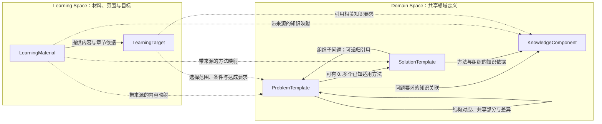

# DeerMind Domain Space Design v1.0

> **中文名称**：DeerMind 领域空间设计  
> **文档性质**：Conceptual Space Design  
> **状态**：阶段性语义结论正式纳入设计；领域有效性与实现迁移仍待验证  
> **上位基线**：[Concept Architecture v1.2](DeerMind_Concept_Architecture_v1.2.md)、[Product Constitution v1.0](../top/DeerMind_Product_Constitution_v1.0.md)  
> **关联设计**：[Learning Space](DeerMind_Learning_Space_Design_v1.0.md)、[Evaluation](DeerMind_Evaluation_Space_Design_v1.2.md)、[Interaction](DeerMind_Interaction_Space_Design_v1.2.md)、[Evolution](DeerMind_Evolution_Space_Design_v1.2.md)  
> **写作规范**：[Design Document Standard v1.0](../top/DeerMind_Design_Document_Standard_v1.0.md)  
> **修订日期**：2026-10-11

本设计承接原架构 Learning Space 的领域责任，以 ProblemTemplate、SolutionTemplate、KnowledgeComponent 明确定义问题、方法和知识。原 LearningTarget 的定义责任移至 Learning Space，两个空间不再共用同一个名称。此次纳入正式设计的是对象职责、关系和运行约束，不表示模板粒度、知识划分或教学效果已经通过实证检验。既有 Spike、Build 仍是其原始基线下的证据。

## 1. 设计目的与边界

DeerMind 要判断学习者能处理什么问题、为什么遇到困难、下一步如何帮助，首先需要一套可以被重复引用的领域坐标。只有题库，系统容易把题目数量误当覆盖；只有知识点目录，系统难以表达选择方法、组织多个步骤、检查结果和解释理由等综合责任；只有自然语言能力标签，评价又缺少可观察、可反驳的依据。

Domain Space 因此定义三类互补对象：ProblemTemplate 描述可以要求学习者解决的哪类问题；SolutionTemplate 描述在何种条件下可如何解决；KnowledgeComponent 描述处理问题与组织方法所需的可复用认知结构或功能。三者共同提供知识与能力的领域参照，个人是否已经具备这些能力则由 Evaluation 根据表现推断。问题不是人的能力本身，但一组有范围、有条件、有责任区分的问题，可以把抽象能力转化为可评价的命题。

Domain Space 不拥有课程容器、个人学习目标、学习者信念、当前教学决策和实际执行历史。Learning Space 定义材料、范围与目标；Interaction 选择活动并解释当前表现；Evaluation 形成 Evidence 与 Belief；Evolution 分析模型失配并提出受治理修订。域模型可以被多个目标复用，不随某一孩子的进度裁剪其定义。

本设计定义语义合同，不规定数据库表、生成算法、提示词、执行引擎或题目编码格式。领域覆盖应逐步扩展到需要支持的知识和能力，但“尽量完整”是建设方向，不是必须先建成全学科模型才允许运行。

## 2. 对象结构与责任关系

下图只表达持久的规范对象。教材章节是 LearningMaterial 的内部结构；具体题目、具体解法及实际作答的运行时记录不在此图中另立核心对象。

ProblemTemplate 与 SolutionTemplate 的适用关系不是一对一。一个模板可以有零个、一个或多个已知方法，一个方法也可以在声明的条件下处理多个模板。零个已知方法意味着模型尚未覆盖，不表示问题不可解。方法中可以引用子问题模板；尚未完成规范映射的子问题保留其局部责任说明和未决状态，不强行创建一个 ProblemFamily 来填满关系。

KnowledgeComponent 与问题、方法均为多对多关系。问题层的关联说明理解题意、表达结果或完成责任涉及什么知识；方法层说明采用某种处理路径时需要什么知识。若不同方法使用不同知识，不把所有方法的知识并集强加给每一次解题。

这套结构不新增独立 CapabilityDefinition，也不把能力压成一个 KC。能力的领域要求由问题范围与责任维度表达，个人的能力状态由条件明确的 Learner Claim 表达，验证由活动产生可解释表现，形成则由 Interaction 选择教学介入。四件事可以协作，不能互相代替。

## 3. ProblemTemplate：定义问题结构和变化范围

### 3.1 模板的语义

ProblemTemplate 是参数化的问题定义，不只是带空格的题干。它至少说明问题情境中的语义角色、已知与未知、变量取值和约束、所求目标、完成责任、允许的表达或环境变化，以及判断一次结果是否成立的依据。参数既可以是数值，也可以是对象、单位、表示方式、配置或受约束的环境状态。

模板中的问题目标与 LearningTarget 不同。前者回答“这一次需要求出、解释、构建或诊断什么”；后者回答“学习者要在怎样的范围与支持条件下稳定做到什么”。要求解释理由、选择方法或检查合理性，应在问题责任中明确，不能看到一个答案正确就默认这些责任也已经完成。

模板应区分学习者可见条件与生成、评判所用的隐藏条件。例如诊断练习可以由系统注入故障，但故障原因不能作为已知信息透露给学习者。对于外部输入的真实问题，系统自己也可能不知道正确原因，不能因无法填写预设答案而伪造一个确定原因。

### 3.2 抽象程度与模板间关系

“果汁、杯、人”可以被抽象为“总资源、基本份额、成组分配”，但抽象必须保留量纲、整组条件、所求量和认知责任。是否采用同一模板，取决于该表达能否保留会改变求解、证据解释与教学判断的重要差异，而不是题干长得是否相似。

同一关系结构可以有不同表示形式和参数范围；两个模板也可能只共享其中一部分。模板间的结构对应须说明成立条件、变量角色映射、保留的责任和改变的责任，允许部分对应或尚不确定。本文不要求存在一个万能最高层模板，也不承诺任意问题间的等价关系均可自动判定。

同模板不等于同难度、同认知负担或等价测量。同样数值关系用文字、图示、表格呈现，可能需要不同的表征转换；加入余数、单位换算或隐含条件，也可能改变应承担的工作。可以用模板内部的有名变化维度表达时不机械拆分；若无法清楚表达重要差异，则应拆分并保留结构关系。粒度的最终适用性需由代表性案例与后续表现数据检验。

### 3.3 从模板到具体问题

运行时依据产品 LearningTarget 选择适用模板与范围，再绑定参数和环境，形成可展示、可作答的具体问题。生成必须满足模板约束并保留所用版本、绑定值、来源与检查依据。上传题目先保存原始材料与提取结果，再进行受控映射；映射未决不妨碍保留资料，但会限制可作出的正式评价与教学承诺。

“计算”“解释”“辨析错误方法”可以用于观察同一领域的不同责任。它们既不必各自成为一种孤立能力，也不能因题材相同而被当成完全相同的表现。具体建模选择应围绕需要区分的责任和可取得的证据，不能仅从题目句式自动推导能力层级。

## 4. SolutionTemplate：表达方法而非执行记录

### 4.1 方法、实例与能力

SolutionTemplate 是参数化、可复用的方法定义，属于方法知识的表达。它不是“学习者具有该方法能力”的判断，也不是某人已经实际执行过的步骤。应用时需要检查适用条件，绑定具体问题参数，并在获得中间结果后继续绑定后续子问题；不要求所有中间值在求解开始前都已知道。

一个模板至少说明适用的问题与条件、输入输出、关键处理关系、子问题的责任、结果如何组合及需要的知识依据。直接应用一项规则的方法可以不再分解。复杂方法的子问题可以继续选择适用方法，因此求解结构可递归展开，但递归是由所选方法产生的，不是每个问题天然具有唯一固定的分解树。

### 4.2 组织、依赖与控制

规范方法既要描述“分成什么问题”，也要描述这些问题之间的信息依赖和控制条件。简单数学解法可呈现为树；诊断、证明搜索或设计改进可能需要分支、验证、回退、重复尝试和停止条件。因此内部表达至少不能排斥这些关系，不能把所有方法强制压成固定步骤树。

方法中的循环须有继续、成功、失败或信息不足的退出含义；运行时调度和资源预算由执行与 Interaction 合同落实。Domain Space 不因此获得调用工具、修改环境或持续运行代理的权限。

有独立认知或行动责任的部分才值得作为子问题。复制一步算式、一次点击或一次 API 调用，不自动形成新的规范问题或 KC。分解只有在改变错误归因、证据解释、迁移分析、教学选择或正确性检查时，才获得建模价值。

### 4.3 知识依据与方法覆盖

直接处理的叶问题需要可解释的知识依据；组合处理还需解释为什么这样分解、为什么这些输出能组成原问题的解答。组织关系不是没有知识的机械连线，但这不意味着每一条组织边都要新增 KC。已有 KC、明确领域规则和引用关系可以共同说明依据，粒度应足以支撑实际判断。

方法可以处于完整、部分、隐性成分未展开或尚未解决的状态。构建过程允许未知；进入正式教学或判分用途前，必须有与用途相称的正确性依据、知识 grounding 和适用范围。未覆盖不等于错误，也不允许系统把尚未验证的生成解法作为确定真理。

参考解法与实际行为必须分离。学生采用另一种有效方法，不能只因不在当前方法库中就被判错；系统应核实其有效性，必要时保留不确定或提交模型扩展候选。参考方法所列 KC 不能直接被当成学生实际调用了这些 KC 的证据。

## 5. KnowledgeComponent：定义可复用的认知结构

KnowledgeComponent 沿用知识成分的研究传统，表示可学习、可复用的认知结构或功能，可包括概念关系、程序性操作、表征转换、方法选择与检查等。它不是所有日常“知识”的集合，也不保证是不可再分的原子，更不限定为能用一句话背出的事实。

一个 KC 的定义应给出其认知作用、适用条件、可辨认的使用表现、与相关 KC 的边界、支持或反驳该划分的依据和版本。教材中的“知识点”是来源之一，不自动与规范 KC 一一对应。方法步骤是识别 KC 的线索，也不自动成为一个 KC。

Domain Space 维护 KC 定义和知识关系，Evaluation 维护某个学习者对该 KC 的 Belief。成功完成一个复合问题不能推出所有相关 KC 均已掌握，分别具有相关 KC 也不能自动推出已经具备整合、选法和检查结果的能力。解释缺席可能只是尚未要求解释，不能直接当作知识缺失。

知识依据必须以适用方法和情境为条件。分数除法可以采用乘倒数方法，也可以用统一单位解释份数；掌握一种有效方法不证明已经理解另一种方法，其有效表现也不能因没有展示另一方法而被否定。

KC 划分属于可修订的领域假设。理论支持采用这一类概念，不替 DeerMind 证明某份实际 KC 列表已经有效。验证要关注跨问题复用、可区分表现、诊断和教学价值；不能只用完全由同一划分产生的评分来证明该划分正确。

## 6. 现实映射与跨空间运行

### 6.1 小学数学示例

具体问题是：有四分之三升果汁，每杯八分之一升，每人两杯，可以分给几人。问题模板可用总量 V、每份量 c、每组份数 k、组数 p 表达，关系为 V = p × k × c，并声明正值、单位一致、无损耗、恰好整组等当前限制。该关系定义题目的约束，不规定必须按哪种顺序运算。

一个方法先求 n = V/c，再求 p = n/k；另一方法先求每人的量 q = c×k，再求 p = V/q。两者均得三人。每个除法子问题还可选择适用的分数处理方法。将参数换成 V = 5/6、c = 1/12、k = 2 可得五人；替换资源名称可能只改变表面情境，增加单位换算或不能整分则需要重新检查模板条件。

材料中的一节可以映射到该模板、两种方法和相关 KC；产品目标可要求“无需定位与解法提示，在规定变化范围内独立建模并求解”，也可只要求“在已给出关系式后正确计算”。相同问题与方法服务不同目标，无需复制两套领域对象。

运行时 Interaction 展示具体题目，记录实际提示与提交，并形成 Observation。Evaluation 对计算、选法、解释等所需 Claim 分别解释证据。只提交“三人”可以支持结果正确，但不足以证明所有推导或迁移责任均由学习者承担。目标达成是目标定义与当前有效 Belief 的派生比较；是否再追问、讲解或换题由 Interaction 决定。

### 6.2 Kubernetes 示例与适用限制

同一对象结构可以表达“在限定实验环境中诊断并修复一个 Service 不可访问问题”。ProblemTemplate 描述环境版本、权限、可见现象、配置变化范围和修复后的验证要求；SolutionTemplate 按观察结果检查 Service、Pod、EndpointSlice、标签选择与端口对应关系，并允许分支、修复后复验或信息不足时退出；KC 定义相关资源关系与诊断知识。

相同不可访问现象可能由不同原因产生，看到症状不等于已经确定所需 KC 或唯一解法。系统注入的故障参数与学习者可见输入必须分开。允许查阅文档但不提供根因定位，和系统已经指出应改哪项配置，是不同的责任条件。

此例说明模板不能只表达数值题、固定答案和线性步骤；它是概念适用性检查，不是 Kubernetes 实验验证，不扩大当前数学 MVP 范围。环境适配、命令执行、权限隔离和运行证据采集属于后续工程工作。

### 6.3 对各责任层的合同

| 消费方 | Domain Space 提供 | 不得从中直接推出 |
| --- | --- | --- |
| Learning Space | 模板、方法、KC 的身份、版本、范围与材料映射参照 | 某课程的教学目标由 Domain 自动决定 |
| Interaction | 问题责任、适用方法、知识依据、结构对应与差异 | 已执行方法、实际帮助、当前必须采取的行动 |
| Evaluation | 条件明确的问题范围、方法 grounding、KC 定义及版本 | 个人掌握、证据独立性、同模板表现可无条件汇总 |
| Evolution | 模型版本、来源、未映射现象、适用限制与可反驳预期 | 因一次学生失败即可批准修改规范模型 |

结构对应提供判断“是否重复”的依据，实际选题由 Interaction 结合 Evidence、Belief、目标和负担决定。重复题接触不是独立新证据，但延迟重测、方法比较和不同表示的练习仍可能有价值。Domain 不制定固定刷题次数，也不把结构相同直接解释为练习无用或迁移已经成立。

Readiness 仍是领域要求、学习者 Belief 与运行条件的派生视图；困难度、先修关系、课程顺序与学习准备度不能混成同一个属性。只有更细分析可能改变重要判断时，运行时才下钻到方法、子问题和 KC，不因模型存在细节就要求每次完整诊断。

## 7. 构建、版本与受控演化

领域建设从代表性材料和问题出发，协同推导问题结构、候选方法和 KC，再通过反例检查其覆盖与边界。不是先建完一套无限抽象模型，也不是把教材目录直接复制成领域图。模板映射、结构对应和方法适用性都需要来源、版本与置信或未决说明，不能把 LLM 候选直接当规范事实。

ProblemTemplate、SolutionTemplate、KC 及具有正式语义的关系应具备稳定身份、版本、适用范围、来源、激活边界、可反驳预期和重放支持。Domain owner 对正式领域语义负责；Evolution 形成问题、修订候选及验证认识；Governance 决定允许的变更与激活。产品 LearningTarget、材料映射与 Domain 变更分别由其 owner 提交，可以经共同校验协调发布，但不混成一个自动扩权入口。

模板拆分、合并、方法重映射或 KC 修订，需要指出哪些旧引用兼容、哪些需重解释、哪些只能保留历史读取。不得只把旧 TaskFamily ID 改名为 ProblemTemplate ID 就视作完成语义迁移。旧实例的参数与责任信息不足时，新范围下的评价允许未知。

新定义可以改变对历史表现的解释，不能重写当时展示的题目、实际提示、工具调用和作答。旧 Evidence 与 Belief 保留原版本；新版本下的正式解释需明确重算或迁移依据。单纯目标标准变化通常只重算 TargetAssessment；只有问题、Claim 或证据含义实质变化时，才按依赖重新解释相应 Evidence 与 Belief。

## 8. 决策、风险与下游交接

本设计选择三个领域核心对象，是为了让问题、方法和知识各有明确责任，同时避免把潜在能力标签、每个题目问法、每个执行步骤都升级成一套平行本体。代价是需要维护条件、关系和版本，而不能仅靠题目分类标签完成评价。若持续出现重要能力责任无法被问题范围、KC 与条件性 Claim 表达的反例，再重新考虑独立能力定义，不因名称直觉反复增加对象。

当前已确认的是领域与产品目标的分离、模板与运行实现的分离、方法递归组织、KC grounding 和学习者认识单写。尚待验证的是具体模板的粒度与结构关系、KC 划分的解释力、实际映射和生成质量、教学及检测收益。数据库结构、映射审核界面、算法与性能预算属于后续设计，不阻塞本轮概念合同的交接。

| 下游 | 必须承接的内容 | 当前交接限制 |
| --- | --- | --- |
| 概念与专项设计 | 两类空间命名、三个领域对象、目标 owner、事实与认识分层 | 本轮同步修订文档，不等于新 Gate 已通过 |
| System Design | 分开的产品/领域版本来源、实例溯源、Claim 范围、变更路由 | 旧实现不因文档改名自动迁移 |
| MVP Phase 3 | 用新模型核对需求含义与目标表达 | 不改变已确认产品范围和指标门槛 |
| MVP Phase 4/5 | 有限领域包、映射资产、受控发布与运行实现 | 以实际资产和验证结果判断完成 |

本版替代原 Learning Space Design 的领域合同。原 L1“所有正式 TaskNode 必须引用 TaskFamily”不再沿用：有用但未映射的子问题可以保留，正式用途须明确其可用边界；未决不能伪装成已验证规范结构。其余关键约束按下表承接，历史编号仅用于追溯，不形成第二份可独立修订的合同。

| 原约束 | 当前承接位置 |
| --- | --- |
| L2、L3：问题目标、单次成功与学习目标区分 | §3、§6；Learning Space §4 |
| L4–L10：有价值的分解、叶与组织 grounding、方法条件、轨迹分离 | §4、§5 |
| L11–L14：知识不等于能力、规范不等于 Belief、要求不等于证据、课程不等于领域 | §1、§2、§5；Learning Space §3–5 |
| L15、L16：Readiness 与 TargetAssessment 均为派生判断 | §6；Evaluation §6.5 |
| L17：领域工具、目标支持与实际使用分开 | §3、§6；Learning Space §4；Interaction §6.1 |
| L18–L22：系统信号与个人证据分开、受控语义、版本与历史 | §7；Evolution 与 System Design |

理论参照包括 [KLI framework](https://pact.cs.cmu.edu/pubs/Koedinger%2C%20Corbett%2C%20Perfetti%202012-KLI.pdf) 对 KC 的认知功能解释，以及 [Task Features and Evidence](https://myweb.fsu.edu/vshute/pdf/TaskModels.pdf) 对问题特征与测量证据关系的讨论。Kubernetes 示例依据其[官方排障文档](https://kubernetes.io/docs/tasks/debug/debug-application/debug-service/)。这些来源支持职责和边界分析，不构成本模型已经有效的实验证据。
