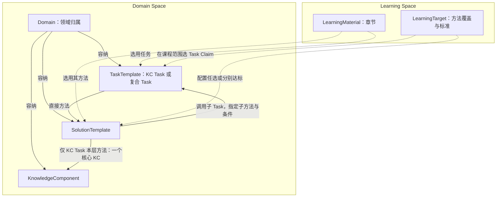

# DeerMind Domain Space Design v1.4

> **版本**：v1.4 
> **中文名称**：DeerMind 领域空间设计 
> **文档性质**：Conceptual Space Design 
> **状态**：本轮 Task 角色与依赖合同已确认；算法、资产与旧架构摘要迁移仍待完成 
> **上位基线**：[Concept Architecture v1.5](DeerMind_Concept_Architecture_v1.5.md)、[Product Constitution v1.0](../top/DeerMind_Product_Constitution_v1.0.md) 
> **关联设计**：[Learning Space](DeerMind_Learning_Space_Design_v1.3.md)、[Evaluation](DeerMind_Evaluation_Space_Design_v1.6.md)、[Interaction](DeerMind_Interaction_Space_Design_v1.5.md)、[Evolution](DeerMind_Evolution_Space_Design_v1.5.md) 
> **维护责任**：Codex 维护与核对；用户决定重要模型与范围变更 
> **评审记录**：用户确认本轮 Task／Solution／KC 关系并授权文档更新；作者核对正文与示例。未据此确认算法、原型适配或模型效果 
> **写作规范**：[设计文档规范 v1.1](../top/DeerMind_Design_Document_Standard_v1.1.md) 
> **更新日期**：2026-11-08 
> **修订说明**：v1.3 → v1.4，统一 Domain 内 Task 角色、方法依赖、KC 覆盖及跨空间边界；旧版保留为基线；逐文件记录见 M1 决定登记§19 

---

本设计由 Domain 容纳 TaskTemplate、SolutionTemplate、KnowledgeComponent 及其具体实例，定义任务、完成方法和知识依据。Learning Space 持有材料、课程范围与目标；Evaluation 只对条件明确的 Task Claim 维护个人 Belief。KC 保留领域解释与教学作用，不再对应独立个人掌握状态。此次确认对象与责任合同，不表示模板粒度、知识划分或教学效果已经实证成立；既有 Spike、Build 只支持原基线。

## 1. 设计目的与边界

DeerMind 要判断学习者能处理什么问题、为什么遇到困难、下一步如何帮助，首先需要一套可以被重复引用的领域坐标。只有题库，系统容易把题目数量误当覆盖；只有知识点目录，系统难以表达选择方法、组织多个步骤、检查结果和解释理由等综合责任；只有自然语言能力标签，评价又缺少可观察、可反驳的依据。

Domain Space 以 Domain 划分领域，在各领域内定义三类互补规范对象：TaskTemplate 描述可以要求学习者完成的哪类任务；SolutionTemplate 描述在何种条件下可如何完成；KnowledgeComponent 描述处理问题与组织方法所需的可复用认知结构或功能。三者共同提供知识与能力的领域参照，个人是否已经具备这些能力则由 Evaluation 根据表现推断。任务不是人的能力本身；Task Claim 对明确任务范围、完成责任、方法要求与条件作出可评价的能力命题。Task 也不等于一次教学活动、软件作业或动作步骤。

Evaluation 的 Task Claim 绑定一个明确版本的 TaskTemplate，默认在声明内组织独立完成、理解与解释、迁移应用、延迟保持方面；个人判断保存在多维 Belief。Domain 提供任务变化、方法、知识与适用条件，不提供跨任务掌握传播规则。具体题目及真实子任务须有适用映射才可提供对应方面的证据；参考 Solution 分解树不证明学生实际执行过所有节点。规范关系见 [Evaluation §3.1](DeerMind_Evaluation_Space_Design_v1.6.md#31-learner-state-model定义-deermind-可以相信什么)。

Domain Space 不拥有课程容器、个人学习目标、学习者信念、当前教学决策和实际执行历史。Learning Space 定义材料、范围与目标；Interaction 选择活动并解释当前表现；Evaluation 形成 Evidence 与 Belief；Evolution 分析模型失配并提出受治理修订。域模型可以被多个目标复用，不随某一孩子的进度裁剪其定义。

本设计定义语义合同，不规定数据库表、生成算法、提示词、执行引擎或题目编码格式。领域覆盖应逐步扩展到需要支持的知识和能力，但“尽量完整”是建设方向，不是必须先建成全学科模型才允许运行。

## 2. 对象结构与责任关系

图 D-01：领域定义与课程选择。矩形为定义，实线为领域内引用，虚线为跨空间选择；省略实例，不表示个人掌握传播。章节属于 LearningMaterial 内部结构，章节不直接关联 KC。

图中 LearningTarget 到 Task 的线是经 Task Claim 的范围选择简写，Claim 归属 Evaluation，不新增目标到 KC 的关系。TaskInstance 归属一个采用的 TaskTemplate；SolutionInstance 同时关联具体 TaskInstance 与采用的 SolutionTemplate，区分教材原有和系统生成解法。实例可入库复用，与学生某次作答不同。

一个 TaskTemplate 可有多个备选方法；草稿可以暂无方法，正式采用需有与用途相称的可用方法。方法可以共享，但必须满足每个所关联 Task 的角色约束：KC Task 的所有本层方法直接引用同一个且唯一的 KC；复合 Task 的本层方法不直接引用 KC。直接引用 KC 的方法不能直接挂到复合 Task 绕过 KC Task。

Task 与 KC 没有直接引用关系。方法知识由本层直接 KC 和其选定子方法知识递归汇总；全部备选方法的并集是领域覆盖，章节采用的方法并集是课程覆盖，实际求解只涉及相应方法及分支。目标选择允许任选、指定或多方法分别达标，不能将范围并集当作每次都已使用的知识。

这套结构不新增独立 CapabilityDefinition，也不把能力压成一个 KC。能力的领域要求由问题范围与责任维度表达，个人的能力状态由条件明确的 Learner Claim 表达，验证由活动产生可解释表现，形成则由 Interaction 选择教学介入。四件事可以协作，不能互相代替。

## 3. TaskTemplate：定义任务结构和变化范围

### 3.1 模板的语义

TaskTemplate 是参数化的任务定义，不只是带空格的题干。它至少说明问题情境中的语义角色、已知与未知、变量取值和约束、所求目标、完成责任、允许的表达或环境变化，以及判断一次结果是否成立的依据。参数既可以是数值，也可以是对象、单位、表示方式、配置或受约束的环境状态。

模板中的问题目标与 LearningTarget 不同。前者回答“这一次需要求出、解释、构建或诊断什么”；后者回答“学习者要在怎样的范围与支持条件下稳定做到什么”。要求解释理由、选择方法或检查合理性，应在问题责任中明确，不能看到一个答案正确就默认这些责任也已经完成。

模板应区分学习者可见条件与生成、评判所用的隐藏条件。例如诊断练习可以由系统注入故障，但故障原因不能作为已知信息透露给学习者。对于外部输入的真实问题，系统自己也可能不知道正确原因，不能因无法填写预设答案而伪造一个确定原因。

**Task 的两种角色。** KC Task 定义如何表现一个核心 KC，可包含求解、解释、辨析等可观察责任，其个人评价仍由 Task Claim 承载。它通过自己的方法直接引用唯一核心 KC，并可调用其他 KC Task；所以 KC Task 不是必须无子任务的原子或叶任务。复合 Task 通过方法调用子 Task 组织多项责任，本层方法无直接 KC；它仍需评价选法、组织与结果合成，不能等同于子 Task 分数汇总。

正式采用的每个 KC 至少有一条对应 KC Task／Solution 的直接展示和检验路径。一个 KC 可以由不同责任的 KC Task 表现，不要求反向一对一；但每个 KC Task 的本层核心 KC 唯一。KC 定义可先保存为待补齐，不能因已入库就视为完成可评价建模。该划分是已选择的设计约束，其粒度和实际价值仍须验证。

### 3.2 抽象程度与模板间关系

“果汁、杯、人”可以被抽象为“总资源、基本份额、成组分配”，但抽象必须保留量纲、整组条件、所求量和认知责任。是否采用同一模板，取决于该表达能否保留会改变求解、证据解释与教学判断的重要差异，而不是题干长得是否相似。

同一关系结构可以有不同表示形式和参数范围；两个模板也可能只共享其中一部分。模板间的结构对应须说明成立条件、变量角色映射、保留的责任和改变的责任，允许部分对应或尚不确定。本文不要求存在一个万能最高层模板，也不承诺任意问题间的等价关系均可自动判定。

同模板不等于同难度、同认知负担或等价测量。同样数值关系用文字、图示、表格呈现，可能需要不同的表征转换；加入余数、单位换算或隐含条件，也可能改变应承担的工作。可以用模板内部的有名变化维度表达时不机械拆分；若无法清楚表达重要差异，则应拆分并保留结构关系。粒度的最终适用性需由代表性案例与后续表现数据检验。

### 3.3 从模板到具体任务

运行时依据产品 LearningTarget 选择适用模板与范围，再绑定参数和环境，形成可展示、可作答的具体问题。生成必须满足模板约束并保留所用版本、绑定值、来源与检查依据。上传题目先保存原始材料与提取结果，再进行受控映射；映射未决不妨碍保留资料，但会限制可作出的正式评价与教学承诺。

“计算”“解释”“辨析错误方法”可以用于观察同一领域的不同责任。它们既不必各自成为一种孤立能力，也不能因题材相同而被当成完全相同的表现。具体建模选择应围绕需要区分的责任和可取得的证据，不能仅从题目句式自动推导能力层级。

## 4. SolutionTemplate：表达方法而非执行记录

### 4.1 方法、实例与能力

SolutionTemplate 是参数化、可复用的方法定义，属于方法知识的表达。它不是“学习者具有该方法能力”的判断，也不是某人已经实际执行过的步骤。应用时需要检查适用条件，绑定具体问题参数，并在获得中间结果后继续绑定后续子任务；不要求所有中间值在求解开始前都已知道。

一个模板至少说明适用的问题与条件、输入输出、关键处理关系、子任务的责任、结果如何组合及需要的知识依据。直接应用一项规则的方法可以不再分解。复杂方法的子任务可以继续选择适用方法，因此求解结构可递归展开，但递归是由所选方法产生的，不是每个问题天然具有唯一固定的分解树。

### 4.2 组织、依赖与控制

规范方法既要描述“分成什么问题”，也要描述这些问题之间的信息依赖和控制条件。简单数学解法可呈现为树；诊断、证明搜索或设计改进可能需要分支、验证、回退、重复尝试和停止条件。因此内部表达至少不能排斥这些关系，不能把所有方法强制压成固定步骤树。

子任务调用必须指定子 Task、子 Solution、调用条件、输入与返回结果。定义间调用图不得循环；共享子任务可多次调用，但每个实际调用有独立位置。方法内部的有界复查须有继续、成功、失败或信息不足的退出含义；运行时调度和资源预算由执行与 Interaction 合同落实。Domain Space 不因此获得调用工具、修改环境或持续运行代理的权限。

有独立认知或行动责任的部分才值得作为子任务。复制一步算式、一次点击或一次 API 调用，不自动形成新的规范问题或 KC。分解只有在改变错误归因、证据解释、迁移分析、教学选择或正确性检查时，才获得建模价值。

### 4.3 知识依据与方法覆盖

KC Task 本层方法负责唯一核心 KC，支持它的知识通过对子 Task 的调用表达。复合方法负责怎样选择、调用和组合子 Task；如果这种组织本身有需明确表征的知识责任，也通过对应 KC Task 引用，不能直接给复合方法补挂 KC。不是每一步操作都要新建知识或任务；分解必须保留可观察、可评价的真实责任。

方法可以处于完整、部分、隐性成分未展开或尚未解决的状态。构建过程允许未知；进入正式教学或判分用途前，必须有与用途相称的正确性依据、知识 grounding 和适用范围。未覆盖不等于错误，也不允许系统把尚未验证的生成解法作为确定真理。

参考解法与实际行为必须分离。学生采用另一种有效方法，不能只因不在当前方法库中就被判错；系统应核实其有效性，必要时保留不确定或提交模型扩展候选。参考方法所列 KC 不能直接被当成学生实际调用了这些 KC 的证据。

## 5. KnowledgeComponent：定义可复用的认知结构

KnowledgeComponent 沿用知识成分的研究传统，表示可学习、可复用的认知结构或功能，可包括概念关系、程序性操作、表征转换、方法选择与检查等。它不是所有日常“知识”的集合，也不保证是不可再分的原子，更不限定为能用一句话背出的事实。

一个 KC 的定义应给出其认知作用、适用条件、可辨认的使用表现、与相关 KC 的边界、支持或反驳该划分的依据和版本。教材中的“知识点”是来源之一，不自动与规范 KC 一一对应。方法步骤是识别 KC 的线索，也不自动成为一个 KC。

Domain Space 维护 KC 定义、适用条件与知识关系；Evaluation 当前不创建 KCClaim / KCBelief。KC 用于解释任务与方法、定位当前错误、组织讲解及设计后续取证，相关分析保留实际表现、方法、帮助和范围依据。一次分析可以指出“本次把变化量当作最终量”，不能由此在旁路维护跨任务的“基准 KC 未掌握”状态。

求解、解释、选法和检查等需要持续评价的责任，落实到单模板 Task Claim 的内部方面及质量条款；不因责任不同就另建顶层 Claim，为每个正式采用 KC 提供有实际责任与完成条件的 KC Task，不把 KC 名称机械改成 Task Claim，也不因参考方法列出了知识依赖而自动生成个人掌握判断。解释未被要求或未被观察到时，保留证据不足。

知识依据必须以适用方法和情境为条件。分数除法可以采用乘倒数方法，也可以用统一单位解释份数；掌握一种有效方法不证明已经理解另一种方法，其有效表现也不能因没有展示另一方法而被否定。

求解依赖以 Task／Solution 调用为权威来源；KC Task 间调用可导出带方法和条件的 KC 依赖视图。KC 的构成或解释关系可保留语义用途，旧先修标注须核对对应任务路径，不能作为并行的概率传播图。方法A需要某子任务，不意味着所有方法都必须先会它；教学顺序也不等于求解依赖。

KC 划分属于可修订的领域假设。理论支持采用这一类概念，不替 DeerMind 证明某份实际 KC 列表已经有效。验证要关注跨问题复用、可区分表现、诊断和教学价值；不能只用完全由同一划分产生的评分来证明该划分正确。

## 6. 现实映射与跨空间运行

### 6.1 小学数学示例

具体问题是：有四分之三升果汁，每杯八分之一升，每人两杯，可以分给几人。任务模板可用总量 V、每份量 c、每组份数 k、组数 p 表达，关系为 V = p × k × c，并声明正值、单位一致、无损耗、恰好整组等当前限制。该关系定义题目的约束，不规定必须按哪种顺序运算。

一个方法先求 n = V/c，再求 p = n/k；另一方法先求每人的量 q = c×k，再求 p = V/q。两者均得三人。主任务为复合 Task，本层两法无直接 KC；每个除法子任务可按其责任落实为 KC Task 或继续分解的复合 Task，再选择适用方法。KC Task 的本层只引用其核心 KC，算术支持经子 Task 调用。将参数换成 V = 5/6、c = 1/12、k = 2 可得五人；替换资源名称可能只改变表面情境，增加单位换算或不能整分则需要重新检查模板条件。

材料中的一节可以关联该模板及两种方法，相关 KC 经方法汇总；产品目标可要求“无需定位与解法提示，在规定变化范围内独立建模并求解”，也可只要求“在已给出关系式后正确计算”。相同问题与方法服务不同目标，无需复制两套领域对象。

运行时 Interaction 展示具体题目，记录实际提示与提交，并保留空间事件及事实；Observation 是否另设及其归属由 M1 后续合同明确。Evaluation 依据该任务 Claim 的内部方面，解释求解、选法、说明理由等实际表现，再更新同一多维 Belief。若实际过程还提供了可识别的计算子任务表现，须核对其独立的任务映射与 Claim，不能从参考分解树自动补出子任务掌握。依赖必须参与适用 Evidence 的解释和联合推断；仅有总结果时能给子任务多大间接支持，由下一轮算法及假设决定，不在 Domain 写确定性掌握传播。只提交“三人”可以支持结果正确，但不足以证明所有推导或迁移责任均由学习者承担。目标达成是目标定义与当前有效 Belief 的派生比较；是否再追问、讲解或换题由 Interaction 决定。

### 6.2 Kubernetes 示例与适用限制

同一对象结构可以表达“在限定实验环境中诊断并修复一个 Service 不可访问问题”。TaskTemplate 描述环境版本、权限、可见现象、配置变化范围和修复后的验证要求；SolutionTemplate 按观察结果检查 Service、Pod、EndpointSlice、标签选择与端口对应关系，并允许分支、修复后复验或信息不足时退出；KC 定义相关资源关系与诊断知识。

相同不可访问现象可能由不同原因产生，看到症状不等于已经确定所需 KC 或唯一解法。系统注入的故障参数与学习者可见输入必须分开。允许查阅文档但不提供根因定位，和系统已经指出应改哪项配置，是不同的责任条件。

制作菜品、完成花艺作品同样可用任务目标、材料条件、质量标准、方法与知识依据来描述；这说明采用 Task 名称的通用意图，不声称已验证这些领域。

此例说明模板不能只表达数值题、固定答案和线性步骤；它是概念适用性检查，不是 Kubernetes 实验验证，不扩大当前数学 MVP 范围。环境适配、命令执行、权限隔离和运行证据采集属于后续工程工作。

### 6.3 对各责任层的合同

| 消费方 | Domain Space 提供 | 不得从中直接推出 |
| --- | --- | --- |
| Learning Space | 模板、方法、KC 的身份、版本、范围与材料映射参照 | 某课程的教学目标由 Domain 自动决定 |
| Interaction | 问题责任、适用方法、知识依据、结构对应与差异 | 已执行方法、实际帮助、当前必须采取的行动 |
| Evaluation | 条件明确的问题范围、方法 grounding、KC 定义及版本 | 个人掌握、证据独立性、同模板表现可无条件汇总 |
| Evolution | 模型版本、来源、未映射现象、适用限制与可反驳预期 | 因一次学生失败即可批准修改规范模型 |

结构对应提供判断“是否重复”的依据，实际选题由 Interaction 结合 Evidence、Belief、目标和负担决定。重复题接触不是独立新证据，但延迟重测、方法比较和不同表示的练习仍可能有价值。Domain 不制定固定刷题次数，也不把结构相同直接解释为练习无用或迁移已经成立。

Readiness 仍是领域要求、学习者 Belief 与运行条件的派生视图；困难度、先修关系、课程顺序与学习准备度不能混成同一个属性。只有更细分析可能改变重要判断时，运行时才下钻到方法、子任务和 KC，不因模型存在细节就要求每次完整诊断。

## 7. 构建、版本与受控演化

领域建设从代表性材料和问题出发，协同推导问题结构、候选方法和 KC，再通过反例检查其覆盖与边界。不是先建完一套无限抽象模型，也不是把教材目录直接复制成领域图。模板映射、结构对应和方法适用性都需要来源、版本与置信或未决说明，不能把 LLM 候选直接当规范事实。

TaskTemplate、SolutionTemplate、KC 及具有正式语义的关系应具备稳定身份、版本、适用范围、来源、激活边界、可反驳预期和重放支持。Domain owner 对正式领域语义负责；Evolution 形成问题、修订候选及验证认识；Governance 决定允许的变更与激活。产品 LearningTarget、材料映射与 Domain 变更分别由其 owner 提交，可以经共同校验协调发布，但不混成一个自动扩权入口。

模板拆分、合并、方法重映射或 KC 修订，需要指出哪些旧引用兼容、哪些需重解释、哪些只能保留历史读取。不得只把旧 TaskFamily ID 改名为 TaskTemplate ID 就视作完成语义迁移。旧实例的参数与责任信息不足时，新范围下的评价允许未知。

新定义可以改变对历史表现的解释，不能重写当时展示的题目、实际提示、工具调用和作答。旧 Evidence 与 Belief 保留原版本；新版本下的正式解释需明确重算或迁移依据。单纯目标标准变化通常只重算 TargetAssessment；只有问题、Claim 或证据含义实质变化时，才按依赖重新解释相应 Evidence 与 Belief。

## 8. 决策、风险与下游交接

本设计以 Domain 作为领域容器，选择 Task／Solution／KC 三类互补定义，是为了让问题、方法和知识各有明确责任，同时避免把潜在能力标签、每个题目问法、每个执行步骤都升级成一套平行本体。代价是需要维护条件、关系和版本，而不能仅靠题目分类标签完成评价。个人能力状态统一为 Task Claim：KC Task 表达核心知识的掌握，复合 Task 表达组织求解。没有另存一份以 KC 为索引的个人状态；直接知识判断引用对应 KC Task 的方法、方面和证据条件。若实际反例表明这一取舍持续损害诊断、教学选择或预测，并有独立证据与行动价值，再经 Evolution / Governance 重开模型；不在运行时悄悄恢复 KC 状态。

当前已确认的是领域与产品目标的分离、TaskTemplate 命名、方法递归组织、KC 作为解释与教学依据，以及 Task Claim 单一能力状态类型和 Evaluation 单写。尚待验证的是具体模板的粒度与结构关系、KC 划分的解释力、实际映射和生成质量、教学及检测收益。数据库结构、映射审核界面、算法与性能预算属于后续设计，不阻塞本轮概念合同的交接。

| 下游 | 必须承接的内容 | 当前交接限制 |
| --- | --- | --- |
| 概念与专项设计 | 两类空间命名、三个领域对象、目标 owner、事实与认识分层 | Domain／Evaluation及M1同步；其他旧摘要待迁移，不代表Gate通过 |
| System Design | 分开的产品/领域版本来源、实例溯源、Claim 范围、变更路由 | 旧实现不因文档改名自动迁移 |
| M1 PRD与内容规格 | 用新模型核对需求、对象、目标与验收 | 本批已同步；不改变既有范围和指标门槛 |
| M1原型、工程与验证 | 角色与依赖约束、实例迁移及运行实现 | 本批未适配页面或旧内容包；以真实资产和验证结果判断完成 |

本版替代原 Learning Space Design 的领域合同。原 L1“所有正式 TaskNode 必须引用 TaskFamily”不再沿用：有用但未映射的子任务可以保留，正式用途须明确其可用边界；未决不能伪装成已验证规范结构。其余关键约束按下表承接，历史编号仅用于追溯，不形成第二份可独立修订的合同。

| 原约束 | 当前承接位置 |
| --- | --- |
| L2、L3：问题目标、单次成功与学习目标区分 | §3、§6；Learning Space §4 |
| L4–L10：有价值的分解、叶与组织 grounding、方法条件、轨迹分离 | §4、§5 |
| L11–L14：知识不等于能力、规范不等于 Belief、要求不等于证据、课程不等于领域 | §1、§2、§5；Learning Space §3–5 |
| L15、L16：Readiness 与 TargetAssessment 均为派生判断 | §6；Evaluation §6.5 |
| L17：领域工具、目标支持与实际使用分开 | §3、§6；Learning Space §4；Interaction §6.1 |
| L18–L22：系统信号与个人证据分开、受控语义、版本与历史 | §7；Evolution 与 System Design |

理论参照包括 [KLI framework](https://pact.cs.cmu.edu/pubs/Koedinger%2C%20Corbett%2C%20Perfetti%202012-KLI.pdf) 对 KC 的认知功能解释，以及 [Task Features and Evidence](https://myweb.fsu.edu/vshute/pdf/TaskModels.pdf) 对问题特征与测量证据关系的讨论。Kubernetes 示例依据其[官方排障文档](https://kubernetes.io/docs/tasks/debug/debug-application/debug-service/)。这些来源支持职责和边界分析，不构成本模型已经有效的实验证据。

## 9. 本轮合同、迁移与版本记录

v1.3 → v1.4（2026-11-08）：加入 Domain 归属、KC Task／复合 Task、仅 KC Task 本层方法直连唯一 KC、方法调用承载依赖；删除 Task／章节直接连 KC 的旧图线，区分规范依赖和个人概率推断。M1 的详细字段、四分之一样例和验收见[内容规格§3.2、§4.15](../mvp/m1/design/Content_and_Model_Reference.md#415-task-依赖如何参与-evaluation)及[决定登记§19](../mvp/DECISIONS.md#19-kc-task复合-task-与依赖更新合同)。

本版与[Evaluation v1.6](DeerMind_Evaluation_Space_Design_v1.6.md)是本轮关系合同。旧 Domain v1.3、Evaluation v1.5 及其引用保留为原基线；Concept、System、Learning Space 的旧摘要不因此已同步，相关差异集中登记 M1-OPEN-04，工程接收前需完成下游迁移。M1 不恢复旧审核发布流程；本设计§7的受控修改在 M1 由管理员直接保存、应用并保留记录实现，不要求另增审核角色。原型和参考包本轮未改，不声称它们已符合新关系；算法和参数未选定。
