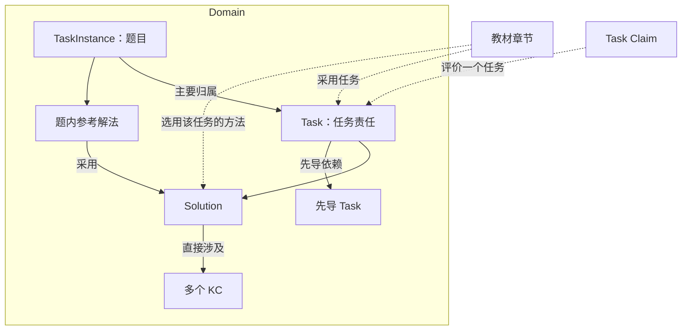

# DeerMind Domain Space Design v1.6

> **版本**：v1.6 
> **中文名称**：DeerMind 领域空间设计 
> **文档性质**：Conceptual Space Design 
> **状态**：本轮领域模型、原型及关联合同已修订，待用户审阅；真实服务与效果未验证 
> **上位基线**：[Concept Architecture v1.6](DeerMind_Concept_Architecture_v1.6.md)、[Product Constitution v1.0](../top/DeerMind_Product_Constitution_v1.0.md) 
> **关联设计**：[Learning Space](DeerMind_Learning_Space_Design_v1.4.md)、[Evaluation](DeerMind_Evaluation_Space_Design_v1.10.md)、[Interaction](DeerMind_Interaction_Space_Design_v1.6.md)、[Evolution](DeerMind_Evolution_Space_Design_v1.6.md) 
> **维护责任**：Codex 维护与核对；用户决定重要模型与范围变更 
> **评审记录**：用户批准模型变更及完整实施；作者检查见MVP决定登记§68，不代表真实效果验收通过 
> **写作规范**：[设计文档规范 v1.1](../top/DeerMind_Design_Document_Standard_v1.1.md) 
> **更新日期**：2026-11-14 
> **修订说明**：v1.5 → v1.6，同步Task／Solution新定义、多KC方法、Task先导、题内参考及相关Task独立取证；保持既定数值规则和工程边界；逐文件记录见MVP决定登记§68 

---

Domain 是与教材无关的领域容器。领域内以 **Task 定义认知责任、Solution 描述完成方法、KC 表达知识**；具体题目保存在 TaskInstance 中，其参考解法是题目的一部分。个人能否完成这些责任，由 Evaluation 的 Task Claim、Evidence 与 Belief 表达。

## 1. 设计目的与边界

领域模型回答三个问题：要求学习者做什么、可以怎样完成、方法涉及哪些知识。任务不是学习活动、系统待办或学生能力状态。方法不是 LLM 的教学策略，也不是学生已经执行过的轨迹。

Domain 管理数学、英语、K8s、厨艺等领域的定义与内容。M1 仍以指定小学数学教材为正式覆盖范围；其他领域示例只检查表达能力。模型建设可以先有定义草稿，再补方法、知识和实例；草稿存在不等于已能正式教学或评价。

Domain 不维护学生概率、目标达成、活动调度和教学策略。Learning Space 选择教材、目标并承载个人学习；Interaction 组织活动；Evaluation 解释证据并维护个人判断；Evolution 的自动修订后置。本文定义模型语义，工程接口与物理存储见 M1 工程合同。

## 2. 对象结构与责任关系

图 D-01：领域定义、题目和章节采用。章节属于教材；图中的引用不是概率传播关系。

| 对象 | 必须表达 | 不承担的责任 |
| --- | --- | --- |
| Domain | 领域名称、覆盖说明及对象归属 | 不把不同领域混成一个候选池 |
| Task | 目标、学习者责任、应交付的表现、完成条件、适用条件和边界、方法及先导关系 | 不直接挂 KC；不预先判断个人掌握 |
| Solution | 方法思路与依据、适用条件、必要关键过程、直接关联的 KC | 不要求预建子任务调用图；不规定教学话术 |
| KC | 含义、适用条件、正反例或可辨认表现 | 不维护另一套个人 Belief 或先修概率图 |
| TaskInstance | 题面及必要图表、一个主要 Task 归属、来源、参考答案或评分依据、可选的参考解法 | 不等于学生作答或一次教学活动 |
| 参考解法内容 | 所属题目、Solution、具体过程、来源及必要图表、稳定的内容引用 | 不作为独立SolutionInstance管理，不冒充学生实际方法 |

## 3. Task：定义任务责任与先导关系

### 3.1 任务定义

Task 描述一类可以观察、解释和检验的认知责任。它可以是求解、解释、比较、证明、诊断或综合应用。必须说清学生承担什么工作、交付什么、什么条件下算完成；只有名称或一组 KC 标签不足以形成 Task。

参数表不是必填结构。数值、公式、对象、关系与限制可直接在任务说明中表达；结构化参数有帮助时仍可保留。生成与归类不能退化为参数替换，也不能因为缺少参数表就拒绝有效任务。

“理解 d=v×t”与“已知 v、t 求 d”不是同一责任。只算出180可能完成计算题，却不足以完成关系解释。综合任务也有自己的选择、组织和结果检查责任，不能用若干基础任务的通过代替它。

不再划分必须满足单 KC 约束的“KC Task”和无直接 KC 的“复合 Task”结构类型。任务可以同时检验相关知识，但仍须保持责任和证据可辨认。任务粒度由区分求解、教学和评价所需的责任确定，不靠强制一对一匹配 KC 决定。

### 3.2 先导任务

先导关系直接在 Task 层维护：当前 Task 引用已有先导 Task，记录理由与适用方法；适用方法可为全部或当前 Task 中的指定方法。先导用于检查基础、安排学习或提供回补线索，不是强制先通过才能进入当前任务的门禁。

同领域检查引用、自引用、重复和循环。没有理由或无法确定方法适用性时保留待核对。旧 KC 先修与 Solution 子调用可以作为人工核对材料，但不自动转换为先导关系。

先导任务的全部方法、KC、Claim 不自动纳入当前章节或目标范围。先导边也不传播成功、失败或概率；实际观察到另一 Task 的表现时，Evaluation 依据该 Task 的合同独立取证。

### 3.3 具体题目与归属

TaskInstance 描述真实可呈现的题目情境及必要材料。每题保留一个明确的主要 Task 归属。归类核对认知责任、适用条件、要求的表现和方法适用性；文本相似或共用 KC 不能单独作为归类依据。

换数字或表面情境可以保持同一归属；加入追及、证明或新的综合责任时必须重新核对。无法确认归属则保留未决，不作为已检查的正式题使用。生成题也必须完成检查、保存后再使用；Domain 统一筛选已有实例，不在 Interaction 另建供题裁决。

## 4. Solution：描述学生的完成方法

Solution 是可复用的方法定义。一个 Task 可以有多种方法，一种方法也可以在适用条件成立时被多个 Task 使用。它至少说明思路与依据、适用条件、关键过程和涉及的 KC。

关键过程可以说明分类、分支、复查、回退和无法继续的条件；这些是方法语义，不要求编辑可执行的递归调用树、变量绑定或每个步骤的出口。复杂推理仍需说明组织和检查责任，简化模型不等于省略有效解法。

Solution 直接关联所需的多个 KC。Task 的知识覆盖为其全部直接方法的 KC 并集；教材章节的知识覆盖为该章采用方法的 KC 并集，均按 KC 身份去重。不沿先导关系继续汇总，不从旧方法调用树推导。

Task 与章节都不直接关联 KC。方法列表是备选定义，不代表每次求解使用全部方法。学生选择一种方法，不证明其已经掌握其他方法或所有引用知识。

参考解法保存在 TaskInstance 下，可同时保存教材原解和系统生成参考，分别关联 Solution 并记录来源。只有题目时可以先入库，后续补参考；不能伪造教材原解。解法的公式、图形、表格及稳定引用不能因取消独立对象而丢失，也不能把解题提示提前放入题面。

## 5. KC：知识定义与直接检验路径

KC 表达可学习、可复用的认知结构或功能，包括概念、关系、操作、表征转换和检查依据。它不保证不可再分，也不等于教材中的标题或某一个算式。

每个正式用于教学评价的 KC，至少有一个 Task 与其 Solution，能够直接观察对该知识的理解或使用。该 Task 的责任、完成条件和方法必须明确检验它；仅在某个 Solution 的 KC 列表中出现，不算满足这项要求。允许一项 KC 有多个检验任务，也允许一个责任清晰的 Task 涉及多个 KC，不强加一对一。

KC 不维护独立先修图，不创建 KC Claim 或 KC Belief。相关学生判断仍落在 Task Claim 的方法与评价方面。原有知识说明、图片和公式保留，旧先修记录只作历史依据，不能静默成为新的任务先导。

## 6. 贯穿案例：理解 d=v×t

### 6.1 Task、方法与知识

Task 要求学生解释路程、速度、经过时间的含义，说明为何相乘、单位是否相容，以及关系成立的条件；只给计算结果不够。

| 方法 | 关键过程 | 直接关联的知识 | 特有先导 |
| --- | --- | --- | --- |
| A：按单位时间累积 | 每个时间单位行进 v，经过 t 个单位累积为 v×t；可用时间段图说明 | 路程、时间、速度、乘法意义、匀速路程关系 | 理解乘法的意义 |
| B：从速度定义变形 | 由 v=d/t，在 t>0 时两边乘 t；t=0 单独说明 d=0 | 路程、时间、速度、乘除互逆、匀速路程关系 | 理解乘除互逆 |

两法共同先导可以是理解路程、时间和速度。B的乘除要求不强加给A。若讲平均速度，必须明确是所问时段的全程平均值，不能用变速时某一时刻速度代替。

对应实例：“汽车以60千米/时匀速行驶3小时，请解释60×3的意义、单位及适用条件。”两条参考解法都随该题保存，题面不包含参考推导。教材章节可以只采用A，另一章采用B；课程范围按实际采用关系计算。

### 6.2 与教学、评价协作

Interaction 可选择一种方法、询问学生已有理解、讲解或检测；教学蓝图与推荐策略决定怎样教，不照搬教材的表达。学生采用未收录但可能正确的方法时，先判断当前表现，不能只因不匹配参考解法就判错。

Evaluation 为该 Task 维护一个 Claim，各方法分别有执行判据和独立、理解、迁移、保持四方面规则。Evidence 先对当前 Task 的实际表现作判断；若同一作答还有明确的其他 Task 表现，在获准评价的已定义 Task 范围内提出候选，逐项核对方法、判据、方面条件和来源。没有明确依据就跳过。

例如增加量算对但最终量答错，可以形成整体负证与“求对应部分”任务的局部正证。两者不能互相代替，也不能作为两次独立练习。同一来源的引用与去重信息保留。没有旧子调用树不取消明确表现的相关 Task 更新，也不允许沿先导边传播概率。

M1 的分项 BKT、共享试用参数和全局0.90阈值不变。方法条件与四方面资格决定是否有可用证据；数值更新与目标派生归 Evaluation，Domain 不分配传播权重。

## 7. 语义内容、来源与采用

教材助手通过持续对话提取与修正知识、题目和具体解法，先核对内容，再匹配或补建领域定义。它不把教材的教学策略作为 Solution。图表与公式保留结构化语义及出处；无法确认时标记缺口，不以猜测填满。

教材管理提供候选，领域管理负责正式定义和题目归属，随后教材章节选择 Task 及其 Solution。候选采用、领域入库、章节采用是不同操作；原始解析块不是章节到模型的正式关联。

语义未变的对象尽量保留身份。旧题面、公式、参考解法、学生表现和事件引用不删除、不批量重挂；旧结构无法确定新含义时保留待核对。历史实验维持原输入与结论，本轮原型通过不代表真实多模态提取或评价已验证。

## 8. 检验边界

- 无参数表仍能完整表达理解、解释、证明和排障任务；不退化成只有标签。
- 方法包含多个 KC，Task 与章节的覆盖按所选方法正确汇总；先导不扩大课程。
- 题目可单独导入，后补多个来源的参考解法；实例身份与出处可追溯。
- 综合任务有自身责任，相关 Task 证据须独立核对；不从关系边或最终正确结果推定掌握。
- 复杂数学与K8s示例只能验证表达是否清楚；真实生成、归类、教学与概率有效性另行验证。

既有理论参照包括 [KLI framework](https://pact.cs.cmu.edu/pubs/Koedinger%2C%20Corbett%2C%20Perfetti%202012-KLI.pdf) 的知识成分观念及 [Task Features and Evidence](https://myweb.fsu.edu/vshute/pdf/TaskModels.pdf) 的任务特征与证据关系。它们不直接证明 DeerMind 本次对象划分或具体 KC 清单有效；本次简化是设计选择，须由代表性任务和后续真实学习数据检验。

## 9. 版本与替代范围

本版替代旧版强制参数化、KC Task／复合 Task 结构角色、单核心 KC、Solution 递归调用及独立SolutionInstance管理。保留 Domain 隔离、Task→Solution→KC、Task Claim、多方法评价、证据来源与确定性更新的边界。

M1 详细字段与实例见[内容与模型规格](../mvp/m1/design/Content_and_Model_Reference.md)，图文流程见[交互规格](../mvp/m1/design/Interaction_Design.md)，整体范围及验收见[变更清单](../mvp/m1/design/Domain_Model_Revision_Checklist.md)。旧版本和历史试验只供追溯，不作为本版新增实现的合同。

本轮修订（v1.6，2026-11-14）：同步Task／Solution新定义、多KC方法、Task先导、题内参考及相关Task独立取证；保持既定数值规则和工程边界。完整范围和检查见MVP决定登记§68。
