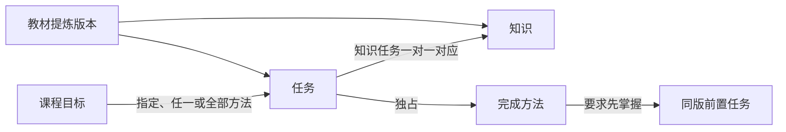

# DeerMind 领域空间设计 v1.8

> 版本 v1.8 · 2026-11-28 · 待用户评审

## 模型的边界

一个领域可包含多本教材。每一版本教材教学提炼独立定义知识与任务。管理员在工作台编辑草稿，整本发布后，领域管理读取同一个发布版。目标和评估标准按具体版本引用。跨版本同名对象保有独立身份。

## 任务、方法与知识

| 对象 | 定义 | 关系 |
| --- | --- | --- |
| 知识 | 名称、含义和适用条件 | 在本版有且仅有一个知识任务 |
| 知识任务 | 要求学生以可观察的表现说明掌握某一知识 | 直接指向该知识，方法的前置只可选择知识任务 |
| 综合任务 | 要求学生组织知识或能力，解决具体问题 | 方法可选择知识任务及综合任务作为前置 |
| 方法 | 本任务的一种完成方式，有步骤、依据和适用条件 | 逐项记录前置任务与理由。两项任务中同名的方法分别维护 |

任务保存所属章、节及原文来源。任务的全部前置取各方法依赖的去重合集。只选某种方法时，使用该方法自己的前置。将知识任务之间的依赖映射到其各自的知识，即可得到知识依赖。两类关系均由同一份方法定义生成。

## 示例

“理解 d=v×t”是知识任务，直接对应“匀速运动中的路程关系”。用等量累加说明该关系可以依赖“理解乘法意义”，用速度定义推导则可以依赖“理解乘除互逆”。系统可显示两项前置，并说明各自来自哪种方法。综合任务“比较两车何时相遇”可以依赖“理解 d=v×t”，也可另设依赖其他综合任务的方法。

前置表示需要掌握的任务。学生采用哪种方式算达标，由当前课程目标选择。学习一个任务不会自动更新其前置任务的概率。Evidence、Belief 和 Task Claim 由 Evaluation 维护。

## 实例及版本

具体题目仍有主要任务、题面、必要图表及可追溯的题内参考解法。参考解法可关联该任务的方法。原件、教材题面、学生实际作答和评价分别保留来源。题目实例的管理入口留待专项讨论。

发布固定本版的章节、知识配对、任务、方法与依赖。生成草稿后可人工修订。保存校验配对和引用，发布校验内容就绪。同版不同章节可依赖，无效引用、自引用、重复边和循环须在提交时处理。已有课程、目标和学习空间仍读各自固定版本。

## 修订记录

| 版本 | 日期 | 修改 |
| :--- | :--- | :--- |
| v1.8 | 2026-11-28 | 接替 [v1.7](DeerMind_Domain_Space_Design_v1.7.md)，明确教材版本、知识配对、方法归属与依赖 |
