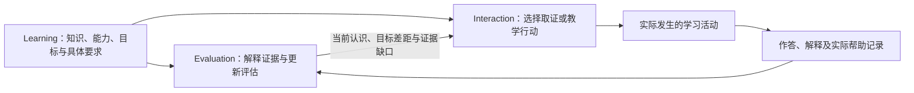
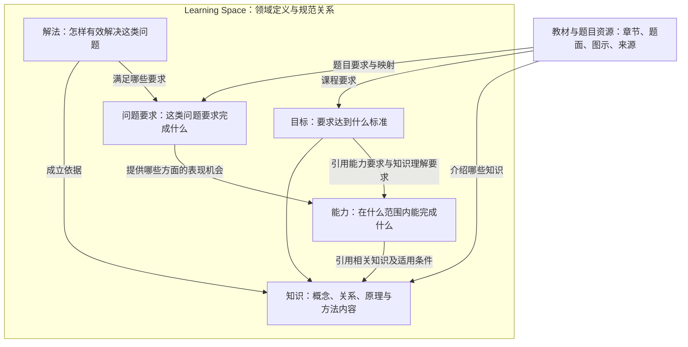

# DeerMind 学习模型目的需求与候选结构复核

> **版本**：v0.3 
> **文档性质**：设计复核与变更记录 
> **状态**：当前设计与工作入口；历史验证按原基线解释 
> **维护责任**：Codex 维护与核对；用户决定重要模型与范围变更 
> **评审记录**：用户确认调整方向并授权修订；具体合同由作者推演与核对，文档检查不代表模型效果或 Gate 通过 
> **写作规范**：[设计文档规范 v1.1](../top/DeerMind_Design_Document_Standard_v1.1.md) 
> **更新日期**：2026-10-20 
> **修订说明**：保留历史 §1–10，新建单模板多维修订及检查记录。逐文件变更见[修订记录 §11](DeerMind_Learning_Model_Reassessment.md#11-单模板多维-claim-的正式修订记录)。

---

本文保留设计讨论的演进。**当前单模板多维 Claim 结论与逐文件变更见 §11**；§1–10 为早期探索和先前修订，按当时语境及对应 Git 基线阅读。历史 C1–C4 和多模板 Claim 不作为现行合同，历史验证不反写。

## 1 目的与证据边界

模型首先要支持六类实际判断：当前需要解释什么；是否还需要了解学生的表现；什么题目或活动能提供有用信息；哪些表现支持当前目标、哪些仍未知；何时值得再次检验；系统发现错误后应修正哪些判断。这些决策需要共同的领域参照，但领域参照不应自行作出个人判断或执行教学。

系统可以观察和影响学习条件，不能直接读取人的真实认知状态。个人掌握状态是基于证据的可修正认识；状态更新也不天然等于实际学习进步。正式模型应让未知、相互矛盾的证据和暂时无法区分的解释有位置，而不是用一个精确外观的分数遮盖这些限制。

用户最初希望 Task 作为描述能力空间的载体。早期 [Knowledge Model §3.1](https://github.com/ivgotcrazy/deermind/blob/206b9c7bd6b0b3e53a09a18e4a3fdeea2ce729fd/doc/archive/DeerMind_Knowledge_Model_v0.2.md#31-task-family-与-task-instance) 已将具体题目解释为 Task Instance；当前 [Learning Space §3.2](https://github.com/ivgotcrazy/deermind/blob/eb7800b10da58bf3ee3ed4cbb27a3d484ebc1b94/doc/concept-design/DeerMind_Learning_Space_Design_v1.1.md#32-当前不建立独立-capability-model) 则通过 Task proficiency 表达能力，暂不设独立 Capability Model。与此同时，当前 §4.4 允许能力要求包含解释、验证、稳健性和迁移维度。因此，现有设计不是完全不能表达多维能力；需要审查的是这些定义是否过度分散、是否让具体作答形式反向决定能力边界。

已有 [Spike 报告 §2](https://github.com/ivgotcrazy/deermind/blob/206b9c7bd6b0b3e53a09a18e4a3fdeea2ce729fd/doc/system-design/spike/DeerMind_Architecture_Validation_Report_v0.1.md#2-依据方法与结果边界) 明确部分 Evidence/Belief 使用脚本 fixture；[Build 报告 §3、§9](https://github.com/ivgotcrazy/deermind/blob/206b9c7bd6b0b3e53a09a18e4a3fdeea2ce729fd/doc/system-design/build/DeerMind_Architecture_Validation_Build_Validation_Report_v0.3.md#9-build退出评审与能力分期决定) 记录了预设任务及 Claim 下的真实评价与局限。它们提供机制与局部语义证据，不足以证明能力单元划分、题目映射和教学价值已经合理。原始结果保留，不因本次复核自动重跑或作废。

研究提供方法参照而不指定 DeerMind 的本体。[ETS 的证据中心设计研究](https://www.ets.org/research/policy_research_reports/publications/report/2018/jzuw.html) 区分希望推断的学习者特征、形成推断的证据以及用于取得表现的任务设计；本次据此要求三者关系显式。[Adding It Up 第4章](https://www.nationalacademies.org/read/9822/chapter/6) 将数学熟练性描述为相互联系的多个方面，并指出理解可能先于清楚的口头表达；本次据此避免仅凭算对、说不出或一种表达形式判定全部掌握。上述参照不证明本项目应采用固定五维、某种评分公式或特定对象数量。

本次核查以现行概念文档的相关条款、运行时的单写与版本合同、Development Roadmap 的阶段责任，以及 Build 的实际 Claim/schema 样例为输入；上述两项外部参照已于 2026-10-11 核对原始发布页面。方法是责任分析、有限正反例走查及旧对象迁移分析，未调用项目 LLM、开展新学习实验或完成独立专家评审。§5 的“可解释”指方案能明确给出允许和不允许的结论，不代表实现已正确执行。知识内容与能力要求的划分是本项目的实用建模约定，不声称获得了对人类认知结构的唯一科学分类。

## 2 从学习决策推导建模要求

下列 LMR 编号只用于本次模型复核，连接要求、案例与候选方案，不替代 MVP 的 REQ、AC 或统计指标。表中要求来自用户目的、现有事实与判断分离原则，以及为避免错误教学决策所需的逻辑区分；它们不是已经执行的验收结果。

| 编号 | 必须回答的问题 | 必须能够表达的内容 | 对教学或判断的作用 |
| --- | --- | --- | --- |
| LMR-01 | 要学习的知识是什么 | 概念、关系、方法、适用条件与可核查依据；可独立定义，区别于能力要求及个人掌握判断 | 决定解释对象及可用表征，避免只保存名称或把会做什么再命名为知识 |
| LMR-02 | 希望形成什么能力 | 可复用且区别于知识内容的能力含义、适用范围、重要表现方面；目标内覆盖及教学用途明确 | 决定检测和教学针对什么，不以单题代替全部能力，也不漏掉关键方面 |
| LMR-03 | 当前目标要求达到什么程度 | 对已有领域定义的范围、质量、稳定性和支持边界要求，以及来源与版本 | 区分已有表现与目标是否满足，避免为每个目标复制能力 |
| LMR-04 | 什么表现能说明什么 | 题目或活动的作答要求、可能取得的表现、支持或反驳的判断及条件 | 选择有用的检测，不把涉及的全部知识都算作已经检验 |
| LMR-05 | 为什么能做或做不到 | 可能的解决方法、知识支撑、适用条件和替代解释；预期方法与实际方法分开 | 决定是否换解释、补基础或继续观察，不凭一个错误推定原因 |
| LMR-06 | 当前究竟知道多少 | 分范围或维度的认识、支持与反对证据、覆盖缺口、条件和可信程度 | 允许计算有支持而理解未确认，避免整项一刀切 |
| LMR-07 | 题目表现可否推广 | 数值、表征、情境、组合、支持与时间差异，以及结论可推广的范围 | 区分复现、保持与适用迁移，不用换题号证明迁移 |
| LMR-08 | 状态为什么发生变化 | 新表现、帮助背景、证据更正、标准变化、模型修订和时间因素 | 区分实际进步的证据、认识更新及系统纠错 |
| LMR-09 | 现实材料如何连接模型 | 章节、知识点、能力项、题目、例解和记录到领域定义的有类型、有依据、可未决映射 | 支持导入、浏览、检测范围及章节统计，避免章节等于知识点 |
| LMR-10 | 下一步是否值得做 | 目标差距、认识缺口、可用活动、适用关系及取得信息的代价 | 为 Policy 提供依据；有缺口不自动强制检测，准备好不等于必须开始 |
| LMR-11 | 如何校正模型并保留历史 | 定义、关系和判断的版本、来源及依赖，旧事实与新解释的区别 | 修改错误映射后定位影响，不重写学生曾做过什么 |
| LMR-12 | 模型精细到什么程度 | 新增或拆分对象带来的可区分表现、教学选择或解释收益，以及维护代价 | 避免为每题、每个问法、每个步骤或每个目标复制对象 |

这些要求覆盖知识、能力、学习状态与现实映射，但不要求 Learning Space 独自实现它们。当前缺材料时可以说明哪项判断无法作出，不能要求先补齐整套知识图谱才提供任何有依据的帮助，也不能通过一律保持未知来宣称系统可靠。

## 3 必须分开的含义与职责

### 3.1 知识与能力定义以及个人判断

本候选把知识定义为领域中可学习的概念、关系、原理与方法内容，说明内容是什么、适用条件是什么及依据是什么；把能力定义为在明确情境与条件下，学习者应能完成哪些事情并达到什么质量。两者都由 Learning 定义，并分别可被引用。个人是否理解某项知识、能否完成某类事情，则是 Evaluation 负责的判断。两种定义不能因都与“乘倒数”有关就混成一类，也不要求为了区分定义而强行使用互不相交的题目或证据。

这是为 DeerMind 提出的建模约定，不主张它是知识与能力的唯一学术划分。现有 KC 把概念理解、程序技能、策略选择等认知功能一并纳入，确实不宜直接原样保留后再增加同义能力对象；候选重定义及历史迁移影响见 §6.5–§6.7。知识对象存在不说明任何人已经掌握，能力定义存在也不说明任何人已经具备。是否理解相关知识可以成为一项能力的重要要求，二者通过明确引用关联。

能力的基本含义和适用范围应保持明确；当前目标所要求的熟练程度、时限或允许帮助另行表达。必须区分单次作答的合格条件与跨表现的能力判断标准。三道题、某个百分比、一次解释或某个时间间隔都不能由概念定义直接推导为充分证据，具体判断仍需领域依据与后续校准。

理解、解释、计算、应用和检查并不天然构成每项能力必须复制的一套固定维度。解释可以是一种重要表现，但说不出来不自动证明不理解；反之，复述一句正确原理也不自动证明会运用。是否需要独立维度、子能力或知识判断，要看它是否改变可检验的结论与行动。

个人状态变化至少要说明两件事：系统的判断是否改变，现有证据是否支持学习者能力发生了变化。新证据可能只让系统知道了原本不知道的能力；更正错误识别、提高目标标准或重建映射，也可能改变判断而没有发生新学习。单凭判断分值差不能计算学习增益，更不能归因于 DeerMind。

模型可以提供先修、迁移、难度和可能学习路径的有条件关系，但它们需要来源与经验状态。教材顺序不等于必须的认知先修，日历时间不等于确定遗忘。当前不选定通用遗忘公式、概率模型、统一能力树或自动排课；开放基础知识讲解的产品边界仍受 OPEN-001 约束，本次关系分析不替用户批准该范围。

### 3.2 能力定义 状态评估 验证与形成

用户提出的四个概念适合作为完整性检查的四类问题，候选方案保留这种区分，但不把它们预设为四个平行模型或四个新 Space。能力定义是规范对象，能力状态是关于个体的认识，验证是取得并解释表现的过程，形成是学习者发生改变的过程；后两项需要多个责任协作。这里的“能力验证”指对学习者能力取证与评价，不是运行时对模型输出的语义合规校验。

| 问题 | 候选定义与必要限定 | 整体模型中的责任与输出 |
| --- | --- | --- |
| 能力是什么 | 定义适用范围、可完成事项、重要方面及有效表现；不包含某个学生已经掌握的结论 | Learning 维护能力定义、知识及其关系；Target 引用它们并规定当前要求 |
| 当前能力状态怎样 | 对特定学习者在明确条件下的能力作出可修正评估；包括方面、范围、证据支持、反证和不确定性 | Evaluation 的 Learner State、Evidence、Inference 协作形成 Belief；掌握程度与判断把握程度分别表达 |
| 怎样验证能力 | 设计有信息价值的表现机会，记录实际表现及帮助，再判断这些表现支持、反驳或不足以判断什么 | Learning 提供领域与具体要求的语义；Evaluation 定义证据需要及解释规则；Interaction 选择并组织适用活动、形成 Observation；Evaluation 更新判断 |
| 怎样促进能力形成 | 根据目标、当前请求和已有认识选择教学或练习，期待真实能力改善，再由后续表现检验；改变评估值不是教学动作的直接目标 | Interaction 的 Action Model 与 Policy 维护可用介入及选择责任；Learning 提供内容和领域关系，Evaluation 提供认识与后续评估 |

能力状态需要区分“判断的能力水平”与“判断有多充分”。某方面表现较弱但证据充分，与尚无足够证据，是不同状态；它们可能需要不同动作。状态上调也可能只是发现学生原本就会，状态下调可能是纠正了高估。学习者真实能力不是可直接读取或直接写入的系统字段，能力形成不能用 Belief 上升代替，更不能在讲解完成后直接设置为掌握。

验证需要超过“怎样表现”这一层。一个验证设计至少说明针对哪个命题、什么要求能取得相关表现、帮助条件怎样影响解释，以及不同结果怎样影响判断。出了一道题并收到回答，只完成了其中一部分。没有发生主动检测时，日常求助、讲解互动和主动提交也可以提供适用证据；取证不足可以保留未决，不要求每次都得到通过或失败的结论。

四类问题之外还需要明确当前目标。希望改变什么、到什么标准、在什么支持条件下成立，由 Learning Target 提供规范参照；具体采用哪个目标由已有目标绑定与交互规则处理。当前认识与目标的比较形成 Target Assessment，认识不足形成证据缺口，两者都只提供决策依据，不自动生成介入命令。

### 3.3 取证和促学怎样形成一个闭环

以下图示表示职责关系，不规定线程或调用时序；同一会话严格串行的既有执行选择不因该闭环改变。

取证主要减少系统的不确定性，教学主要期待学习者发生有价值的改变，但一次活动可以兼有两种作用。比如讲解中的追问既提供表现，也可能提示解题方向；应记录实际暴露并据此解释后续回答，不能仅凭“这是测验”的标签当作完全独立表现。教学活动中的表现也不因此失去全部证据价值。已确认的独立多题自测中求助即结束该自测的产品规则保持不变。

能力形成的候选策略应说明所针对的方面、适用状态或请求、可用动作与材料、预计起作用的理由、实际会提供的帮助、希望随后观察到的表现，以及何时结束或调整。这些是 Interaction 行动与策略的设计内容；领域先修和方法依据引用 Learning，效果理由标明经验状态。这里补足促学策略的责任，不另建可以写入个人掌握状态的“能力形成模型”。

“求解策略”与“教学策略”必须区分。Solution 解释一个问题可以怎样有效解决；教学策略解释怎样帮助学生形成相应理解与处理能力。前者可以是乘倒数，后者可以是用数量图示解释、比较方法或逐步撤去提示。教过某种解法不等于学生形成了对应能力，完成本次题目也不等于达成长期目标。

Interaction 可以直接回应有明确依据的讲解请求，不必先强制完成整套能力评估。它也可以根据已有证据选择进一步了解情况、针对性教学、继续观察或暂不介入。能力缺口与证据缺口都不能单独规定唯一动作，动作还取决于学生当前意图、可用条件和成本。

Evolution 与治理跨上述责任检查系统模型及策略是否需要修订，维护来源、版本、审核与变更影响；它不负责代替学生学习，也不因一次成绩变化就自动宣布教学策略有效或发布新模型。内容与产品组织继续保存教材、题面、图示、例解和来源，按用户熟悉的章节提供入口，语义映射引用正式领域定义。

### 3.4 重构后的 Learning Space 候选结构

建议将 Learning Space 组织为五类规范模型，以及题目、教材等资源与映射。这五类是语义职责，不规定五个服务、五张数据库表或五次模型调用。与原方案相比，实质变化是显式定义能力，并把旧 Task 中有价值的问题要求与方法组织责任保留下来，使它不再同时承担能力定义的全部责任。

图中的资源是 Learning Space 可引用的内容层，原始文件可以由共享内容设施保存；这不增加第五个 Space。图未画出全部关系，例如解法执行所需的能力、章节覆盖的能力方面及题目可用的多种解法，见 §3.5。任何节点都不存放“这个孩子已经掌握”的结论。

| 候选组成 | 负责的规范内容 | 分数除法实例 | 主要用途 |
| --- | --- | --- | --- |
| Knowledge Model 知识模型 | 概念、关系、原理、程序方法内容及成立条件；知识之间有依据的关系 | 除法的数量意义、倒数关系、共同单位与等值表示 | 支撑解释内容、方法依据与知识理解命题 |
| Capability Model 能力模型 | 能力含义、适用范围、应承担的责任、重要方面及有效表现要求 | 在指定正分数问题范围内理解关系、选用方法、执行并核查 | 为个人能力判断与教学目标提供直接参照 |
| Problem Requirements Model 问题要求模型 | 某类问题的情境、已知与所求、完成条件、责任边界及可复用问题族；承接旧 Task 的相应职责 | 已指定除法运算的计算要求；尚未指定运算的数量关系问题要求 | 区分一道题究竟要求什么，组织方法复用、问题生成和表现机会 |
| Solution Model 解法模型 | 适用问题要求、方法结构、分解责任、有效性依据及已知执行依赖；允许多个合法方法 | 乘倒数、使用共同单位比较数量 | 支持核验解答、解释不同方法、分析具体表现；不预定学生实际采用哪一种 |
| Target Model 目标模型 | 引用已有定义，规定当前要求的范围、质量及支持边界；不复制能力含义 | 只要求完成计算的目标，与要求理解并处理数量情境的目标 | 确定本次学习和评价的要求；个人是否达标仍由 Evaluation 派生判断 |
| 资源与映射 | 教材、章节、题目、图示、例解等内容身份及版本，连接上述规范对象的有类型映射 | 一节分数除法教材及 EX-Q1–Q5，各自关联部分要求和知识 | 支持导入、章节入口、内容复用、选题和来源追溯；不是另一套能力状态 |

因此，“题目是不是 Task Instance”需要先明确所指：一道具体题面是题目资源；它可以实例化一个或多个已定义的问题要求，也可能存在待澄清部分；它本身不是能力实例。同题呈现一次、学生作答一次，又是不同的发生记录。使用“问题要求实例”描述题意的具体化可以成立，使用它来代表“某项能力已经表现或形成”则不成立。

题目资源可以包含子问、表达形式、来源和经核验的参考解法，但参考答案不规定所有有效方法。原始上传题目没有正式问题族映射时仍可保存；进入正式方法分解或作为明确命题的评价依据时，则必须满足相应规范引用与证据合同。本报告建议保留正式分解节点的可治理问题族参照：一个正式问题要求实例引用一个规范问题族，一道完整题目可以包含多个要求实例；原始资源不要求预先归族。旧 L1 的替代方案见 §7.2，正式文档尚未修改。问题族与能力是多对多关系，不要求每个问题族都有一个专属能力，也不因一道题有多个要求就重复计算一次作答。

“同一个孩子的校内、校外课程空间”是这些模型和资源的具体适用范围，与 Learning、Evaluation 等四种语义职责不是同一种分类。四 Space 描述谁负责什么，课程空间描述在什么课程边界内运行。按已确认的 MVP 选择，两门课程各自解析所用模型与教材，个人证据、状态、上下文及推荐隔离；同名知识不触发跨课程状态合并。本候选不据此引入共享个人能力档案。

### 3.5 关系与对象必须携带的最小语义

对象之间不能只连接一条“相关”边。否则，选题时无法区分题目涉及的内容与真正要求学生承担的责任，评价时也无法区分方法依据与学生表现。候选至少需要以下关系；它们是语义合同，不是数据库 schema。

| 关系 | 必须明确的含义与条件 | 不能由此直接推出什么 |
| --- | --- | --- |
| 能力要求引用知识 | 能力的哪个方面需要怎样理解或使用哪些知识，适用范围是什么 | 涉及这些知识的人都已具备整项能力；这些知识均须在每题中独立检测 |
| 目标引用能力或知识理解要求 | 当前要求哪些方面、到什么质量、允许何种帮助 | 目标已被学习者达成；改变目标等于学生发生变化 |
| 题目实例化问题要求 | 具体题面、子问、已知所求与局部合格条件如何对应，哪些仍未决 | 题面被保存就已正式分类；所有相似题面具有相同语义 |
| 问题要求提供表现机会 | 学生若承担哪些责任，可能为哪些能力方面或知识理解提供信息 | 本次实际回答必然构成证据，更不自动构成充分证据 |
| 解法满足问题要求 | 方法在何种条件下能够满足要求，哪些节点承担什么责任 | 学生用了该方法；教材只列一种就不存在其他有效方法 |
| 解法的有效性依据 | 方法哪些变形、步骤或分解由哪些知识和推导支撑 | 学生理解了依据；方法有效就说明认知过程已完整建模 |
| 解法的执行依赖 | 为执行具体步骤，需要哪些更具体的知识理解、技能或协调责任，依赖依据与未知部分是什么 | 这些依赖都是错误的唯一原因；用整项能力自身作为依赖就解释了执行过程 |
| 章节和资源映射 | 是介绍知识、要求能力、包含例题，还是提供特定目标的材料；保留教材版本及位置 | 章节、知识和能力一一对应；出现于教材等于已经学会 |

表现与 Claim 的证据关系不列为 Learning 可写关系，它由 Evaluation 在实际发生之后建立。先修、类比或迁移关系也要注明依据和适用范围；当缺乏依据时，保存为待验证候选，不用教材顺序或词语相似度冒充正式关系。

题目资源还需保留来源性质（教材、外部输入、系统原生生成或变式）、内容版本、适用要求、预计提供的表现机会和可用解法依据。变式另引用原题及实际改变的数值、表征、情境或责任；系统原生题不必伪造父题。稳定 ID 用于引用，语义描述与有类型关系用于解释，不把所有知识、能力与变式维度塞入一串必须解码的题号。复用一道题时新增呈现与作答记录，不能覆盖先前作答或清除帮助背景。

为使候选具备可审查的具体形态，一项能力定义至少应能展开为下面这样一张记录。它描述 EX-C1 本身，个人状态另行维护。

| 字段含义 | EX-C1 候选内容 |
| --- | --- |
| 稳定引用与定义版本 | EX-C1；此处仅为工作稿代号，正式发布后需要稳定身份与不可混用的定义版本 |
| 能力含义与范围 | 在约定正有理数及同种量的包含、倍数情境内处理分数除法问题；暂不覆盖负数、代数及全部复合应用 |
| 应承担的责任 | 识别数量关系；选用有效方法；完成处理；在相应要求下说明依据、核查合理性；组合目标还要求协调这些责任 |
| 引用的知识与子能力 | 引用 EX-K1–K4 及适用的基础运算要求；不把“能用共同单位”再次定义成“共同单位知识”；缺少正式基础引用时注明模型未齐备 |
| 有效表现的规范说明 | 有效数量关系与处理过程、正确结果及必要单位；支持图示、符号等适用表达，不强制口头复述或唯一方法 |
| 可以取得表现的要求 | EX-Q1–Q5 分别覆盖部分方面；记录题目是否已给出方法或核查提示，不能将五题计数直接解释为全面掌握 |
| 标准与证据的边界 | 具体目标限定要求范围与支持条件；跨表现怎样形成充分判断由 Evaluation 的证据与推断规则处理 |
| 来源、成熟度与变更影响 | 当前为合成设计样例，未映射真实教材；正式对象需记录审核依据、关系状态与被哪些目标、方法和 Claim 引用 |

知识对象则应能单独展开其内容、条件、依据和相关关系，而不依赖某个学生或能力分数才能解释。程序方法的可学习内容只保留一个规范来源；Solution 引用它并组织针对具体问题要求的应用与分解，不再平行维护相互冲突的原理副本。

以上对象和关系须区分候选、已核实及不可用等成熟度，但本轮不设计状态机。正式参与运行时，需要解析到明确且兼容的版本，不能把草稿与已生效定义混用。精细程度以能改变评价结论、教学选择或来源解释为依据，不先把每句讲解、每个计算步骤都升级成新知识或新能力。

### 3.6 与其他 Space 的读写合同

Learning 提供领域含义和规范参照；Evaluation 维护对学习者的认识；Interaction 负责当前活动的理解、决策和实际行动；Evolution 检查系统模型是否需要改变。它们协作所需的主要交换如下，空间之间的连线表示语义依赖，不意味着可以互相直接改写数据。

| 方向 | 提供什么 | 接收方如何使用及写入边界 |
| --- | --- | --- |
| Learning → Evaluation | 带版本的知识、能力、目标、问题要求、解法及适用映射 | 用于定义 Claim 和解释表现；Learning 不提供某个学生已掌握的预设结论 |
| Learning → Interaction | 当前范围内可用的内容、问题要求、解法、目标与支持边界 | 用于理解请求、组织讲解和表现机会；领域关系不是必须执行的教学命令 |
| Interaction → Evaluation | 正式接纳的 Observation、实际作答与帮助的来源引用、题目要求、活动条件及其版本 | Evidence Model 判断本次表现对明确 Claim 的意义，Inference Model 综合证据；Interaction 不直接写个人能力状态 |
| Evaluation → Interaction | 适用的条件性 Belief、依据、反证、不确定性、目标比较及本轮评价完成情况 | Policy 在自己的输入合同内使用；没有新表现时可不更新状态，必要评价失败时不得把旧 head 冒充本轮完成结果 |
| 各 Space → Evolution | 可追溯的模型缺口、冲突、误判或策略问题，以及相关版本和有限事实 | 形成系统问题评估、修订假设及验证建议；学生答错不自动成为模型错误，学生进步也不自动证明策略有效 |
| Evolution → 治理 → 相应语义 owner | 待审核的具体修订、依据、影响范围与验证结果 | 治理决定是否允许变更，由相应 owner 发布；Learning 发布领域定义，Evaluation 发布其评价模型，Interaction 发布其行动或策略模型 |

其中，Evaluation 的三类职责保留：Learner State Model 规定允许维护哪些命题，Evidence Model 解释单次表现的意义，Inference Model 综合证据形成判断。本候选调整能力命题所引用的领域定义，并不增加第三套与旧 Task Proficiency、KC Belief 并列的同义状态。Target Assessment 仍是目标与适用 Belief 的派生比较，可以缓存但需保留依赖，不另建一套“目标掌握事实”。

治理和运行基础设施承担权限、事件持久化、版本解析与发布激活等责任，不因此成为新的学习 Space。一次交互采用明确的课程范围、目标绑定和兼容版本组合；正式版本已发布并不等于当前会话已采用。具体目标绑定的合法性及生命周期继续服从现有治理和 Interaction 合同，不由 Target 定义自行激活。

运行中，Observation、Evidence、Belief、动作内容等语义候选可以使用规则约束下的 LLM 生成与校验；是否准许写入、引用是否存在、版本是否匹配、是否实际发生展示，由相应 owner 与确定性运行机制控制。图结构本身不会完成教学或推断，LLM 也不能凭一句判断跳过这些合同。语义质量仍需工程测量，不能因通过结构与权限检查就宣称判断必然正确。

面向学生和家长的“学习情况”由章节映射、适用目标、Evaluation 判断以及实际学习记录组成可解释视图。统计必须标明范围、覆盖和计数口径，区分未检测、已有困难及模型尚未覆盖；同一次作答不能因关联多个知识或章节就被当作多次独立表现。页面可显示做题数、覆盖项数等量化信息，但展示性分数与摘要不成为新的 Belief 写入入口，也不反过来替代底层判断。

## 4 分数除法的完整候选实例

本节是合成的领域建模实例，连接定义、题目、解法、评价与教学，不是孩子的记录或新一轮 Spike。`EX-` 代号仅供本节交叉引用，不是已发布的规范编号、数据库 schema 或实际教材映射。先限定为正有理数范围内的分数除法、同种量的包含与倍数关系；分母和除数非零。带负数、代数、复合应用及全部小学大纲覆盖不在此例结论内。

### 4.1 知识 能力与当前目标

| 示例参照 | 定义的实际内容 | 与其他对象的边界 |
| --- | --- | --- |
| EX-K1 数量商的意义 | 同种量 `a` 相对于非零量 `b` 的倍数为满足 `b × q = a` 的数 `q`；“包含多少个单位”允许结果不是整数 | 描述数量关系，不包含学生是否理解或能否应用的判断 |
| EX-K2 除法与倒数关系 | 在本例数域内 `a ÷ b = a × (1/b)`；改变度量单位或等值变换可以为关系提供解释，定义须保留成立条件 | 描述运算关系及依据；正确套用公式不充分证明理解依据 |
| EX-K3 等值表示与共同单位 | 同一种量采用共同的小单位后，原有倍数关系保持；本例 `3/4` 与 `1/2=2/4` 可比较为 3 个与 2 个四分之一单位 | 可用于其他分数问题；不等于学生具备选择共同单位或画图的能力 |
| EX-K4 商的大小关系 | `a>0` 时，`0<b<1` 有 `a/b>a`，`b=1` 有 `a/b=a`，`b>1` 有 `a/b<a`；关系由正数倍数关系解释 | 不把“做除法一定变小”当作原理；掌握此关系也不自动证明会主动核查 |
| EX-C1 处理限定范围的分数除法问题 | 能在上述范围内理解相关数量与运算关系，从情境形成适用问题，选择有效方法完成求解，并解释或核查结果 | 这是一个多方面能力候选；不等于四项知识的清单，也不因题目换问法就变成另一能力 |
| EX-G1 阶段计算目标 | 要求 EX-C1 中约定范围的计算执行达到明确标准；完成当前题目时关键运算责任由学生承担 | 只要求部分方面，达成也不能展示为全部分数除法能力已掌握 |
| EX-G2 综合理解与应用目标 | 要求 EX-C1 的原理理解、情境处理、方法选择、执行和核查具有适用依据，并有综合运用表现 | 不以若干分项简单求平均，不把一种表征或一次成功规定为充分证据 |

这些知识条目分别承担数量意义、运算关系、表示不变性和大小判断的解释责任；最终是否独立作为 KC 交付，还需审查复用与区分价值。分数乘法、等值分数等被调用的基础内容应引用已有定义；若所用领域包尚无定义，应登记具体依赖缺口，不能假装学生已掌握，也不由本例自动开放低年级课程范围。

EX-G1 与 EX-G2 的阶段标准、证据覆盖和后续校准责任必须明确，但本例不凭空指定题数、掌握概率或保持天数。这里能审查的是目标究竟要求什么，以及怎样的表现可能提供依据；足够支持何种稳定结论还需相应测量依据。此前学习过规则不使所有后续表现永久失去独立性，实际帮助按与当前要求的关系解释，也不能只凭新题号或固定时间间隔清零。

### 4.2 题目要求与可用解法

| 示例题目 | 题面与本次要求 | 可取得的表现及其限制 |
| --- | --- | --- |
| EX-Q1 计算 | 计算 `3/4 ÷ 1/2`，保留必要过程 | 结果为 `3/2`；可检查本次计算及书面方法，不能仅凭正确结果判断原理理解 |
| EX-Q2 数量解释 | `3/4` 米是一段 `1/2` 米长度的多少倍？可用图、式或文字说明 | 答案为 `3/2` 倍；可以观察数量意义，但与 Q1 共用数值和关系，不能当作完全独立的新证据 |
| EX-Q3 情境应用 | 把 `5/6` 米长的彩带记作 1 个长度单位，`1/2` 米长的彩带应记作多少个这样的单位？说明处理方法 | 答案为 `3/5` 个单位；未直接指定运算，可观察关系识别及求解。与已讲例子相近时，不能声称已证明广泛迁移 |
| EX-Q4 方法比较 | 对 Q1 比较“乘以倒数”和“先把两个量表示为四分之一单位再比较”；选择一种求解并说明适用理由 | 两种方法在此都有效；可观察给定方案下的选择与理由，不能据此宣称学生能自行生成所有方法 |
| EX-Q5 结果核查 | 不必求精确值，判断 `3/4 ÷ 3/2` 比 `3/4` 大还是小，并说明依据 | 商较小；可观察提示下的大小判断。被要求检查后能检查，不等于已经形成主动检查习惯 |

这些题目是不同的表现机会，不是 EX-C1 的五个互斥实例。一个题目可包含多个要求，每个要求可以关联能力的若干方面和相关知识；只有实际得到的表现经过解释，才构成对具体个人判断的证据。Q1 与 Q2 共用内容、Q4 暴露候选方法、讲解后再做 Q3，都需要保留相应依赖与帮助事实。

本例保留两种求解策略。EX-S1 使用除法与倒数关系，将 Q1 化为 `3/4 × 2` 再计算；它引用 EX-K2，并依赖相应乘法处理内容。EX-S2 使用共同单位，将 Q1 看作 3 个四分之一单位与 2 个四分之一单位的比较，得到 `3/2`；在 Q3 中，`1/2=3/6` 与 `5/6` 分别是 3 个与 5 个六分之一单位，得到 `3/5`。EX-S2 可由图示或算式表达，主要解释关系引用 EX-K1、EX-K3。Solution 保存这些方法及条件，不认定学生一定按某条规范方法思考。

由此可以检验一个关键区别：学生通过共同单位图示解决 Q3，可以为数量关系理解和相应求解提供支持，却不能因此断言已经会用乘倒数算法。反过来，Q1 写出乘倒数形式，可以支持相应执行表现，但不能据此认定已经理解共同单位或该变形的理由。因此必须区分题目可能涉及的知识、选定方法的知识依据与实际表现能够支持的判断。

问题要求可以规范复用，例如“给定算式求值”“解释数量关系”“比较给定方法”。是否收录为问题族，要看稳定要求和方法复用价值，不是按题号、动词或能力方面自动建一族。EX-C1 可以由不同问题族提供表现，一个包含多个要求的题目也可以涉及多个问题族；这里不存在每道题必须唯一隶属某一能力的规则。

### 4.3 从实际表现到条件判断

以下是一条假想交互轨迹，展示每步可以更新什么，不是执行结果。真实运行必须取得当时输入、实际展示的帮助和学生回答；缺少这些信息不能套用表中结论。

| 假想发生记录 | Observation 与 Evidence 要区分的内容 | 对个人状态和目标的影响 |
| --- | --- | --- |
| 初次作答 Q1，写出 `3/4 × 2 = 3/2` | 记录实际过程；核对帮助背景后，解释其对相应计算命题的支持 | 计算得到一次适用支持；理解、独立选法和长期稳定性仍未因此确认，G1 也不能只凭一次成功判定达成 |
| 学生问“为什么要乘倒数” | 求助意图是观察；请求讲解本身不是理解错误的证据 | 可以直接回应请求；保留理解未确认，不先把能力判低 |
| 系统实际展示共同单位图示，学生跟随说出 Q2 的关系 | 记录已展示的信息；区分跟随完成、复述和可辨别的推理表现 | 可形成帮助背景下的支持，不能将完整结果都记作学生独立发现；没有实际展示成功则不能记为已获得帮助 |
| 学生在 Q3 自画六分之一单位，说明 3 个相对 5 个，得到 `3/5` | 实际表征与共同单位方法一致；本题数值变了，但刚才的讲解仍是相关背景 | 增加相应关系理解与应用的支持；不把它等同于乘倒数算法掌握，也不据此宣称广泛迁移或保持 |
| 学生对 Q5 判断商较小，并给出除数大于 1 的适用理由 | 记录本次提示下的核查及理由；解释对 EX-K4 与相应核查要求的支持 | 保留该方面的局部支持，主动核查和跨情境稳定性仍需其他依据 |

最终状态可以分别说明计算、数量意义、情境应用和核查各有什么支持、哪些受到帮助、方法选择还缺哪些表现、哪些范围尚未观察。对 EX-G2 的结论可能仍是依据不足，这不抹去已经取得的局部证据。同一段图示表现被知识理解判断和能力要求引用时，不能计为两次独立发生；综合能力还需检查实际协调运用的表现，而不是复制各方面分数后求平均。

若学生始终没有回答数量解释，相关判断保留未知；若明确坚持错误关系，应记录相反证据；若识别器把正确图示读错，应更正解释及其依赖。这三种情况必须导向不同处理，不能统一写成“理解能力下降”。上述状态变化也不直接证明变化由 DeerMind 造成。

### 4.4 形成能力的介入及后续检查

本例的教学候选针对数量意义与算法之间的联系。适用入口可以是学生主动追问，也可以是已有证据暴露的理解困难；两者不需要先被写成同一种能力缺陷。可采用的过程是把 `1/2` 米作为一个比较单位，让学生借助图示解释 `3/4` 米与它的关系，再将这个关系与乘倒数的算式连接。预期作用是建立意义与运算的联系，这是待检验的教学理由，不是“采用图示必定有效”的结论。

Interaction 应记录实际给出了哪些信息，允许学生追问、继续或退出；后续可根据目标和当前情况安排 Q3 一类表现机会。学生跟随完成、能解释一个近似例子、能在无相关提示的新要求中运用、经过时间后仍能运用，提供不同范围的信息。一次表现有改善时可以增加相应支持，不能直接宣称持久能力已经形成；若没有改善，应重新区分困难和教学适配，不重复执行同一策略来制造完成次数。

若实际困难是不会选择方法，可以比较有效方案及条件；若主要是计算执行错误，则检查真实步骤并安排针对性练习；若只是目前没有表现机会，应考虑是否值得取证，而不是默认需要补课。求解策略来自 Solution，讲解顺序、表征选择、提示与练习安排属于 Interaction 的教学策略，Evaluation 解释活动后的表现。

### 4.5 现实映射与模型变更

教材章节应分别关联其介绍的 EX-K 条目、要求形成的 EX-C1 方面及 EX-G 范围，并保留页码与材料版本；题面来源与题目要求另行引用。章节不是一个 KC，也不必等于一个能力。另一章引用同一能力时，复用语义定义，不重复计算同一次学习表现；校内、校外课程的个人证据仍按已确认规则隔离。

如果后来发现某题实际还依赖当前模型未覆盖的责任，应登记题目映射和能力定义的具体缺口，不能以未映射判断学生不会，也不能由运行时自动发布一个新能力。Evolution 与治理处理候选关系或定义的修订。历史题目、实际帮助和原始回答保留；旧判断是否能解释为新定义下的证据，需逐项检查范围与版本，不批量改名继承。

本例提供了从四类问题到现实材料的完整职责实例，并不表示已形成可直接发布的领域包。实际教材、正式能力颗粒度、测量标准校准和教学有效性仍有各自责任；这些缺口不通过把所有题目强行归为一个 Family 或把所有状态压成一个数值来消除。

### 4.6 从章节求助到后续作答的运行过程

以下沿用 EX-K、EX-C、EX-Q 与 EX-G，展示候选对象如何参与实际交互。假设已经为本例准备并授权启用了兼容的领域定义、评价规则和交互策略，当前是允许讲解的学习活动，目标范围对应 EX-G2。这里的“已启用”是运行前提，不是报告这些对象已经在当前系统实现或发布。活动跨多个轮次推进，每轮严格串行；收到新的输入、明确中断或发生异常时，按已有调度合同处理。

学生在选定课程的“分数除法”章节说：“这章为什么要乘倒数？给我讲讲。”这只表达讲解意图，不能直接解释为她不会计算、缺乏数量理解或不具备整项能力。

| 顺序与责任 | 本步输入 | 本步处理及输出 | 下一步据此做什么 |
| --- | --- | --- | --- |
| 1 运行时接收 | 当前学生、课程空间、章节、活动与目标绑定，输入文本或待识别材料 | 保存输入发生记录及来源；解析当前采用的版本组合 | 后续语义结果能追溯到这次输入和适用范围，不能混入另一课程的历史 |
| 2 Interaction 解析相关领域参照 | 输入、章节映射，以及 Learning 中的 EX-K1–K3、EX-C1、EX-G2 和相关解法 | 确认讲解涉及数量意义与倒数关系；明确哪些内容已映射、哪些尚未覆盖 | 选定理解与教学所需上下文；不遍历全部知识图谱，也不凭章节名称推断掌握 |
| 3 Interaction 形成 Observation | 原输入、允许的上下文与语义规则 | 形成并校验“请求解释倒数关系”的 Observation，保留来源；若无实际作答，不制造错误表现 | Evaluation 判断本轮是否有适用的能力证据；Policy 能区分主动求助与已证实的困难 |
| 4 Evaluation 完成本轮适用处理 | Observation、相关 Claim 与证据规则、可用历史依据 | 本例若只有求助而没有适用的能力表现，明确记录无需新增能力证据或保持原判断；若另含作答，则形成相关 Evidence 并推断。需要评价却失败时返回 non-resolution | Policy 得到真实的完成情况；“没有新证据”“已经评估但仍未知”“处理失败”不可混用 |
| 5 Interaction Policy 选择动作 | 当前请求、目标支持边界、Learning 参照、可合法使用的 Evaluation 结果及活动状态 | 选择先解释一个关键问题：借助数量图示连接 EX-K1、EX-K3 与 EX-K2；可以利用已有状态调整深浅，无需先强制整套测验 | 产生有明确内容依据和责任边界的讲解意图；尚未视为学生已看到帮助 |
| 6 Interaction 生成并实际呈现 | 讲解意图、可用表征与解法、当前版本和执行权限 | 生成并校验内容；通过执行检查后显示或播放。记录真正显示、播放了什么以及是否被打断；失败则记录失败 | 后续评价引用实际发生的帮助；预生成、计划显示或未播出的内容不冒充实际暴露 |
| 7 学生选择下一步 | 已呈现的这一段讲解，继续、追问、尝试或退出的入口 | 学生可以就地追问、决定继续、暂停或结束；本例假设随后接受一道 EX-Q3 类型的检查 | Interaction 组织该表现机会，保留已受帮助的背景；不因新题号自动宣称独立检测 |
| 8 下一轮 Interaction → Evaluation | Q3 的实际题面、要求、学生图示与算式、此前帮助及时间条件 | 假设她将 `1/2` 与 `5/6` 表示为 3 个与 5 个六分之一单位，得到 `3/5`。Observation 记录这种表现；Evidence 解释其支持数量关系运用；Inference 形成相应条件下的判断 | 可以增加对相关理解与应用的支持；不据此证明已独立选用乘倒数算法、掌握全部分数除法或形成长期保持 |
| 9 Evaluation → Interaction | 更新后的适用判断、未覆盖方面、当前目标与学生意图 | 派生目标比较；Policy 可以反馈本次表现、回应追问或提出有理由的下一步。也可以在本段目标完成或学生选择退出时结束 | 学生看到具体反馈，后续活动继承可追溯的认识；没有必要为填满所有维度而不停出题 |

这一过程体现 Learning Space 的实际作用：它让系统知道讲的是哪些内容、期待哪些表现、有哪些有效方法，以及当前结论不能跨过哪些范围。Evaluation 决定这次表现支持什么，Interaction 决定如何回应并组织下一步；学习者是否真的形成了更稳定的能力，需要后续适用表现，而非步骤 6 的“讲解完成”信号。

步骤 4 的无新增判断是一种明确的适用处理结果，不是评价失败的替代名称。当前动作若只需要已经核实的内容与明确请求，允许在其输入合同内回应；若动作需要本轮能力评估，则必须等待串行评价完成。失败时按已有 non-resolution 合同收束，不能临时改称“不需要评价”来继续，也不能静默读取旧 head 当作本轮新结果。NoIntervention 表示有依据地决定不介入，Defer 需要明确等待条件；二者都不能被用来把超时或失败包装成正常完成。

本例与 §4.3 采用相同的证据边界，但入口不同：§4.3 先有一次计算，再提出解释请求；这里直接从章节求助进入。两个入口都可以提供讲解，只有前者可以引用那次计算的表现。模型应支持这种差别，不能为了统一流程补造学生从未做过的诊断。

### 4.7 同一组模型怎样支撑其他活动

章节讲解不是独立于全系统的特殊通道。其他已讨论需求可以复用同样的规范参照、事实记录和判断边界；以下说明概念承载能力，不重新批准 MVP 范围、实现顺序或所有活动的细节。

| 入口与要解决的问题 | Learning 提供什么 | 其余责任怎样组合 |
| --- | --- | --- |
| 问题求助：不会做、做到一半或已有错误 | 具体题目要求、适用知识、合法解法与所涉及的能力方面；识别和映射不清时保留未决 | Interaction 澄清必要题意并组织帮助，Evaluation 只从真实表现取得适用证据。未作答不自动归为错题；内部活动产生的错题也保留来源与帮助条件 |
| 主动自测：想了解某章或若干节的情况 | 章节对应的目标范围、需要覆盖的要求、可用题目及表现机会 | Evaluation 的证据需要支持检测设计，Interaction 选择和组织具体题目；题量取决于范围、覆盖和既有证据，不由章节数或单题正确率直接决定。独立多题自测中求助，按已确认规则结束自测并转入讲解 |
| 系统主动介入：已有困难、证据不足或保持情况待确认 | 适用目标、领域关系、可选问题和材料 | Evaluation 提供有边界的状态与缺口，Interaction 根据当前意图、时机与成本判断是否提出或启动适用活动；具体触发策略属于后续设计，日历到期不直接证明遗忘，也不自动越过学生的活动选择 |
| 查看学习情况：希望知道目前怎样及依据是什么 | 用户熟悉的章节组织、其目标和领域覆盖 | 组合 Evaluation 判断与真实活动记录，给出有口径的章节统计和必要解释；相关方面缺证据与模型未覆盖分开呈现，用户查看或编辑展示不直接改写内部判断 |

错题集合在这个结构中是一类带来源和性质的学习记录视图，不是新的知识模型或能力定义。系统可以据此寻找有价值的讲解、重测或检测机会，但某题被归入集合不自动证明其关联知识都未掌握，移出展示集合也不构成能力恢复的证据。后续是否重测仍要看相关 Evidence、Belief 和目标，而不是“历史题一律不测”或“有错题就必须重做”。

### 4.8 系统模型需要修正时如何处理

以一个假设的映射错误说明 Evolution 的位置：若题目已经明确提示学生“检查结果是否合理”，某个已用映射却把它标为可直接检验“能否自主发起检查”，那么系统模型夸大了题目能取得的信息。这与学生检查结果本身正确还是错误是两个问题。本例 EX-Q5 已明确提示边界；这里是假设运行中另有同类错误映射，不是宣布 EX-Q5 存在已验证缺陷。

处理链条应为：发现问题的 Space 提交具体题面、映射版本、实际表现与受影响判断的引用；Evolution 评估问题，提出将映射收束为“在明确核查要求下完成检查”的修订，并用相关正反案例检查；治理决定是否接受，由 Learning 的语义 owner 发布修订后的映射。若还需修改 Evidence 的解释规则，则由 Evaluation 的 owner 处理相应规则版本，不能只改一个标签就声称全部修复。

发布后按既有版本与激活合同决定哪些后续运行采用新定义，并依据真实依赖定位已有 Evidence、Belief、目标比较和待执行动作的影响。原题面、学生作答、实际帮助与旧判断的历史含义保留。可以重解释的记录产生可追溯的新评价；无法支持更宽结论时收束或保留未知。个人状态因此变化，应说明源于模型纠正，不能记为学生退步，也不应无差别废弃其他题目和另一课程空间的证据。

如果问题出在把学生的手写 `7` 识别成 `1`，应先走事实解释更正及其依赖重算；如果只是提高目标要求，应更新适用目标比较。两者都不必先修改知识或能力定义。只有需要改变系统规范、解释规则或策略时，才进入相应模型演化职责，避免把所有日常异常都升级为 Evolution 项目。

MVP 可由同一管理员在授权范围内完成候选修改、审核与发布，并保留各环节记录；当前不因此设计完整的自治 Evolution 平台。这里确立的是责任链和最小变更需求，模型编辑界面、验证工具、事务实现及迁移程序仍留给后续设计。

### 4.9 问题族与解法分解的具体承接

为避免只说“保留旧 Task 的价值”却没有具体去处，下面把 EX-Q1 的乘倒数解法展开。`EX-PF-` 与节点名仍为本稿示例，不是已发布 ID；分数的分母、除数及求倒数的对象均满足非零等既定条件。

| 规范问题族参照 | 局部要求与合格结果 | 在例子中的使用 |
| --- | --- | --- |
| EX-PF-DIV 正分数商计算 | 运算已指定，求满足 `b × q = a` 的精确商；是否要求过程由适用要求说明 | EX-Q1 实例化 `a=3/4, b=1/2`，结果应为 `3/2` |
| EX-PF-RECIP 非零正分数求倒数 | 对给定 `b` 求 `r`，满足 `b × r = 1` | EX-S1 的节点 N1 引用它，对 `1/2` 求得 `2` |
| EX-PF-MUL 正有理数乘法 | 对给定 `a,r` 求精确乘积，并保持适用表示与等值关系 | EX-S1 的节点 N2 引用它，计算 `3/4 × 2 = 3/2` |

EX-S1 对应的责任结构是：顶层 EX-PF-DIV 在该策略下先完成 N1，再将所得 `r` 交给 N2；两节点之间是数据和顺序依赖。把两步组织起来能求得原商的理由引用 EX-K2，而求倒数、分数乘法本身的内容引用其各自知识定义。责任节点、策略中节点的一次出现，以及学生实际执行到哪个位置分别有身份；同一个求倒数问题族可以被多个解法复用，不为每道题建立一个同义问题族。

这个分解说明了方法结构，没有证明学生会选择它、理解它或一定按照它执行。若学生只写出 `3/2`，实际路径仍可未知；若学生通过共同单位求解，应匹配 EX-S2 的适用结构，而非因未经过 N1 判错。若活动另要求自主核查，应有适用的核查责任和表现依据，不能把 N1、N2 完成直接算作已经核查。

这些问题族也不自动要求新建三项长期个人能力。求倒数若只用于本例，可以先作为可辨别的局部表现；当跨活动复用、独立教学和预测价值足以支持时，再纳入明确能力定义。知识及基础能力的完整正式包在 Phase 4 交付；本例已明确引用需要和缺口，不以“这些节点很基础”为理由假装先修模型和学生掌握都已具备。

EX-Q2 的数量说明、EX-Q4 的方法辨析、EX-Q5 的大小判断具有不同的问题要求，但不按“一个问法一个族”的规则机械建库。是否复用某个问题族，取决于情境、责任、局部完成条件与允许方法是否相容；改变数值或更换题目来源本身不触发新族。模型维护者需要解释新增问题族改变了什么可复用处理责任，不能只给一个名称。

## 5 有限反例与第二领域检查

### 5.1 原有边界与第二领域

分数除法之外，使用“求长方形面积”的合成案例检查结构。假设学生对长 6 厘米、宽 4 厘米的长方形写出 `6 × 4 = 24 平方厘米`。这提供了本次面积计算表现；如果没有过程，不能知道她是套公式、数方格还是使用了其他方法。若数出 24 个单位正方形并解释排列，可提供与单位面积有关的依据；若只写“24 厘米”，数值与单位表现要分开解释。若分解复合图形时失败，不能抹去已有的长方形计算证据，也不能仅凭一个案例诊断某个组成知识欠缺。

这个例子与分数运算有不同的表征和方法关系，初步支持采用“规范定义—活动要求—实际表现—有条件判断”的职责区分；它仍不足以证明能力单元的粒度、所有图形题或跨学科泛化有效。

| 案例 | 必须保留的区别 | 对候选结构的检查结论 |
| --- | --- | --- |
| C01 算对但没有解释 | 计算的支持与原理理解未确认；没有回答不等于错误解释 | LMR-04、06：单个总掌握标签不够；三种候选均须说明如何保留差异 |
| C02 能画图但表达不流畅 | 领域理解与某种表达方式的表现 | LMR-02、04：不能把口头解释设为理解的唯一入口；需要适用的其他表现依据 |
| C03 同题采用不同方法 | 规范允许的方法、实际方法及每种方法的知识支撑 | LMR-05、09：直接把题目关联的全部 KC 计为证据不成立；Solution 责任仍有价值 |
| C04 改数字后再次答对 | 新题内容、旧方法暴露与证据依赖 | LMR-07、08：题目或活动身份变化不能自动重置支持背景，也不意味着复测无价值 |
| C05 同一课程内两章涉及同一内容 | 教材组织与领域定义，以及一次表现的重复引用 | LMR-09、11：不能因出现两章就建两份同义能力或重复计数；不改变两课程空间完全隔离的产品选择 |
| C06 识别错误、标准变化或长期未测 | 事实更正、评价条件变化及信息变旧，与学习变化不同 | LMR-03、08、11：保留变更原因及版本；没有新学习表现时不能据此画出学习增益 |
| C07 尚无合适模型映射的新题 | 内容存在、当题可核验帮助、正式能力判断条件 | LMR-04、09：允许未决映射；不得强行归类或以模型缺口证明学生不会 |
| C08 非标准但有效的方法 | 方法是否合法与是否符合预设答案形式 | LMR-05、12：`3/4 ÷ 1/2 = (3÷1)/(4÷2) = 3/2` 在此例成立；“对应位置相除”不能只凭名称判错，推广须核对定义域与推导 |

C08 也修正了前面讨论可能造成的误解：“判断一种方法”并不预设该方法是错误方法。方法核查必须针对真实数学关系，不能因为它不像教材标准步骤就拒绝。该例是直接代数核查，不是模型推断质量测量。

这批案例完成的是桌面语义检查：可发现将两个含义混成一个字段的错误，可检验候选结构有没有位置承载相关信息。它们不能证明系统已经正确识别学生的思考，也不能证明某个新能力对象在真实学习中具有独立价值。后两项分别需要后续工程质量证据和领域经验检验。

### 5.2 对推荐方案的进一步反例检查

以下集中检查增加能力定义后最容易发生的重复状态、循环推断、迁移和运行阻塞问题。检查方式是将同一输入逐步代入规范关系、证据解释和行动合同，给出允许输出及禁止推出的结论；未用脚本或 LLM 模拟正确答案，也没有准确率统计。

| 案例与输入 | 本报告要求的结果 | 方案中的依据与结论 |
| --- | --- | --- |
| C09 同一段数量图示既支持 EX-K1 理解，又被 EX-C1 的“理解相关知识”方面引用 | 同义理解命题共用规范引用；若另有综合应用命题，保留其不同范围与同一原始证据依赖，不能把两份 Evidence 或两项 Belief 当作两次独立表现 | §6.8 明确命题复用与推断依赖，能够表示；不能靠对象名称不同绕过去重 |
| C10 分项练习均正确，遇到需要自主组织方法的综合问题却失败 | 保留适用分项支持；综合能力仍不足或有反证，不按分数平均判为整体掌握，也不立即诊断一种新的“组织 KC” | §4.9 的规范解法与实际组织表现分开，§6.4 要求综合证据；能够表示，不需新 Space |
| C11 没有新作答，只把目标从计算 EX-G1 改为综合 EX-G2 | 重新派生目标比较，新增未知覆盖；已有能力判断不因目标变严自动下调，更不能生成学习退步事件 | 目标、Claim、实际 Evidence 分开；目标采用过程仍受合法绑定约束，能够表示 |
| C12 学生用未收录但数学上有效的方法答对 | 保留已能确认的结果与表现，对所用方法明确已知和未知；不得因未匹配预设策略判错。方法建模问题提交 Evolution，现有可解释部分不必全部丢弃 | §4.3、§4.8、§6.9 区分局部判断与方法模型成熟度；能够表示，方法正确性实测属于后续质量验证 |
| C13 原始题目或章节映射只完成一部分 | 资源可以存在；只在已明确的相关要求和 Claim 下取证，未覆盖部分明确标示。章节统计不把“尚未映射”伪装成“学生未掌握”，也不声称已检测整章 | §3.4–§3.6 与 §6.9 分层准入；能够表示，完整教材覆盖仍需真实资产 |
| C14 当前动作依赖本轮评价，评价服务失败；历史 Belief 仍可读取 | 不能将旧结果或成功 UNKNOWN 冒充本轮完成。按 non-resolution 合同结束或等待合适的新机会，不绕过严格串行；仅对事先不依赖该评价的动作使用其合法路径 | §4.6 已区分无新增证据、认识未决与运行失败；能够表示，后续实现须验证 |
| C15 同题重做、仅换数字的变式及经过讲解后的新题分别答对 | 分别保存内容、派生关系、实际呈现、作答与帮助。可再次取证，但重复或相近背景不能机械作为独立新样本；出现新题号也不直接证明迁移 | §3.4、§4.3 与 §6.8 保留来源和证据依赖；能够表示，相关性参数尚需工程测量 |
| C16 旧 KC 被拆成知识内容与执行能力，随后撤回新版本的激活 | 历史按原版本还原，新评价引用明确迁移依据；不复制旧掌握度到两个新对象。回滚改变后续可用版本，不删除已经发生的学习事实或把新版本判断无条件塞回旧模型 | §7.4 的语义迁移与既有版本合同衔接；能够表示，具体迁移程序尚未实现 |

这轮检查没有发现必须推翻四 Space 或另设“能力形成 Space”才能解决的冲突。发现并在方案中补齐的关键问题是：知识理解与能力方面可能重复记账；完整模型缺失可能被错误地变成所有帮助和评价的前置阻塞；旧 KC 与旧能力判断无法安全批量改名。对应规则分别收束在 §6.8、§6.9 与 §7.4。

### 5.3 目的要求的覆盖与结论边界

| 要求 | 已给出的设计依据 | 本轮能够确认什么，什么尚不能确认 |
| --- | --- | --- |
| LMR-01 知识内容 | §3.1、§4.1、§6.5 | 内容与个人掌握可分；真实教材条目的准确性和完整性未检验 |
| LMR-02 能力含义与覆盖 | §3.4–§3.5、§6.2、§6.6 | 能力可直接引用且保留多方面；真实课程的最佳颗粒度未确定 |
| LMR-03 目标标准 | §4.1、C11、§6.8 | 目标与能力身份、个人认识分开；达标阈值仍需领域定义与校准 |
| LMR-04 表现与证据 | §4.2–§4.3、C01–C04、C09 | 预期取证与实际证据分开；未证明 LLM 能稳定识别全部边界 |
| LMR-05 方法与原因 | §4.4、§4.9、C03、C08、C12 | 方法有效性、执行依赖、个人表现可分；不能据一次错误获得唯一原因 |
| LMR-06 条件性状态 | §6.4、§6.8、C09–C10 | 局部支持、反证、冲突和未知可共存；未选定统一数值模型 |
| LMR-07 推广与保持 | §4.2–§4.4、C04、C15 | 可以记录变化范围及帮助依赖；本轮没有迁移和长期保持的真实效果证据 |
| LMR-08 状态变化来源 | §3.1–§3.2、C06、C11、C16 | 学习表现、认识纠正、目标变化和模型变更可区分；不据分数变化作因果归因 |
| LMR-09 现实映射 | §3.4–§3.5、§4.5、C05、C07、C13 | 章节、题目、要求、发生记录各有位置；未完成教材导入与人工审核 |
| LMR-10 教学与检测选择 | §3.2–§3.3、§4.6–§4.7、C14 | 同一模型可以支持主动请求与系统介入；不自动推出唯一最优教学动作 |
| LMR-11 更正与版本 | §4.8、§7.4、C16 | 旧语义、原始事实、新解释有明确处理；没有执行真实数据迁移 |
| LMR-12 精细程度 | §4.9、§6.6、§6.8 | 可先采用能力方面，避免每题新增能力；更细划分须用实际用途证明收益 |

因此，本轮可确认的是概念方案已为全部 LMR 给出可定位的责任、关系和实例，且没有需要用虚构证据或第二个状态写入者才能接通的已知环节。这是设计覆盖结论，不是系统或学习效果验收。若后续实际领域出现无法归属的关键对象或相互冲突的 owner，应定点重开相应合同；常规语义误判、参数校准和界面问题不自动要求推翻整个模型。

## 6 候选结构与当前判断

三个候选采用同一组 LMR 与案例比较，不把已有模型或用户偏好的名称当作正确答案。本报告选择 §3.4 的五类逻辑模型组织作为推荐方案；物理存储、API 和服务拆分留待工程设计，不影响当前的语义归属决定。

### 6.1 方向选择及其边界

| 候选 | 怎样组织 | 优点 | 主要代价与反例压力 | 当前判断 |
| --- | --- | --- | --- | --- |
| A 澄清现有 Task Family | 继续用规范任务族作能力参照，Target 规定标准，Claim 表达判断；另明确具体表现要求和题目映射 | 保留既有对象、Solution 分解和 Task Proficiency，改动较小；已有多维标准可用 | 必须说明计算、解释、辨析怎样共同服务一个稳定参照，以及何时真的需要独立 Family；能力含义仍可能分散在多处 | 可行候选，尚未发现单凭本轮例子即可否定的逻辑矛盾；不能只改中文名称后宣布问题解决 |
| B 显式定义能力并区分活动 | 领域中分别定义知识内容与能力要求；题目或活动明确表现要求，按目的连接两者；方法保留自身责任，Target 引用定义并规定达标标准 | 能直接回应“希望描述什么能力”，允许多种表现提供不同证据，减少题型决定能力边界的倾向 | 必须迁移广义 KC、问题族与 Evaluation 判断参照，改动超过局部补充；需要控制能力颗粒度 | 推荐采用；§3–§6 给出结构与合同，§7 给出正式调整和迁移方案；不是已获批准的基线 |
| C 广义知识技能加目标组合 | 统一维护知识技能对象，能力由目标对这些对象及条件的组合表达，题目关联所需表现 | 避免并行的知识与能力目录；对象数可能较少 | 如果只是把相关知识的掌握机械汇总，无法解释部件会做而综合不会；若把综合能力全塞入 KC，可能只是换名并隐藏问题 | 保留对照；目前没有说明如何避免组合能力被机械聚合，不作为默认方向 |

案例没有证明 A 在表达能力上必然失败；A 与 B 的差别主要涉及规范定义的清晰度、复用方式及维护成本。本报告选择 B，是为了直接落实 LMR-02 的稳定能力定义，并与 LMR-04 的具体表现及取证关系分开，降低题目问法、目标标准变化造成身份漂移的风险。新增对象与迁移是明确代价，§7 给出限定范围的处理方案；不能因为 B 更直接就宣布它在学习效果上更优。后续只有出现更清楚且维护更简单的实质替代方案时才重新比较，不以 A 尚未被逻辑否定为理由无限并行探索。

A 与 B 不能仅靠名称区分。本方案已经将能力定义与规范问题族分为不同参照：EX-C1 由所承担的能力范围及责任定义，EX-Q1–Q5 提供不同表现机会，§4.9 的问题族还可独立服务方法分解；个人能力命题引用 EX-C1，不能由新增一个问题族自动生成。这些关系变化构成选择 B 的实质，而不只是把 Task 翻译成“能力”。

### 6.2 能力定义的最小语义

候选定义为：能力描述学习者在一类明确的情境与条件下，能够承担哪些认知或行动责任，并形成什么有效结果。定义必须能约束实际判断，又不能把某一道题、某种答题形式或某个当前目标当作自身身份。这里描述的是希望认识的能力，尚未断言某个学习者具有它，也未把能力假设成不可再分的心理实体。

一份可用的定义至少需要以下内容。表中分数除法只是候选例子；材料覆盖、粒度与标准仍须复核。

| 定义内容 | 分数除法候选例子 | 不承担的责任 |
| --- | --- | --- |
| 可完成事项 | 在限定的分数除法情境中识别适用关系、完成求解，并能对关系与结果提供合理依据 | 不仅用“分数除法能力”作循环定义 |
| 适用范围与边界 | 先讨论正分数运算和明确的数量包含、倍数关系；不从此推广到所有复杂应用题 | 不替实际教材确定大纲，不自动覆盖负数、代数或复合问题 |
| 需要保留差异的表现方面 | 相关原理的理解；情境与数量关系的识别；方法选择；执行；核查与说明。解释、画图、选择及求解可提供不同依据 | 作为覆盖检查，按领域和目标落实；不规定所有能力都复制同一组维度或每次全部检测 |
| 有效结果与辨别依据 | 计算满足数学关系，建模与情境一致，核查有适用依据；示例同时说明正确、错误和无法判断的情况 | 不把教材标准步骤规定为唯一方法，不以一次合格作答宣布掌握 |
| 与知识及其他能力的关系 | 不同方法可能调用分数意义、除法数量意义、倒数或等值关系；相关组成能力并不保证综合表现 | 不把相关 KC 清单当作掌握能力的充要条件 |
| 定义依据与身份 | 记录来源、适用版本及边界变更；具体题面、章节和当前学生不属于定义身份 | 不因换教材标题、题号或当前标准而自动复制定义 |

Target 在此基础上选择当前要达到的范围、方面和质量要求。例如一个阶段先要求独立完成约定范围的计算，另一阶段还要求判断文字情境中的数量关系；它们可以引用同一能力的不同要求，不必复制两份能力。能力定义必须先说明什么结果在领域上有效，Target 才能进一步规定所需覆盖、稳定性、时限或帮助边界；Target 不能把错误结果改成领域上的正确结果。

如果“口头论证”本身就是目标责任，表达质量应进入判断；如果要了解的是数量意义，则应允许图示等适用证据。支持条件也要相对于责任解释：使用一般书写工具与系统直接给出解法，不是同一种帮助。哪些差异进入长期命题、哪些只作本次证据背景，继续由 Evaluation 的命题语义决定，不为所有条件排列预建状态。

### 6.3 题目和方法怎样连接能力

题目首先是可以保存、引用和再次呈现的内容，其中包含一个或多个具体要求。一次实际呈现还带有学习者当时获得的提示、材料、工具和作答背景；一次实际作答则是发生记录。这三者需要可追溯联系，不能都叫作“题目实例”而丢失区别。题目也不是能力本身的一个实例；如果继续使用 Task Instance 一词，必须明确它实例化的是哪一种具体表现要求，而非能力定义。

| 对象或关系 | 候选职责 | 分数除法例子 |
| --- | --- | --- |
| 题目中的具体要求 | 说明这次要做什么、允许什么和怎样判断本次完成 | “计算”“用图说明数量关系”“判断某种变形是否成立”可以是不同要求，甚至同属一道题 |
| 要求与能力的映射 | 说明在什么条件下有机会取得哪个方面的表现；可多对多，也可部分未决 | 同一道应用题可能涉及分数除法和其他领域能力；一项能力可以由多种题面和要求提供依据 |
| Solution 与知识支撑 | 说明某种方法为什么有效、适用条件是什么、涉及哪些知识；与实际采用的方法分开 | 乘倒数、数量图示或其他合法方法可能有不同的支撑关系 |
| 章节与领域定义的映射 | 标明本章介绍、练习或要求哪些内容与表现；章节组织不改变领域身份 | 同一课程中的两章可以引用同一能力的不同范围；章节出现不等于学生已学习或掌握 |
| 实际表现与 Claim 的证据关系 | 由 Evaluation 判断这次表现对哪个具体命题有何意义 | 算对可以支持计算命题，却不自动支持数量意义或独立选择运算的命题 |

“这题适合检测某方面”属于预期取证设计，“学生这次的表现支持该判断”属于发生之后的证据解释。前者即使经过审核，后者仍可能因题面理解、帮助、未作答或无法区分的方法而不能成立。Learning 维护领域定义及表现要求的规范关系，Evaluation 维护证据解释与推断规则，Interaction 记录并处理本次活动；题目映射不能越过这些责任直接写 Belief。

本报告保留现有 Task 中“明确问题要求、局部成功条件与责任分解”的价值，以 Problem Requirements Model 承接。Task Family 的相应责任收束为规范问题族，服务方法复用与生成；它不再是能力唯一的定义参照，也不自动对应一项新的个人能力状态。正式分解节点仍引用规范问题族，只有执行步骤的节点不伪装成规范问题节点，承接例子见 §4.9。没有合适问题族的原始题目可以先存在，与正式规范分解已经合格是两回事。

能力与问题族是多对多联系，个人判断引用能力或明确的知识理解命题，不因为多一个问题族就自动新增一套状态。这是一项语义分工变化；本稿中的 Problem Requirements Model 与问题族用语用于固定含义，历史 `TaskFamily` 标识可以被兼容接口保留，但不得继续按旧含义解释新的能力命题。正式文件的命名与版本落地服从同一调整方案，而不是再次平行发明对象。

### 6.4 一项能力怎样得到有条件的个人判断

候选的能力命题至少引用能力定义及版本、所判断的方面或组合、适用范围、责任与支持条件，以及质量要求。它表达例如“该学习者能否在指定正分数范围内独立完成运算”，而不是只有“分数除法：会／不会”。尚无所需依据的方面保留未知；具有表现不等于证据足够，证据足够的标准也不由题号数直接决定。

| 具体要求与可能表现 | 可以关联的判断 | 不能顺带推出的判断 |
| --- | --- | --- |
| 计算 `3/4 ÷ 1/2`，写出正确结果和乘倒数变形 | 本次运算执行得到支持；书面过程与该方法一致，仍需解释帮助背景和证据局限 | 不自动证明理解数量意义，也不保证内部只使用了这一方法 |
| 用图或算式说明 `3/4` 是 `1/2` 的多少倍，表现正确 | 相应数量关系的理解得到支持；若题面已经给出除法关系，则未检验自行识别运算 | 不自动证明在其他文字情境能独立选对运算 |
| 对某种分数除法方法给出有效判断和理由 | 对该方法及条件的核查表现得到支持，可与相应知识判断关联 | 不自动推广为所有方法都会核查或全部应用均已掌握 |
| 系统讲解后做对相近题 | 受助背景下的执行表现得到支持；可成为后续学习判断的依据之一 | 不能去掉帮助背景后当作新的独立掌握证据，也不能单凭前后差异证明教学的因果效果 |

知识理解判断仍有独立用途。例如，计算有支持而数量意义存在反证时，Evaluation 可以保留这种不一致，并将除法意义列为需要区分的解释；不能直接确定错误原因只有这一种。能力定义中要求理解该原理时，可以引用这个知识理解判断及其适用范围，而不新建同义的“理解维度掌握”状态。单独说明原理的表现仍不能代替在综合情境中协调使用它的表现。后续行动由 Interaction 结合请求和成本决定，可能换图示解释，也可能先澄清题意；缺证据本身不构成必须出题的命令。

候选方向是让原 Task Proficiency 中承担能力判断的部分转为引用显式能力定义，同时保留有用的 KC 判断；不在旧两类状态之外再复制一套 Capability 总状态。综合能力若有独立命题，必须有自身的成立规则和综合表现依据，不能只对方面分数求平均；展示性摘要则引用这些判断，不成为另一个事实源。同一表现可以关联多个命题，但关联次数不等于独立证据次数。

旧 Task Proficiency 不能批量改名后无条件继承。旧命题可能与新能力同义，也可能只覆盖其中一部分，或者尚无可靠对应；迁移必须分别说明可保留、需要重解释或不能沿用的范围。这是候选方案真实的迁移成本，不要求现在改写历史实验或实现迁移程序。

### 6.5 知识与能力的独立定义及关联

用户确认的约束是分别可定义、可区分且能指导实践。对应的候选方案是收束 KC 的含义：知识对象承载概念、关系、原理和程序方法的内容，不再直接用“能够选择策略”“具备核查技能”来定义一个知识对象。程序性知识并未删除；“某种方法有哪些步骤、为什么成立、适用什么条件”仍是可学习内容，而“学习者能否在规定条件下选用并执行它”属于能力要求。Solution 对具体问题或问题族组织有效处理结构，并引用相关知识，避免另写一套相互矛盾的方法原理。

| 层次 | 分数除法中的定义或判断例子 | 区分原则 |
| --- | --- | --- |
| 知识定义 | 在本例数域内，除以非零数等于乘以其倒数；内容还需给出理由、适用条件与相关数量意义 | 不包含“某学生已经会”的结论，换一个学习者不改变该知识内容 |
| 能力定义 | 在约定的问题范围和支持条件下，识别数量关系，选择有效方法，完成计算，并合理解释或核查 | 明确需要承担的责任和表现范围，不用某条知识的名称代替整项定义 |
| 个人知识理解判断 | 学生能否理解上述关系的含义、依据与适用边界；照背规则只提供有限依据 | 是对学习者的判断，不是知识定义；依据可以来自图示、辨析和应用等适用表现 |
| 个人能力判断 | 学生能否在相应情境中完成规定的综合要求，在哪些方面有支持或缺口 | 可以引用适用的知识理解判断，但不能仅凭相关知识均有支持推出综合能力 |

“理解相关知识”可以成为能力的一项要求，其评价引用明确的知识对象和理解判断。这是要求与判断之间的关联，不是把知识对象本身定义成能力，也不是允许两个同义定义长期并存。若单独考察原理理解和在综合情境中使用原理，二者需要不同范围的命题；同一段表现可同时提供相关依据，但不当作独立发生两次。

现有 KC 不能按名称批量归类。例如“倒数关系”的内容可作为知识候选；“在给定分数上求倒数”的执行要求可作为能力方面或独立能力候选；“选择恰当解法”须补出情境、选项与质量条件后进入能力定义。“验证习惯”如果描述持续倾向，既不是一条知识内容，也不能未经依据就升级为稳定个人特征；当前可以评价具体活动中的核查表现，不必先建立通用习惯状态。无法完全用语言陈述的技能也可通过适用表现定义，不能因无法复述而删除或判为不存在。

原先“定义可能局部同义，再让判断合并”的提议在此被修正。新对象必须先说明自身的内容或责任；如果仍说不清区别，应重写或调整划分，不能以运行时去重替代设计。个人判断的复用仍有价值，但建立在清楚的引用和适用条件上。所有关联均受已批准的课程空间边界约束，不据此共享校内与校外课程的个人证据、上下文或推荐。

### 6.6 多方面评价如何指导教学

以下五方面作为分数除法候选的覆盖检查，分别连接要求、可观察依据和可能的教学响应。它们是本项目的设计提议，不是五个已证实相互独立的心理维度，也不要求每道题、每轮活动都测齐。具体能力可以合并、细分或说明某方面不适用；若当前目标要求综合处理问题，则不能只保留计算方面而不交代其余要求。

| 需要检查的方面 | 可以取得的表现 | 区分成立后可考虑的教学响应 |
| --- | --- | --- |
| 理解相关知识与原理 | 用数量关系、图示或适用推理解释为何这样计算；能区分成立与不成立的条件 | 针对具体概念或关系换表征、对照例子；不能把不会口头表达直接判作不理解 |
| 理解情境并形成数学问题 | 从尚未指定运算的情境中识别已知量、所求量和关系 | 引导表示数量关系或澄清题意；不先假定计算方法出了问题 |
| 选择与组织方法 | 在可行方案中选出适用方法，说明依据，必要时调整 | 比较方法条件、讨论选择理由；有多个有效方法时不强制唯一教材路径 |
| 执行与表达 | 按有效方法完成计算或推导，表达结果和必要单位 | 检查实际出错步骤，提供针对性练习或支架；原理已理解时不默认重讲全部原理 |
| 核查、解释与修正 | 用估计、逆向验证或数量意义发现不合理结果，并能据此修正 | 示范与练习适用核查办法；未主动检查与不会检查需进一步区分 |

选择教学响应还需要实际证据及替代解释。例如 `3/4 ÷ 1/2 = 3/4 × 1/2 = 3/8` 显示了不成立的变形，但不能仅据此确定学生不懂倒数、误读了符号还是疏忽。表中响应属于可选方向，Evaluation 提供认识及缺口，Interaction 再结合当前求助、已知条件和成本决定行动；活动成功与否也须由后续表现检验。

保持与迁移在这些方面之上检验适用范围：是否换了数值、表征、情境、组合、帮助条件或观察时间。一次能够解释不自动证明长期保持，多个方面各自表现良好也不自动证明能够协调完成综合问题；反过来，综合题成功也不充分证明所有相关原理均已理解。当前不增加固定维度分数或统一加权公式。

能力内的方面先用于保留有教学价值的差异，只有具有稳定可复用的定义、可区分的表现依据和独立教学或判断价值时，才考虑成为独立能力。若已存在相同范围的独立能力，综合定义应引用它而不重复定义；若目标仅要求其中一部分，应明确目标范围，不能把局部达标展示为全项掌握。

“不留下空白”在当前阶段意味着：目标内重要要求有定义，知道能用什么表现检验，知道不同判断会怎样影响教学；尚不能回答之处明确登记。至少区分目标内已定义但个人证据不足、已发现反证、该目标不要求，以及模型尚未覆盖。最后一项是模型缺口，不能伪装成学生不会或仅需再做题。对于目标内核心方面，未交代定义与评价依据的缺口阻止相关设计收口；不要求先证明所有认知因素或学习效果，才允许有限范围实施。

### 6.7 与既有合同的关系

以下是 B 候选的影响分析，不是已经生效的替代条款。一个能力定义可以继续包含多维条件，但要真正成为直接参照，必须修改对它有排他限制的旧合同，不能只在题目表旁边新增一个名字。

| 既有位置 | 候选处理 | 必须保留的约束 |
| --- | --- | --- |
| Learning §3.2；Concept Architecture §4.1 与 D8 | 按 §3.4 提议增加显式能力模型，将旧 Task 的问题要求责任单独保留，形成五类规范模型；该组织仍待批准 | 不新增 Space，不引入能力状态的新写入者，不把逻辑模型数量规定为服务或数据库数量 |
| Learning §4.4、T3 | 将 Target 对能力的引用与具体表现依据分开，修改只能落到 Task capability 的限定 | 要求仍须有可检验的表现依据，不能停留于抽象名称 |
| Learning §5.1、§5.5、§5.7、L1 | 明确具体要求、问题族、题目及发生记录的区别，审定规范分解是否仍必须引用 Family | 不允许每道题私建一套无治理的正式语义；内容存在与正式映射合格分开 |
| Learning §5.6、§5.12–§5.14、L5–L7 | 核查能力参照变化后，Solution 的分解与知识支撑如何继续成立 | 有效方法仍须有依据，方法相关性不等于学生实际调用或掌握 |
| Learning §5.8–§5.9、L11；Evaluation 的 KC Claim | 重审广义 KC 定义，将知识内容、个人理解、执行与策略技能分清；逐项决定旧对象迁移 | 程序方法内容不丢失，不能把知识内容与能力表现重新写成同义对象 |
| Evaluation §3.1；Concept Architecture §4.2 | 审定能力命题如何承接原 Task Proficiency，知识理解判断如何被能力要求引用 | Evaluation 单写；Observation、Evidence、Belief 分开，帮助、依赖和反证保留 |
| Interaction §3.3–§3.4；Evaluation §3.2–§3.3 | 补足取证设计、活动组织、证据解释及促学策略之间的合同，区分求解策略与教学策略 | 教学期望不直接写 Belief，检测可以未决，实际帮助保留；不强制每次求助先测后教 |
| Interaction、Evolution 及下游引用 | 检查选题、诊断、规范发布与版本影响，不先修改运行实现 | 系统定义变更不重写学习事实，不越权把新解释当作已发生学习 |

到此，B 已有从领域定义到具体要求、实际表现、条件判断、目标比较及教学选择的完整调整链条。结合 §5 的有限反例，足以作出“推荐采用并开展受控修订”的概念结论；不能据此认定所有教材颗粒度恰当、旧数据自动兼容或真实评价质量已经提高。

收束 KC 后，建议将旧 Grounding 中的“方法为什么有效”与“学生执行它需要什么”分成明确关系。方法的成立依据引用知识内容、推导或适用依据；执行要求引用相应知识理解或能力及条件；实际表现支持哪些个人判断则由 Evaluation 另行解释。例如 EX-S1 的变形理由关联 EX-K2，学生能否执行相应计算属于能力要求，Q3 的图示表现是否支持理解还需要证据解释。三者不能压成一个“涉及 KC”的标签。

这个建议意味着旧 L5–L7 不能直接按原样沿用：不能强制每个责任节点都填一个已收束为知识内容的 KC，以此表示已经解释了全部认知支撑。正式方法的要求、有效性依据与建模成熟度必须可查，已声明的执行依赖要有来源和适用条件；尚不清楚的认知机制显式保留未知，不冒充完整因果说明。若方法本身的有效性尚无足够依据，则不能发布为已核实的有效方法。以“具有完成该题的能力”解释“为什么能完成该题”没有增加可检验解释，不能作为有效分解；把协调能力换名为知识以满足旧约束也不成立。这是概念合同的候选修订，尚未生效。

### 6.8 命题复用 条件与推断依赖

本报告推荐 Evaluation 以两类规范命题承接新的领域划分：能力表现命题引用 Capability 的定义及适用方面，知识理解命题引用 Knowledge 的内容及明确理解要求。`CapabilityPerformanceClaim` 与 `KnowledgeUnderstandingClaim` 在此是语义用名，不提前规定工程枚举值。两类命题都通过已有 Learner State、Evidence、Inference 三模型处理；不新增总能力写入者，也不把旧广义 KC 的所有“认知作用”原封不动塞入知识理解命题。

一个判断至少需要明确学习者与课程范围、所引用定义及版本、具体方面或组合、能力成立的情境范围、应由学习者承担的责任和质量要求。实际用了什么提示、距上次学习多久、出现何种表征等，默认属于 Evidence 的发生条件；只有它改变了命题声称的含义时，才形成不同命题。不能为每个题号、每天或每种提示复制一套新能力状态。

这里必须允许“可独立定义”与“可以相关”同时成立。知识内容 EX-K1 与能力 EX-C1 是不同领域对象；如果能力的一项要求只是“理解 EX-K1 的同一含义及条件”，其评估直接引用同一知识理解命题。若另一项要求是“在未给出运算的新情境中识别并使用该关系”，则是更强且不同的能力命题，需要额外表现依据。不能仅因一个字段名叫“知识掌握”、另一个叫“能力理解”就建立两个同义 Belief。

Evidence 与推断结果按来源依赖去重。同一图示可以分别支持两个不同命题，但推断综合能力时，不能再将原始图示 Evidence 与已由该图示形成的两个分项 Belief 当作三份独立支持。若复用中间判断，必须保留其底层来源和适用范围；推断依赖不能循环地用“已经具备综合能力”证明原理理解，再反过来以该理解证明同一综合能力。规范领域图中的类比或相关关系可以有环，证据证明链不能以环自证。

能力层级也不构成自动求和规则。上位能力可以引用下位责任，但是否允许从下位判断推出上位结论，须有显式适用规则；需要协同完成时保留综合表现要求。目标只要求部分方面时，可以给出局部结果，不能给整个能力贴掌握标签。对本例，先保留 EX-C1 及有意义的方面；EX-K1–K4 分别定义为知识候选，不预先建立五项分数除法能力和五个独立分数。

稳定的个人动机、验证习惯或一般迁移能力目前也不被自动纳入这两类命题。系统仍可观察当前意愿、一次是否核查等，并在 Interaction 合同内调整教学；若未来要建立长期新构念，需独立证明其含义、可观测性及行动价值。数学熟练性的文献参照不等于本次已经覆盖了全部人格、动机或长期学习机制。

### 6.9 模型不完整时的使用边界

Learning Space 不需要先建立完整认知因果图才允许运行，但每种使用必须满足与其结论相称的前提。缺少完整认知解释与缺少解答有效性依据是不同问题，不能以“允许未知”放行数学上未核实的断言，也不能因为一种技能的心理机制未知就拒绝已有依据的讲解。

| 使用层次 | 最低前提 | 不满足时如何处理 |
| --- | --- | --- |
| 保存材料与发生记录 | 有可追溯来源、内容身份和适用访问权限 | 保留识别或映射未决状态；不能为满足规范而猜造题意或分类 |
| 提供当下帮助 | 问题或知识请求足够明确、符合产品范围、所给内容有可检查依据，且当前动作权限与支持边界允许 | 澄清实际不明确部分，或限定说明能回答的部分；若无法核实关键内容，明确未决。此路径不以诊断全部能力为前提 |
| 解释某项表现的证据意义 | 该 Claim 的含义和版本、相关问题要求、实际表现及必要帮助背景足够明确，适用 Evidence 规则可用 | 只解释可支持的局部命题，其余保持未决；未知解法不必抹去可确认结果，但不能据结果补造采用方法或原理理解 |
| 形成综合能力或达标判断 | 相关推断规则、适用证据与反证、覆盖及依赖满足所声明范围；存在未决时如实限定结论 | 给出有边界的局部判断和缺口，不能用完成次数、平均分或模型空白生成掌握结论 |
| 发布模型修订并用于新判断 | 定义与关系已经相应审核，有可追溯验证依据、授权、兼容版本和明确影响范围 | 保留候选或未激活版本；不让单次运行中的 LLM 命名直接成为新规范对象 |

上表规定概念使用边界，具体检查、失败分类及事务实现仍沿用已有运行时设计并在工程阶段细化。对受本轮必要评价约束的动作，不允许通过临时降级为“普通帮助”绕过 §4.6 的失败处理。对课程外题目和模型尚未覆盖的课程内题目，也不能仅凭“没有映射”视作同一种情况；课程范围判断需要自身依据，既有产品边界继续有效。

生成一道新题不等于演化一次领域模型。若新题只是在已有规范问题族、关系和允许范围内生成一个实例，系统可以按已授权的普通内容生成、语义校验和资源接纳流程保存并使用，无须每次进入 Evolution 或由管理员发布新能力。仍须检查题意、解答、要求及实际映射是否符合所声明范围，生成意图不能代替校验结果。只有发现需要新增或改变规范能力、知识、问题族、方法语义或关系适用范围时，才进入相应受控演化；实例校验失败先按内容问题处理。C15 的新题身份、内容版本和实际发生记录在这两条路径中都应保留。

## 7 复核结论与修改调整方案

### 7.1 总体判断与推荐决定

本次 reassessment 已完成目的需求分析、现有合同复核、候选比较、具体结构、运行链条、有限反例及修改影响分析。结论是推荐采用 B：显式定义能力、收束知识内容、保留问题要求和解法组织责任，并由 Evaluation 维护相应个人判断。没有发现这些要求必须通过第五个 Space、第二个 Belief 写入者或重建事件体系才能实现的矛盾，因此不建议推翻四 Space 架构。

原设计的问题应定性为领域建模与跨模型合同问题，不能只作为 UI 命名或 LLM 提示词问题处理。它已经具有条件性能力命题、综合能力和事实判断分离等有价值的约束，并非完全不能表达能力；不足在于能力的规范含义分散在 Task Family、Target 和 Claim 中，广义 KC 又覆盖部分技能，导致能力、具体要求和知识支撑容易相互代用。B 将这些责任显式化，但增加能力定义、关系维护和迁移成本。选择它的理由是更直接支撑当前的建模目的及后续维护，不是已经证明它会提高 LLM 准确率或孩子成绩。

A 并未被证明逻辑不成立。如果把能力定义完整放回某一类 Task Family，理论上也能继续发展；但在本项目中还须持续区分用于能力参照的族与用于方法分解的族，其隐含分工最终仍要显式维护。B 更便于独立定义能力、让多种表现提供证据，故不再并行扩展 A。C 可以作为通用知识技能图的建模路线，但与用户要求的知识和能力可独立区分不够吻合，且不能用知识项目求和处理综合表现，本轮不采用。

| 本报告决定 | 推荐方案与理由 | 保留的边界 |
| --- | --- | --- |
| RA-01 规范模型组织 | Learning 采用 Knowledge、Capability、Problem Requirements、Solution、Target 五类逻辑模型，加资源映射；各自回答不同问题 | 不新增 Space，不规定部署和表结构，不向用户强制展示模型术语 |
| RA-02 知识与能力 | 知识定义可学习内容，能力定义情境范围与应承担的责任；理解某项知识是个人判断，可被能力要求引用 | 程序知识不丢失，技能不靠改名塞回知识；不主张这是唯一学术分类 |
| RA-03 题目与问题族 | 题目是可复用资源，其具体要求实例化规范问题族；正式分解节点继续引用规范问题族，能力与问题族多对多 | 原始资料可未映射；一道题不必只属一个族，每个族也不必新建一种个人能力 |
| RA-04 解法与支撑 | 分开方法有效性依据、执行依赖和实际表现证据；结构分解保留独立规范责任 | 不强制用非空 KC 列表宣称解释全部认知机制，不把参考解法当作唯一解法 |
| RA-05 个人状态 | 以能力表现命题和知识理解命题承接旧两类状态；同义命题复用，综合能力需要相应证据 | Evaluation 单写；不增加与旧状态并列的第三套同义总状态，不机械求平均 |
| RA-06 验证与形成 | 取证设计跨 Learning、Evaluation、Interaction；教学策略由 Interaction 负责，引用领域内容并接受后续表现检验 | 出题不是验证完成，讲解不是学习发生，缺口不是行动命令 |
| RA-07 版本与演化 | 新定义和映射经 Evolution 与治理形成受控版本，由语义 owner 发布；新解释保留来源与旧含义 | 不重写历史，不批量继承掌握度，不扩大两门课程间的个人证据共享 |

上述是本报告完成后的推荐决定，均有具体合同和例子支撑。用户尚未批准将它们写入正式基线；“本次分析完成”与“正式方案已批准”“工程验证已通过”分别判断。当前没有需要用户补充教材、孩子困难描述或新增产品范围选择才能完成这份报告的阻塞。

### 7.2 应替代或保留的关键合同

正式修订不应只添加 Capability 一节，而应同步替换排他性引用和含义冲突的旧条款。以下给出可用于改稿的语义文本；编号沿用旧条款以便对照，在正式文档中尚未生效。

| 旧位置或条款 | 推荐替代含义 | 核对依据 |
| --- | --- | --- |
| Learning §3.2；Concept Architecture §4.1、D8 | Learning 显式维护能力定义，Target 引用其范围与要求；能力定义不维护个人状态，且不构成独立 Space。删除“当前不建立独立 Capability Model”及只能间接表达能力的限定 | §3.4 的五模型职责；RA-01、02 |
| Learning §4.4、T3 | 正式目标的能力要求引用明确能力或方面，知识理解要求引用明确知识；二者必须说明可取得何种表现及成立条件，不能只保存抽象标签，也不要求所有目标只能落到原 Task capability | EX-G1/EX-G2；LMR-03、04 |
| Learning §5.1–§5.7、L1 | 规范问题族定义稳定情境、要求、局部成功与责任；正式要求实例和分解节点引用规范问题族，节点出现身份不等于族身份。仅有操作步骤的不建规范族，原始题目允许映射未决 | §4.9；RA-03 |
| Learning §5.8–§5.9、L11 | Knowledge 定义内容及适用依据；执行、策略选择和核查等技能进入能力要求或局部表现说明。知识理解判断与知识内容分离；独立对象仍需证明复用、可区分或教学价值 | §6.5、§6.8；禁止用运行时去重掩盖同义定义 |
| Learning §5.12、L5 | 每个正式叶责任明确局部要求、其在方法中的成立依据或可追溯依据继承，以及已知执行依赖和未决项；不要求每个节点填入一个知识内容 KC 才算认知解释完整 | §4.9 与 §6.9；未知心理机制不同于未经核实的方法 |
| Learning §5.13–§5.15、L6–L7 | 分解与组织应有与具体策略及条件相符的领域依据；将知识内容依赖、能力执行要求、经验性认知假设分别记录。组织成功不自动建立新的“组织 KC” | C10；不能用整项能力自身循环解释整项任务 |
| Learning §5.16、L8 | 规范方法覆盖与实际执行保持分离。只有实际方法及映射已确认时，才能在相应版本与范围内比较其覆盖；部分或未知路径保留未决，不能从预设拓扑反推学生一定调用了全部知识 | C03、C08、C12；旧集合包含表达不再作为所有未知方法的强制前提 |
| Learning §6.1；Evaluation §3.1 | 规范核心命题调整为能力表现与知识理解两类；对旧 Task Proficiency/KC Claim 作语义迁移。能力方面若与某知识理解命题同义则引用它；不同命题保留共同证据依赖 | §6.4、§6.8；不新增并列状态库 |
| Evaluation §3.2–§3.3、§5；Learning §6.2 | Evidence 始终针对明确命题和真实表现；Inference 保留覆盖、反证、帮助、依赖和不确定性。Target Assessment 由适用目标和 Belief 派生，目标变更不直接写能力变化 | C09、C11、C15 |
| Learning §6.5–§6.7 | 难度、先修、迁移等关系是有依据及适用范围的经验关系，不能仅从教材次序推出。诊断从当前请求与有价值的粗粒度判断开始，只有会改变解释或行动时才深入方法、责任或知识 | 不把原 Task-first 简单反转成每轮先评估全部能力；保留渐进分辨原则 |
| Learning L19；Interaction §6；Evolution Contract | 新增正式 Capability、问题要求关系及调整后的命题语义同样受规范版本与授权控制；运行时只产生候选与信号，不能自行新增正式类型后继续执行 | §3.6、§4.8；RA-07 |

其余关键不变量的处理可分为两组。T1、T2、T4–T6，L2–L4、L9–L10、L12–L18、L20–L22 的职责原则继续保留，涉及 Task/KC 名称时按新参照对齐；L15 的 Readiness 仍是能力判断、领域关系与当前条件共同形成的派生视图，不等同于达标或行动许可。四 Space 的 owner、Event/Observation/Evidence/Belief 分层、实际帮助事实、严格串行、non-resolution 和 current-valid 约束均不因本轮重构而放宽。

这里保留的是原则，不表示正式文件中的每处公式可以原样复制。例如 L17 的规范工具语义、目标支持边界与真实工具使用仍然三分，但规范引用要从旧 Task 解析到相应问题要求和能力责任。完成正式改稿时需同时核对正文、公式、图示、附录不变量和示例，不能只修改目录或一句定义。

### 7.3 逐文件调整清单

下表是取得正式修改授权后的执行范围。本轮没有改动表中任何文件；文件名指当前版本，发布新基线时遵循 doc 只保留最新有效版本、历史通过 Git 和已有实验快照追溯的既有规则，不另造一套版本归档流程。

| 文档或资产 | 调整级别与具体内容 | 应保留什么 |
| --- | --- | --- |
| [Concept Architecture](https://github.com/ivgotcrazy/deermind/blob/eb7800b10da58bf3ee3ed4cbb27a3d484ebc1b94/doc/concept-design/DeerMind_Concept_Architecture_v1.1.md) | 必须改：§4.1–§4.2、跨 Space 图与合同、D8 和相关附录，明示能力规范位置与新的两类命题 | 四 Space、事实分层、治理与语义 owner 的边界 |
| [Learning Space Design](https://github.com/ivgotcrazy/deermind/blob/eb7800b10da58bf3ee3ed4cbb27a3d484ebc1b94/doc/concept-design/DeerMind_Learning_Space_Design_v1.1.md) | 必须改：核心模型、Target 引用、Task/问题族承接、知识定义、方法支撑、渐进诊断、构建与验证、不变量及附录 B.1 的“暂不增加”说明 | 局部成功与能力区分、方法分解价值、来源与版本、未知与成熟度 |
| [Evaluation Space Design](https://github.com/ivgotcrazy/deermind/blob/eb7800b10da58bf3ee3ed4cbb27a3d484ebc1b94/doc/concept-design/DeerMind_Evaluation_Space_Design_v1.1.md) | 必须改：§3.1 两类 Claim 定义及公式，知识理解与能力方面复用、证据共同来源、综合能力推断和迁移例子 | 三模型、单写、反证、条件性判断、认识不确定性与 Target Assessment |
| [Interaction Space Design](https://github.com/ivgotcrazy/deermind/blob/eb7800b10da58bf3ee3ed4cbb27a3d484ebc1b94/doc/concept-design/DeerMind_Interaction_Space_Design_v1.1.md) | 对齐合同：§3 的领域引用、§6.1–§6.3 的输入输出；补足求解与教学策略区别、按需取证和模型不完整时的动作前提 | Observation owner、Policy 当前决策、实际展示与帮助、活动中断及恢复 |
| [Evolution Space Design](https://github.com/ivgotcrazy/deermind/blob/eb7800b10da58bf3ee3ed4cbb27a3d484ebc1b94/doc/concept-design/DeerMind_Evolution_Space_Design_v1.1.md) | 对齐可演化对象、变更分类、验证和影响范围，纳入能力定义、知识重分类及题目映射修订 | SystemAssessment/Hypothesis/Validation；不能直接授权或越过各 owner 发布 |
| [System Design](https://github.com/ivgotcrazy/deermind/blob/eb7800b10da58bf3ee3ed4cbb27a3d484ebc1b94/doc/system-design/DeerMind_System_Design_v1.0.md) 与 [State Dependency Architecture](https://github.com/ivgotcrazy/deermind/blob/eb7800b10da58bf3ee3ed4cbb27a3d484ebc1b94/doc/system-design/DeerMind_State_Dependency_Architecture_v1.0.md) | 对齐规范对象与命题种类、canonical refs、依赖类型和失效示例；分清只是名称兼容与真正语义变化 | 原子提交、状态写入边界、依赖有效性及历史依据 |
| [AI Reasoning Runtime](https://github.com/ivgotcrazy/deermind/blob/eb7800b10da58bf3ee3ed4cbb27a3d484ebc1b94/doc/system-design/DeerMind_AI_Reasoning_Runtime_Design_v1.0.md) 与 [Interaction Decision Runtime](https://github.com/ivgotcrazy/deermind/blob/eb7800b10da58bf3ee3ed4cbb27a3d484ebc1b94/doc/system-design/DeerMind_Interaction_Decision_Runtime_Design_v1.0.md) | 检查模型输入、输出合同、类型注册与语义校验是否正确引用新定义；更新有关取证、帮助和必要评价的例子 | 语义规则加 LLM、候选校验、提交权限、严格串行、失败不冒充 UNKNOWN |
| [Semantic Version / Replay / Migration](https://github.com/ivgotcrazy/deermind/blob/eb7800b10da58bf3ee3ed4cbb27a3d484ebc1b94/doc/system-design/DeerMind_Semantic_Version_Replay_Migration_Design_v1.0.md) 与 [Evolution Governance Runtime](https://github.com/ivgotcrazy/deermind/blob/eb7800b10da58bf3ee3ed4cbb27a3d484ebc1b94/doc/system-design/DeerMind_Evolution_Governance_Runtime_Design_v1.0.md) | 增补本次拆分、重分类与命题改义的迁移实例，核对 exact-base 授权、owner 和激活范围 | 既有多版本、重解释、回滚和历史不可重写原则；不新增全局语义版本 |
| [Runtime Event Architecture](https://github.com/ivgotcrazy/deermind/blob/eb7800b10da58bf3ee3ed4cbb27a3d484ebc1b94/doc/system-design/DeerMind_Runtime_Event_Architecture_v1.0.md) | 交叉检查引用；本次未发现需要改变发生事实模型的理由，只在旧类型名称成为排他限制时对齐 | 题面、作答、展示、中断等已经发生的事实不因新本体改写 |
| [System Design Evidence Review](https://github.com/ivgotcrazy/deermind/blob/206b9c7bd6b0b3e53a09a18e4a3fdeea2ce729fd/doc/system-design/DeerMind_System_Design_Evidence_Review_v1.0.md)、[Cross-Cutting Review](https://github.com/ivgotcrazy/deermind/blob/206b9c7bd6b0b3e53a09a18e4a3fdeea2ce729fd/doc/system-design/DeerMind_Cross_Cutting_Coverage_Review_v0.1.md)、[System Design Roadmap](https://github.com/ivgotcrazy/deermind/blob/206b9c7bd6b0b3e53a09a18e4a3fdeea2ce729fd/doc/system-design/DeerMind_System_Design_Roadmap_v0.6.md) | 记录新基线的适用范围及尚未完成的验证，核对旧冻结表述是否继续适用于已改合同 | 原 Spike/Build 的原始结果、被否定保证和质量边界；不能把旧证据直接升级为新方案通过 |
| [Development Roadmap](https://github.com/ivgotcrazy/deermind/blob/206b9c7bd6b0b3e53a09a18e4a3fdeea2ce729fd/doc/top/DeerMind_Development_Roadmap_v0.3.md) 与 [MVP 文档入口](https://github.com/ivgotcrazy/deermind/blob/206b9c7bd6b0b3e53a09a18e4a3fdeea2ce729fd/doc/mvp/README.md) 所辖当前文档 | 授权后对齐受影响模型名称、需求追溯与领域准备责任，登记重开和关闭范围；Phase 3/4/5 的顺序与 Gate 含义保持 | 历史 Gate 记录、已确认用户范围、两课程隔离以及当前 MVP 框架 |
| [Product Thesis](https://github.com/ivgotcrazy/deermind/blob/206b9c7bd6b0b3e53a09a18e4a3fdeea2ce729fd/doc/top/DeerMind_Product_Thesis_v1.0.md)、Product Constitution、AI Native Principles | 本次没有提出改动上位价值和权限原则的理由；正式对齐时核查引用即可，不为改模型批量改上位文档 | 能力形成、认知责任、学习自主及权限与认识分离等原有承诺 |
| 原 Spike/Build 报告、历史快照、实验 fixture 与原型 | 保留为原版本条件下的资产。可作为新领域包和实现的参考，不批量改其 Claim 名称或重写历史通过状态 | 实验可复现性；界面演示不自动证明新模型已经实现 |

本次读取了 Build 的 [contracts.py](https://github.com/ivgotcrazy/deermind/blob/d1c5384b0a9411cb345b44a1b227ea0cd8402ab1/src/architecture_validation/contracts.py) 与 [domain.py](https://github.com/ivgotcrazy/deermind/blob/d1c5384b0a9411cb345b44a1b227ea0cd8402ab1/src/architecture_validation/domain.py)：前者将 Claim 类型限定为 TaskProficiency/KC，后者的除法 KC 含有执行与自查要求。这证实影响已经进入实例 schema 和规范包，而不只是文档措辞。它们属于已有验证实现，本轮及正式概念改稿均不应顺手改写；新 MVP 实现应明确承接新合同，复用旧机制时用新版本适配和相应测试保证隔离。

### 7.4 旧对象与历史判断的迁移方案

迁移必须先判断语义，再决定身份、引用或数据的变化。每条迁移记录至少包括旧对象及版本、新对象及版本、对应类型、适用范围、依据、受影响引用、允许沿用的内容与不能沿用的结论。纯表示变换不能代替语义重解释；旧事实始终留在原发生记录中。

| 旧对象或结果 | 迁移类型与具体处理 | 不允许的快捷做法 |
| --- | --- | --- |
| 仅承担明确局部问题要求的 Task Family | 在内容等义、条件兼容时承接为规范问题族；旧标识可保留作历史解析或受控兼容别名 | 全部 Task Family 改名为 Capability，导致方法分解重新混入能力定义 |
| 同时描述能力范围与具体解法责任的 Task Family | 分出能力定义、问题要求和解法参照，分别审核对应关系；原综合 Claim 仅在真正等义范围内映射 | 一个旧族拆成几个新对象后，把原 Belief 复制给每个对象 |
| 描述关系、原理或程序内容的 KC | 收束为知识定义；若原 KC Claim 的认知作用比新理解要求更宽或更窄，需单独重解释 | 只看到名字像“知识点”就假定旧 Claim 等义 |
| 描述执行、策略选择、核查的 KC | 迁为能力方面或具备独立价值的能力定义，知识依据另外引用；不能独立辨别的暂作局部表现或未决依赖 | 删除相关技能，或把“会选择方法”改称“选择方法知识”以维持旧表 |
| 旧 Solution、Topology、Grounding | 保留有效方法与结构，节点对齐新问题族；拆分方法依据与执行依赖，未知实际路径保留未知 | 将旧 kc_refs 一次性复制到全部新关系，宣称完成认知解释 |
| 原 Task Proficiency / KC Claim 及 Belief | 等义者经兼容核查建立可追溯承接；范围重叠者仅在足够原始依据下重解释；无可靠对应者保留历史，新范围不继承结论 | 复制分数、把 UNKNOWN 当负例、或因新对象存在就生成掌握状态 |
| Target、章节与题目映射 | 目标引用对应新定义；章节区分介绍内容、要求范围与题目机会；多来源复用同义定义并保持题目及来源版本 | 按章复制能力，或因映射版本更新重写学生的原题与作答 |
| Evidence、派生目标比较及当前活动 | 保留旧版本解释；按真实依赖定位影响，能够重解释时形成新修订，不足时限定使用。待执行动作重新核对适用输入 | 将所有历史一律作废，或仅切换版本号后继续消费不兼容的旧结果 |

Build 的单位量示例可检验这套迁移分类。旧 unit-relation KC 及其“说明为何总量除以份数”的 Claim 可以对照新的知识理解要求审查；旧 division KC 中“自行求商并检查”属于执行与核查方面，不能整体变成除法知识理解。原 claim-task 同时包含识别关系、选择策略与计算检查，它与新的能力定义是否等义取决于范围和方法限制；原题用过“先除后乘”并不能自动证明能处理所有正比例问题。

同一旧对象可以拆出多个新定义，但新定义不因拆出而获得新的独立证据。迁移不得将同一次作答分别继承成数次成功。模型重新解释导致判断变化时标明原因；没有新学习发生，就不能把这类变化放入学习增益统计。

实施顺序应为先建立迁移清单和语义对应，再完成引用及规则兼容检查，准备新定义与必要的新评价，随后在明确范围内激活。历史重建仍解析旧版本；激活后发现问题时可以选择仍合法的旧组合供未来使用，但必须重新检查后续产生的判断与活动，回滚不是删除新事实或恢复一个未经核查的旧状态。无需本轮开发迁移程序，也不声称真实数据已迁移。

### 7.5 调整顺序与阶段交接

本复核对应 [Development Roadmap](https://github.com/ivgotcrazy/deermind/blob/206b9c7bd6b0b3e53a09a18e4a3fdeea2ce729fd/doc/top/DeerMind_Development_Roadmap_v0.3.md) 中允许的设计重开；它解决 Phase 3 深入定义前的模型前提，不增设一轮无期限 Spike，也不提前跳入 MVP Engineering。以下工作按依赖推进，授权边界与完成依据分别列出。

| 顺序 | 所在阶段与工作 | 完成依据及停止边界 |
| --- | --- | --- |
| 1 本报告完成 | 当前：完成概念复核、反例检查、合同替代、文件清单与迁移方案 | 本文件的 §1–§7；没有必须等待用户补充材料的分析阻塞。本项已完成 |
| 2 正式基线对齐 | 获得用户明确修改授权后，先改 Concept/Learning/Evaluation，再对齐 Interaction/Evolution 与受影响运行合同 | §7.2 的每个改动有落点；正文、图、公式、不变量、示例一致；原事实、owner 和失败边界未被削弱。未获得授权前不执行 |
| 3 恢复 MVP Definition | Phase 3：把用户需求与能力/知识目标、可见行为、验证边界重新对齐，更新当前追溯和约束记录 | 产品范围与 G3 所需定义明确；不以本报告代替全部 Phase 3 交付，也不要求此时完成全教材建模 |
| 4 产品与领域准备 | Phase 4：用实际教材建立首个范围的知识、能力、问题族、解法、目标、题目映射与评价/教学参照，完成原型及初始评测资产 | G4 要求的是可实施交互与真实领域基础。每个核心判断有正例、反例、帮助及未决示例，缺口和预期使用边界明确；数量按覆盖需要确定 |
| 5 工程实现 | Phase 5：实现新规范包解析、Observation→Evidence→Belief→Policy 链、实际帮助记录、派生展示、局部模型变更和影响处理 | 完成真实端到端产品链和必要机制检查；不是所有参数最优或学习效果已证明。新接口与旧实验有明确版本边界 |
| 6 系统化质量与效果验证 | Phase 6 及后续受控使用：测量识别、证据解释、推断、教学响应及学习效果，校准阈值和范围 | 按验证计划执行与分层归因；实施缺陷及时修复，模型质量不足按证据缩小承诺或优化，只有核心语义冲突才定点重开概念合同 |

Phase 4 的有限样例首先复用本报告 C01–C16 的区别，再由实际教材补齐内容，不能用这 16 个纸面案例冒充完整评测集。可确定的数值和引用一致性由确定性检查处理，语义表现解释与教学质量由明确规则、LLM 和适用的独立评审依据共同验证；不能让模型用自己生成的结论作为唯一标准。

后续至少分开测量三类结果：机制是否正确执行；对能力与知识的判断是否与独立依据一致且说明不确定；教学后是否出现更有价值的学习表现。单次正确、短期可用或满意评价不足以证明持久能力。真实质量阈值的校准与样本规划按现有 MVP Validation Plan 的阶段责任处理，不在本次凭空规定统一题量、准确率或遗忘间隔。

### 7.6 保留问题及处理责任

“完成 reassessment”不是将所有未知标为已解决。以下问题都有去向，其中没有需要新增 Space 或悬置本报告结论的已知结构阻塞。

| 保留问题 | 类型与责任阶段 | 不解决时的实际限制或重开条件 |
| --- | --- | --- |
| 真实教材范围、内容依据及章到模型映射 | 材料与领域准备；Phase 4，管理员与领域建模责任 | 对尚未覆盖章节不能声称完整检测；材料不足时收缩可发布范围，不猜造全教材映射 |
| EX-C1 的实际颗粒度及是否拆出独立能力 | 经验性模型选择；Phase 4 初始建模，Phase 5–6 验证 | 若长期无法区分而不改变行动，应合并或降为方面；若不同表现需要不同教学却无法表达，再细分，不预设固定维度树 |
| 证据充分性、相关性、可信程度、保持与迁移参数 | 评价规则与测量；Phase 4 定义依据与用例，Phase 5–6 校准 | 未经校准只作有边界判断，不能制造精确掌握率或长期效果承诺 |
| LLM 能否稳定区分正确结果、方法、理解和帮助 | 工程质量；Phase 5–6 | 按已批准质量边界改进或缩小自动判断范围；不以结构图宣称解决准确率，也不以要求 100% 正确拖住概念退出 |
| 教学策略适配与真实能力形成效果 | 教学假设；Phase 4 给出可检验策略，Phase 5–6 及后续使用取得证据 | 策略记录预期机制与退出条件；无效果时调整，而不是重复讲解后直接上调状态 |
| 数据结构、校验、迁移工具、事务与时延成本 | 工程设计实现；Phase 5 | 按 §7.4 保持语义和历史，必要时分批激活；字段迁移不得代替语义核对。具体工期须依据详细实现，当前不虚估 |
| 开放基础回顾范围等既有 MVP 未决项 | 产品范围；Phase 3，沿用原登记责任 | 本报告不替用户扩大范围；相关功能落地前按原决策节点处理，不阻塞当前的通用模型说明 |
| 是否将本报告推荐方案正式采用 | 基线批准与编辑授权；用户明确允许时处理 | 当前仅有报告和调整方案，正式文档及 Gate 状态不变；这是后续执行边界，不是本次分析未完成 |

这些问题中，准确率、策略效果、实际教材覆盖与工程时延不能通过继续扩写本体在本轮获得答案；必须进入相应阶段用真实资产和运行证据回答。相反，若出现同义状态由不同 owner 维护、核心题目必须伪造映射才能运行、或系统纠错无法与学习变化区分，应重开受影响的概念合同，不能作为一般调参问题留到上线后。

### 7.7 完成检查与交付状态

| 完成项 | 本次证据 | 判断 |
| --- | --- | --- |
| 从目的出发而非从现有对象出发 | §1–§2 的边界与 LMR-01–12 | 已完成目的与建模要求梳理 |
| 对照原设计并比较替代方向 | §6.1、§6.7 与 §7.1 | 已给出推荐及代价；未把旧设计整体判为无效 |
| 看得到新 Learning Space 及题目位置 | §3.4–§3.5、§4.1–§4.2、§4.9 | 已有结构图、对象与关系、问题族和解法实例 |
| 说得清如何运行及其他 Space 的责任 | §3.2–§3.6、§4.3–§4.8、§6.8–§6.9 | 已有输入输出、写入边界、教学与取证、失败与变更过程 |
| 用反例检验而不是仅举成功例子 | §5 的两个领域、C01–C16 及 LMR 覆盖表 | 有限逻辑走查完成；没有声称执行了真实模型测试 |
| 能直接据此安排正式修改与迁移 | §7.2–§7.5 | 已有合同替代、逐文件范围、历史处理及阶段顺序 |
| 不确定事项有明确性质及去向 | §7.6 | 未知未被掩盖；无须用户立即介入才能交付本次结论 |
| 正式基线与工作稿权限分开 | 元信息、§7.3 与 §7.5 | 本轮只修改本复核文档；不关闭外部登记或改写正式 Gate |

本报告至此交付完成。它支持下一步在获得明确授权后修订正式模型基线，并继续既有 MVP 阶段工作；不需要为完成本次 reassessment 继续追加概念对象、反复请求逐项授意或重跑 Spike。正式修订、领域包交付、运行实现和学习效果验证均未被冒充为已经完成。

## 8. 后续讨论结论与正式设计传导

后续讨论收敛为 Domain Space 的 ProblemTemplate、SolutionTemplate、KnowledgeComponent 三类核心对象。Learning Space 拥有 LearningMaterial 和 LearningTarget，章节属于材料内部结构。能力的领域参照由问题范围和责任维度表达，个人掌握状态仍由 Evaluation 维护；本轮不采用独立 CapabilityDefinition，也不以 ProblemFamily / ProblemRequirementInstance 增加必需层级。

ProblemTemplate 参数化问题关系、约束与所求责任，不规定唯一解法。SolutionTemplate 参数化适用方法，递归组织子问题，允许多个方法、部分映射、条件分支、验证、回退与退出。参考方法与实际执行分开，方法知识不等于学习者能力。KC 沿用包含概念性和程序性认知结构的含义，撤回早期把它压窄为只表示知识理解的候选解释。

模板可以抽象语义角色，但须保留影响求解、证据与教学的差异。结构相同不保证同难度、证据等价或练习无用。是否重测与如何介入由 Evaluation 的有效认识和 Interaction 决策共同支撑。数学与 Kubernetes 只用于概念边界检查，不扩展数学 MVP，也不证明学习效果。

用户已授权把这些阶段结论更新到正式设计。当前权威是 Concept Architecture v1.2、Domain Space v1.0、Learning Space v1.0、Evaluation / Interaction / Evolution v1.2、AI-Native Principles v0.3、System Design 总体与六项专项 v1.1；对象与运行关系分别进入各自正文。旧正式文档由 Git 历史追溯，当前目录不再维护两套并行基线。

本稿 §1–7 中“正式文档未修改”“只在 reassessment 分析”等描述只适用于先前授权边界，现已被本轮明确授权替代。早期候选和案例不能用来宣称现模型有效；具体粒度、映射质量、教学价值和实现迁移留待实际资产及后续工程验证。MVP 阶段顺序、既有范围、旧 Spike/Build 结果和未决产品问题不因本次文档传导自动改变。

## 9 Task Claim 单一能力状态的正式修订记录

### 9.1 依据、范围与当前结论

用户于 2026-10-19 明确批准 KC 不纳入能力状态、继续承担解释和教学职责，并要求所有变更文档递增版本、保持整体一致。此前已选择 Task 名称和仅 Task Claim 方向。本次据此修订正式概念、系统合同及 MVP 交接；不修改产品原型、源码、JSON 内容包、运行数据或旧实验结果。

- Domain：TaskTemplate 定义参数化任务；SolutionTemplate 定义适用方法、递归子任务与结果组合；KnowledgeComponent 定义知识及关系，保留解释、局部诊断与教学用途。
- Learning Space：引用共享领域的任务与方法范围，维护课程目标；允许任选、指定方法、多方法分别覆盖必须明确，不能把知识覆盖并集当作已掌握并集。
- Evaluation：Task Claim 是唯一核心个人能力命题类型，正式标识 TaskProficiencyClaim / TaskProficiencyBelief；任务范围、责任、方法、条件、支持和质量有版本。模板、方法、题目与 KC 均不自动一一生成状态。
- Runtime：按实际表现和帮助形成 Observation / Evidence，由 Evaluation 单写 Belief；知识诊断不成为隐藏的 KC 掌握状态。历史 KC 状态不可直接转换或用于当前 fallback。
- 简化代价：没有独立跨任务 KC 掌握判断；模型是否足够支持诊断、预测与教学仍待真实场景验证。未来新增状态须有证据、价值和受治理迁移。

正式定义见 [Domain](https://github.com/ivgotcrazy/deermind/blob/d1c5384b0a9411cb345b44a1b227ea0cd8402ab1/doc/concept-design/DeerMind_Domain_Space_Design_v1.1.md)、[Learning Space](https://github.com/ivgotcrazy/deermind/blob/d1c5384b0a9411cb345b44a1b227ea0cd8402ab1/doc/concept-design/DeerMind_Learning_Space_Design_v1.1.md)、[Evaluation §3.1 与 §6.8](https://github.com/ivgotcrazy/deermind/blob/d1c5384b0a9411cb345b44a1b227ea0cd8402ab1/doc/concept-design/DeerMind_Evaluation_Space_Design_v1.3.md)。MVP 决定见 DEC-022、DEC-023，资产缺口见 OPEN-010。

### 9.2 原始基线与逐文件清单

修改前工作区干净，输入提交为 [`206b9c7bd6b0b3e53a09a18e4a3fdeea2ce729fd`](https://github.com/ivgotcrazy/deermind/tree/206b9c7bd6b0b3e53a09a18e4a3fdeea2ce729fd)。旧文档均可按此提交和旧路径恢复；版本化文件同步改名，当前目录只保留最新版本。原无编号稿首次设 v0.1，不冒充已有批准版本。本表包括仅修改引用的文件。

| 文档 | 旧版本 → 新版本 | 修改内容 |
| --- | --- | --- |
| [DeerMind_Concept_Architecture_v1.3.md](https://github.com/ivgotcrazy/deermind/blob/d1c5384b0a9411cb345b44a1b227ea0cd8402ab1/doc/concept-design/DeerMind_Concept_Architecture_v1.3.md) | v1.2 → v1.3 | ProblemTemplate / ProblemScope 改为 TaskTemplate / TaskScope，统一任务术语；语义正文与例子同步；传导 Task Claim 单一状态合同；更新现行文档引用及导航 |
| [DeerMind_Domain_Space_Design_v1.1.md](https://github.com/ivgotcrazy/deermind/blob/d1c5384b0a9411cb345b44a1b227ea0cd8402ab1/doc/concept-design/DeerMind_Domain_Space_Design_v1.1.md) | v1.0 → v1.1 | ProblemTemplate / ProblemScope 改为 TaskTemplate / TaskScope，统一任务术语；语义正文与例子同步；调整对象图方向，避免横向压缩；补全 KC 关系；缩短图中空间标题，避免标题遮挡节点；更新现行文档引用及导航 |
| [DeerMind_Evaluation_Space_Design_v1.3.md](https://github.com/ivgotcrazy/deermind/blob/d1c5384b0a9411cb345b44a1b227ea0cd8402ab1/doc/concept-design/DeerMind_Evaluation_Space_Design_v1.3.md) | v1.2 → v1.3 | ProblemTemplate / ProblemScope 改为 TaskTemplate / TaskScope，统一任务术语；语义正文与例子同步；重写模型定义与职责；增加 Task-only 分数例子与有边界的状态更新过程；更新现行文档引用及导航 |
| [DeerMind_Evolution_Space_Design_v1.3.md](https://github.com/ivgotcrazy/deermind/blob/d1c5384b0a9411cb345b44a1b227ea0cd8402ab1/doc/concept-design/DeerMind_Evolution_Space_Design_v1.3.md) | v1.2 → v1.3 | ProblemTemplate / ProblemScope 改为 TaskTemplate / TaskScope，统一任务术语；传导 Task Claim 单一状态合同；语义正文与例子同步；更新现行文档引用及导航 |
| [DeerMind_Interaction_Space_Design_v1.3.md](https://github.com/ivgotcrazy/deermind/blob/d1c5384b0a9411cb345b44a1b227ea0cd8402ab1/doc/concept-design/DeerMind_Interaction_Space_Design_v1.3.md) | v1.2 → v1.3 | ProblemTemplate / ProblemScope 改为 TaskTemplate / TaskScope，统一任务术语；语义正文与例子同步；更新现行文档引用及导航 |
| [DeerMind_Learning_Model_Reassessment.md](https://github.com/ivgotcrazy/deermind/blob/d1c5384b0a9411cb345b44a1b227ea0cd8402ab1/doc/concept-design/DeerMind_Learning_Model_Reassessment.md) | 未编号工作稿 → v0.1 | 保留历史探索，新增已批准 Task-only 结论、逐文件版本与检查记录 |
| [DeerMind_Learning_Space_Design_v1.1.md](https://github.com/ivgotcrazy/deermind/blob/d1c5384b0a9411cb345b44a1b227ea0cd8402ab1/doc/concept-design/DeerMind_Learning_Space_Design_v1.1.md) | v1.0 → v1.1 | ProblemTemplate / ProblemScope 改为 TaskTemplate / TaskScope，统一任务术语；语义正文与例子同步；更新现行文档引用及导航 |
| [README.md](https://github.com/ivgotcrazy/deermind/blob/d1c5384b0a9411cb345b44a1b227ea0cd8402ab1/doc/concept-design/README.md) | 未编号工作稿 → v0.1 | ProblemTemplate / ProblemScope 改为 TaskTemplate / TaskScope，统一任务术语；语义正文与例子同步；更新现行文档引用及导航 |
| [MVP_Document_Architecture_Review.md](https://github.com/ivgotcrazy/deermind/blob/d1c5384b0a9411cb345b44a1b227ea0cd8402ab1/doc/mvp/MVP_Document_Architecture_Review.md) | 未编号工作稿 → v0.1 | 更新现行文档引用及导航 |
| [MVP_Gate_Reviews.md](https://github.com/ivgotcrazy/deermind/blob/d1c5384b0a9411cb345b44a1b227ea0cd8402ab1/doc/mvp/MVP_Gate_Reviews.md) | 未编号工作稿 → v0.1 | 记录批准后模型变更而不重写 Gate 结论；语义正文与例子同步；更新现行文档引用及导航 |
| [MVP_Governance.md](https://github.com/ivgotcrazy/deermind/blob/d1c5384b0a9411cb345b44a1b227ea0cd8402ab1/doc/mvp/MVP_Governance.md) | 未编号工作稿 → v0.1 | ProblemTemplate / ProblemScope 改为 TaskTemplate / TaskScope，统一任务术语；语义正文与例子同步；登记用户批准的模型与版本规则；登记已知资产与工程迁移缺口；传导 Task Claim 单一状态合同；更新现行文档引用及导航 |
| [README.md](https://github.com/ivgotcrazy/deermind/blob/d1c5384b0a9411cb345b44a1b227ea0cd8402ab1/doc/mvp/README.md) | 未编号工作稿 → v0.1 | 更新现行文档引用及导航 |
| [MVP_Definition.md](https://github.com/ivgotcrazy/deermind/blob/d1c5384b0a9411cb345b44a1b227ea0cd8402ab1/doc/mvp/phase-3-definition/MVP_Definition.md) | 未编号工作稿 → v0.1 | ProblemTemplate / ProblemScope 改为 TaskTemplate / TaskScope，统一任务术语；更新现行文档引用及导航 |
| [MVP_Requirements_and_Acceptance.md](https://github.com/ivgotcrazy/deermind/blob/d1c5384b0a9411cb345b44a1b227ea0cd8402ab1/doc/mvp/phase-3-definition/MVP_Requirements_and_Acceptance.md) | 未编号工作稿 → v0.1 | ProblemTemplate / ProblemScope 改为 TaskTemplate / TaskScope，统一任务术语；将单类状态落实为产品后台与学习统计规则；更新现行文档引用及导航 |
| [MVP_Validation_Plan.md](https://github.com/ivgotcrazy/deermind/blob/d1c5384b0a9411cb345b44a1b227ea0cd8402ab1/doc/mvp/phase-3-definition/MVP_Validation_Plan.md) | 未编号工作稿 → v0.1 | ProblemTemplate / ProblemScope 改为 TaskTemplate / TaskScope，统一任务术语；更新现行文档引用及导航 |
| [MVP_Data_and_Authority_Design.md](https://github.com/ivgotcrazy/deermind/blob/d1c5384b0a9411cb345b44a1b227ea0cd8402ab1/doc/mvp/phase-4-product-and-domain-foundation/MVP_Data_and_Authority_Design.md) | 未编号工作稿 → v0.1 | 传导 Task Claim 单一状态合同；更新现行文档引用及导航 |
| [MVP_Domain_and_Content_Foundation.md](https://github.com/ivgotcrazy/deermind/blob/d1c5384b0a9411cb345b44a1b227ea0cd8402ab1/doc/mvp/phase-4-product-and-domain-foundation/MVP_Domain_and_Content_Foundation.md) | 未编号工作稿 → v0.1 | ProblemTemplate / ProblemScope 改为 TaskTemplate / TaskScope，统一任务术语；语义正文与例子同步；传导 Task Claim 单一状态合同；明确旧资产事实及新合同接收条件；更新现行文档引用及导航 |
| [MVP_Evaluation_Assets_Specification.md](https://github.com/ivgotcrazy/deermind/blob/d1c5384b0a9411cb345b44a1b227ea0cd8402ab1/doc/mvp/phase-4-product-and-domain-foundation/MVP_Evaluation_Assets_Specification.md) | 未编号工作稿 → v0.1 | 补充待制作的单类状态评测参考，区分文档与实际资产；更新现行文档引用及导航 |
| [MVP_Product_and_Interaction_Design.md](https://github.com/ivgotcrazy/deermind/blob/d1c5384b0a9411cb345b44a1b227ea0cd8402ab1/doc/mvp/phase-4-product-and-domain-foundation/MVP_Product_and_Interaction_Design.md) | 未编号工作稿 → v0.1 | ProblemTemplate / ProblemScope 改为 TaskTemplate / TaskScope，统一任务术语；传导 Task Claim 单一状态合同；更新现行文档引用及导航 |
| [MVP_Delivery_and_Handover.md](https://github.com/ivgotcrazy/deermind/blob/d1c5384b0a9411cb345b44a1b227ea0cd8402ab1/doc/mvp/phase-5-engineering/MVP_Delivery_and_Handover.md) | 未编号工作稿 → v0.1 | 传导 Task Claim 单一状态合同；更新现行文档引用及导航 |
| [MVP_Engineering_Design.md](https://github.com/ivgotcrazy/deermind/blob/d1c5384b0a9411cb345b44a1b227ea0cd8402ab1/doc/mvp/phase-5-engineering/MVP_Engineering_Design.md) | 未编号工作稿 → v0.1 | 传导 Task Claim 单一状态合同；更新现行文档引用及导航 |
| [MVP_Incremental_Delivery_Plan.md](https://github.com/ivgotcrazy/deermind/blob/d1c5384b0a9411cb345b44a1b227ea0cd8402ab1/doc/mvp/phase-5-engineering/MVP_Incremental_Delivery_Plan.md) | 未编号工作稿 → v0.1 | 传导 Task Claim 单一状态合同；更新现行文档引用及导航 |
| [DeerMind_AI_Reasoning_Runtime_Design_v1.2.md](https://github.com/ivgotcrazy/deermind/blob/d1c5384b0a9411cb345b44a1b227ea0cd8402ab1/doc/system-design/DeerMind_AI_Reasoning_Runtime_Design_v1.2.md) | v1.1 → v1.2 | ProblemTemplate / ProblemScope 改为 TaskTemplate / TaskScope，统一任务术语；传导 Task Claim 单一状态合同；更新现行文档引用及导航 |
| [DeerMind_Evolution_Governance_Runtime_Design_v1.2.md](https://github.com/ivgotcrazy/deermind/blob/d1c5384b0a9411cb345b44a1b227ea0cd8402ab1/doc/system-design/DeerMind_Evolution_Governance_Runtime_Design_v1.2.md) | v1.1 → v1.2 | ProblemTemplate / ProblemScope 改为 TaskTemplate / TaskScope，统一任务术语；传导 Task Claim 单一状态合同；更新现行文档引用及导航 |
| [DeerMind_Interaction_Decision_Runtime_Design_v1.2.md](https://github.com/ivgotcrazy/deermind/blob/d1c5384b0a9411cb345b44a1b227ea0cd8402ab1/doc/system-design/DeerMind_Interaction_Decision_Runtime_Design_v1.2.md) | v1.1 → v1.2 | ProblemTemplate / ProblemScope 改为 TaskTemplate / TaskScope，统一任务术语；传导 Task Claim 单一状态合同；更新现行文档引用及导航 |
| [DeerMind_Runtime_Event_Architecture_v1.2.md](https://github.com/ivgotcrazy/deermind/blob/d1c5384b0a9411cb345b44a1b227ea0cd8402ab1/doc/system-design/DeerMind_Runtime_Event_Architecture_v1.2.md) | v1.1 → v1.2 | ProblemTemplate / ProblemScope 改为 TaskTemplate / TaskScope，统一任务术语；更新现行文档引用及导航 |
| [DeerMind_Semantic_Version_Replay_Migration_Design_v1.2.md](https://github.com/ivgotcrazy/deermind/blob/d1c5384b0a9411cb345b44a1b227ea0cd8402ab1/doc/system-design/DeerMind_Semantic_Version_Replay_Migration_Design_v1.2.md) | v1.1 → v1.2 | ProblemTemplate / ProblemScope 改为 TaskTemplate / TaskScope，统一任务术语；传导 Task Claim 单一状态合同；更新现行文档引用及导航 |
| [DeerMind_State_Dependency_Architecture_v1.2.md](https://github.com/ivgotcrazy/deermind/blob/d1c5384b0a9411cb345b44a1b227ea0cd8402ab1/doc/system-design/DeerMind_State_Dependency_Architecture_v1.2.md) | v1.1 → v1.2 | ProblemTemplate / ProblemScope 改为 TaskTemplate / TaskScope，统一任务术语；语义正文与例子同步；传导 Task Claim 单一状态合同；更新现行文档引用及导航 |
| [DeerMind_System_Design_Roadmap_v0.7.md](https://github.com/ivgotcrazy/deermind/blob/d1c5384b0a9411cb345b44a1b227ea0cd8402ab1/doc/system-design/DeerMind_System_Design_Roadmap_v0.7.md) | v0.6 → v0.7 | 语义正文与例子同步；同步现行设计引用与 Phase 4 状态，保留路线及历史 Gate；更新现行文档引用及导航 |
| [DeerMind_System_Design_v1.2.md](https://github.com/ivgotcrazy/deermind/blob/d1c5384b0a9411cb345b44a1b227ea0cd8402ab1/doc/system-design/DeerMind_System_Design_v1.2.md) | v1.1 → v1.2 | ProblemTemplate / ProblemScope 改为 TaskTemplate / TaskScope，统一任务术语；语义正文与例子同步；更新现行文档引用及导航 |
| [README.md](https://github.com/ivgotcrazy/deermind/blob/d1c5384b0a9411cb345b44a1b227ea0cd8402ab1/doc/system-design/README.md) | 未编号工作稿 → v0.1 | 语义正文与例子同步；更新现行文档引用及导航 |
| [DeerMind_AI_Native_Architecture_Principles_v0.4.md](https://github.com/ivgotcrazy/deermind/blob/d1c5384b0a9411cb345b44a1b227ea0cd8402ab1/doc/top/DeerMind_AI_Native_Architecture_Principles_v0.4.md) | v0.3 → v0.4 | ProblemTemplate / ProblemScope 改为 TaskTemplate / TaskScope，统一任务术语；传导 Task Claim 单一状态合同；语义正文与例子同步；更新现行文档引用及导航 |
| [DeerMind_Design_Document_Standard_v1.1.md](https://github.com/ivgotcrazy/deermind/blob/d1c5384b0a9411cb345b44a1b227ea0cd8402ab1/doc/top/DeerMind_Design_Document_Standard_v1.1.md) | v1.0 → v1.1 | 统一每份改动文档必升版及历史追溯规则；语义正文与例子同步 |
| [DeerMind_Development_Roadmap_v0.4.md](https://github.com/ivgotcrazy/deermind/blob/d1c5384b0a9411cb345b44a1b227ea0cd8402ab1/doc/top/DeerMind_Development_Roadmap_v0.4.md) | v0.3 → v0.4 | ProblemTemplate / ProblemScope 改为 TaskTemplate / TaskScope，统一任务术语；语义正文与例子同步；更新现行文档引用及导航 |
| [README.md](https://github.com/ivgotcrazy/deermind/blob/d1c5384b0a9411cb345b44a1b227ea0cd8402ab1/src/mvp_foundation/README.md) | 未编号工作稿 → v0.1 | 入口提示资产尚待迁移；更新现行文档引用及导航 |
| [README.md](https://github.com/ivgotcrazy/deermind/blob/d1c5384b0a9411cb345b44a1b227ea0cd8402ab1/src/mvp_prototype/README.md) | 未编号工作稿 → v0.1 | 入口提示资产尚待迁移；更新现行文档引用及导航 |

### 9.3 执行与检查记录

本批按“修改前快照 → 文档规范 → 概念对象与状态合同 → 系统读写及版本迁移 → MVP 接收条件 → 引用与逐文件升版 → 一致性检查”的依赖顺序处理。中间检查发现的问题在同一批次修正，不制造多个并行正式版本；最终差异由上述提交与当前工作区对照恢复。

2026-10-19 作者检查结果：

| 检查 | 实际结果与边界 |
| --- | --- |
| 模型语义 | 复核概念总览、Domain、Learning、Evaluation 的定义、例子和附录；Task Claim 单类状态与 KC 知识／教学职责一致，方法覆盖与受助证据限制已传导运行合同 |
| 文档版本与元信息 | 36 份变更文档均显式升版，17 份版本化文件同步改名；旧无编号稿建立 v0.1。标题、文档头、当前引用与逐文件清单一致 |
| 现行链接 | 对变更文档的 704 处本地文件链接及章节锚点执行检查，最终无未解析目标 |
| 图示 | 三张新增变化的 Mermaid 图已在浏览器实际渲染并查看；修复旧换行字面量、横向压缩和标题遮挡，检查对象与箭头含义 |
| 历史与改动范围 | 其余 47 份 Markdown 原文保持；Git 状态检查无清单外源码、JSON、冻结输入或报告变更；本轮没有模型调用或新 Gate 通过 |
| 遗留历史路径 | 冻结历史文档中有 13 处仍引用旧路线图路径，当前目录不再保留该旧文件；已核对这些目标全部存在于修改前 Git 基线，须通过下列历史入口阅读，不能称作现行工作区链接检查通过 |

历史完整阅读入口：[修改前文档树](https://github.com/ivgotcrazy/deermind/tree/206b9c7bd6b0b3e53a09a18e4a3fdeea2ce729fd/doc)、[Development Roadmap v0.3](https://github.com/ivgotcrazy/deermind/blob/206b9c7bd6b0b3e53a09a18e4a3fdeea2ce729fd/doc/top/DeerMind_Development_Roadmap_v0.3.md)、[System Design Roadmap v0.6](https://github.com/ivgotcrazy/deermind/blob/206b9c7bd6b0b3e53a09a18e4a3fdeea2ce729fd/doc/system-design/DeerMind_System_Design_Roadmap_v0.6.md)。冻结报告不为修复导航重写原始字节；其相对引用在该 Git 基线内成立。

检查修复包含：旧 KC 更新例子与 Policy 输入残留、当前版本与阶段表述、历史决策被误改成新术语、锚点失效，以及图示中的文字截断。它们均在本批次交付前修正，没有将旧验证结论改为新模型验证。

### 9.4 未完成迁移与下一接收节点

| 对象 | 当前事实 | 下一步接收要求 |
| --- | --- | --- |
| CONTENT-BNU-6A-U4-001 v1 | 仍是旧 ProblemTemplate 结构，含六个 Task Claim 和一个 KCClaim；本轮保持原字节 | Phase 4 准备新结构、方法要求、Task Claim 与关联 Evidence 参考；内容审核后才能发布 |
| 评测资产和 verify.py | 原案例和检查仍服务各自旧合同，本轮未执行新模型测量 | 制作并审核 ANY／指定／ALL、受助、未知、同源重复、延迟及历史隔离案例；新检查不能只改名称 |
| 原型、Build 与未来 MVP Runtime | 本轮没有代码修改或新模型上线 | Phase 5 实现单类状态写入、当前查询和历史边界，保存 KC 教学用途并形成真实验证证据 |
| Spike / Build / G3 | 原输入、报告与批准结论保持 | 按原版本阅读，不把旧结果当新 Task-only 模型通过；不重开已关闭实验 |

文档一致性通过仅表示合同与交接表述一致；不等于推断算法、领域粒度或学习收益已验证。G4/G5 不因本轮修改取得通过。

## 10 默认四维评价框架的正式修订记录

### 10.1 已批准决定与语义归属

用户于 2026-10-19 明确批准将独立完成、理解与解释、迁移应用、延迟保持作为默认评价框架，允许有依据的裁剪与扩展，并要求所有改动文档升版、记录变更。本节记录该次交付，§9 保留前次 Task-only 修订，不将旧案例或检查结果改写成新合同的验证。

- Evaluation §3.1 定义默认维度、Task Claim 对应、裁剪／扩展和未知边界；§5.4 区分实际条件与能力命题；§6.8 以 C1–C4 说明分数任务的逐步更新。
- Learning Space 以版本化目标记录采用范围、对应命题与裁剪依据；Domain 提供任务、方法及 KC 参照，不新增个人 KC 状态。四维仍由唯一 Task Claim 类型表达。
- Interaction 按价值、时机及学习负担取证，不强制每轮全测。定义缺口、证据不足、未到观察时点与经批准不适用分别处理，不平均为总掌握率。
- 系统合同传导实际帮助／变化／时间、来源依赖、规范版本、写入权限和失效路径；多 Claim 共用表现不等于多份独立样本。只改目标采用与真正改变 Claim 语义分别处理。
- MVP 登记 DEC-024 并扩展 OPEN-010：补齐内容、评价参考及工程接收要求，原型、领域包、脚本和历史测量不因正文更新变成已完成。

这是一项已批准设计决定，尚不证明四个维度是相互独立或穷尽所有领域的能力因子。Claim 粒度、证据充分性、迁移范围、保持间隔及推断质量仍需实际内容和后续验证；例中的七天不构成通用阈值。新增维度须先判断现有责任／质量合同能否表达，避免机械扩展状态空间。

### 10.2 基线与逐文件变更

开始修改时工作区干净，输入提交为 [`d1c5384b0a9411cb345b44a1b227ea0cd8402ab1`](https://github.com/ivgotcrazy/deermind/tree/d1c5384b0a9411cb345b44a1b227ea0cd8402ab1)。一批交付中每个文件只递增一次版本；带版本文件同步改名及现行引用，稳定文件名更新文档头。历史 §1–9 的引用固定在原版本，不通过改名覆写旧修订清单。

| 文档 | 旧版本 → 新版本 | 本轮修改 |
| --- | --- | --- |
| [doc/concept-design/DeerMind_Concept_Architecture_v1.4.md](https://github.com/ivgotcrazy/deermind/blob/8f6be87b112ad93663cfc0e9004e8a5fda3e9a7e/doc/concept-design/DeerMind_Concept_Architecture_v1.4.md) | v1.3 → v1.4 | 在总体架构定位四维默认框架与各空间责任；同步现行交叉引用和导航 |
| [doc/concept-design/DeerMind_Domain_Space_Design_v1.2.md](https://github.com/ivgotcrazy/deermind/blob/8f6be87b112ad93663cfc0e9004e8a5fda3e9a7e/doc/concept-design/DeerMind_Domain_Space_Design_v1.2.md) | v1.1 → v1.2 | 区分 Domain 支持四维取证与个人评价责任；同步现行交叉引用和导航 |
| [doc/concept-design/DeerMind_Evaluation_Space_Design_v1.4.md](https://github.com/ivgotcrazy/deermind/blob/8f6be87b112ad93663cfc0e9004e8a5fda3e9a7e/doc/concept-design/DeerMind_Evaluation_Space_Design_v1.4.md) | v1.3 → v1.4 | 定义默认四维、Claim 映射、裁剪扩展及未知边界，增加运行关系图；修正原先默认不拆迁移命题的含混说明，区分实际条件与所评能力；用分数应用 C1–C4 明确四维命题和逐步证据更新，补充联合探针归因限制；明确跨空间四维规范归属；同步架构决策；区分已决定框架与待验证问题；同步检查清单；同步证据检查；补充语义不变量；更新本版变更说明；更新当前下游传导说明；更新本版修订记录引用；同步现行交叉引用和导航 |
| [doc/concept-design/DeerMind_Evolution_Space_Design_v1.4.md](https://github.com/ivgotcrazy/deermind/blob/8f6be87b112ad93663cfc0e9004e8a5fda3e9a7e/doc/concept-design/DeerMind_Evolution_Space_Design_v1.4.md) | v1.3 → v1.4 | 纳入四维规范的受治理变更；同步现行交叉引用和导航 |
| [doc/concept-design/DeerMind_Interaction_Space_Design_v1.4.md](https://github.com/ivgotcrazy/deermind/blob/8f6be87b112ad93663cfc0e9004e8a5fda3e9a7e/doc/concept-design/DeerMind_Interaction_Space_Design_v1.4.md) | v1.3 → v1.4 | 补全默认四维的决策输入；明确按需取证而非每轮四测；同步现行交叉引用和导航 |
| [doc/concept-design/DeerMind_Learning_Model_Reassessment.md](https://github.com/ivgotcrazy/deermind/blob/8f6be87b112ad93663cfc0e9004e8a5fda3e9a7e/doc/concept-design/DeerMind_Learning_Model_Reassessment.md) | v0.1 → v0.2 | 保留 §1–9 历史并固定原始引用，新增默认四维修订记录 |
| [doc/concept-design/DeerMind_Learning_Space_Design_v1.2.md](https://github.com/ivgotcrazy/deermind/blob/8f6be87b112ad93663cfc0e9004e8a5fda3e9a7e/doc/concept-design/DeerMind_Learning_Space_Design_v1.2.md) | v1.1 → v1.2 | 纳入默认四维与有依据裁剪的目标语义；明确目标采用、准备缺口、发布权限与章节统计边界；明确维度调整与 Claim 迁移的不同影响；同步现行交叉引用和导航 |
| [doc/concept-design/README.md](https://github.com/ivgotcrazy/deermind/blob/8f6be87b112ad93663cfc0e9004e8a5fda3e9a7e/doc/concept-design/README.md) | v0.1 → v0.2 | 更新现行概念导航摘要；更新修订记录入口；避免导航手写版本与实际文件漂移；同步现行交叉引用和导航 |
| [doc/mvp/MVP_Document_Architecture_Review.md](https://github.com/ivgotcrazy/deermind/blob/8f6be87b112ad93663cfc0e9004e8a5fda3e9a7e/doc/mvp/MVP_Document_Architecture_Review.md) | v0.1 → v0.2 | 同步现行交叉引用和导航 |
| [doc/mvp/MVP_Gate_Reviews.md](https://github.com/ivgotcrazy/deermind/blob/8f6be87b112ad93663cfc0e9004e8a5fda3e9a7e/doc/mvp/MVP_Gate_Reviews.md) | v0.1 → v0.2 | 记录新增批准变更而不重写历史 Gate；同步现行交叉引用和导航 |
| [doc/mvp/MVP_Governance.md](https://github.com/ivgotcrazy/deermind/blob/8f6be87b112ad93663cfc0e9004e8a5fda3e9a7e/doc/mvp/MVP_Governance.md) | v0.1 → v0.2 | 登记 DEC-024，并将既有 DEC-022／023 归回决定表；扩展既有迁移项，不伪造资产完成；同步现行交叉引用和导航 |
| [doc/mvp/README.md](https://github.com/ivgotcrazy/deermind/blob/8f6be87b112ad93663cfc0e9004e8a5fda3e9a7e/doc/mvp/README.md) | v0.1 → v0.2 | 同步 MVP 当前模型与交接状态；同步现行交叉引用和导航 |
| [doc/mvp/phase-3-definition/MVP_Definition.md](https://github.com/ivgotcrazy/deermind/blob/8f6be87b112ad93663cfc0e9004e8a5fda3e9a7e/doc/mvp/phase-3-definition/MVP_Definition.md) | v0.1 → v0.2 | 明确默认框架与既有产品价值、范围的关系；将框架说明归入产品目标而非外部服务约束；同步现行交叉引用和导航 |
| [doc/mvp/phase-3-definition/MVP_Requirements_and_Acceptance.md](https://github.com/ivgotcrazy/deermind/blob/8f6be87b112ad93663cfc0e9004e8a5fda3e9a7e/doc/mvp/phase-3-definition/MVP_Requirements_and_Acceptance.md) | v0.1 → v0.2 | 明确默认框架的产品可见行为与后台查询要求；把四维含义落实到学习情况要求；补充 AC-009 的四维未知与分母对照；补充管理员维度覆盖检查验收 |
| [doc/mvp/phase-3-definition/MVP_Validation_Plan.md](https://github.com/ivgotcrazy/deermind/blob/8f6be87b112ad93663cfc0e9004e8a5fda3e9a7e/doc/mvp/phase-3-definition/MVP_Validation_Plan.md) | v0.1 → v0.2 | 同步验证责任与四维反例；防止将框架变成未经校准的新指标或事后裁剪 |
| [doc/mvp/phase-4-product-and-domain-foundation/MVP_Data_and_Authority_Design.md](https://github.com/ivgotcrazy/deermind/blob/8f6be87b112ad93663cfc0e9004e8a5fda3e9a7e/doc/mvp/phase-4-product-and-domain-foundation/MVP_Data_and_Authority_Design.md) | v0.1 → v0.2 | 明确四维规范修改与证据访问权限 |
| [doc/mvp/phase-4-product-and-domain-foundation/MVP_Domain_and_Content_Foundation.md](https://github.com/ivgotcrazy/deermind/blob/8f6be87b112ad93663cfc0e9004e8a5fda3e9a7e/doc/mvp/phase-4-product-and-domain-foundation/MVP_Domain_and_Content_Foundation.md) | v0.1 → v0.2 | 将四维覆盖纳入内容迁移；补充四维内容交换记录并保留已批准可选探针边界；更新交付检查数量表述；补齐四维资产接收条件；同步现行交叉引用和导航 |
| [doc/mvp/phase-4-product-and-domain-foundation/MVP_Evaluation_Assets_Specification.md](https://github.com/ivgotcrazy/deermind/blob/8f6be87b112ad93663cfc0e9004e8a5fda3e9a7e/doc/mvp/phase-4-product-and-domain-foundation/MVP_Evaluation_Assets_Specification.md) | v0.1 → v0.2 | 同步评测交接范围；补充四维定义、语义边界、同源证据与裁剪扩展的必需案例；同步现行交叉引用和导航 |
| [doc/mvp/phase-4-product-and-domain-foundation/MVP_Product_and_Interaction_Design.md](https://github.com/ivgotcrazy/deermind/blob/8f6be87b112ad93663cfc0e9004e8a5fda3e9a7e/doc/mvp/phase-4-product-and-domain-foundation/MVP_Product_and_Interaction_Design.md) | v0.1 → v0.2 | 传导四维信息组织与交互边界 |
| [doc/mvp/phase-5-engineering/MVP_Delivery_and_Handover.md](https://github.com/ivgotcrazy/deermind/blob/8f6be87b112ad93663cfc0e9004e8a5fda3e9a7e/doc/mvp/phase-5-engineering/MVP_Delivery_and_Handover.md) | v0.1 → v0.2 | 补充四维交付证据 |
| [doc/mvp/phase-5-engineering/MVP_Engineering_Design.md](https://github.com/ivgotcrazy/deermind/blob/8f6be87b112ad93663cfc0e9004e8a5fda3e9a7e/doc/mvp/phase-5-engineering/MVP_Engineering_Design.md) | v0.1 → v0.2 | 增加四维工程接收合同；同步现行交叉引用和导航 |
| [doc/mvp/phase-5-engineering/MVP_Incremental_Delivery_Plan.md](https://github.com/ivgotcrazy/deermind/blob/8f6be87b112ad93663cfc0e9004e8a5fda3e9a7e/doc/mvp/phase-5-engineering/MVP_Incremental_Delivery_Plan.md) | v0.1 → v0.2 | 纳入四维增量的开工与交付依赖 |
| [doc/system-design/DeerMind_AI_Reasoning_Runtime_Design_v1.3.md](https://github.com/ivgotcrazy/deermind/blob/8f6be87b112ad93663cfc0e9004e8a5fda3e9a7e/doc/system-design/DeerMind_AI_Reasoning_Runtime_Design_v1.3.md) | v1.2 → v1.3 | 更新本版合同说明，保留原实验边界；明确四维推理输入及候选校验边界；同步现行交叉引用和导航 |
| [doc/system-design/DeerMind_Evolution_Governance_Runtime_Design_v1.3.md](https://github.com/ivgotcrazy/deermind/blob/8f6be87b112ad93663cfc0e9004e8a5fda3e9a7e/doc/system-design/DeerMind_Evolution_Governance_Runtime_Design_v1.3.md) | v1.2 → v1.3 | 更新本版合同说明，保留原实验边界；纳入四维裁剪扩展的受控发布合同；同步现行交叉引用和导航 |
| [doc/system-design/DeerMind_Interaction_Decision_Runtime_Design_v1.3.md](https://github.com/ivgotcrazy/deermind/blob/8f6be87b112ad93663cfc0e9004e8a5fda3e9a7e/doc/system-design/DeerMind_Interaction_Decision_Runtime_Design_v1.3.md) | v1.2 → v1.3 | 更新本版合同说明，保留原实验边界；约束四维缺口到交互行动的转换；同步现行交叉引用和导航 |
| [doc/system-design/DeerMind_Runtime_Event_Architecture_v1.3.md](https://github.com/ivgotcrazy/deermind/blob/8f6be87b112ad93663cfc0e9004e8a5fda3e9a7e/doc/system-design/DeerMind_Runtime_Event_Architecture_v1.3.md) | v1.2 → v1.3 | 更新本版合同说明，保留原实验边界；说明四维所需事实与不可观测条件的边界；同步现行交叉引用和导航 |
| [doc/system-design/DeerMind_Semantic_Version_Replay_Migration_Design_v1.3.md](https://github.com/ivgotcrazy/deermind/blob/8f6be87b112ad93663cfc0e9004e8a5fda3e9a7e/doc/system-design/DeerMind_Semantic_Version_Replay_Migration_Design_v1.3.md) | v1.2 → v1.3 | 更新本版合同说明，保留原实验边界；明确旧命题到四维框架的迁移条件；同步现行交叉引用和导航 |
| [doc/system-design/DeerMind_State_Dependency_Architecture_v1.3.md](https://github.com/ivgotcrazy/deermind/blob/8f6be87b112ad93663cfc0e9004e8a5fda3e9a7e/doc/system-design/DeerMind_State_Dependency_Architecture_v1.3.md) | v1.2 → v1.3 | 更新本版合同说明，保留原实验边界；明确四维变更的依赖失效与同源引用；同步现行交叉引用和导航 |
| [doc/system-design/DeerMind_System_Design_Roadmap_v0.8.md](https://github.com/ivgotcrazy/deermind/blob/8f6be87b112ad93663cfc0e9004e8a5fda3e9a7e/doc/system-design/DeerMind_System_Design_Roadmap_v0.8.md) | v0.7 → v0.8 | 更新当前模型修订状态 |
| [doc/system-design/DeerMind_System_Design_v1.3.md](https://github.com/ivgotcrazy/deermind/blob/8f6be87b112ad93663cfc0e9004e8a5fda3e9a7e/doc/system-design/DeerMind_System_Design_v1.3.md) | v1.2 → v1.3 | 更新本版合同说明，保留原实验边界；补充系统总体四维输入输出合同；同步当前阶段交接说明；同步现行交叉引用和导航 |
| [doc/system-design/README.md](https://github.com/ivgotcrazy/deermind/blob/8f6be87b112ad93663cfc0e9004e8a5fda3e9a7e/doc/system-design/README.md) | v0.1 → v0.2 | 更新系统入口的合同状态；同步现行交叉引用和导航 |
| [doc/top/DeerMind_AI_Native_Architecture_Principles_v0.5.md](https://github.com/ivgotcrazy/deermind/blob/8f6be87b112ad93663cfc0e9004e8a5fda3e9a7e/doc/top/DeerMind_AI_Native_Architecture_Principles_v0.5.md) | v0.4 → v0.5 | 传导四维语义判断原则 |
| [doc/top/DeerMind_Development_Roadmap_v0.5.md](https://github.com/ivgotcrazy/deermind/blob/8f6be87b112ad93663cfc0e9004e8a5fda3e9a7e/doc/top/DeerMind_Development_Roadmap_v0.5.md) | v0.4 → v0.5 | 更新现行系统合同引用，不改历史准入 |
| [src/mvp_foundation/README.md](https://github.com/ivgotcrazy/deermind/blob/8f6be87b112ad93663cfc0e9004e8a5fda3e9a7e/src/mvp_foundation/README.md) | v0.1 → v0.2 | 同步资产与原型的未迁移状态 |
| [src/mvp_prototype/README.md](https://github.com/ivgotcrazy/deermind/blob/8f6be87b112ad93663cfc0e9004e8a5fda3e9a7e/src/mvp_prototype/README.md) | v0.1 → v0.2 | 同步资产与原型的未迁移状态 |

### 10.3 一致性检查与交付边界

| 检查 | 结果与证据边界 |
| --- | --- |
| 逐文件版本与引用 | 35 份变更文档均递增一次版本，其中 16 份同步改名；标题、文档头、现行引用及本节清单已核对 |
| 本地导航 | 对变更文档检查 701 个本地文件／锚点引用，未发现失效；未修改文档没有新增指向本轮旧文件名的失效引用。既有冻结报告的历史引用继续按原基线读取 |
| 语义一致性 | 已核对默认四维与单一 Claim 类型、条件与命题、内容缺口与证据不足、裁剪与目标变更、版本失效、同源证据及非每轮全测；分数例子补齐 C1–C4 及联合探针归因限制 |
| 图文与格式 | 新增 1 张 Mermaid 图已实际渲染并目视检查，文字和连线可读；Markdown 标题、代码围栏及差异格式检查通过 |
| 历史与资产保护 | 48 份未列入本轮的 Markdown 文件保持原内容；工作区变更只涉及清单中的 Markdown。历史方案仅固定引用以保留可恢复性，旧实验、批准快照和运行资产未迁移或重测 |

本轮只修改上述 Markdown 设计、规范输入与入口说明。源码、原型、JSON 内容与案例资产、G3 冻结快照、Spike／Build 报告及历史结果保持原样。OPEN-010 未关闭：旧内容包含 KCClaim，且未完成新四维覆盖／证据合同审核；需由 Phase 4 准备并审核实际新包与案例，再由 Phase 5 接入并验证。本次不新增模型调用、准确率结论、软件接入声明或 G4/G5 通过判断。

## 11 单模板多维 Claim 的正式修订记录

### 11.1 决定、理由与模型边界

用户于 2026-10-20 提出四个维度应作为同一任务能力的方面，并授权“自己搞清楚后就可以修改”。本轮据此完成定义、条件、状态与运行链推演，采用 DEC-025。默认四维、Task-only、KC 解释教学作用和产品阶段范围保持；替代前版一个 Claim 跨多个模板以及 C1–C4 顶层拆分的组织方式。

- 一个 Task Claim 精确绑定一个 TaskTemplate 版本；TaskScope 限定其内部范围。同一评价条件以一个多维声明组织，不因每道题、维度、学习者或普通目标门槛重复创建声明。
- 四个默认方面是 Claim 内部结构，有稳定方面键和明确责任／条件，随 Claim 版本发布；一个多维 Belief 分方面保存判断、不确定性、认识状态及依据。
- Evidence 精确指向 ClaimVersion 与 AspectKey。一次提交形成新的 Belief 修订，未更新方面不刷新证据时间；读取方按实际所需方面检查有效性。
- 不同方法或支持责任不得混用；若只是目标选项或门槛改变，重算派生目标结果；若改变方面含义，核对版本兼容并重解释／重推断。
- 跨任务的课程要求由 LearningTarget 及派生 TargetAssessment 组织；跨任务迁移的来源任务是背景，正式判断仍属于实际表现所对应任务的 Claim。参考分解树不能直接推出全部子任务掌握。

原方案以多个命题保持分项可判断性，逻辑上可以工作，但把分方面判断过早等同于顶层对象拆分；多模板 Claim 又引入额外的覆盖及归属规则。本方案将这些认识保留在同一任务声明及 Belief 内，减少顶层对象与引用关系。它并不减少实际需收集的证据，也不证明推断准确率或教学收益已提高；方面依赖、粒度与校准仍由后续工程和真实场景验证。

### 11.2 作者语义走查与旧结构迁移

以下为合同逻辑走查，不是模型调用、软件测试或儿童学习效果测量。

| 对照 | 当前合同的处理 |
| --- | --- |
| 会独立完成但没要求解释 | 同一 Belief 中独立方面可有支持，理解方面保留未知，不强制顶层拆分 |
| 同一延迟表格题用于迁移和保持 | 两方面共享来源，保留条件与归因不确定性，不重复计权 |
| 某方面更新，其余方面旧证据仍在 | 未影响方面保留自己的依据与时间，不冒充全部刷新；查询按所需方面检查有效性 |
| ANY 改为指定方法或 ALL | 责任语义需核对并版本化，不把旧成功复制成新要求已满足 |
| 仅提高目标门槛或调整选用方面 | 重算目标达成，不直接改变个人能力判断 |
| 任务 A 成功、任务 B 尚未观察 | A 的状态不能自动复制给 B；目标汇总不得掩盖 B 未知 |
| 旧四个 Claim 合并／多模板 Claim 拆分 | 逐项核对来源、条件及语义，去除同源重复；不能拼接分数或复制综合状态 |
| 定义缺失、没有表现、定义不适用 | 分别为内容准备缺口、认识不足、规范适用性，不统一记为失败 |

规范与运行合同分别进入 Evaluation §3.1–4、§5.4、§6.8、Learning Space、各专项系统设计以及 MVP 接收要求。旧 JSON、脚本、原型与历史测量未作迁移，OPEN-010 保持开放；Phase 4 交付新包及参考，Phase 5 验证读写、方面有效性、权限和历史边界。

### 11.3 基线与逐文件版本

修改前工作区干净，准确输入为 [`8f6be87b112ad93663cfc0e9004e8a5fda3e9a7e`](https://github.com/ivgotcrazy/deermind/tree/8f6be87b112ad93663cfc0e9004e8a5fda3e9a7e)。本批每个修改文件递增一次版本，包括仅调整引用的文档；文件名有版本的同步改名，当前目录只保留新版。§1–10 的原修订和检查结果保留历史含义，引用固定到相应 Git 输入。

| 文档 | 旧版本 → 新版本 | 变更内容 |
| --- | --- | --- |
| [doc/concept-design/DeerMind_Concept_Architecture_v1.5.md](DeerMind_Concept_Architecture_v1.5.md) | v1.4 → v1.5 | 统一单模板声明、多维状态与跨任务目标归属；重写核心模型之间的输入输出关系；同步现行文档引用 |
| [doc/concept-design/DeerMind_Domain_Space_Design_v1.3.md](DeerMind_Domain_Space_Design_v1.3.md) | v1.2 → v1.3 | 明确单模板能力参照与子任务证据边界；同步现行文档引用 |
| [doc/concept-design/DeerMind_Evaluation_Space_Design_v1.5.md](DeerMind_Evaluation_Space_Design_v1.5.md) | v1.4 → v1.5 | 重写 Claim、Evidence、Belief 主体；四维改为内部方面；补齐方法／任务／目标边界、局部有效性与旧结构迁移；分数例子改为单 Claim；修正不变量重复编号，更新图与检查清单 |
| [doc/concept-design/DeerMind_Evolution_Space_Design_v1.5.md](DeerMind_Evolution_Space_Design_v1.5.md) | v1.4 → v1.5 | 收敛模型演化对象与方面影响分析；同步现行文档引用 |
| [doc/concept-design/DeerMind_Interaction_Space_Design_v1.5.md](DeerMind_Interaction_Space_Design_v1.5.md) | v1.4 → v1.5 | 将决策输入与取证落到具体方面；同步跨空间输入清单；同步现行文档引用 |
| [doc/concept-design/DeerMind_Learning_Model_Reassessment.md](DeerMind_Learning_Model_Reassessment.md) | v0.2 → v0.3 | 保留历史 §1–10，新建单模板多维修订及检查记录 |
| [doc/concept-design/DeerMind_Learning_Space_Design_v1.3.md](DeerMind_Learning_Space_Design_v1.3.md) | v1.2 → v1.3 | 目标引用精确到任务 Claim 及内部方面；明确同模板评价条件与目标变化的区别；收敛目标覆盖与章节统计；明确方面级语义变化与失效传播；同步现行文档引用 |
| [doc/concept-design/README.md](README.md) | v0.2 → v0.3 | 更新现行模型导航；更新历史与当前结论入口；同步现行文档引用 |
| [doc/mvp/MVP_Document_Architecture_Review.md](../mvp/MVP_Document_Architecture_Review.md) | v0.2 → v0.3 | 同步现行文档引用 |
| [doc/mvp/MVP_Gate_Reviews.md](../mvp/MVP_Gate_Reviews.md) | v0.2 → v0.3 | 记录新增结构变更，不改变 Gate 历史；同步现行文档引用 |
| [doc/mvp/MVP_Governance.md](../mvp/MVP_Governance.md) | v0.2 → v0.3 | 登记单模板多维结构及授权边界；统一保留迁移项与接收要求；更新统一术语；同步现行文档引用 |
| [doc/mvp/README.md](../mvp/README.md) | v0.2 → v0.3 | 更新 MVP 工作入口；同步现行文档引用 |
| [doc/mvp/phase-3-definition/MVP_Definition.md](../mvp/phase-3-definition/MVP_Definition.md) | v0.2 → v0.3 | 同步产品能力组织方式；同步现行文档引用 |
| [doc/mvp/phase-3-definition/MVP_Requirements_and_Acceptance.md](../mvp/phase-3-definition/MVP_Requirements_and_Acceptance.md) | v0.2 → v0.3 | 明确后台多维任务组织；明确多维结果的展示和汇总边界；将准备缺口定位到方面；同步批准依据；补充 AC-009 方面局部更新对照；补充 AC-014 绑定与发布验收 |
| [doc/mvp/phase-3-definition/MVP_Validation_Plan.md](../mvp/phase-3-definition/MVP_Validation_Plan.md) | v0.2 → v0.3 | 同步多维验证覆盖 |
| [doc/mvp/phase-4-product-and-domain-foundation/MVP_Data_and_Authority_Design.md](../mvp/phase-4-product-and-domain-foundation/MVP_Data_and_Authority_Design.md) | v0.2 → v0.3 | 同步内部方面的权限与数据边界 |
| [doc/mvp/phase-4-product-and-domain-foundation/MVP_Domain_and_Content_Foundation.md](../mvp/phase-4-product-and-domain-foundation/MVP_Domain_and_Content_Foundation.md) | v0.2 → v0.3 | 明确新领域包的单模板多维结构；细化内容交换合同；定义局部方面引用；同步新包迁移要求；同步方面级 Evidence 与目标关联；同步现行文档引用 |
| [doc/mvp/phase-4-product-and-domain-foundation/MVP_Evaluation_Assets_Specification.md](../mvp/phase-4-product-and-domain-foundation/MVP_Evaluation_Assets_Specification.md) | v0.2 → v0.3 | 更新默认四维案例的组织方式；补齐单模板、局部有效性、跨任务与历史迁移对照；同步现行文档引用 |
| [doc/mvp/phase-4-product-and-domain-foundation/MVP_Product_and_Interaction_Design.md](../mvp/phase-4-product-and-domain-foundation/MVP_Product_and_Interaction_Design.md) | v0.2 → v0.3 | 调整后台和用户结果的信息组织 |
| [doc/mvp/phase-5-engineering/MVP_Delivery_and_Handover.md](../mvp/phase-5-engineering/MVP_Delivery_and_Handover.md) | v0.2 → v0.3 | 同步多维能力交付证据 |
| [doc/mvp/phase-5-engineering/MVP_Engineering_Design.md](../mvp/phase-5-engineering/MVP_Engineering_Design.md) | v0.2 → v0.3 | 增加多维存储、提交、查询和迁移接收合同；同步现行文档引用 |
| [doc/mvp/phase-5-engineering/MVP_Incremental_Delivery_Plan.md](../mvp/phase-5-engineering/MVP_Incremental_Delivery_Plan.md) | v0.2 → v0.3 | 同步增量准备与完成边界 |
| [doc/system-design/DeerMind_AI_Reasoning_Runtime_Design_v1.4.md](../system-design/DeerMind_AI_Reasoning_Runtime_Design_v1.4.md) | v1.3 → v1.4 | 更新单模板多维输入合同及历史边界；补齐多维推理候选输入输出及校验；同步现行文档引用 |
| [doc/system-design/DeerMind_Evolution_Governance_Runtime_Design_v1.4.md](../system-design/DeerMind_Evolution_Governance_Runtime_Design_v1.4.md) | v1.3 → v1.4 | 更新单模板多维输入合同及历史边界；同步方面发布与重组治理；同步现行文档引用 |
| [doc/system-design/DeerMind_Interaction_Decision_Runtime_Design_v1.4.md](../system-design/DeerMind_Interaction_Decision_Runtime_Design_v1.4.md) | v1.3 → v1.4 | 更新单模板多维输入合同及历史边界；明确 Policy 对方面状态的读取与失败边界；同步现行文档引用 |
| [doc/system-design/DeerMind_Runtime_Event_Architecture_v1.4.md](../system-design/DeerMind_Runtime_Event_Architecture_v1.4.md) | v1.3 → v1.4 | 更新单模板多维输入合同及历史边界；保留多方面共同事实来源与重解释边界；同步现行文档引用 |
| [doc/system-design/DeerMind_Semantic_Version_Replay_Migration_Design_v1.4.md](../system-design/DeerMind_Semantic_Version_Replay_Migration_Design_v1.4.md) | v1.3 → v1.4 | 更新单模板多维输入合同及历史边界；重写分维及多模板旧 Claim 的迁移合同；同步现行文档引用 |
| [doc/system-design/DeerMind_State_Dependency_Architecture_v1.4.md](../system-design/DeerMind_State_Dependency_Architecture_v1.4.md) | v1.3 → v1.4 | 更新单模板多维输入合同及历史边界；落实根修订与方面级依赖、有效性；明确方面语义与目标调整的不同失效路径；同步现行文档引用 |
| [doc/system-design/DeerMind_System_Design_Roadmap_v0.9.md](../system-design/DeerMind_System_Design_Roadmap_v0.9.md) | v0.8 → v0.9 | 记录模型修订，不重写历史阶段 |
| [doc/system-design/DeerMind_System_Design_v1.4.md](../system-design/DeerMind_System_Design_v1.4.md) | v1.3 → v1.4 | 更新单模板多维输入合同及历史边界；明确状态身份、唯一任务绑定和内部方面结构；补齐 Evidence、提交与读取合同；同步当前交付边界；同步现行文档引用 |
| [doc/system-design/README.md](../system-design/README.md) | v0.2 → v0.3 | 更新系统当前合同及阶段；同步现行文档引用 |
| [doc/top/DeerMind_AI_Native_Architecture_Principles_v0.6.md](../top/DeerMind_AI_Native_Architecture_Principles_v0.6.md) | v0.5 → v0.6 | 同步单模板多维的语义推理原则 |
| [doc/top/DeerMind_Development_Roadmap_v0.6.md](../top/DeerMind_Development_Roadmap_v0.6.md) | v0.5 → v0.6 | 更新现行系统交接，不改旧准入 |
| [src/mvp_foundation/README.md](../../src/mvp_foundation/README.md) | v0.2 → v0.3 | 同步运行资产未迁移状态 |
| [src/mvp_prototype/README.md](../../src/mvp_prototype/README.md) | v0.2 → v0.3 | 同步运行资产未迁移状态 |

### 11.4 检查与交付结果

检查日期为 2026-10-20，由作者执行；结果只说明本批文档的结构与合同一致性，不代表工程实现或教学效果通过。

| 检查范围 | 结果与边界 |
| --- | --- |
| 文件、版本与变更范围 | 35 份修改文档均递增一个次版本，文档头、日期和修订说明已核对；其中 16 份带版本文件名同步更名，工作区变更与 §11.3 清单一致 |
| 文档内外的语义一致性 | 走查 Claim 的单模板绑定、内部方面、Evidence 归属、多维 Belief、目标汇总、方法条件、跨任务迁移、子任务依据、查询与失效合同；清除仍把四维分别建成顶层 Claim 的现行示例，历史描述保留原义 |
| 解析与认识不足 | 明确当前有效的 UNKNOWN 可作为允许认识不足的活动输入；定义缺失或依赖失效按合同返回 non-resolution，不把两者混用，也不读取旧判断冒充当前结果 |
| 引用与导航 | 701 个本地链接及目标章节锚点检查通过；未修改文档中没有因本批更名新增的断链；现行正文中的版本引用和阶段位置已同步 |
| 图表与格式 | 修改的 1 张 Mermaid 图使用 Mermaid 11.12.0 实际渲染并目视检查，文字与连线可读；标题与代码围栏检查通过，31 项 Evaluation 不变量编号唯一且有序，差异及新版本文件的新增行格式检查通过 |
| 历史与资产保护 | 输入快照中另外 48 份 Markdown 保持原内容；代码、JSON 内容包、案例资产、原型实现和历史测量未修改。旧修订章节引用固定到 Git 输入，不把本批设计追认为旧实验的验证对象 |

作者按 §11.2 的八组对照及 Evaluation §6.8 的分数例子核对结果归属：一次表现可以影响多个方面，但共享来源；没有解释证据不能补成理解已掌握；更新一个方面不刷新其余方面；不同任务不能复制状态；旧命题合并／拆分必须核对原依据。上述是设计逻辑检查，尚未执行相应软件或模型测量。

本轮仅交付文档语义修订及迁移合同。旧 Spike／Build、G3 冻结快照、实际源码和内容／案例资产保持原样；没有新模型实验或 G4/G5 通过结论。允许作者推进不等于实证已通过，实际迁移仍须按 OPEN-010 取得相应产物与证据。
