# MVP 产品与交互设计

> **版本**：v0.23<br>
> **文档性质**：产品与交互设计；Phase 4 — Product & Domain Foundation<br>
> **状态**：已归档；正文状态仅反映归档前，不能作为新M1 PRD完成结论<br>
> **上游依据与基线**：DEC-039 与 Definition §5 的 M1–M3 范围；历史 [G3-20261015-01](../MVP_Gate_Reviews.md#27-g3-阶段性审阅通过与-phase-4-交接) 及其后有效模型／产品决定；当前 M1 接收范围尚待核对。<br>
> **维护责任**：Codex 提出并维护设计，用户参与重要产品取舍及原型审阅<br>
> **评审记录**：用户确认以逻辑一致的 mock 表达产品设计，并要求文字、原型与截图同步维护；本版落实该原则，具体流程仍待继续审阅。既有走查与缺口见 §7–§8<br>
> **写作规范**：[设计文档规范 v1.1](../../../../top/DeerMind_Design_Document_Standard_v1.1.md)<br>
> **更新日期**：2026-11-02<br>
> **修订说明**：v0.22 → v0.23：归档状态与路径修订，历史正文及评审结论保持原义；逐文件记录见[本次目录变更](../../../DECISIONS.md#4-本次目录变更记录)。

---

**归档说明（2026-11-02）。** 本文是旧MVP资料的可读副本，只修订归档提示、版本与导航。精确原文保存在[原文快照](../original-markdown.zip)；旧决定须按[新承接登记](../../../DECISIONS.md)核对，当前工作从[新MVP入口](../../../README.md)进入。

本文将已确认的产品行为变成用户可操作的过程。输入为[需求与验收规格](../phase-3-definition/MVP_Requirements_and_Acceptance.md)、[验证方案](../phase-3-definition/MVP_Validation_Plan.md)和同阶段内容、权限条件；输出为活动合同、流程、界面状态及原型。工程接收操作与反馈合同，评测资产接收可走查场景。页面数量、导航与布局属于本层工作方案，仍须实际走查；业务责任、权限及验收承诺依据 G3 及共同登记册中明确批准的后续变更。

**2026-11-02 分期后的使用方式。** 本文保留已经打磨的 V2 布局、对话交互、流程规格与截图作为设计资产；本轮不修改页面、代码或截图。M1–M3 的功能分配以 [Definition §5](../phase-3-definition/MVP_Definition.md#mvp-stages)和 Requirements §7 为准，不再把本文全部页面逐项精修作为 M1 工程前提。图文仍对应原有 mock，不能标成已完成的 M1 正式产品。

## 1. 设计目标与需求映射

**本轮先读 [§3.13 持续对话](#continuous-conversation)；四页职责见 [§3.12](#student-pages)，管理员到学生的教学例子见 [§3.11](#fraction-walkthrough)。** 本文要交付的是工程可以逐步实现、评审可以逐步操作的产品交互。§2 保留整体结构，§3 是本次展开的具体流程，§4–§5 是共用规则，§6–§8 记录验证方法、尚缺内容与交接条件。

| 要核对的工作 | 对应正文与截图 | 本轮覆盖到哪里 |
| --- | --- | --- |
| 持续对话、切换与历史 | [§3.13](#continuous-conversation)，H01–H18 | 当前学生对话审阅入口，保持 V2 布局与空间隔离 |
| 学生四页：入口、判断、教材与题目记录 | [§3.12](#student-pages)，P01–P18 | 本轮审阅入口；页面职责、状态含义、数字明细及跨页返回 |
| 按比例增加：模型内容到评价纠错 | [§3.11](#fraction-walkthrough)，F01–F18 | 同一 Task 的方法、知识、Claim、目标、题目版本、作答及评价；当前建议审阅入口 |
| 管理员导入含图表的教材 | [§3.1](#31-flow-006从教材扫描件到学生可选用的内容)，I01–I19、I18B | 批量输入、图文整理、模型关联、目标与应用 |
| 学生选用，管理员后续修补 | [§3.2](#32-flow-006req-023学生选用阅读与课程更新)，I20–I25、U01–U02 | 创建空间、阅读真实书页、更新当前课程、保留旧活动 |
| 准备检测题 | [§3.3](#33-任务实例生成检查保存和复用)，Q01–Q04 | 模板内实例生成、保存成功与归类失败 |
| 早期教材联动样例 | [§3.4](#34-flow-001flow-005连续讲解练习与检测)，C01–C13、C17–C20 | 连续对话、检测、三类评价及准备失败、求助结束 |
| 管理员查看同一次活动 | [§3.5](#35-管理员查看同一次学习而不是另一份演示结论)，C14–C16 | 对照本次作答、实际帮助、采用定义及判断限制 |
| 学生三种教学起点及分支 | [§3.10](#student-teaching)，S01–S25 | 单一输入、回补／对比／图示检测、求助退出和有限评价；当前学生教学审阅入口 |
| 管理教学方法及核对选择 | [§3.9](#teaching-model)，T01–T24 | 蓝图、策略、规则与三种预写学生情境；尚未接入学生端动态选择 |
| 还有什么没达到工程交接要求 | [§3.7](#37-其余流程的覆盖边界)、[§8](#8-文档完成条件) | 逐项列出，不能用已有截图代替未完成设计 |

截图是实际原型行为的记录。**图文出现差异时，必须先指出并解决；不能只因原型可以点击，就把其临时限制或固定样例写成正式产品要求。** §3.1–3.5、§3.9–3.10 采用第49—50页的连续比例案例；§3.11 另用自编的按比例增加案例补齐模型关系、反馈和纠错。各组作答是独立的预设情形，不是一个孩子能力变化的真实记录。

**设计完成与软件实现分开判断。** 本阶段通过具体场景把产品逻辑说明白，为工程设计和实现提供输入。不同菜单可以分别载入同一套 mock 数据，LLM 的预期讲解、题目和评价可以预先编写；不要求后台真实传递数据，也不要求接入 LLM、OCR 或正式 Evaluation。需要核对的是同一教材、目标、任务、题目、作答和评价在各步骤是否对应，角色能做什么、系统为什么给出该结果，而不是模拟实现了多少服务。

Mock 可以预置结果，但不能省略结果成立的条件。例如“已达标”的场景须给出所对应的学习要求、作答和帮助背景、评价依据及未覆盖方面，不能只改状态标签。工程阶段可以验证并调整实现方式，不能依靠工程人员临时补定大批产品规则；具体交接尺度见 §8。


学生应能迅速表达当前学习需要，在一个连续工作区获得解释、追问、作答和反馈，并能看懂本次取得了什么、还不能判断什么。家长应能看到同源学习情况及依据，管理员应能从实际案例定位到定义与运行记录，再受控修正。具体映射统一维护于 [Requirements §7](../phase-3-definition/MVP_Requirements_and_Acceptance.md#7-统一追溯主索引与交接)。

本轮采用以下组织原则：

- 常驻输入承接自然语言意图，教材、题目记录和学习情况仍提供直接操作入口；用户不必先猜出请求属于哪个功能。
- 每次学习聚焦一个当前活动。当前活动的对话直接构成正文，承载讲解、图示、追问、作答和反馈；更早活动的历史按需查阅。首页和其他页面仍不因发送输入自动展开完整历史。
- 让用户看懂当前任务、已有结果和下一步，不把 Space、Claim、Belief 等内部名词当学生导航。
- 学习情况按教材章、节组织。三类学习要求项数与近期作答统计分开，解释各自含义；不制作一个综合“能力分”。
- 用户控制继续、检查和结束；系统建议须说明目的和依据，不抢占正在作答的界面。

这些原则是交互设计依据，不是已证明的易用性结论。原型先检查是否找得到入口、是否理解帮助和检测的区别、能否顺畅返回；正式质量与学习价值仍按 Validation 检验。

本轮重新检查设计方法：局部流程能够执行，不足以证明用户面对长期记录时仍能定位对象、理解结果并完成工作。以下资料作为方法依据，具体方案仍需用 DeerMind 的任务检验，不能借用来源的权威声称本产品已经易用。

| 方法依据 | 本设计的具体应用 | 不能据此推断的结论 |
| --- | --- | --- |
| [NN/g 可用性原则](https://www.nngroup.com/articles/ten-usability-heuristics/)：熟悉的语言、状态可见、用户控制与一致性 | 以教材、活动、孩子、工作事项组织操作；明确当前对象、处理状态及返回位置 | 使用常见控件不等于用户一定理解 |
| [NN/g 渐进披露](https://www.nngroup.com/articles/progressive-disclosure/)：优先呈现常用信息，按需深入 | 章节概览进入要求与依据；后台列表进入对象详情，再查看相关记录 | 不能把完成任务必需的信息全部藏进折叠区 |
| [IBM Carbon 数据表格](https://www.carbondesignsystem.com/building-blocks/core/components/data-table/guidelines)：检索、筛选、排序与分页 | 后台目录具有稳定查询范围，操作区分列表与具体对象；长记录按需加载 | 不要求照搬视觉风格，也不自动纳入批量修改能力 |
| [Microsoft 人机 AI 交互指南](https://www.microsoft.com/en-us/research/project/guidelines-for-human-ai-interaction/)：覆盖初次使用、常态、出错和长期变化 | 意图输入显示当前语境，执行与澄清可见，结果可追溯并有纠错路径 | 有聊天框不等于已经完成 AI 交互设计 |

上述来源于 2026-10-17 核查。学生平板、家长手机、管理员桌面共享业务含义与品牌；布局密度、操作方式与首屏重点分别设计。

**整册范围确认。** DEC-040 已明确 M1 完成整册建模。下文教材导入设计允许逐章整理、核对和应用，作为工作过程继续有效；“至少一章可应用”是分批操作条件，不是 M1 完成条件。M1 必须累计完成整册各章的可用建模。本轮只同步范围说明，不修改现有 V2 页面或截图，也不声称原型已实现整册建模。

### 1.1 M1 交互交接范围

| 主流程 | 复用的已有设计 | 本轮以后只补齐的必要逻辑 | 后置内容 |
| --- | --- | --- | --- |
| 管理员导入和建模 | 教材整理、来源对照、Domain／Claim／目标的所属页面编辑与应用 | 2026 年实际教材输入与覆盖量、必要图表核对、真实模型输出及可用条件；先核对当前流程是否足以执行，不另建审批发布流程 | 任意教材自动导入、复杂内容运营与全景仪表盘 |
| 学生选用、讲解、提问、测验 | 课程选用、教材阅读、V2 持续对话、教学情境及检测求助转教学 | 当前范围的开始、讲解／追问、阶段及结束检测、反馈和未测／未决说明；真实数据采用方式由工程落实 | 首页统计、完整学习情况／题目管理、全量历史搜索、家长完整客户端 |
| 主动任务进入教学 | 现有系统介入与对话内行动方式 | 明确任务的范围、原因、何时可开始及接受／暂缓／结束；在当前产品内能找到并继续，结果可回到评价。旧静态建议不足以证明任务闭环 | 日历、外部推送、复杂长期规划界面 |
| 管理员维护与运行 | 直接编辑、活动详情及跨 Space 追溯 | 可查当前链的真实输入输出、版本、失败及个人评价依据；必要 AI 配置可先由安全运行工具承担 | 通用 Agent 配置中心、自动诊断、复杂运营配置 |

本轮仅划定交接范围，不宣称上述缺口已修复。进入 M1 工程前，影响业务输入输出、权限和状态的缺口须有明确规格；纯视觉或后置功能优化停止。已确认的学生端 Android 方向与后台网页不变，选用现有布局不等于已交付 APK。将来若改变实际操作、节点或显示结果，仍同步修改文字、原型和截图；本轮没有这类页面变动。

## 2. 角色旅程与整体结构

### 2.1 从任务推导产品结构

本节保留整体产品结构及其设计依据；现行 V2 原型的具体操作以 §3 的实际截图核对，尚未逐步展开的部分见 §3.7。先确定用户完成什么工作，再确定去哪里、看到什么以及如何返回；某一章或某一道题只作为内容进入结构，不能决定导航本身。

三端各有一个组织中心：学生先了解自己的学习情况，再选择并开展学习活动；家长围绕孩子的学习情况和支持需要，管理员围绕工作事项与业务对象。下表的频率是设计假设，用于排列入口，不是已有用户研究结论。

| 角色与情境 | 要完成的任务 | 可辨认的完成结果 | 入口安排与频率假设 |
| --- | --- | --- | --- |
| 学生有疑问或想继续学习 | 表达需要、带题求助、继续旧活动 | 进入正确空间的活动，看到解释或必要澄清 | 学习首页、常驻输入；高频 |
| 学生知道想学的范围 | 浏览教材并选择讲解或检测 | 确认章节；进入讲解或检测准备 | 教材目录与章节详情；经常 |
| 学生想了解掌握情况 | 查看章节要求、依据及可做的下一步 | 理解已达标、需加强和待确认的具体含义 | 学习情况；经常 |
| 学生要找回旧题或学习过程 | 定位记录，回看、订正、求助或复测 | 找到原题及对应尝试，保留来源和帮助背景 | 学习记录；经常，不靠记住对话日期 |
| 学生建立课程 | 创建空间，选择已准备并应用的教材与目标；章节按次选择 | 得到独立课程上下文，知道哪些内容可用 | 空间切换器中的管理入口；低频 |
| 家长想知道孩子当前情况 | 看章节状态、实际覆盖和需关注的依据 | 知道目前可判断什么、还有什么不确定 | 概况；主要入口 |
| 家长想理解或支持孩子 | 就相关结果咨询，必要时明确提交复核 | 得到有来源的说明或可追踪的复核事项 | 详情常驻输入、私人咨询；按需 |
| 管理员准备课程 | 导入教材、核对内容，建立目标和领域映射 | 已保存并满足使用条件的范围可供选用 | 教材与目标；启动期集中、后续按需 |
| 管理员核对模型与运行 | 从普通抽查或反馈追溯具体依据 | 形成有证据的人工结论，或明确保留未决 | 用户与学习、模型目录、工作事项；经常 |
| 管理员修订并使修改生效 | 在所属页面编辑保存，查看版本及既有引用 | 修改及版本可查，采用和历史影响分开 | 各对象所属页面；按需 |
| 管理员保障正常使用 | 开户、维护关联、找回账号、处理运行故障 | 原账号或任务恢复到明确状态，保留记录 | 用户与学习、运行；按需 |

任务对应的产品规则仍由 [Requirements §3](../phase-3-definition/MVP_Requirements_and_Acceptance.md#3-三端功能与业务流程) 维护；本节不另设需求编号或替代唯一追溯主索引。§3 的 ACT/FLOW 描述活动内部行为与实际操作，§4 的 UI 合同落实本节页面职责。

### 2.2 所有页面共用的组织规则

页面分为入口、目录、详情和活动工作区。入口负责决定做什么，目录负责找到对象，详情负责理解与操作该对象，活动工作区负责完成当前工作。它们不是四套独立的数据：从不同入口打开同一对象，应到达同一详情并保留各自返回位置。

- **范围先于数据。** 学生始终知道当前学习空间；家长知道当前孩子和空间；后台显示当前查询范围，进入个人内容时显示事项和访问用途。切换上下文同时切换数据、草稿与 AI 依据，不能只换标题。
- **对象有稳定身份。** 名称可读，标识用于区分同名用户、同名教材及不同版本。后台引用同时保留对象和当时版本；当前版本与历史版本不互相覆盖。
- **从结果到依据。** 概览提供当前结果、范围、更新时间及可做动作，详情才展开原因、原记录和版本。异常与未知不能只隐藏在详情中。
- **返回保持位置。** 从筛选结果进入详情，返回保留筛选、排序和位置；沿关联记录深入时保留来源路径。深链接重新检查权限与有效状态，失效时给出明确结果，不能显示缓存的受限资料。
- **同一对象只有一套操作。** 目录和案例中的对象入口引用相同身份与版本，编辑回到对象所属页面，不创建独立审批流程。
- **学习时间不被导航拆散。** 跨空间累计的当天投入可查看，接近既定上限时提醒并保护进度；不让课程切换清零，也不把参考用时变成强制答题倒计时。完整口径引用 REQ-018 与 Validation MET-007。

意图输入是进入和控制工作的一种方式，与按钮操作共用状态、权限和结果。学生、家长常驻输入直接可用；发送后在当前内容中呈现回复、处理反馈或必要澄清，聊天历史按需展开。请求明确时直接进入相应工作；涉及范围歧义时局部确认，涉及正式改变时遵守既有操作条件。首版无需新增一个覆盖全后台的自主操作 Agent，管理员的 AI 辅助在候选准备等获准上下文中提供。

### 2.3 学生端：首页、学习情况与连续活动

学生端保留 V2 的四个导航位置及连续对话布局，默认进入首页。菜单统一为“首页、学习、教材、题目”。“学习”页面展示学习情况，“题目”页面提供全量题目与错题筛选；完整活动历史由首页“全部学习记录”进入，不增加第五个一级菜单。首页回答下一步做什么，学习情况回答当前达到哪些要求，教材用于找内容和选范围，题目记录用于核对原题与历次作答。具体操作、输入输出和截图见 §3.12；每个空间的持续对话及活动切换见 §3.13。

**图 UX-10：学生稳定入口及连续学习工作区。**

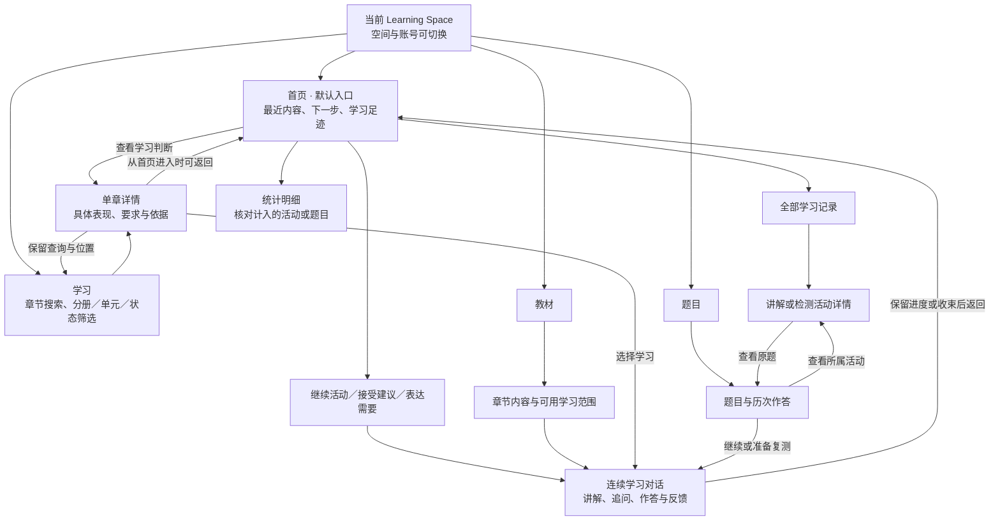

图中实线表示明确操作可到达的页面或内容，不表示每次都经过全部节点。未结束的独立检测仍须按原规则收束，不能通过首页或空间切换绕过；页面跳转、活动次数及原型反馈均不直接更新学习评价。

| 页面 | 主要内容 | 信息边界 |
| --- | --- | --- |
| 首页 | 当前课程、醒目的学校课堂进度及更新入口、DeerMind 最近关注内容与活动位置；一项主要续学或建议；近期学习足迹、当前错题存量、今日时间及常驻输入 | 只展开当前最相关的一个主题，不平铺所有章节；最近打开的章节不等于学校教学进度；活动统计不等于掌握程度 |
| 学习情况 | 教材章节目录、名称／路径搜索、分册／单元／状态筛选；单章具体表现、变化、要求与依据 | 每页最多 12 章；不重复首页活动仪表板。目录状态的单位是学习要求项数，不能转换成掌握百分比 |
| 教材 | 已采用的教材结构、章节内容、可开展学习的范围 | 用于选择内容，不代替评价查询；空间创建仍由空间管理承接 |
| 题目记录 | 一题一条记录，按来源、章节、原作答日期及错题／未作答／待判定筛选；详情保留历次尝试并关联所属活动 | 正确和错误属于一次作答，讲解与订正属于经历，不在题目上设置“已掌握”状态 |
| 全部学习记录（二级页面） | 首页进入，按日期及活动类型查看讲解、检测及对应题目 | 继续同一讲解不增加讲解次数；有提交但中途结束的检测须注明 |
| 当前活动 | 连续对话承载图示、作答、检测与反馈；展开时保留进入活动的右侧页面及常驻输入 | 教学中必要内容原位展开；已结束检测不能再提交，返回和恢复保留原上下文 |

**首页内容与取舍。** 首屏的重点是认出当前课程、学校正在学的章节和 DeerMind 最近的学习起点，并能直接更新课堂进度或继续学习；有实际可处理事项时明确说明。学习状态只保留一项与当前主题有关的反馈及详情入口，不把详细章节统计复制一遍。近期活动数字在其后辅助回顾，避免累计量压过当前学习任务。

| 内容 | 学生能回答的问题 | 展示和计量边界 |
| --- | --- | --- |
| 学校正在学什么 | 学校目前教到哪里，上次确认后是否有变化 | 首页课程标题下方独立显示章节和更新按钮，已填写时显示确认日期；未知有明确提示，两页共用同一进度，不与掌握评价合并 |
| 最近在学什么 | 上次在处理哪个问题，停在哪里 | 按最近实际活动选择主题；恢复原对话与草稿。无活动时仅呈现有依据的建议或自主选择入口，不虚构课程进度 |
| 一项学习反馈 | 最近哪些表现已有依据，还有什么不清楚 | 用学生能理解的话表达，链接到单章学习情况。新活动尚未形成正式评价时明确说明，不用活动量更新预写反馈 |
| 继续或建议 | 现在可以做什么 | 一个主要动作。优先续学或查看最近结果，再考虑有效建议；建议依据可展开，允许暂不安排。其余活动从“全部学习记录”查找，不与首要继续入口平铺 |
| 学习足迹 | 最近实际参与了多少学习 | 默认近 7 天，可切换 30 天；学习天数、开展讲解、已结束检测各有不同计量单位和事件条件，完整业务口径唯一维护于 [Requirements §3.11](../phase-3-definition/MVP_Requirements_and_Acceptance.md#311-首页内容与活动统计) |
| 当前错题 | 现在保存了多少道曾确认出错的题 | 独立标为累计存量，不随近期时段切换；按不同题目去重。订正后仍可有错误历史，不把存量标成“尚不会”或待办数 |
| 今日时间 | 今天还能安排多少学习 | 跨空间累计，沿用每日总使用时间上限。未接计时显示未知；评审样例与真实计时分开，不锁屏 |
| 直接表达需要 | 想问新问题或带一道题，在哪里开始 | 底部随时输入或附图；发送后正文保留处理反馈，完整聊天历史按需展开。登录次数、消息数、API 次数不放学生首页 |

“全局”表示产品入口与重要信息的聚合，不表示把校内和校外的个人状态合并。除既有的每日总投入外，统计、建议、评价和记录均限定当前空间。没有可靠数据时显示未知；只有覆盖范围和记录完整性足以支持时才显示 0。

**原型的资料来源。** 2026-10-17 的首页计数和 30／300 章目录属于旧结构走查资料，见 §7.3 的历史版本，不能用它们描述当前 V2 的实际数据。本轮新建课程有当堂活动、使用记录及明确标注的预设评价（C13）；正式 Evaluation 未接入，任意输入不会被自动套入预写结论。本轮四页已改用共同展示口径，固定默认课程与新建课程分别读取各自 mock 记录，其他未准备空间显示空状态。统计只能来自相应展示、提交与结束事实；当前 mock 不是正式 Evaluation 的实现。

**信息取舍。** 学习情况不常驻显示教材收录章数、全册覆盖或内容准备进度；这些属于教材内容信息。评价不足只在受影响章节及判断依据处说明，不用全局说明挤占学习状态。没有查询条件且无需分页时不另列章节总数；搜索、筛选和分页时保留结果数量，用于确认查找范围。原型规模说明留在评审工具，示例性质仍由评审栏和相应状态标注。

**课堂进度。** 按 [Requirements §3.12](../phase-3-definition/MVP_Requirements_and_Acceptance.md#312-课堂进度与学习状态的区分) 以首页作为主要查看与更新入口：在课程标题下方用独立浅色区域显示“学校正在学”、章节名称和“更新课堂进度”按钮，确认日期作为辅助信息。未填写时显示“学校学到哪了？”和“更新课堂进度”；明确未知时显示“暂不确定”，不以旧章名冒充当前位置。学习情况保留一行轻量上下文及更新入口，章名旁加“学校正在学”标签。首页与学习情况共用同一记录和更新弹窗，标签不使用达标图标，也不进入三类掌握项数。详细时间、来源和更新历史放在弹窗。窄屏按课堂进度、继续或建议、近期学习摘要的顺序呈现，避免新增内容把主要学习动作挤出首屏。

更新弹窗提供当前章节选择和可选小节说明，可明确选择多章；长目录可搜索名称、分册、单元并分批显示，每页最多 8 项（长目录弹窗的搜索与分页尚待下一轮落实）。保存前可以核对已选内容，也可以选择暂不确定。保存追加报告，取消或 Escape 不改变当前进度；关闭回到原入口，原列表筛选和滚动不变。已有选择不在当前目录时不悄悄丢弃，要求重新核对或设为未知。家长在自身的孩子／空间上下文中查看同源信息和历史，没有更新控件。

**图 UX-13　课堂进度更新与掌握评价分别维护**

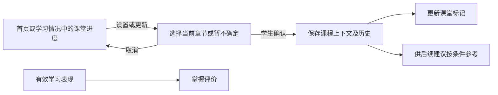

图中课堂进度没有通往掌握评价的直接连线。原型手动选择与本地保存已接入；没有实际学校进度输入时保持未填写。自然语言候选、初次创建空间时的询问及正式推荐使用仍须按需求接入完整流程；不以示例语句或关键词伪装为语义理解。当前教材标识是原型参考版本，不能当成正式出版版本。

**查找与返回。** 学习情况默认展示目录，章节反馈在单章详情阅读。单册不增加分册选项，多册可先选册再选单元；重名章节展示完整路径。筛选重置页码，返回保留查询、页码、滚动位置和焦点；从首页直接打开章节也有返回首页的路径。详情刷新后仍能凭 URL 返回目录条件。长名称正常换行，窄屏将行内状态移到名称下方。正文与输入区分别占位，不相互覆盖。

### 2.4 家长端：先理解情况，再查依据与咨询

家长主导航采用“概况、咨询”，账号与关系作为辅助入口。“概况”以当前孩子和空间为范围，首先呈现章节状态、覆盖与重要限制；孩子近期做了什么是依据入口之一，不让“本次活动”代替整体认识。只有一个有效关联时直接进入该孩子，多关联时在同一位置切换，不合并孩子或课程的判断。

**图 UX-11　家长查看、询问与提报复核**

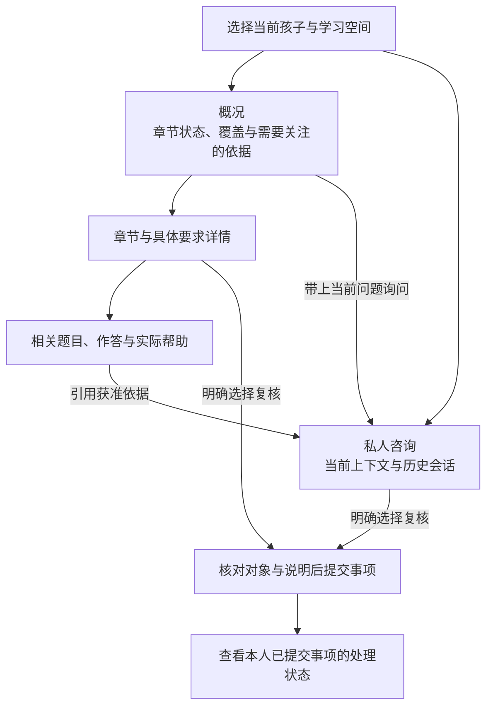

箭头表示操作或授权范围内的引用。咨询不是自动提交的复核，也不是学生作答；查看题目后没有替学生订正或派题入口。复核入口及处理状态从相关结果或咨询内进入，不新增面向孩子的任务管理功能。

概况沿用三类章节项数，近期作答统计另列，不新增“综合能力分”或没有依据的进步趋势。家长可从概况快速判断哪里值得进一步了解，详情说明是缺少证据、已有需加强表现还是结果正在修复。学生和家长读取相同有效依据，但首屏重点和操作不同，不能仅把学生按钮禁用后当成家长版。

咨询历史按当前孩子和空间组织，列表给出可辨认的主题、最近时间与相关对象；选中后继续该段，完整消息按需加载。切换上下文保留各自草稿，不携带另一孩子的内容；私人咨询删除、学生资料只读及关联失效遵守 FLOW-013 和 AUTH-001。

### 2.5 管理端：编辑定义与观测运行分别组织

后台以新版管理员端为基础。管理员在对象所属页面直接新增、修改和保存，不再经过维护中心、审核或发布。需要查个人资料时仍执行相应权限检查；普通模型编辑不要求填写个人资料查看用途。

**导航与页面分工。** 一级菜单按管理员要完成的工作组织，二级菜单选择具体范围：

```text
观测
├─ 运行总览
├─ 交互审查
├─ 空间观测
│  ├─ 领域空间
│  ├─ 学习空间
│  ├─ 评估空间
│  ├─ 交互空间
│  ├─ 智能推理
│  └─ 模型变更
└─ 学生状态
管理
├─ 模型管理
│  ├─ 领域空间
│  ├─ 评估空间
│  └─ 交互空间
├─ 课程管理
│  ├─ 教材管理
│  ├─ 学习目标
│  └─ 学习空间
├─ 用户管理
└─ 系统配置
```

“模型管理”编辑共享定义，“空间观测”查运行记录、变化和待核对情况，两者不是两份模型目录。“课程管理”只是把教材准备、目标维护和个人采用放在相邻入口，不新增 Course 模型对象。空间观测的六项选择移到侧栏，页面内不重复放一套导航。

父菜单负责展开、收起；直接打开详情时展开所属菜单并标明当前位置。切换观测空间保留适用的学习空间和日期条件，清除上一空间专属的对象类型、搜索和详情。列表筛选、分页和返回位置随链接保留。

**领域空间：先找领域，再管理三类对象。** 领域列表支持查找和新建。进入领域后分为 TaskTemplate、SolutionTemplate、KnowledgeComponent 三个子面板，不另设“任务模板交互预览”入口。新建领域没有自动生成的教学内容；未知领域地址不能退回另一个领域冒充成功。

| Task 详情页签 | 内容与操作 | 这样组织的原因 |
| --- | --- | --- |
| 任务定义 | 基本定义、对象与参数、条件与关系、允许的变化、适用边界分别展示并就地编辑；最后两项分成两个卡片 | 管理员能只改一个部分，同时分清可变条件和不适用情况 |
| 方法 | 用表格列出直接关联的 Solution、方法说明和适用条件；点击名称进入方法详情 | Task 层只看直接方法，不把方法内部的子方法摊平 |
| 知识 | 按方法及其递归子方法汇总 KC，去重后列出名称、说明及来源方法；可进入 KC 详情 | Task 不直接编辑 KC 关联；同一 KC 被多个方法引用仍只列一条，来源保留 |
| 实例 | 表格展示题目、参数、答案及来源，支持生成、导入、编辑；保存时检查归类和题目有效性 | 管理员管理具体题目，反向归类作为保存检查，不另设归类工作台 |

Task 的 KC 只通过 Solution 递归汇总；没有方法就没有可汇总的 KC。方法自身可直接引用 KC，也可选定子方法。未选定、缺失引用或循环显示建模缺口，不伪造完整知识集合。对象可以先建立再补内容；用于完整教学或评价前，Task 至少有一个可用方法，该方法直接或递归具有必要知识依据。字段、例子及保存边界详见 [Domain Foundation §2](MVP_Domain_and_Content_Foundation.md#2-核心概念与领域规则)。

**KC 对应关系的阅读要求。** 从 KC 查看关联时，需要说明它在哪些适用 Task 的哪些 Solution／子方法中被使用，以及具体作用、条件和版本；反向路径来自同一套引用，不让管理员另填一套 Task–KC 对应。应区分“使用了这个知识”和“任务明确要求展示该知识的理解或使用”；课程需要后者却缺少合适任务时，显示覆盖缺口。知识理解任务沿用已有 Task／Solution 编辑逻辑，系统的教学安排仍在交互空间管理。详细定义和例子统一见 [Domain Foundation §2.5](MVP_Domain_and_Content_Foundation.md#25-kc-的任务与方法对应关系)。本批只补文档合同，KC 完整反查与覆盖提示尚未新增页面或截图，不能按现有静态列表声称已实现。

实例检查不通过或归类不确定时，不能存为该模板的已归类实例，输入保留供修改。这不阻止保留学生原始上传材料或待映射记录。当前生成使用固定样例，归类及答案检查结果由 mock 场景控制；文本导入不是扫描识别，页面可操作不证明语义算法已经实现。

**评估空间：以 Task Claim 为中心。** 保留 V2 的 Claim 列表及详情组织，关联当前领域的 Task，支持页面内直接编辑以下内容：

- 定义：唯一任务引用、适用范围、责任、条件、质量要求与允许帮助。
- 方法条件：可用方法及任选、指定或分别覆盖要求；不能把使用方法 A 的表现自动当作方法 B 的证据。
- 评价方面：默认独立完成、理解与解释、迁移、延迟保持；每方面写清标准和证据要求，有依据地裁剪或扩展。尚未检测不等于不适用。
- 证据解释：针对相关方面说明什么表现可支持、反对或暂不能判断，以及适用条件。
- 推断说明：证据怎样汇总，冲突、缺证据和时间变化怎样处理，结果需要说明什么。

四方面属于同一 Claim，不创建四个顶层 Claim。KC 不创建个人 Claim 或 Belief。这里是有限字段的直接编辑，不是任意代码、提示词或全系统规则编辑器；保存定义也不直接改变个人能力判断。正式交付要求引用准确版本，当前内存 mock 的关联不能替代工程版本合同。

**交互空间：教学定义单独管理。** 以教学蓝图组织开始、阶段、分支和结束，阶段引用可复用策略，通用规则约束选择与调整。具体字段、操作、三种学生情境及实际截图见 [§3.9](#teaching-model)。这里编辑教学定义，空间观测查看实际运行；保存定义不更新个人 Belief。

**课程管理：教材、目标、个人采用分三步查看。**

| 页面 | 主要组织与编辑内容 | 必须分清的关系 |
| --- | --- | --- |
| 教材管理 | 教材列表 → 教材内章节目录 → 章节内容、映射和来源；保留当前章节，直接维护映射与来源定位 | 章节引用 Task，并选择该任务允许的方法；章节 KC 由选中方法递归汇总。书内页码、文件位置及参考来源可查，不重新定义领域对象 |
| 学习目标 | 选择教材和章节范围 → 关联 Task Claim → 为每个 Claim 配置具体学习要求、评价方面与达标标准 | 要求说明方法条件，并核对章节映射能否支持；缺口不靠放宽 Claim 消除。要求项数、Claim 数、方面数不是同一个统计分母 |
| 学习空间 | 按学生和课程查空间 → 课程范围 → 学习要求与个人状态 → 采用版本和历史 | 学生创建并选择教材与目标；章节在当次学习或检测时选择，后台查看采用结果。当前定义、空间采用版本、个人 Belief 和目标达成结果分别显示，不从教材进度推断掌握 |

保存教材或目标保留编辑结果，管理员应用后更新学生当前引用，学生无需手动维护；已发生的活动仍按当时版本追溯，见 §3.2。修改 Claim 定义不直接改写个人 Belief，也不能仅因保存定义就宣称旧证据已经重新解释。后台没有因此取得替学生新选课程或合并不同空间个人记录的权限。

**交互审查：活动 → 轮次 → 步骤。** 列表先定位活动；详情保留瀑布图与步骤详情，按轮次查看输入、候选、校验、拒绝／重试、提交和实际行动。选中的轮次、步骤及返回条件进入链接。相关学习空间、Task Claim、目标和当时采用版本可追溯。

| 信息轴 | 回答的问题 | 不能混同 |
| --- | --- | --- |
| 执行状态 | 这轮处理完成、失败、中止，还是尚未结束？ | 一次候选拒绝后重试成功，不等于整个活动失败 |
| 审查情况 | 是否有人核对、发现疑点、确认问题或保留未决？ | 没被标记问题不等于模型判断正确 |
| 评价结果 | 哪个 Claim 方面得到支持、反证或仍缺证据，目标要求是否满足？ | 学生需加强不是系统执行失败，活动结束也不等于已掌握 |

核对意见不覆盖原始事实或直接写入新的 Belief。真实会话继续只读显示实际保存的输入、输出、错误与调用信息；缺少正式 Evaluation、逐阶段 Trace 或展示回执时明确缺失。人工活动的步骤、参数、时长及 token 值标为 mock，不补进真实记录。

**空间观测：先看运行，再下钻对象。** 各空间显示所选范围内的运行概况、变化和待核对记录，保留对象详情与活动追溯，暂不自动诊断。没有运行变化时不拿整套模型结构填满首页。

| 观测范围 | 重点查看 | 关联入口 |
| --- | --- | --- |
| 领域空间 | 活动使用了哪些任务和方法，引用及建模缺口 | Task／Solution／KC 只读详情、相关活动；修改转领域管理 |
| 学习空间 | 教材、目标的采用情况及其内容范围、就绪与版本差异 | 当前空间、采用历史、教材与目标 |
| 评估空间 | Evidence、分方面 Belief 及目标评价的变化、缺口 | Claim、依据、个人状态与对应活动 |
| 交互空间 | 请求、Observation、决策与实际行动，需核对的交互 | 活动、轮次、实际帮助及审查记录 |
| 智能推理 | 候选、校验、拒绝重试和提交情况 | 对应轮次与步骤；未记录的数据不倒推 |
| 模型变更 | 定义保存的变化、前后版本和采用差异 | 对象历史及所属编辑页；不恢复审批发布流程 |

日期条件筛选期间的事件和变化，当前快照仍表示当前情况，不能伪装成历史回放。统计按说明的对象或事件口径去重；搜索只筛相应列表。无记录、未接入、引用缺失、无权访问分别表达。共享定义可以关联多个空间，但个人 Evidence 和 Belief 始终按学生与学习空间隔离。

**学生状态：学生 → 学习空间 → Task Claim。** 首层找人，第二层看各自课程，第三层查看分方面 Belief、变化和证据。个人能力判断与目标达成结果并列区分，定义变化不能改写过去判断。不显示 KC 掌握分，不平均四个方面，也不把没有活动解释为不会。学生按稳定标识关联；同名不合并。

**运行总览：先发现需要查看的记录。** 汇总当前各空间及学习活动，明确时间范围和统计对象，分别呈现执行问题、审查疑点与评价结果。活动和内部步骤分别计数，避免同一次失败重复累加。费用、耗时等未取得时标未知，不记零。进入详情保留范围及对应活动／步骤，不用预写百分比冒充真实运行质量。

**用户管理：账号与亲子关系。** 沿用 V2 的可检索列表，按学生、家长、管理员及关系筛选，详情查看账号、关联、学习空间、必要确认和操作历史。没有学习空间的学生仍是独立账号。

1. 开户：核实后建立学生或家长账号；管理员账号保留初始配置，不新增多人管理流程。
2. 关联维护：查找两个独立账号，记录系统外人工核实依据；每条亲子关系单独建立、解除或重新关联，不通过另一名家长传递权限。
3. 账号找回：核实后恢复原账号，保留学习者标识、空间及历史，不另建学习档案。

家长和孩子各自的首次确认只读展示，管理员核实关系不等于代替他们同意使用。解除关系不删除学生档案，不影响其他有效关系。当前操作只改内存 mock，没有真实开户、改密或撤权，也未与旧家长端的关系数据联动。

**系统配置：保留现状。** 用户尚未决定放哪些内容，当前页面不调整。此前讨论的连接编辑、连通性测试及其他配置项不记作已确认的页面要求。REQ-020 的运行需要保留，后续再决定哪些应做成界面、哪些由部署工具承担。

**图 UX-12　查看依据后回到对象所属页面修改**

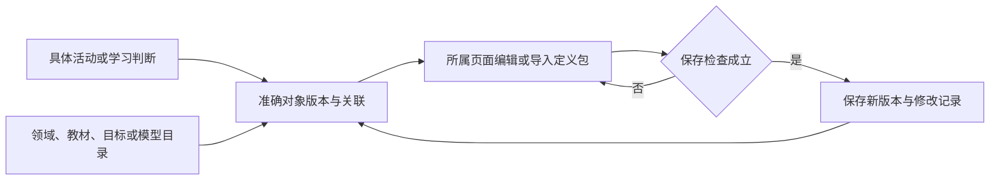

图表示查阅和维护的关系，不是教学调用顺序。当前工作是确认业务与交互：当前管理页与课程联动使用 mock，部分记录保存于浏览器；真实会话属于独立来源。各流程是否保留状态须按实际操作核对，不能统一假定刷新即重置或已实现跨设备持久化。自动版本、权限、并发和依赖失效是正式系统要求，不能用这些页面的本地保存宣称已经实现。

> **决定与实现索引：** DEC-026–030；[原型说明 §7.5](https://github.com/ivgotcrazy/deermind/blob/e0895562acb4757e9f80af888643ab1e27d48506/src/mvp_prototype_next/README.md#75-后台逐页调整与本轮结论归并v012)。该索引记录 2026-10-24 的后台归并；当前主流程及走查范围以 §3、§6 为准，G4 未通过。

### 2.6 典型操作路径与三端交接

以下路径用于检验结构是否能支持真实任务，不限制内容必须是某个示例，也不规定所有学习都要产生复核。

| 任务 | 起点到完成的路径 | 关键检查 |
| --- | --- | --- |
| 学生讲解并检验理解 | 教材目录 → 章节详情 → 分段讲解／追问 → 自愿检查 → 本次结果 → 相关要求及记录 | 请求讲解不先强迫检测；看完不算掌握；检查记录帮助条件 |
| 学生找回旧题 | 学习记录 → 题目与作答 → 按章、来源、时间或错题状态定位 → 题目及某次尝试 → 求助或复测准备 | 同题多次作答可分辨；返回保留筛选；复测必要性仍由有效认识与目标决定 |
| 家长质疑一次判断 | 概况 → 章节要求 → 相关依据 → 咨询解释；仍有疑问时明确提交复核 | 咨询不自动成事项；家长不能修改原输入；没有依据时不编造确定解释 |
| 管理员核查并修正 | 普通抽查 → 具体判断／活动 → 交互事实与评价依据 → 对应定义 → 所属页面修改保存 → 查看版本及引用 | 不预设一定是 Domain 错误；允许不改或未决；不直接手改 Belief |
| 管理员准备另一教材 | 教材目录新增 → 上传与处理 → 核对章节／参考 → 建立目标与领域映射 → 保存、检查各项可用条件并应用 | 处理完成不等于可供全部功能使用；同一领域可被不同教材引用 |
| 管理员恢复未知结果的任务 | 运行目录筛选 → 原任务详情 → 核对提交和已有结果 → 恢复原结果或确认条件后重试 | 使用同一任务身份；结果未知不直接重发；必要访问受事项授权约束 |

**图 UX-01　三端如何完成一次学习及必要维护**

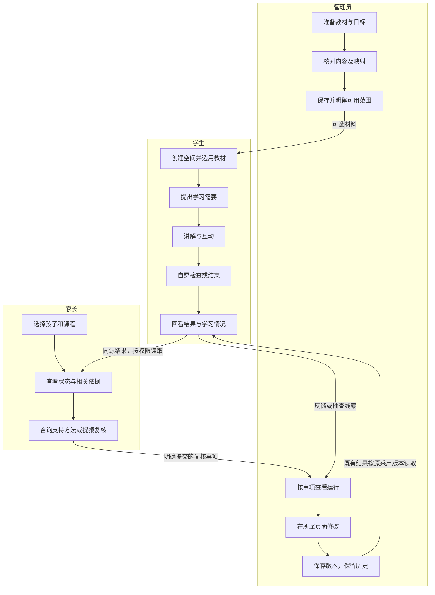

矩形表示业务步骤，分组表示角色，连线表示交接。图省略登录、授权和失败分支；家长咨询不会自动写成学生表现，管理员查看也不获得无关资料权限。处理结果只在相关对象和获准范围内呈现，不新增产品外推送。

### 2.7 长期记录与大量对象的组织

学生和家长不需要面对全站用户，复杂度主要来自自己长期使用的记录；后台同时面对用户数量、每人记录和内容版本增长。前者按空间和章节目次缩小范围，后者依靠可查询目录、对象详情与事项队列，不能统一做成长卡片列表。

| 数据集合 | 默认范围与查找方式 | 数据增加后的展开方式 |
| --- | --- | --- |
| 学生学习记录 | 当前空间；活动与题目分视图，按章节、时间、来源或状态筛选，题目文字可检索 | 先显示摘要，再按需载入更多；详情内逐次查阅作答，保留原列表位置 |
| 家长状态与依据 | 当前孩子和空间，按教材章、节进入具体要求 | 只展开相关记录；私人咨询另按主题文字、时间查询，不把所有历史铺在概况页 |
| 后台账号与学习活动 | 名称或标识定位账号；学习记录另限获准学生、空间、活动类型、状态与时间 | 列表分页及排序；同名结果附稳定标识；个人原文进入受控详情读取 |
| 教材与模型对象 | 教材、章节、对象类型、版本、有效状态、名称或标识 | 目录可检索，关系摘要进入引用列表；不渲染一张包含全部对象的关系图 |
| 运行与维护事项 | 状态、对象、任务类型、时间；待处理视图与历史视图分开 | 明确结果数量和查询范围，分批展开时间线及原始输入输出 |

检索不到、筛选后为空、没有相关记录、加载失败和无权查看分别反馈。列表计数只表示当前获准查询范围内的记录数量，不冒充全站总量。正文搜索不跨越角色和用途权限，不能通过命中片段泄漏受限内容。

这里的检索用于找记录；按名称、标识等明确字段检索不承担学习语义判断。意图识别、题意理解和证据解释仍遵循既有语义规则与模型合同，不通过关键词匹配替代。

分页大小、加载方式和默认时间窗口在低保真与数据密集场景中校准；章节近期作答统计的近 7 天／近 30 天／全部仍严格沿用 DEC-014。本节没有承诺全站即时全文检索、批量改写或自动诊断，也不预设后台容量已经验证。

<a id="3-活动与共性能力模型"></a>

## 3. 按真实操作展开的交互规格

本节按用户完成一件事的顺序组织。截图均来自现行原型的独立浏览器会话；图号就是截图文件名，可在[采集清单](assets/product-interaction/capture-manifest.json)找到路由、时间、视口、文件哈希和原型提交。图片中的 Mock 判定、示例载入和演示身份是走查工具，不属于正式产品控件。

本轮保留 V2 布局及产品范围，在原有对话、章节和后台视图内补齐同一场景的内容与反馈。以下区分两类内容：**操作规格**是已确认的产品行为；**原型边界**说明图中实际做到了什么。工程不能把固定题量、模拟判定或当前禁用的占位按钮当成最终业务规则。

活动表示一段有目标、过程与退出结果的产品工作，不是新增 Space 模型，也不固定工程 Agent 或服务数量。

| 活动 | 进入条件与用户动作 | 系统响应及结束结果 | 切换与恢复 |
| --- | --- | --- | --- |
| ACT-001 章节讲解 | 选择章节或直接说明章节疑问；教材与帮助条件可用 | 明确本次关键问题，分段解释、就地追问；可做阶段练习或结束检查，留下帮助及表现记录 | 暂离保留进度、草稿和追问；返回继续，明确结束后保留回看 |
| ACT-002 问题求助 | 输入具体题目，可无作答，可只请求提示 | 必要时局部澄清题意，按请求提供提示或解释，允许追问与练习 | 保留题目及来源；不因无作答归为错题，不因为同题重开而抹去帮助背景 |
| ACT-003 检测 | 从教材范围、问题复测或有效建议准备；用户看到范围、题量和用时后开始 | 固定本次题单，提交只回收件状态；结束统一反馈，列出已测与未测 | 实质求助先结束，再讲解；技术核对不结束；不得恢复已结束检测继续凑完整结果 |
| ACT-004 按需后续学习 | 系统在有效历史与目标下提出理由，学生选择接受 | 接受讲解进入 ACT-001/002；接受检测先进入 ACT-003 准备；也可暂不参加 | 开始前重核建议有效性，失效则撤去或更新；拒绝不作为能力反证 |

ACT-004 是已有活动的发起与选择流程，不建立“复习页面”或另一套教学引擎。记录、错题管理、教材浏览、学习情况、常驻输入和时间记录是跨活动能力。

### 3.1 FLOW-006：从教材扫描件到学生可选用的内容

**情境与目的。** 管理员拿到一份含文字、公式、示意图、空白练习表和统计图的教材扫描件，希望学生能读到准确的教材内容，并在已准备的章节开展学习。导入的结果是带原页来源、内容结构及模型关联的教材，不是一篇 OCR 纯文本。

**入口与前提。** 管理员从“课程管理 → 教材管理”进入。已有可关联的领域；新领域及模型对象在各自页面维护。正式权限为管理员，本轮用 mock 身份走查。输入可以是一本多页 PDF 或一组扫描图片，不要求逐页新建导入。截图采用北师大版六上数学书页 49—50、91—93；文件页序分别为 52—53、94—96，识别结果预置。

**流程总览。** 教材列表 → 批量输入 → 识别整理 → 原页核对与结构修正 → 关联任务和方法 → 检查目标与应用 → 学生选择教材与目标。允许先完成一部分章节；未准备部分不得伪装为可开展全部学习行为。

**步骤 1：从教材目录创建一项导入。** 管理员点击“导入教材”，进入新导入的上传阶段。列表中“尚未完成的导入”用于恢复同一项工作，不能每次继续都生成新教材。成功应用的教材进入教材目录。入口与目录同处一页，避免管理员必须先知道一串导入任务地址。

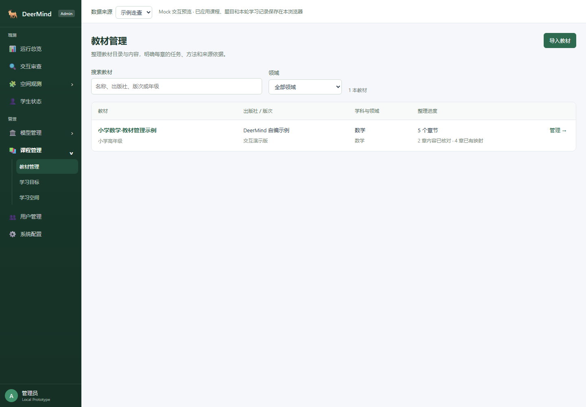

**步骤 2：一次输入扫描件，确认顺序与教材信息。** 在“选择 PDF 或扫描图片”中批量选文件；表格按当前顺序排列，可上移、下移和移除。管理员核对右侧信息，再点击“上传并开始整理”。“载入真实教材书页”是本轮复现入口，替代手工下载五张图片；正式产品不依赖该按钮。

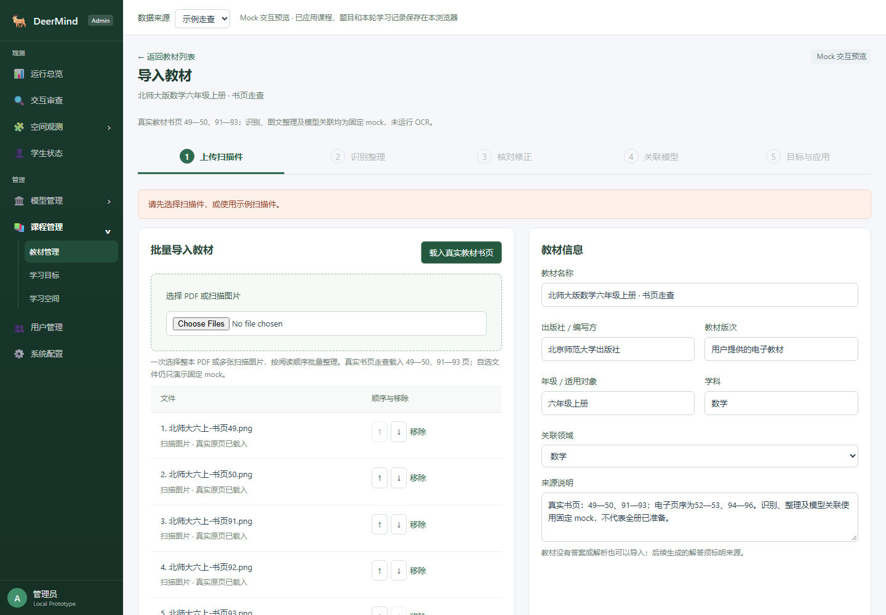

| 输入 | 如何填写或取得 | 对后续过程的作用与检查 |
| --- | --- | --- |
| 扫描文件 | 多页 PDF 或多张图片；至少选择一份 | 无文件不启动；不支持的文件类型给出错误。文件顺序用于整理阅读顺序，不等同书内页码 |
| 教材名称 | 管理员填写；当前可由首个文件名提供初值 | 必填，可修正；不能靠文件名自动确认教材版本 |
| 出版社、版本／册次、年级、学科 | 依据实际教材填写 | 描述材料身份；未知部分不编造，具体来源核验仍需完成 |
| 关联领域 | 从已创建领域中选择 | 必须指向有效领域；限制后续任务和方法选择 |
| 来源说明 | 记录材料来源、扫描范围及已知限制 | 与原件一同保留；后续仍能知道材料从哪里来 |

**失败与返回。** 没有文件时，停留在当前页，给出“请先选择扫描件”的提示，不生成识别结果；已填写信息保留。退出上传页后可从未完成列表继续。本轮验证了空文件拦截，文件类型与恢复检查见既有导入测试。整本教材的文件大小、页数上限尚未确定，属于工程启用上传前必须补齐的规格，见 §8。

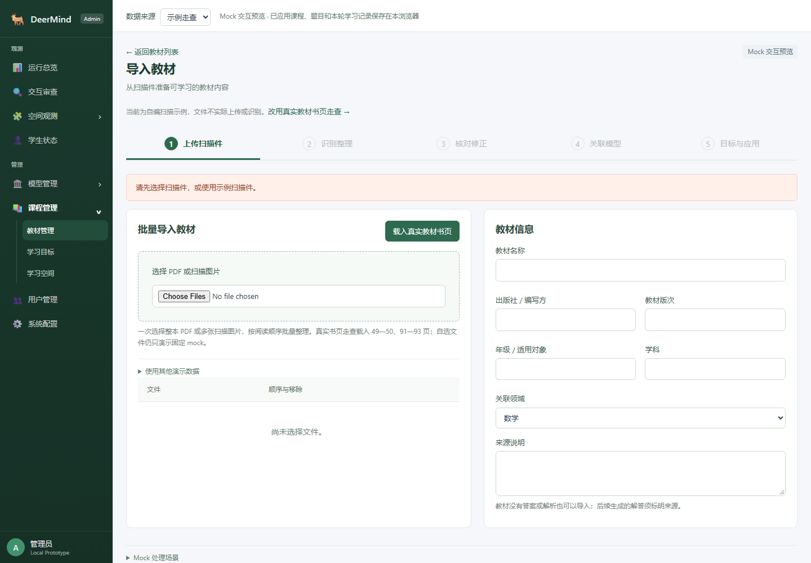

**步骤 3：查看识别整理状态。** 输入满足条件后显示处理中状态和进度。此时尚未形成已核对教材；不能显示为学生已经可用，也不能把处理百分比解释为内容正确率。成功后进入整理工作区，保留本次导入身份和原件。

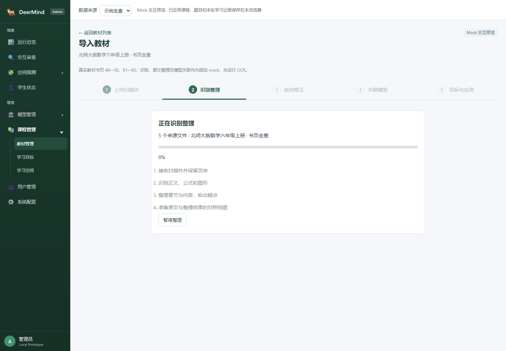

**原型边界。** 图中进度由计时器模拟，离开原型页面会暂停模拟处理；正式需求是处理任务可离页后继续查看，不能照搬计时器的生命周期。真实后台任务、暂停／重试细节尚未形成完整截图规格，本步只确认处理状态的位置与成功后的去向。

**步骤 4：在一个工作区对照原件和整理结果。** 左侧选择课题或内容，中央显示原始书页，右侧展示所选内容。原页高亮框与内容块关联，定位使用“书页＋电子页序＋页内区域”，不能只存一段无法反查的文字。内容可跨页，一页也可包含多个内容项。

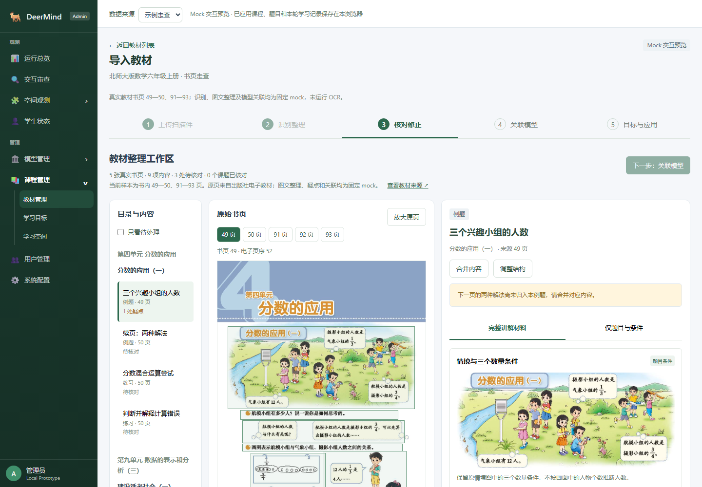

| 区域 | 用户要解决的问题 | 操作和结果 |
| --- | --- | --- |
| 目录与内容 | 我在核对哪一课，哪里还需要处理？ | 选择内容；查看待处理提示和课题核对状态。切换内容不改变原件 |
| 原始书页 | 整理结果是否忠实于原文、图和表？ | 切换原页、查看取用区域、放大核对；原件保持不变 |
| 整理内容 | 学生最终会读到什么？ | 分块编辑、合并跨页内容、调整结构和顺序；不是统一的整页文本框 |
| 课题确认 | 这一课是否已完成必要核对？ | 处理疑点后确认本课；确认不自动建立模型映射或学习目标 |

**为什么这样组织。** 教材的意义来自文字、图表和教学用途的组合。只保留 OCR 文本会丢失图中条件、图表口径和空白作答区；只保留图片又无法选取题目、关联模型或定位需要修正的内容。因此原件与结构化内容并存，以引用相连。

**步骤 5：处理跨页内容，不能直接把疑点标为通过。** 49 页例题的两种解法在 50 页。点击“确认本课整理结果”会因尚未合并而阻止确认；管理员点击“合并内容”，选择续页解法并确认。合并保留两个原页的内容块、教学用途及来源，不把同页其他练习并入例题。

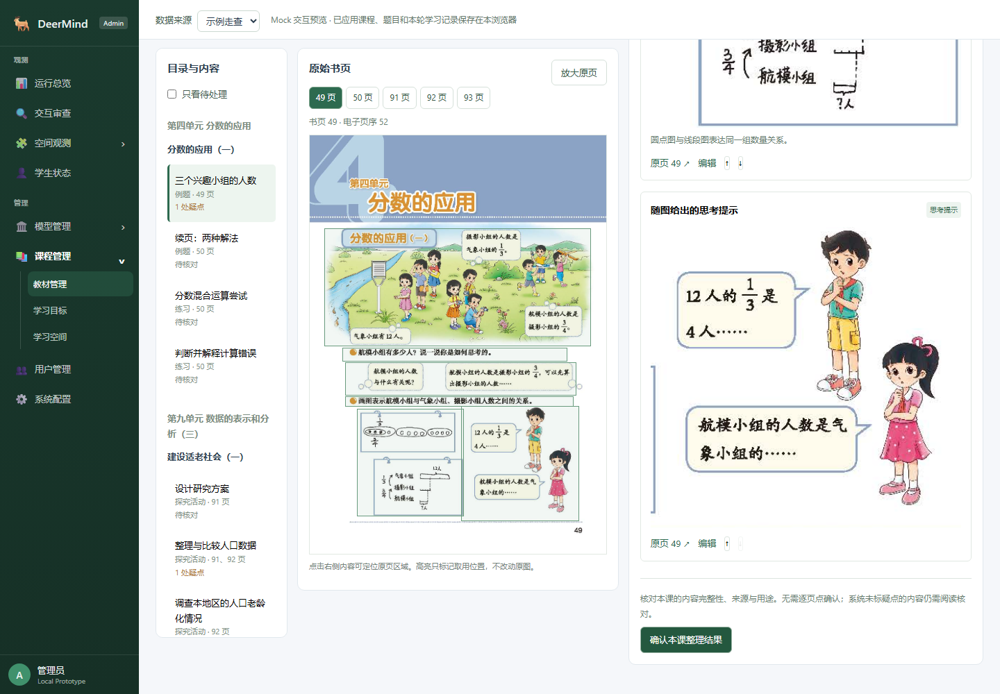

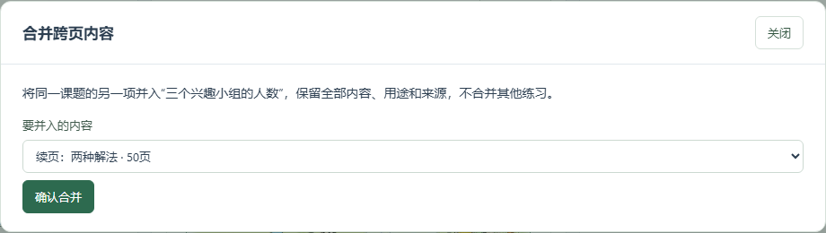

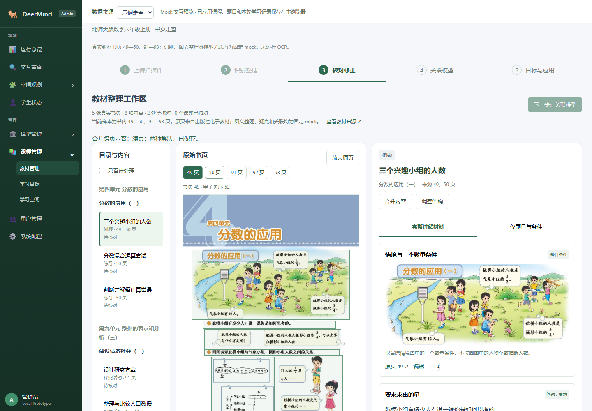

合并的输入是当前内容项及待并入内容项，输出是同一课题下的组合内容；原页不删除，来源不能被新标题覆盖。取消弹窗不修改内容。若实际应拆分而非合并，使用“调整结构”；该分支已有原型操作，但还未在本文形成逐步配图，不能将合并样例当成全部整理行为已完成。

**步骤 6：分别检查完整讲解材料和题目视图。** 在“完整讲解材料”中保留原书引导、解法和答案；切换“仅题目与条件”时排除提示和解法，保留作答所需条件、图表及空白作答区域。原书故意给出的错误算式若是判断任务的题面，仍属于题目条件，不能自动订正为正确答案。

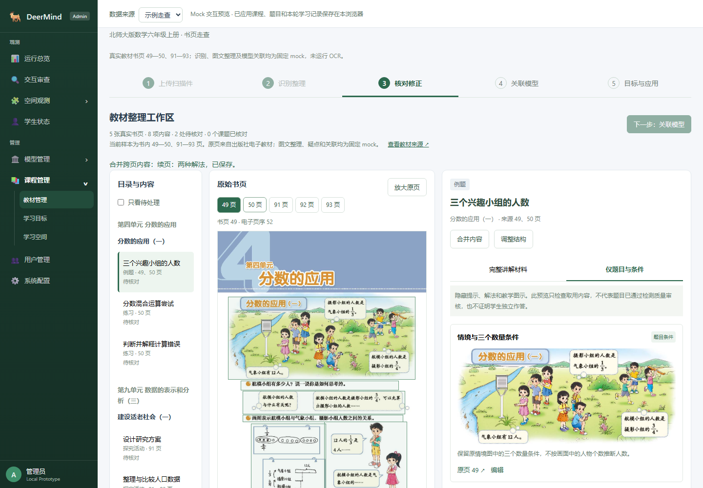

这里按内容块的教学用途组织呈现，不按是否含数字、公式或“答案”字样猜测。切换预览只改变展示，不修改原教材，也不意味着该题已适合独立检测；学生是否看过完整解法须另记实际帮助背景。

**步骤 7：编辑具体内容块，再确认课题。** 点击相应块的“编辑”，核对名称、用途、来源页和内容；保存只更新该块，取消不保留本次编辑。来源区域用于取用原页，辅助说明不能替代原图中的数据和条件。

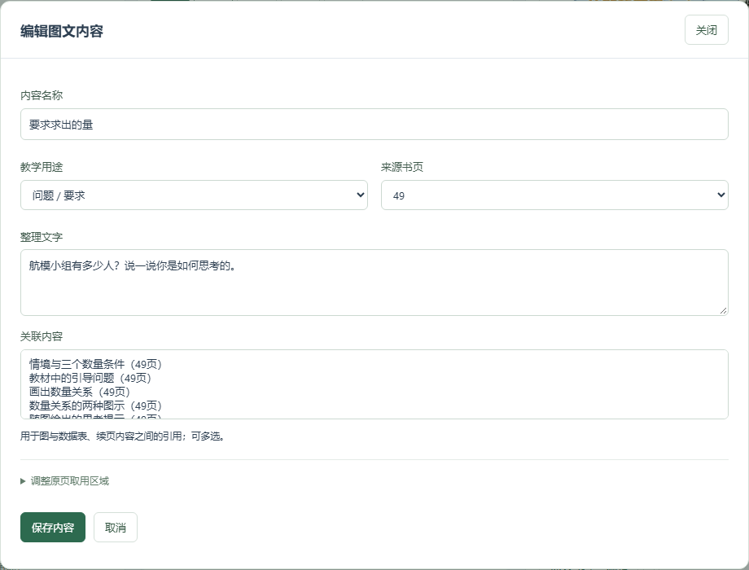

| 字段或控制 | 业务含义 | 保存结果 |
| --- | --- | --- |
| 内容名称、整理文字 | 对内容的命名及可读文本 | 修正整理结果，不改写原扫描件 |
| 教学用途 | 区分题目条件、提示、解法、答案、待填写区域等 | 决定完整材料和题目预览中是否出现 |
| 来源书页、取用区域 | 当前内容来自哪张原页的哪个区域 | 保留定位；区域用相对整页的坐标表达，必须处于页内且有有效面积 |
| 关联内容 | 图与数据表、续页、其他引用的连接 | 指向具体内容，不因标题相似自动建立连接 |
| 已处理疑点 | 管理员已对照原页核对该具体问题 | 与编辑结果同时保存；不能仅凭选中复选框推定所有内容正确 |

当课题所需疑点已处理，点击“确认本课整理结果”，展示本课已核对。内容核对状态属于教材准备，不属于学生能力评价；后续修改相关内容须重新核对受影响部分。

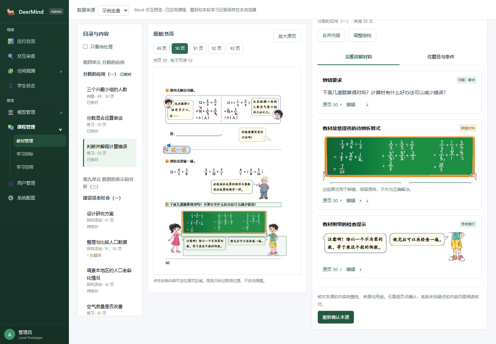

**步骤 8：用统计材料检查图表处理。** 91 页人数表的一列表头识别成“65岁以下人数”。管理员逐格编辑表头、数据及单位，改为“65岁及以上人数”，对照原页确认后保存。不要把整张表转成无结构文字，也不要把学生待填的空白表自动补成完成答案。

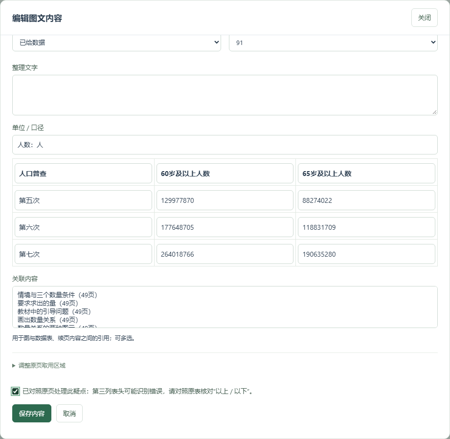

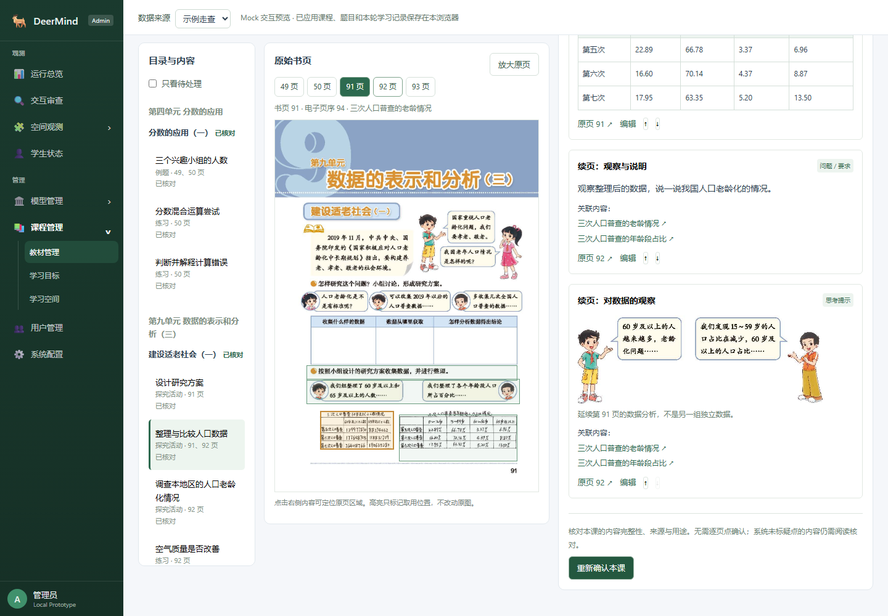

92—93 页的统计图需要引用 91 页的年龄段数据。管理员在图内容块的“关联内容”中选择具体数据表，保存后可沿引用反查。图的图例、比例、坐标和单位由原图保留；不能只给一句“这是饼图”的描述替代图中信息。

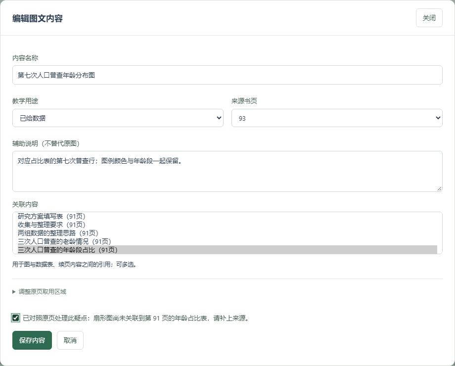

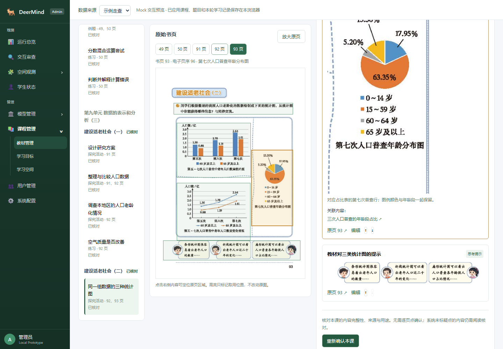

**步骤 9：建立章节到模型的关联。** 完成可用课题的核对后，进入“关联模型”。先显示建议，管理员点击“采用此关联建议”才将其纳入当前章节。建议有错时修改任务、方法和来源，不以识别完成自动接受全部映射。

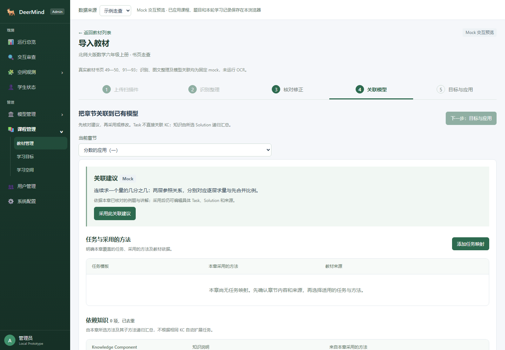

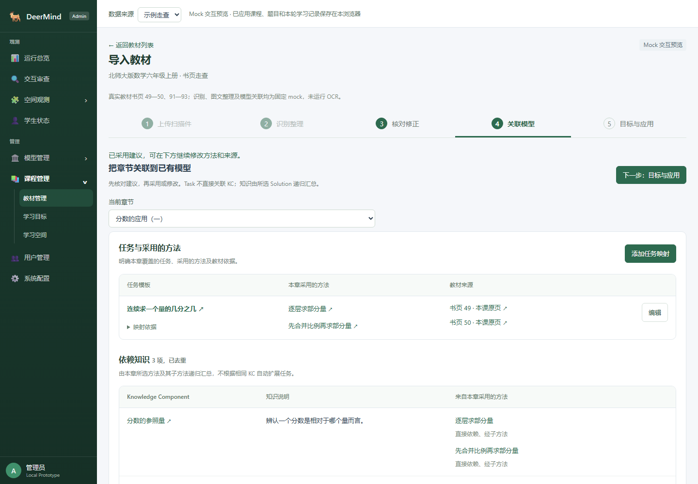

映射的输入是章节、TaskTemplate、所选直接 SolutionTemplate 及教材来源位置。所选方法必须属于该任务和领域；KC 由方法及选定子方法递归汇总、按身份去重，并保留来源方法。管理员不在 Task 或教材映射中手填另一套 KC 集合。

本样例对应“连续求一个量的几分之几”，不是下面讲解样例的“增加四分之一后是多少”。两者不能因为都来自分数教材就映射为同一个任务。关联结果供教学选内容和方法，也为目标引用提供依据；它本身不产生个人 Evidence 或 Belief。

**步骤 10：检查目标要求及应用条件。** 选择已有目标或点击“生成目标建议”，逐项核对学习要求、适用章节和达标标准。每项要求引用 Claim 的方面；“独立完成、理解与解释、迁移、延迟保持”在同一 Task Claim 内表达。生成的是可修改建议，不是管理员已经接受的标准。

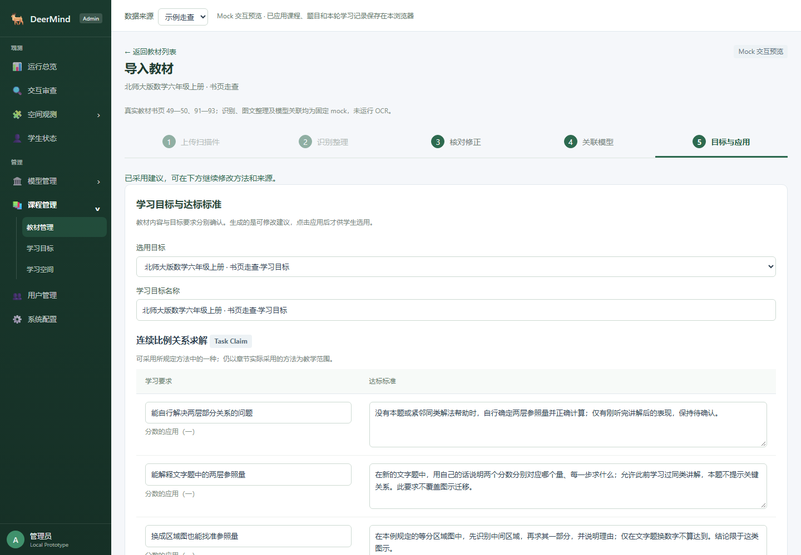

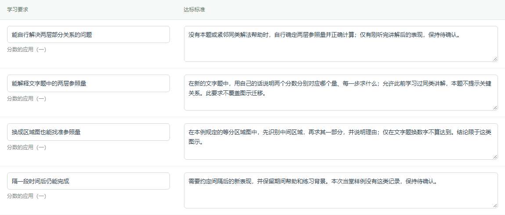

要求名称用于让学生理解，达标标准用于约束后续判断；两者不能混成一个“掌握程度”百分比。方法条件由 Claim 和章节选定方法共同限定；“任选一种”与“分别覆盖”不能互换。修改要求名称不等于修改所评价的 Task；要改变绑定或方面时进入目标管理完整编辑。

当前样例中有四项要求，不意味着每个任务必须展示四项、每章分母必然等于任务数乘四。正式要求项及标准仍由管理员维护；未知、未测和有依据的裁剪分别表达。

**步骤 11：应用，使学生可以选用。** 点击“应用并供学生选用”前，检查至少一章内容核对、模型关联、目标及要求是否齐备。缺项列出原因并禁用应用；已完成部分可先供使用，其余章节保持准备状态。应用成功后显示明确结果及可用范围。

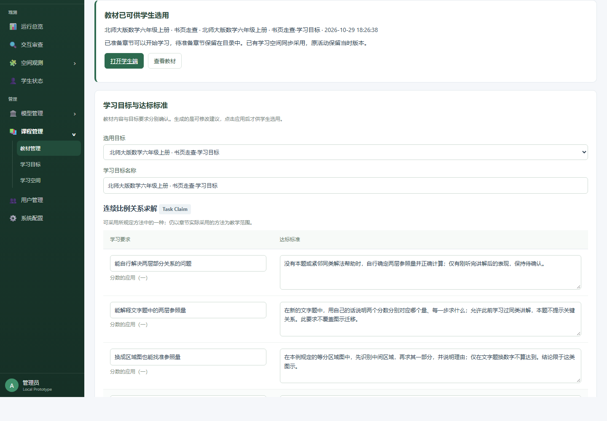

保存和应用的职责不同：保存保留编辑结果；应用使选用该教材与目标的课程取得新内容。MVP 不增加独立审核发布流程。全部试用学生可选择已经准备并应用的教材与目标，不再增加逐个学生的教材授权配置。真实身份及首次确认仍按已有权限规则执行。

### 3.2 FLOW-006／REQ-023：学生选用、阅读与课程更新

**步骤 12：学生创建自己的空间。** 学生从右上角空间切换器点击“＋ 新建学习空间”，选择管理员准备的教材及对应目标，确认后进入课程。学生不重新上传教材，不修改目标定义，也不在创建时保存一份长期章节范围。

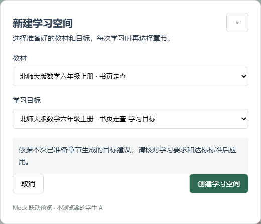

本步产生的是个人 Learning Space 与教材、目标采用关系；不会新建 Domain 定义或生成“初始掌握率”。校内和校外分别创建、分别积累个人记录。章节只在当次讲解或检测时选择，教材更新由管理员承担，学生端不提供版本维护操作。

**步骤 13：浏览目录并阅读整理结果。** 创建后按单元查看章节，搜索只过滤目录；可以展开已核对材料。每章分别展示阅读、讲解或检测的可用入口。学生选择“查看本课材料”后看到整理的图文，可切换“只看题目”；原题条件保留，完整解法隐藏。

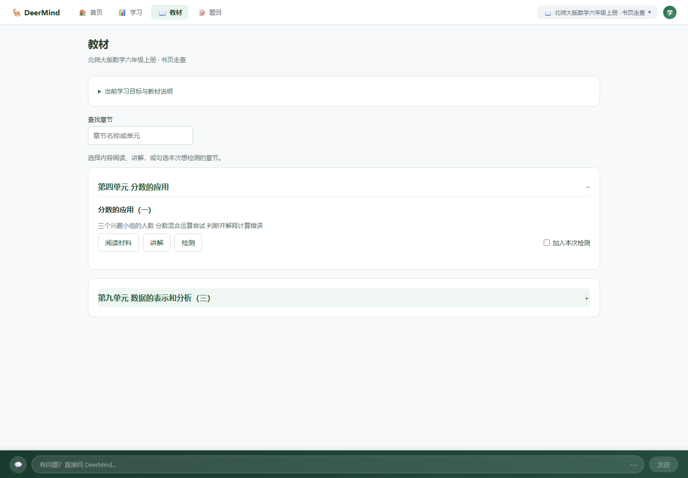

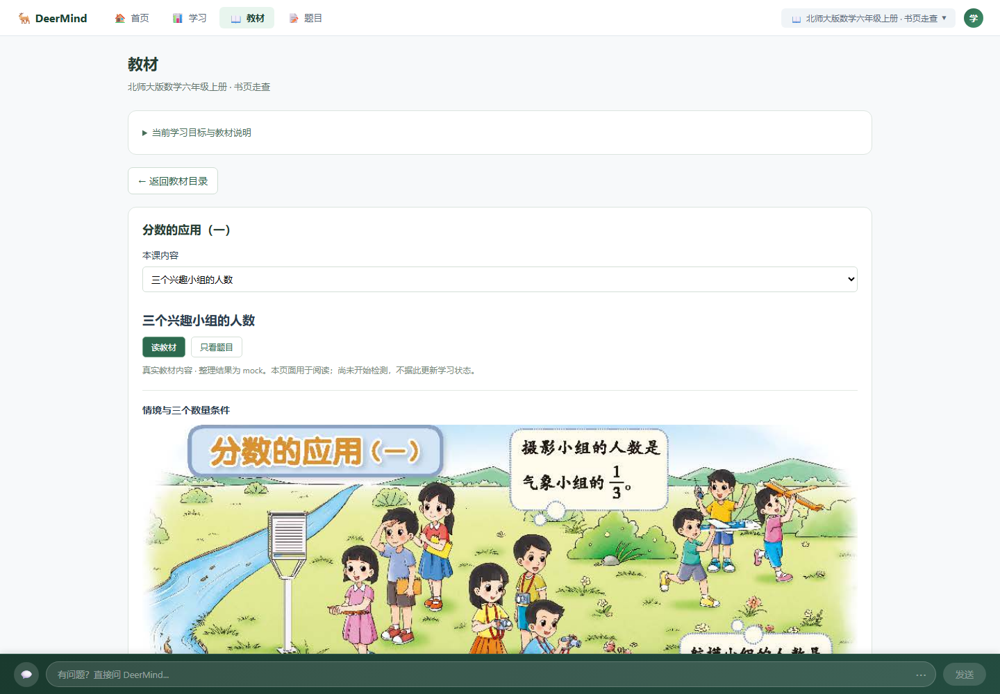

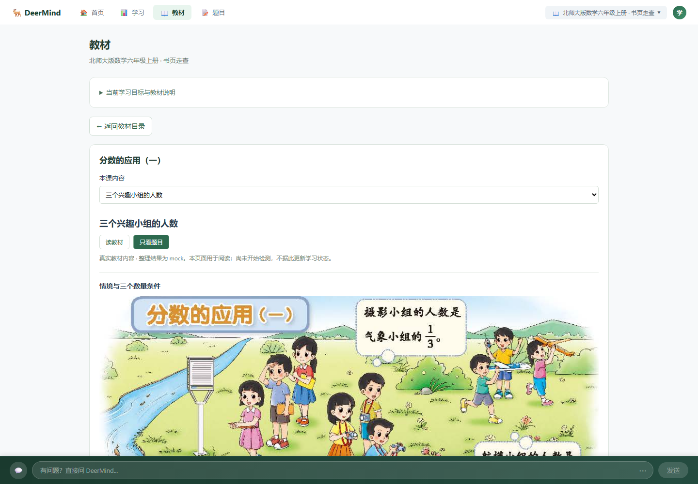

**本路径当前展示到哪里。** 同一课题可以继续进入讲解、练习、检测及反馈，详见 §3.4。第91—93页仍用于图表整理与阅读检查，没有为统计任务预写教学流程。功能可用与否按对应内容说明，不由“教材已应用”推断全册都已具备教学场景。

**更新分支：管理员修补后应用，学生无需维护。** 管理员修改目标并保存后，看到尚有待应用变化；点击“应用更新”后，学生选用的课程读到新版名称和要求。新活动使用新课程依据，已经发生的活动保留当时教材、目标和题目内容，不能改写历史结果。改变标准与学生能力改变分别处理。

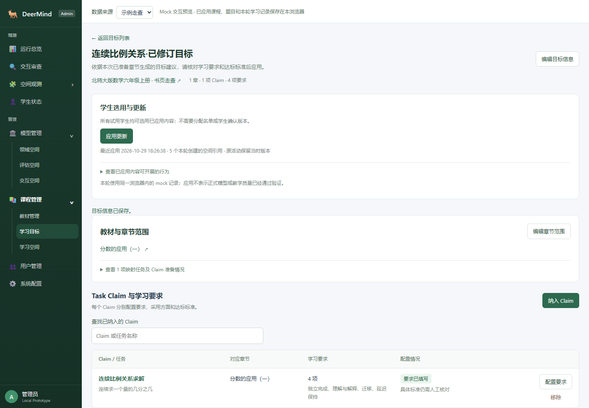

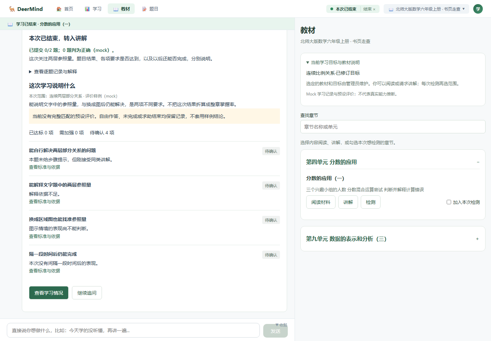

此行为承接 DEC-031、032，已同步到 Phase 3 和数据权限文档；OPEN-011 的产品选择已关闭，真实采用处理仍待工程验证。本文不据此授权重算历史未映射作答；这类作答在 MVP 中保留记录，不做补算。

**删除分支：取消未完成导入。** 教材列表的未完成项按行提供“删除”。点击后弹窗说明具体教材名称、导入草稿和整理内容的删除范围；“取消”返回原列表并保留草稿，“确认删除”移除该项。已应用教材不通过这个入口删除，不能用取消导入破坏已被学生选用的课程。


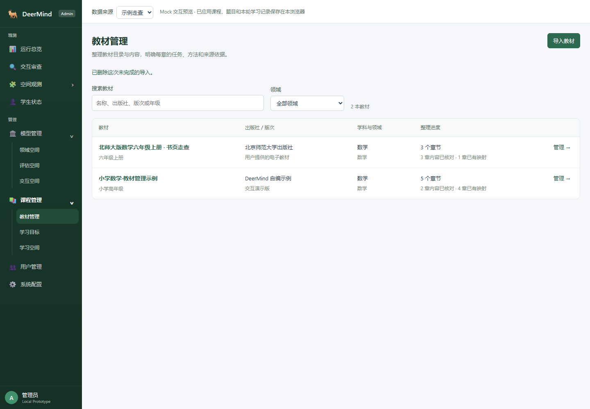

这条规则针对未完成的管理员导入，不替代学生学习资料隐藏规则。正式删除范围、存储清理与审计由工程落实；不能从本地 mock 删除推定真实文件已物理销毁。

### 3.3 任务实例：生成、检查、保存和复用

**情境。** 管理员需要为一个已定义的任务准备题目，学生学习时也可能需要新题。本节以同一教材中的任务“连续求一个量的几分之几”为例；题库中的题目定义与每一次实际使用记录分开。

**步骤 1：在任务内查看实例。** 进入“领域空间 → 具体领域 → 任务模板 → 实例”。列表展示当前任务相关题目；生成、导入、新建和编辑都在这一上下文中进行。题目关联哪个任务不是由管理员每次自由输入一个不受约束的标签。

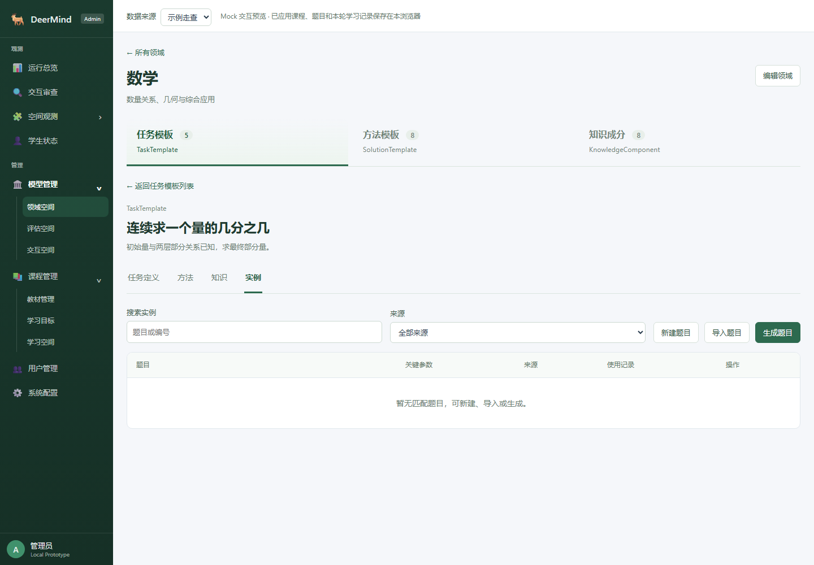

**步骤 2：生成候选，再检查保存。** 点击“生成题目”，生成候选后在编辑区查看题面、参数对应、参考答案、解题过程和来源说明。本例为30本书，其中2/5是科普，科普的1/2是动物类，求得6本；参数与两层参照关系同时保留。编辑后点击“检查并保存”。

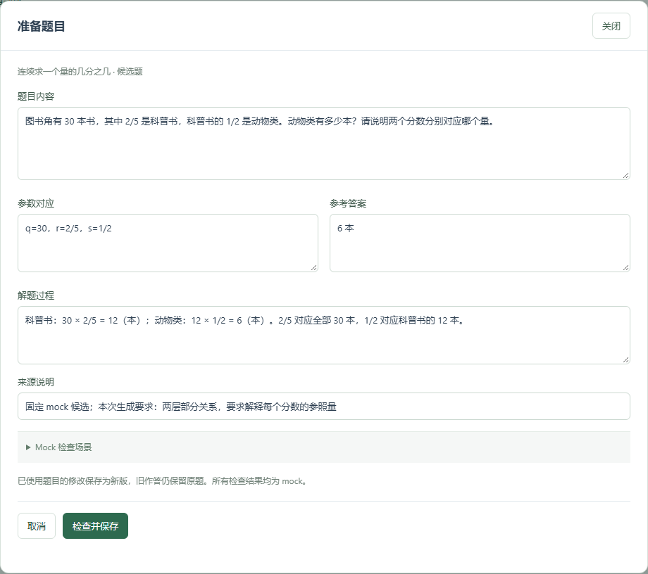

| 项目 | 具体规格 |
| --- | --- |
| 题目内容 | 包含解题所需条件与所求；图形属于题目内容的一部分，不能只在参考解法里提供 |
| 参数对应 | 记录实例与模板参数的对应；只改变数值不自动声明迁移 |
| 参考答案与解题过程 | 用于核对条件可解、答案及适用方法；不默认向检测中的学生展示 |
| 来源与变化 | 区分教材导入、管理员生成、学习中生成及来源题；没有来源题时不虚构派生关系 |
| 保存检查 | 检查题意、模板归类、条件、参考解答及方法适用性；失败或不能确定时不进入可用实例表 |
| 保存结果 | 形成题目身份和版本，记录检查；修改既有题不覆盖过去展示时保存的题目内容 |

当前候选与检查结果均为固定 mock。“模拟检查结果”仅为走查选择器；正式产品不得由学生或管理员随意选择一个标签替代必要检查。题量、生成策略和语义校验工程实现不由这张截图证明。

**步骤 3：确认保存结果或修正失败项。** 成功后关闭编辑区，题目进入实例表。若把“原有80本、增加四分之一、求总数”的题放入当前连续部分量模板，归类失败，停留在编辑区并保留输入；管理员可以修改或取消，不能用“保存成功”绕过错误归类。

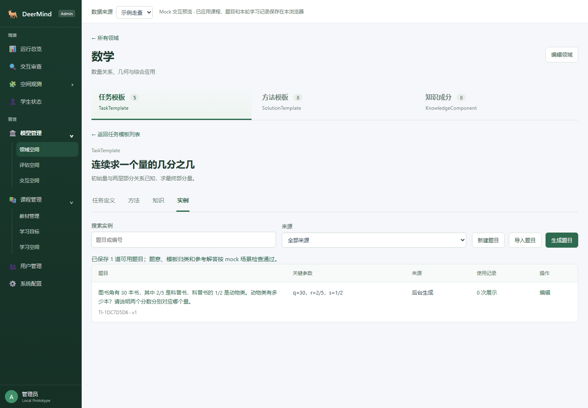

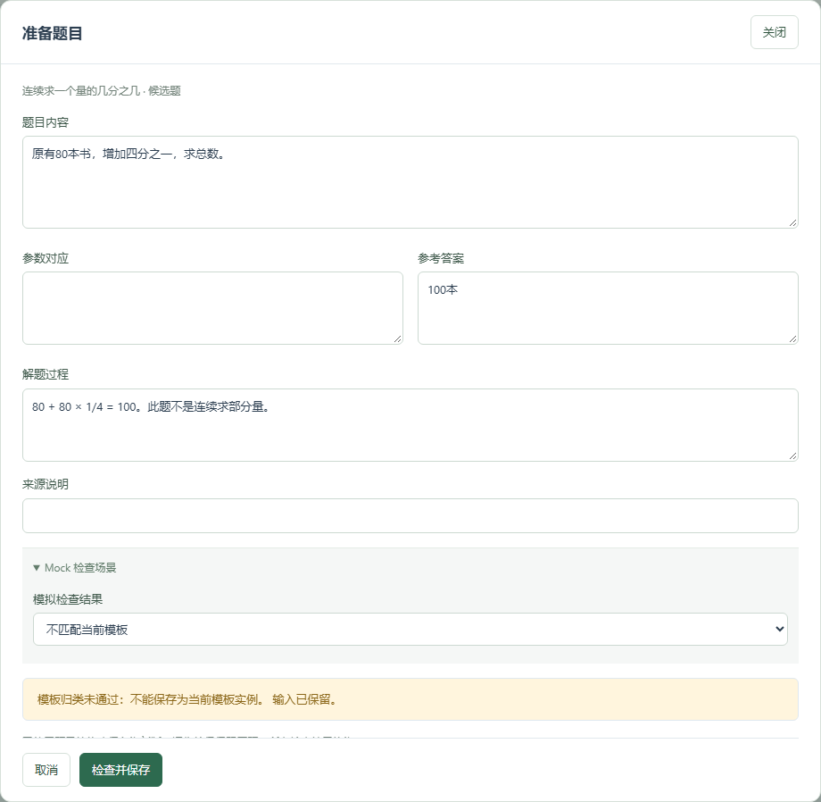

原始上传资料与已归类实例分开。学生上传的纲内新题暂时无法映射时仍可获得帮助并保留原始记录；不能因为此处归类失败就删除原题或拒绝全部帮助。管理员按需补齐模板，MVP 不追补这类历史作答的正式评价。

**学习中生成的业务顺序。** 教学选择已有适用题；确需新题时生成候选，检查通过后保存，再用于展示，并记录本次活动、用途、实际题目版本和帮助背景。不要求管理员逐题确认。生成但未展示不算学生见过，展示例题不算学生作答；旧题可以复测，但是否复测应由目标、Evidence 和 Belief 决定。

本轮教学复用已保存的30本书文字题，并使用40平方米区域图题；候选、检查及选择均为预设样例。准备失败时说明检测尚未开始，提供重新准备或暂不开始（C06）；没有检查通过的题目不进入检测。首版这条路径不增加人工跳过检查的入口，自动替换题的具体策略交工程实现，但不能改变先检查、保存再使用的顺序。

### 3.4 FLOW-001／FLOW-005：连续讲解、练习与检测

本节保留早期教材采用与后台记录的联动样例；新的学生教学交互以 [§3.10](#student-teaching) 为准，题内输入与 mock 判定选择不再作为新设计依据。本节是给定学生情况的一条具体样例，不规定所有学生从例题开始、依次完成固定题量。通用教学过程及不同起点的选择见 [§3.9](#teaching-model)。本节学生端走查使用预写内容，尚未读取管理员教学模型动态选择策略；已有真实对话入口也不代表这套教学定义已接入。

**情境与完成结果。** 学生选用 §3.1–§3.2 中的北师大版六上教材，从“分数的应用（一）”请求讲解。她应能弄清每个分数以谁为参照，尝试新题，在同一对话中得到当题反馈和学习要求的判断，并知道下一步可以做什么。管理员能看到同一案例的原作答、帮助背景、采用的标准及判断依据。

本例只覆盖本课中的连续两层部分关系；不把本课所有题目或整章都算成已经覆盖。管理员的目标与学生的反馈使用下表中的同一套定义。所有讲解、判定和评价均预先编写，不调用 LLM；这些样例展示期望的产品行为，不是学习效果或判断准确率的证据。

| 对象或表现 | 本例内容 | 与后续交互的关系 |
| --- | --- | --- |
| 教材与章节 | 第49—50页，分数的应用（一），三个兴趣小组的人数 | 从教材目录进入，保留原页来源；教材阅读与检测中的帮助条件分开 |
| TaskTemplate | `fraction-chain`：已知初始量及连续两层部分关系，求最终部分量 | 两个分数的参照量是任务要求；不混入“增加四分之一”任务 |
| SolutionTemplate | `S-CHAIN-A` 逐层求量；`S-CHAIN-B` 先合并比例 | 目标允许任选一种；讲解先用逐层求量，追问可看另一种方法 |
| KnowledgeComponent | 经方法及子方法汇总的参照量、求部分量、连乘与结合律 | 用于解释和教学；不生成个人 KC 掌握率 |
| Task Claim | `CLAIM-CHAIN`，内部区分独立、理解与解释、迁移、延迟保持 | 一次任务下看不同条件的表现；不能把一个正确答案扩成四方面都已掌握 |
| 讲解与练习 | 教材例题：12×1/3×3/4＝3人；练习：24×1/3×3/4＝6人 | 练习故意保留把第二层直接当成总量3/4的错误作答 |
| 检测第1题 | 30本书，2/5是科普，科普的1/2是动物类，结果6本 | 观察文字题中的两层参照量及解释；不是迁移证据的替代 |
| 检测第2题 | 40平方米苗圃，左侧3/5为花区，花区上半部为月季，结果12平方米 | 换用区域图观察是否仍能识别两层关系；图与题干共同构成条件 |

**步骤 1：进入讲解，先处理一个关键问题。** 学生点击本课“讲解”。左侧连续对话显示请求、题目和分段解释，右侧保留进入时的教材页面。先把“气象12人 → 摄影4人 → 航模3人”讲清，不一口气讲完整章。输入是当前空间、章节、目标与求助；结果是一次有明确主题的活动和实际展示内容，不产生掌握结论。

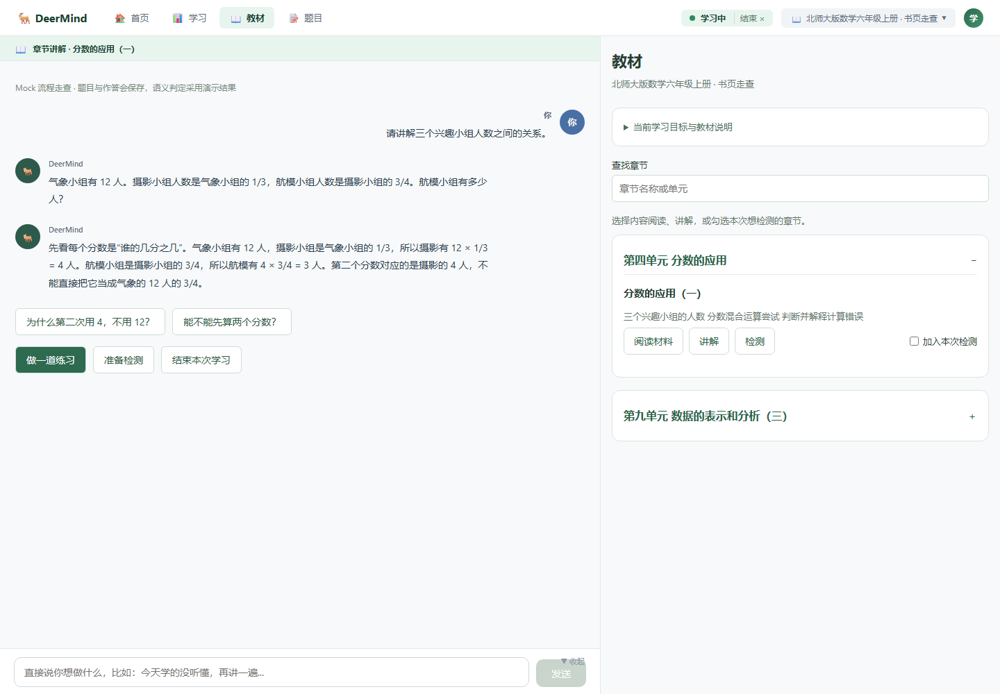

**步骤 2：追问在原处回答，能回到主线。** 本例提供“为什么第二次用4，不用12？”和“能不能先算两个分数？”两条具体追问。第一条说明参照量，第二条解释另一种 Solution。回答接在原对话内，原题与推导仍可回看；孩子可以继续练习、准备检测或结束。自由输入会保存，但原型明确没有理解未预置的问题，不编造回答。

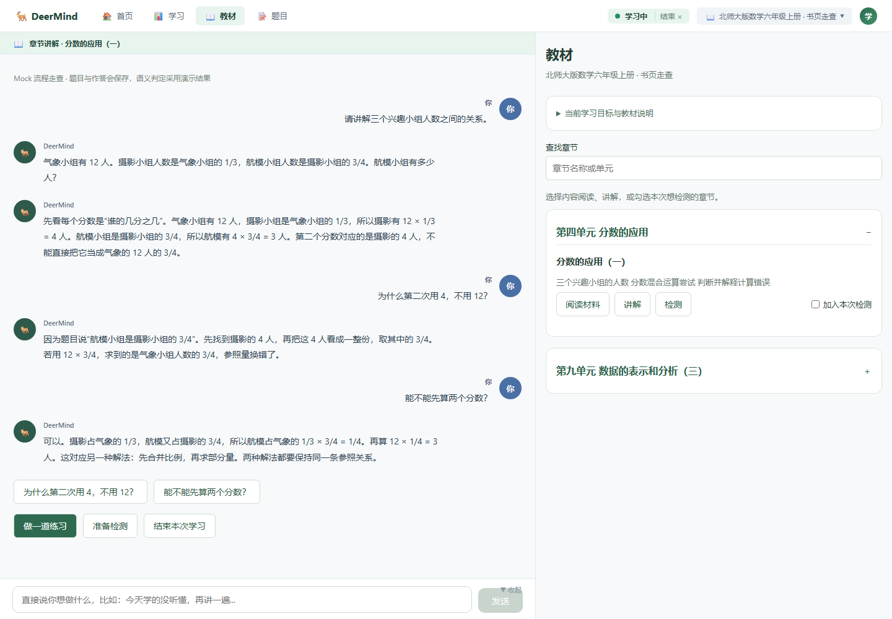

追问按钮是本次教学的可选建议，不是必须依次完成的教学步骤。正式系统如何根据个人状态选择建议由工程实现；产品要求是建议相关、可以忽略，追问后不丢失原来的题目与上下文。

**步骤 3：在对话中练习，提交后反馈。** 点击“做一道练习”，显示24人社团题。“答案和思路”是本题输入，空白不能提交；未提交的文字属于草稿。演示输入为“24×3/4＝18人，我用社团总人数来算”，选择 mock 错误判定后提交。

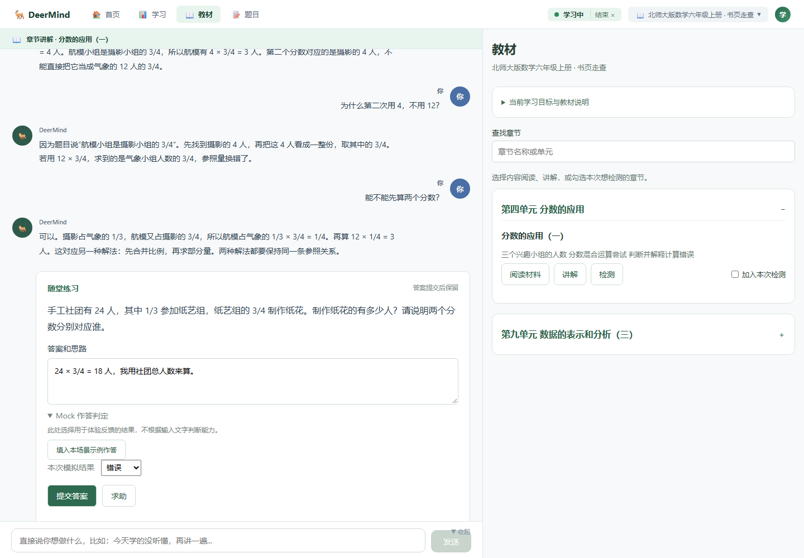

反馈指出应该先求纸艺组8人，再求其中制作纸花的6人；原作答和已获得的帮助继续保留。系统是在解释这次错误，不是在给学生贴“不会分数”的标签。练习中求助只转入讲解，未提交不算错误。

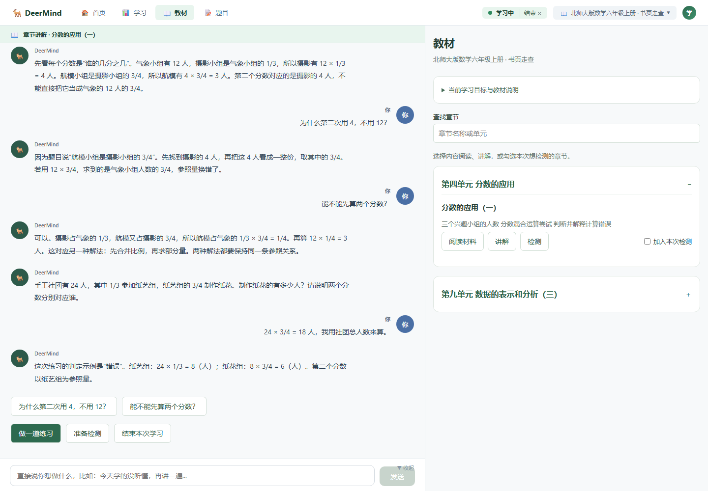

**步骤 4：先说明检测安排，再由学生开始。** 点击“准备检测”，原对话内显示本次范围、两题安排、可用方法和约3–5分钟的参考用时。第一题观察文字解释，第二题观察区域图中的参照量；不提前给出题面或答案。学生可开始或暂不参加。本例的两题不是产品固定题量，参考用时不是倒计时。

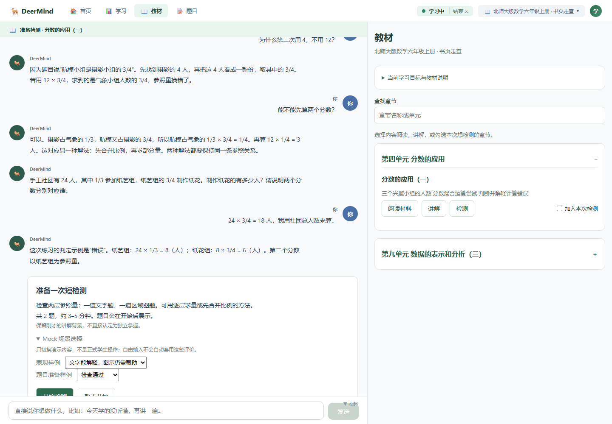

“Mock 场景选择”只供评审切换预设表现，不进入正式学生产品。三个方案分别是“文字能解释，图示仍需帮助”“两题均能说明参照量”“答案信息不足”。它们是同一设计的不同示例，不能拼接成真实学习者的进步曲线。“填入本场景示例作答”用于方便复现，仍需点击提交。

**准备失败分支。** 题目检查未通过时，提示检测尚未开始，不显示不合格题、不生成学生错误。保留当前学习，提供“重新准备”和“暂不开始”。本轮重试展示预设成功结果；没有真实重试算法，也不需要管理员逐题放行。首版此处不增加自动换目标、降低标准或强制转人工的流程。

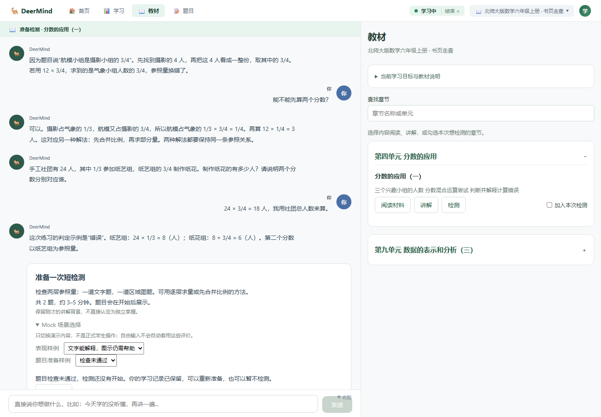

**步骤 5：逐题作答，结束前不公布判定。** 点击开始后固定本次题单。第1题输入完整解释：2/5对应全部书，1/2对应科普书，最终6本。重新打开页面可恢复未提交草稿；点击提交后只确认收到，进入第2题。

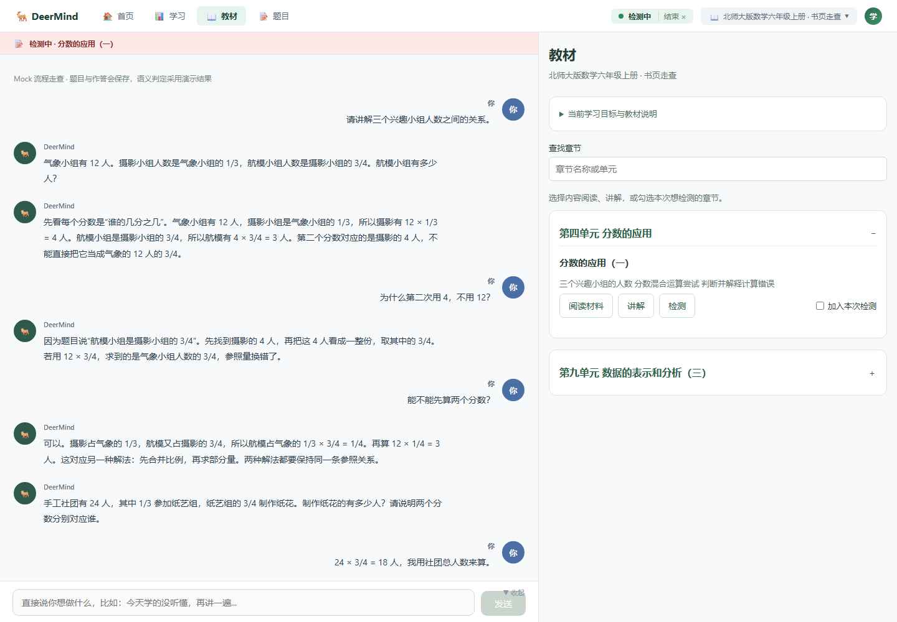

第2题给出完整区域图。本例学生输入“40×1/2＝20平方米，上面是一半，所以用整块40来算”。这条原作答稍后用于说明迁移困难，不能先在作答时提示她该乘3/5。右侧原页面和上文仍可查看，因此要保留此前讲解及材料接触背景，不能仅因当前题没有提示就宣布完全独立。

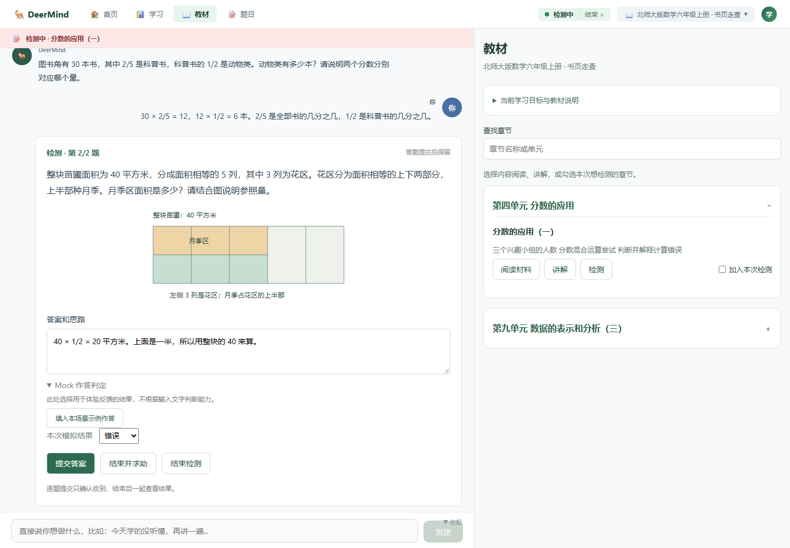

**步骤 6：把题目结果和目标判断分开说明。** 两题提交后，原对话内先显示提交数量和逐题结果，再解释本次学习要求。默认样例第1题正确、第2题错误；错误发生在图示参照量，不能用一个总正确率覆盖这一区别。

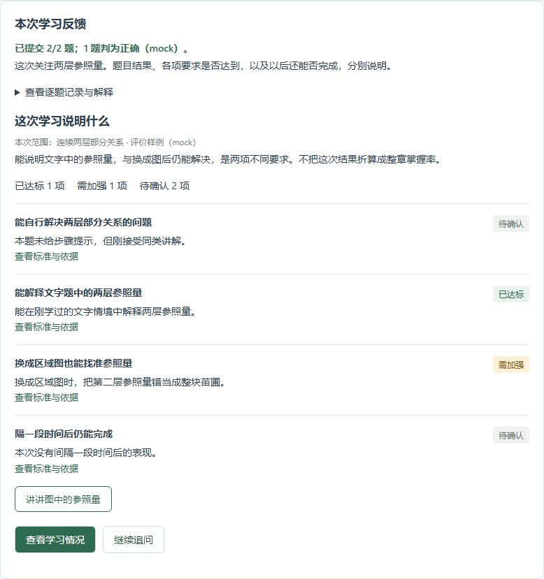

| 学习要求与具体条件 | 默认样例的能力判断 | 目标结果及理由 | 下一步 |
| --- | --- | --- | --- |
| 无本题或紧邻同类解法帮助时，自行解决两层部分关系 | 当前题没有步骤提示，但刚接受同类讲解 | 待确认；本次条件不足以确认稳定独立完成，不判为不会 | 后续在符合条件的新表现中观察 |
| 在新的文字题中解释两个分数分别对应谁；允许此前学过同类讲解 | 第1题能说明两层参照量 | 已达标；满足本目标限定的文字解释要求，不外推所有表征 | 保留过程，继续观察其他表征 |
| 在本例规定的区域图中先识别中间区域，再求其一部分 | 第2题把花区的一半当成整块的一半 | 需加强；图示条件下出现与要求相反的表现，不能因第1题正确而掩盖 | 可选择补讲图中参照量 |
| 有约定间隔后的新表现，并保留期间帮助背景 | 本次没有延迟后的记录 | 待确认；当堂正确也不能证明持久保持 | 本轮不自动安排定时测验或提醒 |

“已达标”对应管理员配置的具体目标要求；Claim 方面的判断仍带有条件和限制。上表标准是交互样例，不是经验证的课程评价阈值。三类项数统计的是本次目标的四项要求，不把1/4称为掌握25%，也不平均四方面。

**步骤 7：按需查看标准与依据。** 每项提供“查看标准与依据”。展开后依次看到标准、为什么这样判断、对应题目与原作答、帮助背景及下一步。不让学生只看一个色块，也不把后台对象编号放进学生的日常判断说明。

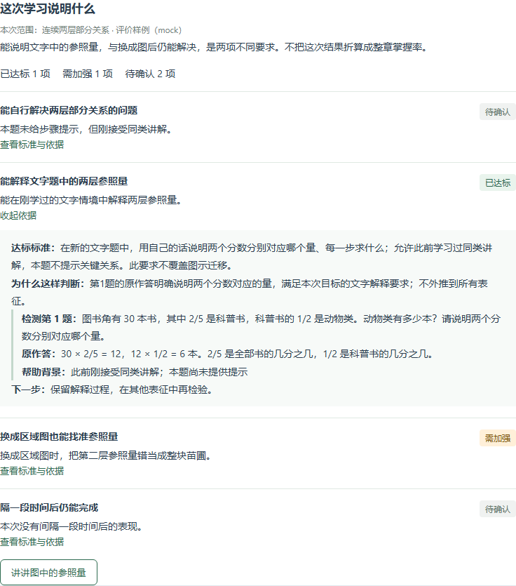

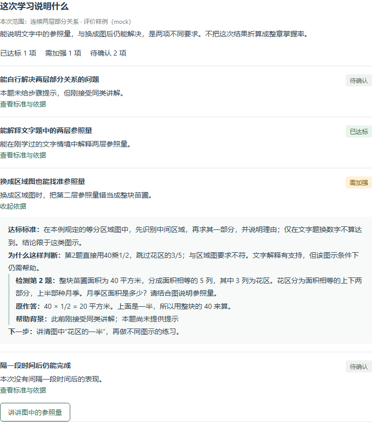

**步骤 8：反馈能引向下一步学习，原判断仍可回看。** 对本例的图示困难，学生可点击“讲讲图中的参照量”。回答仍在原对话中：先找24平方米花区，再求其一半。帮助发生在检测结束后，不能覆盖之前的错误或把“看完解释”改成“已经掌握”。

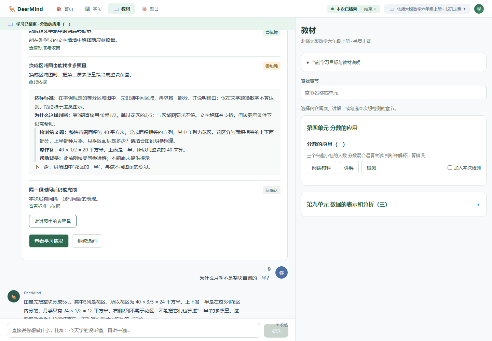

**步骤 9：学习情况展示同一组要求与依据。** 点击“查看学习情况”后，按章展开四项要求。该样例显示已达标1项、需加强1项、待确认2项，展开的标准和原作答与活动反馈一致，可回到原对话。当前仅预置最近完成活动的评价，不实现长期 Belief 汇总；不能把新开一段活动或切换示例当作实际能力变化。

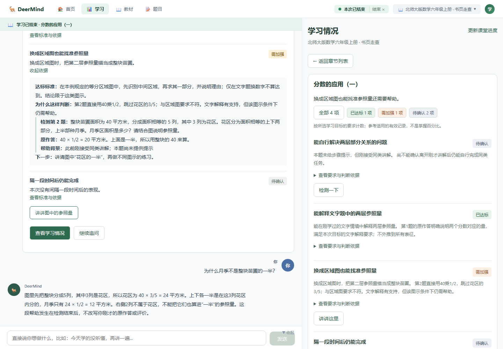

**另外两种结果。** “两题均能说明参照量”展示文字解释与限定区域图两项达到要求，独立与延迟仍待确认。“答案信息不足”展示四项待确认，不把未解释或尚未看清当作错误。任意输入与预设答案不一致时，保留原文并说明没有匹配的预设评价；这里使用精确样例匹配防止串用场景，不是基于字符串进行语义判分。

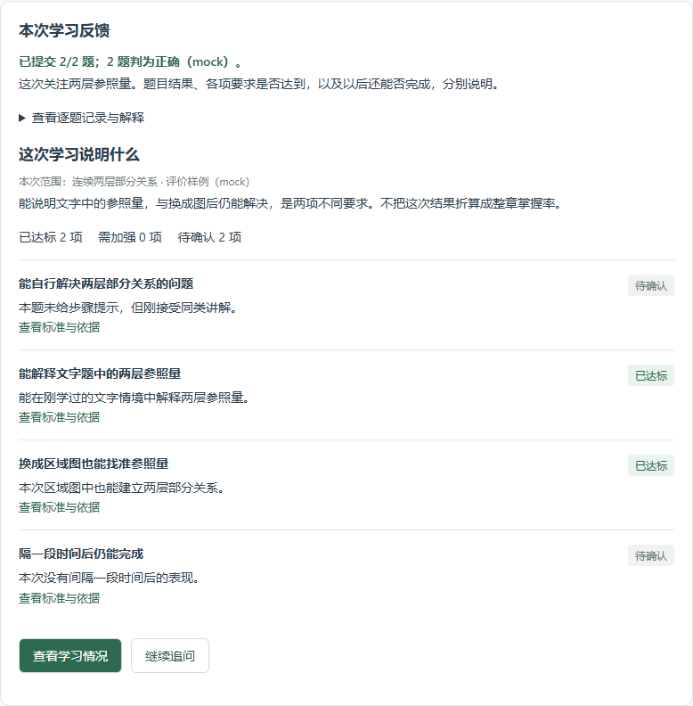


**检测中求助与退出。** 点击“结束并求助”先结束整个检测，再讲解当前题；未提交和未展示的题不判错。零提交显示0/2已提交，不作为零分；该次活动不套用完成检测的评价。主动结束同样保留已经发生的表现，另开检测是新活动。切换学习空间前仍须收束进行中的检测。


图 C20 只核对网页尺寸下的内容可达性，不代表真实 Android 设备、软键盘、笔迹和语音体验已通过。技术性输入核对、含糊求助和其他多模态分支仍在 §3.7 中继续细化。

### 3.5 管理员查看同一次学习，而不是另一份演示结论

管理员从交互审查的活动记录进入案例，先确认学生、Learning Space、章节和活动状态，再按题目使用及对话查看原始表现。选择“评价结果”时，分别呈现当题判定、Task Claim 各方面的条件性判断，以及对应学习目标是否满足。它们使用同一套预置事实，不因显示在后台就变成自动诊断结论。


展开具体方面时，管理员可以看到题目版本、当次使用记录、原作答、实际帮助以及预写的 Evidence 解释；Task Claim 链接进入定义页。“采用定义”显示当时教材、目标、Claim和允许的方法，便于区分标准变化与个人表现变化。既有活动保持其当时依据。


本轮同时纠正后台学习空间中固定写成“增加四分之一”的活动名称和 Claim 引用；本例始终归属连续比例任务。Evidence、Belief 和目标评价都是标注的 mock 示例，无真实推断日志。管理员可沿引用检查定义，不能在此直接把学生改为掌握；实际身份、用途与授权按 [Data §3](MVP_Data_and_Authority_Design.md#3-权限与责任映射) 落实。

### 3.6 流程中的对象、输入输出与状态

下表把前述截图中“发生了什么”与模型联系起来，不要求工程从各 Space 名称自行猜业务。

| 步骤 | 读取的业务输入 | 产生或改变的对象 | 不应产生的结果 |
| --- | --- | --- | --- |
| I01–I04 上传整理 | 原件、顺序、教材身份、领域 | 导入记录、原页、待核对内容 | 学生可用课程、个人能力判断 |
| I05–I15 图文核对 | 原页、内容块、疑点及引用 | LearningMaterial 的结构、来源与核对记录 | 原件被覆盖、空白作答被自动填完 |
| I16–I17 模型关联 | 章节内容、Task、所选 Solution | 章节映射；派生 KC 集合 | Task 直接关联 KC；学生掌握 KC 的结论 |
| I18–I19 目标与应用 | Claim 方面、学习要求、标准和方法条件 | LearningTarget、当前可选课程及应用关系 | 因标准变化直接改写个人 Belief |
| I20–I23 学生选用阅读 | 已应用教材与目标、学生身份 | 个人 Learning Space、阅读上下文 | 自动借用别的空间记录；长期章节范围 |
| Q01–Q04 题目准备 | 模板、参数、条件、参考及来源 | 检查通过的实例及版本 | 生成等于展示、展示等于作答 |
| C01–C08 学习与作答 | 当次课程依据、题目版本、用户输入和帮助 | 活动、题目使用、原作答与实际帮助记录 | 听过等于理解、草稿等于提交 |
| C09–C18 反馈与追溯 | 实际表现、适用 Claim、帮助与历史 | 当题反馈、预设的 Evidence 解释／Belief 判断与目标达成；工程实现需基于实际证据产生这些结果 | 管理员直接指定掌握、一次做对证明保持 |
| U01–U02 应用修补 | 管理员保存的教材／目标新版 | 课程当前采用；原活动快照继续保留 | 回写历史教材、追补未映射旧作答 |

**可见状态及主要允许操作。**

| 对象状态 | 可以做什么 | 离开或结束后的处理 |
| --- | --- | --- |
| 导入：待输入 | 选文件、调整顺序、修改信息、删除草稿 | 从未完成列表继续同一项 |
| 导入：处理中／失败 | 看进度或错误；失败后继续 | 正式后台应保留任务；当前模拟处理离页暂停，尚需完善 |
| 内容：待核对／已核对 | 对照原件、修正结构和图文、确认课题 | 保留原件及修订；编辑影响原核对结果 |
| 课程：已保存未应用／已应用 | 管理员保存或应用，学生选用已应用内容 | 新活动采用更新；旧活动保持当时依据 |
| 学习：讲解／练习 | 追问、练习、求助、准备检测、结束 | 保留输入、帮助和原作答 |
| 检测：准备／进行中 | 准备时确认或不参加；进行中提交、结束或求助 | 正常结束统一反馈；求助结束后再讲解 |
| 评价：已达标／需加强／待确认 | 逐项查看标准、依据及适用条件，再决定是否继续学习 | mock 各状态必须对应预设表现；正式无足够依据时待确认，不能只改颜色或由管理员指定掌握 |

### 3.7 其余流程的覆盖边界

原有 FLOW 编号保留，以免需求引用失效；下列流程仍有概览、规则或旧原型，尚未达到本节逐步截图规格的深度。不取消需求，也不将它们包装为已具备工程交接条件。

| 流程 | 已有基础 | 仍需交付 |
| --- | --- | --- |
| FLOW-002 具体题目求助 | 允许无作答求助、提示边界与连续对话 | 当前 V2 拍照／输入核对、含糊请求、待映射帮助的逐步规格 |
| FLOW-003 学习情况查依据 | 本轮 C09–C18 展示三类状态及标准、作答和后台对应 | 多活动历史的变化、撤销或更正影响，以及长期章节汇总的完整说明 |
| FLOW-004 所属页面直接编辑 | Task、Solution、KC、Claim、教材、目标已有页面；本轮覆盖映射、目标和实例 | 各编辑区字段、必填／取消／失败／保存后的配图规格 |
| FLOW-005 主动范围检测与建议 | 本轮覆盖讲解后检测、准备失败及求助结束 | 多章节选测、按需建议接受／暂缓 |
| FLOW-007 账号关系与首次使用 | 用户管理原型和权限矩阵 | 开户、关联、找回、首次确认在学生端的完整操作说明 |
| FLOW-008 多模态输入 | 原始输入、预览和正式提交的业务边界 | 平板手写、拍照、语音及播放控制的具体状态与失败反馈 |
| FLOW-009 跨来源记录 | §3.12 已覆盖按题查找、错题筛选、历次作答、所属活动与再次求助 | 新增订正、资料更正与隐藏资料的完整操作仍待细化 |
| FLOW-010 案例复核 | 本轮同活动追溯；后台审查、观测与学生状态已有分工 | 普通抽查到定位、记录意见、修补及返回的完整流程 |
| FLOW-011 首页与继续学习 | V2 导航及课堂进度入口；本轮保留进入学习的页面 | 首页、进度、统计、继续学习在新建课程中的统一呈现 |
| FLOW-012 运行与配置 | 运行总览、用量及失败记录原型 | 配置页仍按用户决定暂缓，不将占位配置列为已确认功能 |
| FLOW-013 家长查看与咨询 | 保留已迁入的家长界面及关联权限规则 | 按用户要求暂缓逐步打磨，不把学生端或管理员端走查当作家长端完成 |
| FLOW-014 输入核对 | 原图、识别草稿、用户确认分离的规则 | 当前输入入口的原件对照、局部修正、确认和取消配图 |

家长端按用户要求暂不继续打磨。其查看与咨询需求仍保留，既有迁入界面不能因本轮管理员／学生截图通过就视为家长端已完成审阅。


### 3.8 尚待配图的行为规则

这些规则保留原 FLOW 含义，供下一轮展开时核对。它们约束具体页面设计，尚不能代替字段、输入输出及实际状态截图；旧实现情况见 §7.3 的固定历史版本。

**FLOW-002：从具体问题求助到记录回看**

1. 学生输入题目，已有作答为可选信息。默认提供讲解，也可明确选择“只给提示”；常驻意图输入取得的明确请求与直接操作进入同一业务流程。
2. 提交后显示当前题面、当时请求与处理状态。存在识别疑点时只澄清必要局部；没有原作答时标为未作答，已有作答但未判断时标为尚未判定。
3. 仅提示请求先呈现适用提示，不同时展开最终答案。学生后来明确要求完整讲解时，再展示讲解并记录帮助变化，不改写当时请求。明确讲解请求按已有默认方式先解释、按需互动。
4. 学生回到题目记录时，看到来源、原作答、请求和实际帮助，可以继续相应学习；打开记录本身不构成新的作答。确认错题是筛选视图，不把所有求助或未判定条目放入其中。
5. 删除独立录入的原资料前，说明学生端不可恢复、内部保留及关联家长的只读规则。执行后学生端题面、作答与相关求助副本均不能再由历史或聊天恢复，内部依据和其他独立练习保持。

本流程保留求助行为要求。现行 V2 的输入、真实对话与 mock 学习入口须分别核对；本轮未重新验证自由题目求助或多模态处理，不沿用旧原型“自由输入仅保存”的结论描述全部当前入口。

**FLOW-003：由章节概况查到具体依据**

1. 学生或家长选择课程空间，先看到教材章节点及当前有效结果的更新时间。缺少目标或内容时说明未准备范围，不从另一空间填充。
2. 每章显示已达标、需加强、待确认项数和总数；展开后逐项呈现学习要求，点选某项再看条件、判断原因及相关作答。家长使用同源数据，并保持只读。
3. 近期作答单独显示，默认近 7 个自然日，包含当天。切换近 30 天或全部只改变这组记录；同时显示实际日期范围、独立已判定分母、正确次数及比例。原型比例四舍五入为整数，分子分母始终可核对。
4. 展开统计依据可核对来源、原作答日期、帮助条件与排除原因。未知日期仅进入全部；未结束检测、受助或帮助不明的记录不会进入独立已判定分母，统计规则沿用 Requirements §3.9。
5. 读取失败与判断失效采用单独反馈，暂停展示相应旧项数；不把系统故障放进孩子的待确认数量。近期作答记录可在自身仍有效时独立展示。
6. 常驻输入作用于当前孩子和空间，发送后就地提示，历史按需展开。换空间或角色时不能沿用旧对象的输入。家长咨询不写入学生表现或学生视图。

**FLOW-004：在所属页面编辑并保存对象**

1. 进入领域、教材或目标页面，选择新增或编辑。对象详情中的编辑入口回到所属页面；新对象无需先建立问题事项。
2. 填写定义和关系。关联对象按类型选择，可搜索名称或编号；任务模板可以先建立再补充方法，未完整时明确缺口，不进入完整教学或评价使用。Task 的 KC 仅通过已选方法递归汇总。
3. 点击保存，系统检查必要字段、引用和递归关系、目标相容性及版本冲突。失败就地说明并保留输入；无差异不增加定义版本。
4. 成功后返回所属列表或详情，显示新版本；取消不改变定义。未完成内容可以选择保存草稿，草稿不进入正式目录。
5. Task Claim 的有限字段在评估页直接编辑；教学蓝图、策略和规则按 §3.9 在交互空间维护。其余语义模型仍按既有定义包处理，不增加任意代码或全系统规则编辑器。

**图 UX-03　直接保存与历史保护**


矩形表示操作或结果，菱形为保存检查。此处没有审核、批准或发布步骤；也不将保存当作语义正确或正式引擎已接入。教材与目标的应用按 §3.2 更新当前引用，旧活动保留原采用信息。

**FLOW-005：教材范围选测与主动建议。** 学生在自己创建的空间内选章、节；当前目标决定需要覆盖的要求，系统据此准备题单。题量不是固定配额，准备结果也不是已经开始检测。

1. 先展示采用的教材与目标版本、所选范围、可覆盖要求、题量和参考用时。缺少正式依据的部分单列；仅准备了部分范围时，开始按钮明确“检测已准备部分”，结果不能概括未测章节。
2. 学生明确开始后固定本次题单。逐题提交只确认收到，暂离后恢复同一题单、已提交内容和当前草稿；未结束时不绕入其他教学。
3. 完成、主动结束或实质求助分别记录结束原因。求助先结束，再对当前求助题提供帮助；未答部分仍未检测，自由作答未判定时不显示分数。
4. 另开检测保留前次记录及采用版本；不同空间分别查看历史。开始过或看过同一题的背景在真实评价时仍须使用，不能把重新开测自动当作首次独立表现。
5. 主动建议另说明当前有效依据、目的和投入。接受检测建议先进入同一准备流程，仍需明确开测；暂缓不预约提醒，拒绝不改变学习判断。开始前依据失效时禁止沿旧理由执行，不撤销已经真实发生的活动。

**图 UX-04　自主选测与建议共用检测流程**


矩形表示业务状态或动作，菱形表示选择及准入。主流程强调建议不自动开测、暂离不结束、求助先结束。技术恢复、目标失效与权限异常沿用 §5；不同题量的选择机制与参考用时计算在工程阶段实现。本轮讲解后检测见 §3.4；此处多章节选测与主动建议仍待逐步配图。

**FLOW-007：身份、关系与首次说明。** 独立账号、亲子关联和使用确认是不同事实，不能用其中一项替代另外两项。

- **管理员操作：** 创建档案、建立或解除具体关联、找回原账号前，记录系统外核实及本次依据。一次核实后不默认批准后续所有动作；找回保留原档案与学习历史。
- **关系影响：** 每条亲子关联独立维护。失效后，该家长的当前页面与旧链接均不得继续读取相应学生资料；其他有效关联不随之删除。关联管理不改写学习表现。
- **首次说明：** 家长确认数据使用范围，孩子确认愿意使用，两个入口分别完成。实际服务条件未核实、必要确认未完成时不能处理真实材料；已确认且范围未变时不重复打扰。
- **原型边界：** 本轮只有固定演示主体和本地状态，不收集密码、真实授权或证件。默认双方已确认可供其他流程走查；评审工具可重置演示确认，这不是新增授权撤回功能。真实按主体、关系、用途及服务版本保存的确认凭据仍需工程实现。

**FLOW-008：多模态输入、局部核对与明确提交。** 输入过程先保留用户表达，再处理识别不确定；不能让预览转写变成一次正式作答。

1. 学生选择文字、同题图片／PDF、手写或语音。图片归属存在疑点时核对是否属于同一题；整卷录入仍不纳入范围。几何图、表格及跨图关系需保留原材料，识别文本不能替代原件。
2. 手写过程中不判断；提交或请求帮助后才分析。语音由孩子主动开始和结束，允许预览、修改转写、取消或重录；取消的临时输入不进入学习历史。
3. 识别有疑点时，对照原件局部核对，不把核对题意当成解题帮助。本轮例子将高“4”识别为“1”；确认的是原题文字，不能据此改写学生原作答的对错。
4. 确认后的内容进入当前求助或作答草稿，用户仍明确提交。原件、原识别、核对后的文本与最终发送版本分别可查；再次编辑准备发送的内容，不覆盖原材料。
5. 提交后按当前活动规则反馈：练习可逐题反馈，独立检测只确认收到，直到结束。语音提问应展示并播放回复，停止与重听不推进讲解，播放失败可以继续看文字。

**FLOW-009：跨来源记录、更正与订正。** 记录以题目和当次表现为单位组织，错题是已确认错误的筛选结果，不是所有求助的总称。

- **找记录：** 先确定空间，再按外部录入、讲解练习或检测筛选。每条显示题面、原作答、版本、请求与已记录帮助；按空间查看，不把不同空间的数据汇成个人综合掌握结论。
- **看性质：** 未作答、尚未判定、识别争议和确认错误分别处理。当前主流程有 mock 当题判定，没有正式能力推断；示例判定、真实提交和正式 Evaluation 结果必须标明来源，不能冒充同一类输出。
- **更正资料：** 学生指出录入／识别不符时，追加更正内容与理由，保留原提交，不计为一次新答题。更正需要核对，对已有判断的影响由正式复核及责任链处理，不能直接覆盖旧结论。
- **重新作答：** 订正形成新的尝试并保留帮助说明，原表现仍可查。正确与否仍待正式判断；页面不能仅因保存订正就把错题移成已掌握。
- **回看与复测：** 回看不生成新的表现，不因进入错题筛选就自动复测。复测是否合适继续由有效认识、目标和接触背景决定。
- **删除外部资料：** 同题多页按整份原资料隐藏，学生不能从原输入、更正或订正副本恢复。内部事实及获准家长／后台读取仍遵守已有规则；不扩展内部检测记录的删除权限。

**图 UX-05　资料更正与重新作答保留不同含义**


矩形表示资料处理与可见结果，箭头注明触发。更正和评价的正式生效仍由相应责任层完成；图不表示保存一段用户说明就已经重算 Belief。隐藏的学生资料不沿回看路径恢复，完整权限规则见 Data §5。

**FLOW-010：从活动核对依据并处理问题。** 管理员可主动抽查，不必等待系统判定异常。

1. 按学生、空间和活动定位记录，访问个人资料时记录用途；可查看真实输入、已发生的帮助及所用版本。
2. 未执行的 Observation、Evidence、Belief 或 Policy 明确显示未执行，不伪装成通过或不干预。
3. 在当前活动保存核对意见；如需修改规范定义，沿引用进入对象所属页面按 FLOW-004 处理，不建立强制审批事项。
4. 已确认不应使用的 Evidence 可记录原因后停止其及依赖结果的当前使用；事实和历史判断保留，新的判断只能由相应责任层产生。真实会话尚无正式评价绑定时只能记录意见。

**FLOW-011：从首页进入活动。** 首页先交代最近学习内容、活动位置与一项相关反馈，再提供继续学习、接受建议和提出新需要的入口。打开产品和阅读首页本身不算开始讲解；只有学生进入活动后，才记录实际展示。

1. 首页按 §2.3 呈现当前课程、最近内容、继续学习或建议、学习足迹及常驻输入；一级入口为首页、学习、教材和题目；首页另有全部学习记录二级视图，账号与空间管理独立可达。检测从章节、题目或建议进入准备，教材选择只决定本次范围。
2. 学生可以继续原活动、带问题求助，或查看章节状态再决定下一步。讲解与求助进入当前活动工作区，不增加一套并行聊天面板。
3. 切换空间时，未发送文字、输入材料和求助草稿保留在所属空间。不同空间即使同名，也不合并记录、判断或草稿。
4. 返回首页不结束讲解；下次继续恢复最近实际参与的原活动、段落和未发送内容。结束活动回到首页后显示实际结果，不能继续已结束检测。未结束的检测仍按 FLOW-005 收束，不能借首页或链接绕入教学。

**图 UX-06 学习入口、活动与空间上下文**

图中实线表示明确操作产生的页面迁移；从检测返回首页的前提是该检测已经结束。页面变化不直接产生掌握判断，空间上下文随记录保留。自然语言输入的识别和执行不在此图伪装为已实现。

**FLOW-012：运行任务核对与处理。** 管理员先查看任务状态，再依据原提交结果和服务条件选择处理，不把所有异常统一做成“重试”。

| 状态或操作 | 呈现与可做动作 | 禁止混淆 |
| --- | --- | --- |
| 处理中／结果未知 | 查询原任务和提交结果；未知时继续核对 | 不直接重试，不要求孩子重新答题 |
| 原结果已存在 | 恢复原结果状态，核对实际提交与展示 | 不重新制造作答、评价或教学展示 |
| 确认未提交且失败 | 服务条件满足后，对原任务重试并记录尝试 | 不建立第二份学生表现 |
| 语义未决 | 查看输入、规则、输出及缺失条件，再决定补充或人工维护 | 网络返回不等于形成有效判断，不能用传输重试冒充通过 |
| 用量未取得 | 延迟、调用量、费用分别标未知；已知合计注明缺失数量 | 未知不记零，不把样例费用当实际预算 |

**图 UX-07 原任务核对与重试边界**

图中“明确失败”须确认没有提交，不能只从超时推断。图描述用户可理解的状态与动作；后端去重、原提交核对和实际执行确认由工程实现。当前入口为运行总览、交互审查和空间观测。服务条件仍须在真实重试前核实，但不预定系统配置页怎样编辑或测试；该页按 DEC-030 暂缓设计。旧原型中的合成配置检查只保留为历史样例。

**FLOW-013：家长查看具体空间并咨询。** 家长首先确认当前孩子和空间，再查看同源学习情况及必要依据。家长的选择不改变孩子当前正在学习的空间。

1. 在有效关联内选择空间。尚未形成评价的空间说明当前限制，不能套用另一个空间或预写样例的达标数。
2. 按需展开题目来源、原提交、实际帮助、提交前的输入核对及后来的更正／订正。学生端已删资料按现行授权仍可只读查看；家长没有修改或代交入口。
3. 在常驻输入中提出问题，发送后显示处理状态，历史按需展开。咨询归属于实际家长、孩子和空间；切换时保留各自未发送草稿，不把旧空间的文本带入新上下文。
4. 可以继续或另开一段咨询，删除按整段确认。删除后该家长入口不再恢复原咨询，孩子的事实和已独立提交的维护事项不随之删除。
5. 关联失效时停止读取该孩子的受限上下文；另一个家长的有效关系与私人咨询保持独立。

**图 UX-08 学习依据共享与家长咨询隔离**

连线表示获准的读取或操作。两段咨询彼此不连通，也不反向写成孩子作答；删除甲的咨询不影响乙的咨询或孩子的原记录。图省略身份核实，授权条件仍按 AUTH-001。

**FLOW-014：检测内核对输入。** 孩子需要确认数字、符号或转写是否符合原意时，应能在当前题内处理，不被迫退出检测或接受解题帮助。

| 操作阶段 | 界面行为 | 对检测与记录的影响 |
| --- | --- | --- |
| 打开核对 | 保留当前题及核对前输入，展示待确认文字 | 仍是同一次检测、同一道题；不生成第二次表现 |
| 核对中 | 只处理输入差异，不显示解法、对错或提示；确认前不能提交该题 | 原作答草稿与待确认更改分开保存，刷新可恢复 |
| 取消核对 | 回到原草稿，撤销未确认更改 | 不新增作答或更正记录 |
| 确认核对 | 保存前后内容与用户说明，回到未提交草稿 | 仍需明确提交；未自动评分或认证独立性 |
| 明确求助 | 按已有规则结束检测，再进入教学 | 保留已提交部分，未做部分仍为未检测；请求与实际展示分开 |
| 请求含义不清 | 先澄清，暂不提供实质教学 | 不能仅因用户点击“核对”就保证更改没有语义影响 |

**图 UX-09 输入核对与解题帮助的不同出口**

图只描述明确操作，含糊请求仍先澄清。核对按钮和用户声明不是语义判断依据的替代品；正式系统须保留原材料、实际帮助与解释依据。现行输入入口仍须补齐配图；有文字核对功能不等于已经运行 OCR 或已经确认独立性。

<a id="teaching-model"></a>

### 3.9 FLOW-015：管理教学蓝图、策略和规则

**使用情境与目的。** 管理员希望知道系统为什么从某处开始讲、为什么换一种教法、何时练习或检测，并能修改相应定义。入口为“模型管理 → 交互空间”，分为教学蓝图、教学策略、通用规则三个页签。右上角的情境推演用于核对定义所表达的意图。空间观测中的“交互空间”仍查看实际运行；这两个入口不混用。

本节承接 REQ-025／AC-025 和 DEC-036。用户已初步认可页面逻辑并授权文档同步；这不是教学有效性验证。当前只管理一个默认蓝图，用 mock 展示修改和选择，不新增多蓝图调度、自由代码编辑、审批发布或真实模型调用。

**模型是什么，以及它不接管什么。** 教学模型是一组可管理的教学定义，不是只有文字说明的附件，也不是一条包办全部判断的 prompt。蓝图规定可经过的阶段和转移条件，策略规定阶段内怎样组织教学，通用规则约束跨阶段的选择。字段中允许清楚的自然语言；保存时的字段与引用检查不能证明语义合理。

| 内容 | 所属责任与作用 | 输入与输出边界 |
| --- | --- | --- |
| 教学蓝图、策略、规则 | Interaction 的教学规范配置，供 Interaction Policy 选择行动；不新建第五个独立决策者 | 读取当前目标、适用领域内容、请求、实际表现、帮助和有效个人认识；为策略选择和下一步候选提供依据，实际推进另记入 State |
| 当前阶段与活动进度 | Interaction State 的运行投影 | 记录实际走过的阶段、未解决问题及当前检测是否结束；不把蓝图上存在的节点当成已经发生 |
| 讲解、提问、出题与反馈 | Action Model 定义允许行为，Policy 决定当前是否执行，实际展示另留事实 | 候选文本不等于已展示；选中策略不等于策略已有效执行 |
| 任务、解法与知识依据 | Domain 的 Task／Solution／KC | Solution 说明如何完成任务；教学策略说明如何帮助学生学习，两者不可互换 |
| 教材、学习范围与达标标准 | Learning Space 的材料和目标 | 教材提供内容、范围和来源参考；教材排版顺序不强制成为教学顺序，教学策略不能降低正式标准 |
| Evidence、分方面 Belief 与目标结果 | Evaluation | 教学侧可提出待检验的问题、读取适用结果；不能自行写入掌握判断或建立 KC 能力状态 |

上述映射沿用 Interaction 的 Observation／State／Action／Policy 分工，不替换上位架构。真实运行时，LLM 在这些定义约束下理解语义、组织内容及提出选择；程序负责可确定的字段、引用、权限和状态条件。当前原型没有运行这条真实链，也没有实现关键词教学决策。理论与实践依据、适用限制见[内容基础 §6.4](MVP_Domain_and_Content_Foundation.md#64-教学策略的依据与内容准备)。

**步骤一：从蓝图认识整体过程。** 默认蓝图名为“有明确学习重点的教学”。左侧显示阶段和连线，右侧显示选中对象的目的、输入、开展方式、输出和引用。点击阶段查看职责，点击连线查看何时转移及判断依据；键盘 Enter／Space 也可选择。不要求每次教学经过全部阶段。

**图 T01　默认教学蓝图与阶段详情**


| 阶段 | 要做的事与需要的信息 | 本阶段结果与下一步 |
| --- | --- | --- |
| 明确本次学习重点 | 从请求、课程目标和材料确定本次先解决的问题；明确时直接采用，不必重复询问 | 留下本次重点、目标引用和暂不处理的范围 |
| 确定学习起点 | 先使用已有 Belief、当前表现和帮助；只澄清会改变选择的信息，不强制前测 | 可以进入讲解、先尝试或在同意后直接检测；未知不等于不会 |
| 讲解与互动 | 围绕关键关系分段解释；可示范、辨析或回补，学生选择继续、追问或尝试 | 保留实际内容与帮助；可在本阶段换策略，也可转练习或收束 |
| 练习与应用 | 学生尝试关键工作，允许逐题反馈、提示和补讲 | 保留原作答和订正；按实际困难返回讲解，或经同意检测，或收束 |
| 检测与反馈 | 先明确目的、题目与帮助条件并取得同意；进行中不泄露对错 | 整次结束后反馈；实质求助先结束检测再补教，未作答部分保持未检测 |
| 总结本次学习 | 依据实际走过的路径和适用评价，说明完成与未决 | 可以结束；没有经过的练习、检测或延迟观察不得补造，结束不等于达标 |

图中连线是有条件的可选路径；返回边表示重新教学，不表示撤销原作答。同一阶段换策略不必增加一个新的阶段。所有阶段允许学生停止或暂停，30 分钟总使用边界仍适用；暂停状态的工程持久化不能由这张静态图证明。

**步骤二：编辑阶段、扩展阶段或分支。** 编辑时先改表单，应用到蓝图草稿后再整体保存；这样可以同时补齐节点与连线，不要求中间每个草稿状态都能执行。取消表单保留原草稿，取消蓝图修改则恢复上次保存版本。

| 编辑对象 | 字段及填写要求 | 操作结果与检查 |
| --- | --- | --- |
| 蓝图信息 | 名称、用途；名称说明这一流程适用于什么教学 | 进入草稿；整体保存时两项均不能为空 |
| 阶段 | 名称、阶段目的、需要的信息、怎样开展、留下的结果、可用策略 | 名称、目的、输入、结果必填；开展方式可暂缺但须可见，不把字段齐全当作教学准备完成 |
| 新阶段 | 同上，并选择插入的已有连接 | 原连接保留进入条件并指向新阶段；追加新阶段到原终点的连接，默认完成条件仍须管理员核对 |
| 连接 | 起点、终点、名称、转移条件、判断依据 | 不允许相同起终点、以结束为起点或以开始为终点；同一对节点编辑既有连接，不重复创建 |
| 策略引用 | 从已定义策略多选 | 停用策略不能作为新的可用选择；既有引用保留并标示停用，不静默换策略 |

例如，“需要讲解”连接的条件是请求或表现指向具体解释／回补问题；依据为当前请求、表现、相关 Belief 和实际帮助。不是以某个词出现或错误次数作为默认切换算法。

**图 T02　阶段编辑字段**


**图 T03　添加阶段并明确插入位置**


**图 T04　编辑转移条件与依据**


**图 T05　添加另一条可选分支**


移除阶段会同时移除关联连接，页面要求确认；移除后不自动猜测新的路径。保存蓝图前检查每个阶段能从开始到达、且有通向结束的路径。循环回补本身允许，但结构可达不能保证实际教学不会反复兜圈，真实运行还须检查学生意愿、负担及停止条件。

**步骤三：核对、保存与查看修改。** 缺少必填信息时保留输入并定位提示；草稿尚未保存时显示“保存蓝图”和“取消修改”。保存通过后增加 mock 版本和修改记录。普通策略／规则表单直接保存，不另走审核发布。

**图 T06　缺少阶段目的时不应用修改**


**图 T07　草稿尚未保存的状态**


**图 T08　保存后的版本及修改记录**


当前修改只在本次页面会话内保存，离开菜单再返回仍在，刷新恢复示例。真实身份、持久化、无差异版本抑制和正式版本采用尚未实现。不得把内存中的 v2 当作正式发布版本；正式维护继续服从 REQ-022 的历史与权限规则。

**步骤四：维护可复用策略。** 列表按名称、目的或适用情况搜索，按启停状态筛选，超过一页时分页，每页 8 条。默认展示概念建立与回补、示范与例题讲解、对比辨析、引导练习、变化与迁移练习、间隔巩固。间隔巩固默认停用，未接入本次蓝图，不因此新增日程或推送功能。

**图 T10　策略列表、状态和引用阶段**


点击名称进入详情，按四组编辑；新建策略填写同一套字段，自动生成标识。策略可供多个阶段引用，修改不会在每个阶段复制另一份定义。未被阶段引用的策略仅存在于目录，不表示系统已经会选择它。

| 字段组 | 字段 | “对比辨析”的完整填写意图 |
| --- | --- | --- |
| 基本定义与适用条件 | 名称、教学目的、适用情况、不适用情况、需要的信息 | 识别决定方法或结果的关键差异；适合材料基础可理解但关键条件混淆的情况。材料基础不清、已能解释或只是计算执行困难时不强推辨析。读取目标、实际表现和帮助、比较材料及领域依据 |
| 教学组织 | 如何组织教学、允许的帮助、需要观察的表现 | 保持其他条件接近，比较关键差异；可提问，也可按请求直接解释。允许图示、突出位置和重述；观察学生能否指认、画图或说明差异如何影响求解，不能只看复述术语 |
| 调整与结束 | 调整方式、结束条件 | 只解决剩余疑点；基础关系不足改用回补，理解后执行困难转引导练习，能应用再考虑变化任务。已有适用表现、换策略、暂停或结束均可收束，不由策略结束直接宣布达标 |
| 依据与示例 | 依据与限制、领域示例 | 比较学习提供参考，具体选择和退出条件仍待验证。气象 12 人、摄影占 1/3，比较航模占摄影 3/4 与占气象 3/4，分别得 3 与 9；后者为辨析材料，不冒充连续两级关系任务的完成证据 |

当前保存必填名称、目的、适用及不适用情况、教学组织、观察、调整、结束和依据。其余字段可暂留空，但“允许的帮助”和真实任务准备不能在正式执行时靠猜测补齐；工程接收须结合使用阶段检查，而非把本次表单检查当成全部语义验证。

**图 T11　同一条策略的完整定义**


**图 T12　只编辑调整方式与结束条件**


**图 T13　停用后保留已有引用**


停用不删除历史，也不把运行中的活动换成另一个策略。当前 mock 只是标明不可选择；正式活动怎样绑定定义版本、保存后何时采用新版，见 OPEN-013，须在真实教学接入前完成设计。

**步骤五：维护通用规则。** 当前规则为说明关键关系、按表现调整帮助、避免无目的重复、按目标和表现选择。每条包含名称、适用情况、具体要求、依据与限制、启停和版本；前四项必填。管理员可新增、编辑、启停，不能把规则停用理解为取消权限或评价责任。

**图 T14　规则与只读系统约束分开**


**图 T15　修改规则说明而非编写执行代码**


学生可停止、讲解分段、实质求助先结束独立检测、实际帮助留存、Evaluation 单写个人判断及空间隔离属于上位约束，在此只读。多个策略都可能适用时，结合目标、当前请求、实际表现和已给帮助选择；列表顺序不是优先级。不清楚且会影响选择时澄清，不为跑完蓝图强迫学生继续。

**步骤六：用三种情境检查选择与切换。** 三种情境均使用“12 人 → 摄影占 1/3 → 航模占摄影 3/4”的教学重点。左侧是预写的师生交流，右侧是当前阶段、采用策略、选择原因、下一步观察和评价边界。下方可选后续学生表现、返回上一轮、重新推演，并展开已经走过的路径。分支由管理员点击选择，不是 LLM 对自由输入的判断。

| 情境 | 起点与选择 | 切换与结束的逻辑 |
| --- | --- | --- |
| 基础含义不清楚 | 学生问“三分之一是 3 个人吗”；先以 12 个圆点分 3 组建立含义 | 用 18 的 1/3 检查基础应用，再回到原题；参照数量仍混淆则辨析，能说明且愿意则检测，也可直接收束 |
| 会算但解释不清 | 学生得 3，却说“看到两个分数就乘起来”；先保留“理由不足”的判断，不直接判不理解 | 对比两个分数参照量；仍混淆时在讲解阶段内换成概念回补，想直接听则解释，能应用后进入练习 |
| 已理解，检验迁移 | 已有表现支持熟悉文字条件，学生希望尝试图示；经同意跳过重复讲解 | 40 平方米花坛，3/5 种花，其中一半玫瑰；分别走成功、参照量错误、材料歧义和求助退出分支 |

**图 T16　基础情境：先回补含义**


**图 T17　回补后由实际表现决定下一步**


18 的三分之一是单层问题，只给原任务的基础关系提供局部支持，不等于完成连续两级关系任务。继续检测时另用 30 本书、科技书占 2/5、动物类占科技书 1/2 的题；单题检测结束后才反馈 6 本。

**图 T18　正确结果但理由不足，先辨析关键条件**


**图 T19　阶段不变，教学策略改变**


由对比改为具体图示回补时，阶段仍是“讲解与互动”；策略变了，不需要假造一次练习结束。要求直接讲解时可以在对比策略内增加帮助，也不必另造一种策略。

**图 T20　回查所经阶段、连线及版本来源**


查看策略定义后可以返回原分支。展开蓝图显示已经过的阶段和连接；同阶段切换通过路径文字保留，不将其他未选择分支涂成已经发生。

**图 T21　已有理解时直接进入新的表征检测**


**图 T22　先结束检测，再给出讲解帮助**


实质求助先结束本次检测，未提交部分保持未检测，再展示讲解；不能恢复原检测凑出成功结果。若学生提交 20 平方米并说明把一半用于整个花坛，则保留错误作答，在检测结束后进入辨析；不把订正覆盖到原结果上。

**图 T23　材料歧义不直接记作能力失败**


这里预设已经核对出图示有歧义，页面没有真实图示校验器。保留原因和未决，再另行准备合适材料；“学生说看不懂”和“材料确有问题”仍是两种需要区分的事实。

**图 T24　结束时说明本次支持什么、尚未验证什么**


12 平方米及正确理由只支持本次条件下的表现，不能推出所有迁移和延迟保持。当前推演保留可见上文，不宣称完全独立；正式 Evidence 和 Belief 仍由真实 Evaluation 形成。

**图 T09　修改定义后不能把旧脚本当成新验证**


三种脚本固定引用初始教学模型 v1。保存蓝图、策略或规则后提示“规则已修改，示例待核对”，仍展示原 v1，不伪造模型已按新定义运行。真实版本生效、语义一致性及教学质量检查尚待工程与评测；本次截图只能证明界面能够表达这些操作和分支。

**与现有学生流程的关系。** §3.4 的 C01–C20 是一种给定学生情况的具体讲解与检测路径，不是“先讲例题，再做固定两题”的通用教学规定。本节管理员三种情境已在 [§3.10](#student-teaching) 对应为可操作的学生交流、策略切换、帮助和预设评价。两侧都依据固定 v1，但学生端仍未执行管理员修改后的定义；这是同一设计的两种 mock 视图，不是已经接通的教学引擎。

> **工程交接边界：** 本节确定产品操作、定义内容和责任，未固定规则执行器、prompt 组织、LLM 输出 Schema、版本持久化或激活协议。OPEN-013 跟踪正式教学定义采用与冲突处理；评测资产 §6.2 记录三种开发情境，不以脚本覆盖证明真实策略选择有效。


<a id="student-teaching"></a>
### 3.10 FLOW-001／FLOW-005／FLOW-015：三种起点的连续教学

本节是学生教学交互的当前审阅入口。[教学走查入口](http://127.0.0.1:5181/student/teaching.html)提供三种独立情境，均围绕教材第49—50页的连续比例任务。教学起点由已有表现决定，不能要求所有学生先听完同一段例题。管理员维护的蓝图、策略、规则见 §3.9；本节用该固定 v1 的意图编写学生侧响应，尚未执行管理员编辑后的定义，也未接通真实教学决策。

**入口、角色与数据边界。** 走查者先选情境和入口页，再以学生身份操作。正式产品不要求孩子选择“我是不会还是会”；起点应由请求及适用的学习记录决定。三个入口分别预置不同的个人历史，彼此不累积。此页保留 V2 的左侧对话、右侧教材／学习情况／首页；右侧课程内容与本例一致，不改普通学生入口已有页面。普通学生的真实 LLM 路径仍独立存在，不能用它证明本节已实际运行。

| 输入／产出 | 本例取值与规则 | 参与者与责任 |
| --- | --- | --- |
| 课程、目标、当次范围 | 北师大版六上；分数的应用；连续两层参照量 | Learning Space 提供教材和目标采用关系；只选当次课题 |
| Task 与方法 | `fraction-chain`；逐步求中间量或合并比例均允许 | Domain 提供任务及 Solution；每个分数仍需说明参照量，KC 经方法参与讲解，不维护个人 KC 状态 |
| 学习要求 | 新文字任务的参照量解释、指定嵌套区域图的关系识别；独立与持久另列条件 | 目标定义要求，Task Claim 组织四方面，Evaluation 解释表现并形成有条件的判断 |
| 教学起点 | A 不理解 1/3；B 算对但解释不足；C 已有适用的文字解释记录 | Interaction 选择回补、对比或检测；不凭自称“会了”制造既有 Belief |
| 实际记录 | 交流、所用材料、作答原文、练习／检测用途、帮助、结束原因 | 本轮在标签页的独立 mock 状态中保存；不写入其他学习空间、真实会话或正式 Belief |
| 教学选择依据 | 所在阶段、选用策略、选择原因、题目准备情况 | 仅走查工具展开；正式运行追溯的来源在工程阶段实现，不向孩子堆砌模型对象 |

**共同操作合同。** 对话底部只有一个输入框。需要回答时标明当前问题，按钮为“提交作答”；不另设题目答案框。输入未提交属于草稿，刷新保留；收起聊天只收起左侧，原右侧页面保持。讲解、图示、追问和反馈接在同一段对话内，不跳独立教学页面。常态只提供当前有意义的操作；没有固定的“概念→例题→练习→总结”进度条。

练习可以立即反馈，检测须先说明目标、题量、用时参考和帮助规则，再由学生开始。本例每次检测只有1题，是当前目标的样例安排，不是通用题量标准。提交这1题即结束整场，再反馈；求助也先结束整场，再讲解。上文及右侧内容可见，所以本例不把“未点求助”直接称为独立作答。今天结束只结束活动，不把教学完成写成能力已掌握。

**A1：先回应分数含义，而非先完整讲完原题。** 初始题为“气象12人，摄影是气象的1/3，航模是摄影的3/4”。学生问“三分之一是3个人吗”，系统用12个点、3个等分组说明1/3是分法，一组是4人。原题的完整解法尚未灌给学生，右侧仍是进入时的教材上下文。


**A2：局部检测后回到原问题。** 学生在底部提交“18÷3＝6，把18平均分成3份取1份”，即时反馈后询问原题第二个分数对应谁。该单层练习不能作为完整两层任务通过的证据。


学生说明“摄影4人，再取其3/4得3人”后，系统确认本次局部表现，并允许练习、用新题检测或结束。两步计算与合并比例都合法，不因解法不同判错。


**A3：准备一份目的明确的新题。** 点击“用新题检测”，说明检查两层关系、1题、约3分钟以及求助会结束。点击“准备题目”展示固定候选检查并保存成功的状态，之后才可点“开始检测”。正式实现应先复用合适题目或生成候选，检查题意、解答、范围与模板匹配，成功保存后使用；本轮不执行生成和语义检查。


检测题是30本书、科普占2/5、动物占科普1/2，要求结果及理由。不是刚讲过的12人原题或18人单层练习；不提前提供12本这个中间量或6本的解答。


**A4：检测结束后反馈。** 提交“先求12本科普，再取一半得6本”，检测结束，系统说明结果与参照量解释均符合本题。原作答保持，不用后来的讲解覆盖。


小结只统计本路径实际练习回应和检测，默认简短。展开后，个人判断说明看到了什么表现，学习要求说明这些表现支持到哪里；其他方面不因此自动通过，也不会清空原有认识。


**A5：回补仍不清楚。** 回答仍把1/3当成3人时，改用18人平均装3袋的表示，允许直接讲解、进一步练习或结束。不会反复强制同一道题。若回到原题后把12当作第二层整体，转入下述对比辨析，保留同一对话。


**B1：算对不等于解释充分，理由不足也不等于已经证实不会。** 起点为“12×1/3×3/4＝3，看到两个分数就乘”。系统承认3人正确，再并列比较“航模是摄影的3/4”与“航模是气象的3/4”。这两个材料用于辨析参照量，其中第二个不是完整两层任务的检测。


**B2：根据实际回应切换。** 认为两种说法一样时，在同一对话内切到分组图回补；阶段仍围绕讲解与互动，不重新开一套学习向导。能说明A为3、B为9时，可进入新文字练习或自主结束。


**B3：用新题练习后即时反馈。** 练习24人社团、折纸占1/3、纸花占折纸3/4，结果为6。解释清楚仍标为刚接受相关帮助后的练习；如果继续检测，使用前述30本书题，不将已讲过的练习重新标为未见过的新题。


学生主动点“直接讲解”时，直接解释两种说法的参照量和3／9两个结果，不强迫继续猜答。结束本次也合法，不伪造“完成了检测”。


**C1：适用的已有证据允许跳过重复讲解。** 此情境单独预置了文字题中能说明两层参照量的记录，进入时提出图示检测。A、B的作答不会自动带入C；“已有证据”是本情境的输入，不是仅凭孩子说“会了”推断。


**C2：用图示检查限定的迁移。** 学生同意并开始后，展示40平方米苗圃、5个等面积列、左侧3列花区及上半部月季。图中只给题意，不显示24或12两个计算结果。提交仍在同一底部输入框，右侧页面不切换。


放大只改变显示尺寸，不增加解法。缩回后仍在原题和草稿中。


**C3：成功只支持这类图示条件。** 提交12平方米且说明“一半对应花区”后，支持本次嵌套区域图关系识别；不推断所有图形、普遍迁移或延迟保持。既有文字理解判断保留，独立和持久本次不新增结论。


**C4：错误与补讲分开。** 提交20平方米并说明取全图一半，检测先结束，再指出参照对象错误；记录的是这次表现，不直接推断“所有文字题都不会”。


点“讲讲这里”在同一对话解释40→24→12，或先合并比例；后续帮助不改原提交、帮助条件及原判定。


只写12而未解释时，数值正确，理解与解释待确认，不能套用完整的正向评价，也不把它判错。


**C5：求助、中断和材料问题。** 点“求助并结束检测”，先记录整场结束，未提交保持未检测；未提交草稿单独保留，然后讲解，不将草稿充当正式答案。主动“结束检测”同样不计错，但不自动讲解。


“图示看不清”先提供放大或结束选项，不自动把学生的描述当成已证实的材料错误，也不判能力不足。


确认区域标注有缺陷的情境，通过演示工具注入。此时结束本题判定，保留材料待核对，不更新能力为失败。正式缺陷核实机制尚未实现。


**共同异常与演示边界。** 题目准备失败时没有开始检测，不能产生作答或评价；原位置可重试或暂不检测。本例重试返回已准备状态，再由学生开始。


演示工具放在对话顶部的小入口内，与正常学生操作分开。可填入预设回答、查看教学选择、重置情境及注入失败。预设回答须回到底部提交；不提供“判为正确”选项。非预设自由输入原文保留并说明尚无响应，检测提交后结束且保持未决，不通过关键词凑出判断。正式产品应由语义模型处理这些自由表达。


在1024×768视口，输入、收起／展开和右侧页面保留；没有第二个答案框或页面横向溢出。实际 Android 平板、软键盘、手写和语音仍未验证。


**本节交接限制。** 页面行为和上述条件可供工程设计采用，但固定案例匹配不是教学或能力推断算法。它没有实现自由语义、正式题库入库、后台版本热更新、跨端状态同步或实际30分钟计时机制；每天全部使用不超过30分钟仍是既定产品约束。§3.4原有固定两题路径保留用于教材采用与后台记录的早期联动走查，其中题内答案框和结果选择器不再是新教学交互的设计依据；工程以本节统一输入与可变教学过程为准。真实执行仍由 OPEN-013 承接，不据此通过 G4。


<a id="fraction-walkthrough"></a>
### 3.11 按比例增加：从管理员准备到学生评价与纠错

本节用“一根绳子原长80米，增加原长的四分之一，现在长多少米”把模型、行为和页面对应起来。它是自编交互例子，采用后台的“教材管理示例”，不是北师大版第49—50页原题；§3.1–3.5 的连续两层部分关系教材走查仍保留。本节的文字题和图示题都是已写好的 mock，不调用 LLM，不代表已完成正式内容包或能力计算。

**审阅入口与前提。** 打开[管理员教材章节](http://127.0.0.1:5181/admin/#/textbooks?id=BOOK-MATH&chapter=CH-INCREASE&tab=content)，核对并应用“按比例增加后的数量”；再从[学生端](http://127.0.0.1:5181/student/)右上角创建学习空间，选择这本教材及其目标，进入该章“讲解”。已有同课程空间可直接使用管理员应用后的内容；已有活动仍保留当时版本。学生端保持 V2 左侧对话、右侧进入页面，练习和检测均在底部同一个输入框提交。

本次走查从没有个人依据开始。需要讨论的不是“答对几题就掌握”，而是能否解释每条新表现支持什么、不能支持什么。定义及预写判断案例统一见 [Domain Foundation §2.6](MVP_Domain_and_Content_Foundation.md#26-按比例增加的完整交互样例)。

**步骤 1：管理员准备任务、方法和知识。**

输入为 `fraction` 任务及领域 `DOM-MATH`。任务要求已知原量 q 和增加比例 r，求总量 t；不是只求增加量，也不包含已知最终量反求原量。方法 S1-A 先求增加量再相加，其中调用 S0 求比例对应的部分；S1-B 先求 1+r 再乘原量。输出是可供本课程选用的两种方法及其知识依据。Task 的 KC 列表由方法和子方法汇总，不允许另填直接知识关联。

图 F01　Task 只列直接方法；点击方法进入各自定义。


图 F02　知识列表给出汇总来源，S0 等子方法不变成 Task 的另一个直接方法。


**步骤 2：管理员准备 Claim 和课程要求。**

输入为 Task 与两种方法；`CLAIM-FRACTION` 在同一声明内维护独立、理解、迁移、保持四方面。`TARGET-MATH` 选择该 Claim 的要求，采用方法任选一种。允许的方法、支持条件、范围和判据随采用版本保留，不随每轮聊天临时改写。当前7天间隔仅是已有演示值，不是已验证的通用保持标准。

图 F03　管理员说明每一方面要看什么表现。


图 F04　目标引用 Claim 并规定课程要求，不能直接填写某位学生是否掌握。


**步骤 3：核对课程内容并应用。**

管理员核对自编教材章节的题意、单位及两种方法，保存核对结果后点击“应用更新”。结果是该课程可被试用学生选用；学生不编辑教材映射或目标标准。普通保存与应用的区分继续遵循 §3.2。

图 F05　核对并应用后供学生选用。


**步骤 4：准备具体题目。**

管理员可在 Task 的“实例”生成候选。候选包括题面、q/r参数、答案、解题过程和来源；检查失败保留输入，通过后保存明确身份及版本。题目保存不产生学生证据。教学中按同样规则自动准备题目，不增加逐题人工确认；本轮只演示固定检查结果，不做语义校验。

图 F06　120本增加四分之一的候选题，答案150本；先检查保存，再用于检测。


**步骤 5：学生选用并请求讲解。**

学生选教材、目标并创建空间，随后选择当次章节，没有长期章节范围维护。系统采用课程快照，展示80米绳子的例题和分步解释；讲解发生只记为帮助，不上调 Belief。这个例子的起点是明确请求讲解，其他起点和回补策略见 §3.10。

图 F07　学生选用教材和目标。


图 F08　例题、解释与后续动作留在对话中，右侧教材不跳走。


**步骤 6：追问另一种方法。**

学生选择“可以直接乘四分之五吗”，系统就地说明原量是一份、增加量是同一份的四分之一，合起来为原长的四分之五。方法 B 由课程允许；回答保留原讲解，并记录这次帮助。正式运行的自由追问由 LLM 按规则理解；mock 仅给预写追问固定回答，其他输入明确未解释。

图 F09　两种方法共用同一数量关系，选择 B 不被判错。


**步骤 7：学生选择检测，系统准备题目。**

说明本次两题、约3–5分钟，一道文字题及一道长度图，结束后统一反馈；这只是本样例题单，不是所有检测固定两题。上文及右侧仍可看，不宣称满足独立检测条件。若准备检查未通过，不展示题目、不产生检测作答；学生可重试或暂不检测。

学生也可从教材直接选择“检测”。这时说明“本次未先讲解，其他接触和帮助情况未核实”，不能沿用讲解路径的帮助事实；同样不能仅凭未点求助就确认独立完成。

图 F10　准备失败仍停留在开测前，不把系统失败当作学生不会。


**步骤 8：逐题作答，按开测时版本保存。**

第一题采用已保存的120本题，第二题需要时生成并保存48米图示题。开测固定本次题面、参考与版本；以后管理员改题不静默改写正在作答的题目。学生在底部提交，逐题只确认收到；自己的原作答仍可见，结束前不显示判定或参考答案。求助先结束整场检测，未提交不判错。

演示时展开题内“演示工具”，填入预设回答后在底部提交；工具用于审阅，不属于正式学生操作。任意自由文字不走关键词分类，结果保留待确认。页面只保留一个作答输入框。

图 F11　第一题：保存后展示，底部输入答案和理由。


图 F12　第二题：长度图与作答仍在同一对话中。


**步骤 9：分别给出当题反馈、能力判断及目标结果。**

默认场景中，学生第一题解释正确，第二题只算48×1/4=12并把12米当作总长。结束后反馈1题正确、1题错误；理解方面保留刚讲解后的局部支持，图示方面指出本次不足，独立与保持不新增支持。课程理解要求排除机械复述，因此单次紧邻讲解后的解释仍不足以直接达标。每一方面展开后能看要求、原作答、帮助、解释和目标结果；不平均成掌握率。

图 F13　同一作答到 Evidence、Belief 和目标的解释可核对。


图 F14　学习情况引用相同的预写判断，纠错后也更新；本演示不执行跨活动的正式推断。


**步骤 10：管理员复核同一次活动。**

管理员从实例的使用记录进入该活动，也可从交互审查进入。输入为实际走查记录，页面展示当时的课程、题目版本、原作答与帮助，再查看对应 Claim 四方面；不存在另一份管理员专属能力结论。原型 Evidence 和 Belief 说明均明确是 mock。

图 F15　管理员查看同一活动的评价及依据。


**步骤 11：确认题目依据有错时，停止其继续影响评价。**

本分支人为注入“图示标注有误”的假设，不表示上图实际有缺陷。管理员在活动中选中具体题目版本，点击“作废本题评价依据”，填写错误原因，核对影响记录数后确认。该版本停用、相关依据排除，原题和原判定继续保留。默认例子的图示反证被撤回，相关要求回到待确认；文字题依据仍保留。用户看到的变化解释为纠错，不说成学习退步。

这是已知错误的最小处理，不是自动诊断、不补算旧待映射作答、不做历史批量迁移。例子起点无其他个人证据，因此撤回后显示未知；真实工程须依据剩余有效证据重评受影响的方面，不能一律清空其他认识。管理员不能直接把 Belief 改为“掌握”。

图 F16　精确到题目版本的作废确认与原因。


图 F17　学生侧说明纠错，保留另一题的有效表现。


图 F18　旧版本停用并可追溯；编辑检查保存为新版后，仅用于后续选题。


**完成边界与工程输入。** 本节交付同一组定义、输入输出、四组作答预设、未决／求助／准备失败／作废分支和实际截图。工程仍需实现语义生成与检查、模型任务执行、正式多维状态更新及版本采用；本节不预定评分公式，也不证明教学有效。上位 Domain 图同步仍属 OPEN-012，整章正式内容迁移仍属 OPEN-010，不能由本合成例子关闭。

<a id="student-pages"></a>
### 3.12 学生四页：从学习起点到判断与原作答

本节落实用户已确认的第一轮页面调整。保留 V2 顶部导航、空间选择、底部输入以及展开时左侧对话／右侧来源页面。默认课程使用同一组带固定日期的合成记录；新建课程使用自己的教学走查记录；三种固定教学情境也沿用相同页面职责。它们的内容来源不同，个人结果不能跨空间混用。

**走查前提与范围。** 打开 `/student/?preview=pages`，无需模型密钥，不读取已有真实会话。默认数学课程使用六下示例目录和独立编写的比例应用材料；不将该目录或示例讲义声称为出版社核验内容。新建的六上课程仍可阅读已整理的真实书页。所有数字都是交互样例，不是孩子的真实数据。默认示例统计截止日期为 2026-10-29，跨空间今日用时预设为 12 分钟；已有课程未接计时的显示“尚未统计”。

| 页面及记录单位 | 输入 | 用户操作与输出 | 设计理由 |
| --- | --- | --- | --- |
| 首页／活动与参与记录 | 当前空间、课堂报告、近期活动及适用建议 | 更新学校进度、继续原活动、查看活动明细；下方数字可查记录 | 先给下一步，再给统计；同一主题已在进行中时，不再重复摆一张同义建议卡 |
| 学习情况／学习要求 | 当前采用目标的要求及有效判断、章节映射 | 按单元和状态找到章节，逐项展开标准与原作答 | 条件化判断由具体要求表达，避免单一掌握率；不把缺少内容等同学生不会 |
| 教材／章节与材料 | 当前采用教材、目标、材料及功能可用条件 | 阅读图文、请求讲解，勾选本次检测范围并确认 | 内容入口不承担评价仪表板；学校没教过不阻止预习 |
| 题目记录／题目及历次作答 | 外部录入、练习、检测题及当时帮助 | 查原题、筛错题、查看每次作答和所属活动，再求助或申请复测 | 一题可以多次作答；订正不抹去历史，题目也不直接获得“已掌握”标签 |

**P01–P03：打开首页，明确学校进度和学习起点。** 未填写课堂进度时显示询问和更新入口，不捏造学校已学章节。点击“更新课堂进度”，在当前教材目录选择一章或多章，或选“暂不确定”；确认后首页和学习情况使用同一报告。取消不改变原值。学校进度不影响要求状态，也不会把前面的章节全部标为已学。


继续卡片展示最近实际活动的标题和暂停位置，主要按钮回到原对话；旁边提供本章学习情况和全部活动记录。建议与正在进行的同一主题重复时合并，其他有理由的建议可单独显示，并允许暂时忽略。没有活动时提供教材选择入口；没有充分依据时不制造建议。


“全部学习记录”是首页的二级视图，按近 7 天／30 天／全部和讲解／检测筛选。进入活动可查看其题目，再回到原对话。活动记录的“回到原对话”只定位历史；首页“继续学习”才恢复未完成活动。持续对话支持本机刷新恢复，跨设备恢复不由本轮证明。讲解或检测结束状态与学习要求是否达标分开显示。


**P04–P09：先读判断，再核对依据。** 初次进入章节目录时优先定位最近活动所在单元，学生可切换全部单元；提供章节／单元搜索和要求状态筛选，每页最多 12 章。单章有明确判断才显示对应项数；内容要求未准备时显示暂不可评价，不增加待确认项。返回列表保留查询和分页位置。


单章先呈现一段可理解的结论，再显示学习要求项数。示例的六项要求为三个已达标、一个需加强、两个待确认；每项的范围、标准、历史依据均可查看。它是人工编写的条件化状态示例，不能从固定题量推出正式系统的达标阈值，也不意味着每章必须六项或每个方面必须单列一项。


点击某类项数只筛选该类要求，不改判断。展开“查看要求与判断依据”，展示标准和相关题目；“讲讲这里”带上章节与具体要求进入对话。“检测一下”表达检测意图，仍需后续准备与学生同意，不能点击一个待确认项就自动判为不足。


点击图示题，进入题目记录的具体题目，保留图形、原作答、原日期和帮助条件。点击“返回判断依据”恢复原章及筛选；仅查看原题不产生新作答。


在某次作答下点击“查看所属学习活动”，展示这次检测中的题目及结果；可回看其他题、回到原对话或关闭返回。原题、作答与活动关联分别保持，不能用题目数量替代作答或检测次数。


近期作答区域与当前学习判断分开。选择近 7 天、近 30 天或全部，仅更新作答统计；展开可核对计入和未计入的记录。默认样例有 4 次符合独立条件的作答，其中 3 次正确，即 75% 作答正确率；不是章节掌握率。受助作答、未决和无效依据另列；外部作答日期未知时只在“全部”显示。没有合格分母时显示“暂无可统计作答”。业务规则以 Requirements §3.9 为准。


**P10–P13：教材用于选择内容与本次范围。** 教材按单元折叠、按名称搜索。章节提供阅读、讲解和检测入口，并可加入本次检测。学校正在学的标记只辅助定位；已达标或学校未教过，都不单独构成隐藏讲解入口的理由。暂不能检测时就地说明，仍可提供适用的讲解。


阅读页保留文字和图示。默认六下样例明确标“示例讲义”；六上导入样例沿用 MaterialReader，保留原书图表、关联材料和页码定位。返回教材目录保留搜索与展开状态。


勾选一节或多节后，显示所选章节并提供清空、核对范围。确认框列出本次范围及相应学习要求，取消保留本次选择；“准备本次检测”传入范围并清空临时选择，不修改 Learning Space 的长期属性。题量和参考用时由后续题单准备说明，不在目录勾选阶段硬编码。


进入对话后，右侧保留原教材页面。普通目录和多章选择展示预写的准备交接，不运行真实组卷。默认比例应用章可在持续对话中走查一题检测；准备、开始、提交与求助分开，见 §3.13。已有数量增加、连续比例专项情境仍保留原检查路径。未编写的自由输入只保留并说明边界，不伪造模型回复或判定。


**P14–P16：题目记录覆盖全量题目，错题是一个可见筛选。** 默认列出题目摘要、来源、章节、最近作答结果和时间，可按全部／错题／未作答／待判定切换，并结合章节、来源、原作答日期及文字搜索。每页最多 10 道题。同题多次作答合并在一个详情内，变式题保持各自身份。


错题条件是存在有效的确认错误作答。图中48米题先独立答12米，后来在帮助后订正为60米，两次作答都保留；仍属于有错误历史的题目。当前错题存量按题去重，不因后来正确自动删除，也不把“已讲解／已订正”当作互斥的能力状态。打开详情可讲解或申请再试，是否原题复测或换题由后续活动结合目标与依据决定。


未作答题可直接求助；待判定题保留具体原因。未知的外部原作答日期显示未知，不拿上传日期替代；单题正确、解释仍待判断时不能把整份作答作为独立正确计入统计。作废依据仍可追溯原作答，但不进入当前错误归集和有效评价。


**P17–P18：跨页、平板和空间边界。** 在1024×768尺寸检查了左侧对话、唯一底部输入、展开收起及右侧来源页面；这不代替真实设备、手写或语音验收。页面间切换保留各页查询；从明确的依据链接进入详情时保留返回位置。


切换到尚无内容的空间，首页引导选教材，学习情况不借用数学数据；无有效作答时不显示0%正确率。每日用时是跨空间合计，其他学习记录、要求判断与统计全部限定当前空间。


**统计核对与实现边界。** 默认样例共8道题、2道有错误历史的题；近7天有6个开展学习的自然日、3次首次展示内容的讲解活动、2次有提交且结束的检测。继续同一讲解跨日只增加学习日期，不增加讲解次数。首页数字可查看日期、活动或题目明细。新建课程依据各自已有记录显示，不把示例的6项判断复制给其他目标。全量业务口径唯一维护于 Requirements §3.9、§3.11；本轮是这些规则的 mock 展示与检查，不新增正式评价算法。

**本轮仍未交付的细节。** 不据此宣布真实多章组卷、动态教学、正式能力推断、计时、多端恢复及所有自由输入已实现。拍照、手写、语音、复杂中断、原始资料更正和隐藏流程仍按原阶段计划细化。原有教学情境检查保留；本轮不调整其能力结论或授予 G4 通过。

<a id="continuous-conversation"></a>
### 3.13 持续对话：自然交流、活动切换和历史续聊

**情境与目的。** 学生与自己的学习助理长期交流，既会换章节，也会隔天回来追问。每个学生的每个 Learning Space 有一条持续时间线，活动是其中有目的、有状态的学习过程；不把查找历史的标签当作教学执行或能力判断。本文依据 [Requirements §3.14](../phase-3-definition/MVP_Requirements_and_Acceptance.md#314-学习空间内持续交流与活动边界)，边界记录于 DEC-037。

**入口和数据。** 使用 `/student/?preview=pages`。默认仍为首页；输入后展开 V2 左侧对话，右侧保留来源页面。既有数学示例的题目、检测和讲解进入同一条合成时间线，新交流追加在末尾。普通消息不强制形成学习活动。数据保存在当前浏览器的本地示例存储，按空间分开；不读写真实 LLM 会话，不调用模型，不声称已经实现正式检索、长期记忆或权限隔离。

| 页面元素 | 操作和输入 | 输出与不变项 |
| --- | --- | --- |
| 常驻输入／唯一作答框 | 文本、可选历史引用；检测作答时明确显示“提交答案” | 追加到当前空间的最新位置；历史回看期间普通发送不冒充正式答案 |
| 对话标题 | 当前活动标题，或无活动时的 DeerMind | 不要求学生管理会话名称；收起时检测状态仍可见 |
| 展开／收起 | 调整对话可见区域 | 不结束活动、不清空记录和草稿 |
| 本次先到这里／结束检测 | 明确停止当前学习活动 | 保存结束原因与实际表现，随后仍可继续交流；不保留含糊的全局“结束 ×” |
| 历史查找 | 文字；可展开日期、活动类型、章节条件 | 只查当前空间；结果定位原消息，不改变当前活动 |
| 接着聊／取消引用 | 选中具体历史消息 | 输入上方显示日期、所属活动和原文；保留草稿，发送后才处理续聊 |
| 首页与活动记录 | 继续学习／回看这次学习／回到原对话 | 未完成活动可继续；回看只定位；结束活动不重新开放 |

**自然交流，H01–H03。** 在首页输入“为什么增加四分之一还要加原量？”，系统展开左侧，追加请求和预设解释，右侧首页保持。再打开教材、查找圆柱的表面积，当前讲解仍不变。点击该章节“讲解”才保留旧进度并进入新内容；未发草稿不丢失。普通页面请求均带上相应章节、要求或题目；这里使用固定样例响应，不是用关键词实现正式意图理解。


**回看与引用，H04–H08。** 点击标题栏“历史”，左侧显示查找结果，右侧教材不变。输入“图里的原长”可定位10月28日原交流；提示“正在回看历史，当前活动未改变”。点击“接着聊”返回最新位置，将引用放在输入框上方，原草稿保留；取消引用不清空草稿。明确发送“继续上次进度”后恢复未完成讲解，同一活动不重复计为一次新的讲解。查询已结束检测并追问，只创建后续答疑，原检测及其答案保持已结束。


查找结果按时间排列；默认每批最多30条，可继续加载；时间线先展示最近40条，再按需查看更早交流。点击搜索结果时自动加载对应原文；手动上翻时保留位置并提供“回到最新”，不因新消息强迫跳回底部。回看时若不选引用，输入仍属于当前交流，不静默采用旧内容为目标；正式语义不明确时需要澄清。本轮自由输入未覆盖时明确保留为待处理，不假造语义判断。

**检测与切换，H09–H14。** 在当前交流提出“出一道题检测一下”，先说明范围、题量与求助规则，不立即开始。按“开始检测”后题目内嵌，底部输入变为答案和理由，历史消息继续存在。上文及历史可见，不宣称独立条件自动成立。样例题为120本书增加四分之一，只有显式预设作答获得固定反馈；其他答案保持待判定。


检测中点击其他章节的讲解，显示当前检测结束的后果，选择“继续检测”保留原检测与未提交答案；选择“结束检测并切换”才进入新内容。检测中明确求助不重复询问是否真的要帮助，先结束，再讲解。草稿保留，但不变成已提交答案；未提交不计错。


检测结束后，输入框回到正常交流，结果仍在时间线上。新提交的题目与活动进入当前空间的记录视图，帮助条件未确认时不计入独立作答正确率。学习要求状态不会因为这份预写反馈自动改变；不建立 KC 个人状态，也不把一题正确写成迁移或持久能力。

**查询、隔离与恢复，H15–H18。** 可组合日期、章节和活动类型；没有结果时提示换词或清除条件。另一空间有自己的消息、活动、引用和草稿；切换不复制数学记录。正在检测时切换空间，先说明结束后果并由学生选择。重新打开原空间恢复其记录与未发草稿，刷新也保留；不自动发送或启动新检测。首页仍是进入软件的默认页面。


**当前实现边界。** 原型以预置活动和显式示例请求表示语义选择；搜索为本地文字查找，尚非真实语义检索。活动类型及标题用于查找，实际请求、作答、帮助与结束事实才决定行为和评价边界。旧专项教学与真实 LLM 路径保留原运行形态，未冒充已经接入此长期对话；工程阶段再统一正式持久化、上下文选择、跨设备并发与访问控制。活动完成、聊天持续与数据保留期限是三个不同概念，原有用户资料与权限约定继续有效。

检查脚本 [capture-conversation.mjs](../../../../../src/mvp_prototype/tests/capture-conversation.mjs)及[采集清单](assets/product-interaction/conversation/capture-manifest.json)对应H01–H18；状态边界另由 [conversation.test.mjs](../../../../../src/mvp_prototype/tests/conversation.test.mjs)检查。作者走查不代替用户审阅、真实语义质量或G4通过。

## 4. 关键交互与信息呈现

本节保留各页面的职责与共用规则；它不是对全部页面已完成逐步规格的声明。已配图步骤见 §3，其他页面仍按 §3.7 继续展开。

**UI-001：学生学习工作区。** 主区上方保留课程、章节和本次目的，当前活动采用连续对话。题面、图示、推导、练习表单与反馈作为可交互内容直接嵌入，追问与原内容可对照；讲解、检查安排和结果不要求切换页面。较长过程应允许回查和定位，不能只依赖记住聊天日期。

主要教学和作答默认内嵌；需要集中核对材料或确认关键操作时可以短暂弹出面板，关闭后回到原位置、保留草稿。弹出形式不用于承载整段教学，也不需要给每个动作加确认。原型使用受控的 Vue／HTML／CSS 组件，不执行任意输入中的 HTML；正式内容如何生成及渲染留待工程设计，动态内容不意味着控件行为和权限随意变化。

常驻输入支持文字、材料与主动录音入口，手写进入可提交的作答区域。软件键盘出现时输入区随可视区域移动，正文仍可滚动，不遮挡提交或结束操作。本轮走查只覆盖文字及图示，不能据此确认真实手写与语音体验。

输入框显示当前作用对象，例如“正在讨论：三角形面积／第 1 段”。普通发送就地反馈，不自动展开历史；对话沿用现有展开／收起操作，打开、关闭不丢失草稿，不新增单独的历史入口。要开始另一题或章节时明确显示新对象，旧讲解保留。意图不明确时先澄清，不按关键词直接执行删除、开测或发布。

语音的实际行为沿用 Requirements §3.8：主动录音、转写预览、修改或发送；语音提问默认播放并展示回复，其他输入默认展示并可播放；停止和重听不推进讲解。原型必须标明模拟语音，不能用浏览器朗读假称完整语音服务。

**UI-002：检测工作区。** 在连续学习工作区内显示题目、当前进度、作答区和“提交”“求助”“结束”，明确当前已进入检测状态。开始前及求助入口说明实质帮助将结束检测，当前 V2 保留上文和右侧页面，不通过另开页面打断过程；因此必须保留已看过的帮助背景，不能宣称本次检测自动满足独立条件。提交后仅显示收到及下一题，不显示对错、解法或章节状态变化；完成或结束后在原工作区展开反馈。求助状态明确时无需再问学生是否真的要帮助；先反馈检测已结束，再展示帮助。含糊请求先澄清。

**UI-003：章节学习情况。** 课堂进度按 §2.3 以独立上下文及章名旁标记呈现，更新不改变评价。 目录提供可搜索、可按教材层级缩小范围的章节索引；单章详情展示已有表现、具体困难和仍不了解的部分，并说明变化、实际表现及下一步。完整学习要求及三类项数按需展开，继续向下查阅相关依据。数量必须有明确对象和口径，不由原始项数推断整章掌握；已有表现和实际覆盖分别说明。近期作答独立放置，近 7 天／近 30 天／全部筛选只控制作答统计，显示实际日期范围、可计分母和排除原因。加载失败或判断失效单独显示，不假装成孩子待确认。

**UI-004：家长概况与咨询。** 家长按当前孩子和空间只读查看课堂进度及来源，不提供代替孩子更新的入口。 依 §2.4 分设概况与私人咨询入口。概况先呈现当前孩子和空间的章节状态、覆盖及限制，再进入具体要求与相关依据；本次活动是详情对象，不是家长首要导航。切换时连同数据、草稿所属对象与咨询上下文一起切换，避免向另一孩子发送旧问题。提供咨询及明确提交的结果复核入口，私人咨询不出现在学生端。家长没有学生资料编辑入口；已隐藏材料的错误按既有复核事项提交后台。

**UI-005：后台定义与案例查看。** 管理员可以从定义目录进入，也可以从具体活动进入，二者通过有权限的引用互查。目录不是个人资料全览：进入具体学生记录前选定工作事项和用途，内容范围依 [Data §3](MVP_Data_and_Authority_Design.md#3-权限与责任映射) 校验。

| 查看区域 | 组织方式与主要信息 | 进一步操作 |
| --- | --- | --- |
| 定义目录 | 按 Learning / Domain / Interaction / Evaluation / Evolution 及模型、对象类型、版本和状态定位；个人实例从获准学习上下文进入 | 查看定义、来源、引用与版本差异；需要维护时进入所属页面编辑定义，不改当前事实 |
| 活动概览 | 学习者、空间、请求、活动状态、有效依据版本和记录完整性 | 进入时间线或判断详情，定位本次应有但缺失的记录 |
| Interaction 时间线 | 按实际先后排列输入、Observation 与校验、Policy 结果、计划动作、实际展示或播放、中断 | 同屏对照原输入、结构化结果和可读依据；区分候选、正式提交、执行不确定 |
| Evaluation 详情 | 按 Claim 范围查看 Evidence、Belief 前后变化、支持条件、目标评价和有效性 | 反查实际作答与帮助、采用的规则版本、变更原因，不提供“直接设为掌握” |
| 核对与修改记录 | 活动核对意见、对象前后版本及历史采用 | 查看实际依据与未决影响，不要求建立审批事项 |

“合法未产生”“尚在处理”“处理失败”“无权查看”“记录缺失”使用不同文案和状态；不可都显示空白。后台展示可检查的输入输出与理由，不要求显示模型隐藏思维链，不假装有自动根因诊断。

**UI-006：对象所属页面内编辑。** 领域、评估、教材和目标各自提供新增与编辑，按 §2.5 的对象关系互查。Task 按内容区编辑，方法、知识与实例用表格；Task Claim 及其有限规则字段直接编辑。正式保存保留版本并说明错误，不跳转审核页。扫描处理、真实权限和已有空间采用仍分别交付，当前 mock 不证明这些能力已经完成。

**UI-007：教材目录与检测准备。** 教材目录按章、节提供浏览与学习入口，从章节详情选择讲解或检测范围；选择检测后才进入安排。空间创建从空间切换器选择教材与目标，不保存长期章节范围；章、节只在当次学习或检测时选择。检测前说明题量、用时和覆盖缺口；开始后只保留本次题目、提交、暂离和结束相关操作。问题复测和产品内建议也进入同一检测准备过程，不强制绕回章节目录。

**UI-008：账号与关系。** 学生、家长各自查看首次说明和本人的确认；管理员从“用户管理”的可检索账号目录进入档案详情，选择具体关系维护或原账号找回。核实依据在该次操作中记录，不放在所有账号之上的通用核实表单；新增关系按姓名或标识查找候选并核对身份，不把全站账号塞入下拉框。解除关联前显示受影响的两端主体，之后旧访问入口返回关系失效状态。正式页面不出现原型的角色切换或演示确认重置工具。

**UI-009：输入核对面板。** 在当前求助／作答上下文展开材料入口，不另建一段聊天。原件与局部识别疑点对照；取消、重录、保留笔迹与转入草稿分别可操作。进入草稿后仍明确提交，发送前不生成正式学习结果。用户已经看过的来源说明可折叠，当前要核对的输入和提交按钮保持可找到。

**UI-010：学习记录与跨来源题目。** 首页的“全部学习记录”用于找回旧讲解或检测结果，一级入口“题目记录”用于找原题及某次尝试；两者相互关联，当前详细操作见 §3.12。空间、章节、时间、来源与确认错题是不同查询维度。选中记录后进入稳定详情，按次对照原提交、实际帮助和后续变化，返回恢复查询位置；更正资料与新增订正使用不同操作选项。后台的同记录入口沿 UI-005 展开，隐藏于学生端不意味着内部事实不存在。

**UI-011：学生首页。** 当前课程、最近学习位置和可理解的简短反馈先于活动统计。主要行动按 §2.3 提供续学、查看结果或建议，不随章节和历史数量无限增长。学习足迹采用三个时段指标，当前错题是另列的存量指标；数字可查明细，切换时段不能改变错题存量或学习状态。完整章节查询进入 UI-003，事实查找进入 UI-010。输入区独立占位，发送反馈留在正文；切换空间不借另一个空间的记录填充空白。真实时间与事件统计未接入时明确未知，原型的示例来源就近标注。

**UI-012：后台运行与处理。** 运行总览按 §2.5 呈现各空间和活动，进入交互审查或空间观测查具体记录；执行、审查与评价分别展示。费用与延迟注明单位、范围及未知值，当前 mock 不产生真实质量或成本结论。系统配置保留现状，具体字段与操作待定，不再把旧原型的配置分视图当作本轮已确认方案。

**UI-013：教学模型管理。** 模型管理下的交互空间提供蓝图、策略、规则三个页签；阶段与连线就地查看和编辑，策略与规则使用列表及分区表单。情境推演同时展示交流和选择依据，修改定义后旧脚本标为待核对。完整操作及限制见 [§3.9](#teaching-model)，不重复维护另一套字段。

## 5. 中断、恢复与异常流程

| 情境 | 用户看见什么、可以做什么 | 必须保留的业务区别 |
| --- | --- | --- |
| 处理较慢 | 原请求保持待处理，可取消或离页后返回查看 | 取消意图与结果是否已发生需核对；重试不新增学习表现 |
| 传输失败或结果状态未知 | 告知仍在核对原提交，核对后恢复结果或提供重试 | 不提示孩子重答以掩盖服务失败，不重复展示已确认发生的教学 |
| 暂离讲解 | 返回时出现“继续上次”，恢复段落、追问和未发送草稿 | 暂离不是讲解完成，也不把阅读位置作为掌握结果 |
| 暂离检测 | 返回同一未结束检测，核对已提交与当前草稿 | 不承诺恢复已结束检测；不会把技术重试变成第二次作答 |
| 题意或识别不清 | 高亮有疑点的局部，保留原件和确认输入 | 不要求重传全部材料，不把疑点算作学生错误 |
| 纲内但模型映射不足 | 区分能提供的帮助与暂不能形成的正式判断，保留维护线索 | 没有模板不自动等于超纲，不编造正式映射 |
| 明确超纲 | 简短说明当前支持范围，保留用户选择返回的入口 | 不用难度高或没有见过作为超纲结论 |
| 版本已失效或关系撤销 | 停止相应访问或依赖使用，说明结果正在修复或当前无权查看 | 隐藏页面不是权限实施；不能用失效旧结论继续推荐 |
| 删除资料 | 说明本端不可恢复及内部保留，确认具体对象后执行 | 其他独立练习不连带删除；历史、搜索和新回复不能恢复应隐藏内容 |

这些是产品反馈规则。已有配图的分支按 §3 执行，尚无对应页面的分支不能仅凭此表视为设计完成。请求去重、事务恢复及版本一致性的技术实现留到 Phase 5；用户能看到什么、能执行什么，仍须在 Phase 4 写清。

## 6. 关键页面、原型与走查

**当前可操作资产。** 统一原型为 [src/mvp_prototype](../../../../../src/mvp_prototype/README.md)。管理员入口为 `/admin/`，学生入口为 `/student/`；浏览器路径只用于定位，业务对象和路由参数不能代替权限校验。v0.13 在学生现有组件中增加连续比例样例；v0.14 新增管理员“模型管理 → 交互空间”。学生 V2 布局保持；v0.15 新增固定 v1 的三种学生情境与必要分支，v0.18 统一四页及数字／状态表达；v0.19 在 `/student/?preview=pages` 接通每个空间的持续对话。直接 `/student/` 与 `?teaching=` 保留旧专项运行样例，不作为新对话规格；启动脚本默认学生入口改为当前审阅地址。教学场景仍为 mock；本轮页面按钮不调用真实模型，不据此确认正式教学或评价能力。

**截图来源。** 原主流程的[采集清单](assets/product-interaction/capture-manifest.json)记录 52 张图片的图号、原型路由、时间、视口、文件哈希、源码提交、关键源文件哈希及前端构建首页哈希。常规视口为1440×1000，C20为1024×768。[文件与链接核对结果](assets/product-interaction/verification.json)记录截图引用、文件哈希及文档链接检查。整页图用于识别上下文，弹窗或完整表格图用于看清字段；教学蓝图、完整策略等长页面以增高视口采集，避免应用内部滚动区截断内容；没有用生成图片或拼接界面伪造状态。原始书页来自原型内已保存的教材样例。新增教学模型的 [24 张截图与采集清单](assets/product-interaction/teaching-model/capture-manifest.json)独立记录本次源码哈希、路由及版本；教学模型批次与其他批次分别登记。本版累计引用 155 张实际截图（52＋24＋25＋18＋18＋18），各批次的范围及检查结果见对应采集清单。管理员菜单变化影响的旧图同步重采，不能用不同批次的旧页面冒充同一构建。

**可复现操作。** [capture-product-spec.mjs](../../../../../src/mvp_prototype/tests/capture-product-spec.mjs)启动独立端口的原型服务和全新浏览器上下文，按 §3 操作后采集。管理员和学生使用同一教材及目标；三组作答各用新建的个人空间，避免把不同预设情形误当成历史进步。当前使用的 5181 服务及用户浏览器数据不参与采集；模型调用为 0。

安装项目依赖后，从 `src/mvp_prototype` 目录执行；首次采集需安装 Playwright 配套的 Chromium Headless Shell：

```powershell
npx playwright install chromium --only-shell
npm --prefix admin run build
npm --prefix student run build
node tests/capture-product-spec.mjs
node tests/capture-student-pages.mjs
node tests/capture-teaching-spec.mjs
python tests/check-product-spec.py
```

构建用于生成当前界面；采集脚本核对空文件提示、跨页合并、题目与讲解材料区分、图表引用、目标应用、学生选用、实例保存失败、准备失败不生成检测记录、草稿恢复、三类评价、自由输入不套结论、求助结束及旧活动快照保留。脚本失败即退出失败，不能把失败前已经写出的图片认作整条流程通过。[文档核对脚本](../../../../../src/mvp_prototype/tests/check-product-spec.py)检查图号与采集清单一一对应、图片和关键源码哈希、正文链接以及指向本文的其他文档锚点。v0.13 曾记录 24 项学习／教材回归通过，不能当作每次文档修订都重新执行；当前教学模型检查范围见 §7.1。

**文字、原型和截图共同维护。** 三者表达同一份产品设计：文字写清规则和理由，原型呈现用户可执行的动作及反馈，截图记录具体状态。不能把任何一份长期当作另一份的过期附件。

| 修改从哪里开始 | 同批必须核对及更新的内容 | 何时算完成 |
| --- | --- | --- |
| 修改文字中的产品规则 | 找到受影响的页面、动作、字段、状态和结果；调整相应 mock 场景及原型，再采集受影响截图 | 新规则能在原型中看见或操作，截图与文字表达相同结果 |
| 修改原型中的内容或交互 | 回查对应流程与字段说明，更新触发条件、输入输出、模型和权限影响及设计理由；同步重采截图 | 文档能准确解释修改后的界面，不由工程猜测新增操作的含义 |
| 修改场景数据或 LLM 预期输出 | 核对同一案例涉及的教材、目标、Task Claim、题目、作答、反馈和管理员视图，修改相关示例及截图 | 各页面可分别预置，但事实、引用及结论前后一致 |

每次修改先按流程、步骤和图号定位影响，再在同批交付中完成文字、原型、截图及相关验收说明的核对。尚有一处未同步，就标为该流程未完成同步，不能作为新的工程依据。涉及需求范围、模型语义或权限时同时核对对应上游文档；已有不一致项按 §7.2 收口。新增重要取舍仍需讨论，不以改文档代替决定。

**截图更新的具体规则。**

- 每个改变用户可见内容或可做操作的步骤，都有对应状态图。相同页面内数个字段可共用一图；另开的弹窗、错误、处理结果分别配图。
- 图片旁写清触发操作、业务输入、输出、必要检查及为何如此设计；截图不替代文字规格。
- 界面或场景内容发生变化时，重新操作受影响步骤并采图、更新清单；未受影响的图可以复用。仅修正错别字或补充不改变行为的理由时，核对图文仍一致即可，无需为了升版重截全部图片。
- 所有修改过的正式文档均升版并记录变更，记录影响到的流程与截图；历史交由 Git 保留，不堆积多个“最新版”目录。
- Mock 判定器、演示身份及样例装载入口须说明用途；不能被工程误抄为面向学生或正式管理员的产品功能。
- 本轮走查桌面及1024×768视口，并检查横向溢出；真实平板、软键盘、手写笔、拍照和语音尚未验证，不能据此声称 Android 使用体验已通过。

## 7. 交互评审与工程交接

### 7.1 作者 review 与适用批次

以下主流程检查来自 v0.13；本批重采图片以对齐菜单，教学模型另列本节末尾，历史测试数量不合并成新一轮全面验收。

| 核对项 | 本轮结果 | 证据或限制 |
| --- | --- | --- |
| 教材从哪里来，学生如何选到 | 批量输入、核对、关联、应用、创建空间和阅读连续可操作 | I01–I23；真实识别为 mock，不是 OCR 精度测试 |
| 图表是否丢失或变成文字摘要 | 原页、内容块、表格单元格、统计图和跨页引用并存 | I05、I12–I15、I22；其他教材结构尚需继续覆盖 |
| 实例与作答有没有混为一谈 | 管理员保存实例，学习活动记录实际题目使用与作答 | Q01–Q04、C14–C15；未验证真实生成与语义检查 |
| 检测是否提前显示解答，求助如何退出 | 提交后进入下一题；结束统一反馈；求助先结束整个检测 | C05–C08、C19；上文可见，不能据此宣称完全独立 |
| 草稿、当前引用与历史是否分开 | 未提交草稿刷新恢复；管理员应用后当前课程改变，旧活动目标名称不变 | C07、U01–U02及脚本断言；不是跨设备或数据库版本验证 |
| 结果有没有超出依据 | 文字解释达标与图示困难可并存，独立及保持仍待确认；非样例输入不套正向结论 | C09–C18及自由输入断言；不是语义准确率验证 |
| 是否用同一案例展示从教材到学习反馈的过程 | 第49—50页 → 连续比例任务及方法 → 同一目标 → 作答及评价 → 后台查看 | I01–I23、Q01–Q04、C01–C18；不实现真实业务服务 |
| 截图能否复现 | 独立上下文采集成功，52 个状态，无页面异常、无模型调用 | 采集清单及脚本；未证明易用性、性能或学习效果 |

本轮作者检查修正了两处可见问题：检测后追问的回答移到反馈卡之后，避免被长卡片挤出阅读位置；窄页面的章节按钮换行，避免把章名挤成竖排。学习情况中的补讲入口直接返回对话并显示对应解释。

判断内容的检查重点是结论有没有超出样例：图示检测的解法不提前出现在追问入口；后台按活动与 Claim 连接依据；非预设答案不产生预写的正向评价；检测后补讲不改写原表现。三种评价情形及准备失败、求助退出均实际走查。文字中的操作、标准与截图对应，用户易用性和真实教学质量仍未验证。

**2026-10-27 教学模型复核。** 24 张实际页面图覆盖蓝图、字段、保存、策略、规则及三种情境；最终两批采集共 76 张，无页面异常、无模型调用。配套 Chromium 已完成采集；此前 Edge 异常退出的批次不计为通过。新增 10 项交互检查已通过，另核对相邻评估管理与导航。旧空间观测有两项用例依赖当前样例中不存在的“采用条件待核对”记录，未把它们记为通过，也未为本轮教学页面改写原样例。窄屏蓝图文字、规则表格操作换行及图示情境缺少图形的问题已修正。

作者复核确认了定义与个人判断分开、同阶段换策略、检测求助先结束、材料问题不归因于能力，以及修改定义不冒充新情境运行。当时尚未取得真实策略选择、教学效果、学生端接入或正式版本采用证据；本次学生 mock 对应情况另见下段。

**2026-10-28 学生教学复核。** [采集及走查脚本](../../../../../src/mvp_prototype/tests/capture-student-teaching.mjs)完成13组检查，生成 S01–S25；对应 [采集清单](assets/product-interaction/student-teaching/capture-manifest.json)。覆盖三种路径、直接解释、基础仍不清楚、准备失败、自由输入未覆盖、草稿刷新、收起展开、求助、材料疑点及1024×768。无页面异常、无模型调用。作者复核修正了展开后未回到当前问题、作答／结束状态输入提示不准确两处问题。该结论只覆盖交互和预写内容，不证明真实教学策略或学习效果。

### 7.2 上下游同步与未完成交接

前版仅在本文记录的明确决定，本批按 DEC-031–036 同步到需求、数据、内容、评测和工程输入，历史批准基线不改写。

| 已确认决定 | 本文落实 | 本批承接与剩余工作 |
| --- | --- | --- |
| 取消长期章节范围，学生不维护课程源定义 | §3.2、UI-007 | Requirements §3.1、REQ-023／AC-023；当次活动选章保留 |
| 管理员保存并应用教材或目标更新 | §3.2、U01–U02 | Requirements §3.6、Data §3、Domain §4；当前引用更新与旧活动依据分开，真实版本处理仍待工程 |
| 所有试用学生可选用已准备教材与目标 | §3.1 | Definition、Requirements、Data；首次确认及个人记录权限不因此取消 |
| 待映射题先帮助和留存，不补算这些历史作答 | §3.2–§3.3 | Requirements、Domain、Data；后续新表现才按适用新映射解释 |
| 新题检查通过保存后使用，不逐题人工确认 | §3.3 | Requirements §3.8、Domain §2.3；真实生成与检查尚待实现 |
| 教学蓝图、策略、规则可管理 | §3.9、UI-013 | REQ-025／AC-025；教学方法依据见 Domain §6.4，真实接入见 OPEN-013 |

OPEN-010 的正式内容包迁移、OPEN-012 的上位 Domain 直接 KC 关系同步仍未完成；本批不以后台或文档升级关闭它们。教学定义生效与真实执行须按 OPEN-013 交付。G4 仍未通过，不能把局部页面认可扩展为整套 PRD 已可交接。M1/G4 只核对 §1.1 的当前必做设计与资产；后置页面的未完成项不再混入 M1 开工条件。

### 7.3 版本与过程记录

| 版本／日期 | 改动 | 复核与边界 |
| --- | --- | --- |
| v0.10／2026-10-25 | 统一原型目录引用，固定旧版原型历史 | [v0.10 固定版本](https://github.com/ivgotcrazy/deermind/blob/6fe50d825523749dd9a1391bc6e1d1ff3bac77d0/doc/mvp/phase-4-product-and-domain-foundation/MVP_Product_and_Interaction_Design.md) |
| v0.11／2026-10-26 | §3 主流程改写为具体操作规格，44 张实际截图，字段与状态、模型输入输出、作者 review；统一本文件的空间范围、更新和检测表达 | 本轮仅本文升版；新增采集脚本和图片清单。未改界面，未通过 G4，未宣称完整 PRD 已可工程化 |
| v0.12／2026-10-26 | §1 明确 mock 场景与真实实现的边界，§3 修正教材链路和题目生成缺口的含义，§6 增加文字与原型双向维护及截图更新规则，§8 明确工程接收尺度 | 本次不改界面或 mock 内容，既有 44 张截图仍有效；重新核对图片与链接，不冒充新一轮运行或用户验收 |
| v0.13／2026-10-26 | §3.3–§3.5 统一连续比例案例，补齐讲解、追问、练习、文字／图示检测及三类评价；同步目标样例、管理员依据、准备失败和自由输入边界；重采52张截图 | 原型与本文同步，使用固定 mock；保留 V2 布局，未调用 LLM，未通过 G4；原型说明升至 v0.14 |
| v0.14／2026-10-27 | 增补教学模型操作与三种情境，24 张新图；重采受菜单变化影响的主流程图；同步先前五项简化决定 | mock 不接管真实教学与 Evaluation；学生端动态接入及正式采用仍待完成，G4 状态不变 |
| v0.15／2026-10-28 | 三种学生情境与必要分支、单一作答入口、有限评价及25张实际截图；明确早期固定路径与当前教学规格的关系 | 固定 v1 mock；13组交互检查，不宣称动态引擎或 G4 通过 |
| v0.16／2026-10-28 | 明确 KC 反查路径、使用与检测覆盖的区别，并引用统一语义合同 | 仅文档澄清；完整反查与覆盖提示尚未增加界面，不重记截图为新功能验证 |


v0.10 的 §6–§7 记录了旧原型多轮实现、数据规模及作者检查，本版用上述固定链接保留，不再把过程日志放在现行操作规格中。旧测试数量、旧审批界面和旧原型限制不能替代本版实际走查，也不能当成当前设计要求。

本章完成检查按当前 M 阶段的适用流程执行；被后置的设计保留参考状态，不能勾选已完成，也不以其未完成否定 M1 必做子集的交接。

## 8. 文档完成条件

**本版完成的是首批操作规格，不是整个产品设计的完成验收。** 能直接进入工程工作的前提是相关流程的输入、操作、正常与必要失败结果、模型和权限影响都清楚；只有主页面和若干成功截图还不够。

工程应能据此设计实现，并能判断实现是否符合产品要求。对纳入本轮 MVP 的每条主要流程，交接前必须说清：

- **谁为什么使用：** 用户情境、要达成的结果、入口和前提。
- **具体如何操作：** 各步骤、输入字段、默认值与必要限制，可用操作及对应反馈。
- **结果如何成立：** 输出内容、状态变化、采用的对象和条件、权限及可追溯依据；AI 预期输出须有具体样例，不能只写“智能生成”。
- **正常变化如何处理：** 取消、返回、未完成、输入不清、证据不足及妨碍主流程继续的失败；不要求穷举所有边缘情况，明确后置的行为和当前边界即可。
- **如何核对：** 文字、可操作原型、截图和验收预期能够相互对应，同一 mock 案例无逻辑矛盾。

不要求产品设计阶段消除所有未知。尚未确定的问题须逐项说明影响范围、现有假设、后续负责阶段及最迟决定节点；影响主流程、角色权限或结果含义的问题，不能仅写“工程阶段确定”后作为已完成交接。接口、存储、模型调用和算法选择由工程细化；需要实际使用才能确认的假设在验证时再调整。目标是减少可提前发现的返工，不承诺后续永不返回产品设计。

| 交接检查 | 当前状态 | 尚需补齐 |
| --- | --- | --- |
| 管理员教材主流程与学生阅读逐步对应 | 已配图，待用户审阅 | 整理中的拆分／移动、真实上传数量与大小限制、离页处理和恢复 |
| 教学检测主流程逐步对应 | 同一教材案例已贯通并配图，待用户审阅 | 其他任务与多章节活动不能直接照搬本例固定题量、方法和标准 |
| 题目检查与使用规则可实施 | 生成、保存、归类失败、准备失败重试／取消及使用记录均已配图 | 泛化的选题和语义检查由工程落实；不把当前固定候选当作选题算法 |
| 学生能理解完整评价结果 | 本例三类状态、标准、依据和限定已配图，待用户审阅 | 多次活动的变化、综合判断与更正的交互仍需展开；不能以本例宣称真实评价有效 |
| 所有主要页面都有具体字段与流程 | 部分完成 | §3.7 所列编辑、记录、输入、账号、首页等；按主流程优先，不扩展暂缓的配置或自动诊断 |
| 模型、数据与权限描述相容 | 本文补齐主链输入输出与不应发生的变化 | §7.2 的已确认简化决定已同步；上位 Domain 关系、正式内容包、教学定义采用及真实授权仍待交付 |
| 平板主要交互已核对 | 本流程1024×768视口已检查，其他部分未完成 | 软键盘与书写／拍照／语音；工程还需实际 APK 验证 |
| 版本、图片及验收可追溯 | 本轮新增采集清单，保留旧 Git 基线 | 后续每轮同步截图、文字和验收场景；用户审阅后才记录相应结论 |

下一步按本例深度展开管理员内容编辑的字段规格，再补学生输入核对、记录及其主要分支；继续处理 §7.2 所列正式资产与工程交接缺口。按 §6 同步维护文字、原型及截图，优先解决产品逻辑，不为本轮交互走查提前实现真实业务服务。只有涉及新的产品取舍才提交用户决定；已经明确的规则继续展开。家长端和系统配置按用户安排暂缓；不能因此假称整个 G4 已完成。
