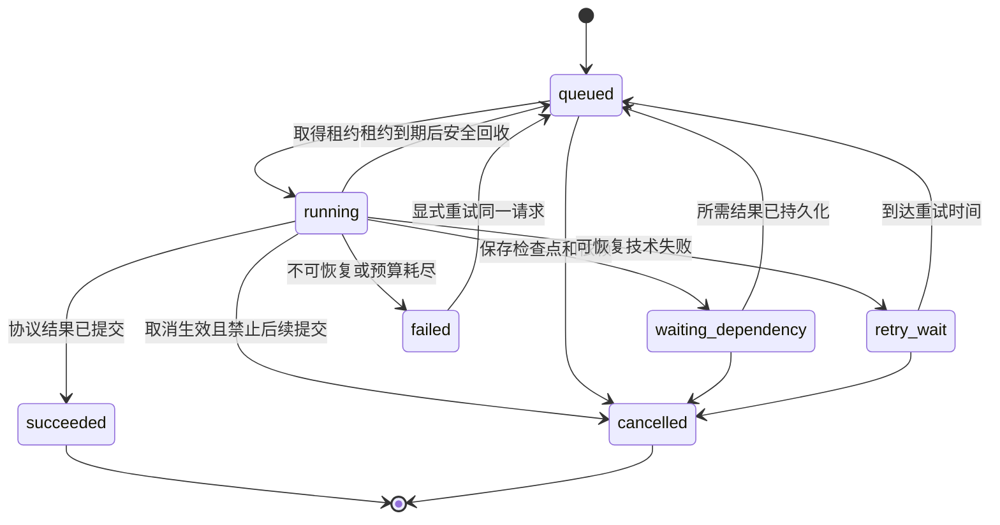
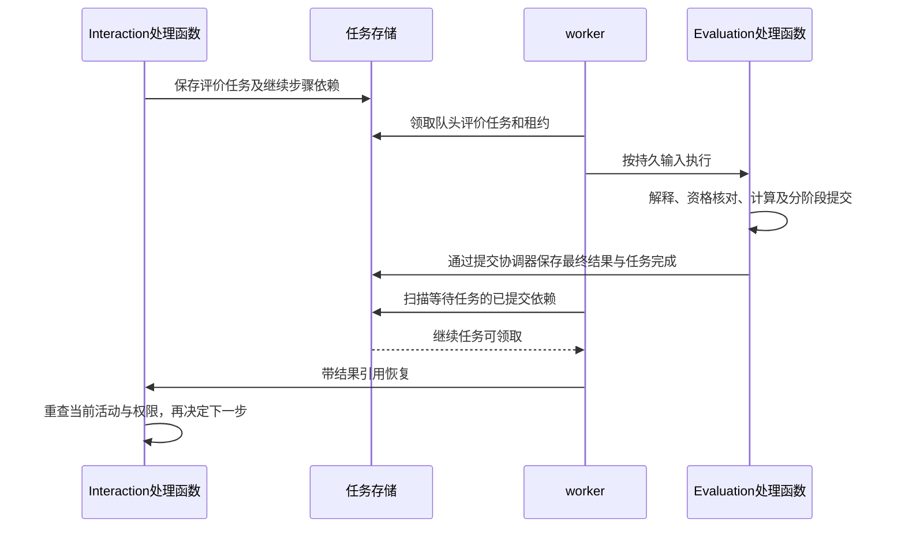

# M1 Agent 运行框架设计

> **版本**：v0.4 
> **文档性质**：M1工程设计草案 
> **状态**：归档可读副本；v0.3 原稿及未提交内容保存在原文 ZIP，正文为当时草案 
> **上游依据与基线**：PRD v0.23、内容规格 v0.22、交互规格 v0.21；产品工作基线仍为 `37bd334`，工程输入与决定见[工程入口](README.md)和[登记§31](../../../DECISIONS.md#31-m1系统设计首轮实现草案) 
> **维护责任**：Codex整理与自检；用户审阅模块、接口及技术取舍 
> **评审记录**：用户确认面向实现的系统设计标准并授权推进；本轮建议不代表技术选型、实现或Gate通过 
> **写作规范**：[设计文档规范 v1.1](../../../../top/DeerMind_Design_Document_Standard_v1.1.md) 
> **更新日期**：2026-11-11 
> **修订说明**：v0.3 → v0.4，仅调整归档文档头与相对链接；精确原文见[归档说明](../README.md)。

---

本文件将“共享Agent框架、等待时释放执行器”落实为可实现的运行机制。首轮建议采用Python API与worker两个进程、同一个PostgreSQL数据库，不增加独立消息服务或通用工作流平台。候选及取舍由[总体架构](Engineering_Design.md)维护，本文件说明采用该候选时怎样执行。

AgentRunner执行模型及工具协议，RuntimeJob保存任务进度；Interaction决定活动怎样推进，Evaluation决定证据、数值计算和目标结果。这里的任务不是Domain的TaskTemplate。一条持续对话产生多个短任务，不把整个聊天生命周期绑定到一个常驻Agent。

本轮细化“提交作答→评价→继续教学”链，并规定三类AI职责的共用执行边界。整册解析拆分、各协议最终Schema和生产参数仍待后续细化或有限试验。完整表结构、HTTP接口及业务幂等键由[数据与接口](Data_and_Interface_Design.md)维护，本文维护生命周期与执行机制；上下文取材合同见[上下文设计](Context_and_Memory_Design.md)。

## 1. Agent定义、运行实例与执行器

### 1.1 模块及公开对象

建议源码根为 `src/deermind/backend/deermind/`。以下是待确认的代码组织，本轮不创建代码目录。

| 模块／对象 | 负责什么 | 边界 |
| --- | --- | --- |
| `foundation/execution`：RuntimeJob、JobHandler | 任务身份、状态、检查点、租约、依赖、结果引用；按注册类型执行 | 不决定教学与评价含义 |
| `foundation/agents`：AgentSpec、AgentRunner | 按上下文、工具白名单、输出Schema及预算运行有限模型循环 | 结果须交所属Space校验提交 |
| `foundation/context`：ContextAssembler | 按用途及权限组装输入并保留来源 | 不维护第二套Belief |
| `foundation/tools`：ToolGateway | 校验工具、参数、范围及调用身份 | 不接受LLM自己授予的权限 |
| `infrastructure`：ModelGateway实现、数据库适配 | 供应商调用、用量与错误记录、持久化端口实现 | 不内置教学／评价规则 |
| `entrypoints`：API、worker | 请求接入、查询、任务领取和执行 | HTTP连接及协程不是持久任务身份 |

JobHandler及AgentSpec由业务模块或Space定义，在 `bootstrap.py`显式注册。基础框架依赖接口，不反向导入具体Space实现；M1不加载用户插件、不执行用户上传代码、不提供通用DAG编辑器。

### 1.2 AI职责与业务处理

| AgentSpec建议名称 | 所属模块 | 合法产出 |
| --- | --- | --- |
| `material_assistant` | `application/materials` | 原件引用、KC／题目／解法解析候选、修正说明、缺失材料请求 |
| `learning_assistant` | `spaces/interaction` | 当前活动的合法动作候选、讲解答疑内容、检测计划或澄清 |
| `evidence_interpreter` | `spaces/evaluation` | 有来源的证据候选、方法／方面归因、资格不足或不确定项 |

AgentSpec至少规定所属模块、提示协议引用、输入用途、输出Schema引用、工具白名单、调用预算与模型能力要求。提示协议由语义所属模块维护。一次Evaluation处理可先调用证据解释，再调用确定性计算与提交；纯函数不必包装成Agent。

首条链的JobHandler为 `evaluation_round`、`interaction_continue`，教材处理类型后续补齐。RuntimeJob使用 `job_id`，Evaluation业务处理使用 `evaluation_id`；租约或worker改变不创建新的作答、评价或教学机会。等待学生输入通常结束当前生成任务，Interaction继续保存活动状态。

只保存实际请求、公开输出、工具调用、候选与结果依据；不要求保存模型内部思维链。运行Schema由[数据与接口§1／§3](Data_and_Interface_Design.md)维护。

## 2. 执行生命周期

### 2.1 状态与迁移

| 状态 | 持久含义 | 执行器 |
| --- | --- | --- |
| `queued` | 已委派，满足时间／依赖／业务顺序后可领取 | 不占用 |
| `running` | 有有效租约、尝试编号及检查点 | 占用一个本地槽，模型并发另算 |
| `waiting_dependency` | 检查点与所需结果依赖已一起保存 | 不占用 |
| `retry_wait` | 技术故障可恢复，保存原因、次数和下次时间 | 不占用 |
| `succeeded` | JobHandler要求的结果已保存，result_ref可读取 | 不占用 |
| `failed` | 技术错误或预算耗尽，保留最后检查点 | 不占用 |
| `cancelled` | 未提交动作不再允许；已发生事实不撤销 | 不占用 |

任务成功不等于学生达标。例如Evaluation成功返回“无资格证据”是合法完成，不应重试直到得到正证。Evaluation结果及阶段状态由其合同定义，runtime不增加含义相近的第二套评价状态。显式重试技术失败沿用原job_id、evaluation_id及已提交阶段，新增执行尝试；预算耗尽先按§3.3处理，不能仅改变状态继续调用。重试不是错误评价纠正或重新解释已采用证据。

### 2.2 检查点

检查点只记录可重新进入的程序步骤及结果引用，例如“原始输入已绑定”“证据候选已保存”“Belief阶段已提交”。不保存数据库连接、协程、不可重建对象或供应商会话句柄。

恢复先查已提交业务结果，再继续未完成步骤，不从头生成整段响应。已保存候选可继续校验，但权限、租约与活动状态必须重查。需要学生新输入或材料补充时返回业务等待，不通过技术重试伪造新输入。

## 3. 共享执行与资源调度

### 3.1 领取和租约

API校验身份、请求并完成短事务；不持有请求事务等待LLM。异步操作返回已保存的业务及任务身份。worker领取满足时间、依赖和业务顺序的任务，在事务外执行模型调用。

领取采用短事务中的 `SELECT ... FOR UPDATE SKIP LOCKED`及条件更新：设置running、增加尝试编号、生成租约令牌和到期时间后提交。该机制适用于多个队列消费者，不作为普通业务完整查询的替代，见[PostgreSQL SELECT文档](https://www.postgresql.org/docs/18/sql-select.html)。

心跳、检查点和业务提交均核对租约。业务提交事务内先锁定任务记录，再同时检查`state=running`、lease_token与当前执行者一致、`lease_until`晚于数据库当前时间；仅令牌相同但租约已经过期也不能提交。旧worker即使晚收到模型结果也不能越过该检查，过期回收同样使用条件更新。锁顺序按数据合同统一，不能持有数据库锁等待LLM。ModelGateway采用异步调用；阻塞工具须隔离执行，不能阻塞worker事件循环而使心跳一起停顿。

同一学习空间的作答评价和教学机会评价共用Evaluation请求序号，只有该空间队头请求可执行；技术失败保留队头，重试仍处理同一请求，合法未知／无资格完成并推进序号。序号及分配事务由[数据与接口§6](Data_and_Interface_Design.md)维护。其他空间、教材任务和不依赖新评价的学习动作可以继续，不能把评价串行扩大成锁住整个系统。

### 3.2 首轮建议初值

以下数值是假设单台M1试用服务的工程起点，未验证，不是产品门槛；作为服务配置，不新增算法配置页面。

| 参数 | 建议值 | 待核验依据 |
| --- | --- | --- |
| worker执行槽 | 4，教材任务同时最多1个 | 验证整册解析不占满前台执行资源 |
| 在途模型请求 | 2 | 按供应商限制与成本调整，领取不等于立即占用模型槽 |
| 租约／心跳 | 60秒／15秒 | 验证慢请求与进程中断；心跳不依赖模型返回 |
| 空队列轮询／过期回收检查 | 1秒／5秒 | 核对数据库负载及恢复时延 |
| 单次模型请求超时 | 通常120秒，教材候选180秒 | 多模态延迟待测；超时不证明远端未处理或未收费 |
| 单个Agent逻辑步骤预算 | 最多6次模型请求、12次工具调用、累计主动执行10分钟 | 包含修复和重试，不含排队／依赖等待；缺失输入可提前结束 |
| 技术调用尝试 | 最多3次，退避2秒、10秒 | 在剩余预算内优先遵守Retry-After；无效凭据不重试 |

预算以持久的`job_id + step_key`为计量作用域，从runtime步骤记录累计；同一步骤因租约回收或重试重新领取时不能清零，新的合法业务步骤才使用新的预算。step_key由JobHandler固定，不能为了绕过限额在重试时改名。优先保障学生请求及其依赖评价，教材任务排队。M1用固定任务类型优先级和入队时间；仍须在有限验证中检查教材是否长期饥饿。只有实际吞吐需求证明必要时才增加worker进程。

记录入队、领取、模型调用、依赖等待、完成及重试的时间。它们提供后台执行事实，不直接等于学生学习用时。前台等待、纯后台运算、自动记录／补记／未知由[业务§7](Business_Flow_Design.md#7-系统主动任务与用时提醒)分别解释。

### 3.3 预算耗尽后的受控恢复

以下为待用户确认的最小运维方案，不新增管理员配置页面。服务配置或网络故障已修复且仍有剩余预算时，具备技术运维权限的人员可显式重试原任务；重新领取产生新attempt，已用额度及成功业务阶段保留。

预算已经耗尽时，普通重试应拒绝并返回预算不足原因。运维人员须先核对失败原因及已有业务结果，再决定是否为该job的受限逻辑步骤追加一份有限额度，或修复造成无效消耗的服务配置。修复配置本身不恢复已用额度；如果继续执行仍需新增模型／工具调用，就必须同时批准足够的有限追加额度。若只需补交已经保存的合法结果，不再调用模型或工具，可按该提交步骤的剩余预算恢复。

追加必须显式填写授权人、原因、受影响job及步骤、各维度追加量、调整前后上限和时间，并在同一短事务中保存追加记录及新的有效限额。初始预算、已用预算和全部追加记录保留；字段由[数据与接口§1.3](Data_and_Interface_Design.md#13-通用执行记录)维护。系统按“初始额度＋已批准追加－累计使用”检查可执行性，不直接清零usage，也不因全局默认配置变化而静默重置在途任务额度。

批准追加后显式重试原job_id与evaluation_id，从原step_key的未完成检查点继续，Evaluation序号及教学机会身份保持不变，不创建新的任务或评价规避限额。再次用尽则再次停在failed，不自动追加；未批准追加时保持可见的技术阻塞，不能跳过该空间队头、记为学生反证或重算已成功的概率更新。这里授权的是有限技术执行资源，不授权修改题目、判据或已采用Evidence。

## 4. 任务依赖、通知与恢复

### 4.1 唯一委派入口与恢复依据

首轮唯一评价委派入口是Interaction接收合法检测提交的应用操作：作答、原始事件、Evaluation处理记录和runtime任务在同一短事务中保存。不会另设事件订阅者再次启动相同评价。实际事务和业务键由[数据与接口§6](Data_and_Interface_Design.md)定义。

`evaluation_round`的result_ref指向evaluation_id。首条链的 `interaction_continue`依赖明确为`required_result=final`，等待本次完整协议结束，包括合法unknown／skip。若最终结果已完成，登记时即可进入可执行状态；不会因某个阶段先完成，再多创建一个继续任务。

完成依据是数据库内的结果，不是内存通知。M1定期扫描waiting_dependency任务和依赖记录，不需要消息中间件。登记依赖与等待状态同一事务完成，扫描必须覆盖“评价先完成，后登记等待”的竞态。通知若后续加入，只优化时延，不再产生第二条业务执行链。

### 4.2 分层结果与活动变化

- **完整完成。** 读取所等evaluation_id的结果，不能用“最新一个评价”替代。
- **部分有效。** Evaluation保留已成功阶段，学生查询可按业务规则先取得合法当题反馈。首条链的继续任务仍等final；以后如确需按阶段恢复，须逐动作明确依赖，不由runtime把partial当成全部完成。
- **失败。** 保留本次失败及原始事实；不把失败当负证、不催学生重做。依赖未完成结果的后续动作继续等待，显式技术重试沿原身份恢复。
- **学生切换／停止。** 合法学习表现仍可完成评价；原继续任务失去前台输出资格，不强行恢复旧活动。
- **取消等待。** 学生停止／切换取消的是继续教学任务，不取消已成立表现的评价。评价任务因技术原因无法继续时以failed保留原序号的未完成请求，不进入cancelled终态；显式恢复沿同一身份继续，不能借取消推进队头或丢掉一次更新。

Evaluation成功与stream序号推进、任务最终成功由短事务协调保存；各模块经自身接口参与，不能由Evaluation绕过执行模块直接改runtime表。Belief阶段已成功而目标阶段失败时，重试不再次更新概率。具体提交合同见数据文档。

恢复固定本轮事实及当时采用依据，刷新当前活动、权限和后续教学所需状态，见[上下文§6](Context_and_Memory_Design.md#6-并发与暂停恢复的刷新)。依赖等待不占执行槽或模型额度。

## 5. 模型、工具与业务提交

### 5.1 有界工具循环

1. JobHandler取得所属模块定义的AgentSpec和业务输入。ContextAssembler校验必需来源，构造上下文并保存实际发送内容的引用。
2. ModelGateway按能力配置调用模型，凭据不进入提示词。结果只能是结构化候选、工具请求、澄清／缺失说明或无法继续。
3. ToolGateway核对工具名称、参数Schema、调用身份和当前范围；跨空间、未授权或不在白名单的调用拒绝并留痕。
4. 执行合法工具，将带来源结果交回模型；可能影响同一对象的动作不并行写入。读取更多信息也必须遵守本任务用途限制。
5. 输出通过结构与来源检查后，交所属模块校验业务条件并提交。结构错误最多一次定向修复且计入总预算；语义不确定不靠重复询问到“通过”为止。
6. 保存结果引用，完成或明确返回缺失／失败；必须依赖其他任务时保存检查点后释放槽位。

教材助手只能保存候选和修正建议；采用、领域入库、章节关联仍按管理员操作生效。学习助手不能写Belief；证据解释不能用模型概率覆盖算法。Domain生成与归类结果也须经Domain提交接口，不接受LLM自行编造的对象身份作为入库授权。

### 5.2 生成、提交与展示

生成成功、动作获准、发送与实际展示是不同事实。候选存在不说明学生已得到提示；渲染成功也不证明阅读或理解。消息与展示回执结构由数据合同维护，API查询可以返回已提交消息，不直接暴露内部候选。

检测中的请求分类可以由LLM提出“实质帮助／技术处理／不明确”及原文依据，Interaction程序核对当前轮和动作许可。实质帮助先结束当前轮并取消未开始轮次，再允许提交讲解或提示；不明确先中性澄清，不能先提示再补状态。分支引用[业务§5](Business_Flow_Design.md#5-题目供给检测轮与求助)。

首轮建议不向学生直接流出未校验token；校验已完成的消息／内容块才可发送，前台可以显示处理中。首条链采用HTTP命令与结果查询，不额外引入消息中间件。以后采用SSE也只传已允许展示的结果，不能绕过活动与权限检查。

## 6. 必要故障与一致性控制

| 情形 | 处理及恢复 | 应验证的结果 |
| --- | --- | --- |
| HTTP重复请求 | 同业务键返回原身份，载荷冲突拒绝 | 一份作答、一条评价链 |
| LLM限流／瞬断 | 预算内重试同一步，每次调用留痕 | 不新增作答或教学机会 |
| 模型超时，远端结果未知 | 仅重做无已知业务效果的推理，保留可能重复费用 | 不宣称外部调用严格一次 |
| 模型返回后worker退出 | 已保存候选继续校验；未保存可能重推理，效果仍须幂等 | 不重复更新或展示 |
| 失去租约的worker晚返回 | 提交事务拒绝旧令牌 | 新旧worker不各提交一次 |
| 业务阶段成功但任务未完成 | 查询已提交阶段，接续未完成部分 | 不再次应用同一Evidence |
| 依赖通知丢失／重复 | 扫描已提交结果，幂等唤醒同一个继续任务 | 不丢恢复、不重复继续 |
| 实际展示状态未知 | 保留未知，评价核对帮助资格不足 | 未知不等于无帮助 |
| 预算耗尽 | 失败可查，普通重试不重置；运维按§3.3批准有限追加后沿原身份恢复 | 有明确恢复出口，不自动无限续跑，不跳过评价队头 |
| 结构持续错误 | 保留失败和已成功部分，修复协议／服务后核对剩余预算再显式重试 | 不重复应用成功阶段，失败不降低个人能力 |
| 活动／权限改变 | 提交前重查，旧候选不得投到新活动 | 历史任务不接管前台 |

runtime租约不能替代Evaluation的幂等与先后关系。同空间评价按请求序号串行，不能按LLM返回快慢决定概率更新顺序。取消或技术重试也不具备删除原始事实、纠正历史评价的权限。

## 7. 框架选择与最小验证

### 7.1 候选及重开条件

| 候选 | 适合之处及代价 | 首轮建议 |
| --- | --- | --- |
| PostgreSQL任务表＋有限JobHandler／AgentRunner | 同库短事务便于事实与任务可靠交接；需实现本文件明确的租约、等待、幂等和恢复 | 推荐候选，但必须做故障验证 |
| LangGraph | 已有图检查点和存储；需厘清与Space事实、runtime任务的关系 | 有限循环不足时验证，不同时维护两套执行状态 |
| Temporal | 已有持久执行和等待恢复；引入运行服务及开发约束，业务效果仍需幂等 | 长流程复杂度或运维需求证明收益后重开 |

参考：[LangGraph持久化](https://docs.langchain.com/oss/python/langgraph/persistence)、[Temporal执行](https://docs.temporal.io/workflow-execution)。来源说明已有机制，不代表DeerMind选型或性能已经验证。

旧 `src/architecture_validation/runtime.py`、`store.py`、`model.py`可参考受限调用、来源和实际展示追溯；其单线程／SQLite、Observation管线和历史重算不可直接迁入M1。复用结果由[实施计划](Delivery_Plan.md)统一登记。

### 7.2 有限验证与剩余设计

本轮不执行实验。后续至少验证：两worker争抢、过期旧租约晚提交、完成先于等待登记、完全无通知、阶段提交后进程退出、原活动停止、空间评价队头失败后恢复、预算耗尽拒绝普通重试而有限追加后沿原身份恢复，以及同一帮助输出重试不重复计机会。不能只检查“任务最后完成”。

尚须细化三类AgentSpec最终Schema和工具清单、教材逐页／跨页任务拆分、供应商适配、实际取消能力，以及容量与成本参数；依赖哪个评价阶段须逐业务动作映射。没有确认的细节不能默认为已批准，不新增Evolution、插件或历史重放平台。

## 8. 完成条件与审阅

以下是未来接收条件。草案尚待审阅和验证，本轮均不勾选。

- [ ] RuntimeJob、活动与执行资源关系明确，状态及检查点与数据合同一致。
- [ ] 领取、租约、提交、依赖及恢复能按同一组接口实现，必要故障案例已验证。
- [ ] 三类AI职责的上下文、工具、输出和权限已具体化，不能绕过Space写入。
- [ ] 等待、切换、重复请求及进程退出不伪造业务效果，资源参数已有验证依据。
- [ ] 图表、正文、接口及审阅记录一致，设计建议与实际验证明确分开。

当前交付为首轮设计草案；作者自检不代表框架验证、工程接收或授权编码。

