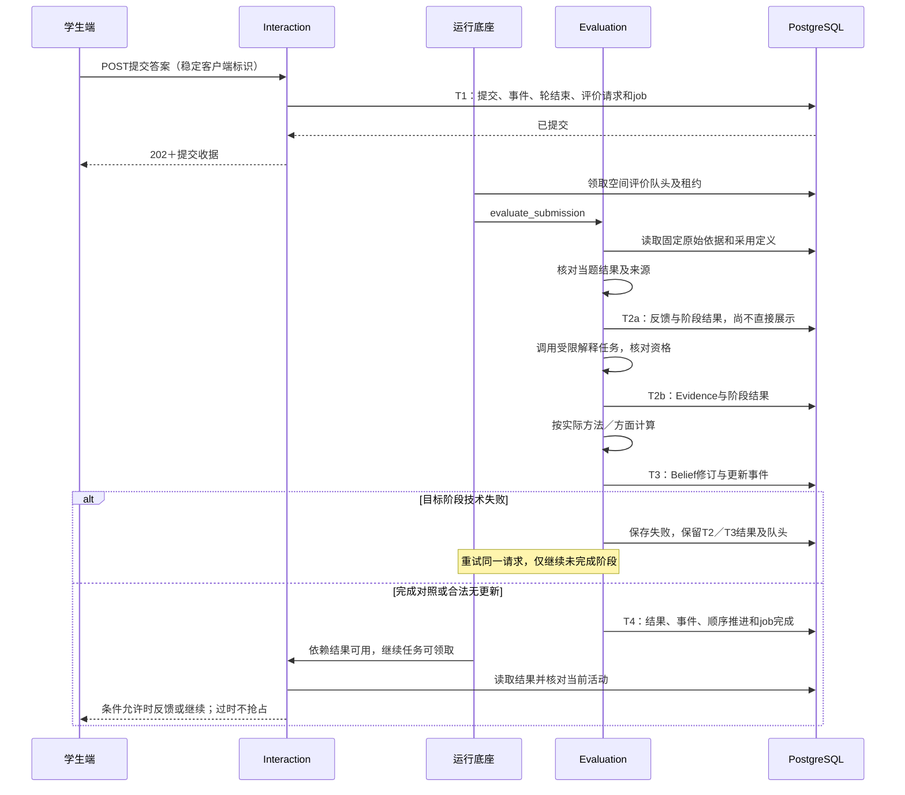

# M1 业务运行机制设计

> **版本**：v0.4 
> **文档性质**：M1业务运行工程设计工作稿 
> **状态**：归档可读副本；v0.3 原稿及未提交内容保存在原文 ZIP，正文为当时草案 
> **上游依据与基线**：输入清单见下文；产品工作基线仍为 `37bd334cf29fd56b1fe5ef6f61cc3c819f01dfb0`；本批修改前提交为 `72b4fd97c65ac0b45a7323601f88c07704382022`，输入核对见[工程入口](README.md)，本批记录见[登记§31](../../../DECISIONS.md#31-m1系统设计首轮实现草案) 
> **维护责任**：Codex负责整理与自检；用户审阅范围及关键取舍 
> **评审记录**：用户确认按面向实现标准推进；本轮接口、事务及执行建议待审阅，未获实现批准 
> **写作规范**：[设计文档规范 v1.1](../../../../top/DeerMind_Design_Document_Standard_v1.1.md) 
> **更新日期**：2026-11-11 
> **修订说明**：v0.3 → v0.4，仅调整归档文档头与相对链接；精确原文见[归档说明](../README.md)。

---

**职责。** 将已确认的M1产品行为转为跨模块执行过程，明确每一步的处理者、输入、调用、写入、等待与结果。

**输入。** [PRD v0.23](../../../m1/PRD.md)、[内容规格 v0.22](../../../m1/design/Content_and_Model_Reference.md)、[交互规格 v0.21](../../../m1/design/Interaction_Design.md)及[原型与资产说明](../../../m1/prototype/README.md)；共同设计输入为[总体架构](Engineering_Design.md)、[运行框架](Agent_Runtime_Design.md)和[上下文设计](Context_and_Memory_Design.md)。

**预期输出与接收者。** 端到端时序图、步骤处理合同、关键分支表及需求到工程流程的对应；供数据接口设计、功能实现和联调验收使用。

**边界。** 承接既定教学、权限和评价规则，不另设产品规则或第二套算法参数；原型不足与产品未决分别登记，不能将mock行为直接当作实现合同。

本轮采用[总体架构](Engineering_Design.md)提出的API＋worker、PostgreSQL及分层模块候选，把§5–6的一条主链展开为可评审的程序行为。技术实现均为建议，未确认或验证；其余“待设计”章节仍为大纲。字段和错误码由[数据与接口](Data_and_Interface_Design.md)维护，运行机制由[运行框架](Agent_Runtime_Design.md)维护，不在本文另起一套。产品规则承接见[工程入口](README.md#31-产品规则到工程章节的对应)。

## 1. 初始化与基础管理

待设计：展开系统启动、管理员与试用账号、服务配置、领域对象手动维护，以及四类活动蓝图、节点、规则和推荐策略维护的必要生产者和消费者；配置定义与学生运行实例分开。

预期产出：初始化流程、前提及结果表；运行配置引用[总体架构](Engineering_Design.md)。

## 2. 教材助手解析与候选采用

待设计：展开扫描件批量导入、持续对话、引用内容、解析纠错、候选核对和采用，处理图表公式及原件出处。

预期产出：教材处理时序图和输入输出表；不恢复手工解析编辑器。

## 3. 领域入库、章节关联与课程应用

待设计：展开KC、TaskInstance、SolutionInstance待入库、模板复用／补建、实例关系、章节TT／ST采用、Claim与目标配置及应用；承接KC Task／复合Task与方法依赖、跨章节方法汇总及各自适用来源，不能将某章选用的方法无条件开放到全部章节。

预期产出：内容到可用课程的交接表；保留已定人工操作，不增加审核发布中心。

## 4. 学生选用与四类活动执行

待设计：展开学习空间创建、持续聊天、活动森林、讲解／答疑／检测／自由交谈、暂停返回与教材独立浏览。分别承接局部追问、需要独立目标的子活动、顶层转交及返回；区分蓝图节点和活动运行状态。节点继承本活动规则与推荐策略，子活动采用自身配置；无推荐策略命中仍可合法继续，未命中转移条件不能默认结束。

预期产出：活动协作时序图和关键路径；活动规则按产品定义承接。

## 5. 题目供给、检测轮与求助

### 5.1 本链前提与供题边界

学生已选用有效教材与目标，当前检测活动及轮来自已采用蓝图；题面、TaskInstance、方法／Claim及实际展示可以追溯。本轮只展开“已经有合格题目后”的提交与反馈，出题工具、候选检查、文件及完整题目Schema须后续补齐。

供题仍按产品合同：优先已有合格实例；不足时按模板生成、检查、保存后使用；检查失败且无替代题才暂不能检测。题目生成成功不等于已展示或已作答，同题接触不能仅换编号变成新样本。开始需学生确认；程序记录轮身份和采用条件，不能把聊天草稿当提交。

### 5.2 接受提交

学生提交调用[数据§5.1](Data_and_Interface_Design.md#51-提交答案)的POST接口。接口入口验证身份和空间，Interaction核对轮归属、允许提交状态及文件引用。按照[数据§6.1 T1](Data_and_Interface_Design.md#61-提交边界与唯一触发)在一个短事务中保存答案、原始事件、轮结束、Evaluation请求和运行任务。

首次成功返回202及submission_id／evaluation_id；网络重发沿同一客户端标识读取原收据，不新建题目、提交或评价。事务失败保留前端未确认输入；只有保存成功才显示“已提交”。提交确认不得附可能提示后题的解法。

程序创建一个`evaluation_round`运行任务；是否需要`interaction_continue`依赖由当前活动决定。不能同时设置一条原始事件订阅，让它再次为同一作答创建评价。事件用于追溯，持久任务是本方案的执行入口。

### 5.3 求助与提交竞争

| 请求 | Interaction处理 | 必须保留的事实 |
| --- | --- | --- |
| 字号、显示故障等中性请求 | 允许必要技术处理，不自动结束检测轮，不输出题目提示 | 请求及实际技术处理 |
| 意图含糊 | 先无提示澄清，保持轮的合法状态；不能边澄清边泄露解法 | 原请求、澄清与回应 |
| 实质求助 | 先提交轮结束、取消原计划未开始轮次，再进入讲解／答疑子活动；帮助输出必须检查轮已结束 | 求助请求、轮结束原因、实际展示和子活动关系 |
| 已结束轮后的讲解／答疑 | 按检测活动的轮后处理调用子活动，结束后返回；新检测另建计划、题目与轮 | 原轮引用及实际后续行为，不覆盖原提交 |

求助判别可由LLM提出，但是否允许展示帮助由Interaction程序检查。请求和计划输出不等于实际帮助；只记录确实交付的内容。同一轮的提交与求助结束采用行锁及revision检查，只允许一个结束转移。迟到求助不能把已经接受的答案改成受助作答；若求助先完成结束，迟到提交被拒绝并返回真实轮状态。

教学机会身份与去重引用数据合同。帮助并不自动加学习转移；其收束、实际内容和资格需另行判断，未知不加L。未作答或请求帮助不作为能力反证。

## 6. 事件到评价再返回教学

### 6.1 调用与提交顺序

**图 M1-BF01：提交到评价返回的候选实现。** 展示主路径、阶段失败和恢复边界；AI内部工具循环见运行框架。本图不表示算法或真实LLM已运行。

图中的关联写入通过各模块repository共同参与事务完成，不表示Interaction直接写Evaluation表。数据库事务不跨LLM调用；T1–T4字段及原子边界唯一见[数据§6](Data_and_Interface_Design.md#6-事务幂等与并发提交)。

| 步骤 | 处理者与输入 | 处理及输出 |
| --- | --- | --- |
| 1 固定依据 | Evaluation接收evaluation_id | 读取同空间原始提交、题面、实际帮助／展示、方法／判据和必要接触背景，形成可恢复的输入；旧Belief不用于诱导本次表现解释 |
| 2 核对当题反馈与解释表现 | Evaluation及`evidence_interpreter`任务 | 先核对当题结果并以T2a保存反馈；只答150也可有可靠的当题核对，不要求已有方法Evidence。证据解释另外输出方法、判据、方面及来源片段，不生成概率，不补造步骤 |
| 3 程序核对 | Evaluation处理候选 | 校验引用、帮助、时间、重复来源；同一作答×方法×方面先合并判据。子Task仅沿实际子过程形成独立依据，不从父成功推断 |
| 4 保存解释 | Evaluation执行T2b | 合格、未决、不适用及原因均可记录；合法无更新可完成，不是服务失败，不撤销T2a已核对反馈 |
| 5 数值更新 | Evaluation执行T3 | 确认当前空间队头，读取分项current_probability，调用纯函数并保存一次修订。只更新适用方面；没有明确子证据就停止该分支 |
| 6 目标对照 | Evaluation执行T4 | 对照当前目标的方法要求、适用Evidence及观测概率；未舍入值与0.90比较。保存结果后推进顺序及完成任务；业务层不另算达标 |
| 7 恢复教学 | Interaction处理完成结果引用 | 检查结果属于本次提交、活动未结束且位置仍适用；按蓝图决定下一步。学生已切换时不抢占，新动作继续遵守检测规则 |

### 6.2 四分之一：可核对的输入输出

本例采用[内容§4.24](../../../m1/design/Content_and_Model_Reference.md#424-一次检测怎样反馈并衔接后续任务)的合成E1／E2：目标允许两种方法任选一种，本次实际用分步法A。两次之间无新的教学机会；B无本次证据，不能复制A的结果。本表是合同预期，不是测试报告。

| 输入／条件 | 预期输出 |
| --- | --- |
| E1：120本，学生写120×1/4=30、120+30=150，并解释参照与加回原量；帮助资格成立 | A独立／理解各形成一次合格观测，约0.772727；原计划还有E2时只确认提交，不先展示解法 |
| E2：40米的新表格题，学生独立求50并解释，指定迁移背景可核对 | A独立／理解约0.920382，迁移约0.772727；保持无合格证据，B不更新 |
| 题单结束、目标对照成功 | 独立／理解达到本次目标；迁移未达阈值，保持待确认。不能宣布整章、两种方法或所有方面均掌握 |
| 只有150、没有方法过程 | 可以核对当题结果；无法归因A或B，分项跳过，不制造理解或子Task证据 |
| 有两步算式但没有解释 | 独立条件可核对则只更新独立；未解释不作为理解反证 |
| 表格接触史未知 | 保留可核对求解／解释，迁移条件未决，不为了补齐四方面强行更新 |

观测与教学预测分开：实际教学收束时以稳定机会身份先登记顺序请求，不等LLM资格判断返回后才入队；仅对后续核对合格的独立／理解项应用L。不刷新实际表现时间，不直接达标。完整教学机会注册接口与语义质量仍须细化和验证，M1不按聊天条数计权。公式、参数和阈值继续引用产品内容规格，不在流程另设数值标准。

### 6.3 等待、部分成功与失败

“学生已提交”“解释已完成”“概率已更新”“目标已对照”“反馈已展示”分别记录，不用一个完成布尔值代替。阶段状态和结果结构见[数据§5.2](Data_and_Interface_Design.md#52-读取评价结果)。

| 情况 | 保存与恢复 | 后续行为 |
| --- | --- | --- |
| LLM或工具技术失败 | 按底座有界重试；仍失败保存失败阶段，原始事实保留；feedback失败同样不推进final／队头 | 不记学生反证，不要求学生重做；已成功反馈可按展示规则显示，依赖本次完整评价的步骤等待 |
| 有效核对或解释后无法判分／归因／资格未决 | 反馈可为合法undetermined，Evidence可为空并记录跳过，完成处理而概率不变 | 可以依据真实未知说明限制，不能把技术状态标失败 |
| Belief已提交、目标阶段失败 | 保留已有修订及T2／T3成功标记；重试只做目标对照和完成 | 旧有效目标结果可带原时间回看，不能标成此次结论；不重复加分 |
| 通知重复或丢失 | 完成依据是已持久化result_ref；底座扫描已满足依赖，继续任务唯一 | 重复通知不新建活动、不重复展示。完整展示去重合同随聊天协议补齐 |
| 学生已退出／切换／活动结束 | 保留原评价，恢复时核对当前位置 | 不自动抢回聊天主线；后续查询仍可看到结果 |
| 租约到期后的迟到输出 | 拒绝旧租约写入；有效接替任务读取已成功阶段 | 已形成事实不丢失，未提交输出不冒充成功 |

同一空间评价全串行、失败保留队头是本轮技术建议；会阻塞该空间后续数值更新，但不要求全空间停止聊天。正常技术重试不能跳过序号后回填概率，也不等于错误解释替代或历史重算。取舍与具体键见数据§6.2，需用户审阅。

## 7. 系统主动任务与用时提醒

待设计：展开有效评价／时间条件、任务安排与接受／暂缓／拒绝、活动接续、评价返回及必要性重查。暂缓当天不再催，次日进入空间且仍必要时最多提示一次；拒绝不降Belief、不记答错，同一依据不再提醒，新表现／目标／延迟条件才可形成新理由；同一依据不重复建待办，评价未完成等待结果而非催重做。

另行展开PRD§6.3的跨学习空间累计用时及30分钟提醒流程，不将其当成学习任务或强制退出。说明学生等待时间、纯后台运算、重叠使用时段、空闲判断、自动测量／用户补记／未知的处理；影响操作与记录含义的未决项提出方案供确认，未知不能默认为零。

预期产出：主动任务提醒状态与依据去重表、独立的用时记录及提醒流程；业务任务与Agent运行任务分别标识。后台执行时间事实由运行框架提供，前台使用与补记记录通过交互接口接收，字段交数据合同；不复制产品规则或新增任务中心。

## 8. 关键异常与端到端接收

本轮先登记以下工程接收场景，尚未执行；实施计划安排实际fixture、数据库集成及故障注入。其余教材到课程、四类完整活动及主动任务仍须后续逐条补齐。

| 场景 | 必须核对的结果 |
| --- | --- |
| 同一提交重发、响应丢失后重试 | 一个submission、一个evaluation、一次数值更新；不同内容复用客户端标识被拒绝 |
| 跨轮复用客户端标识但答案相同 | request_hash包含操作、space及round；返回409，不返回旧轮收据、不创建新评价 |
| T1任一写入失败 | 无半个提交／无丢失的评价任务，客户端可用原标识重试 |
| 提交与求助同时发生 | 一个合法轮结束，帮助不在未结束轮中展示；原提交不被改写 |
| 两个worker竞争、旧租约迟到 | 只有有效租约可提交；既有阶段结果和数值不重复 |
| 前序教学机会与后序作答 | 按登记顺序计算；前序技术失败时后序数值等待，不按LLM速度排序 |
| 未决或全部无资格 | 成功处理并有明确跳过原因，概率不变，不形成负证 |
| 只答150，参考可靠但无法识别方法 | feedback阶段可成功且正确；Evidence为空并说明归因不足，不更新A或B。反馈服务技术失败另标failed并等待重试 |
| 目标对照失败后恢复 | 原Evidence和Belief修订保留，目标重试不重做数值 |
| 结果返回时学生已切换活动 | 评价可查询，旧恢复任务不抢占当前活动 |
| 学生查询尚未结束题单的评价 | API也遵守反馈展示限制，不能从查询绕过题面保护 |

这些场景验证接线和确定性机制，不能代替Evidence语义质量、参数校准或学习效果验证。教学机会、帮助、迁移及保持的解释质量仍按validation另验。

## 9. 完成条件与审阅

以下是完整设计接收条件。本轮只展开局部候选主链，均不勾选，不表示系统已实现或全部流程已经闭环。

- [ ] 三条主链每步均能定位生产者、消费者、输入、输出、持久写入及必要等待，没有依赖隐含人工操作。
- [ ] 实质求助／技术处理／含糊请求分开，轮后帮助及重新准备、评价分层失败、结果迟到和主动任务不抢占等分支落实到执行过程。
- [ ] 教学机会与数值更新责任、提醒去重和用时口径均有输入输出及接收章节；未决产品含义没有由工程默认补定。
- [ ] 覆盖整册准备和M1四类活动，不将四分之一联调样例当作全部交付；语义缺口明确返回产品而非由代码默认。
- [ ] 所需图表和示例真实存在、与正文一致；技术验证标明已验证或待验证及其影响，不用设计描述冒充结果。
- [ ] 上下游引用、权限和M1范围核对完成；作者自检、用户审阅和允许进入对应实现的范围分别记录。

审阅分工：Codex先自检，用户审阅模块操作、提交边界和失败处理等技术细节。本批记录见[DECISIONS §31](../../../DECISIONS.md#31-m1系统设计首轮实现草案)，后续验证由[实施计划](Delivery_Plan.md)及[验证入口](../../../m1/validation/README.md)承接；当前不进入编码。

