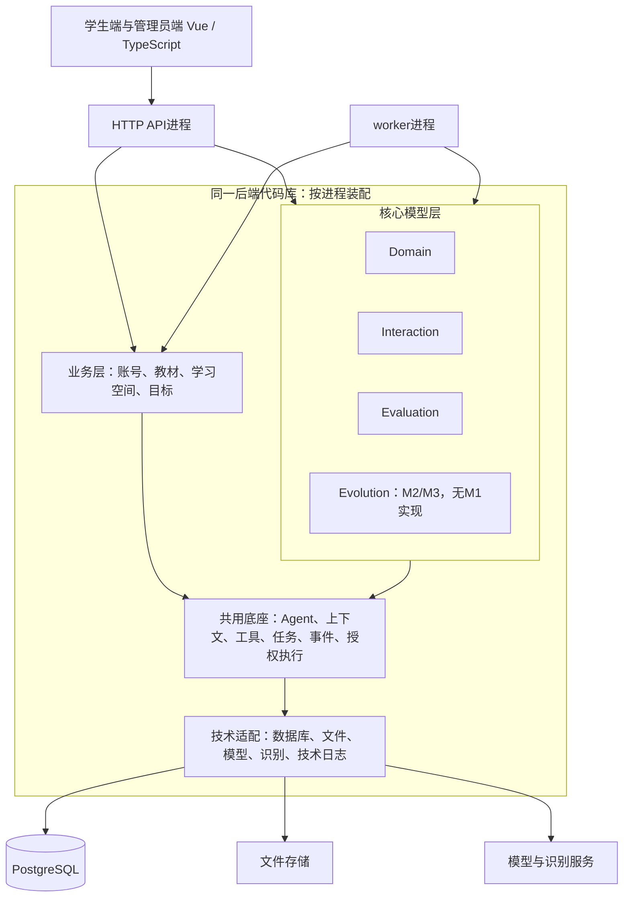
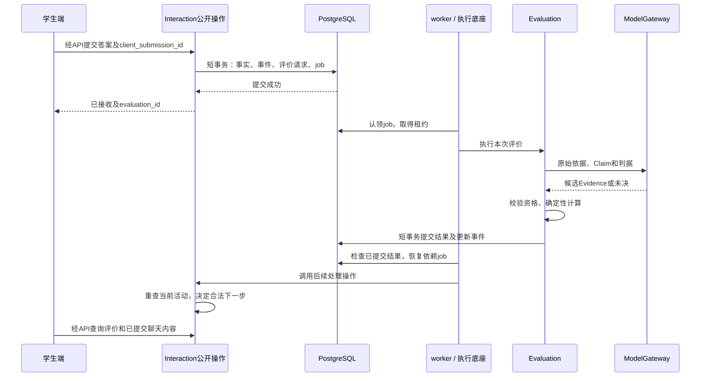

# M1 总体工程架构设计

> **版本**：v0.4<br>
> **文档性质**：M1系统设计草案，面向实现<br>
> **状态**：归档可读副本；v0.3 原稿及未提交内容保存在原文 ZIP，正文为当时草案<br>
> **上游依据与基线**：PRD v0.23、内容规格 v0.22、交互规格 v0.21、验证计划 v0.4；与产品工作基线 `37bd334` 一致；本批修改前提交 `72b4fd97c65ac0b45a7323601f88c07704382022`，文件指纹见工程README<br>
> **维护责任**：Codex提出方案、维护与自检；用户审阅模块命名、接口组织及技术取舍<br>
> **评审记录**：用户已确认分层方向与面向实现的设计标准，授权推进；本文具体目录、技术栈和执行机制均为待审建议<br>
> **写作规范**：[设计文档规范 v1.1](../../../../top/DeerMind_Design_Document_Standard_v1.1.md)<br>
> **更新日期**：2026-11-11<br>
> **修订说明**：v0.3 → v0.4，仅调整归档文档头与相对链接；精确原文见[归档说明](../README.md)。

---

本文件负责系统如何划分、部署和接线。完整接口字段由[数据与接口](Data_and_Interface_Design.md)唯一维护，执行机制由[Agent运行框架](Agent_Runtime_Design.md)细化，取材与记忆由[上下文设计](Context_and_Memory_Design.md)细化，业务顺序由[业务运行机制](Business_Flow_Design.md)维护。五份技术设计交叉完善，不重复维护第二套接口或算法。

本轮交付架构候选及“提交答案→评价→继续教学”的局部实现草案。选型、模块名、接口名均待审阅；其余链路仍需细化，不声明M1系统设计整体完成。

## 1. 工程目标、范围与输入基线

M1支持整册教材导入建模、学生选用、四类活动、检测评价及主动任务。首条实现链使用“四分之一”核对接线，不能代替整册及其他流程交付。产品规则见[PRD](../../../m1/PRD.md)、[内容规格](../../../m1/design/Content_and_Model_Reference.md)、[交互规格](../../../m1/design/Interaction_Design.md)；质量测量归[验证计划](../../../m1/validation/Validation_Plan.md)。

已经确认的方向：

- 业务层承载学习空间、教材、目标、账号及关系；核心模型层按Domain、Interaction、Evaluation、Evolution划分。M1不建设Evolution功能。
- 每个Space区分定义与内容、运行行为和运行状态；TaskInstance／SolutionInstance是可复用内容，不是学生作答或Agent运行实例。
- AI执行、上下文、工具、事件及可靠任务机制共用；活动规则、数值计算和教材采用含义由所属模块决定。
- 事件只追加、个人空间隔离；求助先结束检测轮再帮助；Evaluation计算概率和目标状态。算法与阈值引用产品，不在工程另定。
- Evolution、错误评价纠正、替代Evidence、历史重算和跨版本迁移后置；必要采用依据与并发检查继续保留。

本轮未确定模型供应商、主机规格、并发与成本上限，也未完成账号找回、教材文件上传及完整领域维护接口；缺口见§5–6及工程README。图示覆盖不代表接口已完成。

## 2. 系统结构与外部依赖

### 2.1 逻辑层与运行进程

建议同一后端代码库启动API与worker两个进程，暂不按Space拆服务。查询和短事务在API处理；需要模型或等待其他结果的工作，持久化后由worker执行。



箭头表达使用关系，源码依赖按§2.3控制，不能据此导入全部底层实现。管理员维护Domain可直接调用其公开操作，无需为每个Space增加空业务包装。

### 2.2 代码目录与模块职责建议

以下是待确认的目录设计，本批不创建源码目录。现有原型继续作为交互资产，不能直接用其mock状态作为正式业务状态。

```text
src/deermind/
├── frontend/                         Vue学生端、管理员端及生成的API类型
├── backend/
│   ├── deermind/
│   │   ├── entrypoints/              api.py、worker.py：启动、路由、进程生命周期
│   │   ├── application/
│   │   │   ├── accounts/             账号、角色关系、业务访问条件
│   │   │   ├── materials/            原件、教材助手、候选、章节采用
│   │   │   ├── learning_spaces/      选用关系、空间上下文、组合查询
│   │   │   └── targets/              学习目标定义、方法覆盖要求
│   │   ├── spaces/
│   │   │   ├── domain/               领域定义、题目与解法内容、依赖与领域操作
│   │   │   ├── interaction/          活动配置、活动执行、检测轮、学习助手
│   │   │   └── evaluation/           Claim、Evidence、数值计算、Belief、目标结果
│   │   ├── foundation/
│   │   │   ├── agents/               有界模型—工具执行循环
│   │   │   ├── context/              上下文组装、摘要和引用机制
│   │   │   ├── tools/                工具注册、校验、调用记录
│   │   │   ├── execution/            RuntimeJob、依赖、认领、等待与恢复
│   │   │   ├── events/               事件追加与查询合同
│   │   │   └── access/               身份及授权条件的通用检查
│   │   ├── infrastructure/           postgres、files、model_providers、recognition、telemetry
│   │   └── bootstrap.py              创建连接、注册handler、注入接口实现
│   ├── migrations/                   数据库结构迁移
│   └── tests/                        单元、事务、接线与故障测试
└── deploy/                           启动配置和部署说明，凭据不入库
```

| 模块 | 维护什么／公开操作 | 边界 |
| --- | --- | --- |
| `application/materials` | 教材、出处、候选和章节采用；对话解析、候选采用、提交领域、章节关联 | 不越过领域入库操作直接插改模板 |
| `application/learning_spaces` | 学生选用及当前教材／目标引用；提供使用条件和组合查询 | 不保存第二份Belief或自行计算目标结果 |
| `application/targets` | 目标定义及方法／方面要求；维护和查询采用要求 | 不通过目标输入覆盖M1全局评价阈值 |
| `spaces/domain` | Domain、TT／ST／KC、TI／SI、递归依赖；维护、检索、实例归类和核验入库 | 不推断个人掌握，不保存学生作答 |
| `spaces/interaction` | 蓝图／规则／策略、活动森林、轮及帮助事实；接收请求、选择合法动作、请求评价 | 不直接写Evidence、Belief和目标结果 |
| `spaces/evaluation` | Claim、评价请求、Evidence、Belief和目标结果；解释、资格校验、计算及依据查询 | 不决定教学下一步，不直接向学生推提示 |
| `foundation/execution` | 运行任务、租约、检查点、依赖及结果引用；认领、等待、恢复和重试 | 不依据LLM自述判断学生达标 |
| `foundation/events` | 事件身份、关联和追加查询机制 | 不成为另一套能力或活动状态管理器 |

Space内部拟按实际职责组织：Domain为`definitions / content / dependencies`；Interaction为`definitions / activities / testing / assistant`；Evaluation为`claims / evidence / belief / targets / numerics`。用`contracts`暴露输入输出，`ports`声明所需外部能力；内部可以先用文件实现，不为目录齐整预建空类。

### 2.3 依赖与装配规则

1. 前端只访问HTTP合同；路由校验、鉴权并调用公开操作，不写概率算法或活动转移逻辑。
2. 跨模块只使用公开合同，不直接访问对方仓储、ORM实体或私有表。参与方可以共享同一短事务，各自完成授权写入，不把事务协调等同于任意跨表写权。
3. 核心不导入`application`实现。业务传入只读空间／目标条件；补取数据由装配代码注入查询端口。教材可提问范围与目标需评价范围分开，不能合成一个聊天白名单。
4. 底座不导入Space实现。三类AI任务的提示、语义输出和工具集合分别由教材、Interaction、Evaluation声明，启动时注册；底座只执行通用协议。
5. 核心数值和活动约束不直接依赖数据库或模型SDK。适配器位于`infrastructure`，由`bootstrap.py`注入；供应商切换不改变Belief含义。

建议采用Python导入边界检查与测试约束这些规则，具体检查工具随依赖锁定。逻辑层和物理进程分别设计，不按层数增加服务。[Microsoft分层说明](https://learn.microsoft.com/en-us/dotnet/architecture/microservices/microservice-ddd-cqrs-patterns/ddd-oriented-microservice)

### 2.4 外部能力

| 能力 | 接入点及输入 | 输出与失败处理 |
| --- | --- | --- |
| LLM推理 | `ModelGateway`接收已组装上下文、工具Schema和输出约束 | 结构化候选、调用用量与失败；不能直接当已展示消息或业务成功 |
| 识别／OCR | 授权原件、指定页区域与提取要求 | 带出处的结构化内容及未确定项；不能用空文本掩盖漏图；可由多模态模型或专用工具承担 |
| 文件 | 文件端口接收字节、类型、归属；按ID读取 | 文件引用、hash与元数据；原件、原题图形和教学辅助图分别记录 |

模型与识别供应商未定。文件存储先推荐服务器持久目录，数据库保存引用，不把大图base64塞入事件；多机共享成为实际需要时再选对象存储。文件写入与数据库登记不是同一事务，临时文件、校验、登记和失败清理机制须在教材接口设计中补齐。

## 3. Space、Agent、程序与人工的责任

### 3.1 定义、个人状态和执行状态

| 类型 | 例子与维护方 | 实现要求 |
| --- | --- | --- |
| 定义和可复用内容 | Domain模板／题目，Interaction蓝图，Evaluation Claim | 管理端经所属模块维护，运行保留采用依据；TI／SI不是工作记忆 |
| 学生运行和判断 | Interaction活动／轮；Evaluation Evidence／Belief／目标状态 | 按学习空间归属，由所属Space更新；管理员不能手填概率 |
| 技术执行 | RuntimeJob、某次尝试的租约、步骤结果 | 底座维护；活动可跨多个job，job可换worker恢复；job结束不等于活动结束 |
| 全局事实 | 提交、实际帮助、Evidence形成、概率更新事件 | 生产者决定含义，共同追加；后台教材事件不强塞学生空间ID |

### 3.2 三类AI工作的挂载

教材助手由`materials`提供解析任务与候选工具；学习助手由Interaction提供活动、动作和教学资源；Evidence解释由Evaluation提供本次事实与判据。三者共用执行机制，不共用一份无限增长的对话或全系统工具权限。

程序控制身份、工具授权、状态转移合法性、持久提交、重复检查及数值计算；LLM负责意图、内容解析、教学表达和表现解释。推荐策略未命中仍可在框架内给出方案；违规或不能形成合格输出时明确未完成。详见[运行§5](Agent_Runtime_Design.md#5-模型工具与业务提交)。

摘要、缓存与检查点只用于恢复和取材，不能覆盖原事件或Belief。Evidence解释不把既有掌握概率作为本轮表现依据；上下文来源与限制见[上下文§2](Context_and_Memory_Design.md#2-各类任务的上下文合同)。

### 3.3 事件与提交

建议单个PostgreSQL实例，按`product / domain / interaction / evaluation / runtime / event_log`分Schema。Schema划分用于职责与迁移组织，不等于天然模块级安全隔离；仍需授权、仓储与源码边界。数据库应用角色禁止更新／删除事件表，迁移角色单独管理。

检测提交事实、原始事件、评价请求和待执行job在同一短事务登记。LLM调用在事务外，结果校验后再提交业务结果及事件。已提交结果是完成依据，通知仅作唤醒；事件不能成为第二条独立评价入口。完整约束由[数据与接口](Data_and_Interface_Design.md)维护。

M1不要求用事件重放全系统状态。当前状态表和不可变事件各有用途；事件引用必须能定位当时依据，不能只指向会被覆盖的当前值。

## 4. 三条主流程的总体运行关系

### 4.1 内容到课程

管理员选Domain→教材助手解析和对话修正候选→采用→提交KC／TI／SI到领域→复用或补建模板并关联实例→教材章节采用TT／ST→目标选择Claim和方法要求→应用后学生选用。

助手不能越过领域入库和章节采用；章节不直接关联KC。该链已明确责任，完整上传、采用、领域维护和应用API及失败Schema仍在[业务§2–3](Business_Flow_Design.md)细化，不能据本段直接开工。

### 4.2 活动与题目供给

业务入口确认空间身份→Interaction确定活动→Domain提供合格实例，必要时生成、核验、保存→Interaction按蓝图讲解、答疑或检测。无替代题且生成核验失败时相关检测暂不可用；教材浏览不限制聊天。

Solution分解、活动森林／蓝图、Agent任务依赖是不同关系，不合并成一个工作流对象。四类活动完整API、并发控制与消息交付合同仍待细化。

### 4.3 提交答案到评价返回

本轮详细输入、写入、失败及恢复由[业务§5–6](Business_Flow_Design.md)、[数据§4–6](Data_and_Interface_Design.md)、[运行§3–6](Agent_Runtime_Design.md)维护。



worker调用Interaction是同代码库内的模块操作，不回调HTTP服务器。202只表示提交已保存；合法未知不等于执行失败，一项Belief成功更新不等于四方面全部达标。

**顺序候选。** 同空间作答与教学机会共用评价请求序号，M1空间内串行、不同空间并行。前序技术失败保留队头等待重试，后续概率更新不能越过；不依赖新评价的聊天继续。代价是一次故障可能延后该空间后续评价，须用户确认，不能默默用后续请求跳过失败或历史重算补洞。

## 5. 部署、资源、权限与运行要求

### 5.1 最小部署候选

建议一个主机运行前端静态服务、API、worker、PostgreSQL和持久文件目录。API／worker使用同一构建物、不同启动入口。评价链用HTTP命令与GET查询持久结果；聊天SSE只传校验并提交的消息，不直通未经检查的模型token。完整展示确认合同在活动接线设计中补齐。

| 进程／资源 | 启动条件 | 故障职责 |
| --- | --- | --- |
| API | 数据迁移完成、配置合法、身份校验可用 | 重启后按稳定提交标识返回原结果 |
| worker | handler注册、数据库及所需模型能力可用 | 过期租约重领，拒绝旧worker迟返提交，按持久步骤恢复 |
| PostgreSQL | 持久卷、运行与迁移角色分开 | 无库不报写入成功；恢复时任务与业务结果一起核对 |
| 文件目录 | 容量、访问权限及备份检查 | 缺原件明确失败，不用文本缓存假装图表完整 |

开发环境为Windows；正式主机、操作系统、预算和是否使用容器待确认。候选允许用独立启动命令运行API／worker，不要求本轮引入Kubernetes。不能把本机工具安装状态当作部署条件已满足。

### 5.2 权限、观测与配置

业务维护账号、关系与空间归属，底座执行身份条件，Space校验具体操作是否合法。LLM输出不授予角色或工具权限。模型和数据库密钥只在服务端配置，前端及普通日志不返回密钥。

最低技术观测建议包含请求／job／评价／活动／空间关联ID、步骤状态、耗时、调用用量、失败码和重试次数。原件及聊天正文用受限引用，技术日志不复制整段个人记录；业务事件与调试堆栈分开。

租约、超时、并发和重试试用值见[运行框架](Agent_Runtime_Design.md)，须故障验证后锁定。容量、成本上限、备份频率和恢复目标根据试用人数及主机条件另定，不预填无依据的生产指标。

## 6. 技术选择、复用与关键风险

### 6.1 待确认的技术选择

| 编号 | 推荐候选及理由 | 备选和重开条件 |
| --- | --- | --- |
| M1-TECH-01 | Python＋FastAPI/Pydantic后端，Vue／TypeScript前端；已有Python提取和运行验证经验 | TS／Fastify可统一语言，但现有Node接线并非生产后端；若团队维护经验明显偏TS再调整 |
| M1-TECH-02 | PostgreSQL关系数据＋必要JSONB；SQLAlchemy事务、Alembic迁移为候选 | SQLite更轻但多worker及跨模块提交需另论证；精确依赖版本确认后锁定，不维护双生产存储 |
| M1-TECH-03 | API＋worker，数据库任务／依赖和有限租约调度 | Temporal具备持久执行能力但增加服务；自建恢复验证不通过或成本过高时重新比较 |
| M1-TECH-04 | 有界Agent工具循环，AgentSpec代码注册，模型传输适配 | LangGraph可用于单个AI任务内部，不与跨任务调度混为同一选型；采用时只保留一套等待恢复权威 |
| M1-TECH-05 | 同空间评价串行，失败暂阻塞后续数值更新 | 并行解释＋顺序提交更复杂；先测吞吐，不按LLM返回先后更新 |
| M1-TECH-06 | §2.2目录和模块名、公开操作与内部实现分开 | 本轮请用户审阅目录深度与命名，不能作为无需确认的细节略过 |

全部是待审建议；供应商、具体依赖版本与部署规格尚未批准。

### 6.2 复用依据

原型为Vue／TypeScript；`src/architecture_validation`使用Python、FastAPI、Pydantic、SQLite和单worker；教材四例主要是Python。此事实支持TECH-01的经验判断，不证明生产核心已存在。页面和场景、校验器／提示、故障案例可逐项参照；旧Observation管线、演示身份、内存队列、硬编码概率和全量重算不能整体迁入。

实际清单和接收验证唯一维护在[实施计划§3](Delivery_Plan.md#3-e01e07依赖与复用)，不按代码数量决定复用价值。

### 6.3 机制依据与待验证项

- PostgreSQL的`SKIP LOCKED`可认领队列行，不能跳过同空间尚未处理的评价前序；租约与迟返拒绝仍要实现。[SELECT说明](https://www.postgresql.org/docs/current/sql-select.html)
- FastAPI后台任务在响应后执行；本方案需要跨进程恢复，不能只挂到HTTP进程的`BackgroundTasks`。[后台任务说明](https://fastapi.tiangolo.com/tutorial/background-tasks/)
- SQLAlchemy事务上下文可承接一次短提交；业务与事件／任务必须共享实际事务，接口同名不保证原子。[事务说明](https://docs.sqlalchemy.org/en/20/orm/session_transaction.html)
- LangGraph区分检查点和长期存储；即使采用，框架记忆也不能代替Space事实和Belief。[持久化说明](https://docs.langchain.com/oss/python/langgraph/persistence)

上述为机制依据，不是DeerMind实测。验证需覆盖重复提交、双worker认领、模型返回后进程退出、租约过期迟返、提交成功通知丢失、失败队头恢复及学生切换活动，具体输入输出见[实施计划§2](Delivery_Plan.md#2-先行技术验证)。

后续必须补齐账号认证与找回、模型和识别能力／预算、完整教材与领域接口、活动并发与实际展示确认、用时空闲口径、文件备份和部署要求。对应功能编码前定案，不以本链草案替代全系统接收。

## 7. 完成条件与审阅

本轮已有目录、技术候选、运行链与故障验证安排；尚未完成所有合同或取得用户技术确认，整体清单保持未勾选。

- [ ] 系统边界、模块依赖、部署与所有权一致，运行图无越权写入。
- [ ] 技术、模块名及接口组织经用户审阅；依赖版本和配置范围已锁定。
- [ ] 关键操作有输入输出、数据约束、事务、并发恢复与可执行测试方案。
- [ ] 整册准备、四类活动、主动任务、权限及运维具有具体承接，未知能力经有限验证。
- [ ] 图、正文、合同与代码组织一致；设计预期与实测结果分开。
- [ ] 作者自检、用户审阅及允许编码范围有各自记录。

建议先审§2目录和边界、§5部署、§6六项技术候选，再沿§4.3阅读业务／数据／运行合同。具体确认登记到[DECISIONS](../../../DECISIONS.md)，不以批量“同意设计”掩盖未讨论的细节。
