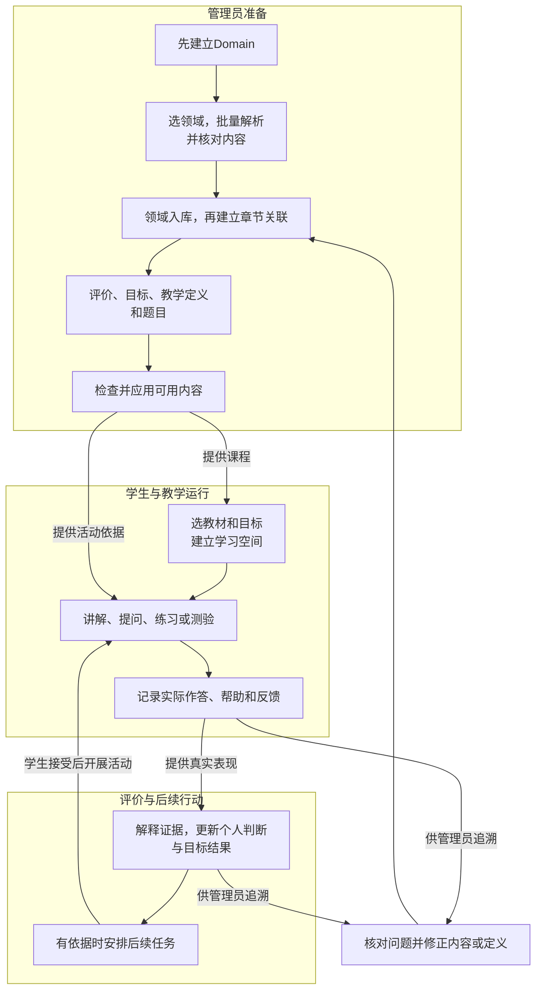
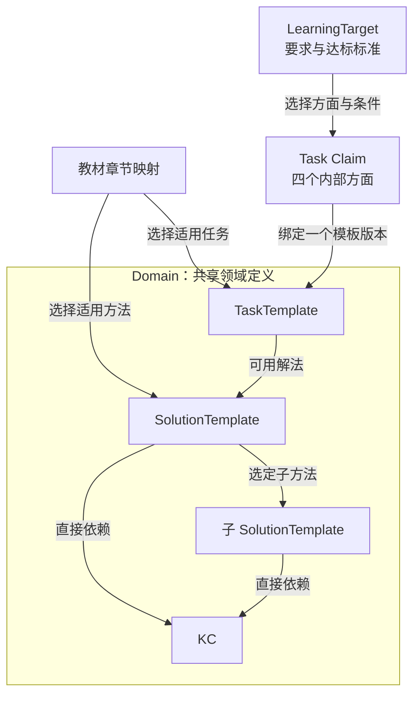
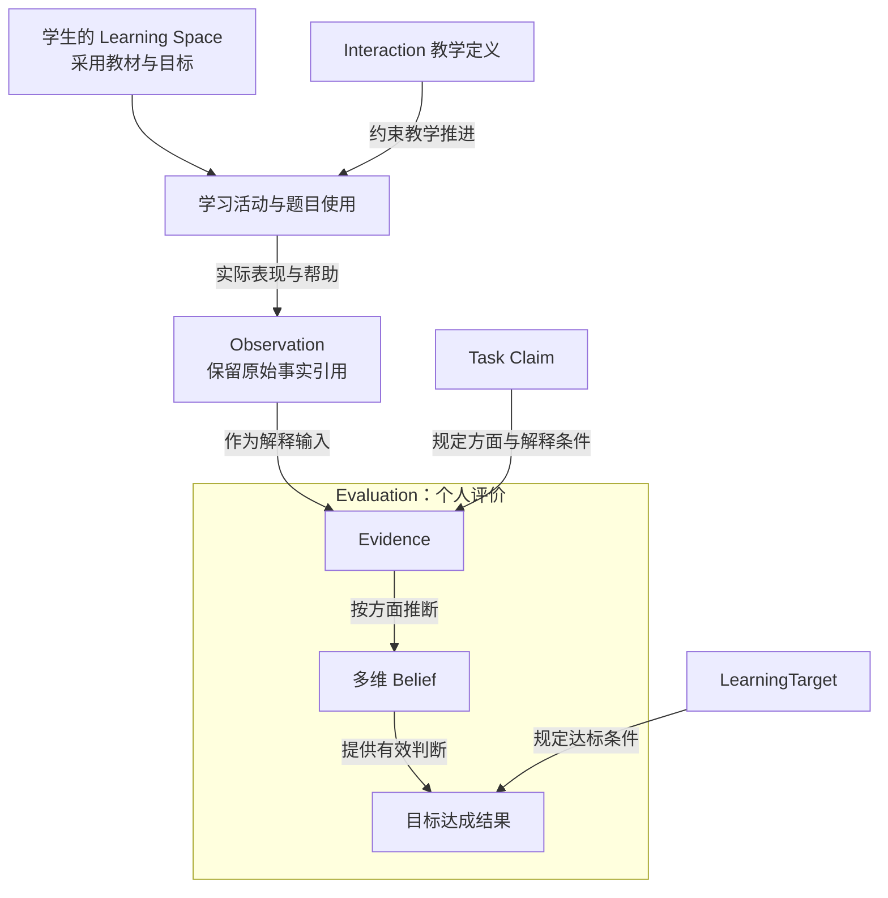
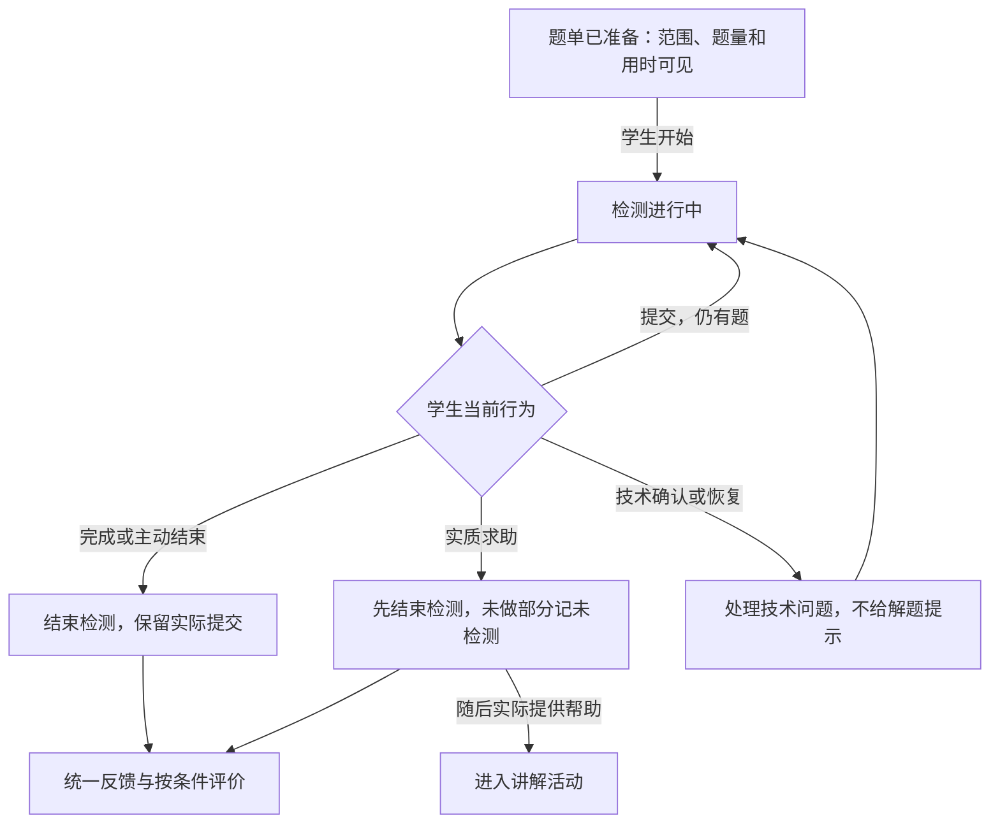

# M1 产品需求文档

> **版本**：v0.11 
> **文档性质**：M1 产品需求主文档（PRD） 
> **状态**：管理员教学模型合同已对照原型；真实教学质量与课程应用待验证 
> **上游依据与基线**：[Development Roadmap v0.10](../../top/DeerMind_Development_Roadmap_v0.10.md)、[决定承接登记](../DECISIONS.md)及用户本轮重写授权；旧成果经取舍引用，不整体继承旧页面或工作流 
> **维护责任**：Codex 编写与自检；用户决定关键产品取舍并审阅 
> **评审记录**：用户确认教学模型本轮收束并授权同步；作者核对当前原型、文字和模拟路径。整册、真实教学与完整 M1 另行验收 
> **写作规范**：[设计文档规范 v1.1](../../top/DeerMind_Design_Document_Standard_v1.1.md) 
> **更新日期**：2026-11-06 
> **修订说明**：v0.10 → v0.11，修订 R06、R11 与 A06，区分策略未命中与动作不可执行，细化 R07 的选题条件。逐文件变更见决定登记§16 

---

本文是M1产品规格的主文档，说明第一版是什么、管理员与学生如何使用、系统应产生什么结果。主流程和核心规则在本文完整表达，详细操作与具体内容通过明确引用展开；本文与详细设计及原型同步修订，共同形成工程输入。

相关操作、状态和对应截图见[主流程交互设计](design/Interaction_Design.md)，教材、对象、题目和具体标准见[内容与模型规格](design/Content_and_Model_Reference.md)。按[六个业务工作包](README.md#2-六个产品设计工作包)交替核对规则、实际内容与原型，发现遗漏可以返回修改。保留V2基本布局和持续对话；必要页面调整按方案确认后执行，外围视觉优化后置。本文业务图不替代界面截图，旧mock不表示新需求已实现。 当前原型代码独立维护于[prototype](prototype/README.md)，按工作包迁入所需部分，不整体继承旧原型范围；已迁入与尚未迁入以M1工作表为准。

## 1. 产品目标、用户与范围

### 1.1 第一版要解决的问题

学生面对一本实际在学的数学教材，可以请 DeerMind 讲解、追问、练习和测验。DeerMind 根据实际表现调整帮助，说明本次已经得到哪些判断、哪些仍不知道，并在有依据时安排下一项学习任务。管理员能够从原始扫描件准备完整课程，并在发现问题后查明依据、修正内容和模型。

第一版的核心价值假设是：**把可靠的教学内容、适应当前学生的教学过程和有依据的评价连接起来，能够比单纯查答案或自由聊天更有效地帮助学习。** 这是假设，需要真实使用检验；目录、原型、模型定义和一次答对都不能证明它。

| 使用者 | 具体需要 | M1 提供的能力 |
| --- | --- | --- |
| 学生 | 看不懂当前教材内容，或想知道自己是否会用 | 选用课程，阅读教材，在同一空间中讲解、提问、练习、测验，看到具体反馈和下一步 |
| 管理员 | 把教材变成可教学、可检测、可维护的内容 | 批量导入与整理，维护领域、评价、目标和教学定义，准备题目，应用内容，查看运行依据并纠错 |
| 家长／监护人 | 知道真实使用条件并控制孩子投入 | 必要的首次告知与确认、用时信息；完整家长客户端、报告和咨询后置 |

首个学生是用户的六年级孩子。具体困难成因尚无可靠观察，不能预设为基础差、粗心或缺乏迁移。M1 既处理学生明确提出的困难，也允许在证据不足时暂不判断。

### 1.2 必做、简化与后置

| 能力 | M1 必做结果 | 简化方式与后置范围 |
| --- | --- | --- |
| 教材与建模 | 用户指定的北师大版六年级上册数学电子教材，整册可导入、整理、建模并用于教学 | 按章推进，AI 辅助、管理员核对；不承诺任意教材全自动建模 |
| 学生学习 | 讲解、提问、阶段及结束检查、主动测验 | 先支持文字、算式、公式和教材图表；语音、自由手写识别、外部拍题导入后置 |
| 个人评价 | 保存真实作答和帮助，形成 Task Claim 各方面的判断及目标结果 | 少量明确规则与真实模型判断；保留未知，不构建复杂全量统计首页 |
| 主动任务 | 系统依据目标、表现和时间安排补讲或检测，学生可以选择执行 | 产品内呈现；无固定周课表、预约、外部推送或最优调度平台 |
| 内容维护 | 管理员直接编辑保存，明确应用后供学生使用；可查活动与定义版本 | 无独立审核发布中心、自动诊断或自主改模 |
| 运行底座 | 真实模型与识别服务、身份隔离、持久化、失败恢复、必要配置和调用记录 | 简单可维护部署；不先建通用 Agent、工具或记忆配置平台 |

完整错题管理、独立题目记录中心、完整学习情况统计、课堂进度、家长产品和校外第二课程属于 M2 方向。长期策略、持续效果及运营效率主要在 M3 完善。后置的是这些产品能力的完整形态，M1 的作答记录、当前评价、主动任务和必要追溯仍须真实存在。

学生端仍以已确认的 Android 平板客户端为交付方向，管理员使用电脑网页。技术框架、具体模型和识别供应商由工程设计确定；不得把浏览器 mock 当成完成 Android 交付。

### 1.3 教材基线与完成边界

采用用户提供的电子教材链接为工作来源，版权页后补。已有[来源核验](../../../src/mvp_foundation/materials/bnu-math-6a-source-verification.json)区分了出版社、年级和册次与尚未确认的出版／印刷年份；本文不把“2026 年使用”写成已经核准的出版版次。

继承[全册目录与逐章建模清单](../../../src/mvp_foundation/materials/bnu-math-6a-whole-book-plan.json)，作为核查起点。清单中的候选任务、检查例和模型状态须重新核对，不能因文件存在就视为建模完成。

M1 完成时须满足：

- **内容完整。** 全册教学章节、活动、复习及必要附页都能定位原页；文字、公式、图表和跨页关系没有未经说明的遗漏。
- **模型可用。** 教学内容有适用的任务、方法、知识、评价定义与目标；必要基础回补有依据；当前教学和检测所需题目及参考已核对。
- **主流程真实。** 管理员在产品内完成准备和应用，学生可以学习、提问、测验、取得反馈，系统可以基于真实结果安排任务。
- **可追溯、可修正。** 管理员可说明一次教学或评价用了什么事实、定义和版本，并修正后续使用。
- **有验证结论。** 分别报告工程完成、内部质量、试用条件和仍未证明的效果；不能用一章样例或全书上传成功代替整册建模。

整册准备完成不要求孩子在 M1 验收前学完整册，更不表示她已经掌握整册。可以按章开发联调，但阶段交付范围仍是整册。

## 2. 产品整体与端到端流程

### 2.1 一条贯穿实例

以下题目是作者为说明产品逻辑编写的例子，不冒称教材原题或已核准检测题：**一根绳原长 40 米，增加原长的四分之一后，共长多少米？**

| 环节 | 人或系统做什么 | 形成的结果及下一步用途 |
| --- | --- | --- |
| 准备领域和教材 | 先建小学数学Domain；导入时选定领域，核对解析出的知识、题目和教材解法 | 有章节和来源的内容候选；尚未成为领域模型 |
| 入库并关联章节 | 在领域内复用或补建任务、方法和KC，把题目与解法关联到模板；回教材为章节选用任务及方法 | TaskInstance／SolutionInstance和领域定义；章节直接引用TaskTemplate及所选SolutionTemplate，KC由方法汇总 |
| 定义评价与目标 | Claim 定义独立完成、理解与解释、迁移、保持；目标说明本章采用的要求、方法和标准 | 按每种方法判断表现，并按目标核对任选或分别达标，没有任何学生状态 |
| 准备题目并应用 | 核对例题及另一道未展示答案的检测题，检查映射与参考；应用课程 | 学生可以选用该教材和目标，活动采用明确版本 |
| 学生求助 | 学生说“增加四分之一到底是加多少？” | 开始讲解活动，先解释增加的是原量的四分之一，必要时引用图示 |
| 学生练习 | 学生在提示后写出 `40×1/4=10，40+10=50` | 保留作答和已给出的提示；可说明本次在帮助下做对，不直接宣布独立掌握 |
| 检测与反馈 | 学生同意后，完成另一个已准备问题，并按要求说明比例的参照量 | 产生新的表现记录；Evaluation 分别解释其对独立求解和理解的意义 |
| 安排下一步 | 系统依据有效结果判断是否还需补讲、补测或延迟检查 | 有必要才形成任务；迁移或保持未取得相应证据时仍为未知 |

“求解方法”是怎样解题，“教学策略”是怎样帮助学生学会，二者不是同一个对象。Domain 提供前者，Interaction 组织后者，Evaluation 判断实际表现支持什么。

### 2.2 主流程

**图 M1-01：从课程准备到下一次学习。** 矩形表示业务阶段，分组框表示主要责任；箭头标签说明交付或触发关系。

学生可以只提一个问题后退出，不必走完整图。系统也可以不创建下一项任务。图中的循环不允许无限追问、自动强制开测或用管理员意见直接改写能力。

### 2.3 核心对象怎样连接

**图 M1-02A：领域、课程和评价定义。** 箭头表示所标注的引用；KC 经方法递归汇总，不增加 Task 到 KC 的直接关联。

**图 M1-02B：定义如何支撑个人判断。** 主线表示活动事实到评价结果；侧边说明定义的作用，不表示这些定义由活动临时生成。

教材可以选用领域定义的一个子集及其适用方法，不改变整个领域的定义。同一个 Claim 可被不同课程采用，但个人 Belief 按学生、学习空间和 Claim 版本隔离。教材内容块、图表、章节是教材内部结构；本图不把每种结构都扩展为新的核心模型。

## 3. 管理员准备与维护

各项需求以稳定编号 `M1-Rxx` 标识，验收见 §7。页面可以合并或拆分这些操作，但功能的输入、结果和权限不能省略。

### 3.1 初次启动与试用账号（M1-R01）

**使用场景。** 管理员要确认真实服务可用，并让指定孩子用自己的身份开始学习。

1. 部署者提供首个管理员账号和受保护的模型、图文识别服务连接。管理员可通过必要页面或检查命令确认配置存在、连接成功或失败；连接成功不等于教学质量合格。
2. 管理员在系统外核实本人和亲子关系，在后台记录结果，为学生建立独立账号，并保留监护关系及必要首次确认。
3. 向家长说明实际数据用途、可见范围、保留方式和外部服务；学生获得简明说明并确认愿意使用。使用条件未成立时，可以准备合成案例，不处理孩子真实学习输入。
4. 学生账号找回恢复原身份与已有空间，不通过另建学生身份丢失历史。管理员和学生即便由同一个成人代为操作，角色和操作记录仍须区分。

输出为可登录账号、关系及确认记录、服务可用状态。M1 不建设完整家长应用或自动身份认证；初始化命令和账号凭据交付方式由工程设计落实。

### 3.2 批量导入教材（M1-R02）

管理员已有扫描PDF或多张书页图片，希望一次导入一本或一部分教材。导入的目的，是取得可复用的知识、题目及求解内容，并确定本教材采用的领域范围；不复刻教材排版，也不直接照搬其教学策略。

| 输入 | 产品规则 |
| --- | --- |
| 所属领域 | 必须选择已存在的Domain；没有时先新建领域，再回到导入。领域可以是空模型，不要求事先完成全学科建模 |
| 扫描文件 | 批量PDF或JPG／PNG；保留原文件及页序。整批提交、内部分页，不要求管理员逐页创建教材 |
| 教材信息 | 书名、来源及已知版本信息；未知版权页信息可后补，不由模型猜填 |
| 来源位置 | 印刷页码、文件内页位置、必要区域和跨页引用分别保留；封面等可无印刷页码 |

教材列表将“教材”和“领域”分为两列，并提供领域筛选。导入页面未选领域时不能开始整理。选领域只决定内容进入哪个模型范围，不把教材等同于Domain，也不共享学生的个人状态。

系统接收整批文件后建立可返回的导入任务。处理状态与内容质量分开：已上传不等于已解析；已解析不等于已入库；已入库不等于课程已可应用。发生处理失败时保留已接收输入与已得到的结果，明确未完成部分并允许继续，不要求重新建立整本教材。

未完成导入可从列表删除，先说明并确认删除对象。该操作不连带删除已加入领域的定义或实例，也不删除其他教材或历史学习记录。课程应用后的撤下及历史清理不由此入口承担。

> **当前表达：** [交互§1.1](design/Interaction_Design.md#11-批量导入与开始整理)。当前原型支持内置真实书页配合mock结果；普通上传没有真实OCR。真实PDF分页、存储、限额及失败部分重试仍须工程落实，不能以演示进度代替整册导入验收。

### 3.3 解析内容、核对并重新解析（M1-R03）

教材管理负责取得可靠内容，领域管理负责维护模型。管理员按章节查看三类解析结果：

- **知识：** KC候选，包含知识含义、适用条件及必要表达。
- **题目：** TaskInstance候选，包含完整题干、条件、要求及题面所需图表。例题的题目也单独列出，可只导入题目。
- **教材解法：** SolutionInstance候选，表示教材对某一道具体题的求解过程，并指向该题；一道题可以有多条教材解法。未见到教材解法的练习题不自动补写一条“教材原有解法”。

这些都是教材内容候选，尚未自动成为领域对象。模型提取与匹配分两步：先读懂并核对内容，再复用或补建模板。编号、父题关系及引用由程序维护，不要求LLM自由生成全库编号。

**图文不丢信息，也不单独成为第四类入库对象。** 图、表、公式随所属KC、题目或解法保存结构化语义。题面中的几何标记、数据表、坐标轴和单位必须保留；解题提示、答案及教学辅助图不能提前出现在题面。原页用于核对和追溯，重新呈现依据结构化内容；不以一段文字摘要或截图本身替代图表含义。细则见[内容规格§3.1](design/Content_and_Model_Reference.md#31-提取什么以及怎样保存图表和来源)。

核对采用简单流程：打开内容，查看原页；发现缺漏或错误，点击“重新解析”，说明需要纠正什么；查看候选结果后选择采用或取消。可针对单项或章节重新解析。采用只替换指定范围的解析结果，保留原件、此前结果和本次说明；取消不改现有内容。不建设内容块移动、框选出处、图形编辑或手工逐字段修补工作台。

必要图表、条件、题目归属等仍有缺口的内容保持未完成，不能提交为合格候选。重新解析失败时保留旧结果并说明失败；不能以“已经重新解析”替代内容核对。M1先用有限样例检验修正效果，不假设提示词一定能修好任何内容。

管理员分别选择知识、题目和解法，提交到所选领域的“待入库内容”。只选题目不附带解法；选择解法时必须带上其对应题目或复用已入库的同一道题。提交不自动新增模板、KC或章节关联。已提交而尚未入库的内容被重新解析后，旧待办不继续按过时内容入库；需提交新结果。已保存领域对象不因教材重新解析被静默覆盖。

> **操作与证据：** [交互§1.2](design/Interaction_Design.md#12-按章节核对与重新解析)。四例真实提取试验仍有人工修正，见[试验报告](validation/Content_Representation_Trial.md)；当前mock只表达操作逻辑，不宣称已实现无人核对导入。

### 3.4 维护领域、处理入库并关联章节（M1-R04）

Domain是独立于教材的领域容器。管理员在其中维护TaskTemplate、SolutionTemplate、KnowledgeComponent以及具体题目；同一领域可服务多本教材。领域管理先具备手动创建和修改能力，教材提供补充内容来源，而不是唯一建模入口。

| 对象 | 核心责任 | 必须分清的关系 |
| --- | --- | --- |
| TaskTemplate | 定义一类任务的工作责任、完成要求、对象变量、条件关系、允许变化和适用边界 | 只直接关联可用SolutionTemplate；不直接关联KC，也不包含某个学生的掌握状态 |
| SolutionTemplate | 定义求解方法的条件、输入输出、顺序步骤、分支、复查和结束条件 | 递归分解时选定子任务和子方法；直接引用KC，汇总所选子方法的KC |
| KnowledgeComponent | 定义知识含义、适用条件、示例及先修知识 | 先修知识可多选；能反查引用它的方法和任务，不建立个人KC Belief |
| TaskInstance | 一道具体题及其已给条件、待求对象、图表和来源 | 归属一个当前采用的TaskTemplate；题目本身不是学生作答记录 |
| SolutionInstance | 对一具体题采用某种方法的具体求解过程 | 同时关联TaskInstance和SolutionTemplate；教材原有与系统生成的来源分开 |

字段与实例化规则见[内容规格§3.2](design/Content_and_Model_Reference.md#32-领域对象与字段)。TaskTemplate的完成要求描述这类任务怎样才算完成；Task Claim与学习目标进一步定义如何解释个人表现及达标条件，不能互相替代。

**方法与知识。** Task只列直接方法；内部子方法在方法详情中展开。Task的KC等于这些方法及其选定子方法的直接KC递归并集，并按KC身份去重。没有方法就没有该路径的KC；不为补齐显示自动新增Task–KC关系。方法循环、缺少子方法及未完成知识定义须显示缺口。草稿可保存，但不能被标为完整教学或检测依据。先修关系也不代表个人掌握状态自动传播。

**待入库内容直接按行操作。** 不增加审核角色，也不先打开一个总“处理”对话框：

| 内容 | 行内按钮 | 成功后实际得到什么 |
| --- | --- | --- |
| KC候选 | 添加知识成分、删除 | 添加弹框可新建或复用知识；完成显示已添加 |
| 题目 | 提取任务模板、关联任务模板、删除 | 提取仅保存模板；关联才保存题目并建立TaskInstance→TaskTemplate关系，显示已关联 |
| 解法 | 提取解法模板、关联解法模板、删除 | 提取仅保存模板；关联才保存SolutionInstance并连到其题目及方法模板，显示已关联 |

提取模板不自动关联实例，也不连带生成其他方法和KC。已有适用模板直接关联即可。解法入库前先处理所属题目；所选方法尚未列入该题任务的直接方法时，确认操作须说明会补上这条关系。系统不能为了让关联成功而默默放宽任务定义或改题意。

状态列区分待添加、待关联、已添加和已关联；提取模板后仍是待关联。题目及其解法构成同一处理组，部分完成时保留已完成行供核对，整组完成后从待办消失；不设置“已入库”历史页。删除只取消本次待办，不删除教材源内容及已保存模型。删除尚未入库的父题时须说明其待处理解法一并取消。

**回教材建立章节关联。** 章节直接选择TaskTemplate及其适用的SolutionTemplate，KC按所选方法汇总。教材解析内容只提供选择依据；元素入库不自动关联章节，章节也不直接关联KC。

- 表格右上方“添加关联”打开弹框，选择当前领域中的任务及本章采用的方法；确认后立即保存。
- 主表只读显示已保存的任务、方法和汇总知识。每行“编辑”弹框调整方法，取消不改结果；至少选择一种有效方法。
- “取消关联”立即移除本章引用，不删除任务、方法或实例。页面不保留总“保存章节关联”按钮，也不把建议当成已关联结果。

章节采用是课程范围定义，不是个人掌握或达标。六年级教材可以排除使用初中知识的方法，领域中仍保留该方法。已入库KC应能通过明确任务及方法直接展示和检测；允许多对多，不为每个KC机械复制一套独占Task、Solution和Claim。

> **对应操作：** [领域手动管理](design/Interaction_Design.md#13-手动维护领域模型)；[待入库处理与章节关联](design/Interaction_Design.md#14-领域入库与章节关联)。

### 3.5 定义 Task Claim、目标与学习要求（M1-R05）

**使用场景。** 管理员要把“学会这一章”具体化为可判断的要求，避免系统临时决定什么叫掌握。

管理员分两步准备评价。先在「评估管理」说明怎样看懂学生在一类任务上的表现。再在「目标管理」规定本教材的哪些表现要达到什么程度。

| 对象 | 管理员规定什么 | 下一步如何使用 |
| --- | --- | --- |
| Task Claim | 选择领域和一个 TaskTemplate 版本。默认采用独立完成、理解与解释、迁移、延迟保持四个方面。有依据时可裁剪或增加，至少保留一项 | 同一 Claim 可用于不同课程和目标。任务及其全部直接方法来自 Domain，工具使用条件随方法定义 |
| 每种方法 | 从本 Task 的判据中选择本层执行判据，展开 Domain 调用的子方法查看其本层判据。另为当前方法的各评价方面分别说明判断要求、所需证据 | “会按步骤算”与“能解释为什么这样算”各有依据。实际采用哪种方法、接受哪些帮助决定作答可支持哪些判断 |
| 学习目标 | 选用教材和章节。每项学习要求引用一个适用的 Claim 版本，明确学生能懂的名称、具体任务范围、采用的方法与方面、各方面达标标准 | 指定一种方法时核对该方法。允许任选时，同一种方法满足整项要求即可。要求两法分别达标时，逐法核对，不能把两法零散的成功拼成达标 |

**课程配置。** 章节已关联的 Task 和选用的方法给出候选范围。管理员核对每项要求的范围及标准后保存。同一 Claim 可被不同目标复用，也可在同一目标下按不同子范围建立不同要求。Claim 更新或章节不再支持选定方法时，目标提示管理员重新核对。来源配置缺口和学生证据不足分别呈现。

**举例。** 求增加四分之一后的新量，分步法先求增加量，再加回原量；倍数法直接乘以 1＋1/4。学生只用分步法完成并解释时，相关证据可以支持该法。若目标要求两法分别达标，倍数法仍待取得表现。改目标可以改变达成结果，原作答与个人能力判断仍按其实际依据解释。

本例题量、表格迁移和延迟检查的试用标准统一见[内容规格§4.10](design/Content_and_Model_Reference.md#410-试用达标标准belief更新与学生反馈)。两类判据和实际方法条件见[内容规格§4.12](design/Content_and_Model_Reference.md#412-同一任务两种方法怎样解释表现)，页面操作见[交互规格§1.5](design/Interaction_Design.md#15-评估管理与目标管理)。

### 3.6 管理教学方法（M1-R06）

**使用场景。** 管理员希望系统按有依据的教学方法工作，既不照教材逐段机械讲，也不让模型任意发挥。

管理员在 Interaction Space 维护一套通用教学蓝图，供不同任务和课程使用。教材及学习目标决定此次学什么，Solution 说明题目可以怎样求解；教学模型负责这一轮怎样帮助学生。首次准备使用默认蓝图，以后可以增改阶段和转移。一种新的讲法通常在现有阶段内就能使用。

| 定义 | 管理员维护的内容 | 运行责任 |
| --- | --- | --- |
| 教学蓝图 | 每个阶段的目的、输入、做法、输出与推荐策略。每条连接的起点、终点、转移条件及判断依据 | 程序核对阶段与连接有效，掌握当前阶段和是否允许转移。六个默认阶段为明确重点、确定起点、讲解、练习、检测、总结。可以跳过、返回、等待或结束 |
| 教学策略 | 目的、适用与不适用情况、教学组织、帮助、观察点、调整与结束条件。阶段引用零到多条推荐策略 | LLM 可以采用、组合或换用其他合法教法。未命中推荐仍可讲解，停用只取消该项推荐。记录实际做法、帮助和选择依据，临场教法无需预先登记 |
| 教学规则与系统约束 | 管理员可维护适用于一个或多个阶段的教学要求。学生退出、独立检测帮助边界、实际展示与评价权限等系统约束只读 | 启用规则对教学具有约束力。程序执行能确定的条件，LLM 在这些边界内理解含义、组织表达。停用普通规则或修改蓝图不能解除系统约束 |

**先判动作是否合法，再选择教法。** 对学生认识有限时，可以根据她明确的请求先帮助，需要时只澄清一个关键点。多种策略适用可选其一；没有一种适合时，可采用其他讲法。例如学生已经知道增加量是 20 本，只问为什么可以乘 1.25，LLM 可以顺着加法提取共同因数。若必要材料缺失、规则冲突、没有所需连接或没有合法下一步，则暂停受影响的动作，保留进度并说明原因。还有合法帮助可提供时，学生可选择继续。

**从讲解直接检测。** 学生同意、目的明确、有符合此次用途的新题且蓝图允许转移时，可以跳过练习。独立检测进行中只展示题面和作答入口。学生请求实质帮助时，程序先结束本次检测，保留已提交部分与未提交草稿，再转入讲解并记录实际显示的提示。已结束的检测不再接收独立作答。学生也可以直接结束学习。正常提交后再给反馈；理解、迁移或保持的判断由 Evaluation 依据有效表现形成。

**保存与修订。** 保存蓝图前检查必填字段、引用、阶段从开始可达且有通往结束的路径。允许有目的的返回；自动推进不能在没有新输入或状态变化时无限重复。普通修订供新活动采用，进行中的活动保留原依据。已确认失效的定义停止用于受影响动作，模型服务失败按§6处理。管理员点击走查使用固定 mock：四分之一走查检验当前保存的连接，三种原有情境固定引用 v1。真实 LLM 的教法选择和教学效果留待工程验证。

对应操作、输入输出与截图见[交互设计§1.6](design/Interaction_Design.md#16-教学模型管理与走查)。

### 3.7 准备题目和参考（M1-R07）

**使用场景。** 系统需要讲解例子、练习和检测题。题目来源、答案、适用范围和使用经历必须能够说清。

第一版可以先以管理员核对的小型题库运行。教材题目、人工补充题及 AI 辅助准备的候选共用下列信息：

| 信息 | 业务要求 |
| --- | --- |
| 题面与来源 | 完整条件、问题、公式及必要图表；原题来源或作者生成标识，不能把作者参考称为教材标准答案 |
| 任务归类 | 所属 TaskTemplate 版本、参数值、条件符合情况；归类未通过时只能保留原始资料或候选，不能保存成该模板的可用实例 |
| 方法与答案 | 已核对的可用方法、参考结果／评分要点、允许的其他解法；开放解释题不能只用字符串答案判断 |
| 用途与条件 | 例题、练习、检测的可用性；对应章节、要求、方法和检查方面；是否真能检验某种变化或延迟条件 |
| 版本与使用 | 题目修订、每次展示和作答、是否给过提示或答案分别记录；改题不能覆盖过去实际见到的题面 |

管理员从任务或章节准备题目，查看参考并核对后保存。没有附答案的教材不妨碍准备，但 AI 解答只是待核对参考。疑似题意缺失、答案冲突或映射错误的候选不能进入检测。

题库需要覆盖当前学习要求，并区分已用于讲解的例题和可检测的新表现；不规定每章统一题量。系统选题时按目标、方法、学生接触历史及可用题目选择，不能把“还剩几道题”当成能力覆盖。没有合适题目时说明尚不能检测该要求，管理员补齐；不能重复已展示答案的题并宣称获得新独立证据。

自动生成广泛变式、原生题和复杂组卷优化不作为 M1 前置条件。将来启用教学中自动出题时，已确认的规则仍有效：候选通过题意、答案、范围和归类检查后保存并使用，无须管理员逐题批准；检查失败不交付学生。M1 不另建大型题库运营产品。

备题与选题分别核对：管理员准备公共实例及其可用用途；每次使用时再结合该学生的接触历史与目标，不按学生复制题库。用四分之一样例逐题核对的清单见[内容规格§4.13](design/Content_and_Model_Reference.md#413-题目准备从公共实例到本次可用题)。

### 3.8 检查、应用与更新（M1-R08）

**使用场景。** 管理员已整理一章，要让学生实际使用；后来修正内容，还要知道何时影响学生。

1. 保存保留当前编辑及版本。检查结果逐项列出：原页／图文、章节映射、可用方法、Claim／目标、教学定义、题目参考是否满足对应行为的条件。
2. 管理员选择要应用的教材内容及目标，查看可用行为和阻塞缺口，确认应用。不恢复审核人、审批单和发布中心。
3. 系统记录所采用的内容和定义版本，使所有试用学生可以选择已准备内容；已使用同一课程的空间更新当前引用，不要求学生手动维护。
4. 正在进行或已结束的活动保留实际采用依据。普通保存不能无声改写旧活动；后续活动使用适用的新版本。活动中遇到已知错误时按 §6 处理，不能继续使用已明确失效内容。

浏览、讲解、当题反馈和正式评价的准备条件分开表达。例如原页已整理但 Claim 未准备好，可以浏览，不能显示“学生待确认”来掩盖课程缺少评价定义。M1 最终验收时，不能将这种局部可用当作整册建模完成。

管理员应用更新不授权替学生换教材或换学习目标，也不把目标标准降低解释为学生能力上升。

### 3.9 查看一次运行并纠错（M1-R09）

**使用场景。** 管理员发现“孩子明明接受了提示，系统却说独立完成”，要找到具体错误发生在哪。

从学生及学习空间进入一项活动，再看轮次和处理步骤；定义管理另有入口。最低可查看内容如下：

| 查看层次 | 必须能看到的依据 |
| --- | --- |
| 活动 | 学生、空间、目标、范围、活动类型、开始／结束原因、采用版本、关联主动任务 |
| 一轮交流 | 原始输入与上下文引用、理解结果、教学选择及理由、计划输出和实际展示、提交作答、帮助记录 |
| 评价 | 当题反馈、Evidence 对应的 Claim 方面、多维 Belief 前后变化、目标结果及其依据；未产生或失败明确显示 |
| 运行状态 | 执行成功／失败／取消、调用时间与用量、重试；审查意见和学习评价分别显示 |
| 后续处理 | 可疑记录、管理员核对意见、相关定义修订与应用、新活动使用结果 |

管理员记录“预期是什么、实际是什么”，进入对应内容或模型定义修正。不得直接将某个学生的 Belief 改成通过；已知不可靠的结论停止当前使用，并保留原记录及待处理状态。M1 不承诺批量补算所有历史；待映射题补齐定义后也不追补旧作答评价，新表现按新依据处理。

Evolution 在本阶段通过这种有记录的人工修正提供基础作用，不另建自动诊断或演化工作流。系统能追溯并纠错，不等于已经能自动找出根因。

## 4. 学生学习与系统主动任务

### 4.1 选用课程与阅读教材（M1-R10）

学生登录后，选择管理员已准备的教材及可用目标，创建自己的 Learning Space。选择保存的是课程采用关系，不是复制一份由学生维护的教材。M1 不设置长期章节范围，每次学习或检测选择章、节或当前题目。

学生可浏览目录和原页，阅读整理内容、公式及图表，从具体内容发起“讲讲这里”或输入自己的问题。操作须保留实际所指内容；只浏览另一页不自动切换当前教学目的。原页无法读取、章节尚未准备或暂不能评价时，说明影响当前操作的原因。

每个学习空间有一条持续对话。学生不需要命名或新建会话；活动边界由实际学习行为形成。当前消息、活动、草稿和判断属于该空间，共用教材定义不表示共用个人历史。

### 4.2 讲解、提问与策略调整（M1-R11）

**使用场景。** 学生明确说“讲一下这一节”或问“为什么增加四分之一不是直接加四分之一”。系统要直接回应问题，并根据实际反应继续。

开始时采用当前教材、目标、已知表现和请求。已有信息足够时直接给简明解释；缺少决定当前帮助内容的关键信息时，只澄清该问题，不强迫每次先做完整诊断或整章预测。

| 学生情况 | 可以采用的起点 | 观察后怎样调整 |
| --- | --- | --- |
| 不清楚四分之一指谁 | 用一条线段或教材图说明原量与增加量，先讲清参照整体 | 仍混淆时换一个更简单的对应例；能说明后回到原问题，不持续重复原话 |
| 算得出结果，但解释成“加 1/4 米” | 对比原量不同、增加比例相同的情况，请学生说明差异 | 能辨认关系后撤去提示再练习；复述仍不一致则继续澄清，不能因计算正确跳过问题 |
| 已有可靠的求解和解释表现 | 简短回答当前疑问，可按请求进入练习或准备检测 | 新表现支持时不强制重新讲全部内容；出现冲突则回到具体卡点 |

这些是同一蓝图的不同起点。LLM 根据当前问题和实际表现选择教法，可以在讲解阶段内切换；推荐未命中时仍可提供合法帮助。“没测过”保留未知。

讲解分段进行，每段围绕一个关键问题。学生可以追问、要求更详细、只要提示、继续或停止。追问与对应内容关联，主线和进度保留；不因模型已经生成下一段就认定学生看过或理解。

当当前内容依赖旧知识时，可以简短回补，再回到本题，不另开整套低年级课程。发现真正进阶超纲请求时说明范围并委婉拒绝；教材内新问法或缺映射不直接等于超纲。范围不清先澄清，不能靠关键词决定。

### 4.3 讲解中的练习与结束检查（M1-R12）

系统可在有教学目的时请学生解释一步、比较两个答案或尝试一道题，并说明要检查什么。学生提交后才分析；未提交草稿、阅读结束、“懂了”或沉默不作为完成任务的证据。

练习允许提示、示范和及时反馈，帮助的具体内容及呈现时间须记录。学生接受帮助后做对可以说明“在这个提示下完成了”，也能作为适用条件下的证据；不能直接支持无帮助独立完成。

需要检查当前是否会独立运用时，先说明检查范围与帮助条件，经学生同意进入检测。听完讲解不强制检测；学生选择不测时可结束教学并明确“尚未检查”。结束检查也不是每次全面检测四方面，未涉及的方面保持原判断或未知。

讲解可以因当前问题得到回应、学生选择结束、暂时无法继续或转去其他活动而收束。结束小结说明本次讲了什么、实际做了什么、反馈和评价边界以及可选下一步；不使用“已经学会”作为统一结束语。

### 4.4 学生主动测验与求助（M1-R13）

学生从教材选择本次章／节，可选择多个。系统依据对应要求、适用方法、有效历史和可用题目准备题单，说明覆盖、题量、参考用时及未覆盖部分，学生决定是否开始。题量取决于目标和范围，不设置全章统一的固定数；过大范围提出分次方案。

开始后题单不无声扩充。正常独立检测中，提交先确认收到，结束后统一反馈；不提前给出会影响后题的答案或讲解。技术确认和识别核对可以处理，不能借此给实质提示。

**图 M1-03：检测的主要状态与帮助分支。** 矩形表示业务状态，菱形表示学生行为分类；断网恢复另见 §6。

请求实质帮助时结束**本次多题检测**，不只是结束当前一题；之后如需补测，准备新的检测并由学生选择。已提交部分仍可按当时条件评价，没做部分不是答错。“求助请求已收到”与“实质帮助已展示”分别留存。

同一道题可以重测，但接触、提示和见过答案的经历不会因另开活动消失。系统不得仅凭新活动编号就标为全新独立样本。

### 4.5 反馈、个人判断和目标结果（M1-R14）

学生首先看到具体反馈：题目及自己的作答、哪里正确或需要检查、相关解释及本次帮助情况。其次看到与当前学习有关的评价，用通俗语言说明条件和依据；无需显示原始 KC 编号或一串模型概率。

| 层次 | 示例 | 不可混淆的含义 |
| --- | --- | --- |
| 当题反馈 | 这次新长度算对了；“四分之一”的参照量解释仍不清楚 | 一次表现的判断，不代表同类题全部会做 |
| Belief 的方面判断 | 当前证据支持在所测范围自行求解；解释还有冲突；迁移与保持尚未得到相应证据 | 学生在本空间的有条件认识，不强行平均为掌握百分比 |
| 目标结果 | “解释增加比例的参照量”仍需加强；“延迟后仍能完成”待确认 | 与当前目标标准比较的结果，不是新的能力状态 |
| 后续行动 | 可再看一个对比例子，或之后检验不加提示的表现 | 建议和任务，不是已发生的学习 |

“已达标”需要有效依据支持当前要求；“需加强”需要有适用的不足依据；证据不足、冲突或时点未到可以“待确认”并说明原因。内容定义没准备好、服务失败与学生证据不足须分别表达。

当题反馈可用但评价失败时，可以展示已有合法反馈，同时明确评价暂未完成。没有新的有效 Belief 不显示假进步，也不能拿过时状态充当本轮评价；依赖该评价的后续任务暂不安排。

M1 在活动结果和必要详情中提供上述信息，不要求先实现完整学习情况仪表盘。学生仍可追问“为什么这样判断”，回复须引用获准事实和适用要求。

### 4.6 系统主动安排任务（M1-R15）

**使用场景。** 学生刚在帮助下完成任务，或已有表现到了适用的延迟检查时间。系统应能主动提出合适下一步，不要求学生自己意识到每个证据缺口。

触发检查的时机包括进入学习空间、活动结束和已有任务到期。判断输入是当前目标、有效 Evidence／Belief、已发生帮助、时间条件、已有任务和当前活动。时间触发本身不等于应该补课；未知不等于不会。

一个任务至少包含：所属空间、任务目的、章节和要求、关联 Claim、讲解或检测类型、理由及依据、可开始的条件／时间、当前状态和关联执行活动。这是运行任务，不是 Domain 中的 TaskTemplate。

| 学生操作或依据变化 | 业务结果 |
| --- | --- |
| 接受 | 核对任务仍适用；讲解进入活动，检测先展示题单并确认开始；不抢占另一个进行中的活动 |
| 暂缓 | 本次不启动，当天不再催；次日进入该学习空间时重新检查必要性，仍有必要则当天最多再提示一次；不是预约或自动开测 |
| 拒绝 | 保留拒绝结果，同一依据不再提醒；只有新的表现、目标或延迟检测条件带来新理由时才重新考虑，不降低 Belief，不将拒绝记成答错 |
| 活动结束或转教学 | 记录实际完成、部分完成或求助结果；依据新的有效表现决定后续，不把任务完成按钮等同达标 |
| 新事实或目标使理由失效 | 未开始任务取消或更新原因；历史执行记录保留，不继续以旧理由启动 |

进入页面或重试不能重复创建同一依据的待办。再次提示沿用原任务，不新建一份同义待办；次日未进入该空间时不在产品外催促，之后再次进入时仍先检查必要性，不能补发多条错过的提醒。跨过午夜或换个说法不构成拒绝后重新提醒的“新理由”。

没有合适题目、评价无效或理由不充分时，可以不创建任务；必要时记录待处理原因供管理员查看。再次提醒按M1-DEC-003执行；具体延迟评价窗口仍由逐章标准确定，见 §8 的M1-OPEN-03。这里的次日提示是尊重暂缓选择的提醒规则，不是固定复习周期，也不表示必须再测。

### 4.7 切换、暂停与继续（M1-R16）

每个学习空间当前只推进一项学习活动。明确改学另一内容时保留旧讲解进度；恢复时沿用活动身份和真实历史，不重复计算一次讲解。普通浏览不等于切换活动。

独立检测中切换内容需要说明将结束本次检测，确认后结束；实质求助按 §4.4 直接结束并转教学。已结束检测不能因“接着聊”重新开放原答案提交；回看可转入答疑或另开检测。

M1 需要恢复最近活动、回看相关交流和来源，完整历史多条件搜索后置。恢复前核对原提交和实际展示结果；旧活动的定义已被判为不可靠时，说明不能继续沿用，并按当前可用条件重新准备，不能复制旧进度冒充同一条有效教学链。

## 5. 模型、数据与权限的产品含义

### 5.1 谁定义、谁产生、谁可以修改（M1-R17）

| 数据或模型 | 产生与维护责任 | 使用与修改边界 |
| --- | --- | --- |
| 教材原件、解析内容与章节关联 | 管理员导入，AI提出或重新解析候选；管理员核对、选择提交并建立章节关联 | 原页不被解析覆盖；候选不是领域对象；章节直接选TT及ST，应用后供学生引用 |
| Domain、TaskTemplate、SolutionTemplate、KC | 管理员在领域内手动维护或采纳教材来源候选 | 按领域组织、按课程选择；Task的KC经方法汇总，不含个人掌握状态 |
| TaskInstance与SolutionInstance | 手动维护、教材提取或后续生成；管理员核对及建立模板关系 | 题目引用TT；具体解法同时引用TI和ST，来源性质保留；与学生作答分开 |
| Claim 及证据解释／推断定义 | Evaluation 规范，管理员有限编辑 | 版本受控；运行 LLM 不能为让学生达标临时改定义 |
| LearningTarget 与采用关系 | 管理员维护目标，学生选择课程；管理员应用修订 | 学生聊天不能降低达标标准，课程更新不修改历史表现 |
| 教学蓝图、推荐策略与教学规则 | Interaction 的规范定义，管理员维护可编辑部分，系统约束只读 | 蓝图约束转移，规则约束动作，策略建议教法；教学本身不写 Belief |
| 学生输入、作答、实际展示和帮助 | 真实交互产生，按事件留存 | 草稿、候选和已经发生的事实分开；更正保留原记录及来源 |
| Observation、Evidence、Belief | Interaction 解释观察；Evaluation 解释证据并形成个人判断 | 只使用有效且获准依据；Evidence 精确指向 Claim 方面，不能更新所有方面 |
| 目标达成与主动任务 | Evaluation 按目标派生达成结果；Interaction 决定后续活动 | 目标改变不自动上调能力，任务不直接写入个人判断 |
| 运行和修改记录 | 系统记录调用、状态、版本、管理员操作 | 供追溯；真实记录、作者预期、mock 和人工核对意见不混用 |

Belief 不是可任意加减的分数。对于同一学生、空间、Claim 版本，维护一份多维判断；实际输出形式和校准方法由工程设计承接，但必须保留各方面的支持、限制和依据。不新增 KCClaim、KCBelief 或 Solution Belief。

### 5.2 方法与四方面评价

| 方面 | 需要定义并实际取得的表现 | 不能据此偷换的结论 |
| --- | --- | --- |
| 独立完成 | 在允许工具和帮助边界内，自行完成关键求解责任 | 有提示后正确不自动证明无帮助完成 |
| 理解与解释 | 说明关系、理由或适用边界，可通过语言、图、辨析等方式表现 | 复述一句原话、算对或没要求解释，都不能代替这一判断 |
| 迁移应用 | 相对学习经历，发生了定义中有意义的变化，并完成相应责任 | 换数字不自动等于迁移，一种变化不证明任意泛化 |
| 延迟保持 | 在定义的间隔及可比条件下再次表现；期间练习与帮助背景可查 | 到了时间不证明保持，系统模拟时间不证明孩子真实保持 |

独立性也可限制解释、迁移和保持，不是四个互不相关的平均分。同一表现只能更新它实际支持的方面；没有表现的方面保留未知或原有适用判断。管理员可在 Claim 基本信息中有依据地裁剪／扩展适用方面，课程在其中选用要求，不能因为实现麻烦或学生不会就裁剪。

### 5.3 权限与历史

- **学生。** 查看自己的教材采用、对话、作答、相关反馈及评价，提交学习输入；不修改领域定义、他人记录或评价标准。
- **管理员。** 准备内容、管理试用账号和必要关系，按事项查看运行依据，修正内容或定义；不能替学生制造表现或把核对意见写成学生原始作答。
- **家长。** M1 保留必要监护关系和确认，不因此向学生公开家长沟通，也不默认已有完整家长查看产品。
- **系统。** 只把当前请求必要、获准且有效的材料发给实际外部服务；密钥不进入客户端、普通日志或教学文本。长期对话不表示每轮发送全部历史。

共享领域和教材不共享个人证据。定义保存、应用、活动采用、实际展示、作答和判断版本可串起来查；目标改版可以改变达成结果，但必须说明标准变化，不能称为孩子进步。

M1 不引入新的资料删除或授权撤回界面。既有“界面删除不等于物理销毁”的后续产品决定保留，不能借本次简化宣称无限期保存或扩大用途。实际外部服务、保留及处理条件在真实数据接入前核实。

## 6. AI责任、运行规则与必要异常

### 6.1 AI、程序和人工分别做什么（M1-R18）

| 工作 | 规则与 LLM 承担的部分 | 程序或人工承担的部分 |
| --- | --- | --- |
| 教材解析与入库 | 先提取KC、具体题目和教材解法；按纠正说明重新解析；另提出模板提取与匹配候选 | 程序维护编号、引用、状态和来源；管理员核对、选择采用并在领域内入库，随后另建章节关联 |
| 理解与教学 | 识别意图，按教学定义选择起点、内容、方法与下一步 | 程序保证权限、活动状态、串行和真实展示记录；管理员维护规范 |
| 当题反馈和评价 | 按答案／方法参考、Claim 和实际帮助解释表现与更新依据 | 程序检查结构、引用、版本和提交资格；错误或未决不能假装成功 |
| 主动任务 | 判断需要补讲、检测或等待，给出对应依据 | 程序核对时间、重复、状态和用户选择，不自动强制开始 |
| 纠错 | 可辅助分析具体记录和提出修订 | 管理员决定内容改动，系统保留记录；不建设自主改模 |

语义判断使用明确规则与 LLM，不能用关键词命中替代意图、超纲、题目归类或理解判断。确定性的权限、时间、版本和提交检查由程序完成。生成结果与语义校验仍可能出错，因此必须有失败、未决和人工纠错路径。

### 6.2 必须处理的主流程异常

| 情况 | 学生或管理员应得到的结果 | 对记录和评价的影响 |
| --- | --- | --- |
| 上传／识别失败 | 指明失败部分，保留已接收原件和已整理结果，可返回重试 | 不标为整本整理完成，不制造重复页 |
| 图片、条件或映射不足 | 定位缺口；可用部分继续准备，相关功能说明暂不可用 | 缺内容不能算学生不会，也不能伪造 KC 或 Claim |
| 模型超时或返回格式错误 | 明确本次处理未完成，保留输入；可重试或停止 | 不写假 Observation／Evidence／Belief；重试核对原提交 |
| 必要教学规则冲突或无合法下一步 | 按§3.6说明受影响部分暂不能继续，保留进度；可结束或选择已准备内容 | 不执行越界动作，不把配置问题或服务失败记为学生能力不足 |
| 提交后断网或重复点击 | 返回同一次提交的处理状态，必要时恢复 | 不增加第二次作答、评价或重复教学展示 |
| 学生主动停止 | 保留已发生内容及未提交输入，停止当前后续输出 | 不将后台已生成但未展示的提示当作已经接受 |
| 评价暂未形成有效结果 | 区分当前可用的当题反馈与尚未完成的评价 | 不读失效旧判断伪装新结果，相关主动任务暂缓 |
| 发现已展示的错误内容或判断 | 管理员可定位并处理，用户获知影响其学习的实质更正 | 旧事实保留；不可靠判断退出当前使用，不依赖其继续推断 |
| 纲内问题尚未映射 | 可以按已有可靠内容帮助并保留原记录，说明正式评价限制 | 管理员后续补齐；M1 不补算这类旧作答 |

同一交流严格串行处理。模型理解未完成时不能把依赖它的策略决定当成正式结果；异常与主动中断另行收束。后台导入可以独立处理，但不改变学习活动的顺序和责任。

新版本的兼容性、事务、重试次数和上下文截取等由工程落实。不得为覆盖少见情况先建复杂迁移平台；也不能用“以后处理”掩盖重复提交、丢失作答和已知错误继续使用这些主流程问题。

### 6.3 用时提醒与运行质量（M1-R19）

用户已确认：孩子每天全部 DeerMind 使用不超过 30 分钟，**系统只提醒，由家长控制结束，不强制暂停或锁定**。

计时跨学习空间累计当天使用负担，学生需要等待的时间计入，纯后台运算另计。自动可测、用户补记和未知部分分别表示；不能宣称精确知道所有离开设备后的时间。具体空闲判断与补记操作须在设计／工程接入时明确，不默默把未知记为零。

学生能查看累计用时；达到 30 分钟时明确提醒，若继续使用则继续如实记录超时，不显示“系统已保证未超时”，也不扣减能力判断。管理员可从实际记录核对投入。家长完整端后置不等于取消该约束。

工程需提供简单启动／停止及配置检查方式，记录调用延迟、用量、错误及可知费用；未知费用不写零。普通单题响应与整本导入耗时分开验收，不能用很快的“收到”替代可用讲解。

## 7. 验收与需求追溯

### 7.1 按主流程验收

以下是产品验收场景，尚未完成正式产品验收。A02–A06已有有限mock操作检查，详见交互规格；真实识别、语义质量及整册覆盖未由这些检查证明。每项需同时检查正常结果和表中拒绝／失败分支；详细输入、参考、样本与环境在验证计划固定。可运行、语义质量合格和学习有效分开判定。

| 编号／需求 | 前提与动作 | 可观察结果及关键反例 |
| --- | --- | --- |
| M1-A01／R01 | 配置真实服务，开立学生账号并完成必要确认；另测缺失确认 | 可按原身份登录并保留关系，连接错误可见；缺条件不处理真实学习输入 |
| M1-A02／R02 | 未选领域尝试导入；选领域后批量上传、失败后继续、离页返回及删除草稿 | 未选领域不能导入；列表可按领域筛选；保留原件、同一任务及失败部分；删除不连带删除已入库模型 |
| M1-A03／R03 | 核对跨页双解、辨错原式、统计图及几何题；重新解析后分别采用与取消；只提交题目，再提交解法 | KC／题目／解法分列且来源可查；图表随所属元素；原式和待填内容不擅改；取消不覆盖；仅题不带解法，解法必须有父题；过时待办不继续入库 |
| M1-A04／R04 | 从空Domain手动建模；分别添加KC、提取／关联题目和解法；配置递归方法，再新增／编辑／取消章节关联 | 提取不等于关联；SI连到TI及ST；Task的KC递归去重；章节只关联TT及所选ST且独立保存；缺方法、循环或无效引用显示缺口，不造Task–KC |
| M1-A05／R05 | 建 Claim，分别查看两法的执行判据与四方面规则；在目标中先选任选，再改为分别达标；移除章节采用的一种方法 | 方法页同步切换两类定义，子方法可追溯。任选与分别达标可区分；只用一种方法的证据不能填另一法。冲突要求提示核对，不能作为可用配置保存；变更标准不改历史事实 |
| M1-A06／R06、R11 | 走三种起点，再用四分之一模拟无推荐命中、讲解后直测、检测中求助、主动退出及正常提交。保存移除直测连接的新蓝图再试 | 无推荐仍可讲解；缺连接不能直测。求助先结束检测并保留草稿，再展示提示。版本采用、必要规则冲突和服务失败按§3.6、§6另验；脚本不证明真实教学质量 |
| M1-A07／R07 | 准备核对题、缺图题、错误归类题和已展示答案的题 | 可用题有参考和使用条件；不合格不能供检测，不把接触史清空 |
| M1-A08／R08 | 保存一章，再明确应用；随后修订并再次应用 | 学生可选用相应可用内容，普通保存不改当前引用；旧活动依据仍可查 |
| M1-A09／R09 | 查看一条“帮助后答对却被判独立”的异常运行并修正定义 | 可查实际帮助、Evidence 和 Belief 变化；不能手填学生达标，也不覆盖原始事实 |
| M1-A10／R10 | 学生选择教材和目标，浏览章节并发起内容求助 | 建立个人空间与来源上下文；无长期章节范围，不借别的学生／空间记录 |
| M1-A11／R11、R12 | 学生讲解中追问、只要提示、回补基础或拒绝检查 | 请求得到对应帮助，实际帮助可查；不强制固定顺序或把“懂了”当掌握 |
| M1-A12／R13 | 多章准备检测，提交部分后求助，另测技术确认 | 先说明覆盖题量；正常结束统一反馈；实质求助结束整次检测，未做不是错题 |
| M1-A13／R14 | 独立正确、帮助后正确、解释冲突、迁移／保持未测分别反馈 | 当题、Belief 方面和目标结果区分；没测的方面不自动通过，评价失败不写假进步 |
| M1-A14／R15 | 活动结束或到期产生任务；接受、暂缓、拒绝、依据过时；暂缓后当天及次日重复进入，拒绝后分别无新依据／有新依据 | 真正依据模型结果安排任务，执行可回查；暂缓当天不再催，次日仍必要才最多提示一次；拒绝后无新理由不再提醒，出现新理由须重新判断；不重复创建、不强制开始、不将拒绝当反证 |
| M1-A15／R16、R18 | 讲解切换与恢复、检测结束后续聊、断网重复提交 | 活动和事实不重复，旧检测不复活，未提交内容与已接收输入可区分 |
| M1-A16／R17 | 多角色、两个空间使用相同教材，查看及引用个人记录 | 定义可共享，个人依据不串用；管理员修改意见不冒充学生表现 |
| M1-A17／R18 | 模型超时、格式失败、评价失败、未映射问题 | 失败、未决、内容缺口分别可见；保留合法结果，后续不依赖失效判断 |
| M1-A18／R19 | 当天多次使用累计到 30 分钟并继续 | 显示提醒和实际累计，不锁定；超时如实记录，不声称自动符合上限 |
| M1-A19／R02–R08 | 对全册目录逐项核对，抽取各章及主要内容类型开展真实教学 | 结构与内容覆盖全量可查，真实语义案例分布可查；一章成功或全书文件上传不能代表整册完成 |

M1-A05／A07／A11–A14可以先用[四分之一具体样例](design/Content_and_Model_Reference.md#46-本次到底教什么评什么)展开：同一题算对但理由错、只给答案、受助成功、表征变化、未到延迟时点应得到不同结果。采用前核对样例的门槛确认状态；数学参考和作者走查不算真实模型质量通过，也不能代替全册覆盖。

### 7.2 质量目标与证据责任

沿用[旧验证方案 §2](../archive/2026-11-02-before-m1-prd/phase-3-definition/MVP_Validation_Plan.md#2-指标与判定规则)中已经记载的目标和测量边界，未经讨论不降低。它们是产品目标，不是已经测到的性能或普遍科学常数。

| 质量对象 | 继承的目标及 M1 解释 |
| --- | --- |
| 讲解 | MET-001：交付验收样例关键数学错误为 0、合格率至少 90%；按请求、范围及帮助条件复核 |
| 图文识别 | MET-002：支持范围内清晰材料的整题关键内容至少 95% 正确；M1 测教材输入，初次自动结果与人工修正后结果分开 |
| 当题／掌握判断 | MET-003／004：分别至少 90% 符合预定参考；评价样本包括帮助、未知、冲突及四方面限制，不能全输出未知规避错误 |
| 生成题 | MET-005：实际交付验收样例严重缺陷为 0；仅在本批启用生成时测量，不用来声称后置的广泛生成已实现 |
| 响应 | MET-006：普通单题至少 90% 在原始提交后 30 秒内取得可用讲解；完整处理和重试纳入，教材批处理另报 |
| 时间与效果 | MET-007：全部使用每天不超过 30 分钟是实际使用约束，系统提供提醒和记录；MET-008–010 的即时、保持及介入价值观察不因重写取消，也不作为目录或工程实现完成的伪证据 |

语义质量需要真实服务与独立于输出的参考；事务、权限和版本检查不由模型评分代替。验收前固定案例、分母、版本和允许复验范围；网络故障单列，实施缺陷及时修复，不在同一轮无限增加优化目标。

整册内容和关系覆盖全量核对，真实语义测量用覆盖各章、主要任务／方法与内容类型的有限案例，不要求孩子逐题做完整本书。管理员人工时间和修正量如实记录；人工核对本身不能变成模型自动正确率。

### 7.3 复用的边界

[决定登记 §5](../DECISIONS.md#5-旧成果的承接与取舍)对旧 REQ-001–025、确认决定和资产逐类记录承接、简化、后置及仅供参考。旧编号保留历史含义，新需求按本章追溯，不给旧需求换编号后冒称已经执行。

既有原型用于观察交互表达，真实书页用于核对输入，旧领域包用于暴露例子和关系问题，Spike／Build 用于理解已知机制限制。它们都不能直接当成 M1 正式教材模型、当前质量结论或已完成产品。

## 8. 待决事项与审阅条件

### 8.1 当前需要讨论或准备的事项

| 事项 | 已知边界与下一步 | 最迟确定节点 |
| --- | --- | --- |
| 逐章目标与证据标准（M1-OPEN-03） | 四分之一样例的范围、判据、题面和试用门槛已明确，用户以M1-DEC-004确认门槛；正式内容采用与其他章节标准仍需准备，不能机械套用样例 | 对应内容准备及正式评价接入前 |
| 上位关系及旧资产迁移（M1-OPEN-04） | M1 采用 Task→Solution→KC，方法工具归 Solution、方法覆盖归目标。上位 Evaluation v1.5 有不同约定；具体差异及迁移责任见[决定登记§15](../DECISIONS.md#15-评估与目标原型收束及文档同步)。旧资产仍须核对 | 新模型合同冻结、资产正式使用前 |
| 外部服务与来源条件（M1-OPEN-05） | 电子教材工作源已定，版权页后补；完整原页、实际服务、数据处理与真实使用条件仍须核对 | 相关外部处理和真实学生接入前，不阻塞当前 PRD |
| 具体测量与输入上限（M1-OPEN-08） | 既有质量目标保留；输入大小、用时识别、样本分母、参考核对和停止条件按实际条件准备，不能先跑再改门槛 | 必要设计／工程对应节点，真实验证运行前 |

上述候选不是本稿偷偷固定的产品决定。用时提醒已记为M1-DEC-002；任务暂缓及拒绝后的再次提醒已由M1-DEC-003确认，M1-OPEN-07关闭，具体规则见§4.6，不再留给工程猜测。

M1-OPEN-02已按既有版本、学生控制及失败约束在§3.6收束为产品处理规则。本例试用门槛经M1-DEC-004确认，细则见准备参考§4.10，未将M1-OPEN-03整册准备责任一并关闭。本轮是规格补齐，不是宣布真实策略选择质量或工程实现已经通过。

### 8.2 本稿完成到哪里

本轮完成了主流程草案、角色与对象责任、输入输出、必要分支和验收的对应，并继承可用资料。领域、教材、评估、目标及教学模型管理已完成正文、当前页面及截图对应；全文细审、其余工作包页面对应、全册模型及参考、工程设计和产品级真实验证仍未完成。PRD文本形成、详细规格形成和原型对应分别记录；对应业务包的产品设计完成须三者共同核对，不能只按正文是否写完判断。

工程接收前需确认：

- 管理员到学生的每项必要输入都有生产入口；输出有明确使用者，状态与权限无矛盾。
- 教学、检测、反馈与评价边界可按具体案例解释；重要待决行为已处理，工程不负责猜产品含义。
- 实际教材、目标和题目准备要求可执行；复用旧资产前完成当前模型核对。
- 关键操作及失败反馈有相应交互表达；如修改原型，文字、截图和操作同步，不把本稿中的业务图当成页面验收。
- 验证计划具备可执行的参考、分母及停止条件，原有指标和未完成事项没有因重写丢失。

下一步按[M1工作计划](README.md#3-现有成果缺口与当前进度)接续D02的题目准备，按§3.7核对可用例题、参考及检测资格。D03再展开内容应用和学生选用。PRD、详细规格和原型继续共同推进，未完成部分不默认交给工程补定。
