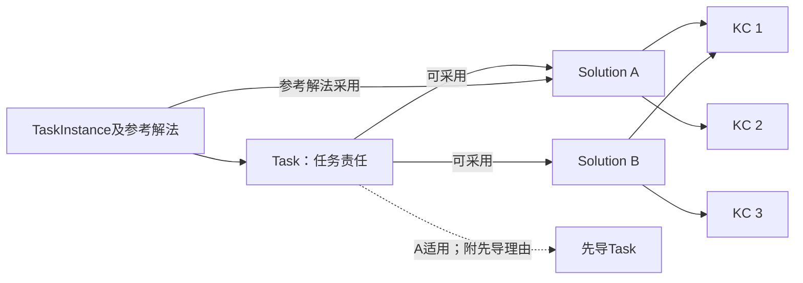
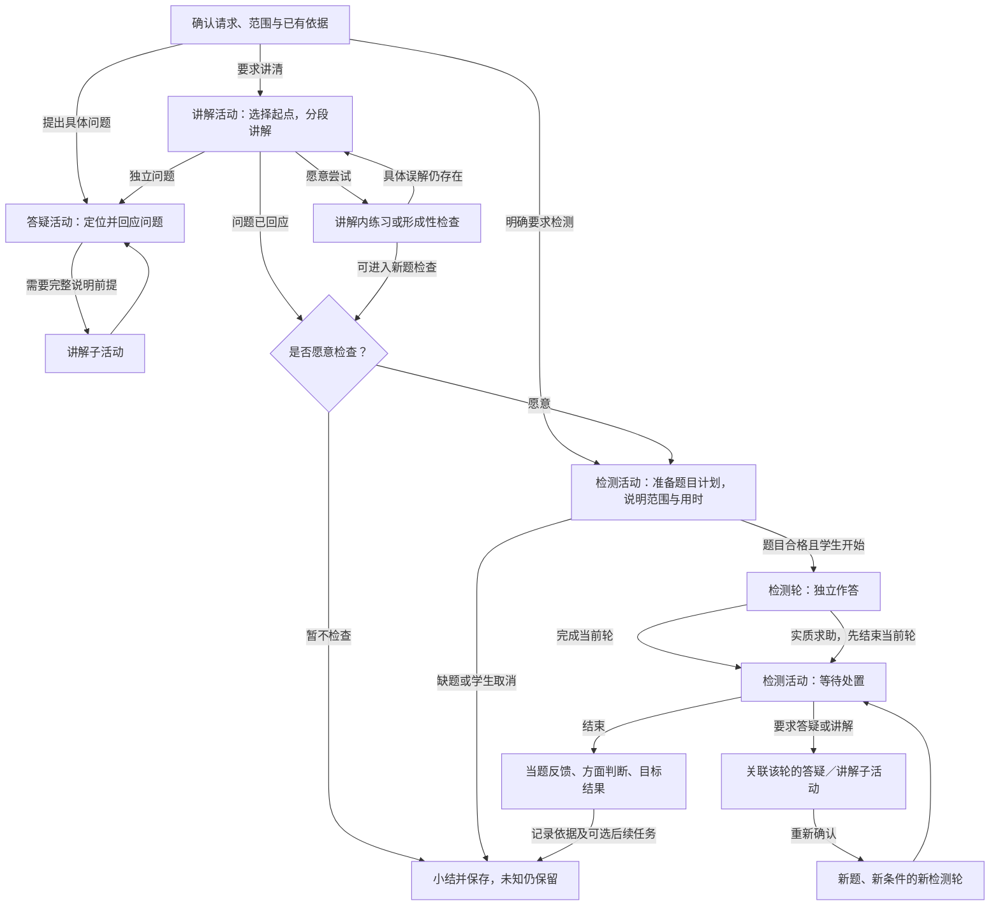
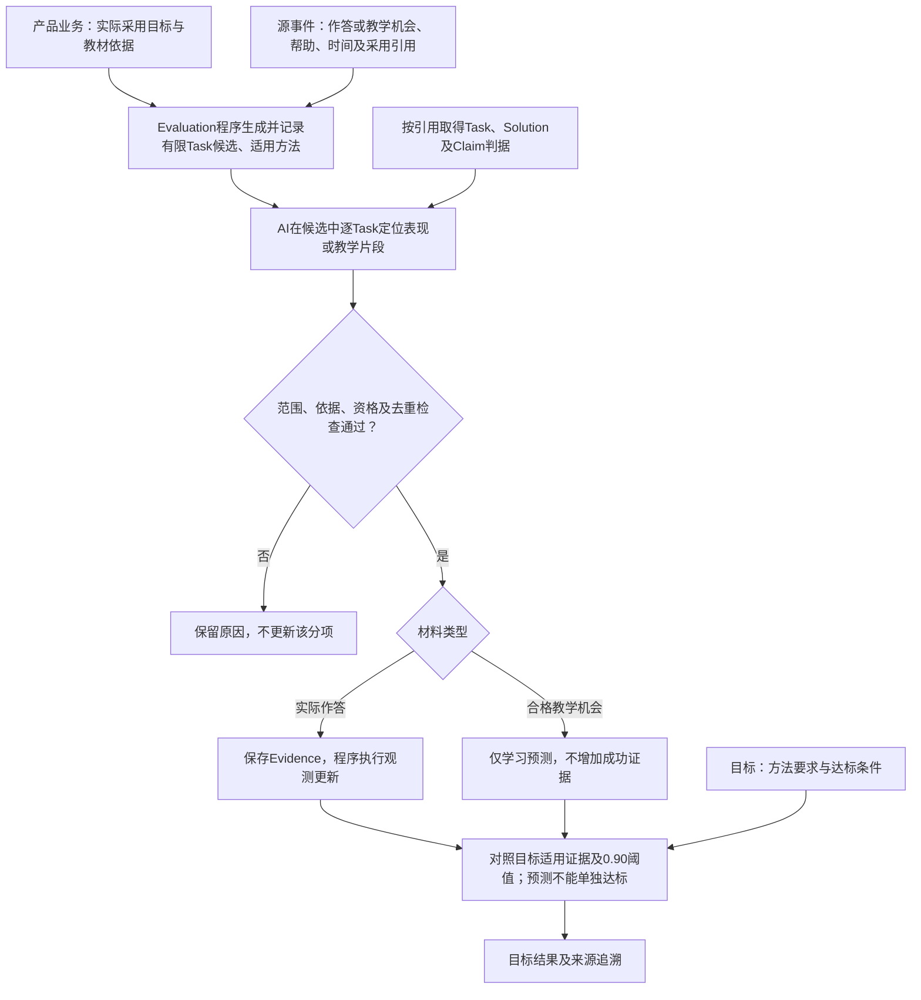

# M1 内容与模型规格及示例

> **版本**：v0.24 
> **文档性质**：M1产品规格的内容与模型专题；包含规定、设计草案和说明示例 
> **状态**：文档修订待用户审阅；本轮未修改原型或实现真实服务 
> **上游依据与基线**：[M1 PRD v0.26](../PRD.md)、本轮已确认的 Interaction 活动模型及此前领域、教材、评估与目标原型；既有四分之一样例及来源见§2、§4 
> **维护责任**：Codex 整理与自检；实际内容核对由管理员完成；重要范围及评价条件仍需讨论 
> **评审记录**：用户批准本轮修订；作者自检见MVP决定登记§69，不代表真实效果验收 
> **写作规范**：[设计文档规范 v1.1](../../../top/DeerMind_Design_Document_Standard_v1.1.md) 
> **更新日期**：2026-11-14 
> **修订说明**：v0.23 → v0.24，明确取证及学习机会的候选范围和正反例；补KC路径确认；同步最小评价链图；逐文件记录见MVP决定登记§69 

---

本文与PRD、交互规格和原型共同定义M1产品，把教材导入、建模、教学与评价展开为实际内容和可核对结果。交互表达会检验这些内容能否查看和维护，具体例子也会暴露业务缺口；修改按[M1工作包](../README.md#2-六个产品设计工作包)返回相应文档，不单向等待PRD结束。文件路径保留以保持引用稳定，标题明确其包含详细规格的责任。

**内容的效力。** 来自已确认决定的规定按原决定生效，例如§4.10的M1-DEC-004；领域与教材规则见M1-DEC-007至009，评估与目标分工见M1-DEC-010及011，Interaction 活动模型见M1-DEC-012至014；当前Domain规则见本轮Domain模型修订决定；M1-DEC-015中的结构角色及调用约束已被替代，最小概率更新方案与试用参数见M1-DEC-016；未获确认的后续细则仍是待审设计草案。题面、教学话术、字段示例和走查结果是说明材料，不因此成为已入库内容或真实证据。理论依据和试用标准不混同；效力以各节具体标注和决定记录为准，不因文件名称带Reference就将规定视为可选，也不将整份草稿视为已批准。

本轮沿用旧书页与开发参考，不继续手写扩大模型包，不要求管理员在系统开发前手工建完整册。先用代表内容说明正确产物，工程实现真实工具后，再在产品内逐章完成整册建模。

## 1. 准备对象与可用条件

教材导入形成语义内容，领域管理形成可复用模型，章节关联说明课程采用什么。三者分开保存，不能把上传、解析、入库和课程可用合成一个“完成”状态。

| 产物 | 内容与责任 | 后续用途 |
| --- | --- | --- |
| 原件与出处 | 原书页、文件顺序、印刷页码、必要区域及跨页关系；不改写原件 | 核对与追溯，不能单靠截图代替结构化语义 |
| 解析候选 | 按章节组织KC、TaskInstance及题内参考解法候选；公式、图表在所属元素内部 | 与Agent对话核对／纠错及选择提交；此时尚未写入领域 |
| 领域定义与实例 | Domain内的KC、Task、Solution、TaskInstance及题内参考解法 | 多本教材复用；供后续教学选法、题目准备与评价引用 |
| 章节关联 | 本章采用的Task及其直接Solution；KC计算汇总 | 确定课程任务与方法范围，不代表学生掌握 |
| 后续课程准备 | Task Claim、目标标准、Interaction 活动定义、核对题库及应用关系 | Claim 与目标配置见§4.12，活动准备见§4.7，题目准备见§4.13；D03处理应用 |

Domain可以先为空，通过手动维护和教材内容逐步完善。教材也可以完全复用已有模型；两种情况采用同一套关系。教材不是Domain的副本，课程不复制整个领域；个人Evidence和Belief不在导入过程中生成。

## 2. 本轮采用哪些已有材料

| 输入 | 当前用途 | 不作为何种证明 |
| --- | --- | --- |
| [出版社来源核验 v1](../../../../src/mvp_foundation/materials/bnu-math-6a-source-verification.json) | 电子教材身份、来源及已核查的原页线索 | 版权页和2026年实体用书版次尚未最终核准 |
| [全册准备清单 v2](../../../../src/mvp_foundation/materials/bnu-math-6a-whole-book-plan.json) | 13个目录项及附页的覆盖检查；包括9个单元、2项综合实践、数学好玩和总复习 | 其中候选任务定义及检查例不是已完成模型，不等于全册原页已经核对 |
| [教材整理的旧流程与截图](../../archive/2026-11-02-before-m1-prd/phase-4-product-and-domain-foundation/MVP_Product_and_Interaction_Design.md#31-flow-006从教材扫描件到学生可选用的内容) | 批量导入、原页对照、图表及跨页整理的操作参考 | 识别进度和结果为mock，不证明真实OCR、后台任务或整册可用 |
| [比例增加参考包 v1](../../../../src/mvp_foundation/m1/increase-reference/package.json)及[案例](../../../../src/mvp_foundation/m1/increase-reference/cases.json) | 已有对象、关系和正反例，用于检查课程、方法与评价是否接得起来 | 状态为作者参考、未启用；不是正式达标政策、独立评测或完整章节 |
| [有限内容提取试验](../validation/Content_Representation_Trial.md) | 四例暴露的跨页双解、原题错误式、统计图及几何表达问题；保存实际输入输出和修正依据 | 不证明任意LLM可靠提取，也不证明无人核对整册导入 |
| [当前原型与截图](Interaction_Design.md#1-管理员准备教材与课程) | 核对本轮操作、对象和状态；截图清单带来源与哈希 | mock没有真实识别、自动归类或正式学习评价效力 |
| [旧分数应用内容包](../../../../src/mvp_foundation/content/fractions-application/) | 书页引用、数值参考、问题类型线索 | 旧模型类型与关系须按现行合同重新核对，不能整体导入当作当前模型 |

这里按材料版本引用，没有改动原始资产。需要修正时应修改其权威来源并记录影响，不能在本文另维护一份不同的答案或目录。

## 3. 从一批扫描页到可用课程

本节是M1的业务对象与内容合同，不是数据库或API Schema。任务定义字段的语义、具体内容的归属及状态必须先一致；服务接口、模型供应商、存储和版本事务由工程展开。

图中实线表示保存的引用；知识汇总框表示计算结果。解法实例同时连题目和方法；章节只直接连任务及所选方法。图没有新增章节到KC或Task到KC的关系。这张既有图未区分 Task 角色；本轮新增的单 KC 约束和依赖方向以§3.2图 M1-C02 为准，旧图不证明原型已适配。

### 3.1 提取什么以及怎样保存图表和来源

先提取教材具体内容，再处理它归入哪个领域对象。例题先得到一道题和一条或多条教材解法，不直接把具体数字、人物和步骤变成通用定义。知识性陈述可以形成KC候选；教材讲法、授课顺序、教学策略不自动抽成Solution，学生讲解、答疑和检测继续由Interaction的活动模型组织。

每个候选保留：类型、标题、所属章节、内容、来源位置、待核对问题；解法另有对应题目引用。来源信息是核对依据，不是新的能力对象。编号及关系由程序分配并维护，模型只输出内容与局部关系候选。

| 表达 | 需要保留的结构 | 渲染与核对规则 |
| --- | --- | --- |
| 文字／要求 | 原有含义、已知条件、要求、分问及单位；区分题目、解法和知识用途 | 不把答案、提示或求解步骤混入题干；摘要不能删去必要条件 |
| 公式 | 数学表达、所在语境、符号及单位；分式与运算顺序可还原 | 辨错题中的错误公式按原样表达。格式标准化不等于订正数学内容 |
| 表格 | 行列标题、单位、单元格值、合并关系及空白用途 | 待填单元格不能变成给定数据；表格与引用它的图保持关系 |
| 统计图 | 类型、轴、刻度、系列、图例、数据及单位；数据已知／未读清状态 | 根据结构重绘，核对对应表格；看不清的值不能按趋势猜填 |
| 几何／关系图 | 对象、标签、连接、长度／角度等标记、明确几何关系及必要布局信息 | 图看起来垂直或等长不等于题设给定；形状与标记都需核对，缺关系不得生成确定结论 |
| 跨页内容 | 同一题的共同条件、续问、对应解法，各部分出处 | 可以多页组成一个实例，但不能把邻近不同题合成一题 |

所有图表归属KC、TaskInstance或题内参考解法，随主人一起预览、提交和保存，不建立独立的“图表入库”队列。用于解释的辅助展示与原题材料分开；学生题面只取原题条件，参考解法及其辅助图另取。日后改变呈现形式时，仍要保留这些语义边界。

M1不承诺一种有限结构覆盖任意视觉材料。现有表示按已测的公式、表、统计图和几何样例使用；表达不了或读不清时，保留原件及缺口，通过Agent对话补充材料、重读并核对，不能用“无损”标签掩盖信息丢失。实际完整性仍需真实服务验证。

**教材导入Agent的对话工作合同。** 管理员提供原件、所属Domain和解析要求；Agent维护本次导入上下文，选择工具取得KC、题目和教材解法候选。它负责语义处理，程序负责动作范围和写入条件；管理员负责核对与采用，不要求管理员直接编辑解析结构。“人工纠错”在此指管理员通过对话指出问题，并由Agent修改，不是手工补图、修改公式树或上传人工改好的结果冒充Agent成功。

| 环节 | 输入、处理与返回 | 必须保持的边界 |
| --- | --- | --- |
| 理解请求 | 导入身份、Domain、选中章节／候选、原件及已有对话；例如“这题还有另一种解法” | 程序附上选中对象及版本；多个可能对象时先澄清，不猜测要改整章 |
| 选择动作 | Agent可整批解析、重读局部页、补提图表、纠正表达、拆分解法或请求补页 | 工程可以用一组受约束工具实现，不要求独立部署或复杂多Agent；没有可行动作就说明原因并等待 |
| 形成候选 | 结构化KC／TaskInstance及题内参考解法内容及局部关系、原页位置、本次改动和未决项 | 候选不是已入库模型；遗漏图表不能用文字摘要代替；辨错题的错误不能被改成正确答案 |
| 检查与预览 | 程序检查结构、引用及改动范围；Agent核对含义，页面渲染公式、图表和对比信息供管理员核对 | Schema通过不证明语义完整；无法确定的数值和几何关系保留未知。工具错误与内容未知分开 |
| 采用或取消 | 管理员确认本次候选后，程序更新对应解析结果；取消保留当前结果 | 编号、当前题和引用由程序维护。拆成两条解法仍指向同一题；旧版本和纠正要求可追溯 |
| 失败与继续 | 说明已完成部分、失败原因和所需补充，允许继续同一导入对话 | 不自动无限重试，不取消有效旧内容，不把未完成候选提交为合格内容 |

同一导入保留对话、动作输入输出和采用记录，离开后可继续；原件始终保留。候选待核对时若输入版本已变，须重新核对当前版本，不能覆盖其后修订。任务定义、领域实例和章节关联不随候选更新被静默改写；尚未入库旧待办标出过时，按新候选重新提交。管理员教材对话属于内容准备上下文，不属于学生Learning Space的活动森林或学习Evidence。

**对话与候选的采用规则。** 一个教材导入记录承载一段持续对话；管理员消息、引用、候选与采用记录属于内容准备上下文。单项引用带上当前内容身份和版本，整章引用说明选定范围。查看其他章节不改引用；移除引用后，如仍不能确定所指，应重新澄清。刷新和返回后保留对话、未发送文字及助手展开状态；不重建一套独立会话管理。

| 候选状态 | 内容含义与允许动作 | 保存影响 |
| --- | --- | --- |
| 待核对 | 查看修改前、修正后和原页；继续修正、采用或不采用 | 旧解析结果继续作为当前内容，候选尚不能被当作已入库结果 |
| 被后续候选替代 | 同一明确引用继续修正时产生新版；旧版仍可查看 | 不再提供旧版采用入口，新版仍需核对，不能把两版拼接重复入库 |
| 已采用 | 对比来源后确认写入；保留当时结果快照 | 只改引用范围；同一题拆出多个解法仍引用同一当前题，既有领域对象和章节采用不被覆盖 |
| 未采用 | 明确放弃本次候选，仍保留对话及候选记录 | 原解析结果不变，不误记为解析失败或学生负证 |

若候选形成后，源内容已经有新修订，采用必须被阻止并要求重新核对；不能只检查候选文本可渲染。已提交但尚未入库的内容在采用修正后标记过时，管理员重新提交新结果；已入库领域定义和实例继续走领域维护，教材Agent不代为更新。编号、当前题引用及版本检查由程序执行，不要求管理员输入编号或手工改结构。

当前mock在`flow.assistant`保存消息、引用、输入及展开状态，候选保留修改前后快照与处置状态。这说明交互所需信息，不规定生产数据库Schema或消息协议。现有`reparseCandidate`仍是预设结果函数；识别少量演示措辞不等于LLM理解任意纠正要求。“补充材料”只记文件名，不保存文件内容或自动核销缺页，真实上传、读取、范围校验及候选语义检查必须由工程落实。

**四例纠错的预期。** C02要求拆出两种解法，题目仍为同一道；C03要求恢复运算结合次序，同时保留原书用于辨错的错误；C05指出遗漏三张图，由Agent重新读取原页并补全数据、轴、图例和单位；C06要求核对图形及可见标记，不猜测未提供附页。管理员可以描述问题，不能预先把修好的结构喂入后再计为自动提取成功。成功须同时满足原意正确、目标修正完成和无关内容不变。测试输入和结果继续与历史人工修正副本区分，详见[验证计划](../validation/Validation_Plan.md#2-教材导入agent与整册建模验证)。

### 3.2 领域对象与字段

领域语义以[Domain专项定义](../../../concept-design/DeerMind_Domain_Space_Design_v1.7.md)为准。本节列M1维护和使用的内容；Task、Solution名称替代旧Template名称，但语义未变的记录保留原身份。

| 对象 | 维护内容 | 关系与检查 |
| --- | --- | --- |
| Domain | 名称、范围说明、对象归属 | 候选、正式定义、题目都明确领域 |
| Task | 名称、目标、责任、交付与完成要求、条件及边界；参数和变化说明可选 | 关联一个或多个Solution；不能直接关联KC；不再划分KC Task／复合Task结构类型 |
| Solution | 思路与依据、适用条件、必要关键过程、直接所需KC；输入输出可选 | 直接关联多个KC；不要求子调用、输入绑定或可执行的递归控制图 |
| KC | 含义、条件、示例边界与必要图表 | 正式用于教学评价前，有明确直接检验它的Task及Solution；共用KC不推出方法等价 |
| TaskInstance | 原题及必要图表、主要Task、来源、参考结果或评分依据、检查状态 | 一题保留一个明确主要归属；没有参考解法也可先入库，正式供题另检查用途 |
| 题目参考解法 | 所属题目、Solution、具体过程与必要图表、来源、稳定内容引用 | 可多条、可后补；区分教材原有和系统生成；不再独立管理题内参考解法 |
| Task先导关系 | 已有先导Task、理由、适用方法（全部或指定） | 同领域，检查自引用、重复及循环；不自动把先导加入章节或目标 |

图 M1-C02：方法知识与先导分开。关系不是概率传播路径。

Task的知识覆盖是其方法的直接KC并集；章节只汇总所采用方法，按KC身份去重，保留方法来源。不再从对应方法或先导Task继续汇总。原型现有参数、解法、图表和来源保留；旧子调用与KC先修只作核对材料，不自动转换成新先导。

**任务与方法怎样写。** “理解d=v×t”要求解释量、单位、依据和适用条件，不能用“算出路程”代替。A按单位时间累积解释，B从v=d/t变形解释；两法直接关联多项KC。乘法意义可以仅是A的先导，乘除互逆可以仅是B的先导。未知先导不自动锁定讲解或检测。

**归属怎样检验。** 对具体题核对责任、条件、所需表现与方法适用性；换数字可保持Task，增加追及或新证明责任需重新核对。不能仅靠文本相似或共用KC通过。无参数表不阻止生成，生成后仍按相同语义检查、保存再用；无法判断保留未决。

**与评价分工。** Task描述一次任务需要完成的责任，Claim维护如何解释个人表现；综合任务也保留自己的Claim，不取其他Task概率的平均。每个正式KC的直接检验路径须由Domain内容管理员逐项确认：Task责任明确要求理解或使用该KC，Solution能支撑可观察表现；仅在KC列表引用它不算检验。Domain保存KC／Task／Solution及内容依据、责任、预期表现与不足示例、确认人和结论／待补原因；Evaluation另维护对应方法的执行判据与方面规则。这是就绪记录，不新增Task→KC依赖或KC Claim。草稿及教材入库可缺路径；课程应用检查汇总Domain路径与Evaluation判据缺口，按用途限制正式使用，不增加审批，不自动把路径Task选入目标。初中、高中和K8s仍只用于表达检查，不扩大M1正式课程范围。

### 3.3 从解析候选入库到章节采用

| 环节 | 输入及操作 | 输出与不能混淆的状态 |
| --- | --- | --- |
| 提交领域 | 教材中分别选择KC、题目、解法；解法有当前题 | 当前Domain的待办；尚未写模型，也未关联章节 |
| 添加KC | 核对定义，新建或复用已有KC | 保存的KC及来源对应；不自动生成任务或方法 |
| 提取定义 | 从具体题／解法提出通用定义，核对后保存 | Task或Solution；原实例仍待关联，不能自动捏造依赖 |
| 关联题目 | 选定符合责任与条件的Task | TaskInstance→Task；无解法的练习题也可先入库 |
| 关联解法 | 先有对应TaskInstance，再选Solution | 题内参考解法→TaskInstance及Solution；必要时明确补上Task→Solution引用 |
| 关联章节 | 回教材选Task及本章采用的方法 | 章节→Task／所选Solution；KC计算得出，元素来源仅作依据 |

重复选择已有定义意味着复用，不覆盖它。提取定义和关联实例是两次不同结果；关联检查应核对题目完成责任、条件及方法适用性，真实语义判断留工程实现，当前mock匹配不具有该保证。关联成功也不自动通过题库质量检查。

待办按元素逐行展示，内部按题目及其解法保留来源组：部分完成时显示已添加／已关联；整组完成后离开待办。删除未处理项只取消本次提交；删除当前题时一并说明待处理解法受影响。已保存模型和原始教材不因此删除。来源与结果仍可追溯，无需另设已入库列表或审核中心。

**章节只维护实际采用。** 新增关联时从当前领域选任务及方法，保存立即生效于教材草稿。编辑只改变本章方法选择；取消关联只删除引用。主表没有可直接改动的勾选框、任务下拉框或总保存操作。至少一种有效方法才形成该条章节关联；无方法的任务可以先作为领域草稿存在。章节保存不等于应用给学生。

### 3.4 哪些条件满足后可以做什么

| 行为 | 必要准备 | 缺少条件时 |
| --- | --- | --- |
| 与Agent解析／纠错 | 原件、Domain、章节／候选上下文及对话要求；Agent选择动作并返回候选 | 原件和旧结果保留；歧义先澄清，无法确定则显示缺口，不自动补成已知事实 |
| 保存领域草稿 | 对象身份及最小定义，引用可检查 | 允许补建，显示未完整；不宣布语义质量合格 |
| 保存章节关联 | 已存在的任务及至少一种适用直接方法 | 不能把建议冒充已关联；缺方法先回领域补齐 |
| 学生阅读 | 已应用的教材及可读取的原页／整理内容 | 缺页说明具体位置；不把Domain或Claim尚缺定义等同于已有书页不能读 |
| 讲解／答疑 | 对请求有可靠内容依据；按适用Task／方法知识和Interaction活动定义组织 | 任意章节可发起求助，阅读器不限定请求；可作有依据的局部帮助，不能承诺未准备的完整章节教学或正式评价 |
| 练习与反馈 | 题面、核对参考、适用方法、实际展示和帮助记录 | 无可靠参考不确定判分；已入库不等于合格检测题 |
| 按目标检测／评价 | 合格题、Task Claim及目标标准，适用的接触与帮助条件 | 不启动无法满足承诺的检测；内容缺口不算学生不会 |
| 后续主动任务 | 有效个人依据、目标、时间条件及可执行内容 | 无依据不生成；安排任务不等于已执行或达标 |

面向学生的行为属于D02–D06的完整产品责任；四类活动编辑、学生固定活动分支及运行追溯已有 mock 页面，真实内容应用与评价服务尚未完成。保存与应用分开，历史活动保留原采用依据；已确认错误的内容不继续使用。目标未准备与学生证据不足是两种状态，不能都显示“待确认”。

### 3.5 本轮样例与真实验证边界

真实五页样例包含第49—50页的连续比例例题与两种解法、第50页练习及辨错、第91—93页的数据表和统计图。四例核对样例沿用C02跨页双解、C03错误原式、C05统计图、C06几何内容，用于重现[有限试验](../validation/Content_Representation_Trial.md)暴露的问题。

例题的题目独立保存，两种解法分别形成题内参考解法；统计题的图表属于题面；原题让学生判断的错误算式保留错误；几何关系以明确标记为依据。这四类反例约束Agent解析／纠错和后续渲染，不要求管理员操作底层块结构。

原书49—50页对应电子页序52—53，91—93页对应94—96；单张图片自身的文件页位置又是另一种定位。当前原型提供已知样例原页查看，真实PDF分页、漏页补入、目录覆盖及批处理恢复尚需工程和整册工作核验。此前复杂手动块编辑方案不再作为当前交互要求；完整性责任并未取消。

真实试验原始结果和人工处理保留在原报告，本轮没有改写为自动通过。现有教材助手已表达持续对话、引用、候选修正与采用；解析结果、提取定义与匹配仍为固定mock，没有真实Agent推理和工具执行。实际提取与对话纠正能力、未见任务定义／新KC补建、图形表达和整册人工负担尚待工程验证；历史试验中的人工结构修正不是Agent纠错已通过的证据。

### 3.6 准备结果怎样交给下一步

评估管理可独立为领域任务定义 Claim。目标管理使用已经保存的章节任务／方法关系选用 Claim；教材和目标准备完成后，还须准备Interaction活动定义及题目供给条件；题库无备用实例时，可按合格任务定义实时生成、检查、保存后使用，不要求先填满题库。Claim定义评价方面及证据含义；目标规定本课程哪些要求必须满足；Belief由真实学习表现产生。具体例子继续使用§4的“增加四分之一”，不把第49—50页连续比例例题换名当成同一个任务。

交接时至少提供：章节和来源、采用的任务／方法及版本线索、知识汇总路径、可用题目与解法、仍缺定义或检查的部分。原型的本地对象编号和版本提示只是操作表达；真实不可变版本、事务和一致性由工程定义，不能宣称已经具备生产能力。

### 3.7 课程应用结果与学生选用交接

本节细化PRD M1-R08／R10已确定的保存、应用和自动采用规则，回答管理员产物如何成为学生可选内容；不增加审批或发布中心。**应用结果是一份采用记录**，不是新建“课程”领域对象。下表是产品必须表达的内容，不规定数据库表、API字段名或打包方式。

| 应用结果包含什么 | 使用方怎样解释 |
| --- | --- |
| 教材、目标身份与各自采用版本 | 学生选择的组合；同一目标更新版本与另选一个目标不同。没有有效教材／目标及适用关系，不能成为可选组合 |
| 所属Domain、章节及其采用的Task／Solution引用 | 说明本课程实际准备了什么；目标只选教材采用范围内的Task Claim与方法。KC沿方法汇总，不新增章节→KC关系 |
| Claim、目标要求和Interaction活动定义的采用依据 | 分别供评价、目标对照和活动执行读取；保存新定义不会静默改变已有活动采用的依据 |
| 各范围／方法／方面可开展的行为、缺口和原因 | 阅读、讲解答疑、练习反馈、目标检测评价分别检查；不能只输出一个“全课程就绪”的布尔值。缺口定位到受影响行为，不能扩大成对整个章节的聊天禁令 |
| 题目供给条件及核对参考 | 已有合格实例或可生成的任务定义、适用方法与检查依据；具体题目仍须在本次使用前检查。后台准备通过不证明任意生成题都合格 |
| 本次操作人、时间、成功／失败、前后采用结果及受影响空间 | 管理员确认后才更改当前有效引用。失败保留此前有效结果并说明未生效，不能显示成功却让学生采用残缺结果；落盘和重试机制交工程实现 |

**用“四分之一”核对交接。** 以下是规格中的假设数据，说明输入输出，不把§4.2尚未启用的旧参考包改写为已就绪。教材为已提供链接对应的北师大六上数学，版次仍待版权页核验；U04中取“一个量增加四分之一”局部，采用先求增加量再相加、先求增加后倍数两种方法。目标身份记为G，规则沿用§4.10的已确认试用条件，本例任选一种方法；书页来源为53—54页，不是49—50页的连续比例题。B1、B2、G1仅表示本例采用版本，不冒充正式模型编号。

| 情形 | 管理员输入与操作 | 学生选项及现有空间结果 |
| --- | --- | --- |
| 保存未应用 | 保存教材B1、章节两种方法、Claim及目标G1，尚未确认应用 | 不新增该组合的可选项；若同教材／目标已有旧应用，继续使用旧结果。保存也不创建学生空间或Belief |
| 首次应用 | 已核对上述引用、方法依赖、活动定义、题目供给与试用标准；确认应用B1＋G1，并明确其他章节实际准备程度 | 该组合供所有试用学生选择。学生选用后创建个人空间，引用B1＋G1；初始没有实际表现，不能预填掌握。局部可用不表示全册M1验收完成 |
| 同组合普通更新 | B2仅补充书页来源说明，不变更任务责任、方法、Claim和目标G1；保存后再确认应用 | 已选同一教材及G的空间当前引用改为B2＋G1，学生不手动维护。原有活动继续记录B1依据，新活动使用B2；其他教材或其他目标不被替换，既有Evidence、Belief和目标判断不因来源说明更新而改变 |

第三例仅说明普通内容维护。Evolution相关的定义演进、跨版本兼容判定、Belief迁移及历史重算后置M2/M3，不再作为M1产品讨论或工程前置。M1保留实际使用的内容依据与只追加事件；不改写旧事实，不据此建设版本迁移平台。管理员更换目标身份仍不属于同组合普通更新。

**可用内容与个人条件分开判定。** 仍以G1为例，实际开展行为时还要核对当前服务和本次题目，以下检查结果不能互相替代。

| 具体情况 | 准备结果／个人状态 | 对学生行为的影响 |
| --- | --- | --- |
| 原页、两种方法和讲解活动依据可靠，但迁移方面缺少可用评价判据 | 课程的迁移评价未准备，列明缺少判据；不是学生迁移能力待确认 | 已有依据的讲解、提问和其他具备条件的评价照常；不承诺正式迁移评价，不把整个目标判为达标 |
| 迁移判据已齐备，当前没有备用题 | 有实时生成和检查依据时，不能仅凭题库为空判为内容不可用 | 开始检测前生成候选，检查通过并保存才使用；失败且无合格替代题时说明本次暂不能测，不写负面Evidence |
| 保持判据和题目供给已准备，但学生尚未达到起算条件或尚未满七天 | 内容已准备，个人保持条件未满足 | 保持结果尚不能确认，不是缺课程定义；按已定条件再考虑后续任务，不现在强测或提前宣布保持达标 |
| 课程完整，新空间尚无任何作答 | 内容可用，学生证据尚缺 | 可以讲解、提问或按条件开始检测；个人评价保持待确认，不能用课程就绪程度代替能力 |
| 应用失败或应用后临时生成／服务失败 | 前者不替换有效应用；后者是运行失败，不回写成学生表现 | 保留可恢复记录并说明本次未完成；不制造作答失败或降低Belief |

若目标的部分评价未准备，目标详情须区分课程缺口与学生证据不足，不能悄悄删去这项要求再宣布整个目标达成。学生选择时说明影响选用的主要限制；进入学习后只在相关请求发生时说明具体缺口，不把后台核对清单常驻聊天区。首次应用本身不替学生选章；任意章节仍可自然提问，能提供什么帮助由请求和可靠依据决定。

**应用、选用和历史的记录。** 管理员应用结果可追溯到操作者、采用依据与前一结果；学生创建空间记录实际选用版本。已有空间引用更新是该空间的新事件，只追加，不修改旧的选用事件、聊天或活动。普通引用更新不产生学习Evidence；如目标要求变化引起重新对照，Evaluation另留目标判断及原因，不能称为学生能力提高。事件的存储、并发和失败重试在工程中落实，原型本地编号不等同这些保证。

> **交互承接与验收：** [交互§1.7](Interaction_Design.md#17-应用到学生选用的交接规格)、PRD M1-A08／A10。现行原型没有可达的完整应用流程，学生SF01只有预置选项；本文完成产品交接语义，不声明页面或真实服务完成。没有重新采集应用成功截图，避免把旧界面当成本次实现证据。

## 4. 一个已有案例怎样贯穿模型

### 4.1 先区分两个不同用途的书页样例

此前第49—50页主要检验跨页整理，旧映射样例是“连续求一个量的几分之几”。“已知原量与增加分率求新量”的代表模型则采用第53—54页。它们同属分数应用，但不是同一个任务，不能为了主流程演示把两个来源合并。

比例增加参考包中的两张原页已按其记录哈希核对：

| 原页 | 本地原件 | 本轮核查 |
| --- | --- | --- |
| 印刷53页／阅读器56页 | [PAGE-53](../../../../src/mvp_foundation/m1/increase-reference/source/page-056.png) | 文件存在且哈希与包内来源记录一致；不是重新执行OCR |
| 印刷54页／阅读器57页 | [PAGE-54](../../../../src/mvp_foundation/m1/increase-reference/source/page-057.png) | 文件存在且哈希与包内来源记录一致；不是正式内容质量验收 |

### 4.2 复用哪些对象，核对什么

下列标识来自 `M1-INCREASE-REFERENCE@1`，仅用于定位作者参考，不作为工程数据库主键设计。

| 角色 | 已有对象 | 核对其产品含义 |
| --- | --- | --- |
| 领域 | `DOM-M1-MATH@1` | 归属于数学；本包只覆盖一个局部，不等于整个数学领域 |
| 主任务 | `TT-M1-INCREASE@1` | 原量与增加分率已知，确定增加以原量为基准，求最终量；不含反求原量或连续多次变化 |
| 两种直接方法 | `ST-M1-PARTS@1`、`ST-M1-FACTOR@1` | 先求增加量再相加，或先求增加后倍数；选法受题目与课程条件约束 |
| 相关任务与方法 | `TT-M1-SCALE@1`、`ST-M1-MULTIPLY@1` | 需要求指定倍数时，能够沿选定对应方法继续查到知识依据 |
| 知识 | 包内5项KC | 分率参照量、指定倍数、增量与总量、分配律、运算；KC由实际选定方法汇总，不手填Task的知识清单 |
| 评价定义 | `CL-M1-INCREASE@1` | 绑定主任务，在内部区分四方面；没有学生个人状态 |
| 章节采用 | `U04`的局部映射 | 指向53—54页、主任务、两种允许方法及相应Claim；不表示U04整章完成 |
| 学习目标 | `LT-M1-INCREASE@1` | 当前样例为任选一种方法；独立、解释、迁移、保持的要求分开，不要求每题全测 |
| 题目 | 包内6个来源／教学／检测参考 | 具体题面、来源与用途分别核对，不能仅凭名称认定它足以测迁移或保持 |

该包是历史参考输入；其中有效题面和多KC方法可复用，但旧递归调用不再作为当前结构合同。按§3.2和§4.15重新核对责任、方法、来源和实例归属，不改写历史包或实例编号。该包明确 `ready_for_formal_assessment=false`：缺少正式证据聚合与达标校准，因此可以用来说明如何连接对象，不能直接让系统据此给孩子宣布掌握。本文§4.6–4.10补充的是其中“四分之一”子范围的产品样例及已确认试用标准，不改写原包的范围、版本或启用状态。

### 4.3 教学和评价怎么使用这些准备结果

下面使用参考包已有的书本数量例子，避免另造一套题号。PRD中的40米例子是同类任务的说明，不代表这名学生已经做过本表中的全部题目。以下假设内容、标准已经经管理员核对并应用；当前参考包本身尚未满足这个前提。

| 环节 | 输入与处理 | 产物及其使用边界 |
| --- | --- | --- |
| 管理员准备 | 在U04采用主任务和两种方法；配置`CL-M1-INCREASE`及目标，明确当前允许任选一种方法 | 保存定义和参考，再检查、应用；没有产生学生Belief |
| 学生选用 | 选教材及目标创建Learning Space，提出学习本章增加关系 | 课程引用和本次活动范围；不复制一份独立领域模型，不预写掌握程度 |
| 开始讲解或答疑 | Interaction依据请求和已有有效表现建立讲解或答疑活动；从Domain取适用方法，用`Q-M1-TEACH`解释80本增加1/4得到100本 | 实际展示的例题、图示、提示和解释进入所属活动记录；仅生成但未展示的内容不算帮助 |
| 获得表现 | 学生解释“1/4指原来的80本”，或在提示后算出100本；Reasoning按规则理解输入 | 空间事件记录实际表现及帮助背景，Evaluation据此提取Evidence；不要求独立Observation层，不能直接宣布掌握 |
| 准备检测活动 | 根据目标和未解决的问题选`Q-M1-CHECK`等合适题目，核对该学生未见解法及本次条件，再说明范围和预计负担 | 得到有明确测量目的的题目计划；学生确认才开始；选题结果不写进Belief |
| 记录检测轮作答 | 学生对60本增加1/5写出`60×1/5=12，60+12=72`并说明基准。轮中若实质求助，先结束当前轮并取消原题单未开始轮次 | Event保留活动、轮次、题面版本、作答与实际帮助；提交确认不提前泄露余题的答案或方法 |
| 轮后答疑或讲解 | 学生问“为什么这样算”或要求讲透时，检测活动暂停并建立关联该轮的答疑或讲解子活动 | 子活动记录`triggeredByAttemptId`；其帮助不倒灌到帮助前检测轮。重新确认必须准备新题和新轮 |
| 反馈与评价 | 检测活动结束后按参考给当题反馈；Evaluation按Claim、条件和有效历史解释Evidence，更新相关Belief方面，再比较目标 | 这次结果正确是确定的算术事实；它能支持什么范围、是否足以达标仍受标准约束。不能由一题推导四方面全通过 |
| 下一步 | Interaction读取合法评价与目标，选择补讲、以后检测或本次结束；管理员可查同一次活动的记录 | 任务或建议带依据。未实际发生的延迟检查不形成保持证据；同一表现不因重试处理变成多份独立证据 |

这是一条产品逻辑走查，不是运行日志。Event记录事实、Reasoning理解输入、Evaluation维护个人判断、Interaction选择和执行活动行为；课程提供范围与目标，Domain提供领域定义。活动蓝图怎样执行、调用分几次和如何储存由工程设计落实。

### 4.4 题库与本次题单如何分工

**入库先检查题目本身，选题再检查学生及用途。** 题库不按学生复制。一次使用引用题目版本，另记这次活动、要求、实际呈现、提示、作答和接触背景。题目内容被修正时保留旧版本及旧使用事实。

| 已有候选 | 能提供什么 | 本次使用前还要检查什么 |
| --- | --- | --- |
| `Q-M1-TEACH`：80本增加1/4，100本 | 讲解数量关系、示范两种方法 | 展示解法后不能立即拿同题证明新的独立表现 |
| `Q-M1-CHECK`：60本增加1/5，72本 | 同一范围的新计算和解释表现 | 若此前已展示本题答案则更换；只换数字不自动证明迁移 |
| `Q-M1-SOURCE-54`：看图求树木数量，60棵 | 图文理解与对应求解 | 参考包明确图区域尚未提取；必须先形成完整、核对过的题面，不能拿一句“依据关系图”代替图 |
| `Q-M1-TRANSFER`：表格中的40米增加1/4，50米 | 文字转表格的迁移候选 | 比较实际学过的表征与当前变化；若此前已讲过同一40米关系或该表格，要记录，不把题名当作陌生性证明 |
| `Q-M1-DELAY`：72本增加1/6，84本 | 延迟后再次检查同类表现的候选 | 实际间隔和期间练习／帮助符合相应标准；当天出这道题不是延迟检测 |

按次选题依次回答：要检验哪些目标要求、需要哪类表现、现有题目能覆盖哪些要求、对该学生是否适用、预计负担是否合适。一道题可以同时取得计算和解释表现；四个方面不等于必须出四道题，也不能由一道算对的题填满四个方面。

本次允许方法根据任务方法、教材采用关系、本次明确请求及检测目标确定。按章教学核对该章采用关系；无书页引用时不把阅读器位置强加给请求。当前目标之外的教材内帮助仍可开展，但不自动扩展目标。目标要求分别说明两法时须取得各自表现，不能只改标签。没有合格实例时可按任务定义生成、检查并保存；供题失败不临时放宽标准。

M1可复用已核对题库，也必须支持教学中在已准备任务定义范围内自动出题。两条路径都检查题意、参数、答案、归类和用途；通过后保存并使用，无须管理员逐题确认。复杂组卷和广泛新题探索后置。

### 4.5 用反例检查评价不会越界

| 观察到的表现 | 可以支持的结论 | 必须保留的限制 |
| --- | --- | --- |
| 没给当题提示，答案和参照量解释正确 | 在所测条件下的独立与解释表现 | 是否充分达标要看标准；迁移、保持未因此得到证明 |
| 只给出正确答案72，没有过程或解释 | 本题答案正确 | 不能补写“理解了为什么”；解释方面仍缺依据 |
| 给出`60×1/5=12`的提示后完成72 | 在所记帮助下完成后续计算 | 不当作完整独立求解；实际帮助不能被漏记 |
| 基准和列式正确但算错 | 可保留已表现出的正确理解，并指出计算问题 | 不把部分支持升级为任务整体达标；可用KC解释错误，不更新KCBelief |
| 换成另一组数字后算对 | 同任务定义另一实例的表现 | 不自动视为表征迁移或泛化 |
| 隔一段时间再次完成 | 在实际间隔和帮助背景下的表现 | 未满足目标规定的延迟条件时，不宣布持久掌握 |

本表固定的是解释边界；达标统一使用§4.20的0.90阈值，不再逐章另设题数门槛。逐章仍须准备执行判据、迁移变化和保持条件，验证工作检查解释及预测质量，不由实现者临时猜测。

### 4.6 本次到底教什么、评什么

**情境。** 学生选用分数应用章节，问：“一个量增加四分之一后是多少？我不明白怎么想。”本次处理原量已知、增加量以原量为基准、只有一次增加的任务。

为避免把简单例子的成功扩大成本章掌握，本次范围明确如下：

| 项目 | 本次约定 |
| --- | --- |
| 数量范围 | 样例使用能被4整除的正整数原量；书本数量或长度等同单位数量。非整除、分数原量、反求原量和连续变化不在本次检测中 |
| 任务责任 | 认出原量；理解增加部分为原量的1/4；求增加后的总量；能够说明所用关系 |
| 允许方法 | A：先算增加量`a÷4`或`a×1/4`，再加`a`。B：直接算`a×5/4`或`a×(1+1/4)`；任选一种，不强迫每题两法 |
| 参考关系 | `新增量=a/4`；`总量=a+a/4=5a/4`。对于本次正原量，总量大于原量且小于其两倍 |
| 显示给学生的要求 | 自己求出增加后的数量；说清四分之一指谁、为什么要加回原量；读懂表格给出的同一关系；间隔后再检查能否完成 |
| 明确不作的断言 | 不从本次结果推出所有分率、所有题型、两种方法或整章均已掌握，也不把一次延迟成功称为永不遗忘 |

**对象采用。** 继续使用`TT-M1-INCREASE@1`、两种方法及`CL-M1-INCREASE@1`，不为1/4再建一个Task或Claim。本文的“四分之一学习目标草案”选择该Claim的子范围`r=1/4`并规定要求；它不是旧`LT-M1-INCREASE@1`的静默改版，尚无正式目标对象。Evidence保留实际参数、表征、帮助和方法，Belief的方面判断说明已支持与未覆盖的范围；判断本目标时使用对应范围的有效依据，不能只读一个“该Claim已通过”的总标记。

**方法的依据与适用限度。** 本例选择“必要讲解—学生尝试—解释理由—根据表现调整”的方法。例题与练习结合、图文结合、解释性提问及间隔学习，分别受到[IES学习组织实践指南](https://ies.ed.gov/ncee/wwc/PracticeGuide/1)支持；说明分数运算为什么成立，而不只传授步骤，符合[IES分数教学实践指南](https://ies.ed.gov/ncee/wwc/PracticeGuide/15)的建议。具体三条教学路径是据此作出的产品设计，不是指南规定的唯一流程。

这些研究不提供本任务的统一掌握阈值或保持间隔。M1-DEC-021采用0.90作为全局试用阈值，替代M1-DEC-004的固定题数门槛；本例七天仍是保持证据的资格条件，不是已验证的自然遗忘规律。数值、资格判据和实际教学效果均须真实验证。

### 4.7 三种起点怎样讲、怎样切换和结束

**同一道题，求解方法、活动策略承担不同责任。** Domain 中的分步法和倍数法都可以求新量。学生问「为什么能乘1.25」时，讲解活动只需允许继续讲解，系统可以从她已经会的加法推导倍数。选用这种讲法无需命中推荐策略。学生以独立问题追问时，Interaction 建立答疑活动；答疑发现需要完整说明前提时，再建立讲解子活动。程序掌握活动树、检测轮、学生同意与可转移条件；LLM 在这些约束内决定解释、表征与追问。讲过的推导保留为实际帮助。

历史讲解脚本保留两组样例：三种固定 v1 情境使用连续两级部分量，旧四分之一脚本用80本和120本检查单轮求助。它们已退出当前管理导航，不代表新的四类活动编辑器会执行任意配置。当前学生固定脚本增加多轮检测、轮后讲解及返回新轮；截图和实际边界见[交互设计§1.6–3](Interaction_Design.md#16-四类活动蓝图与规则策略管理)。下表三种起点仍是教学内容参考，不是当前活动配置的运行日志。

**正常起点不先强制考试。** 有明确求助且材料足够时，先回应。已有可靠记录帮助选择起点；没有记录时不把学生归为“基础差”，也不编造先前错误。学生想先试做，可以直接进入相应练习或检测准备。

本例用已存在的`Q-M1-TEACH`：原有80本书，新添的是原来的1/4，现在有多少本？下面是一段可接受的教学内容参考，不要求LLM逐字照读：

> 这里的四分之一，是把原来的80本分成四等份，取其中一份，所以新添了20本。原来的80本还在，现在一共是80＋20＝100本。

可用的教学示意是“原量四份＋新增一份”：原量`[20][20][20][20]`，新增`[20]`。单位一份是20本；`1`代表原来80本这一整份，并非1本。采用直接倍数法时，说明`1+1/4=5/4`表示合起来是原量的几倍。线段、份数和文字要表达同一关系，不以装饰图代替解释。

| 起点和实际输入 | 教学动作与学生机会 | 下一步的条件 |
| --- | --- | --- |
| 概念尚未建立：问“1/4是几本，为什么还加80？” | 分段解释四等份及新增量，再问“20本是新增的，还是现在全部？”；可用文字或等份示意，回答后及时反馈 | 能区分新增与总量，尝试24本增加1/4；若仍不懂一份，转入必要基础回补 |
| 能算但解释有误：写`80×5/4=100`，说“1代表1本” | 先确认其用语含义；若确是概念错误，解释这里的1代表原量一整份。可比较80本与160本增加同一比例时，新增量为何分别为20、40 | 能结合自己的式子说清参照量后，用新题检查；只复述刚显示的话可支持当下理解，但不直接完成解释要求 |
| 已有可靠求解和解释表现：只问“能不能直接乘5/4？” | 简短说明两种方法等价，沿学生选用的方法继续；不重复一整段基础课程 | 问题得到回应即可结束，或经学生选择进入练习／检测。遇到具体误解才返回相应解释 |

基础回补只处理本问题所需的一步，例如“24平均分4份，每份多少”。回补后能继续则返回原任务；同一个障碍仍未解决时，说明卡在哪里，提供更小一步的帮助或结束选择，不反复重播同一段话，也不自动展开整套低年级课程。回补的回答和所给帮助照实记录，不自动生成新的KC或相关任务Belief。

**练习与正式检查分开。** 教学中的24本例子得到30本，允许提示和即时反馈；它用于指导下一步，不作为独立完成的正证。学生只说“懂了”时，系统可以邀请尝试；拒绝检查就收束为“已讲解，尚未检查”，不偷偷标记达标。

**图 M1-Q01：本例活动树与检测轮的可选路径。** 矩形表示活动或检测轮，菱形表示学生选择；箭头表示推进条件。讲解、答疑和检测可递归组织为活动树，检测轮不能嵌套教学性活动。图以材料与定义可用为前提，规则缺失、服务失败及中断见PRD§3.6、§6。

学生在任何阶段都能停止；未提交输入保留，未做题不判错。检测轮结束后才允许答疑或讲解；获得实质帮助后，原题单尚未开始的轮次不继续作为原独立计划，重新确认使用新题新轮。图中循环依赖新表现或学生选择，不是允许程序自动循环讲解直到学生“通过”。上方 Mermaid 源是本节现行规则图；旧`M1-Q01.png`保留在历史资产中，不再作为本节图示引用。

### 4.8 本例具体准备哪些题

第一轮教学与检测用小型核对题库，不依赖实时生成。以下题面是管理员需要准备的实际内容示例，除复用项外均为作者新编；文档编号用于评审，不表示已入库或已通过管理员核对。题面与参考答案分别保存，出题不向学生发送参考答案。

| 编号与用途 | 给学生的完整输入 | 教师／评价参考及用途限制 |
| --- | --- | --- |
| `Q-M1-TEACH`，已有教学例 | 原有80本书，新添的书是原来的1/4，现在有多少本？请说明 | 100本；增加量20本，基准80本。讲解时可展示过程，不算新的独立检测 |
| `QTR-P1`，受助练习 | 原有24本书，新添的是原来的1/4，现在有多少本？ | 30本；可以提示或追问。帮助记录保留，不混入独立完成正证 |
| `QTR-C1`，文字检测 | 图书角原有120本书，又增加了原来数量的1/4。现在共有多少本？请写出答案，并说明四分之一指哪个数量、为什么这样算 | 150本；原量120，增加30，总量150。分步或倍数法均可；不要求固定措辞或两法都写 |
| `Q-M1-TRANSFER`，已有表格候选 | 请根据下表求延长后的路线长度，并说明分率相对哪个量、你怎样得到新长度。表格见下 | 50米；基准40米，增加10米。只有表格使用条件成立时才提供文字转表格的迁移依据 |
| `QTR-D1`，延迟复测 | 原有72本书，又添了原来数量的1/4，现在有多少本？请说明依据 | 90本；新增18本。与旧包`Q-M1-DELAY`的1/6、84本不同，不替换旧题；时间没到时本题也只是一道普通题 |
| `QTR-R1`，备用新题 | 水箱原有48升水，又加入原有水量的1/4。现在共有多少升水？请说明 | 60升；新增12升。用于同范围再检查或替换暴露答案的题，不能仅凭换情境就宣布迁移 |

表格检测的题面数据（属于题目条件，不能隐藏）：

| 项目 | 数据 |
| --- | --- |
| 原路线长度 | 40米 |
| 延长部分占原路线的比例 | 1/4 |

**一次检测怎样组题。** 对刚完成文字／等份讲解、尚未练过这种表格且没有旧有效检测记录的样例学生，可提出“文字题＋表格题”两题，预计约5–8分钟，实际时长仍需工程试用验证。学生开始前看到本次覆盖、题量和结束后统一反馈的安排。两题分别取得解题与解释表现，表格题额外检查这一种表征变化，不为四方面各出一套试卷。

这不是全书统一题量。已有适用表现可以复用，只测缺口；表格先前已讲过、题目已见答案、图表内容缺失或当前目标不同，都要换题或明确本次不覆盖相应要求。可以先做文字检查，但不能把备用文字题填进“表格迁移已测”。原题单的题量、预计负担和覆盖在开始前固定，不因学生做错就在同一次检测轮中无限追加题目；学生取得实质帮助后，原题单未开始轮次取消，后续确认另以新题新轮准备。

同一对话保留教学内容不妨碍提出新题，但如果本次实际查阅了相关解法、得到提示或帮助来源不清，必须保留条件。没有点击求助不等于已证实无帮助；书页或历史再次打开、系统实际提示及学生说明的帮助应进入记录。M1不声称观测到设备外的全部行为，也不增加监考或锁屏。

### 4.9 判据：具体看什么表现

每次表现先分别判断数量关系、求解结果、解释与帮助条件，不先给一个总分。关系正确但计算失误、算对但理由错误、只有答案而没有解释，必须能得到不同反馈。理解原意的语义判断依赖规则＋LLM，计算、引用和提交条件由程序核对；不能靠命中“原量”等关键词判解释通过。

| Claim方面与本例要求 | 可接受表现 | 明确不足 | 只能保持未确认的情形 |
| --- | --- | --- | --- |
| 独立完成：自行求总量 | 在已记录条件下，没有当题或等同解法提示；自己建立`a+a/4`或`5a/4`关系，结果和单位正确；方法任选其一 | 把增加量当总量、给原量直接加1/4，或不能完成所要求计算；反证只限实际表现 | 只有模糊答案、帮助情况未知、题目无效或仅抄写已给答案；当题帮助后成功另记受助表现 |
| 理解与解释：说清参照量与总量 | 用文字、式中标注或图说明1/4对应原量的一份，原量仍在，所以要把新增与原量合起来；用倍数法时解释1是原量整体 | 明确把1说成1本、分率基准改成新总量、把20本新增量说成80本题的总量 | 没被要求解释、只给答案、输入难以理解；不能把不善长篇表达当概念错误 |
| 迁移：从已学文字／等份例读到表格 | 在此前接触条件可说明时，从表中找对原量与增加分率，独立建立关系并说明两行数据如何使用 | 看清表格数据却把增加部分当总量，或明确误解表中比例指向；应与读表／数学原因区分 | 未给表格、表格识别错误、这类表格刚示范过、既往接触未知；仅换数字或名词不能充当此项 |
| 延迟保持：间隔后仍能完成本范围 | 在规定间隔后的新题中，再次得到无当题实质帮助的正确求解和解释；记录基准时点、实际间隔与期间练习 | 在条件有效且题意清楚时重新出现相关错误；保留当前正确部分，不把一次错说成全忘了 | 尚未到时点、没有基准表现、当题帮助后完成，或记录无法确定；不能从任务到期、已接受或同日正确推断保持 |

**帮助请求如何分类与执行。** 原始请求、语义分类依据、程序处置和实际展示是不同记录。LLM可提出“实质帮助／技术处理／不明确”的分类和原文依据；程序检查当前轮状态、引用和动作许可。按钮明确“求助”的请求可直接采用已定义意图；自然语言不能只按“提示”等关键词分类。语义分类本身仍须验证。

| 请求／情况 | 应怎样处理 | 对Evidence的影响 |
| --- | --- | --- |
| “告诉我先算哪一步”“解释四分之一”“看看这一步对不对” | 都可能提供解题信息；先结束检测轮、取消未开始轮，再进入帮助子活动 | 请求与实际帮助分别记录；不因仅提出求助就记负证，已提交表现按当时条件评价 |
| “提交成功了吗”“图片没加载”“输入框不能写” | 中性技术确认或恢复，不提供答案、步骤或对错暗示 | 不自动结束轮或判为受助；若恢复时实际泄露提示，按真实展示处理 |
| “我看不懂”“这里什么意思”且所指不明 | 先问是显示问题还是题意／解法问题；澄清只列中性选择，不附带思路 | 未明确前不提供实质帮助，也不把学生记成不会；若其明确要讲题意或方法，再结束轮进入帮助 |
| 计划输出包含提示，但轮尚未结束 | 程序不得提交该帮助动作；转入合法结束轮流程或澄清 | 未展示的计划不是已获得帮助；失败不记学生负证 |
| 已发现系统在轮内泄露答案或提示 | 记录实际展示及受影响时间，停止该轮继续作为独立检测；尚未更新的表现按实际帮助核对，已产生错误评价的纠正后置 | 不静默删除帮助或保持“独立成功”；此前尚未受影响的提交分别核对 |

不能声称程序仅凭结构就能验证任意文本绝无提示；工程须对输出行为及语义分类做有限案例检查，失误事实保留；错误评价的纠正工作流后置M2。规则在PRD§4.4执行，验证参考见验证计划§3。

**判分实例。** 对`QTR-C1`：

- `120×1/4=30，120+30=150本；四分之一是120本的一份，原来的书还在。`——数量关系、结果和解释均有支持，再检查实际帮助与覆盖条件。
- `120×5/4=150本，这里的1是1本书。`——结果正确，解释存在明确矛盾；先核实用语，不能只看150就通过解释要求。
- `120÷4=30，所以现在有30本。`——增加量正确、总量错误；可具体补讲“新增”与“全部”，不用宣布所有知识不会。
- 如果只答`30本`而没有过程，只能确定答案不符；尚不能断定是混淆总量、计算出错还是漏写，需要在结束后结合说明澄清。
- `120+30=140本。`——如果过程含义明确，可保留数量关系支持，指出运算错误；本次完整求解尚未满足标准。
- 只答`150本`——当题答案正确。由于本题明确要求理由，说明理由部分尚未提供；这本身不是“不理解”的反证。可以在本次检测结束后再邀请说明，新增回答另留记录。

反馈在检测活动结束后提供；上述参考不是允许系统在第一题提交后提示参照量，从而影响下一题。若求助导致当前检测轮提前结束，只评价实际提交和实际条件，未做题仍是未检测。学生随后要求讲解或答疑时，该帮助归属于检测活动下关联本轮的子活动，不倒灌为轮中已发生的独立表现。

### 4.10 试用达标标准、Belief更新与学生反馈

**M1-DEC-021确认全局阈值θ=0.90。** 每种方法的独立、理解、迁移和保持分别判断，不合成一个总概率。原M1-DEC-004的“两题求解解释、一次迁移、一次保持即达标”计数规则被替代；本例的判据、迁移条件和七天间隔仍用于判断Evidence是否合格。0.90是试用决策，不是已校准的科学常数。正式题目及其他章节内容仍需核对，不能因门槛确定而宣布整册就绪。

| 方面 | 合格Evidence必须表达什么 | 达标与反馈 |
| --- | --- | --- |
| 独立完成 | 无当题实质帮助，按适用方法完整求出增加后的数量；单个答案不足以识别方法时不归因 | 对应证据更新后的概率≥0.90；学生看到“你能独立完成这类任务”，注明实际范围，不显示学会百分比 |
| 理解与解释 | 能结合具体数据说明参照量、增加量与总量关系；机械照读、没解释或只算对不构成理解正证 | 本方面单独达到0.90；不能借独立概率代替理解 |
| 迁移 | 在明确的新变化下自行使用方法，参照经历及本次条件可核对；仅换数、重复已教表格不自动是迁移 | 合格迁移Evidence更新该概率，达到0.90才达标；一次成功仍可先肯定当次表现 |
| 保持 | 以独立和理解达到阈值时所用的最近合格表现为本例基准；至少7×24小时后，在未展示解法的新题中再次完整求解与解释 | 合格保持Evidence更新该概率，达到0.90才达标；到时不等于达标，一道成功也不自动达标 |

期间练习如实记录，不把“七天后仍能做”说成“七天没有复习也不会忘”。保持基准使用实际表现时间，后续验证沿用该检查依据，不按每条消息或查看记录重启计时。初次达标后出现新反证，正常更新概率并按同一阈值判断，不删除旧证据，也不另设重新做两题的恢复流程。

迁移的新颖性必须有依据；系统内没有旧练习不等于校外从未接触。当前表格例只提供一次合格迁移时，从先验更新为约0.773，仍未达标。下一次必须是符合所选迁移条件的另一条有效表现，不能重复同一已教表格凑次数；若当前内容不能提供，就保留未达标和供题限制。其他章节需准备可实际取得证据的迁移条件，这属于内容准备，不另建概率维度。

同一次作答可以分别更新多个方面，但对同一方法／方面只更新一次。没有有效证据时为待确认；已有适用证据但概率低于0.90时为需加强，反馈可说明“已有成功表现，还需确认”，不把低于阈值一律说成做错。未决、不适用、处理失败均不作负证。达标比较使用证据更新后的概率，教学L形成的预测只供后续更新及教学选择，不能单靠讲解次数使目标达标。

| 实际情形（从0.50开始，期间无L转移） | 分项与目标结果 |
| --- | --- |
| 听例题并在提示下完成练习 | 不形成独立成功，不用受助表现填迁移或保持 |
| 两题独立完成且解释清楚，其中一题满足指定表格迁移 | 独立、理解各约0.920，达标；迁移约0.773，未达标；保持无证据，待确认 |
| 只给正确答案，没有足够方法过程或解释 | 保留当题正确；无法归因的方法及理解不更新 |
| 基准七天后首次合格保持表现 | 保持约0.773，仍未达标，不宣称永久保持 |
| 达标后出现明确反证，随后取得新的合格表现 | 继续更新原概率并与0.90比较；可以下降或恢复，没有另加固定题数要求 |

E2后的反馈示例：“这两题你都能独立完成，也解释清楚了原因。这次换成表格也做对了，但迁移还需要更多合格表现来确认；隔一段时间能否继续完成，还没有检验。”当题反馈、分项状态和整个目标是否达成分别说明，不要求学生看原始概率。

### 4.11 工程接收时具体还缺什么

| 工作 | 现在已有的输入 | 开始相关实现／正式使用前还需什么 |
| --- | --- | --- |
| 教学执行与记录 | 三种起点、两种解法、分段与退出、实际帮助的责任 | 按PRD§3.6落实当前定义采用与合法转移；LLM的真实选择与输出在工程中测量 |
| 题目供给 | 完整题面、来源／作者标识、参考答案和用途；现有小题库路径 | 管理员核对后建立正式题目身份和版本；原题图区域未准备的候选继续不可用 |
| 评价与目标 | 四方面判据、反例、条件覆盖和已确认的本例试用门槛 | 内容采用前核对标准与正式目标版本；工程给出结构化输出、证据聚合与有限校准，不临时猜产品含义 |
| 后续任务 | 具体不足、未知、基准表现与时间条件；已确认暂缓／拒绝规则 | 记录目标与依据版本；满足时间不自动开测；仍按当前有效依据重新判断 |
| 质量验证 | 有支持、反证、未知、求助、重复及条件不满足的预期结果 | 从作者参考之外准备有限独立案例，固定分母与停止条件；本稿未执行模型评测 |

这些内容是D02、D04、D05共同设计的输入；须与PRD、实际原型和截图核对后，按已明确范围交接工程。必要技术可行性分析可提前开展；本例门槛已确认，正式内容采用与实现验证仍未完成，不把本文直接当作完整工程基线。整册其他章节复用这套“范围—方法—表现—标准—题目”写法，但不能复制两题／七天或套同一组语义判据。当前管理员配置的操作与截图见交互规格§1.5。

### 4.12 同一任务两种方法怎样解释表现

Task 给出任务范围和直接方法，Solution 规定该法的步骤、条件、工具及对应方法调用。评估管理引用领域模型，按方法分别维护下表前两项；目标管理维护第三项。判据的定义、由作答解释出的 Evidence 和综合有效证据得到的个人 Belief 是三种不同对象。

| 责任 | 分步法 A：先求增加量，再加原量 | 倍数法 B：求原量的 1＋r 倍 |
| --- | --- | --- |
| 方法执行判据 | 整体检查是否接收对应方法求得的增加量并加回原量。对应方法自己检查是否按原量乘分率求出增加量 | 检查是否按新量倍数乘原量求出结果。只写最终数值时，无法识别采用了哪种方法 |
| 方法下的四方面规则 | 独立看关键步骤有无实质帮助；理解看能否解释为什么加回原量；迁移看能否读懂变化后的表征并用该法；保持看满足延迟条件时能否再次表现 | 独立看是否自行选用和构造倍数；理解看能否解释 1 和 r 分别表示什么；迁移和保持同样以该方法的表现及情境、时间记录为据 |
| 目标达标标准 | 采用 A 时对照目标启用的各方面标准。若 A、B 均可任选，来自 A 的完整表现可以满足该项要求 | 若目标要求 A、B 分别达标，则 B 需要自己的证据。只有 A 的表现时，B 待确认，学生可看见仍缺哪种方法的表现 |

**从表现到判断。** 原有 80 本书，增加四分之一。学生自行写出「80×1/4＝20，80＋20＝100」并说「增加的是原来 80 本的四分之一，所以要把这 20 本加回去」。这些输入支持 A 的执行和解释；独立性还要核对有无提示。这一题没有提供 B、陌生表格或间隔后表现的依据。下一次若学生在提示后解释清楚，可以记录该条件下的理解表现，同时保留独立完成仍待核对。一个作答可支持多个判断，重复引用同一作答不增加新题数。

**判据与复用。** 执行判据由本Task的Claim管理，可关联给一个或多个方法；每法另外维护四方面规则。不展开对应方法或继承先导Task判据。综合任务仍须检查自己的选择、组织和结果责任。裁剪评价方面需有理由；当题未要求解释、未观察迁移或未到时间时，各自保留待确认。

个人判断以学生、学习空间和 Claim 版本为单位，证据保留实际方法与条件。同一目标可按方法分别核对覆盖，不派生第二份方法 Belief。§4.10 的题量和间隔适用于本例已确认的目标；展示“两法分别达标”属于另一个配置示例，不能据此把已确认的检测题量自动翻倍。

**目标、章节与方法适用关系。** Claim只绑定领域Task版本，可被不同教材、章节和目标引用。LearningTarget选择教材范围内的Claim和方法；目标条目的章节引用说明覆盖及来源，不能成为额外的Claim或个人Belief身份。学习要求仍是目标内部对Task／Solution／Claim的配置，不建立独立能力实体。

若章节甲对Task T采用A，章节乙对同一Task采用B，则覆盖甲乙的目标可汇总A、B，分别保留“甲→A”“乙→B”的有效采用关系。管理员可设任选或分别达标；按具体章节教学时仍核对该章采用的方法。不得把并集变成每章均可使用所有方法，也不得以方法交集为空禁止跨章目标。实际Evidence是否能用于目标，由Task、方法、题目范围与条件判断，不能仅因书页来自另一章就复制或丢弃有效证据。

当前原型的`allowedMethods()`使用所有所选章节的方法交集，尚未落实此合同；正文先明确关系，本批不改源码或相关截图。

### 4.13 题目准备：从公共实例到本次可用题

**D02 的输入和输出。** 输入是已确定的学习要求、章节采用的方法和归类后的 TaskInstance。管理员复用实例的题面、来源及解法参考，核对它能用于哪种教学或检测目的。输出是可供该要求选用的题目版本、用途、答案与评价要点，以及尚未覆盖的要求。学习时再结合个人记录选题。以下是下一步产品设计的核对清单，§4.8 的题目是作者样例，尚未按整册标准核准。

| 谁在什么时候判断 | 核对内容 | 结果如何使用 |
| --- | --- | --- |
| 管理员备题 | 题面和必要图表完整，来源可追溯，参数满足 Task，答案及适用方法已核对。具体解法引用该实例及对应 Solution，区分教材原有与系统生成 | 保存可用版本及参考；缺图、参考冲突、归类未通过时保留缺口，暂不供正式检测 |
| 管理员对照章节目标 | 该题能引出哪项要求、哪种方法或哪种变化的表现。题面与提示、答案分开。目标若要求两法分别达标，还要能看出学生实际用了哪一法 | 按目标看到有合格候选的要求，以及需要补题或补参考的要求；接受多种解法不等于两种方法均已检验 |
| 系统在一次活动开始前 | 核对目的、题目版本、学生是否见过题面、看过解法或取得帮助、此前表征和实际时间间隔 | 相同题可复习或重测。要取得符合目标的独立新表现时，换用满足条件的题，记录这次使用 |
| 系统在活动结束后 | 区分展示题面、展示提示、提交、未提交、订正和实际经过时间。Evidence 只引用满足条件的表现 | 某项无合格题时，可保留其他可测部分，说明未覆盖哪一项。内容不足和学生能力不足分别呈现 |

**用同一目标核对题目分工。** 题面与详细参考见§4.8，只在该处维护；§4.10维护本例的试用门槛。

- **例题与练习。** 80 本例题可展示两法，24 本练习可给提示。看过解法的同题可再练，当作独立新题会夸大证据。
- **独立检测。** 120 本文字题要求求解并说明参照量；40 米表格题要保留表格数据和单位。只在此前未练过这种呈现时，才支持本次文字到表格的迁移。若表格不适用，48 升备用文字题仅可替换同范围的文字检查，表格迁移仍待确认。
- **延迟检查。** 72 本增加四分之一得到 90 本。独立与解释达到试用标准后，按§4.10的实际间隔选用合格新题。当天用这道题可以练习，不能验证保持。旧参考包中的 72 本增加六分之一属于不同目标范围。
- **供应不足。** M1允许教学中按Task自动生成题目；没有备用实例不等于不能检测。先检查生成候选的题面、参数、参考和用途，通过后保存并使用，无需管理员逐题确认；候选未通过且无其他合格题时说明暂不能开展该检测。当前四分之一走查使用固定题，未验证真实生成、个人接触史或自动选题。

**工程交接。** 将目标采用的Task／Solution及方面条件、既有实例或生成条件、核对参考和接触历史交给选题／生成处理，返回可用题或明确缺口。本轮不新增备题页面；接口及检查执行归工程，教材内容和逐章参考由内容准备核准。

### 4.14 活动配置与“四分之一”使用对照

本节把已有领域、课程和评价对象接到活动配置，不新增“学习要求”实体，也不把蓝图节点当作能力维度。规则作用范围以[PRD§3.6](../PRD.md#36-管理-interaction-活动模型m1-r06)为准；页面操作和截图见[交互设计§1.6](Interaction_Design.md#16-四类活动蓝图与规则策略管理)。

| 对象／结构 | 定义内容 | 在本例中的作用 |
| --- | --- | --- |
| 活动类型与蓝图 | 讲解、答疑、检测、自由交谈各自的开始、节点、条件转移及结束 | 已知原量及增加比例的明确求助进入讲解；对“为什么乘1.25”的疑问可进入答疑 |
| 节点 | 目的、输入、开展、输出、允许动作、无法继续时的处理 | “讲解与互动”可围绕原量、增加量和总量解释；不能在没有依据时宣布保持已达标 |
| 条件转移 | 来源节点的判断时机、顺序、条件、依据、目标和无命中处理 | 讲解后学生明确想检测且材料可用，可直接进入“检测与反馈”；输入不足则等待或澄清 |
| 规则定义与引用 | 活动级和本节点分别引用，保存定义及启用情况 | 活动规则不能由节点放宽；独立检测中求助先结束轮是系统边界，不能通过普通配置豁免 |
| 推荐策略定义与引用 | 活动级及节点级推荐，按适用条件选择 | 未命中预设策略时仍可从“80＋80×1/4”解释“80×1.25”，但不能越过允许动作 |
| 活动实例、各Task关系、返回位置 | 实际请求、采用定义、当前节点、运行状态、结束原因及相关消息 | 讲解调用答疑时保存原主线；子活动暂停是等待，取消或失败返回也不能当作已经讲懂 |
| 检测轮 | 一次提交机会、题目、实际帮助、草稿、提交或结束原因 | 120本题和48升题是不同轮；后者求助后结束，讲解关联此轮，重新确认换为64厘米新题 |

领域定义、实例和运行记录不得混用：Task／Solution规定任务和方法；TaskInstance保存具体题目及其参考解法；蓝图规定如何组织活动；活动实例记录实际发生的过程。规则和策略在同一活动定义内共用引用，不在每个节点复制一份。

**如何确定本节点的配置。** 先遵守不可解除的系统约束，再同时满足已启用的活动规则和本节点规则；有冲突则停止相关动作，而不是任选一条。推荐候选来自活动及本节点推荐，按适用条件选用，可不命中。子活动采用自身配置，父活动不把局部规则或策略自动复制过去。界面隐藏继承项仅为减少重复，不改变这一生效关系。

**当前默认的活动级配置。** 以下是本轮采用的默认内容，不是要求所有未来课程永远使用同一组策略。这里的“共用”表示含义相同，各活动仍分别保存定义；没有新增公共规则库。

| 活动 | 所有节点共同遵守的规则 | 活动推荐策略 |
| --- | --- | --- |
| 讲解 | 避免无目的重复；按当前目标和表现选择；表达不直接等于掌握；尊重暂停与结束；规则冲突与子活动边界 | 短回应与逐步展开：先回应关键部分，学生需要时再补充，不拆散必要的完整说明 |
| 答疑 | 尊重暂停与结束；活动与评价边界；无法可靠继续时停止；不把提问当成能力结论 | 直接澄清：范围明确时回应关键关系，不制造不必要的完整课程 |
| 检测 | 尊重暂停与结束；活动与评价边界；无法可靠继续时停止 | 默认不配置活动级推荐；在准备及轮后节点选择，不向进行中的检测轮引入教法 |
| 自由交谈 | 尊重暂停与结束；活动与评价边界；无法可靠继续时停止；不产生评价输入；明确意图才转交 | 简短回应：回应闲聊或产品操作，不扩展成一堂课 |

“尊重暂停与结束”要求立即停止新增动作并保留未决项，不以答对为退出条件；“活动与评价边界”分别采用各活动职责，禁止本活动直接写能力结论；“无法可靠继续时停止”覆盖内容无法核实和规则冲突。自由交谈的明确意图才转交约束不要求对已明确的请求重复确认。检测轮的原子边界同时由系统约束保护，节点中的普通规则条目用于说明，不能通过停用解除。

**各节点只追加本层配置。** 表中“无”指没有额外的本节点引用，仍继承上表活动配置。开始／结束节点同样继承活动配置，不增加普通节点动作。默认节点、转移条件和规则／策略的完整文字保存在[本批配置快照](assets/activities-v0.1/activity-configurations.json)，用于复核截图和正文，不是工程接口 Schema。

| 活动／节点 | 本节点规则及要求 | 本节点推荐策略及适用情况 |
| --- | --- | --- |
| 讲解／明确本次学习重点 | 无；允许明确或澄清请求，不改写正式目标 | 无 |
| 讲解／确定学习起点 | 无；采用已有表现，未知不等于不会 | 无 |
| 讲解／讲解与互动 | 说明关键关系：解释步骤为什么成立，不只列计算过程 | 概念建立与回补：必要基础不清；示范与例题讲解：有基础但不会组织过程；对比辨析：关键条件混淆或理由不足 |
| 讲解／练习与应用 | 根据表现调整帮助：能接手时减少帮助，持续困难时调整解释，不机械加题 | 引导练习：仍需支持；变化与迁移练习：已有熟悉条件下的表现，需要明确的新表征或情境 |
| 讲解／检测与反馈 | 无；调用检测子活动并等待，不能在父节点执行检测轮 | 无 |
| 讲解／总结本次学习 | 无；总结实际发生内容与未知，不自行写入能力状态 | 无 |
| 答疑／定位问题 | 局部追问不碎裂：同一疑问继续澄清，不强行拆成子活动 | 追问定位：只有“不会／没懂”而信息不足时，澄清会影响回答的关键点 |
| 答疑／回应问题 | 无；按原问题回应，必要时调用子活动 | 无；“直接澄清”已在活动级推荐，不在节点重复显示 |
| 答疑／调用讲解或子答疑 | 无；保存原问题与返回位置，等待子活动 | 升级为讲解：依赖尚未建立的前提或完整方法时，补充后回到原疑问 |
| 答疑／调用检测 | 无；有目的、范围与学生同意后调用，保留取消或未评价结果 | 无 |
| 答疑／收束答疑 | 恢复原主线：按返回条件恢复、结束或替换父活动，保留暂停点 | 无 |
| 检测／准备检测 | 无；说明目的、范围、负担、帮助边界并取得开始确认 | 首次诊断：缺有效表现；延迟保持确认：已有初步结果且到了约定观察时点 |
| 检测／检测轮 | 检测轮原子性；求助先结束本轮；暂停不泄露帮助 | 无；仅接收作答或中性技术确认，不提供教法、提示和答案 |
| 检测／轮后处理 | 帮助后使用新轮：不恢复旧轮或旧题单，不倒灌受助作答 | 针对性确认：已有部分表现，仅补充具体方法或方面的证据缺口 |
| 检测／调用讲解或答疑 | 帮助后使用新轮：保留原轮，帮助与该轮关联但不改写原表现 | 无；教学采用子活动自己的推荐策略 |
| 检测／汇总反馈 | 无；显示有效 Evaluation 返回和限制，无结果也可结束 | 无 |
| 自由交谈／交流与澄清 | 无；回应普通交流，必要时澄清意图 | 必要澄清：尚不清楚是否寻求学习帮助，不反复确认明确意图 |
| 自由交谈／转交学习活动 | 无；成功建立新活动或返回原主线后才算转交完成 | 无 |
| 自由交谈／收束交流 | 无；自然结束或交回父活动，不强加学习任务 | 自然收束：已回应且没有继续请求时简短结束 |

讲解策略定义中保留停用的“间隔巩固”，它没有被当前节点选用；不能据其存在声称讲解自动发起延迟任务。检测的“延迟保持确认”仅指导已经有依据且已接受的检测如何准备，不代替主动任务的产生与提醒规则。推荐策略中的理论说明是设计参考，当前选择、切换与效果尚未经过真实教学验证。

**本例逐步使用。**

1. 学生请求讲“增加四分之一”，采用任务、教材允许方法和目标要求确定内容。Interaction依据请求和可用表现选择起点，不把教材讲解逐字变成强制策略。
2. 在讲解节点，LLM可以换用合规解释；缺少必要材料、无法核实或出现规则冲突时停止受影响的动作。学生追问同一关系可就地澄清；独立前提问题需要自己的过程时建立答疑子活动，随后返回。
3. 学生要求检测，先准备题目与条件并确认开始，再进入检测轮。题面显示、未提交输入、已提交作答和实际帮助应分别记录。检测不因“懂了”而跳过表现获取。
4. 48升题中求助：先结束轮并保存“48 ÷ 4”草稿，取消原计划未开始轮次；再由检测活动创建讲解子活动。学生端 SF11 与 SF12 分别对应“已经结束但尚未提示”和“已经给予讲解”，不能合并成同一个独立作答事件。
5. 帮助后仍需确认时重新准备64厘米新题。新轮的表现属于受过前序教学后的再次确认，不能修改旧轮的帮助条件。当前脚本只演示过程，没有由它生成正式迁移或保持结论。
6. 活动结束输出实际消息、材料、作答、帮助及结束原因，供Evaluation从空间事件解释Evidence并更新Belief。Interaction不得把顺利走到结束节点当成目标达成；自由交谈本身不产出能力证据。

**当前验证范围。** 管理员配置可编辑和保存，固定学生脚本可呈现活动嵌套、轮后帮助和新轮。脚本没有按任意新蓝图动态执行，也没有通用的自然语言条件判定或规则冲突检测。工程需把可确定约束交由程序执行，并验证语义判断与输出是否遵守规则；Evaluation的最小语义输入输出及更新规则见§4.16–4.21，工程接口与真实质量仍待实现验证。原有两题与七天门槛仍按§4.10维护，本批不改变。

### 4.15 Task 依赖如何参与 Evaluation

本轮取消由Solution调用树决定取证路径的要求，保留有明确表现的相关Task更新。先导只提供教学线索；它既不是成功传播边，也不决定Evidence必然属于哪个Task。

以下允许更新的例子均以相应Task被实际采用目标选用、方法适用为前提；不满足时只保留事实，不更新该Task。

| 四分之一任务的表现 | 可形成的判断 | 不能推出什么 |
| --- | --- | --- |
| 自行写80×1/4=20，再写80+20=100并解释 | 当前Task方法A的表现；其中明确局部可与已有“求对应部分”Task匹配 | 不能当作多次独立练习；B、迁移、保持不随之通过 |
| 只提交100 | 保留当题结果正确；方法未知的分项不更新 | 不虚构方法或所有相关知识已掌握 |
| 系统先给出增加量20，学生求出100 | 有帮助的组合表现 | 不给求增加量的Task记独立成功；当前任务也不是无帮助完成 |
| 正确求出20，却把最终量答为20 | 当前任务可有负证；求对应部分可有明确正证 | 不把整体失败分摊给所有先导Task |

Evaluation按§4.17先限定候选Task，再核对当前Task及可辨认局部的Claim、方法、判据、方面条件和原始来源。候选范围来自实际采用目标，不凭题单、KC列表或先导边扩大。上表“求对应部分”的局部正证仅在该Task已被目标选用时成立；未选用时保留作答及未更新原因，仍可讲解帮助。

当前Task和其他Task的判断共用来源时，保留共同来源与去重身份。同一Claim／方法／方面至多形成一次观测更新；某Task的后验不是另一Task的新作答证据，不形成循环加分。具体资格、公式和目标逻辑见§4.16—4.21。

### 4.16 M1 Belief：按方法和方面保存分项概率

本节至§4.21落实 **M1-DEC-016**。用户已确认采用“分项概率＋有明确证据的局部依赖更新”，先用共享试用参数推进工程化，不维护所有方法、方面及相关 Task 的联合状态组合。这里的算法选择、使用边界和初值是已确认的试用决定；数值有效性、证据解释质量和真实学习效果仍待验证。本文维护 M1 的计算、输入输出与样例；通用认识责任见[Evaluation v1.11](../../../concept-design/DeerMind_Evaluation_Space_Design_v1.11.md)。

**概率命题。** 每个分项表示：在该 Task／方法及已说明的责任、题目范围和条件下，学习者具备该方面能力的可能性。它不是该题正确率、学生学会了百分之几，也不是“模型输出这句话的置信度”。一次作答通过判据的预测概率另由测量参数计算。使用共同初值不表示学生真实水平相同；没有有效表现仍为待确认，不能把内部的0.50展示成已经测得的能力。

**一份 Belief 的组成。** 身份仍为“学生＋Learning Space＋Task Claim版本”；相关 Task 有自己的 Claim／Belief，不新增 KC 或 Solution 的个人状态对象。

| 组成 | M1 必须保留的含义 |
| --- | --- |
| 判断位置 | 实际方法引用和评价方面；条件是证据资格及覆盖信息，不是第三层概率索引。只建立已定义、当前需要的方法／方面分项 |
| 观测后的概率 | 最近一次合格能力证据经贝叶斯更新后的值及对应时间；无证据时只存在标明性质的初始先验 |
| 当前计算概率 | 供下一次更新使用的值；可能包含已记录的学习转移。与上一项区分，能看出变化来自作答还是教学预测 |
| 证据基础 | 支持、反对、未决、帮助及共同来源；已用作答和学习机会的标识；缺失或未覆盖的方面不自动补齐 |
| 适用性与时间 | 最近实际表现时间、明确范围、迁移类型、保持基准／间隔／期间练习、冲突和失效原因；记录更新时间不能代替验证时间 |
| 版本依据 | Task、Solution、Claim／判据、解释规则、算法及参数版本。概率更新前后值和原因可追溯，不能只有一个被覆盖的数字 |

方法执行判据仍与四方面规则分别定义。完整执行是否合格、错误位置等作为 Evidence 的内容；独立完成分项还要核对实际帮助。计算一行正确不自动满足父方法全部判据，也不证明理解。四方面不是四种无条件、相互独立的心理特质：

| 方面 | 概率针对的具体责任 | 有资格更新的条件 |
| --- | --- | --- |
| 独立完成 | 无当题实质帮助，按该方法完成所定义责任 | 方法过程满足可判定条件，实际帮助可核对；允许工具沿 Solution 定义，不由 Claim 另配工具许可 |
| 理解与解释 | 解释该方法的关键关系、理由或边界 | 有针对判据的解释／辨析等表现，且满足相应帮助边界；答案正确、未要求解释或照读示范不足以更新 |
| 迁移 | 在指定变化下仍能使用该方法 | 变化类型与参照经历明确，符合该分项的迁移条件；换数不自动成为迁移，不同变化的覆盖不可互相冒充；按本方面已定义的资格核对，不为每种变化另建概率 |
| 保持 | 在约定间隔与练习背景下仍能完成所定义责任 | 有基准表现、实际经过时间和新的可比表现；保留期间练习或未知，不推断无复习保持或永不遗忘 |

**M1的条件简化。** 同一Task／方法／方面采用相同判据时，合法题目参数变化更新同一概率。两种方法默认对应八个边际概率，不因分母、题号、目标、表征或时间组合继续分裂；不是256个联合状态。保留共同来源但不相乘或平均成总掌握率。题目之间条件可比是试用假设，真实难度差异与相关性须验证。

以分步法A的独立完成为例：Task允许原量和分率变化，两题原量均为正整数且结果整除；学生无当题帮助、完整作答，两题之间没有新增教学机会。120增加1/4得到150后，概率由0.50更新为0.772727；100增加1/5得到120后，继续更新同一分项为0.920382。公式和参数仍见§4.18；未说明理由不自动更新理解，只换分率不自动更新迁移，未满足间隔不更新保持。

Evidence分别保留r=1/4、r=1/5、原量、过程、帮助和表征。同一定义下这两题共同使该方法独立概率达到约0.920，可按全局阈值判断；不再要求目标累计两道1/4题。目标仍核对实际适用范围：只有1/4表现不能凭共享概率声称取得了1/5的实际证据；所需范围没有对应Evidence时为待确认。范围覆盖不是新概率索引，换目标不复制Belief。

条件未知先保留未决；明确不符合某方面资格则不更新该方面。确有不能混用的评价责任，应先修订并确认评价定义，不能由LLM运行时创建条件分项。默认四方面的有依据裁剪和扩展仍保留。

### 4.17 从空间事件到 Evidence 与相关 Task 更新

源事实是学习空间只增不删不改的事件。Evaluation 从实际提交、展示、帮助及活动／检测轮关系中解释 Evidence；本合同不要求先新增独立 Observation 对象。Observation 的独立必要性及归属仍另行核对，不能据旧术语强插一层。定义候选、生成但未展示的帮助、管理员意见与学生实际表现分开。

**候选范围与责任。** M1只对空间本次实际采用目标所引用Claim对应的Task开展正式评价，保留教材的方法和章节适用条件；目标所要求的方法、方面及题目条件另用于目标达成对照。产品业务维护采用依据；Interaction在题目使用、作答和教学机会中保留当时采用依据、实际题目及存在时的题单引用。Evaluation经授权读取这些材料，由程序生成并记录本次候选Task／Claim、适用方法及来源；活动用旧依据就沿旧依据处理，不改取最新目标。

AI只在该有限范围识别实际表现；题单覆盖、其他参考解法、共同KC及先导均不能扩展Task集合。范围内也须有明确、合格Evidence；范围外只保留事实和未更新原因，不阻止当题帮助，以后扩大目标不补算旧作答。采用依据缺失时不猜范围，读取故障与业务缺口分开记录。这同样约束教学机会的学习预测，防止通过另一条路径更新范围外Belief。范围记录与取材授权的工程合同见[Evaluation§2.2](../engineering/Evaluation_Space_Design.md#22-本次评价候选范围的生成与留痕)。

**图 M1-C03：M1 最小评价链。** 图中矩形表示处理或记录，菱形表示是否满足更新条件；这是后台逻辑，不代表已经实现的页面。

学生的同一段表现可以支持当前或其他Task的多个方面，但每项必须有独立的判断依据。候选来自明确的局部表现，不沿定义调用树展开，不沿先导图传播概率；没有明确依据则跳过该项。

**Evidence 的最小语义记录。** 保留来源事件／作答／活动／轮次及原始片段，实际题目与参数，Task和Claim／判据版本，实际方法及原始表现片段位置，评价方面与条件，帮助／接触／时间背景，合格／不合格／未决或不适用的结果、理由，以及共同来源标识及本次候选范围依据引用。字段名称和存储协议交由工程设计，但这些含义不能丢失。

1. LLM辅助识别方法、解释步骤与判据符合情况，输出可回查的依据，不输出要写入的掌握率，也不虚构学生未给出的步骤。
2. 程序核对引用、条件、时间、帮助、处理资格与重复来源。自动检查不能保证语义正确；方法不明、表现不完整或判据冲突时保留未决，不把低质量候选强行二值化。
3. 同一作答在同一 Claim／方法／方面下先合并判据判断，再形成至多一次观测更新。完整判据满足才是合格；已明确违背要求可以是不合格；无法解释的冲突不硬算成一正一负两次更新。
4. 对明确局部表现，在上述已记录候选范围内匹配已有Task，核对其Claim、实际方法、判据及四方面条件。当前题采用表格或延迟检测，不自动使其他Task拥有迁移或保持证据。
5. 用有效 Evidence 形成新的 Belief 修订，再按目标要求派生达成结果。失败时保留合法源记录与未决状态，不显示虚假进步。

**相关 Task 的逐方面例子。** 当前题为“120增加四分之一”，学生独立写出`120×1/4=30，120+30=150`。若“求一个量的四分之一”Task已由当前实际采用目标选用，且前半段足以满足其对应方法执行判据，则形成其独立完成正证；只有算式时不更新相关任务理解。另有说明“四分之一以120为基准、取四等份的一份”且符合对应判据，才更新其理解。迁移、保持各自检查相关 Task 的条件；当前任务的方法A不能自动成为相关 Task 的方法名称，必须引用实际对应方法。

| 情况 | M1 数值处理 |
| --- | --- |
| 子过程正确，整体把增加量当总量 | 对明确对应方法形成相应正证；对有明确错误的父责任形成反证，不把父失败分摊给全部孩子 |
| 只有最终答案，没有足够方法／过程 | 保留当题结果；无法明确归因的方法及相关 Task 不更新。M1不启用仅总结果的间接概率分摊 |
| 系统提供子结果后学生完成当前题 | 不记相关任务独立成功；父方法也不记无帮助完成，其他有条件表现据判据判断 |
| 多条路径都引用同一次相关任务表现 | 保留所有追溯路径，但对同一判断项只更新一次；重试、重复提交、重复引用均不新增样本 |
| 同题提示后订正或重复练习 | 记录帮助和变化，不作为独立新题成功；已有可靠的未受助提交不被后续提示改写 |
| 相关 Task 的 Belief 已提高 | 供教学选择参考，不当作新 Evidence再次灌入父 Task；反向亦同，不制造循环加分 |

### 4.18 概率计算、学习转移与共享参数

**已确认的M1试用配置。** 初始配置标识为`M1-BELIEF-PARAM-01`，与解释／算法版本共同留痕。首批用于有过程依据的数学作答和解释；不是适用于所有学科、题型的通用校准结果。暂不设置逐 Task、逐方法的参数覆盖；四方面共用观测参数，差异首先由证据资格与判据表达。

| 参数 | 初值 | 定义及限制 |
| --- | --- | --- |
| p0 | 0.50 | 无个体证据时的计算先验，不是已测能力，也不是50%的学生已掌握这一事实 |
| S | 0.15 | 已具备该项能力时未通过判据的假设概率；失误以外的内容／识别故障先判未决，不能都当学生失败 |
| G | 0.25 | 尚未具备该项能力仍通过判据的假设概率；不是选项数倒数，仅猜中选择题或含糊回答不直接套用 |
| L | 0.05 | 一次明确、相关且满足学习机会条件的教学后，从尚未具备转为具备的预测概率；不按消息或点击次数累加 |

这些值是启动假设，不宣称来自 DeerMind 学生数据。必须满足`0<p0<1`、`0<S<1`、`0<G<1`、`1-S>G`及`0≤L<1`；语义适用比满足数值范围更重要。M1保持未知、冲突和模型局限，不把单个概率当成可靠性证明，也不使用LLM自报置信度临时调整参数。

**观测更新。** 令p为该分项更新前的当前计算概率，合格表现记y=1，明确不合格记y=0：

\[
p_{obs}=\begin{cases}
\dfrac{p(1-S)}{p(1-S)+(1-p)G},&y=1\\
\dfrac{pS}{pS+(1-p)(1-G)},&y=0
\end{cases}
\]

未决、不适用、没有表现或不满足该方面条件，不代入y=0。每条新有效证据只处理一次；下次用上次的计算结果作先验，不再把此前全部 Evidence 重加一次。局部正负证据及冲突原因保留，不能只显示更新后的数字。

**学习转移。** 在明确相关教学发生后，可计算：

\[
p_{next}=p_{obs}+L_{effective}(1-p_{obs})
\]

它是关于学习变化的模型预测，不是新成功作答。没有新的观测时，公式中的起点是该分项现有计算概率，并记录来源性质。M1区分以下条件：

- 独立完成、理解与解释：只有明确指向相应 Task／方法／方面的相关教学已经实际提供、满足已采用学习机会规则时，才使用L=0.05。规则需识别一次完整的相关教学机会，不以生成文本、活动启动、每条消息或一次“懂了”代替。
- 迁移、保持：L有效值为0；普通讲解不自动提高这两项。需要符合各自条件的新表现才能做观测更新。
- 没有有效学习机会、引用不明或教学内容已知有误：不应用学习转移。只教了整体组织，不自动给全部相关 Task 加L；明确教到子责任时仍需独立定位教学依据及适用项。
- 同一教学机会对同一分项只转移一次，重试与恢复不再次累加。参数共享不表示教学收益覆盖全部方法或方面。
- 记录转移前后值、教学来源和参数版本；不增加成功题数，不刷新最后实际验证时间，不关闭未知／冲突，也不独自满足目标。

学习机会识别规则与粒度必须在实际接入前通过代表案例核对；不明情况先不加L。这是本轮方案的待验证部分，不允许工程按任意对话条数实现。新表现可以推翻此前预测。长期无新证据时保留上次时间及适用限制；M1不引入未经验证的自动遗忘曲线，等待七天本身不触发能力下降或保持成功。

**学习机会的最小输入和资格。** 一次机会是围绕明确Task／方法责任的一段实际教学过程，可包含多条消息、示范和互动；它不等同活动、轮或消息。记录是既有教学事件的解释与更新依据，不新增面向管理员的事件编辑器或配置页。

| 必须有的含义 | 程序可核对的部分／语义解释责任 |
| --- | --- |
| 稳定机会标识及来源 | 程序在该教学目的开始时分配并关联实际展示事件；暂停、恢复、拆消息、同一输出重试沿用身份 |
| 对应Task／Claim版本、实际方法、独立或理解方面、责任范围 | 引用必须有效，方法与方面适用；LLM根据实际内容给出具体片段和相关性理由，不能只提交“有帮助” |
| 实际完成的教学内容及收束理由 | 至少已交付一段针对该责任的完整说明／示范及必要上下文；内容是否足够完整由规则与语义核对，程序不以活动结束或“懂了”替代 |
| 帮助性质、实际展示时点及内容版本 | 未展示、工具失败、仅有寒暄、只有任务安排或内容已知错误均不合格；管理员教材对话不属于学生教学机会 |
| 资格结果、限制、采用规则／算法／参数版本 | 只对明确合格的独立／理解分项用L；未知不转移。迁移／保持的有效L仍为0，未知机会不能凭缺字段默认为合格 |

去重针对“学习空间＋Claim版本＋实际方法＋方面＋同一机会身份”。这描述业务唯一性，数据库键由工程决定。LLM不自行生成新机会编号以绕过去重；更换算法或消息编号也不能把同一机会再次加L。一个机会涉及各Task责任时，分别给各自实际内容依据，不能沿依赖全图加L；同一分项在机会收束且资格核对通过后只更新一次。

例如，先说明增加量、再说明加回原量、最后请学生解释，三条消息可能是一次机会；恢复这段讲解仍为同一次。之后确有另一轮针对不同困难的完整教学，可以记录新机会，但必须有新的实际教学内容和目的依据，不能只把原话换个表达。学生在其中作答按Evidence规则另行处理，教学预测与作答观测保持来源性质区别。

启用学习转移前须通过上述来源、粒度、各Task归因及去重检查；不满足时保留教学事件，不调用转移函数。共享L初值仍是0.05，并非本轮重新设为0；“尚未启用不合格输入”与改变参数是两件事。后验公式不变，目标使用当前全局阈值；学习预测不单独触发0.90达标；迁移与七天保持的Evidence资格仍须满足。

**相关性和局部降级。** 同一次作答分别支持独立与理解不要求两方面统计独立，但不得相乘或平均成总掌握率；同一分项的连续更新则须防范重复、近似重复、提示暴露和条件不可比。明确不合格者按反证处理，归因或条件不明者保留未决并跳过该更新，不混为一种“降级”。若某分项预测验证不可靠，暂停依赖该概率的自动决策，保留有效Evidence与明确目标规则；不清空历史，不伪造更低概率，不立即废弃全部Belief。恢复或更换算法须记录版本和验证依据，不能按试验结果临时挑规则。

**理论及近似边界。** 观测更新和学习转移借用[BKT的贝叶斯公式](https://educationaldatamining.org/EDM2024/proceedings/2024.EDM-long-papers.2/index.html)。经典BKT的二值潜在状态和测量假设不能自动证明本项目的四方面划分或参数合理。M1按方法、方面做边际更新，保留共同来源但不推断完整相关分布；对多条证据的连续计算依赖条件可比及适当的独立近似，真实相关性与过度自信必须校验。只考虑已明确的局部相关任务证据，不引入完整联合状态、CKT间接归因或通用依赖图传播。

### 4.19 四分之一：可复算的记录与目标结果

任务采用已知原量、增加四分之一的子范围。A为先求增加量再相加；B为先求`1+1/4=5/4`倍再计算。下表是按§4.18新初值复算的合成例子，不是正式入库、学生实测或概率校准。80本例题已讲过，不算独立新题。表内轮间没有记入学习转移，便于单独检验观测公式；若实际给予相关教学，应另记L及其版本后重新计算，不能混用本表数值。

| 事件／实际方法 | 合格表现与条件 | 该方法更新后：独立／理解／迁移／保持 | 目标所获得的依据 |
| --- | --- | --- | --- |
| E1／A | 120本新文字题，独立得150并解释原量、增加量和总量 | 0.772727／0.772727／待确认／待确认 | 第一次独立求解与解释 |
| E2／A | 40米新表格题，独立得50并解释；指定文字到表格条件可核对 | 0.920382／0.920382／0.772727／待确认 | 两次独立与解释；一次指定迁移 |
| E3／B | 48升新文字题，独立得60，说明为何乘5/4 | 0.772727／0.772727／待确认／待确认 | B有一次合格表现；不提高A，也不冒充B的迁移 |
| E4／A | E2基准后至少7×24小时，72本新题独立得90并解释，期间练习如实记录 | 0.975189／0.975189／0.772727／0.772727 | A新增一次符合本例条件的延迟保持依据 |

每行只列实际方法，另一法保持原值及原验证时间。“待确认”项内部可持有0.50先验，但没有合格证据。E2的同一次作答分别支持三方面，每个分项更新一次，仍只算一道题；E4同理。理解与独立在此例数值相等，仅因为初值和表现序列相同，不代表两项可合并或真实相互独立。

**反例复算。** 某分项从0.50开始，连续两次合格得到0.920382；若随后出现一条明确不合格、条件适用且非重复的证据，观测后约为0.698068。若接着提供一次合格相关教学，且该分项允许学习转移，当前计算概率约为0.713164；仍保留刚才的失败依据，不宣告问题已解决。单纯未答、求助请求、内容失败或不明方法不能套用这一负向公式。

### 4.20 从 Belief 与证据基础派生目标达成

M1所有Task、方法及评价方面共用θ=0.90，不按任务或目标另设阈值，不开放后台阈值配置。LearningTarget继续选择Task Claim、要求的方法及方面，并说明适用范围和证据条件；不新增TargetBelief或学习要求实体。

1. 定位实际方法／方面的Belief及适用于目标的Evidence。没有对应有效证据、所需范围未覆盖或资格无法核对时为待确认；先验0.50不是测得能力，课程缺口和处理失败另列。
2. 有适用证据时，比较最近一次有效Evidence更新后的观测概率p_obs：p_obs≥0.90为已达标，p_obs<0.90为需加强。原题数门槛和“历史反证永久阻止达标”均取消；正负证据由既定算法正常累计，未决不作负证。未四舍五入的实际值用于比较。
3. 学习转移后的计算概率用于下次更新，不能单靠L跨过阈值宣布达标。迁移和保持本来就不加L；其Evidence仍须满足新变化、间隔及实际表现条件。
4. 指定A只看A；任选A或B，须有同一种允许方法的所有所需方面达标；要求两法分别达标，则逐法满足。不能平均八项概率，也不能拼接A的独立与B的理解。所需项未全达标时整个目标未完成。
5. 保留当次依据与状态事件。新证据使概率降到阈值以下就更新为需加强，后来升回阈值就恢复达标，不清空概率、不另加答错恢复流程。Evolution版本演进和历史重算后置，不在M1定义跨版本承接算法。

按§4.19，E2后A只有独立、理解达标；迁移0.772727未达标、保持待确认。E4后A独立、理解仍达标，迁移和保持均为0.772727，目标尚未完成。若以后取得另一条真正符合各自条件的正证，对应概率可升到0.920382；是否安排与接受继续检测沿既有任务及学生控制规则，不能为了越阈值无限出题。

0.90只是全局试用门槛，不代表算法或参数已经校准。它与PRD质量验收中的“判断准确率至少90%”是两个概念：前者决定个人目标状态，后者检验系统质量。

### 4.21 待验证事项与工程接收

**已确定与尚待验证分开。** 本批确定结构、更新资格、明确证据的相关Task更新、公式、共享初值和达标分工。以下事项由M1-OPEN-09承接，不再把整体算法方向列为未决定，也不声称校准已完成：

| 待验证项 | 最小核对方式 | 完成时点与责任 |
| --- | --- | --- |
| LLM Evidence归因与判据解释 | 有独立参考的正确、错误、未答、受助、方法不明及子过程案例；检查原始依据，不能只看JSON合规 | 真实评价接入前，由内容核对与工程共同准备，具体案例在验证计划固定 |
| 去重与数值实现 | 复算§4.19；重试同一证据不变；同源各Task各自更新而无回灌；帮助不计独立成功；无资格方面不变 | 算法实现接收前，由工程执行；本批仅核对文档算术 |
| 参数敏感性 | 用连续成功、失败和先失败后学会的序列，分别小幅改变p0、S、G、L；检查结论／选题是否轻易翻转，预先固定试算范围 | 工程算法接入时完成，由工程与产品核对；不得用挑出的参数倒推试用成功 |
| 学习转移粒度 | 按任务、方法、方面核对实际教学事件；拆消息、恢复和再次提取不重复加L；区分预测上升与真实掌握 | 启用L前核对识别规则；不明确的机会不转移 |
| 校准与过度自信 | 留出后续未用于更新的作答，先预测其通过概率`p(1-S)+(1-p)G`再对照结果；分别检查方法、方面、帮助及同源影响 | 按验证计划§4预先固定留出、比较及停止口径；样本不足不宣称校准通过或按Task拟合，满足校准条件后先评共享参数，有持续差异才考虑分组 |
| 时间和保持含义 | 核对真实间隔及期间练习；不得把系统模拟时间或预测上升当作保持证据 | 真实延迟检测时验证；复杂遗忘模型后置 |

验证中的后续作答通过率不是潜在掌握的直接真值；预测准确也不单独证明教学有效。四方面共享测量参数、方法识别可靠性、判据粒度和序列独立近似都可能产生系统偏差，需要保留限制。参数校准使用隔离验证记录，不据此建设M1版本迁移流程；Evolution的参数／定义演进、兼容判定和旧Belief迁移后置M2/M3。实际采用依据与原事件仍保留；M1不实施错误评价纠正、替代Evidence或历史重算，后续机制在M2规划，未映射旧作答不补算的既有范围决定仍有效。

概率、语义质量及教学效果的验证职责与运行前清单见[验证计划](../validation/Validation_Plan.md)，确定性检查和脚本接线见[工程接收说明](../engineering/README.md#3-本轮必须承接的实现与复测要求)。本轮没有重选算法或改初值。固定mock已补齐后台证据及事件追溯，具体记录见§4.22；当前没有真实接口、算法服务或参数校准。工程按本节准备事件到Evidence的协议、去重和提交规则及有限案例；Observation独立必要性、旧架构摘要和资产迁移仍按OPEN-04及相关合同核对。

### 4.22 Evaluation处理留痕与只读证据投影

**同一数据，两种查询目的。** Evaluation从空间原始事件提取并核对Evidence，程序按有效证据更新Belief，再对照LearningTarget派生目标状态。M1每次形成或正常更新都留下新的空间事件；事件包含引用和当时结果，不能覆盖旧事件。管理员查看目标依据时，则读取当前Belief所使用的累计有效Evidence，再从单条Evidence读取原始来源，不必先进入算法更新事件。

| 记录 | 产生时点及责任 | 必须保留的关联与结果 |
| --- | --- | --- |
| 原始事件 | Interaction或其他实际行为发生后 | 空间、活动／轮、发生与记录时间、题面、提交、实际展示／帮助和来源版本；计划不冒充实际展示 |
| Evidence形成事件 | Evaluation完成解释与资格核对后 | 本次Evidence标识，Claim／实际方法／方面及判据版本，支持／反证与理由，原始事件／片段和共同作答标识；无资格不硬转正负证 |
| Belief更新事件 | 程序成功形成新的分项修订后 | 稳定Belief身份、受影响方法／方面、更新前后值、实际Evidence引用、算法／参数版本、前序修订和更新性质；失败不记成功更新 |
| 目标状态更新事件 | Evaluation按目标标准完成对照后 | 目标采用版本、所用Belief修订及其证据基础、原状态／新状态、达标或不足的具体理由 |
| 错误评价纠正及替代记录（M2规划） | 不属于M1处理链或验收 | 后续讨论如何替代和重算；M1仅保留已有事件与依据，不提供纠正操作 |

事件与Evidence不能混为一层：学生作答事件记录“学生说了什么”，Evidence说明“这段表现支持或反驳哪个判据”；Evidence形成事件记录这次解释处理确实发生。Belief更新和目标更新虽属于空间事件，不能再提取成学生表现证据，否则会循环加分。Observation是否另设独立对象不在本轮新增决定，原始事实来源已足以明确。

**当前依据如何读取。** 按学生、空间、Claim版本、实际方法和评价方面定位分项，沿正常更新链取得累计Evidence，按标识去重；查看特定目标时另核对范围与条件。不能只取最后一次更新，也不能把所有与Task有关的事件拿来充数。无合格Evidence仍待确认，先验不作为测得能力展示。M1不实现错误解释替代后的重算投影。

**错误评价纠正后置。** M1不提供错误评价纠正、替代Evidence、历史重算或相应管理操作；纳入M2候选范围再设计。不因此取消教材Agent纠错、领域定义维护、目标标准变化后的正常对照、更新失败重试及新表现带来的正常概率更新。原事件不可改，管理员不能直接改分。保留追溯以便发现问题，不声称M1已能修复历史个人判断。

**保留的旧原型示例，不全属于M1交付。** 下表记录现有固定mock；其中R3的错误解释替代与重算已经后置，不能作为M1必须实现或已实现的行为。正常事件与Evidence查看仍可复用；与§4.19的正常达标算例、学生单页的求助脚本分别命名，不能混用来源、题数或时间。都是合成记录，不是真实测量。参数仍只采用§4.18，未加入教学预测增量。

| LS-001记录 | 有效解释及更新结果 | 当前目标含义 |
| --- | --- | --- |
| R1：120本求150，并解释参照量和加回原量 | A的独立／理解从先验更新为77.3%；来源为轮开始、答案提交、轮结束 | 各有一次合格新题，概率低于当前0.90阈值；旧图仍按原计数门槛展示 |
| R2：64厘米求80，并解释 | A的独立／理解各为92.0% | 两次文字新题支持独立和理解；没有表格迁移与保持证据 |
| R3：七天后48升只答增加量12升 | 先有错误的保持支持解释，后追加纠正；A独立／理解由92.0%变为69.8%；保持从错误的77.3%更正为16.7%，重算基线为50.0% | 新反证使独立／理解需加强；保持需加强。此前两题仍是有效正证，不能删除以凑结论 |
| R4表格题求助未提交；R5在同类表格讲解后作答，评价失败 | 无新的有效Evidence或Belief；R5也不能仅换数字就当作首次表格迁移 | 迁移待确认，失败状态与能力不足分开 |
| 方法B未使用 | 不从A复制概率或Evidence | 各方面待确认；不能宣称两种方法都掌握 |

数字展示保留一位百分数，完整计算可用§4.18复算。保留实际帮助和接触历史不意味着本原型已验证相关Task提取、学习转移或所有教学条件。当前原型只用固定事件和Evidence投影验证查看逻辑；个人结果不在后台手工修改。具体界面、空状态、错误引用与返回方式见[交互§3.2–3.3](Interaction_Design.md#32-从学习目标查看判断依据)。

### 4.23 持续对话、活动目录与教材上下文

本节承接M1-DEC-018及PRD§4.1、§4.7，说明学生页面应读取和保留哪些含义；不是新增会话实体或工程Schema。Interaction负责活动及交流，Evaluation从事实解释能力依据；目录和阅读位置不能替代这两者。

| 记录或引用 | 必须表达的内容 | 何时变化及消费方 |
| --- | --- | --- |
| 空间持续对话 | 所属Learning Space、按发生顺序的消息、题目展示、帮助与作答 | 交流发生时追加；由聊天展示、上下文取材及事实追溯读取，不按活动复制多份聊天 |
| 活动身份及各Task关系 | 活动类型、由类型和内容生成的名称、开始时间、父活动、采用定义及处理位置 | 创建活动时建立身份；子活动保留返回位置，运行状态另行变化；标题和目录读取，不由目录点击变更 |
| 检测轮 | 所属检测活动、题目实例、开始／提交／求助结束、草稿与实际帮助先后 | 每轮有自己的身份，轮后帮助另建子活动并引用触发轮；旧轮不重开 |
| 消息归属及首次位置 | 每条交流所属活动；该活动首次出现的消息或开始提示位置 | 程序维护引用；目录定位读取，不能将某棵活动树误当作一段完全连续、独占的聊天区间 |
| 当前运行位置 | 当前叶活动及上层路径，父活动的暂停点 | 开始、调用、返回、暂停、恢复和结束改变；每个空间最多推进一个叶节点 |
| 回看与布局位置 | 正在回看的活动、滚动位置、目录展开项、教材／聊天展开状态 | 界面操作改变，不改运行位置；不以一次回看新增一次作答或教学成功 |
| 阅读位置与显式引用 | 阅读器当前章节／页码；请求明确指向书页时附当时教材及内容引用 | 翻页只改阅读位置，已发送引用保持原义；教材隐藏或指代不明先澄清，不隐式使用最后页 |
| 未发送输入 | 输入归属的空间、草稿及检测轮未提交内容 | 暂停和恢复保留；不得将草稿当成已提交答案或新Evidence |

活动运行状态仍使用进行中、暂停、已结束等状态；蓝图节点表示处理位置，二者不混称。活动提示是给学生读的发生说明，空间事件是只追加的事实记录；目录是活动的查询视图，不另外维护一份能改写历史的事件清单。原型为localStorage可变对象，不能据此宣称不可变事件机制已实现。

**教材与实际学习范围分开。** 章节→Task／所选Solution、目标→Claim及标准继续限定正式内容采用与评价。阅读器停留位置不再增加一层限制；任意章节都可提出求助，未映射内容先帮助和保留记录，不冒充已映射评价。若新请求与当前主题无关，是否建新根活动由请求判断，不由章节选择框触发。明确书页请求也不是一律新建活动，仍须识别它是在继续、追问还是改学。

**对Evaluation的影响。** 目录定位、布局切换或阅读并不证明掌握，也不重新执行旧答案。实际查看到的提示／参考属于可用的接触事实，若与当前检测有关，后续提取Evidence必须保留这种条件；不能因没有点击求助按钮就断言无帮助。学生明确提交、系统实际展示和处理结果仍按§4.17、§4.22形成事实与处理留痕，不从界面高亮或标题推断能力。

**本轮可复采的活动森林。** [示例数据源码](../prototype/src/student/activity-forest-fixture.ts)与[SF03–SF04](Interaction_Design.md#22-自然交流活动路径与历史目录)对应。以下是合成历史，不是学习测量样本。

| 顶层活动 | 子活动及返回 | 最终演示状态 |
| --- | --- | --- |
| 自由交谈：今天想学什么 | 明确希望讲解后结束，下一段建立独立讲解树 | 已结束 |
| 讲解：增加四分之一是什么意思 | 答疑“为什么还要加回原来的数量”→子讲解“四格图”→返回答疑→返回讲解 | 三个活动均已结束 |
| 检测：用新题检查四分之一 | 120本题提交；48升题求助先结束轮→子讲解48升→子答疑参照量→返回讲解→返回检测 | 检测及两个子活动均已结束；受助后答对不写回独立作答 |
| 讲解：把两步计算写成一个算式 | 子答疑“括号里的1代表什么” | 父讲解暂停，当前答疑进行中；可明确返回父活动 |

共四棵树、九个活动节点、十四轮预写交流。示例开始时间在首次加载时按演示日程生成，之后随本地示例保存；不是用户登录或实际开始学习的时间。默认示例与原有记录使用不同存储键，可通过右上角入口切换，不清空、不合并个人历史。正常新空间仍无历史，首次显示教材与输入框；多空间生产持久化、权限和事件序列由工程实现。

这些记录只验证界面怎样表达活动关系，不更改“四分之一”的Task、方法、四方面标准、共享试用参数或Evidence归因。管理员固定Evaluation样例与本节预置对话不共享同一运行来源，不将它们拼接成已经跑通算法的证据。

### 4.24 一次检测怎样反馈并衔接后续任务

本节补齐LC-03／04，复用§4.19的E1、E2、E4合成算例和§4.10的试用标准。评价算法、学习转移和提醒规则不变；不将这里的预期结果当成学生原型或管理员LS-001已发生的记录。学习目标仍围绕Task、Solution及其Claim配置，不新增“学习要求”实体。

**同一次学习的前提。** 学生选用的教材、目标和活动定义已经有效应用。目标限定“增加四分之一”，允许A（先求增加量再相加）或B（先求增加后倍数），任选一种方法满足完整要求。本次实际用A；E1为120本新文字题，E2为40米新表格题，题目、帮助及指定迁移背景均可核对。两轮之间不展示解法或计入新的教学机会，沿用§4.19的计算前提；表格接触背景不确定时改走下表的未决分支。

| 顺序 | 事实与责任方处理 | 交给下一步的结果及学生可见内容 |
| --- | --- | --- |
| 1. E1提交 | Interaction追加题面、作答、实际帮助、轮结束事件。学生写出120×1/4＝30、120＋30＝150，并解释以120为参照、还要加回原量 | 先确认提交成功；原计划还有E2时，不展示会提示后题的答案、解法或评价解释。提交成功不表示评价通过 |
| 2. E2提交并结束本次题单 | 学生按表格给出的40米独立求出50米并解释；记录指定变化与接触背景。Evaluation从两次表现分别解释Evidence并去重 | 当题结果：两题的求解和解释符合参考。方法A独立／理解分别为0.920382，迁移为0.772727；保持无合格证据。B没有获得本次成功证据 |
| 3. 对照目标、反馈 | Evaluation核对方法与Evidence资格，分别将观测概率与0.90比较；Interaction据有效结果表达 | “独立求解和解释已达到本次要求。这次表格也做对了，但迁移还需要合格表现确认；保持尚未检验。”迁移0.772727未达标，不宣称整章或两法都掌握 |
| 4. 留下后续检查依据 | 将E2的合格表现时点记为本例保持基准，保留目标版本、A方法、相关Belief修订及Evidence引用。系统按PRD§4.6核对后安排后续检测条件 | 可说明“以后再用一道新题看看是否还会”。最早开始为基准后7×24小时；不是马上再出题，也不是承诺固定日期推送。学习照常进行 |
| 5. 到时重新判断并提出任务 | 学生在满足间隔后进入空间；Interaction读取Evaluation当前有效结果，程序核对时间、当前活动、重复任务与用户此前选择。目标仍适用且保持仍未确认，才提出检测 | “上次你能自己求解和解释，已过至少7天。要不要用一道新题看看现在是否还能完成？”显示范围和预计负担，允许接受／暂缓／拒绝，不直接开启检测轮 |
| 6. 接受、开始并提交E4 | 学生接受同一任务，确认检测计划后建立与任务关联的检测活动；无正在进行的主线时为顶层活动，相关主线中的调用按既有规则建子活动。本例用72本新题，学生独立求90本并解释 | 记录任务→活动→检测轮→原始提交。题目实时生成时，须先检查、保存再用；接受或生成成功都不算已完成检测 |
| 7. 更新并结束后续任务 | Evaluation按E4及实际间隔、练习背景更新；Interaction记录本次任务执行结局，再检查目标是否达成 | A独立／理解0.975189，迁移及保持各0.772727。检测执行完成，但保持目标仍未达标；不能宣布原目标已解决。继续检查需有必要性及学生选择，不立刻连续催测；B不凭A达标 |

E1／E2／E4同时服务多个方面时，共同作答身份不变。目标使用0.90阈值及适用Evidence资格，不要求学生查看概率，也不再用固定题数另设门槛。保持基准取实际表现时间，不取后台处理或重新打开页面的时间。

**评价返回给Interaction什么。** Evaluation提供结果含义，Interaction决定在当前活动的何时、用何种话语展示；LLM可以调整措辞，不能补造已达标项、概率或未发生的表现。

| 返回内容 | 最小含义与展示约束 |
| --- | --- |
| 定位与处理情况 | 空间、活动、轮次／作答及采用版本；哪些处理已完成、尚在处理或失败。必须能确认结果属于哪次提交，不把晚到结果套给另一题 |
| 当题反馈 | 原始作答、已核对的正确／不足／无法判定部分、理由及实际帮助；没有可靠参考就不确定判分。反馈展示时点服从检测轮规则 |
| 个人判断 | 实际方法及方面、适用范围、有效Belief修订与累计Evidence、仍缺的表现／条件和冲突；其他方法保持原判断，不填默认成功 |
| 目标结果 | 目标采用版本及逐方法／方面的达标、需加强或待确认，具体依据和变化原因；课程缺口及处理失败单列，不能假装成学生能力状态 |
| 可解释依据 | Evidence对应原始事件及片段、题目条件、时间和帮助；学生追问时可用通俗事实解释，不必把事件ID、参数表或后台列表推给学生 |

每一层结果只在该层有效完成后使用。若仅当题核对成功、Evidence提取失败，可显示合法当题反馈并说明“这次学习评价还没完成”；若Belief更新已成功、目标对照失败，则保留该有效修订，目标仍标明本次尚未完成，不回滚或伪装整个过程成功。此前有效判断可按原时间回看，但不能标成此次新结论。重试沿同一提交恢复，不要求学生重复作答以补系统失败，不重复加分。

**同一流程中的必要分支。** 下表与正常成功路径互为替代，不能把它们串成同一学生经历后照用正常路径的数值。

| 实际表现／处理情况 | Evidence、Belief与目标如何处理 | 学生反馈和允许的下一步 |
| --- | --- | --- |
| 只交150，没有过程 | 结果可核对，实际方法及完整责任无法归因；不更新A或B分项，不虚构解释 | “结果是对的，但还看不出你是怎么想的。”在检测轮结束后邀请说明；后续补充是新事件，按当时接触／帮助条件评价，不补写成原提交已有过程 |
| 有两步正确算式，但未解释 | 满足方法执行及独立条件时，只形成相应独立正证；理解无依据，不作反证。从先验开始的一次独立正证约0.773，未达到0.90 | “计算过程对了，还想了解你为什么先求这部分。”如学生愿意，可在轮后答疑；不能以不愿解释直接判为不理解 |
| 表格题只答增加量10米并明确把它当新长度 | 若构成适用、明确的反证，更新对应A分项并说明不足；相关Task仅对其实际过程另行判断 | 指出增加量与总量的区别，提出补讲；讲过不等于反证消失，新的独立确认使用新题 |
| 表格题解对，但是否练过这种表征不明 | 可核对求解／解释；迁移条件未确认则不更新该迁移分项，保留原因 | “这次表格题做对了；是否属于新的变化还不能确认。”不为了凑齐前三项偷偷改迁移标准 |
| 检测轮中实质求助 | 先结束该轮、取消原计划未开始轮次，再建讲解／答疑子活动；保留此前合格提交，不把没做题记错 | 帮助仍在原检测主线下。子活动完成后回轮后处理，若重新确认，准备新题和新轮；不能将受助后答案写回原轮为独立成功 |
| 评价失败或结果未返回 | 保留已成功的事实与合法结果；失败部分无新有效结论，不能代入负证或算达标 | 展示已完成反馈与“评价尚未完成”的区别；依赖这次评价的任务等待，不依据失败安排补课 |
| 学生追问评价依据 | 引用当前有效Evidence及源片段，解释样本、方法、帮助和时间条件；疑似解释错误保留事实及限制，M1不提供历史评价纠正流程 | 可答“这两题你独立写出了过程，但还没有隔七天后的表现”。这次解释反馈不是学生新作答，不再次提取为掌握证据 |

**同一系统任务的响应与返回。** 运行任务与Domain Task分开。任务保留目的、对应目标／Claim／方法／方面、依据修订、最早开始条件、学生响应及关联活动；具体字段名和存储协议交工程。任务的安排、展示、响应、活动关联和结果处理均沿现有空间事件留痕，只追加，不改旧记录。

| 触发／学生选择 | 对任务、活动和评价的处理 |
| --- | --- |
| 暂缓 | 当天不再催；次日进入同一空间、仍有必要时最多再提示一次，沿用该任务。未进入不外推、不补发多天提醒；不产生新作答或降低Belief |
| 拒绝 | 保存拒绝，同一依据不再提醒；下一天或换文案不重启。只有新的表现、目标或延迟条件构成新理由，才重新判断，不借新任务编号绕过拒绝 |
| 接受但未开始／启动失败 | 接受不等于检测完成；题目检查、服务或活动创建失败时保留任务和原因，重试对应同一次请求，不记学生答错，不重复建活动 |
| 已有其他活动进行中 | 不自动抢占或并行开第二个叶活动。相关主线按调用规则暂停父活动后建子活动；无关内容需学生明确切换，否则保留待执行意愿 |
| 执行后证据满足目的 | 记录活动实际完成及评价依据，原补证目的已解决，不再按同一理由提示。本例E4保持概率仍低于0.90，不属于此情况 |
| 执行后有明确不足／部分完成／求助 | 记录实际结局，不能把“任务执行完”当成目标达标。Interaction读取Evaluation结果，转入已有的轮后帮助或收束；新安排须有新的有效依据和学生选择，不为剩余每个缺口立即排一串任务 |
| 执行结束但评价尚未完成 | 活动已经发生，任务结果等待有效评价；不反复催学生重做。评价完成后再核对目的是否解决，失败本身不是补课理由 |
| 学生自行学习或目标变化使理由过时 | 启动前重查，已被其他有效表现解决则取消未执行任务；已经执行的历史不删。已有活动及评价按其实际采用依据保留 |

Evaluation负责能力和目标判断，Interaction依据这些判断及当前活动组织反馈与后续行动；程序执行时间、去重、合法转移及用户选择检查。任务完成事件、Belief更新事件和系统反馈不能反过来成为学生表现的Evidence。活动结束后读取最新有效结果，不把活动状态“结束”作为掌握证明。

> **交互与验收：** [交互§2.4](Interaction_Design.md#24-检测轮与反馈的已展示范围)、[§3.1](Interaction_Design.md#31-主动任务与活动记录的边界)，PRD M1-A13／A14。以上是规格走查，学生原型尚未展示完整评价反馈及主动任务响应，既有SF截图与IR01不能证明此链已实现。本轮不新增UI、截图、任务中心或算法配置。

## 5. 如何从代表样例扩展到整册

全册清单的B01–B06可作为共同核对框架，实际结果由管理员使用真实产品产生：

| 原清单项 | 需要逐章留下的结果 | 不能用什么代替 |
| --- | --- | --- |
| B01 来源与内容 | 原页、内容块、图表及跨页关系，缺口与修正记录 | 仅上传文件或仅保留OCR文字 |
| B02 任务／方法／知识 | 复用或新增定义、适用方法、Task先导及知识反查 | 每题复制一套任务定义，或把目录标题当成完整能力模型 |
| B03 Claim／目标 | 每项要求的方面、条件、方法与标准，以及正例／反例／不足例 | 四个方面的名字或未解释的掌握率 |
| B04 教学与题目 | 有来源的教学依据、可用题目和参考、用途与接触背景 | 只有正确答案，或只准备一道已展示解法的检测题 |
| B05 反馈和评价 | 对代表表现预期如何反馈、更新哪些方面、保留哪些未知 | 预写“已掌握”结果或把所有题数当成独立证据 |
| B06 应用与运行 | 真实工具应用、学生选用与核心学习、后续任务和追溯记录 | mock流程、作者静态文件或一章样例 |

内容覆盖清单须全量核对，语义质量运行采用预先确定的有限代表案例，不能为验收要求孩子做完整本书。一个公共Task或Solution可以服务多个章节；复用时核对条件，不按章机械复制定义。

综合实践、数学好玩、复习和附页仍在全册核查范围内。若某类内容不能用当前输入和任务表达完成其学习责任，应提出具体缺口与处理方案；不能默默删除该部分，也不能为了全册计数写成已完成。是否需要调整某个能力边界仍由产品决定，不在本轮凭目录标题代替决策。

## 6. 交给后续工作的明确输入

| 接收方 | 本文提供的输入 | 仍需完成的内容 |
| --- | --- | --- |
| 交互设计 | 步骤、操作对象、需要原页对照的地方、失败及缺口表达 | 学生持续对话与目录已对应交互§2、本文§4.23，Evaluation追溯见交互§3.2–3.3；只补M1闭环检查中的必要交接 |
| 工程设计 | 原页／内容块／映射／定义／题目之间必须保留的关系、候选与应用的区别 | 文件存储、OCR和模型调用、Schema与接口、后台任务、版本及事务实现；按§4.16–4.21实现证据去重、数值更新与目标追溯 |
| 内容准备 | 全册核查框架、真实来源与一个已有对象案例 | 管理员在真实工具中核对并完成各章；目标证据标准及相应题目参考 |
| 验证计划 | PRD验收场景及可用案例线索、明确的未知与不允许外推 | 独立参考、样本覆盖、分母、质量测量与有限复验；作者参考不自动成为独立测试集 |

当前按六个业务包同步推进规则、内容与交互，不依赖版权页即可开展相应设计。任务再次提醒已由M1-DEC-003确认，教学版本及冲突处理已在PRD§3.6收束；正式工程接收前，仍需准备对应正式内容、其他章节的标准及数据服务条件，不能把本文件创建完成当成整册模型或真实验证完成。

本轮修订（v0.23，2026-11-14）：同步Task／Solution新定义、多KC方法、Task先导、题内参考及相关Task独立取证；保持既定数值规则和工程边界。完整范围和检查见MVP决定登记§68。

本轮修订（v0.24，2026-11-14）：明确取证及学习机会的候选范围和正反例；补KC路径确认；同步最小评价链图。本轮仅改文档；完整记录见MVP决定登记§69。
