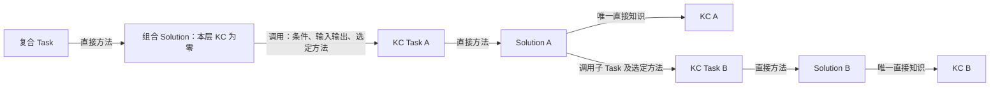
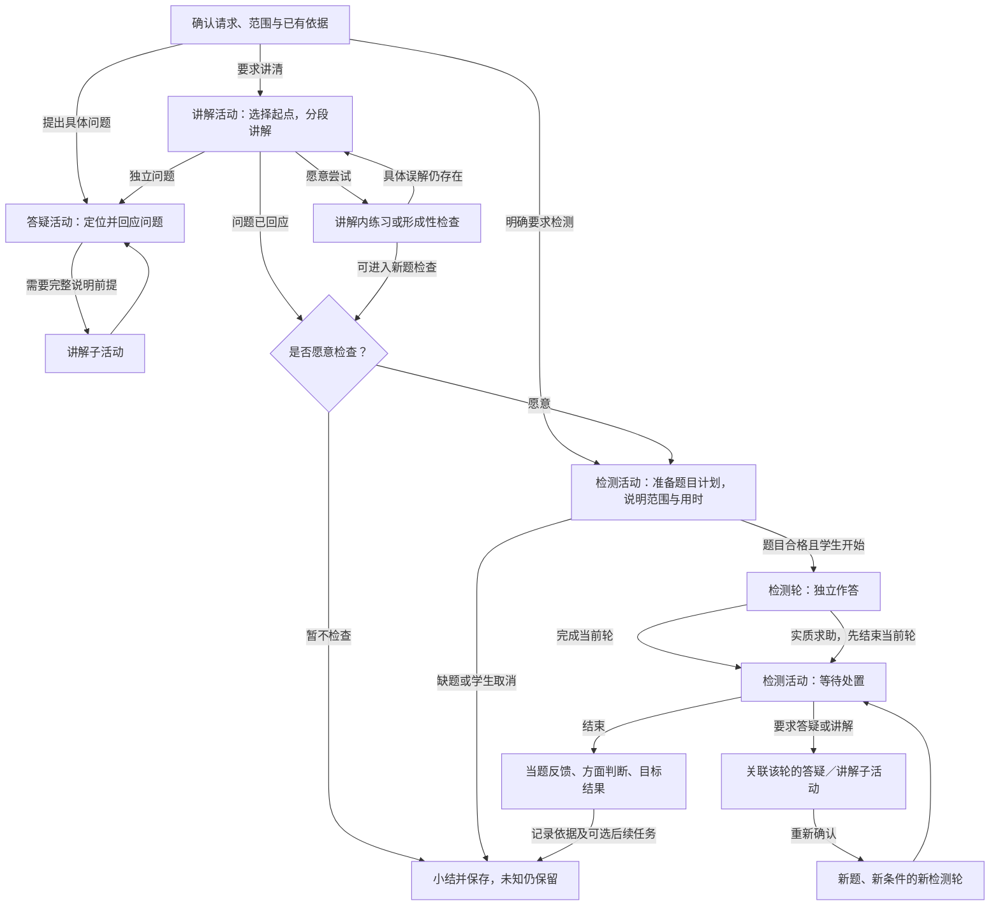
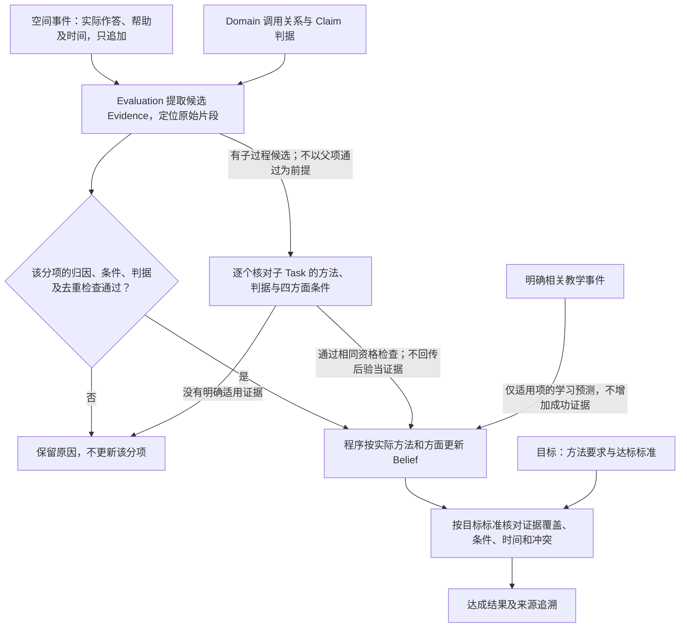

# M1 内容与模型规格及示例

> **版本**：v0.15 
> **文档性质**：M1产品规格的内容与模型专题；包含规定、设计草案和说明示例 
> **状态**：Evaluation追溯原型已阶段确认，图文已同步；主流程仍有产品交接缺口，未通过工程接收 
> **上游依据与基线**：[M1 PRD v0.16](../PRD.md)、本轮已确认的 Interaction 活动模型及此前领域、教材、评估与目标原型；既有四分之一样例及来源见§2、§4 
> **维护责任**：Codex 整理与自检；实际内容核对由管理员完成；重要范围及评价条件仍需讨论 
> **评审记录**：用户确认目标侧Evidence优先、事件侧更新留痕，授权同步文档与截图；本批作者完成一致性和主流程检查，不代表真实评价或M1 Gate通过 
> **写作规范**：[设计文档规范 v1.1](../../../top/DeerMind_Design_Document_Standard_v1.1.md) 
> **更新日期**：2026-11-09 
> **修订说明**：v0.14 → v0.15，同步Evaluation事件、累计证据投影和目标追溯，补齐当前截图及主流程检查；逐文件记录见M1决定登记§21 

---

本文与PRD、交互规格和原型共同定义M1产品，把教材导入、建模、教学与评价展开为实际内容和可核对结果。交互表达会检验这些内容能否查看和维护，具体例子也会暴露业务缺口；修改按[M1工作包](../README.md#2-六个产品设计工作包)返回相应文档，不单向等待PRD结束。文件路径保留以保持引用稳定，标题明确其包含详细规格的责任。

**内容的效力。** 来自已确认决定的规定按原决定生效，例如§4.10的M1-DEC-004；领域与教材规则见M1-DEC-007至009，评估与目标分工见M1-DEC-010及011，Interaction 活动模型见M1-DEC-012至014；KC Task、复合 Task 与依赖更新见M1-DEC-015，最小概率更新方案与试用参数见M1-DEC-016；未获确认的后续细则仍是待审设计草案。题面、教学话术、字段示例和走查结果是说明材料，不因此成为已入库内容或真实证据。理论依据和试用标准不混同；效力以各节具体标注和决定记录为准，不因文件名称带Reference就将规定视为可选，也不将整份草稿视为已批准。

本轮沿用旧书页与开发参考，不继续手写扩大模型包，不要求管理员在系统开发前手工建完整册。先用代表内容说明正确产物，工程实现真实工具后，再在产品内逐章完成整册建模。

## 1. 准备对象与可用条件

教材导入形成语义内容，领域管理形成可复用模型，章节关联说明课程采用什么。三者分开保存，不能把上传、解析、入库和课程可用合成一个“完成”状态。

| 产物 | 内容与责任 | 后续用途 |
| --- | --- | --- |
| 原件与出处 | 原书页、文件顺序、印刷页码、必要区域及跨页关系；不改写原件 | 核对与追溯，不能单靠截图代替结构化语义 |
| 解析候选 | 按章节组织KC、TaskInstance和SolutionInstance候选；公式、图表在所属元素内部 | 核对、重新解析及选择提交；此时尚未写入领域 |
| 领域定义与实例 | Domain内的KC、TaskTemplate、SolutionTemplate、TaskInstance及SolutionInstance | 多本教材复用；供后续教学选法、题目准备与评价引用 |
| 章节关联 | 本章采用的TaskTemplate及其直接SolutionTemplate；KC计算汇总 | 确定课程任务与方法范围，不代表学生掌握 |
| 后续课程准备 | Task Claim、目标标准、Interaction 活动定义、核对题库及应用关系 | Claim 与目标配置见§4.12，活动准备见§4.7，题目准备见§4.13；D03处理应用 |

Domain可以先为空，通过手动维护和教材内容逐步完善。教材也可以完全复用已有模型；两种情况采用同一套关系。教材不是Domain的副本，课程不复制整个领域；个人Evidence和Belief不在导入过程中生成。

## 2. 本轮采用哪些已有材料

| 输入 | 当前用途 | 不作为何种证明 |
| --- | --- | --- |
| [出版社来源核验 v1](../../../../src/mvp_foundation/materials/bnu-math-6a-source-verification.json) | 电子教材身份、来源及已核查的原页线索 | 版权页和2026年实体用书版次尚未最终核准 |
| [全册准备清单 v2](../../../../src/mvp_foundation/materials/bnu-math-6a-whole-book-plan.json) | 13个目录项及附页的覆盖检查；包括9个单元、2项综合实践、数学好玩和总复习 | 其中候选模板及检查例不是已完成模型，不等于全册原页已经核对 |
| [教材整理的旧流程与截图](../../archive/2026-11-02-before-m1-prd/phase-4-product-and-domain-foundation/MVP_Product_and_Interaction_Design.md#31-flow-006从教材扫描件到学生可选用的内容) | 批量导入、原页对照、图表及跨页整理的操作参考 | 识别进度和结果为mock，不证明真实OCR、后台任务或整册可用 |
| [比例增加参考包 v1](../../../../src/mvp_foundation/m1/increase-reference/package.json)及[案例](../../../../src/mvp_foundation/m1/increase-reference/cases.json) | 已有对象、关系和正反例，用于检查课程、方法与评价是否接得起来 | 状态为作者参考、未启用；不是正式达标政策、独立评测或完整章节 |
| [有限内容提取试验](../validation/Content_Representation_Trial.md) | 四例暴露的跨页双解、原题错误式、统计图及几何表达问题；保存实际输入输出和修正依据 | 不证明任意LLM可靠提取，也不证明无人核对整册导入 |
| [当前原型与截图](Interaction_Design.md#1-管理员准备教材与课程) | 核对本轮操作、对象和状态；截图清单带来源与哈希 | mock没有真实识别、自动归类或正式学习评价效力 |
| [旧分数应用内容包](../../../../src/mvp_foundation/content/fractions-application/) | 书页引用、数值参考、问题类型线索 | 旧模型类型与关系须按现行合同重新核对，不能整体导入当作当前模型 |

这里按材料版本引用，没有改动原始资产。需要修正时应修改其权威来源并记录影响，不能在本文另维护一份不同的答案或目录。

## 3. 从一批扫描页到可用课程

本节是M1的业务对象与内容合同，不是数据库或API Schema。模板字段的语义、具体内容的归属及状态必须先一致；服务接口、模型供应商、存储和版本事务由工程展开。

图中实线表示保存的引用；知识汇总框表示计算结果。解法实例同时连题目和方法模板；章节只直接连任务模板及所选方法。图没有新增章节到KC或Task到KC的关系。这张既有图未区分 Task 角色；本轮新增的单 KC 约束和依赖方向以§3.2图 M1-C02 为准，旧图不证明原型已适配。

### 3.1 提取什么以及怎样保存图表和来源

先提取教材具体内容，再处理它归入哪个领域对象。例题先得到一道题和一条或多条教材解法，不直接把具体数字、人物和步骤变成通用模板。知识性陈述可以形成KC候选；教材讲法、授课顺序、教学策略不自动抽成SolutionTemplate，学生讲解、答疑和检测继续由Interaction的活动模型组织。

每个候选保留：类型、标题、所属章节、内容、来源位置、待核对问题；解法另有对应题目引用。来源信息是核对依据，不是新的能力对象。编号及关系由程序分配并维护，模型只输出内容与局部关系候选。

| 表达 | 需要保留的结构 | 渲染与核对规则 |
| --- | --- | --- |
| 文字／要求 | 原有含义、已知条件、要求、分问及单位；区分题目、解法和知识用途 | 不把答案、提示或求解步骤混入题干；摘要不能删去必要条件 |
| 公式 | 数学表达、所在语境、符号及单位；分式与运算顺序可还原 | 辨错题中的错误公式按原样表达。格式标准化不等于订正数学内容 |
| 表格 | 行列标题、单位、单元格值、合并关系及空白用途 | 待填单元格不能变成给定数据；表格与引用它的图保持关系 |
| 统计图 | 类型、轴、刻度、系列、图例、数据及单位；数据已知／未读清状态 | 根据结构重绘，核对对应表格；看不清的值不能按趋势猜填 |
| 几何／关系图 | 对象、标签、连接、长度／角度等标记、明确几何关系及必要布局信息 | 图看起来垂直或等长不等于题设给定；形状与标记都需核对，缺关系不得生成确定结论 |
| 跨页内容 | 同一题的共同条件、续问、对应解法，各部分出处 | 可以多页组成一个实例，但不能把邻近不同题合成一题 |

所有图表归属KC、TaskInstance或SolutionInstance，随主人一起预览、提交和保存，不建立独立的“图表入库”队列。用于解释的辅助展示与原题材料分开；学生题面只取原题条件，参考解法及其辅助图另取。日后改变呈现形式时，仍要保留这些语义边界。

M1不承诺一种有限结构覆盖任意视觉材料。现有表示按已测的公式、表、统计图和几何样例使用；表达不了或读不清时，保留原件及缺口，重新解析和核对，不能用“无损”标签掩盖信息丢失。实际完整性仍需真实服务验证。

**重新解析。** 管理员输入纠正说明，系统给出新候选，采用后替换该项／该章的解析结果，取消则保留原值。若拆出两条解法，两条仍指向同一道题。模板、领域实例及已建立的章节关系不会随一次重新解析被静默覆盖；尚未完成的旧提交要按新内容重新确认。

### 3.2 领域对象与字段

| 对象 | 必要字段及其含义 | 引用与检查 |
| --- | --- | --- |
| Domain | 名称、覆盖范围、说明、身份及版本 | 模型对象有领域归属；新领域为空，不自动复制其他学科 |
| TaskTemplate | 名称／说明；建模角色（KC Task／复合 Task）；目标与责任；交付及完成条件；对象变量；条件关系；变化与边界 | 直接引用 SolutionTemplate；核心 KC 由本层方法关系确定，不重复保存 Task→KC 引用 |
| SolutionTemplate | 名称／思路；条件；输入输出；步骤控制；本层直接 KC；子 Task／子方法调用；结束条件 | KC Task 本层方法直接 KC 恰为一个且与其备选方法一致；复合 Task 本层为零；每个子调用明确方法及条件 |
| KnowledgeComponent | 名称、定义与含义、适用条件、示例／边界、必要图表及解释关系 | 反查对应 KC Task 与方法；求解依赖沿 Task／Solution 推导。旧先修标注只作待核对解释资料，不单独驱动概率更新；不存个人掌握程度 |
| TaskInstance | 题干、已给值、待求内容、必要图表、TaskTemplate、来源、版本、参考及可用检查结果 | 一个题可无教材解法；题目与学生某次作答分开。原型当前模板引用不能冒充生产级不可变版本存储 |
| SolutionInstance | 对应题目、采用的方法模板、具体求解过程、参考结果、必要图表与来源性质 | 同时连TaskInstance和SolutionTemplate；教材原有／系统生成不能混称 |

**任务模板为何需要这些字段。** 完成要求说明要交出什么；对象与变量说明有哪些量、图形、函数或资源，其中哪些已给、哪些待求、哪些需要调查。条件与关系约束合法问题；允许变化限定同类实例可怎样变化；适用边界说明何时不能继续归到本模板。它们既服务正向生成，也服务反向归类，不能只凭题干相似。

一个变量包含标识、名称、类型、用途和约束。类型可以是数值、点／图形、函数／表达式、区间／集合、配置／资源、状态／观测或文本；用途区分“题目已给定”“需要研究或求解”“需要通过调查获取”。例如分类讨论的参数不一定在题面绑定为某个值，K8s待调查的故障原因也不能当成给定事实。当前类型是M1表达样例，不声称完备的通用领域语言。

**方法模板怎样描述过程。** 步骤具有标识、动作、所需输入、产出与后续位置；顺序步骤、条件选择、分类讨论和检查复查分别表达。分支写清条件、动作或结论及去向，分类讨论说明覆盖范围。复查明确通过后去哪里、未通过时回到哪里、何时停止；不使用“反复尝试直到成功”作为无限循环。

递归分解引用子TaskTemplate和选定的子SolutionTemplate，说明传入什么、取得什么；外层方法继续组合子结果。控制流程内允许有界复查，但方法之间循环引用不是合法递归终点。草稿可不完整并显示缺口，不以字段保存成功表示方法已可执行。

**两类 Task 与本层约束。** KC Task 用可观察的任务责任表征一个核心 KC，其所有可用本层方法均直接引用该 KC，且不再直接引用第二个 KC。复合 Task 的本层方法不直接引用 KC，只组织对子 Task 的调用。两类 Task 都可以有子任务，因此 KC Task 不是“不能再分”的原子任务。这是当前选定的建模约束，具体粒度的教学与测量有效性还需验证，不是已经证明所有认知活动都能唯一分解。

图 M1-C02：本层知识与递归依赖。矩形是定义，箭头是带标签的引用；省略实例、其他备选方法和课程对象，不表示个人掌握传播。

**知识汇总。** 对指定方法，知识集合＝本层直接 KC＋所选子方法递归知识，按 KC 身份去重并保留路径。KC Task A 的本层只有 KC A，但图中完整方法同时涉及 KC B；不能要求其递归知识总数也为一。复合 Task 的本层为零，也不等于其求解不需要知识。

Task 的全部备选方法并集用于领域内容覆盖；教材采用方法的并集用于课程覆盖；一次表现按实际或有依据推定的方法及命中分支解释。三种集合不能混用。若方法不明，保留候选路径及不确定性，不虚构执行路径。

**依赖与完整性。** Task 间的求解依赖由 Solution 调用定义，不另维护可与之冲突的手填 Task 依赖图。KC Task 之间的调用可导出带方法／条件的 KC 依赖视图；它不是教学顺序，也不自动成为所有情境下的必要先修。既有 KC 先修标注保留作解释线索，正式推断必须回到具体 Task／Solution 路径核对。

- 每个正式采用 KC 至少有对应的 KC Task 和方法，写明可观察责任与完成条件；可复用已有任务，不机械复制四个方面的 Task。KC 可先保存为待补齐，不因此可用于正式评价。
- 方法调用明确子 Task、子 Solution、输入输出和条件。方法共享必须满足各所关联 Task 的本层约束；直接引用 KC 的方法不能直接挂到复合 Task 上绕过 KC Task。
- 本层直接 KC 为零的组合方法仍须表达选择、排序、合并及检查。若这些动作涉及需要单独表征的知识责任，引用对应 KC Task；不把一切微小操作都建成新的 Task。
- 定义调用图不得循环；同一子任务可被多处复用，运行时形成多个调用位置。本层流程可有有界复查，但不能以模板循环冒充可终止的分解。
- 缺子方法、缺核心 KC、KC Task 多核心或复合方法直接挂 KC 均是内容缺口；保存草稿与正式采用分开。调用中的辅助任务不必成为学生目标的独立达标项，但参与正式评价须有适用 Claim。

**Claim 归属。** KC Task 和复合 Task 都引用同一类 Task Claim。KC 的直接检验靠 KC Task 的可观察表现完成，不创建 KC Claim／KC Belief；复合 Task 的组织责任保留自己的 Claim，不用子 Claim 的平均分替代。依赖参与评价的规则见§4.15。

当前初中、高中和K8s示例用于检验上述字段是否能表达递归、分类、调查和复查，见[交互§1.3](Interaction_Design.md#13-手动维护领域模型)。它们不扩大M1正式课程范围，也不证明模板足以覆盖任意未来领域。

### 3.3 从解析候选入库到章节采用

| 环节 | 输入及操作 | 输出与不能混淆的状态 |
| --- | --- | --- |
| 提交领域 | 教材中分别选择KC、题目、解法；解法有父题 | 当前Domain的待办；尚未写模型，也未关联章节 |
| 添加KC | 核对定义，新建或复用已有KC | 保存的KC及来源对应；不自动生成任务或方法 |
| 提取模板 | 从具体题／解法提出通用模板，核对后保存 | TaskTemplate或SolutionTemplate；原实例仍待关联，不能自动捏造依赖 |
| 关联题目 | 选定符合责任与条件的TaskTemplate | TaskInstance→TaskTemplate；无解法的练习题也可先入库 |
| 关联解法 | 先有对应TaskInstance，再选SolutionTemplate | SolutionInstance→TaskInstance及SolutionTemplate；必要时明确补上Task→Solution引用 |
| 关联章节 | 回教材选TaskTemplate及本章采用的方法 | 章节→TaskTemplate／所选SolutionTemplate；KC计算得出，元素来源仅作依据 |

重复选择已有定义意味着复用，不覆盖它。提取模板和关联实例是两次不同结果；关联检查应核对题目完成责任、条件及方法适用性，真实语义判断留工程实现，当前mock匹配不具有该保证。关联成功也不自动通过题库质量检查。

待办按元素逐行展示，内部按题目及其解法保留来源组：部分完成时显示已添加／已关联；整组完成后离开待办。删除未处理项只取消本次提交；删除父题时一并说明待处理解法受影响。已保存模型和原始教材不因此删除。来源与结果仍可追溯，无需另设已入库列表或审核中心。

**章节只维护实际采用。** 新增关联时从当前领域选任务及方法，保存立即生效于教材草稿。编辑只改变本章方法选择；取消关联只删除引用。主表没有可直接改动的勾选框、任务下拉框或总保存操作。至少一种有效方法才形成该条章节关联；无方法的任务可以先作为领域草稿存在。章节保存不等于应用给学生。

### 3.4 哪些条件满足后可以做什么

| 行为 | 必要准备 | 缺少条件时 |
| --- | --- | --- |
| 核对与重新解析 | 原件、章节和已有候选；指出需要纠正的内容 | 原件保留；无法确定则显示缺口，不自动补成已知事实 |
| 保存领域草稿 | 对象身份及最小定义，引用可检查 | 允许补建，显示未完整；不宣布语义质量合格 |
| 保存章节关联 | 已存在的任务及至少一种适用直接方法 | 不能把建议冒充已关联；缺方法先回领域补齐 |
| 学生阅读／讲解 | 已应用的内容与范围、必要图表、可靠方法知识和 Interaction 活动定义 | 有依据的局部帮助可用；不能承诺未准备的完整章节 |
| 练习与反馈 | 题面、核对参考、适用方法、实际展示和帮助记录 | 无可靠参考不确定判分；已入库不等于合格检测题 |
| 按目标检测／评价 | 合格题、Task Claim及目标标准，适用的接触与帮助条件 | 不启动无法满足承诺的检测；内容缺口不算学生不会 |
| 后续主动任务 | 有效个人依据、目标、时间条件及可执行内容 | 无依据不生成；安排任务不等于已执行或达标 |

后四行属于D02–D06的完整产品责任；四类活动编辑、学生固定活动分支及运行追溯已有 mock 页面，真实内容应用与评价服务尚未完成。保存与应用分开，历史活动保留原采用依据；已确认错误的内容不继续使用。目标未准备与学生证据不足是两种状态，不能都显示“待确认”。

### 3.5 本轮样例与真实验证边界

真实五页样例包含第49—50页的连续比例例题与两种解法、第50页练习及辨错、第91—93页的数据表和统计图。四例核对样例沿用C02跨页双解、C03错误原式、C05统计图、C06几何内容，用于重现[有限试验](../validation/Content_Representation_Trial.md)暴露的问题。

例题的题目独立保存，两种解法分别形成SolutionInstance；统计题的图表属于题面；原题让学生判断的错误算式保留错误；几何关系以明确标记为依据。这四类反例约束重新解析和后续渲染，不要求管理员操作底层块结构。

原书49—50页对应电子页序52—53，91—93页对应94—96；单张图片自身的文件页位置又是另一种定位。当前原型提供已知样例原页查看，真实PDF分页、漏页补入、目录覆盖及批处理恢复尚需工程和整册工作核验。此前复杂手动块编辑方案不再作为当前交互要求；完整性责任并未取消。

真实试验原始结果和人工处理保留在原报告，本轮没有改写为自动通过。当前重新解析、提取模板与匹配都是固定mock；实际不同模型的提取能力、纠正成功率、任意图形表达及全册人工负担尚待工程验证。

### 3.6 准备结果怎样交给下一步

评估管理可独立为领域任务定义 Claim。目标管理使用已经保存的章节任务／方法关系选用 Claim；教材和目标准备完成后，还须准备 Interaction 活动定义与题库。Claim定义评价方面及证据含义；目标规定本课程哪些要求必须满足；Belief由真实学习表现产生。具体例子继续使用§4的“增加四分之一”，不把第49—50页连续比例例题换名当成同一个任务。

交接时至少提供：章节和来源、采用的任务／方法及版本线索、知识汇总路径、可用题目与解法、仍缺定义或检查的部分。原型的本地对象编号和版本提示只是操作表达；真实不可变版本、事务和一致性由工程定义，不能宣称已经具备生产能力。

## 4. 一个已有案例怎样贯穿模型

### 4.1 先区分两个不同用途的书页样例

此前第49—50页主要检验跨页整理，旧映射样例是“连续求一个量的几分之几”。“已知原量与增加分率求新量”的代表模型则采用第53—54页。它们同属分数应用，但不是同一个任务，不能为了主流程演示把两个来源合并。

比例增加参考包中的两张原页已按其记录哈希核对：

| 原页 | 本地原件 | 本轮核查 |
| --- | --- | --- |
| 印刷53页／阅读器56页 | [PAGE-53](../../../../src/mvp_foundation/m1/increase-reference/source/page-056.png) | 文件存在且哈希与包内来源记录一致；不是重新执行OCR |
| 印刷54页／阅读器57页 | [PAGE-54](../../../../src/mvp_foundation/m1/increase-reference/source/page-057.png) | 文件存在且哈希与包内来源记录一致；不是正式内容质量验收 |

### 4.2 复用哪些对象，核对什么

下列标识来自 `M1-INCREASE-REFERENCE@1`，仅用于定位作者参考，不作为工程数据库主键设计。

| 角色 | 已有对象 | 核对其产品含义 |
| --- | --- | --- |
| 领域 | `DOM-M1-MATH@1` | 归属于数学；本包只覆盖一个局部，不等于整个数学领域 |
| 主任务 | `TT-M1-INCREASE@1` | 原量与增加分率已知，确定增加以原量为基准，求最终量；不含反求原量或连续多次变化 |
| 两种直接方法 | `ST-M1-PARTS@1`、`ST-M1-FACTOR@1` | 先求增加量再相加，或先求增加后倍数；选法受题目与课程条件约束 |
| 递归子任务与方法 | `TT-M1-SCALE@1`、`ST-M1-MULTIPLY@1` | 需要求指定倍数时，能够沿选定子方法继续查到知识依据 |
| 知识 | 包内5项KC | 分率参照量、指定倍数、增量与总量、分配律、运算；KC由实际选定方法汇总，不手填Task的知识清单 |
| 评价定义 | `CL-M1-INCREASE@1` | 绑定主任务，在内部区分四方面；没有学生个人状态 |
| 章节采用 | `U04`的局部映射 | 指向53—54页、主任务、两种允许方法及相应Claim；不表示U04整章完成 |
| 学习目标 | `LT-M1-INCREASE@1` | 当前样例为任选一种方法；独立、解释、迁移、保持的要求分开，不要求每题全测 |
| 题目 | 包内6个来源／教学／检测参考 | 具体题面、来源与用途分别核对，不能仅凭名称认定它足以测迁移或保持 |

该包尚未按本轮 KC Task／复合 Task 及本层单 KC 约束重建；包内多 KC 方法只能作为旧版参考，不能直接作为当前规范模型。新结构映射见§4.15，本批不改写包或实例编号。该包明确 `ready_for_formal_assessment=false`：缺少正式证据聚合与达标校准，因此可以用来说明如何连接对象，不能直接让系统据此给孩子宣布掌握。本文§4.6–4.10补充的是其中“四分之一”子范围的产品样例及已确认试用标准，不改写原包的范围、版本或启用状态。

### 4.3 教学和评价怎么使用这些准备结果

下面使用参考包已有的书本数量例子，避免另造一套题号。PRD中的40米例子是同类任务的说明，不代表这名学生已经做过本表中的全部题目。以下假设内容、标准已经经管理员核对并应用；当前参考包本身尚未满足这个前提。

| 环节 | 输入与处理 | 产物及其使用边界 |
| --- | --- | --- |
| 管理员准备 | 在U04采用主任务和两种方法；配置`CL-M1-INCREASE`及目标，明确当前允许任选一种方法 | 保存定义和参考，再检查、应用；没有产生学生Belief |
| 学生选用 | 选教材及目标创建Learning Space，提出学习本章增加关系 | 课程引用和本次活动范围；不复制一份独立领域模型，不预写掌握程度 |
| 开始讲解或答疑 | Interaction依据请求和已有有效表现建立讲解或答疑活动；从Domain取适用方法，用`Q-M1-TEACH`解释80本增加1/4得到100本 | 实际展示的例题、图示、提示和解释进入所属活动记录；仅生成但未展示的内容不算帮助 |
| 获得表现 | 学生解释“1/4指原来的80本”，或在提示后算出100本；Reasoning按规则理解输入 | Observation描述表现及帮助背景；不能直接宣布独立掌握 |
| 准备检测活动 | 根据目标和未解决的问题选`Q-M1-CHECK`等合适题目，核对该学生未见解法及本次条件，再说明范围和预计负担 | 得到有明确测量目的的题目计划；学生确认才开始；选题结果不写进Belief |
| 记录检测轮作答 | 学生对60本增加1/5写出`60×1/5=12，60+12=72`并说明基准。轮中若实质求助，先结束当前轮并取消原题单未开始轮次 | Event保留活动、轮次、题面版本、作答与实际帮助；提交确认不提前泄露余题的答案或方法 |
| 轮后答疑或讲解 | 学生问“为什么这样算”或要求讲透时，检测活动暂停并建立关联该轮的答疑或讲解子活动 | 子活动记录`triggeredByAttemptId`；其帮助不倒灌到帮助前检测轮。重新确认必须准备新题和新轮 |
| 反馈与评价 | 检测活动结束后按参考给当题反馈；Evaluation按Claim、条件和有效历史解释Evidence，更新相关Belief方面，再比较目标 | 这次结果正确是确定的算术事实；它能支持什么范围、是否足以达标仍受标准约束。不能由一题推导四方面全通过 |
| 下一步 | Interaction读取合法评价与目标，选择补讲、以后检测或本次结束；管理员可查同一次活动的记录 | 任务或建议带依据。未实际发生的延迟检查不形成保持证据；同一表现不因重试处理变成多份独立证据 |

这是一条产品逻辑走查，不是运行日志。Event记录事实、Reasoning理解输入、Evaluation维护个人判断、Interaction选择和执行活动行为；课程提供范围与目标，Domain提供领域定义。活动蓝图怎样执行、调用分几次和如何储存由工程设计落实。

### 4.4 题库与本次题单如何分工

**入库先检查题目本身，选题再检查学生及用途。** 题库不按学生复制。一次使用引用题目版本，另记这次活动、要求、实际呈现、提示、作答和接触背景。题目内容被修正时保留旧版本及旧使用事实。

| 已有候选 | 能提供什么 | 本次使用前还要检查什么 |
| --- | --- | --- |
| `Q-M1-TEACH`：80本增加1/4，100本 | 讲解数量关系、示范两种方法 | 展示解法后不能立即拿同题证明新的独立表现 |
| `Q-M1-CHECK`：60本增加1/5，72本 | 同一范围的新计算和解释表现 | 若此前已展示本题答案则更换；只换数字不自动证明迁移 |
| `Q-M1-SOURCE-54`：看图求树木数量，60棵 | 图文理解与对应求解 | 参考包明确图区域尚未提取；必须先形成完整、核对过的题面，不能拿一句“依据关系图”代替图 |
| `Q-M1-TRANSFER`：表格中的40米增加1/4，50米 | 文字转表格的迁移候选 | 比较实际学过的表征与当前变化；若此前已讲过同一40米关系或该表格，要记录，不把题名当作陌生性证明 |
| `Q-M1-DELAY`：72本增加1/6，84本 | 延迟后再次检查同类表现的候选 | 实际间隔和期间练习／帮助符合相应标准；当天出这道题不是延迟检测 |

按次选题依次回答：要检验哪些目标要求、需要哪类表现、现有题目能覆盖哪些要求、对该学生是否适用、预计负担是否合适。一道题可以同时取得计算和解释表现；四个方面不等于必须出四道题，也不能由一道算对的题填满四个方面。

允许方法的交集来自任务方法、章节采用和目标条件。例如课程允许两法、目标任选其一，使用分步法成功不证明另一法也会；目标若要求分别说明两法，题单必须取得相应表现，不能只修改结果标签。没有合格题目时说明该项暂不能检测并由管理员补齐，不让运行模型临时放宽标准。

M1先复用核对题库。AI辅助管理员备题与教学时自动出题是两条不同路径；后者尚未作为M1必做能力。以后启用时仍执行检查通过、保存、使用的顺序，不因省略逐题人工审核而省略检查。

### 4.5 用反例检查评价不会越界

| 观察到的表现 | 可以支持的结论 | 必须保留的限制 |
| --- | --- | --- |
| 没给当题提示，答案和参照量解释正确 | 在所测条件下的独立与解释表现 | 是否充分达标要看标准；迁移、保持未因此得到证明 |
| 只给出正确答案72，没有过程或解释 | 本题答案正确 | 不能补写“理解了为什么”；解释方面仍缺依据 |
| 给出`60×1/5=12`的提示后完成72 | 在所记帮助下完成后续计算 | 不当作完整独立求解；实际帮助不能被漏记 |
| 基准和列式正确但算错 | 可保留已表现出的正确理解，并指出计算问题 | 不把部分支持升级为任务整体达标；可用KC解释错误，不更新KCBelief |
| 换成另一组数字后算对 | 同模板另一实例的表现 | 不自动视为表征迁移或泛化 |
| 隔一段时间再次完成 | 在实际间隔和帮助背景下的表现 | 未满足目标规定的延迟条件时，不宣布持久掌握 |

本表固定的是解释边界。它没有擅自规定“两题就达标”或“七天即持久”。逐章证据标准仍列为M1-OPEN-03，由内容准备给出可核对的标准与正反例，验证工作检查其实际判断质量；不是把产品含义留给实现者临时猜测。

### 4.6 本次到底教什么、评什么

**情境。** 学生选用分数应用章节，问：“一个量增加四分之一后是多少？我不明白怎么想。”本次处理原量已知、增加量以原量为基准、只有一次增加的任务。

为避免把简单例子的成功扩大成本章掌握，本次范围明确如下：

| 项目 | 本次约定 |
| --- | --- |
| 数量范围 | 样例使用能被4整除的正整数原量；书本数量或长度等同单位数量。非整除、分数原量、反求原量和连续变化不在本次检测中 |
| 任务责任 | 认出原量；理解增加部分为原量的1/4；求增加后的总量；能够说明所用关系 |
| 允许方法 | A：先算增加量`a÷4`或`a×1/4`，再加`a`。B：直接算`a×5/4`或`a×(1+1/4)`；任选一种，不强迫每题两法 |
| 参考关系 | `新增量=a/4`；`总量=a+a/4=5a/4`。对于本次正原量，总量大于原量且小于其两倍 |
| 显示给学生的要求 | 自己求出增加后的数量；说清四分之一指谁、为什么要加回原量；读懂表格给出的同一关系；间隔后再检查能否完成 |
| 明确不作的断言 | 不从本次结果推出所有分率、所有题型、两种方法或整章均已掌握，也不把一次延迟成功称为永不遗忘 |

**对象采用。** 继续使用`TT-M1-INCREASE@1`、两种方法及`CL-M1-INCREASE@1`，不为1/4再建一个Task或Claim。本文的“四分之一学习目标草案”选择该Claim的子范围`r=1/4`并规定要求；它不是旧`LT-M1-INCREASE@1`的静默改版，尚无正式目标对象。Evidence保留实际参数、表征、帮助和方法，Belief的方面判断说明已支持与未覆盖的范围；判断本目标时使用对应范围的有效依据，不能只读一个“该Claim已通过”的总标记。

**方法的依据与适用限度。** 本例选择“必要讲解—学生尝试—解释理由—根据表现调整”的方法。例题与练习结合、图文结合、解释性提问及间隔学习，分别受到[IES学习组织实践指南](https://ies.ed.gov/ncee/wwc/PracticeGuide/1)支持；说明分数运算为什么成立，而不只传授步骤，符合[IES分数教学实践指南](https://ies.ed.gov/ncee/wwc/PracticeGuide/15)的建议。具体三条教学路径是据此作出的产品设计，不是指南规定的唯一流程。

这些研究不提供本任务“做对两题即达标”或“七天证明持久”的阈值。§4.10的题量和时间是为M1提出、已由M1-DEC-004确认的有限试用标准，仍须实测并可修订；不冒充理论定律或经验证的能力测量模型。

### 4.7 三种起点怎样讲、怎样切换和结束

**同一道题，求解方法、活动策略承担不同责任。** Domain 中的分步法和倍数法都可以求新量。学生问「为什么能乘1.25」时，讲解活动只需允许继续讲解，系统可以从她已经会的加法推导倍数。选用这种讲法无需命中推荐策略。学生以独立问题追问时，Interaction 建立答疑活动；答疑发现需要完整说明前提时，再建立讲解子活动。程序掌握活动树、检测轮、学生同意与可转移条件；LLM 在这些约束内决定解释、表征与追问。讲过的推导保留为实际帮助。

历史讲解脚本保留两组样例：三种固定 v1 情境使用连续两级部分量，旧四分之一脚本用80本和120本检查单轮求助。它们已退出当前管理导航，不代表新的四类活动编辑器会执行任意配置。当前学生固定脚本增加多轮检测、轮后讲解及返回新轮；截图和实际边界见[交互设计§1.6–3](Interaction_Design.md#16-四类活动蓝图与规则策略管理)。下表三种起点仍是教学内容参考，不是当前活动配置的运行日志。

**正常起点不先强制考试。** 有明确求助且材料足够时，先回应。已有可靠记录帮助选择起点；没有记录时不把学生归为“基础差”，也不编造先前错误。学生想先试做，可以直接进入相应练习或检测准备。

本例用已存在的`Q-M1-TEACH`：原有80本书，新添的是原来的1/4，现在有多少本？下面是一段可接受的教学内容参考，不要求LLM逐字照读：

> 这里的四分之一，是把原来的80本分成四等份，取其中一份，所以新添了20本。原来的80本还在，现在一共是80＋20＝100本。

可用的教学示意是“原量四份＋新增一份”：原量`[20][20][20][20]`，新增`[20]`。单位一份是20本；`1`代表原来80本这一整份，并非1本。采用直接倍数法时，说明`1+1/4=5/4`表示合起来是原量的几倍。线段、份数和文字要表达同一关系，不以装饰图代替解释。

| 起点和实际输入 | 教学动作与学生机会 | 下一步的条件 |
| --- | --- | --- |
| 概念尚未建立：问“1/4是几本，为什么还加80？” | 分段解释四等份及新增量，再问“20本是新增的，还是现在全部？”；可用文字或等份示意，回答后及时反馈 | 能区分新增与总量，尝试24本增加1/4；若仍不懂一份，转入必要基础回补 |
| 能算但解释有误：写`80×5/4=100`，说“1代表1本” | 先确认其用语含义；若确是概念错误，解释这里的1代表原量一整份。可比较80本与160本增加同一比例时，新增量为何分别为20、40 | 能结合自己的式子说清参照量后，用新题检查；只复述刚显示的话可支持当下理解，但不直接完成解释要求 |
| 已有可靠求解和解释表现：只问“能不能直接乘5/4？” | 简短说明两种方法等价，沿学生选用的方法继续；不重复一整段基础课程 | 问题得到回应即可结束，或经学生选择进入练习／检测。遇到具体误解才返回相应解释 |

基础回补只处理本问题所需的一步，例如“24平均分4份，每份多少”。回补后能继续则返回原任务；同一个障碍仍未解决时，说明卡在哪里，提供更小一步的帮助或结束选择，不反复重播同一段话，也不自动展开整套低年级课程。回补的回答和所给帮助照实记录，不自动生成新的KC或子任务Belief。

**练习与正式检查分开。** 教学中的24本例子得到30本，允许提示和即时反馈；它用于指导下一步，不作为下文无当题帮助题数的充数项。学生只说“懂了”时，系统可以邀请尝试；拒绝检查就收束为“已讲解，尚未检查”，不偷偷标记达标。

**图 M1-Q01：本例活动树与检测轮的可选路径。** 矩形表示活动或检测轮，菱形表示学生选择；箭头表示推进条件。讲解、答疑和检测可递归组织为活动树，检测轮不能嵌套教学性活动。图以材料与定义可用为前提，规则缺失、服务失败及中断见PRD§3.6、§6。

学生在任何阶段都能停止；未提交输入保留，未做题不判错。检测轮结束后才允许答疑或讲解；获得实质帮助后，原题单尚未开始的轮次不继续作为原独立计划，重新确认使用新题新轮。图中循环依赖新表现或学生选择，不是允许程序自动循环讲解直到学生“通过”。上方 Mermaid 源是本节现行规则图；旧`M1-Q01.png`保留在历史资产中，不再作为本节图示引用。

### 4.8 本例具体准备哪些题

第一轮教学与检测用小型核对题库，不依赖实时生成。以下题面是管理员需要准备的实际内容示例，除复用项外均为作者新编；文档编号用于评审，不表示已入库或已通过管理员核对。题面与参考答案分别保存，出题不向学生发送参考答案。

| 编号与用途 | 给学生的完整输入 | 教师／评价参考及用途限制 |
| --- | --- | --- |
| `Q-M1-TEACH`，已有教学例 | 原有80本书，新添的书是原来的1/4，现在有多少本？请说明 | 100本；增加量20本，基准80本。讲解时可展示过程，不算新的独立检测 |
| `QTR-P1`，受助练习 | 原有24本书，新添的是原来的1/4，现在有多少本？ | 30本；可以提示或追问。帮助记录保留，不混入无帮助题数 |
| `QTR-C1`，文字检测 | 图书角原有120本书，又增加了原来数量的1/4。现在共有多少本？请写出答案，并说明四分之一指哪个数量、为什么这样算 | 150本；原量120，增加30，总量150。分步或倍数法均可；不要求固定措辞或两法都写 |
| `Q-M1-TRANSFER`，已有表格候选 | 请根据下表求延长后的路线长度，并说明分率相对哪个量、你怎样得到新长度。表格见下 | 50米；基准40米，增加10米。只有表格使用条件成立时才提供文字转表格的迁移依据 |
| `QTR-D1`，延迟复测 | 原有72本书，又添了原来数量的1/4，现在有多少本？请说明依据 | 90本；新增18本。与旧包`Q-M1-DELAY`的1/6、84本不同，不替换旧题；时间没到时本题也只是一道普通题 |
| `QTR-R1`，备用新题 | 水箱原有48升水，又加入原有水量的1/4。现在共有多少升水？请说明 | 60升；新增12升。用于同范围再检查或替换暴露答案的题，不能仅凭换情境就宣布迁移 |

表格检测的题面数据（属于题目条件，不能隐藏）：

| 项目 | 数据 |
| --- | --- |
| 原路线长度 | 40米 |
| 延长部分占原路线的比例 | 1/4 |

**一次检测怎样组题。** 对刚完成文字／等份讲解、尚未练过这种表格且没有旧有效检测记录的样例学生，可提出“文字题＋表格题”两题，预计约5–8分钟，实际时长仍需工程试用验证。学生开始前看到本次覆盖、题量和结束后统一反馈的安排。两题分别取得解题与解释表现，表格题额外检查这一种表征变化，不为四方面各出一套试卷。

这不是全书统一题量。已有适用表现可以复用，只测缺口；表格先前已讲过、题目已见答案、图表内容缺失或当前目标不同，都要换题或明确本次不覆盖相应要求。可以先做文字检查，但不能把备用文字题填进“表格迁移已测”。原题单的题量、预计负担和覆盖在开始前固定，不因学生做错就在同一次检测轮中无限追加题目；学生取得实质帮助后，原题单未开始轮次取消，后续确认另以新题新轮准备。

同一对话保留教学内容不妨碍提出新题，但如果本次实际查阅了相关解法、得到提示或帮助来源不清，必须保留条件。没有点击求助不等于已证实无帮助；书页或历史再次打开、系统实际提示及学生说明的帮助应进入记录。M1不声称观测到设备外的全部行为，也不增加监考或锁屏。

### 4.9 判据：具体看什么表现

每次表现先分别判断数量关系、求解结果、解释与帮助条件，不先给一个总分。关系正确但计算失误、算对但理由错误、只有答案而没有解释，必须能得到不同反馈。理解原意的语义判断依赖规则＋LLM，计算、引用和提交条件由程序核对；不能靠命中“原量”等关键词判解释通过。

| Claim方面与本例要求 | 可接受表现 | 明确不足 | 只能保持未确认的情形 |
| --- | --- | --- | --- |
| 独立完成：自行求总量 | 在已记录条件下，没有当题或等同解法提示；自己建立`a+a/4`或`5a/4`关系，结果和单位正确；方法任选其一 | 把增加量当总量、给原量直接加1/4，或不能完成所要求计算；反证只限实际表现 | 只有模糊答案、帮助情况未知、题目无效或仅抄写已给答案；当题帮助后成功另记受助表现 |
| 理解与解释：说清参照量与总量 | 用文字、式中标注或图说明1/4对应原量的一份，原量仍在，所以要把新增与原量合起来；用倍数法时解释1是原量整体 | 明确把1说成1本、分率基准改成新总量、把20本新增量说成80本题的总量 | 没被要求解释、只给答案、输入难以理解；不能把不善长篇表达当概念错误 |
| 迁移：从已学文字／等份例读到表格 | 在此前接触条件可说明时，从表中找对原量与增加分率，独立建立关系并说明两行数据如何使用 | 看清表格数据却把增加部分当总量，或明确误解表中比例指向；应与读表／数学原因区分 | 未给表格、表格识别错误、这类表格刚示范过、既往接触未知；仅换数字或名词不能充当此项 |
| 延迟保持：间隔后仍能完成本范围 | 在规定间隔后的新题中，再次得到无当题实质帮助的正确求解和解释；记录基准时点、实际间隔与期间练习 | 在条件有效且题意清楚时重新出现相关错误；保留当前正确部分，不把一次错说成全忘了 | 尚未到时点、没有基准表现、当题帮助后完成，或记录无法确定；不能从任务到期、已接受或同日正确推断保持 |

**判分实例。** 对`QTR-C1`：

- `120×1/4=30，120+30=150本；四分之一是120本的一份，原来的书还在。`——数量关系、结果和解释均有支持，再检查实际帮助与覆盖条件。
- `120×5/4=150本，这里的1是1本书。`——结果正确，解释存在明确矛盾；先核实用语，不能只看150就通过解释要求。
- `120÷4=30，所以现在有30本。`——增加量正确、总量错误；可具体补讲“新增”与“全部”，不用宣布所有知识不会。
- 如果只答`30本`而没有过程，只能确定答案不符；尚不能断定是混淆总量、计算出错还是漏写，需要在结束后结合说明澄清。
- `120+30=140本。`——如果过程含义明确，可保留数量关系支持，指出运算错误；本次完整求解尚未满足标准。
- 只答`150本`——当题答案正确。由于本题明确要求理由，说明理由部分尚未提供；这本身不是“不理解”的反证。可以在本次检测结束后再邀请说明，新增回答另留记录。

反馈在检测活动结束后提供；上述参考不是允许系统在第一题提交后提示参照量，从而影响下一题。若求助导致当前检测轮提前结束，只评价实际提交和实际条件，未做题仍是未检测。学生随后要求讲解或答疑时，该帮助归属于检测活动下关联本轮的子活动，不倒灌为轮中已发生的独立表现。

### 4.10 试用达标标准、Belief更新与学生反馈

**本例初始试用标准已由用户确认（M1-DEC-004），可以据此开展工程设计及对应内容准备。** 正式题目、目标和模型仍需核对采用，旧参考包未因此自动启用；M1-OPEN-03中其他章节的准备责任仍保留。 表内门槛是有限样本下的产品取舍：用少量不同表现避免一题正确立即概括，同时控制30分钟总负担。它们不估计普遍可靠性，不替代工程中的语义质量校准，也不修改已有质量验收指标。

| 方面 | 本例已确认的试用门槛 | 学生能看到的结论边界 |
| --- | --- | --- |
| 独立完成 | 至少两个不同实例满足§4.9无当题实质帮助的完整求解条件；题目参数／条件确有变化，不能把重复提交或同题订正算第二个；有未解释的相关反证时不自动通过 | “在已检查的增加四分之一题目中，你能自己求出新数量。”说明范围与帮助条件，不说所有分数应用都掌握 |
| 理解与解释 | 上述表现中至少两次能结合各自具体数据说明参照量与总量关系；不强制长篇文字，也不要求会说第二种方法；机械复制刚显示的句子不足以单独满足 | “你能说明四分之一指原来的量，新增部分还要加回原量。”只答对但没说明时保留待确认 |
| 迁移 | 至少一次满足指定的“文字／等份→表格”条件，并能正确解释数据关系；只支持这条具体变化；若表格已经教过，则该题是练习，换未覆盖变化或保留待确认 | “这次换成表格，你也找对了数量关系。”不概括为任意陌生题都能迁移 |
| 延迟保持 | 以求解与解释两项达到本例标准时所用的最近一次合格表现为基准，至少7天后，在一道未展示解法的新题中再次完整求解和解释；到时重新判断必要性，学生接受才开始 | “距基准表现已过7天／实际若干天，这次仍能完成。”注明期间练习或其未知情况，不解释为7天没练也不会忘 |

这里的“7天”作为**本例首轮验证的最小间隔**，不是全局每周排课。首次可开始时间为基准时点后7×24小时；之后进入空间再检查，记录实际间隔，不补发错过日期的检测。期间正常学习无需暂停，已有练习照实保留；期间是否练过未知时，也不能描述为“未经复习的自然保持”。如果目标以后要测无强化保持，需要另有明确条件，不能沿用本标准偷换。迁移也按已记录及学生补充的接触背景解释；系统内没找到旧练习不等于校外从未练过，无法核实则保留这一限制，只描述本次表格表现，不宣称首次迁移。

**四方面可以共享一次表现，但不能重复计样本。** 文字题与表格题的两次作答可以同时支持独立与解释；表格题还可支持特定迁移。它们始终是两次作答，不因产生五条Evidence变成五个独立样本。延迟题可以更新当时的求解与解释判断，不能靠把日期字段改成七天制造第三次真实作答。

**从表现到判断的最小处理。**

1. Event保留题目版本、提交、实际帮助和时间；Reasoning理解所提交内容。题目或识别未决时先保留原始输入，不生成正反结论。
2. Evaluation按方面解释支持、反证或证据不足，Evidence引用同一原始作答与实际条件；没有个人KC状态。
3. Belief结合该空间已有有效依据，保留不同方面的范围和限制；不以正确率直接等同掌握率。目标按对应子范围和条件判断已达标、需加强或待确认。
4. 存在明确有效错误时，可对相应要求说明需加强；如果新旧证据冲突、原因未明，则待确认并说明冲突。旧错不是永久否决：补讲后，在新题解释与求解中针对原错误取得满足门槛的表现，可以更新当前认识，旧错误和帮助仍可追溯；不能只因“讲过了”就撤销反证。
5. Interaction据有效判断决定结束、补讲或安排后续任务；不用任务完成状态替代能力判断。评价失败保留合法当题反馈，不沿用失效判断制造进步。

以没有其他有效表现的样例学生为例：

| 实际走查情形 | 当题与Evidence | 个人判断、目标结果与后续 |
| --- | --- | --- |
| 听完80本例子，再按提示完成24本练习 | 受助成功，帮助明确 | 可以说明跟随解释完成；独立、迁移和保持不能据此达标，邀请新题检查 |
| 文字题150本正确且解释清楚；表格题写`40×1/4=10，所以新长10米` | 文字有支持；表格作答明确把增加量当总量 | 不宣布独立与解释稳定通过；表格要求有具体不足，先对照10米与50米补讲；保持仍未知 |
| 两题均在适用条件下正确并解释，且无相关冲突 | 两次求解与解释支持，表格提供指定迁移支持 | 按已确认试用标准，可判本例前三项达到相应要求；保持待确认。只安排有依据的延迟任务，不把整章标为掌握 |
| 两题只算对、理由都没提供 | 两个答案正确，解释不足 | 不编造思路或推断理解；需要取得过程／解释才能满足对应要求。可结束后邀请说明，不以沉默判错 |
| 至少7天后完成72本题，答案90本且说明清楚 | 在实际时间和练习背景下的新成功 | 按已确认标准更新延迟方面；如期间有练习或未知，反馈保留这些条件，不声称永久保持 |

示例反馈可写为：“这次两题，你都找对了原来的量，并算出了增加后的总量；表格里的关系也说明白了。这个范围的检查已达到本次标准。隔一段时间还能否完成，今天还不能判断。”这句话只适用于已采用本例标准且上述事实真实成立的情况；不是系统统一结束语。

### 4.11 工程接收时具体还缺什么

| 工作 | 现在已有的输入 | 开始相关实现／正式使用前还需什么 |
| --- | --- | --- |
| 教学执行与记录 | 三种起点、两种解法、分段与退出、实际帮助的责任 | 按PRD§3.6落实当前定义采用与合法转移；LLM的真实选择与输出在工程中测量 |
| 题目供给 | 完整题面、来源／作者标识、参考答案和用途；现有小题库路径 | 管理员核对后建立正式题目身份和版本；原题图区域未准备的候选继续不可用 |
| 评价与目标 | 四方面判据、反例、条件覆盖和已确认的本例试用门槛 | 内容采用前核对标准与正式目标版本；工程给出结构化输出、证据聚合与有限校准，不临时猜产品含义 |
| 后续任务 | 具体不足、未知、基准表现与时间条件；已确认暂缓／拒绝规则 | 记录目标与依据版本；满足时间不自动开测；仍按当前有效依据重新判断 |
| 质量验证 | 有支持、反证、未知、求助、重复及条件不满足的预期结果 | 从作者参考之外准备有限独立案例，固定分母与停止条件；本稿未执行模型评测 |

这些内容是D02、D04、D05共同设计的输入；须与PRD、实际原型和截图核对后，按已明确范围交接工程。必要技术可行性分析可提前开展；本例门槛已确认，正式内容采用与实现验证仍未完成，不把本文直接当作完整工程基线。整册其他章节复用这套“范围—方法—表现—标准—题目”写法，但不能复制两题／七天或套同一组语义判据。当前管理员配置的操作与截图见交互规格§1.5。

### 4.12 同一任务两种方法怎样解释表现

TaskTemplate 给出任务范围和直接方法，SolutionTemplate 规定该法的步骤、条件、工具及子方法调用。评估管理引用领域模型，按方法分别维护下表前两项；目标管理维护第三项。判据的定义、由作答解释出的 Evidence 和综合有效证据得到的个人 Belief 是三种不同对象。

| 责任 | 分步法 A：先求增加量，再加原量 | 倍数法 B：求原量的 1＋r 倍 |
| --- | --- | --- |
| 方法执行判据 | 父层检查是否接收子方法求得的增加量并加回原量。子方法自己检查是否按原量乘分率求出增加量 | 检查是否按新量倍数乘原量求出结果。只写最终数值时，无法识别采用了哪种方法 |
| 方法下的四方面规则 | 独立看关键步骤有无实质帮助；理解看能否解释为什么加回原量；迁移看能否读懂变化后的表征并用该法；保持看满足延迟条件时能否再次表现 | 独立看是否自行选用和构造倍数；理解看能否解释 1 和 r 分别表示什么；迁移和保持同样以该方法的表现及情境、时间记录为据 |
| 目标达标标准 | 采用 A 时对照目标启用的各方面标准。若 A、B 均可任选，来自 A 的完整表现可以满足该项要求 | 若目标要求 A、B 分别达标，则 B 需要自己的证据。只有 A 的表现时，B 待确认，学生可看见仍缺哪种方法的表现 |

**从表现到判断。** 原有 80 本书，增加四分之一。学生自行写出「80×1/4＝20，80＋20＝100」并说「增加的是原来 80 本的四分之一，所以要把这 20 本加回去」。这些输入支持 A 的执行和解释；独立性还要核对有无提示。这一题没有提供 B、陌生表格或间隔后表现的依据。下一次若学生在提示后解释清楚，可以记录该条件下的理解表现，同时保留独立完成仍待核对。一个作答可支持多个判断，重复引用同一作答不增加新题数。

**递归与复用。** 执行判据由本 Task 的 Claim 管理，可关联给一个或多个本层方法。父方法展开的是 Domain 已选定调用的子 Task 和子方法；子判据在来源 Claim 维护。子步骤做对只支持相应步骤，父层仍须检查怎样使用返回结果。裁剪评价方面需有理由；当题未要求解释、未观察迁移或未到时间时，各自保留待确认。

个人判断以学生、学习空间和 Claim 版本为单位，证据保留实际方法与条件。同一目标可按方法分别核对覆盖，不派生第二份方法 Belief。§4.10 的题量和间隔适用于本例已确认的目标；展示“两法分别达标”属于另一个配置示例，不能据此把已确认的检测题量自动翻倍。

### 4.13 题目准备：从公共实例到本次可用题

**D02 的输入和输出。** 输入是已确定的学习要求、章节采用的方法和归类后的 TaskInstance。管理员复用实例的题面、来源及解法参考，核对它能用于哪种教学或检测目的。输出是可供该要求选用的题目版本、用途、答案与评价要点，以及尚未覆盖的要求。学习时再结合个人记录选题。以下是下一步产品设计的核对清单，§4.8 的题目是作者样例，尚未按整册标准核准。

| 谁在什么时候判断 | 核对内容 | 结果如何使用 |
| --- | --- | --- |
| 管理员备题 | 题面和必要图表完整，来源可追溯，参数满足 TaskTemplate，答案及适用方法已核对。具体解法引用该实例及对应 SolutionTemplate，区分教材原有与系统生成 | 保存可用版本及参考；缺图、参考冲突、归类未通过时保留缺口，暂不供正式检测 |
| 管理员对照章节目标 | 该题能引出哪项要求、哪种方法或哪种变化的表现。题面与提示、答案分开。目标若要求两法分别达标，还要能看出学生实际用了哪一法 | 按目标看到有合格候选的要求，以及需要补题或补参考的要求；接受多种解法不等于两种方法均已检验 |
| 系统在一次活动开始前 | 核对目的、题目版本、学生是否见过题面、看过解法或取得帮助、此前表征和实际时间间隔 | 相同题可复习或重测。要取得符合目标的独立新表现时，换用满足条件的题，记录这次使用 |
| 系统在活动结束后 | 区分展示题面、展示提示、提交、未提交、订正和实际经过时间。Evidence 只引用满足条件的表现 | 某项无合格题时，可保留其他可测部分，说明未覆盖哪一项。内容不足和学生能力不足分别呈现 |

**用同一目标核对题目分工。** 题面与详细参考见§4.8，只在该处维护；§4.10维护本例的试用门槛。

- **例题与练习。** 80 本例题可展示两法，24 本练习可给提示。看过解法的同题可再练，当作独立新题会夸大证据。
- **独立检测。** 120 本文字题要求求解并说明参照量；40 米表格题要保留表格数据和单位。只在此前未练过这种呈现时，才支持本次文字到表格的迁移。若表格不适用，48 升备用文字题仅可替换同范围的文字检查，表格迁移仍待确认。
- **延迟检查。** 72 本增加四分之一得到 90 本。独立与解释达到试用标准后，按§4.10的实际间隔选用合格新题。当天用这道题可以练习，不能验证保持。旧参考包中的 72 本增加六分之一属于不同目标范围。
- **供应不足。** 首批可先使用经过核对的小题集。启用教学时自动生成后，仍须先检查、保存、再使用，通过检查的题无需逐题人工审批。当前四分之一走查直接使用固定新题，未验证真实生成、个人接触史或自动选题。

**接下来的交互审阅。** 先走两个操作：从现有 Task 的实例查看题面、方法和参考，确定可用用途；再从已配置的学习要求，检查是否有合适的题取得所需表现。建议先复用已有实例和目标入口。是否需要增加新的入口，等这两个操作暴露实际缺口再决定。

### 4.14 活动配置与“四分之一”使用对照

本节把已有领域、课程和评价对象接到活动配置，不新增“学习要求”实体，也不把蓝图节点当作能力维度。规则作用范围以[PRD§3.6](../PRD.md#36-管理-interaction-活动模型m1-r06)为准；页面操作和截图见[交互设计§1.6](Interaction_Design.md#16-四类活动蓝图与规则策略管理)。

| 对象／结构 | 定义内容 | 在本例中的作用 |
| --- | --- | --- |
| 活动类型与蓝图 | 讲解、答疑、检测、自由交谈各自的开始、节点、条件转移及结束 | 已知原量及增加比例的明确求助进入讲解；对“为什么乘1.25”的疑问可进入答疑 |
| 节点 | 目的、输入、开展、输出、允许动作、无法继续时的处理 | “讲解与互动”可围绕原量、增加量和总量解释；不能在没有依据时宣布保持已达标 |
| 条件转移 | 来源节点的判断时机、顺序、条件、依据、目标和无命中处理 | 讲解后学生明确想检测且材料可用，可直接进入“检测与反馈”；输入不足则等待或澄清 |
| 规则定义与引用 | 活动级和本节点分别引用，保存定义及启用情况 | 活动规则不能由节点放宽；独立检测中求助先结束轮是系统边界，不能通过普通配置豁免 |
| 推荐策略定义与引用 | 活动级及节点级推荐，按适用条件选择 | 未命中预设策略时仍可从“80＋80×1/4”解释“80×1.25”，但不能越过允许动作 |
| 活动实例、父子关系、返回位置 | 实际请求、采用定义、当前节点、运行状态、结束原因及相关消息 | 讲解调用答疑时保存原主线；子活动暂停是等待，取消或失败返回也不能当作已经讲懂 |
| 检测轮 | 一次提交机会、题目、实际帮助、草稿、提交或结束原因 | 120本题和48升题是不同轮；后者求助后结束，讲解关联此轮，重新确认换为64厘米新题 |

模板、实例和运行记录不得混用：TaskTemplate／SolutionTemplate规定任务和方法；TaskInstance／SolutionInstance是具体题目与具体解法；蓝图规定如何组织活动；活动实例记录实际发生的过程。规则和策略在同一活动定义内共用引用，不在每个节点复制一份。

**如何确定本节点的配置。** 先遵守不可解除的系统约束，再同时满足已启用的活动规则和本节点规则；有冲突则停止相关动作，而不是任选一条。推荐候选来自活动及本节点推荐，按适用条件选用，可不命中。子活动采用自身配置，父活动不把局部规则或策略自动复制过去。界面隐藏继承项仅为减少重复，不改变这一生效关系。

**当前默认的活动级配置。** 以下是本轮采用的默认内容，不是要求所有未来课程永远使用同一组策略。这里的“共用”表示含义相同，各活动仍分别保存定义；没有新增公共规则库。

| 活动 | 所有节点共同遵守的规则 | 活动推荐策略 |
| --- | --- | --- |
| 讲解 | 避免无目的重复；按当前目标和表现选择；表达不直接等于掌握；尊重暂停与结束；规则冲突与子活动边界 | 短回应与逐步展开：先回应关键部分，学生需要时再补充，不拆散必要的完整说明 |
| 答疑 | 尊重暂停与结束；活动与评价边界；无法可靠继续时停止；不把提问当成能力结论 | 直接澄清：范围明确时回应关键关系，不制造不必要的完整课程 |
| 检测 | 尊重暂停与结束；活动与评价边界；无法可靠继续时停止 | 默认不配置活动级推荐；在准备及轮后节点选择，不向进行中的检测轮引入教法 |
| 自由交谈 | 尊重暂停与结束；活动与评价边界；无法可靠继续时停止；不产生评价输入；明确意图才转交 | 简短回应：回应闲聊或产品操作，不扩展成一堂课 |

“尊重暂停与结束”要求立即停止新增动作并保留未决项，不以答对为退出条件；“活动与评价边界”分别采用各活动职责，禁止本活动直接写能力结论；“无法可靠继续时停止”覆盖内容无法核实和规则冲突。自由交谈的明确意图才转交约束不要求对已明确的请求重复确认。检测轮的原子边界同时由系统约束保护，节点中的普通规则条目用于说明，不能通过停用解除。

**各节点只追加本层配置。** 表中“无”指没有额外的本节点引用，仍继承上表活动配置。开始／结束节点同样继承活动配置，不增加普通节点动作。默认节点、转移条件和规则／策略的完整文字保存在[本批配置快照](assets/activities-v0.1/activity-configurations.json)，用于复核截图和正文，不是工程接口 Schema。

| 活动／节点 | 本节点规则及要求 | 本节点推荐策略及适用情况 |
| --- | --- | --- |
| 讲解／明确本次学习重点 | 无；允许明确或澄清请求，不改写正式目标 | 无 |
| 讲解／确定学习起点 | 无；采用已有表现，未知不等于不会 | 无 |
| 讲解／讲解与互动 | 说明关键关系：解释步骤为什么成立，不只列计算过程 | 概念建立与回补：必要基础不清；示范与例题讲解：有基础但不会组织过程；对比辨析：关键条件混淆或理由不足 |
| 讲解／练习与应用 | 根据表现调整帮助：能接手时减少帮助，持续困难时调整解释，不机械加题 | 引导练习：仍需支持；变化与迁移练习：已有熟悉条件下的表现，需要明确的新表征或情境 |
| 讲解／检测与反馈 | 无；调用检测子活动并等待，不能在父节点执行检测轮 | 无 |
| 讲解／总结本次学习 | 无；总结实际发生内容与未知，不自行写入能力状态 | 无 |
| 答疑／定位问题 | 局部追问不碎裂：同一疑问继续澄清，不强行拆成子活动 | 追问定位：只有“不会／没懂”而信息不足时，澄清会影响回答的关键点 |
| 答疑／回应问题 | 无；按原问题回应，必要时调用子活动 | 无；“直接澄清”已在活动级推荐，不在节点重复显示 |
| 答疑／调用讲解或子答疑 | 无；保存原问题与返回位置，等待子活动 | 升级为讲解：依赖尚未建立的前提或完整方法时，补充后回到原疑问 |
| 答疑／调用检测 | 无；有目的、范围与学生同意后调用，保留取消或未评价结果 | 无 |
| 答疑／收束答疑 | 恢复原主线：按返回条件恢复、结束或替换父活动，保留暂停点 | 无 |
| 检测／准备检测 | 无；说明目的、范围、负担、帮助边界并取得开始确认 | 首次诊断：缺有效表现；延迟保持确认：已有初步结果且到了约定观察时点 |
| 检测／检测轮 | 检测轮原子性；求助先结束本轮；暂停不泄露帮助 | 无；仅接收作答或中性技术确认，不提供教法、提示和答案 |
| 检测／轮后处理 | 帮助后使用新轮：不恢复旧轮或旧题单，不倒灌受助作答 | 针对性确认：已有部分表现，仅补充具体方法或方面的证据缺口 |
| 检测／调用讲解或答疑 | 帮助后使用新轮：保留原轮，帮助与该轮关联但不改写原表现 | 无；教学采用子活动自己的推荐策略 |
| 检测／汇总反馈 | 无；显示有效 Evaluation 返回和限制，无结果也可结束 | 无 |
| 自由交谈／交流与澄清 | 无；回应普通交流，必要时澄清意图 | 必要澄清：尚不清楚是否寻求学习帮助，不反复确认明确意图 |
| 自由交谈／转交学习活动 | 无；成功建立新活动或返回原主线后才算转交完成 | 无 |
| 自由交谈／收束交流 | 无；自然结束或交回父活动，不强加学习任务 | 自然收束：已回应且没有继续请求时简短结束 |

讲解策略定义中保留停用的“间隔巩固”，它没有被当前节点选用；不能据其存在声称讲解自动发起延迟任务。检测的“延迟保持确认”仅指导已经有依据且已接受的检测如何准备，不代替主动任务的产生与提醒规则。推荐策略中的理论说明是设计参考，当前选择、切换与效果尚未经过真实教学验证。

**本例逐步使用。**

1. 学生请求讲“增加四分之一”，采用任务、教材允许方法和目标要求确定内容。Interaction依据请求和可用表现选择起点，不把教材讲解逐字变成强制策略。
2. 在讲解节点，LLM可以换用合规解释；缺少必要材料、无法核实或出现规则冲突时停止受影响的动作。学生追问同一关系可就地澄清；独立前提问题需要自己的过程时建立答疑子活动，随后返回。
3. 学生要求检测，先准备题目与条件并确认开始，再进入检测轮。题面显示、未提交输入、已提交作答和实际帮助应分别记录。检测不因“懂了”而跳过表现获取。
4. 48升题中求助：先结束轮并保存“48 ÷ 4”草稿，取消原计划未开始轮次；再由检测活动创建讲解子活动。学生端 IS02 与 IS03 分别对应“已经结束但尚未提示”和“已经给予讲解”，不能合并成同一个独立作答事件。
5. 帮助后仍需确认时重新准备64厘米新题。新轮的表现属于受过前序教学后的再次确认，不能修改旧轮的帮助条件。当前脚本只演示过程，没有由它生成正式迁移或保持结论。
6. 活动结束输出实际消息、材料、作答、帮助及结束原因，供Evaluation从空间事件解释Evidence并更新Belief。Interaction不得把顺利走到结束节点当成目标达成；自由交谈本身不产出能力证据。

**当前验证范围。** 管理员配置可编辑和保存，固定学生脚本可呈现活动嵌套、轮后帮助和新轮。脚本没有按任意新蓝图动态执行，也没有通用的自然语言条件判定或规则冲突检测。工程需把可确定约束交由程序执行，并验证语义判断与输出是否遵守规则；Evaluation的最小语义输入输出及更新规则见§4.16–4.21，工程接口与真实质量仍待实现验证。原有两题与七天门槛仍按§4.10维护，本批不改变。

### 4.15 Task 依赖如何参与 Evaluation

本节承接 M1-DEC-015的结构约束，按M1-DEC-016收敛为明确证据的局部递归更新；Evidence语义、算法与参数见§4.16–4.21。Domain 的规范合同见[Domain v1.5](../../../concept-design/DeerMind_Domain_Space_Design_v1.5.md)，概率性判断与共同来源原则见[Evaluation v1.7](../../../concept-design/DeerMind_Evaluation_Space_Design_v1.7.md)。

**“一个量增加四分之一”的结构核对。** 下表是对旧参考包的待迁移方案，用语义名称说明，不冒充已保存对象。为聚焦关系，计算等更基础调用不逐个铺开；正式建模时不得把这些所需 KC 偷挂在复合方法上。

| Task 及角色 | 本层方法表达什么 | 本层直接 KC | 方法中的子 Task 调用 |
| --- | --- | --- | --- |
| 求增加后的数量：复合 Task | A 先求增加量，再加回；B 先求最终倍数，再求总量 | 两法均无直接 KC | A 调用“求一个量的几分之几”“按增量合成总量”；B 调用“把增加比例转换为最终倍数”“求一个量的指定倍数” |
| 求一个量的几分之几：KC Task | 解释参照量并构造原量×分率，取得计算结果 | 一个量的几分之几 | 可调用分数乘法等 KC Task，递归所得知识不受本层单 KC 数量约束 |
| 按增量合成总量：KC Task | 将原量和同单位增量组成最终量，说明为何相加 | 原量、增量与总量的关系 | 可调用相应计算 KC Task |
| 把增加比例转换为最终倍数：KC Task | 把原量作为1份，将增加比例转换为1＋r | 同一基准下增加比例与最终倍数的关系 | 可调用分率理解和同基准相加的 KC Task |
| 求一个量的指定倍数：KC Task | 以原量乘指定倍数并解释量的对应 | 倍数与乘法关系 | 可调用相应计算 KC Task |

“一个量的几分之几”与“指定倍数”是否共用同一个更宽模板，要按责任、参数范围与原有定义核对；本表不擅自决定它们必须拆成两份，也不宣称这些 KC 已完成学科审定。要点是每个 KC Task 的核心知识唯一，支持知识经子 Task 表达，任务粒度不能仅为凑单 KC 而失去可观察意义。

**从事件到个人判断。** 空间事件保留真实题面、作答、过程、帮助及先后顺序，发生后只增不删不改；更正追加新事件并引用原记录。Evaluation 根据事件及判据解释 Evidence，再结合已有 Belief 与本次相关依赖更新判断，最后按目标比较达成情况。源事件是事实，Evidence 是解释，Belief 是概率性认识，目标结果是派生比较；本批不要求新增一层必选 Observation 对象，也不冻结其归属。

| 学生表现 | 允许解释的依据 | 必须保留的限制 |
| --- | --- | --- |
| 自行写80×1/4＝20，再写80＋20＝100，并解释两步 | A 的组织表现；两个子 Task 对应的过程可作为其 Claim 的证据 | 父子判断共用同一次来源，不能算成三次独立成功；B、迁移和保持不随之通过 |
| 只提交100，无过程 | 保留父任务结果正确；M1不从总结果给不明方法或子任务分摊概率 | 不知道实际方法，不能虚构A路径或认定每个子Task都成功；没有明确方法证据的分项不更新 |
| 系统先给出增加量20，学生算出100 | 有支持条件下的组合表现 | 求增加量的子 Task 未由学生完成，不形成其独立成功；父任务也不能记为无帮助完成 |
| 正确求出20，却把最终量答为20 | 求增加量有正向表现；组合环节有反向表现 | 不把父任务失败同步扣到所有子 Task，更不扣到未使用的B路径 |
| 两个子任务分别检测均有支持，但没有综合表现 | 可按各自适用方法／方面更新子Claim；不把子Belief当新证据更新父Task | 不直接把父 Task 标为已掌握，仍要处理选法、组织、条件和组合责任 |

**更新合同。** 每个 KC Task／复合 Task 的个人状态均以学生、学习空间和 Claim 版本定位，在内部保留方法与四方面条件。对同一来源的多条 Evidence，推断必须处理相关性、重放去重和历史版本；子 Belief 的更新结果不是新的作答，不能再当独立 Evidence 回流放大父 Belief。依赖提供哪些状态可能受影响的依据，不给出概率权重，更不提供“父成功→所有孩子掌握”的确定性规则。

**本轮算法边界。** M1采用分项贝叶斯观测更新和有条件的BKT式学习转移，不启用仅有总结果的间接依赖传播。结构、参数、公式和目标逻辑见下文；M1-OPEN-09继续跟踪校准、学习机会粒度及真实Evidence质量，不再把方案方向列为未选定。

### 4.16 M1 Belief：按方法和方面保存分项概率

本节至§4.21落实 **M1-DEC-016**。用户已确认采用“分项概率＋有明确证据的局部依赖更新”，先用共享试用参数推进工程化，不维护所有方法、方面及子 Task 的联合状态组合。这里的算法选择、使用边界和初值是已确认的试用决定；数值有效性、证据解释质量和真实学习效果仍待验证。本文维护 M1 的计算、输入输出与样例；通用认识责任见[Evaluation v1.7](../../../concept-design/DeerMind_Evaluation_Space_Design_v1.7.md)。

**概率命题。** 每个分项表示：在该 Task／方法及已说明的责任、题目范围和条件下，学习者具备该方面能力的可能性。它不是该题正确率、学生学会了百分之几，也不是“模型输出这句话的置信度”。一次作答通过判据的预测概率另由测量参数计算。使用共同初值不表示学生真实水平相同；没有有效表现仍为待确认，不能把内部的0.50展示成已经测得的能力。

**一份 Belief 的组成。** 身份仍为“学生＋Learning Space＋Task Claim版本”；子 Task 有自己的 Claim／Belief，不新增 KC 或 Solution 的个人状态对象。

| 组成 | M1 必须保留的含义 |
| --- | --- |
| 判断位置 | 实际方法引用、评价方面及适用条件。只建立有明确评价定义、当前需要的分项；不是每种条件组合都建一个 Claim |
| 观测后的概率 | 最近一次合格能力证据经贝叶斯更新后的值及对应时间；无证据时只存在标明性质的初始先验 |
| 当前计算概率 | 供下一次更新使用的值；可能包含已记录的学习转移。与上一项区分，能看出变化来自作答还是教学预测 |
| 证据基础 | 支持、反对、未决、帮助及共同来源；已用作答和学习机会的标识；缺失或未覆盖的方面不自动补齐 |
| 适用性与时间 | 最近实际表现时间、明确范围、迁移类型、保持基准／间隔／期间练习、冲突和失效原因；记录更新时间不能代替验证时间 |
| 版本依据 | Task、Solution、Claim／判据、解释规则、算法及参数版本。概率更新前后值和原因可追溯，不能只有一个被覆盖的数字 |

方法执行判据仍与四方面规则分别定义。完整执行是否合格、错误位置等作为 Evidence 的内容；独立完成分项还要核对实际帮助。计算一行正确不自动满足父方法全部判据，也不证明理解。四方面不是四种无条件、相互独立的心理特质：

| 方面 | 概率针对的具体责任 | 有资格更新的条件 |
| --- | --- | --- |
| 独立完成 | 无当题实质帮助，按该方法完成所定义责任 | 方法过程满足可判定条件，实际帮助可核对；允许工具沿 Solution 定义，不由 Claim 另配工具许可 |
| 理解与解释 | 解释该方法的关键关系、理由或边界 | 有针对判据的解释／辨析等表现，且满足相应帮助边界；答案正确、未要求解释或照读示范不足以更新 |
| 迁移 | 在指定变化下仍能使用该方法 | 变化类型与参照经历明确，符合该分项的迁移条件；换数不自动成为迁移，不同变化不能无条件合并 |
| 保持 | 在约定间隔与练习背景下仍能完成所定义责任 | 有基准表现、实际经过时间和新的可比表现；保留期间练习或未知，不推断无复习保持或永不遗忘 |

“增加四分之一”只提供该参数子范围的证据，不能外推全部增加比例。必要的不同迁移条件以同一 Belief 内有定义的适用分项区分，不按题目、目标或每条事件复制个人能力对象。两个方法各四个适用分项是8个边际概率，不是256个联合状态。省略联合分布是一项明确近似：不保存完整相关性，不相乘求“全部掌握概率”，也不把共享来源变成独立重复测量。

### 4.17 从空间事件到 Evidence 与子 Task 更新

源事实是学习空间只增不删不改的事件。Evaluation 从实际提交、展示、帮助及活动／检测轮关系中解释 Evidence；本合同不要求先新增独立 Observation 对象。Observation 的独立必要性及归属仍另行核对，不能据旧术语强插一层。定义候选、生成但未展示的帮助、管理员意见与学生实际表现分开。

**图 M1-C03：M1 最小评价链。** 图中矩形表示处理或记录，菱形表示是否满足更新条件；这是后台逻辑，不代表已经实现的页面。

学生的同一段表现可以支持父、子或多个方面，但每条关系必须有自己的判断依据。图中的递归是沿实际方法调用去核对表现，不是沿全图传播概率；更深层没有明确证据就停止该分支。

**Evidence 的最小语义记录。** 保留来源事件／作答／活动／轮次及原始片段，实际题目与参数，Task和Claim／判据版本，实际方法及子调用位置，评价方面与条件，帮助／接触／时间背景，合格／不合格／未决或不适用的结果、理由，以及共同来源标识。字段名称和存储协议交由工程设计，但这些含义不能丢失。

1. LLM辅助识别方法、解释步骤与判据符合情况，输出可回查的依据，不输出要写入的掌握率，也不虚构学生未给出的步骤。
2. 程序核对引用、条件、时间、帮助、处理资格与重复来源。自动检查不能保证语义正确；方法不明、表现不完整或判据冲突时保留未决，不把低质量候选强行二值化。
3. 同一作答在同一 Claim／方法／方面／适用分项下先合并判据判断，再形成至多一次观测更新。完整判据满足才是合格；已明确违背要求可以是不合格；无法解释的冲突不硬算成一正一负两次更新。
4. 递归核对实际子过程：子 Claim与方法可确定，且表现达到子 Task 所需粒度时，按子 Task 自己的四方面条件形成 Evidence。父任务采用表格或延迟检测，不自动使子任务拥有迁移或保持证据。
5. 用有效 Evidence 形成新的 Belief 修订，再按目标要求派生达成结果。失败时保留合法源记录与未决状态，不显示虚假进步。

**子 Task 的逐方面例子。** 父题为“120增加四分之一”，学生独立写出`120×1/4=30，120+30=150`。若前半段足以满足已定义的“求一个量的四分之一”子方法执行判据，则形成其独立完成正证；只有算式时不更新子任务理解。另有说明“四分之一以120为基准、取四等份的一份”且符合子判据，才更新其理解。迁移、保持各自检查子 Task 的条件；父任务的方法A不能自动成为子 Task 的方法名称，必须引用实际子方法。

| 情况 | M1 数值处理 |
| --- | --- |
| 子过程正确，父层把增加量当总量 | 对明确子方法形成相应正证；对有明确错误的父责任形成反证，不把父失败分摊给全部孩子 |
| 只有最终答案，没有足够方法／过程 | 保留当题结果；无法明确归因的方法及子 Task 不更新。M1不启用仅总结果的间接概率分摊 |
| 系统提供子结果后学生完成父题 | 不记子任务独立成功；父方法也不记无帮助完成，其他有条件表现据判据判断 |
| 多条路径都引用同一次子任务表现 | 保留所有追溯路径，但对同一判断项只更新一次；重试、重复提交、重复引用均不新增样本 |
| 同题提示后订正或重复练习 | 记录帮助和变化，不作为独立新题成功；已有可靠的未受助提交不被后续提示改写 |
| 子 Task 的 Belief 已提高 | 供教学选择参考，不当作新 Evidence再次灌入父 Task；反向亦同，不制造循环加分 |

### 4.18 概率计算、学习转移与共享参数

**已确认的M1试用配置。** 初始配置标识为`M1-BELIEF-PARAM-01`，与解释／算法版本共同留痕。首批用于有过程依据的数学作答和解释；不是适用于所有学科、题型的通用校准结果。暂不设置逐 Task、逐方法的参数覆盖；四方面共用观测参数，差异首先由证据资格与判据表达。

| 参数 | 初值 | 定义及限制 |
| --- | --- | --- |
| p0 | 0.50 | 无个体证据时的计算先验，不是已测能力，也不是50%的学生已掌握这一事实 |
| S | 0.15 | 已具备该项能力时未通过判据的假设概率；失误以外的内容／识别故障先判未决，不能都当学生失败 |
| G | 0.25 | 尚未具备该项能力仍通过判据的假设概率；不是选项数倒数，仅猜中选择题或含糊回答不直接套用 |
| L | 0.05 | 一次明确、相关且满足学习机会条件的教学后，从尚未具备转为具备的预测概率；不按消息或点击次数累加 |

这些值是启动假设，不宣称来自 DeerMind 学生数据。必须满足`0<p0<1`、`0<S<1`、`0<G<1`、`1-S>G`及`0≤L<1`；语义适用比满足数值范围更重要。M1保持未知、冲突和模型局限，不把单个概率当成可靠性证明，也不使用LLM自报置信度临时调整参数。

**观测更新。** 令p为该分项更新前的当前计算概率，合格表现记y=1，明确不合格记y=0：

\[
p_{obs}=\begin{cases}
\dfrac{p(1-S)}{p(1-S)+(1-p)G},&y=1\\
\dfrac{pS}{pS+(1-p)(1-G)},&y=0
\end{cases}
\]

未决、不适用、没有表现或不满足该方面条件，不代入y=0。每条新有效证据只处理一次；下次用上次的计算结果作先验，不再把此前全部 Evidence 重加一次。局部正负证据及冲突原因保留，不能只显示更新后的数字。

**学习转移。** 在明确相关教学发生后，可计算：

\[
p_{next}=p_{obs}+L_{effective}(1-p_{obs})
\]

它是关于学习变化的模型预测，不是新成功作答。没有新的观测时，公式中的起点是该分项现有计算概率，并记录来源性质。M1区分以下条件：

- 独立完成、理解与解释：只有明确指向相应 Task／方法／方面的相关教学已经实际提供、满足已采用学习机会规则时，才使用L=0.05。规则需识别一次完整的相关教学机会，不以生成文本、活动启动、每条消息或一次“懂了”代替。
- 迁移、保持：L有效值为0；普通讲解不自动提高这两项。需要符合各自条件的新表现才能做观测更新。
- 没有有效学习机会、引用不明或教学内容已知有误：不应用学习转移。只教了父层组织，不自动给全部子 Task 加L；明确教到子责任时仍需独立定位教学依据及适用项。
- 同一教学机会对同一分项只转移一次，重试与恢复不再次累加。参数共享不表示教学收益覆盖全部方法或方面。
- 记录转移前后值、教学来源和参数版本；不增加成功题数，不刷新最后实际验证时间，不关闭未知／冲突，也不独自满足目标。

学习机会识别规则与粒度必须在实际接入前通过代表案例核对；不明情况先不加L。这是本轮方案的待验证部分，不允许工程按任意对话条数实现。新表现可以推翻此前预测。长期无新证据时保留上次时间及适用限制；M1不引入未经验证的自动遗忘曲线，等待七天本身不触发能力下降或保持成功。

**理论及近似边界。** 观测更新和学习转移借用[BKT的贝叶斯公式](https://educationaldatamining.org/EDM2024/proceedings/2024.EDM-long-papers.2/index.html)。经典BKT的二值潜在状态和测量假设不能自动证明本项目的四方面划分或参数合理。M1按方法、方面做边际更新，保留共同来源但不推断完整相关分布；对多条证据的连续计算依赖条件可比及适当的独立近似，真实相关性与过度自信必须校验。只考虑已明确的局部子任务证据，不引入完整联合状态、CKT间接归因或通用依赖图传播。

### 4.19 四分之一：可复算的记录与目标结果

任务采用已知原量、增加四分之一的子范围。A为先求增加量再相加；B为先求`1+1/4=5/4`倍再计算。下表是按§4.18新初值复算的合成例子，不是正式入库、学生实测或概率校准。80本例题已讲过，不算独立新题。表内轮间没有记入学习转移，便于单独检验观测公式；若实际给予相关教学，应另记L及其版本后重新计算，不能混用本表数值。

| 事件／实际方法 | 合格表现与条件 | 该方法更新后：独立／理解／迁移／保持 | 目标所获得的依据 |
| --- | --- | --- | --- |
| E1／A | 120本新文字题，独立得150并解释原量、增加量和总量 | 0.772727／0.772727／待确认／待确认 | 第一次独立求解与解释 |
| E2／A | 40米新表格题，独立得50并解释；指定文字到表格条件可核对 | 0.920382／0.920382／0.772727／待确认 | 两次独立与解释；一次指定迁移 |
| E3／B | 48升新文字题，独立得60，说明为何乘5/4 | 0.772727／0.772727／待确认／待确认 | B有一次合格表现；不提高A，也不冒充B的迁移 |
| E4／A | E2基准后至少7×24小时，72本新题独立得90并解释，期间练习如实记录 | 0.975189／0.975189／0.772727／0.772727 | A新增一次符合本例条件的延迟保持依据 |

每行只列实际方法，另一法保持原值及原验证时间。“待确认”项内部可持有0.50先验，但没有合格证据。E2的同一次作答分别支持三方面，每个分项更新一次，仍只算一道题；E4同理。理解与独立在此例数值相等，仅因为初值和表现序列相同，不代表两项可合并或真实相互独立。

**反例复算。** 某分项从0.50开始，连续两次合格得到0.920382；若随后出现一条明确不合格、条件适用且非重复的证据，观测后约为0.698068。若接着提供一次合格相关教学，且该分项允许学习转移，当前计算概率约为0.713164；仍保留刚才的失败依据，不宣告问题已解决。单纯未答、求助请求、内容失败或不明方法不能套用这一负向公式。

### 4.20 从 Belief 与证据基础派生目标达成

LearningTarget规定要采用哪些Claim、方法与具体标准；Evaluation按Belief的有效判断及其证据基础形成TargetAssessment。目标状态不是新的能力概率，不新增TargetBelief。M1不把“某概率超过90%”增设为通用达标门槛，也不能因为两个参数相同就让目标规则失去方法、条件和时间区分。

1. 对目标选择的范围和方法，取得有效Belief修订及适用Evidence；定义或判断失效时明确待确认，不读过时结果冒充有效值。
2. 按目标要求核对不同题目、帮助、解释、指定变化、间隔及相关反证。本例仍以§4.10的M1-DEC-004为唯一门槛来源：两题求解和解释、一次指定迁移、至少七天后的新题保持。
3. 先判断每个所需方法及方面：有足够适用依据且无未解释相关反证才达标；有明确不足则说明需加强；没测、条件不足或冲突未解决保持待确认。失败处理、失效判断与能力不足分开。
4. 目标要求指定A时只核对A；任选A或B时，需要有一种允许方法满足该项完整要求，不能随意拼接A的求解和B的解释；两法分别达标时必须逐法满足，A不能填B的缺口。
5. 保存所用目标版本、Belief修订和来源事件引用。目标改版只重做对照，不改旧事件或凭空提高能力。学生看到条件明确的反馈，不必展示原始计算概率。

因此，E2后A满足本例前三项，保持待确认；E4后A满足本例四项。B只有一次求解与解释，要求两法分别达标的目标仍未完成。这里75%以上或92%以上的概率不是达标原因：原因是对应证据满足已确认试用标准。低把握、未知、冲突和条件限制仍须保留供教学选择与后续核验，不用一项试用要求通过宣称全章、普遍迁移或永久掌握。

把同样标准扩展到两法属于另一个目标配置，不静默将原先题量翻倍。学生已用A处理过某类表格后，换数字让B再做不自动成为首次表格迁移；需按该目标实际定义核对。目标仍可有未覆盖部分，不靠新增概率参数掩盖内容准备缺口。

### 4.21 待验证事项与工程接收

**已确定与尚待验证分开。** 本批确定结构、更新资格、局部递归、公式、共享初值和达标分工。以下事项由M1-OPEN-09承接，不再把整体算法方向列为未决定，也不声称校准已完成：

| 待验证项 | 最小核对方式 | 完成时点与责任 |
| --- | --- | --- |
| LLM Evidence归因与判据解释 | 有独立参考的正确、错误、未答、受助、方法不明及子过程案例；检查原始依据，不能只看JSON合规 | 真实评价接入前，由内容核对与工程共同准备，具体案例在验证计划固定 |
| 去重与数值实现 | 复算§4.19；重试同一证据不变；同源父子各自更新而无回灌；帮助不计独立成功；无资格方面不变 | 算法实现接收前，由工程执行；本批仅核对文档算术 |
| 参数敏感性 | 用连续成功、失败和先失败后学会的序列，分别小幅改变p0、S、G、L；检查结论／选题是否轻易翻转，预先固定试算范围 | 工程算法接入时完成，由工程与产品核对；不得用挑出的参数倒推试用成功 |
| 学习转移粒度 | 按任务、方法、方面核对实际教学事件；拆消息、恢复和再次提取不重复加L；区分预测上升与真实掌握 | 启用L前核对识别规则；不明确的机会不转移 |
| 校准与过度自信 | 留出后续未用于更新的作答，先预测其通过概率`p(1-S)+(1-p)G`再对照结果；分别检查方法、方面、帮助及同源影响 | 收集真实记录后持续核对；样本不足不按Task拟合，先调共享参数，有持续差异才考虑分组 |
| 时间和保持含义 | 核对真实间隔及期间练习；不得把系统模拟时间或预测上升当作保持证据 | 真实延迟检测时验证；复杂遗忘模型后置 |

验证中的后续作答通过率不是潜在掌握的直接真值；预测准确也不单独证明教学有效。四方面共享测量参数、方法识别可靠性、判据粒度和序列独立近似都可能产生系统偏差，需要保留限制。参数或解释规则改变时生成新版本并记录采用范围，不覆盖旧结果；具体重算机制由工程接收定义，M1不新增批量历史重算平台，未映射旧作答不补算的既有范围决定仍有效。

本轮已用固定mock补齐后台证据及事件追溯，具体记录见§4.22；当前没有真实接口、算法服务或参数校准。工程按本节准备事件到Evidence的协议、去重和提交规则及有限案例；Observation独立必要性、旧架构摘要和资产迁移仍按OPEN-04及相关合同核对。

### 4.22 Evaluation处理留痕与只读证据投影

**同一数据，两种查询目的。** Evaluation从空间原始事件提取并核对Evidence，程序按有效证据更新Belief，再对照LearningTarget派生目标状态。每次形成、更新或纠正都留下新的空间事件；事件包含引用和当时结果，不能覆盖旧事件。管理员查看目标依据时，则读取当前Belief所使用的累计有效Evidence，再从单条Evidence读取原始来源，不必先进入算法更新事件。

| 记录 | 产生时点及责任 | 必须保留的关联与结果 |
| --- | --- | --- |
| 原始事件 | Interaction或其他实际行为发生后 | 空间、活动／轮、发生与记录时间、题面、提交、实际展示／帮助和来源版本；计划不冒充实际展示 |
| Evidence形成事件 | Evaluation完成解释与资格核对后 | 本次Evidence标识，Claim／实际方法／方面及判据版本，支持／反证与理由，原始事件／片段和共同作答标识；无资格不硬转正负证 |
| Belief更新事件 | 程序成功形成新的分项修订后 | 稳定Belief身份、受影响方法／方面、更新前后值、实际Evidence引用、算法／参数版本、前序修订和更新性质；失败不记成功更新 |
| 目标状态更新事件 | Evaluation按目标标准完成对照后 | 目标采用版本、所用Belief修订及其证据基础、原状态／新状态、达标或不足的具体理由 |
| 纠正事件及替代记录 | 发现先前解释错误并完成核对后 | 被纠正记录、理由、替代关系和新修订；原始事件及旧解释仍保留，不制造新的学生作答 |

事件与Evidence不能混为一层：学生作答事件记录“学生说了什么”，Evidence说明“这段表现支持或反驳哪个判据”；Evidence形成事件记录这次解释处理确实发生。Belief更新和目标更新虽属于空间事件，不能再提取成学生表现证据，否则会循环加分。Observation是否另设独立对象不在本轮新增决定，原始事实来源已足以明确。

**当前依据如何读取。** 以学生、空间、Claim版本、实际方法、评价方面及适用条件定位分项；沿有效修订取得其累计Evidence，按标识去重并排除被替代解释。不能只取最后一次更新的Evidence，也不能取所有与Task有关系的事件来充数。列表保留原始作答关系，同题多判据合并和多方面共源按§4.17执行。无有效Evidence仍待确认，内部先验不作为已经测得的能力展示。

**纠正如何显示。** 原始事件不改；旧Evidence留存，新解释明确替代旧解释，目标侧默认只列当前有效记录。重新计算时，排除旧解释，从受影响分项的合法基线按有效记录恢复，不能在错误正证后再叠加同一作答的负证当成两次观测。更新事件分别保存实际前后值和重算基线。此规则规定纠正结果的产品含义，不增加管理员手动重算或批量追补平台；重算提交和失败恢复由工程设计实现。

**当前后台原型的另一组“四分之一”经历。** 下表用于追溯与纠正交互；与§4.19的正常达标算例、学生单页的求助脚本分别命名，不能混用来源、题数或时间。都是合成记录，不是真实测量。参数仍只采用§4.18，未加入教学预测增量。

| LS-001记录 | 有效解释及更新结果 | 当前目标含义 |
| --- | --- | --- |
| R1：120本求150，并解释参照量和加回原量 | A的独立／理解从先验更新为77.3%；来源为轮开始、答案提交、轮结束 | 各有一次合格新题，尚不足两题要求 |
| R2：64厘米求80，并解释 | A的独立／理解各为92.0% | 两次文字新题支持独立和理解；没有表格迁移与保持证据 |
| R3：七天后48升只答增加量12升 | 先有错误的保持支持解释，后追加纠正；A独立／理解由92.0%变为69.8%；保持从错误的77.3%更正为16.7%，重算基线为50.0% | 新反证使独立／理解需加强；保持需加强。此前两题仍是有效正证，不能删除以凑结论 |
| R4表格题求助未提交；R5在同类表格讲解后作答，评价失败 | 无新的有效Evidence或Belief；R5也不能仅换数字就当作首次表格迁移 | 迁移待确认，失败状态与能力不足分开 |
| 方法B未使用 | 不从A复制概率或Evidence | 各方面待确认；不能宣称两种方法都掌握 |

数字展示保留一位百分数，完整计算可用§4.18复算。保留实际帮助和接触历史不意味着本原型已验证子Task提取、学习转移或所有教学条件。当前原型只用固定事件和Evidence投影验证查看逻辑；个人结果不在后台手工修改。具体界面、空状态、错误引用与返回方式见[交互§3.2–3.3](Interaction_Design.md#32-从学习目标查看判断依据)。

## 5. 如何从代表样例扩展到整册

全册清单的B01–B06可作为共同核对框架，实际结果由管理员使用真实产品产生：

| 原清单项 | 需要逐章留下的结果 | 不能用什么代替 |
| --- | --- | --- |
| B01 来源与内容 | 原页、内容块、图表及跨页关系，缺口与修正记录 | 仅上传文件或仅保留OCR文字 |
| B02 任务／方法／知识 | 复用或新增定义、适用方法、递归路径及知识反查 | 每题复制一套模板，或把目录标题当成完整能力模型 |
| B03 Claim／目标 | 每项要求的方面、条件、方法与标准，以及正例／反例／不足例 | 四个方面的名字或未解释的掌握率 |
| B04 教学与题目 | 有来源的教学依据、可用题目和参考、用途与接触背景 | 只有正确答案，或只准备一道已展示解法的检测题 |
| B05 反馈和评价 | 对代表表现预期如何反馈、更新哪些方面、保留哪些未知 | 预写“已掌握”结果或把所有题数当成独立证据 |
| B06 应用与运行 | 真实工具应用、学生选用与核心学习、后续任务和追溯记录 | mock流程、作者静态文件或一章样例 |

内容覆盖清单须全量核对，语义质量运行采用预先确定的有限代表案例，不能为验收要求孩子做完整本书。一个公共Task或Solution可以服务多个章节；复用时核对条件，不按章机械复制定义。

综合实践、数学好玩、复习和附页仍在全册核查范围内。若某类内容不能用当前输入和任务表达完成其学习责任，应提出具体缺口与处理方案；不能默默删除该部分，也不能为了全册计数写成已完成。是否需要调整某个能力边界仍由产品决定，不在本轮凭目录标题代替决策。

## 6. 交给后续工作的明确输入

| 接收方 | 本文提供的输入 | 仍需完成的内容 |
| --- | --- | --- |
| 交互设计 | 步骤、操作对象、需要原页对照的地方、失败及缺口表达 | 按当前原型同步步骤和截图；Evaluation追溯已对应交互§3.2–3.3，其余缺口见M1闭环检查 |
| 工程设计 | 原页／内容块／映射／定义／题目之间必须保留的关系、候选与应用的区别 | 文件存储、OCR和模型调用、Schema与接口、后台任务、版本及事务实现；按§4.16–4.21实现证据去重、数值更新与目标追溯 |
| 内容准备 | 全册核查框架、真实来源与一个已有对象案例 | 管理员在真实工具中核对并完成各章；目标证据标准及相应题目参考 |
| 验证计划 | PRD验收场景及可用案例线索、明确的未知与不允许外推 | 独立参考、样本覆盖、分母、质量测量与有限复验；作者参考不自动成为独立测试集 |

当前按六个业务包同步推进规则、内容与交互，不依赖版权页即可开展相应设计。任务再次提醒已由M1-DEC-003确认，教学版本及冲突处理已在PRD§3.6收束；正式工程接收前，仍需准备对应正式内容、其他章节的标准及数据服务条件，不能把本文件创建完成当成整册模型或真实验证完成。
