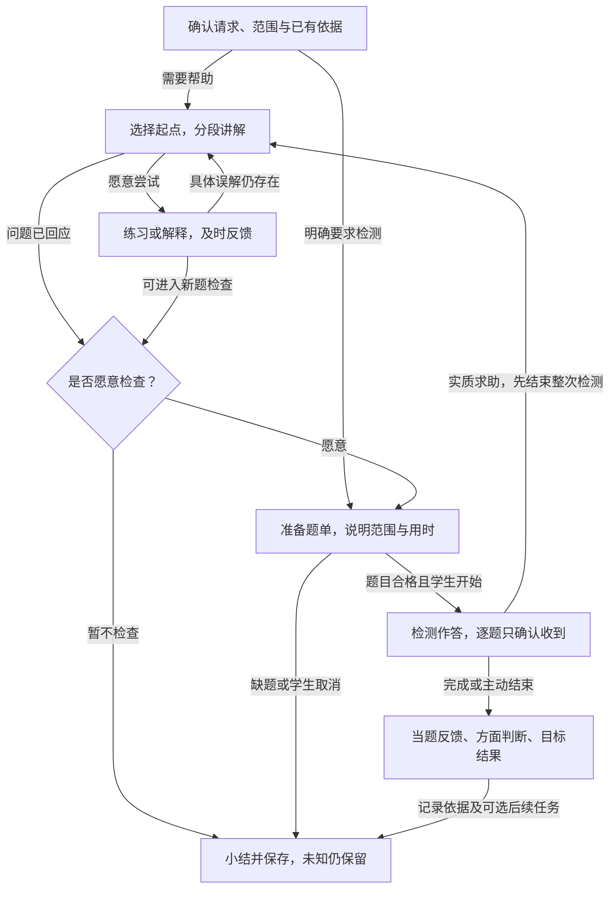

# M1 内容与模型规格及示例

> **版本**：v0.8 
> **文档性质**：M1产品规格的内容与模型专题；包含规定、设计草案和说明示例 
> **状态**：领域与教材对象关系、语义表达及交接规则已与当前原型对齐；四分之一标准保留，全册内容和真实模型质量未验收 
> **上游依据与基线**：[M1 PRD v0.9](../PRD.md)、本轮已确认领域与教材原型；既有四分之一样例及来源见§2、§4 
> **维护责任**：Codex 整理与自检；实际内容核对由管理员完成；重要范围及评价条件仍需讨论 
> **评审记录**：本轮用户认可交互方向并授权同步；作者核对对象关系与操作。既有M1-DEC-004仍有效，有限真实提取试验另见验证报告 
> **写作规范**：[设计文档规范 v1.1](../../../top/DeerMind_Design_Document_Standard_v1.1.md) 
> **更新日期**：2026-11-06 
> **修订说明**：v0.7 → v0.8：同步Domain六类对象、图文语义归属、重新解析、模板与实例入库及章节采用，保留四分之一教学评价标准。本批依据与检查见决定登记第14节 

---

本文与PRD、交互规格和原型共同定义M1产品，把教材导入、建模、教学与评价展开为实际内容和可核对结果。交互表达会检验这些内容能否查看和维护，具体例子也会暴露业务缺口；修改按[M1工作包](../README.md#2-六个产品设计工作包)返回相应文档，不单向等待PRD结束。文件路径保留以保持引用稳定，标题明确其包含详细规格的责任。

**内容的效力。** 来自已确认决定的规定按原决定生效，例如§4.10的M1-DEC-004；本轮领域与教材规则见M1-DEC-007至009；未获确认的后续细则仍是待审设计草案。题面、教学话术、字段示例和走查结果是说明材料，不因此成为已入库内容或真实证据。理论依据和试用标准不混同；效力以各节具体标注和决定记录为准，不因文件名称带Reference就将规定视为可选，也不将整份草稿视为已批准。

本轮沿用旧书页与开发参考，不继续手写扩大模型包，不要求管理员在系统开发前手工建完整册。先用代表内容说明正确产物，工程实现真实工具后，再在产品内逐章完成整册建模。

## 1. 准备对象与可用条件

教材导入形成语义内容，领域管理形成可复用模型，章节关联说明课程采用什么。三者分开保存，不能把上传、解析、入库和课程可用合成一个“完成”状态。

| 产物 | 内容与责任 | 后续用途 |
| --- | --- | --- |
| 原件与出处 | 原书页、文件顺序、印刷页码、必要区域及跨页关系；不改写原件 | 核对与追溯，不能单靠截图代替结构化语义 |
| 解析候选 | 按章节组织KC、TaskInstance和SolutionInstance候选；公式、图表在所属元素内部 | 核对、重新解析及选择提交；此时尚未写入领域 |
| 领域定义与实例 | Domain内的KC、TaskTemplate、SolutionTemplate、TaskInstance及SolutionInstance | 多本教材复用；供后续教学选法、题目准备与评价引用 |
| 章节关联 | 本章采用的TaskTemplate及其直接SolutionTemplate；KC计算汇总 | 确定课程任务与方法范围，不代表学生掌握 |
| 后续课程准备 | Task Claim、目标标准、教学定义、核对题库及应用关系 | 支撑学生选用、教学和评价，仍是D02后续及D03工作 |

Domain可以先为空，通过手动维护和教材内容逐步完善。教材也可以完全复用已有模型；两种情况采用同一套关系。教材不是Domain的副本，课程不复制整个领域；个人Evidence和Belief不在导入过程中生成。

## 2. 本轮采用哪些已有材料

| 输入 | 当前用途 | 不作为何种证明 |
| --- | --- | --- |
| [出版社来源核验 v1](../../../../src/mvp_foundation/materials/bnu-math-6a-source-verification.json) | 电子教材身份、来源及已核查的原页线索 | 版权页和2026年实体用书版次尚未最终核准 |
| [全册准备清单 v2](../../../../src/mvp_foundation/materials/bnu-math-6a-whole-book-plan.json) | 13个目录项及附页的覆盖检查；包括9个单元、2项综合实践、数学好玩和总复习 | 其中候选模板及检查例不是已完成模型，不等于全册原页已经核对 |
| [教材整理的旧流程与截图](../../archive/2026-11-02-before-m1-prd/phase-4-product-and-domain-foundation/MVP_Product_and_Interaction_Design.md#31-flow-006从教材扫描件到学生可选用的内容) | 批量导入、原页对照、图表及跨页整理的操作参考 | 识别进度和结果为mock，不证明真实OCR、后台任务或整册可用 |
| [比例增加参考包 v1](../../../../src/mvp_foundation/m1/increase-reference/package.json)及[案例](../../../../src/mvp_foundation/m1/increase-reference/cases.json) | 已有对象、关系和正反例，用于检查课程、方法与评价是否接得起来 | 状态为作者参考、未启用；不是正式达标政策、独立评测或完整章节 |
| [有限内容提取试验](../validation/Content_Representation_Trial.md) | 四例暴露的跨页双解、原题错误式、统计图及几何表达问题；保存实际输入输出和修正依据 | 不证明任意LLM可靠提取，也不证明无人核对整册导入 |
| [当前原型与截图](Interaction_Design.md#1-管理员准备教材与课程) | 核对本轮操作、对象和状态；截图清单带来源与哈希 | mock没有真实识别、自动归类或正式学习评价效力 |
| [旧分数应用内容包](../../../../src/mvp_foundation/content/fractions-application/) | 书页引用、数值参考、问题类型线索 | 旧模型类型与关系须按现行合同重新核对，不能整体导入当作当前模型 |

这里按材料版本引用，没有改动原始资产。需要修正时应修改其权威来源并记录影响，不能在本文另维护一份不同的答案或目录。

## 3. 从一批扫描页到可用课程

本节是M1的业务对象与内容合同，不是数据库或API Schema。模板字段的语义、具体内容的归属及状态必须先一致；服务接口、模型供应商、存储和版本事务由工程展开。

图中实线表示保存的引用；知识汇总框表示计算结果。解法实例同时连题目和方法模板；章节只直接连任务模板及所选方法。图没有新增章节到KC或Task到KC的关系。

### 3.1 提取什么以及怎样保存图表和来源

先提取教材具体内容，再处理它归入哪个领域对象。例题先得到一道题和一条或多条教材解法，不直接把具体数字、人物和步骤变成通用模板。知识性陈述可以形成KC候选；教材讲法、授课顺序、教学策略不自动抽成SolutionTemplate，学生教学继续由Interaction的教学模型组织。

每个候选保留：类型、标题、所属章节、内容、来源位置、待核对问题；解法另有对应题目引用。来源信息是核对依据，不是新的能力对象。编号及关系由程序分配并维护，模型只输出内容与局部关系候选。

| 表达 | 需要保留的结构 | 渲染与核对规则 |
| --- | --- | --- |
| 文字／要求 | 原有含义、已知条件、要求、分问及单位；区分题目、解法和知识用途 | 不把答案、提示或求解步骤混入题干；摘要不能删去必要条件 |
| 公式 | 数学表达、所在语境、符号及单位；分式与运算顺序可还原 | 辨错题中的错误公式按原样表达。格式标准化不等于订正数学内容 |
| 表格 | 行列标题、单位、单元格值、合并关系及空白用途 | 待填单元格不能变成给定数据；表格与引用它的图保持关系 |
| 统计图 | 类型、轴、刻度、系列、图例、数据及单位；数据已知／未读清状态 | 根据结构重绘，核对对应表格；看不清的值不能按趋势猜填 |
| 几何／关系图 | 对象、标签、连接、长度／角度等标记、明确几何关系及必要布局信息 | 图看起来垂直或等长不等于题设给定；形状与标记都需核对，缺关系不得生成确定结论 |
| 跨页内容 | 同一题的共同条件、续问、对应解法，各部分出处 | 可以多页组成一个实例，但不能把邻近不同题合成一题 |

所有图表归属KC、TaskInstance或SolutionInstance，随主人一起预览、提交和保存，不建立独立的“图表入库”队列。用于解释的辅助展示与原题材料分开；学生题面只取原题条件，参考解法及其辅助图另取。日后改变呈现形式时，仍要保留这些语义边界。

M1不承诺一种有限结构覆盖任意视觉材料。现有表示按已测的公式、表、统计图和几何样例使用；表达不了或读不清时，保留原件及缺口，重新解析和核对，不能用“无损”标签掩盖信息丢失。实际完整性仍需真实服务验证。

**重新解析。** 管理员输入纠正说明，系统给出新候选，采用后替换该项／该章的解析结果，取消则保留原值。若拆出两条解法，两条仍指向同一道题。模板、领域实例及已建立的章节关系不会随一次重新解析被静默覆盖；尚未完成的旧提交要按新内容重新确认。

### 3.2 领域对象与字段

| 对象 | 必要字段及其含义 | 引用与检查 |
| --- | --- | --- |
| Domain | 名称、覆盖范围、说明、身份及版本 | 模型对象有领域归属；新领域为空，不自动复制其他学科 |
| TaskTemplate | 名称／说明；目标与学习者责任；交付内容及各自完成条件；对象与变量；条件关系；允许变化；适用边界 | 直接方法是SolutionTemplate引用；参数实例化不改变任务责任 |
| SolutionTemplate | 名称／思路；适用条件；输入与输出；步骤及控制关系；直接KC；成功结束及停止条件 | 每个递归子任务明确采用哪个子方法；不把其他备选方法的KC算入当前路径 |
| KnowledgeComponent | 名称、定义与含义、适用条件、示例／边界、必要图表及先修知识 | 先修为同领域KC多选引用；可反查使用它的方法和任务；不存个人掌握程度 |
| TaskInstance | 题干、已给值、待求内容、必要图表、TaskTemplate、来源、版本、参考及可用检查结果 | 一个题可无教材解法；题目与学生某次作答分开。原型当前模板引用不能冒充生产级不可变版本存储 |
| SolutionInstance | 对应题目、采用的方法模板、具体求解过程、参考结果、必要图表与来源性质 | 同时连TaskInstance和SolutionTemplate；教材原有／系统生成不能混称 |

**任务模板为何需要这些字段。** 完成要求说明要交出什么；对象与变量说明有哪些量、图形、函数或资源，其中哪些已给、哪些待求、哪些需要调查。条件与关系约束合法问题；允许变化限定同类实例可怎样变化；适用边界说明何时不能继续归到本模板。它们既服务正向生成，也服务反向归类，不能只凭题干相似。

一个变量包含标识、名称、类型、用途和约束。类型可以是数值、点／图形、函数／表达式、区间／集合、配置／资源、状态／观测或文本；用途区分“题目已给定”“需要研究或求解”“需要通过调查获取”。例如分类讨论的参数不一定在题面绑定为某个值，K8s待调查的故障原因也不能当成给定事实。当前类型是M1表达样例，不声称完备的通用领域语言。

**方法模板怎样描述过程。** 步骤具有标识、动作、所需输入、产出与后续位置；顺序步骤、条件选择、分类讨论和检查复查分别表达。分支写清条件、动作或结论及去向，分类讨论说明覆盖范围。复查明确通过后去哪里、未通过时回到哪里、何时停止；不使用“反复尝试直到成功”作为无限循环。

递归分解引用子TaskTemplate和选定的子SolutionTemplate，说明传入什么、取得什么；外层方法继续组合子结果。控制流程内允许有界复查，但方法之间循环引用不是合法递归终点。草稿可不完整并显示缺口，不以字段保存成功表示方法已可执行。

**知识汇总。** 方法的知识等于直接KC与所选子方法知识的并集；Task的知识再汇总其直接方法。按KC身份去重，保留贡献路径；先修知识关系不自动当成另一条直接依赖。题目成功不能推断所有备选方法的KC都被掌握。知识要直接检验时，通过针对其理解的小任务和方法表达，不新增KC Claim。

当前初中、高中和K8s示例用于检验上述字段是否能表达递归、分类、调查和复查，见[交互§1.3](Interaction_Design.md#13-手动维护领域模型)。它们不扩大M1正式课程范围，也不证明模板足以覆盖任意未来领域。

### 3.3 从解析候选入库到章节采用

| 环节 | 输入及操作 | 输出与不能混淆的状态 |
| --- | --- | --- |
| 提交领域 | 教材中分别选择KC、题目、解法；解法有父题 | 当前Domain的待办；尚未写模型，也未关联章节 |
| 添加KC | 核对定义，新建或复用已有KC | 保存的KC及来源对应；不自动生成任务或方法 |
| 提取模板 | 从具体题／解法提出通用模板，核对后保存 | TaskTemplate或SolutionTemplate；原实例仍待关联，不能自动捏造依赖 |
| 关联题目 | 选定符合责任与条件的TaskTemplate | TaskInstance→TaskTemplate；无解法的练习题也可先入库 |
| 关联解法 | 先有对应TaskInstance，再选SolutionTemplate | SolutionInstance→TaskInstance及SolutionTemplate；必要时明确补上Task→Solution引用 |
| 关联章节 | 回教材选TaskTemplate及本章采用的方法 | 章节→TaskTemplate／所选SolutionTemplate；KC计算得出，元素来源仅作依据 |

重复选择已有定义意味着复用，不覆盖它。提取模板和关联实例是两次不同结果；关联检查应核对题目完成责任、条件及方法适用性，真实语义判断留工程实现，当前mock匹配不具有该保证。关联成功也不自动通过题库质量检查。

待办按元素逐行展示，内部按题目及其解法保留来源组：部分完成时显示已添加／已关联；整组完成后离开待办。删除未处理项只取消本次提交；删除父题时一并说明待处理解法受影响。已保存模型和原始教材不因此删除。来源与结果仍可追溯，无需另设已入库列表或审核中心。

**章节只维护实际采用。** 新增关联时从当前领域选任务及方法，保存立即生效于教材草稿。编辑只改变本章方法选择；取消关联只删除引用。主表没有可直接改动的勾选框、任务下拉框或总保存操作。至少一种有效方法才形成该条章节关联；无方法的任务可以先作为领域草稿存在。章节保存不等于应用给学生。

### 3.4 哪些条件满足后可以做什么

| 行为 | 必要准备 | 缺少条件时 |
| --- | --- | --- |
| 核对与重新解析 | 原件、章节和已有候选；指出需要纠正的内容 | 原件保留；无法确定则显示缺口，不自动补成已知事实 |
| 保存领域草稿 | 对象身份及最小定义，引用可检查 | 允许补建，显示未完整；不宣布语义质量合格 |
| 保存章节关联 | 已存在的任务及至少一种适用直接方法 | 不能把建议冒充已关联；缺方法先回领域补齐 |
| 学生阅读／讲解 | 已应用的内容与范围、必要图表、可靠方法知识和教学定义 | 有依据的局部帮助可用；不能承诺未准备的完整章节 |
| 练习与反馈 | 题面、核对参考、适用方法、实际展示和帮助记录 | 无可靠参考不确定判分；已入库不等于合格检测题 |
| 按目标检测／评价 | 合格题、Task Claim及目标标准，适用的接触与帮助条件 | 不启动无法满足承诺的检测；内容缺口不算学生不会 |
| 后续主动任务 | 有效个人依据、目标、时间条件及可执行内容 | 无依据不生成；安排任务不等于已执行或达标 |

后四行属于后续D02–D06的完整产品责任，当前M1原型尚未迁入相应页面。保存与应用分开，历史活动保留原采用依据；已确认错误的内容不继续使用。目标未准备与学生证据不足是两种状态，不能都显示“待确认”。

### 3.5 本轮样例与真实验证边界

真实五页样例包含第49—50页的连续比例例题与两种解法、第50页练习及辨错、第91—93页的数据表和统计图。四例核对样例沿用C02跨页双解、C03错误原式、C05统计图、C06几何内容，用于重现[有限试验](../validation/Content_Representation_Trial.md)暴露的问题。

例题的题目独立保存，两种解法分别形成SolutionInstance；统计题的图表属于题面；原题让学生判断的错误算式保留错误；几何关系以明确标记为依据。这四类反例约束重新解析和后续渲染，不要求管理员操作底层块结构。

原书49—50页对应电子页序52—53，91—93页对应94—96；单张图片自身的文件页位置又是另一种定位。当前原型提供已知样例原页查看，真实PDF分页、漏页补入、目录覆盖及批处理恢复尚需工程和整册工作核验。此前复杂手动块编辑方案不再作为当前交互要求；完整性责任并未取消。

真实试验原始结果和人工处理保留在原报告，本轮没有改写为自动通过。当前重新解析、提取模板与匹配都是固定mock；实际不同模型的提取能力、纠正成功率、任意图形表达及全册人工负担尚待工程验证。

### 3.6 准备结果怎样交给下一步

下一步使用已经保存的章节任务／方法关系，准备对应Task Claim及LearningTarget，再准备教学定义与题库。Claim定义评价方面及证据含义；目标规定本课程哪些要求必须满足；Belief由真实学习表现产生。具体例子继续使用§4的“增加四分之一”，不把第49—50页连续比例例题换名当成同一个任务。

交接时至少提供：章节和来源、采用的任务／方法及版本线索、知识汇总路径、可用题目与解法、仍缺定义或检查的部分。原型的本地对象编号和版本提示只是操作表达；真实不可变版本、事务和一致性由工程定义，不能宣称已经具备生产能力。

## 4. 一个已有案例怎样贯穿模型

### 4.1 先区分两个不同用途的书页样例

此前第49—50页主要检验跨页整理，旧映射样例是“连续求一个量的几分之几”。“已知原量与增加分率求新量”的代表模型则采用第53—54页。它们同属分数应用，但不是同一个任务，不能为了主流程演示把两个来源合并。

比例增加参考包中的两张原页已按其记录哈希核对：

| 原页 | 本地原件 | 本轮核查 |
| --- | --- | --- |
| 印刷53页／阅读器56页 | [PAGE-53](../../../../src/mvp_foundation/m1/increase-reference/source/page-056.png) | 文件存在且哈希与包内来源记录一致；不是重新执行OCR |
| 印刷54页／阅读器57页 | [PAGE-54](../../../../src/mvp_foundation/m1/increase-reference/source/page-057.png) | 文件存在且哈希与包内来源记录一致；不是正式内容质量验收 |

### 4.2 复用哪些对象，核对什么

下列标识来自 `M1-INCREASE-REFERENCE@1`，仅用于定位作者参考，不作为工程数据库主键设计。

| 角色 | 已有对象 | 核对其产品含义 |
| --- | --- | --- |
| 领域 | `DOM-M1-MATH@1` | 归属于数学；本包只覆盖一个局部，不等于整个数学领域 |
| 主任务 | `TT-M1-INCREASE@1` | 原量与增加分率已知，确定增加以原量为基准，求最终量；不含反求原量或连续多次变化 |
| 两种直接方法 | `ST-M1-PARTS@1`、`ST-M1-FACTOR@1` | 先求增加量再相加，或先求增加后倍数；选法受题目与课程条件约束 |
| 递归子任务与方法 | `TT-M1-SCALE@1`、`ST-M1-MULTIPLY@1` | 需要求指定倍数时，能够沿选定子方法继续查到知识依据 |
| 知识 | 包内5项KC | 分率参照量、指定倍数、增量与总量、分配律、运算；KC由实际选定方法汇总，不手填Task的知识清单 |
| 评价定义 | `CL-M1-INCREASE@1` | 绑定主任务，在内部区分四方面；没有学生个人状态 |
| 章节采用 | `U04`的局部映射 | 指向53—54页、主任务、两种允许方法及相应Claim；不表示U04整章完成 |
| 学习目标 | `LT-M1-INCREASE@1` | 当前样例为任选一种方法；独立、解释、迁移、保持的要求分开，不要求每题全测 |
| 题目 | 包内6个来源／教学／检测参考 | 具体题面、来源与用途分别核对，不能仅凭名称认定它足以测迁移或保持 |

该包明确 `ready_for_formal_assessment=false`：缺少正式证据聚合与达标校准，因此可以用来说明如何连接对象，不能直接让系统据此给孩子宣布掌握。本文§4.6–4.10补充的是其中“四分之一”子范围的产品样例及已确认试用标准，不改写原包的范围、版本或启用状态。

### 4.3 教学和评价怎么使用这些准备结果

下面使用参考包已有的书本数量例子，避免另造一套题号。PRD中的40米例子是同类任务的说明，不代表这名学生已经做过本表中的全部题目。以下假设内容、标准已经经管理员核对并应用；当前参考包本身尚未满足这个前提。

| 环节 | 输入与处理 | 产物及其使用边界 |
| --- | --- | --- |
| 管理员准备 | 在U04采用主任务和两种方法；配置`CL-M1-INCREASE`及目标，明确当前允许任选一种方法 | 保存定义和参考，再检查、应用；没有产生学生Belief |
| 学生选用 | 选教材及目标创建Learning Space，提出学习本章增加关系 | 课程引用和本次活动范围；不复制一份独立领域模型，不预写掌握程度 |
| 开始讲解 | Interaction依据请求和已有有效表现选择策略；从Domain取适用方法，用`Q-M1-TEACH`解释80本增加1/4得到100本 | 实际展示的例题、图示、提示和解释进入活动记录；仅生成但未展示的内容不算帮助 |
| 获得表现 | 学生解释“1/4指原来的80本”，或在提示后算出100本；Reasoning按规则理解输入 | Observation描述表现及帮助背景；不能直接宣布独立掌握 |
| 准备检测 | 根据目标和未解决的问题选`Q-M1-CHECK`等合适题目，核对该学生未见解法及本次条件，再说明范围和预计负担 | 得到有明确测量目的的有限题单；学生确认才开始；选题结果不写进Belief |
| 记录作答 | 学生对60本增加1/5写出`60×1/5=12，60+12=72`并说明基准；若期间求助则按PRD结束本次独立检测 | Event保留题面版本、作答与实际帮助；提交确认不提前泄露余题的答案或方法 |
| 反馈与评价 | 结束后按参考给当题反馈；Evaluation按Claim、条件和有效历史解释Evidence，更新相关Belief方面，再比较目标 | 这次结果正确是确定的算术事实；它能支持什么范围、是否足以达标仍受标准约束。不能由一题推导四方面全通过 |
| 下一步 | Interaction读取合法评价与目标，选择补讲、以后检测或本次结束；管理员可查同一次活动的记录 | 任务或建议带依据。未实际发生的延迟检查不形成保持证据；同一表现不因重试处理变成多份独立证据 |

这是一条产品逻辑走查，不是运行日志。Event记录事实、Reasoning理解输入、Evaluation维护个人判断、Interaction选择和执行教学行为；课程提供范围与目标，Domain提供领域定义。教学蓝图怎样执行、调用分几次和如何储存由工程设计落实。

### 4.4 题库与本次题单如何分工

**入库先检查题目本身，选题再检查学生及用途。** 题库不按学生复制。一次使用引用题目版本，另记这次活动、要求、实际呈现、提示、作答和接触背景。题目内容被修正时保留旧版本及旧使用事实。

| 已有候选 | 能提供什么 | 本次使用前还要检查什么 |
| --- | --- | --- |
| `Q-M1-TEACH`：80本增加1/4，100本 | 讲解数量关系、示范两种方法 | 展示解法后不能立即拿同题证明新的独立表现 |
| `Q-M1-CHECK`：60本增加1/5，72本 | 同一范围的新计算和解释表现 | 若此前已展示本题答案则更换；只换数字不自动证明迁移 |
| `Q-M1-SOURCE-54`：看图求树木数量，60棵 | 图文理解与对应求解 | 参考包明确图区域尚未提取；必须先形成完整、核对过的题面，不能拿一句“依据关系图”代替图 |
| `Q-M1-TRANSFER`：表格中的40米增加1/4，50米 | 文字转表格的迁移候选 | 比较实际学过的表征与当前变化；若此前已讲过同一40米关系或该表格，要记录，不把题名当作陌生性证明 |
| `Q-M1-DELAY`：72本增加1/6，84本 | 延迟后再次检查同类表现的候选 | 实际间隔和期间练习／帮助符合相应标准；当天出这道题不是延迟检测 |

按次选题依次回答：要检验哪些目标要求、需要哪类表现、现有题目能覆盖哪些要求、对该学生是否适用、预计负担是否合适。一道题可以同时取得计算和解释表现；四个方面不等于必须出四道题，也不能由一道算对的题填满四个方面。

允许方法的交集来自任务方法、章节采用和目标条件。例如课程允许两法、目标任选其一，使用分步法成功不证明另一法也会；目标若要求分别说明两法，题单必须取得相应表现，不能只修改结果标签。没有合格题目时说明该项暂不能检测并由管理员补齐，不让运行模型临时放宽标准。

M1先复用核对题库。AI辅助管理员备题与教学时自动出题是两条不同路径；后者尚未作为M1必做能力。以后启用时仍执行检查通过、保存、使用的顺序，不因省略逐题人工审核而省略检查。

### 4.5 用反例检查评价不会越界

| 观察到的表现 | 可以支持的结论 | 必须保留的限制 |
| --- | --- | --- |
| 没给当题提示，答案和参照量解释正确 | 在所测条件下的独立与解释表现 | 是否充分达标要看标准；迁移、保持未因此得到证明 |
| 只给出正确答案72，没有过程或解释 | 本题答案正确 | 不能补写“理解了为什么”；解释方面仍缺依据 |
| 给出`60×1/5=12`的提示后完成72 | 在所记帮助下完成后续计算 | 不当作完整独立求解；实际帮助不能被漏记 |
| 基准和列式正确但算错 | 可保留已表现出的正确理解，并指出计算问题 | 不把部分支持升级为任务整体达标；可用KC解释错误，不更新KCBelief |
| 换成另一组数字后算对 | 同模板另一实例的表现 | 不自动视为表征迁移或泛化 |
| 隔一段时间再次完成 | 在实际间隔和帮助背景下的表现 | 未满足目标规定的延迟条件时，不宣布持久掌握 |

本表固定的是解释边界。它没有擅自规定“两题就达标”或“七天即持久”。逐章证据标准仍列为M1-OPEN-03，由内容准备给出可核对的标准与正反例，验证工作检查其实际判断质量；不是把产品含义留给实现者临时猜测。

### 4.6 本次到底教什么、评什么

**情境。** 学生选用分数应用章节，问：“一个量增加四分之一后是多少？我不明白怎么想。”本次处理原量已知、增加量以原量为基准、只有一次增加的任务。

为避免把简单例子的成功扩大成本章掌握，本次范围明确如下：

| 项目 | 本次约定 |
| --- | --- |
| 数量范围 | 样例使用能被4整除的正整数原量；书本数量或长度等同单位数量。非整除、分数原量、反求原量和连续变化不在本次检测中 |
| 任务责任 | 认出原量；理解增加部分为原量的1/4；求增加后的总量；能够说明所用关系 |
| 允许方法 | A：先算增加量`a÷4`或`a×1/4`，再加`a`。B：直接算`a×5/4`或`a×(1+1/4)`；任选一种，不强迫每题两法 |
| 参考关系 | `新增量=a/4`；`总量=a+a/4=5a/4`。对于本次正原量，总量大于原量且小于其两倍 |
| 显示给学生的要求 | 自己求出增加后的数量；说清四分之一指谁、为什么要加回原量；读懂表格给出的同一关系；间隔后再检查能否完成 |
| 明确不作的断言 | 不从本次结果推出所有分率、所有题型、两种方法或整章均已掌握，也不把一次延迟成功称为永不遗忘 |

**对象采用。** 继续使用`TT-M1-INCREASE@1`、两种方法及`CL-M1-INCREASE@1`，不为1/4再建一个Task或Claim。本文的“四分之一学习目标草案”选择该Claim的子范围`r=1/4`并规定要求；它不是旧`LT-M1-INCREASE@1`的静默改版，尚无正式目标对象。Evidence保留实际参数、表征、帮助和方法，Belief的方面判断说明已支持与未覆盖的范围；判断本目标时使用对应范围的有效依据，不能只读一个“该Claim已通过”的总标记。

**方法的依据与适用限度。** 本例选择“必要讲解—学生尝试—解释理由—根据表现调整”的方法。例题与练习结合、图文结合、解释性提问及间隔学习，分别受到[IES学习组织实践指南](https://ies.ed.gov/ncee/wwc/PracticeGuide/1)支持；说明分数运算为什么成立，而不只传授步骤，符合[IES分数教学实践指南](https://ies.ed.gov/ncee/wwc/PracticeGuide/15)的建议。具体三条教学路径是据此作出的产品设计，不是指南规定的唯一流程。

这些研究不提供本任务“做对两题即达标”或“七天证明持久”的阈值。§4.10的题量和时间是为M1提出、已由M1-DEC-004确认的有限试用标准，仍须实测并可修订；不冒充理论定律或经验证的能力测量模型。

### 4.7 三种起点怎样讲、怎样切换和结束

**正常起点不先强制考试。** 有明确求助且材料足够时，先回应。已有可靠记录帮助选择起点；没有记录时不把学生归为“基础差”，也不编造先前错误。学生想先试做，可以直接进入相应练习或检测准备。

本例用已存在的`Q-M1-TEACH`：原有80本书，新添的是原来的1/4，现在有多少本？下面是一段可接受的教学内容参考，不要求LLM逐字照读：

> 这里的四分之一，是把原来的80本分成四等份，取其中一份，所以新添了20本。原来的80本还在，现在一共是80＋20＝100本。

可用的教学示意是“原量四份＋新增一份”：原量`[20][20][20][20]`，新增`[20]`。单位一份是20本；`1`代表原来80本这一整份，并非1本。采用直接倍数法时，说明`1+1/4=5/4`表示合起来是原量的几倍。线段、份数和文字要表达同一关系，不以装饰图代替解释。

| 起点和实际输入 | 教学动作与学生机会 | 下一步的条件 |
| --- | --- | --- |
| 概念尚未建立：问“1/4是几本，为什么还加80？” | 分段解释四等份及新增量，再问“20本是新增的，还是现在全部？”；可用文字或等份示意，回答后及时反馈 | 能区分新增与总量，尝试24本增加1/4；若仍不懂一份，转入必要基础回补 |
| 能算但解释有误：写`80×5/4=100`，说“1代表1本” | 先确认其用语含义；若确是概念错误，解释这里的1代表原量一整份。可比较80本与160本增加同一比例时，新增量为何分别为20、40 | 能结合自己的式子说清参照量后，用新题检查；只复述刚显示的话可支持当下理解，但不直接完成解释要求 |
| 已有可靠求解和解释表现：只问“能不能直接乘5/4？” | 简短说明两种方法等价，沿学生选用的方法继续；不重复一整段基础课程 | 问题得到回应即可结束，或经学生选择进入练习／检测。遇到具体误解才返回相应解释 |

基础回补只处理本问题所需的一步，例如“24平均分4份，每份多少”。回补后能继续则返回原任务；同一个障碍仍未解决时，说明卡在哪里，提供更小一步的帮助或结束选择，不反复重播同一段话，也不自动展开整套低年级课程。回补的回答和所给帮助照实记录，不自动生成新的KC或子任务Belief。

**练习与正式检查分开。** 教学中的24本例子得到30本，允许提示和即时反馈；它用于指导下一步，不作为下文无当题帮助题数的充数项。学生只说“懂了”时，系统可以邀请尝试；拒绝检查就收束为“已讲解，尚未检查”，不偷偷标记达标。

**图 M1-Q01：本例教学与检测的可选路径。** 矩形为活动阶段，菱形为学生选择；箭头表示推进条件。图以材料与定义可用为前提，教学规则缺失、服务失败及中断见PRD§3.6、§6。

学生在任何阶段都能停止；未提交输入保留，未做题不判错。图中循环依赖新表现或学生选择，不是允许程序自动循环讲解直到学生“通过”。图的渲染结果见[阅读图](assets/quarter-design-v0.1/M1-Q01.png)，这不是页面截图。

### 4.8 本例具体准备哪些题

第一轮教学与检测用小型核对题库，不依赖实时生成。以下题面是管理员需要准备的实际内容示例，除复用项外均为作者新编；文档编号用于评审，不表示已入库或已通过管理员核对。题面与参考答案分别保存，出题不向学生发送参考答案。

| 编号与用途 | 给学生的完整输入 | 教师／评价参考及用途限制 |
| --- | --- | --- |
| `Q-M1-TEACH`，已有教学例 | 原有80本书，新添的书是原来的1/4，现在有多少本？请说明 | 100本；增加量20本，基准80本。讲解时可展示过程，不算新的独立检测 |
| `QTR-P1`，受助练习 | 原有24本书，新添的是原来的1/4，现在有多少本？ | 30本；可以提示或追问。帮助记录保留，不混入无帮助题数 |
| `QTR-C1`，文字检测 | 图书角原有120本书，又增加了原来数量的1/4。现在共有多少本？请写出答案，并说明四分之一指哪个数量、为什么这样算 | 150本；原量120，增加30，总量150。分步或倍数法均可；不要求固定措辞或两法都写 |
| `Q-M1-TRANSFER`，已有表格候选 | 请根据下表求延长后的路线长度，并说明分率相对哪个量、你怎样得到新长度。表格见下 | 50米；基准40米，增加10米。只有表格使用条件成立时才提供文字转表格的迁移依据 |
| `QTR-D1`，延迟复测 | 原有72本书，又添了原来数量的1/4，现在有多少本？请说明依据 | 90本；新增18本。与旧包`Q-M1-DELAY`的1/6、84本不同，不替换旧题；时间没到时本题也只是一道普通题 |
| `QTR-R1`，备用新题 | 水箱原有48升水，又加入原有水量的1/4。现在共有多少升水？请说明 | 60升；新增12升。用于同范围再检查或替换暴露答案的题，不能仅凭换情境就宣布迁移 |

表格检测的题面数据（属于题目条件，不能隐藏）：

| 项目 | 数据 |
| --- | --- |
| 原路线长度 | 40米 |
| 延长部分占原路线的比例 | 1/4 |

**一次检测怎样组题。** 对刚完成文字／等份讲解、尚未练过这种表格且没有旧有效检测记录的样例学生，可提出“文字题＋表格题”两题，预计约5–8分钟，实际时长仍需工程试用验证。学生开始前看到本次覆盖、题量和结束后统一反馈的安排。两题分别取得解题与解释表现，表格题额外检查这一种表征变化，不为四方面各出一套试卷。

这不是全书统一题量。已有适用表现可以复用，只测缺口；表格先前已讲过、题目已见答案、图表内容缺失或当前目标不同，都要换题或明确本次不覆盖相应要求。可以先做文字检查，但不能把备用文字题填进“表格迁移已测”。题量、预计负担和覆盖在开始前固定，不因学生做错就在同一次检测中无限追加题目。

同一对话保留教学内容不妨碍提出新题，但如果本次实际查阅了相关解法、得到提示或帮助来源不清，必须保留条件。没有点击求助不等于已证实无帮助；书页或历史再次打开、系统实际提示及学生说明的帮助应进入记录。M1不声称观测到设备外的全部行为，也不增加监考或锁屏。

### 4.9 判据：具体看什么表现

每次表现先分别判断数量关系、求解结果、解释与帮助条件，不先给一个总分。关系正确但计算失误、算对但理由错误、只有答案而没有解释，必须能得到不同反馈。理解原意的语义判断依赖规则＋LLM，计算、引用和提交条件由程序核对；不能靠命中“原量”等关键词判解释通过。

| Claim方面与本例要求 | 可接受表现 | 明确不足 | 只能保持未确认的情形 |
| --- | --- | --- | --- |
| 独立完成：自行求总量 | 在已记录条件下，没有当题或等同解法提示；自己建立`a+a/4`或`5a/4`关系，结果和单位正确；方法任选其一 | 把增加量当总量、给原量直接加1/4，或不能完成所要求计算；反证只限实际表现 | 只有模糊答案、帮助情况未知、题目无效或仅抄写已给答案；当题帮助后成功另记受助表现 |
| 理解与解释：说清参照量与总量 | 用文字、式中标注或图说明1/4对应原量的一份，原量仍在，所以要把新增与原量合起来；用倍数法时解释1是原量整体 | 明确把1说成1本、分率基准改成新总量、把20本新增量说成80本题的总量 | 没被要求解释、只给答案、输入难以理解；不能把不善长篇表达当概念错误 |
| 迁移：从已学文字／等份例读到表格 | 在此前接触条件可说明时，从表中找对原量与增加分率，独立建立关系并说明两行数据如何使用 | 看清表格数据却把增加部分当总量，或明确误解表中比例指向；应与读表／数学原因区分 | 未给表格、表格识别错误、这类表格刚示范过、既往接触未知；仅换数字或名词不能充当此项 |
| 延迟保持：间隔后仍能完成本范围 | 在规定间隔后的新题中，再次得到无当题实质帮助的正确求解和解释；记录基准时点、实际间隔与期间练习 | 在条件有效且题意清楚时重新出现相关错误；保留当前正确部分，不把一次错说成全忘了 | 尚未到时点、没有基准表现、当题帮助后完成，或记录无法确定；不能从任务到期、已接受或同日正确推断保持 |

**判分实例。** 对`QTR-C1`：

- `120×1/4=30，120+30=150本；四分之一是120本的一份，原来的书还在。`——数量关系、结果和解释均有支持，再检查实际帮助与覆盖条件。
- `120×5/4=150本，这里的1是1本书。`——结果正确，解释存在明确矛盾；先核实用语，不能只看150就通过解释要求。
- `120÷4=30，所以现在有30本。`——增加量正确、总量错误；可具体补讲“新增”与“全部”，不用宣布所有知识不会。
- 如果只答`30本`而没有过程，只能确定答案不符；尚不能断定是混淆总量、计算出错还是漏写，需要在结束后结合说明澄清。
- `120+30=140本。`——如果过程含义明确，可保留数量关系支持，指出运算错误；本次完整求解尚未满足标准。
- 只答`150本`——当题答案正确。由于本题明确要求理由，说明理由部分尚未提供；这本身不是“不理解”的反证。可以在本次检测结束后再邀请说明，新增回答另留记录。

反馈在整次检测结束后提供；上述参考不是允许系统在第一题提交后提示参照量，从而影响下一题。若求助导致提前结束，只评价实际提交和实际条件，未做题仍是未检测。

### 4.10 试用达标标准、Belief更新与学生反馈

**本例初始试用标准已由用户确认（M1-DEC-004），可以据此开展工程设计及对应内容准备。** 正式题目、目标和模型仍需核对采用，旧参考包未因此自动启用；M1-OPEN-03中其他章节的准备责任仍保留。 表内门槛是有限样本下的产品取舍：用少量不同表现避免一题正确立即概括，同时控制30分钟总负担。它们不估计普遍可靠性，不替代工程中的语义质量校准，也不修改已有质量验收指标。

| 方面 | 本例已确认的试用门槛 | 学生能看到的结论边界 |
| --- | --- | --- |
| 独立完成 | 至少两个不同实例满足§4.9无当题实质帮助的完整求解条件；题目参数／条件确有变化，不能把重复提交或同题订正算第二个；有未解释的相关反证时不自动通过 | “在已检查的增加四分之一题目中，你能自己求出新数量。”说明范围与帮助条件，不说所有分数应用都掌握 |
| 理解与解释 | 上述表现中至少两次能结合各自具体数据说明参照量与总量关系；不强制长篇文字，也不要求会说第二种方法；机械复制刚显示的句子不足以单独满足 | “你能说明四分之一指原来的量，新增部分还要加回原量。”只答对但没说明时保留待确认 |
| 迁移 | 至少一次满足指定的“文字／等份→表格”条件，并能正确解释数据关系；只支持这条具体变化；若表格已经教过，则该题是练习，换未覆盖变化或保留待确认 | “这次换成表格，你也找对了数量关系。”不概括为任意陌生题都能迁移 |
| 延迟保持 | 以求解与解释两项达到本例标准时所用的最近一次合格表现为基准，至少7天后，在一道未展示解法的新题中再次完整求解和解释；到时重新判断必要性，学生接受才开始 | “距基准表现已过7天／实际若干天，这次仍能完成。”注明期间练习或其未知情况，不解释为7天没练也不会忘 |

这里的“7天”作为**本例首轮验证的最小间隔**，不是全局每周排课。首次可开始时间为基准时点后7×24小时；之后进入空间再检查，记录实际间隔，不补发错过日期的检测。期间正常学习无需暂停，已有练习照实保留；期间是否练过未知时，也不能描述为“未经复习的自然保持”。如果目标以后要测无强化保持，需要另有明确条件，不能沿用本标准偷换。迁移也按已记录及学生补充的接触背景解释；系统内没找到旧练习不等于校外从未练过，无法核实则保留这一限制，只描述本次表格表现，不宣称首次迁移。

**四方面可以共享一次表现，但不能重复计样本。** 文字题与表格题的两次作答可以同时支持独立与解释；表格题还可支持特定迁移。它们始终是两次作答，不因产生五条Evidence变成五个独立样本。延迟题可以更新当时的求解与解释判断，不能靠把日期字段改成七天制造第三次真实作答。

**从表现到判断的最小处理。**

1. Event保留题目版本、提交、实际帮助和时间；Reasoning理解所提交内容。题目或识别未决时先保留原始输入，不生成正反结论。
2. Evaluation按方面解释支持、反证或证据不足，Evidence引用同一原始作答与实际条件；没有个人KC状态。
3. Belief结合该空间已有有效依据，保留不同方面的范围和限制；不以正确率直接等同掌握率。目标按对应子范围和条件判断已达标、需加强或待确认。
4. 存在明确有效错误时，可对相应要求说明需加强；如果新旧证据冲突、原因未明，则待确认并说明冲突。旧错不是永久否决：补讲后，在新题解释与求解中针对原错误取得满足门槛的表现，可以更新当前认识，旧错误和帮助仍可追溯；不能只因“讲过了”就撤销反证。
5. Interaction据有效判断决定结束、补讲或安排后续任务；不用任务完成状态替代能力判断。评价失败保留合法当题反馈，不沿用失效判断制造进步。

以没有其他有效表现的样例学生为例：

| 实际走查情形 | 当题与Evidence | 个人判断、目标结果与后续 |
| --- | --- | --- |
| 听完80本例子，再按提示完成24本练习 | 受助成功，帮助明确 | 可以说明跟随解释完成；独立、迁移和保持不能据此达标，邀请新题检查 |
| 文字题150本正确且解释清楚；表格题写`40×1/4=10，所以新长10米` | 文字有支持；表格作答明确把增加量当总量 | 不宣布独立与解释稳定通过；表格要求有具体不足，先对照10米与50米补讲；保持仍未知 |
| 两题均在适用条件下正确并解释，且无相关冲突 | 两次求解与解释支持，表格提供指定迁移支持 | 按已确认试用标准，可判本例前三项达到相应要求；保持待确认。只安排有依据的延迟任务，不把整章标为掌握 |
| 两题只算对、理由都没提供 | 两个答案正确，解释不足 | 不编造思路或推断理解；需要取得过程／解释才能满足对应要求。可结束后邀请说明，不以沉默判错 |
| 至少7天后完成72本题，答案90本且说明清楚 | 在实际时间和练习背景下的新成功 | 按已确认标准更新延迟方面；如期间有练习或未知，反馈保留这些条件，不声称永久保持 |

示例反馈可写为：“这次两题，你都找对了原来的量，并算出了增加后的总量；表格里的关系也说明白了。这个范围的检查已达到本次标准。隔一段时间还能否完成，今天还不能判断。”这句话只适用于已采用本例标准且上述事实真实成立的情况；不是系统统一结束语。

### 4.11 工程接收时具体还缺什么

| 工作 | 现在已有的输入 | 开始相关实现／正式使用前还需什么 |
| --- | --- | --- |
| 教学执行与记录 | 三种起点、两种解法、分段与退出、实际帮助的责任 | 按PRD§3.6落实当前定义采用与合法转移；LLM的真实选择与输出在工程中测量 |
| 题目供给 | 完整题面、来源／作者标识、参考答案和用途；现有小题库路径 | 管理员核对后建立正式题目身份和版本；原题图区域未准备的候选继续不可用 |
| 评价与目标 | 四方面判据、反例、条件覆盖和已确认的本例试用门槛 | 内容采用前核对标准与正式目标版本；工程给出结构化输出、证据聚合与有限校准，不临时猜产品含义 |
| 后续任务 | 具体不足、未知、基准表现与时间条件；已确认暂缓／拒绝规则 | 记录目标与依据版本；满足时间不自动开测；仍按当前有效依据重新判断 |
| 质量验证 | 有支持、反证、未知、求助、重复及条件不满足的预期结果 | 从作者参考之外准备有限独立案例，固定分母与停止条件；本稿未执行模型评测 |

这些内容是D02、D04、D05共同设计的输入；须与PRD、实际原型和截图核对后，按已明确范围交接工程。必要技术可行性分析可提前开展；本例门槛已确认，正式内容采用与实现验证仍未完成，不把本文直接当作完整工程基线。整册其他章节复用这套“范围—方法—表现—标准—题目”写法，但不能复制两题／七天或套同一组语义判据。页面、旧JSON包及历史截图本轮保持不变。

## 5. 如何从代表样例扩展到整册

全册清单的B01–B06可作为共同核对框架，实际结果由管理员使用真实产品产生：

| 原清单项 | 需要逐章留下的结果 | 不能用什么代替 |
| --- | --- | --- |
| B01 来源与内容 | 原页、内容块、图表及跨页关系，缺口与修正记录 | 仅上传文件或仅保留OCR文字 |
| B02 任务／方法／知识 | 复用或新增定义、适用方法、递归路径及知识反查 | 每题复制一套模板，或把目录标题当成完整能力模型 |
| B03 Claim／目标 | 每项要求的方面、条件、方法与标准，以及正例／反例／不足例 | 四个方面的名字或未解释的掌握率 |
| B04 教学与题目 | 有来源的教学依据、可用题目和参考、用途与接触背景 | 只有正确答案，或只准备一道已展示解法的检测题 |
| B05 反馈和评价 | 对代表表现预期如何反馈、更新哪些方面、保留哪些未知 | 预写“已掌握”结果或把所有题数当成独立证据 |
| B06 应用与运行 | 真实工具应用、学生选用与核心学习、后续任务和追溯记录 | mock流程、作者静态文件或一章样例 |

内容覆盖清单须全量核对，语义质量运行采用预先确定的有限代表案例，不能为验收要求孩子做完整本书。一个公共Task或Solution可以服务多个章节；复用时核对条件，不按章机械复制定义。

综合实践、数学好玩、复习和附页仍在全册核查范围内。若某类内容不能用当前输入和任务表达完成其学习责任，应提出具体缺口与处理方案；不能默默删除该部分，也不能为了全册计数写成已完成。是否需要调整某个能力边界仍由产品决定，不在本轮凭目录标题代替决策。

## 6. 交给后续工作的明确输入

| 接收方 | 本文提供的输入 | 仍需完成的内容 |
| --- | --- | --- |
| 交互设计 | 步骤、操作对象、需要原页对照的地方、失败及缺口表达 | 沿用可用旧流程并核对当前PRD，每一步有实际操作和截图对应；本轮未修改页面 |
| 工程设计 | 原页／内容块／映射／定义／题目之间必须保留的关系、候选与应用的区别 | 文件存储、OCR和模型调用、Schema与接口、后台任务、版本及事务实现 |
| 内容准备 | 全册核查框架、真实来源与一个已有对象案例 | 管理员在真实工具中核对并完成各章；目标证据标准及相应题目参考 |
| 验证计划 | PRD验收场景及可用案例线索、明确的未知与不允许外推 | 独立参考、样本覆盖、分母、质量测量与有限复验；作者参考不自动成为独立测试集 |

当前按六个业务包同步推进规则、内容与交互，不依赖版权页即可开展相应设计。任务再次提醒已由M1-DEC-003确认，教学版本及冲突处理已在PRD§3.6收束；正式工程接收前，仍需准备对应正式内容、其他章节的标准及数据服务条件，不能把本文件创建完成当成整册模型或真实验证完成。
