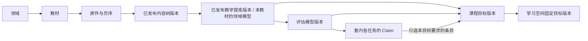

# M1 教材管理优化：内容树、教学提炼与学生学习地图

> 版本 v0.18 · 2026-11-28 · 已部署至本机 K3s，待用户评审

本次优化要让管理员和学生查到：**这版教材的某章、某节涉及哪些任务和方法？某道题的解法在原书哪一页？** 章、节与任务可以双向查询。题目或解法已有具体原文引用时，可继续定位到相应节点和原页。

## 1. 调整前的教材能力

调整前，教材助手接收指定领域下的 PDF 和图片，保存原件和逐页清单，支持分批解析、对话纠错、候选采用、提交领域入库和章节关联。已实现的候选分为知识成分、题目和题内参考解法，保存章节、父题和来源页。普通段落、标题和插图尚未组成一棵可按页查询的完整内容树。[候选数据](../../../../src/m1/server/src/deermind/product/materials/assistant_facts.py) · [现有集群验收记录](../../../../src/m1/deploy/environments/local-wsl/E02-09-material-corrections.md)

上一版领域模型允许多个教材复用 Task、Solution、KC。章节采用 Task 及其适用方法；章节涉及的知识点可从已采用方法汇总。Task 之间的先导关系可以适用于全部方法或指定方法。这些定义是学习地图的数据基础。[Domain 设计 §4](../engineering/Domain_Space_Design.md)

## 2. 内容模型与使用方式

现有教材工作区已支持按领域查找、调整上传页序、上传并解析、对照图表原页、引用候选或图表纠错、查看修订差异、批量采用、提交领域入库及建立章节关联。本轮将教材条目与原件分开，将初稿生成与人工编辑分开。M1 沿用“教材作为课程”的产品口径，学生学习空间固定已发布的具体版本。

### 2.1 原页、内容树和教学提炼

原件供阅读和核对。章节及原文来源挂在任务上。知识通过唯一对应的知识任务定位章节，方法通过所属任务定位。既有空间读取采用时固定的版本。

正式知识有唯一知识任务，任务定义可观察表现，评估套维护评价判据。课程目标选择规定方法、任一方法或全部方法。[领域规则](../engineering/Domain_Space_Design.md)

已有物理页登记在 PostgreSQL 的 `product.material_source.pages` 列中，类型为 `jsonb`，一个源文件一行，数组中每项代表一页。每页有内部标识 `page_id`、从 1 起算的文件页序 `file_page_index` 和可空的印刷页码 `printed_page_label`。例如，封面和目录占前两页时，文件第 3 页可能印着“1”。多张图片导入时，每张图片的文件页序都可能是 1，仍能用各自的 `page_id` 区分。接收文件时印刷页码默认为空。[数据库字段说明](../engineering/database/Business_Product.md) · [原页接收实现](../../../../src/m1/server/src/deermind/product/materials/receiving.py)

### 2.2 教材内容节点表

`product.material_content_node` 承载逻辑树，一行一个完整节点。表已通过迁移 0043 建立，完整定义见[数据库分册](../engineering/database/Business_Product.md#31-productmaterial_content_node)。节点的父子关系表达教材结构；Q1 确定的章、节与 Task 的关联另行维护。

| 字段 | PostgreSQL 类型 | 可空 | 含义与约束 |
| :--- | :--- | :--- | :--- |
| `material_version_id` | `uuid` | 否 | 本节点所属的整本内容树版本。节点查询和引用固定到此版本；教学提炼另有自己的版本标识。 |
| `node_id` | `uuid` | 否 | 节点标识，与版本号组成主键。 |
| `parent_id` | `uuid` | 仅根可空 | 直接父节点，必须属于同一版本；不得指向自己。 |
| `node_kind` | `text` | 否 | 受控类型，取值见下表。 |
| `sibling_order` | `integer` | 否 | 同一父节点下的逻辑阅读顺序，从 1 起，同级唯一。定位“第二种方法”时仅在同一父题的解法中排序。 |
| `content` | `jsonb` | 是 | 本节点自身的完整内容。有值时为一个 JSON 对象；纯组织节点可为空。跨页段落仍保存一份完整正文。 |
| `covered_page_ids` | `uuid[]` | 否 | 本版教材中节点覆盖的原页集合，无空元素、无重复。由解析来源和子节点覆盖页汇总；同一原页可出现在多个节点中。 |

| 节点类型 | 正文和归属 |
| :--- | :--- |
| `book`、`unit`、`chapter`、`section`、`group` | 教材、单元、章、节、栏目。`section` 可嵌套为小节。书上印的标题作为 `heading` 子节点。 |
| `example`、`exercise`、`subquestion`、`solution` | 例题、练习、小问、解法。学生可能单独指称的组成部分可建子节点。例如，同一题的两种解法各占一行，一种解法中的文字与算式可以同在它的正文中。 |
| `heading`、`paragraph`、`caption`、`formula` | 原书标题、自然段、图表说明、结构化公式。保留书上确实出现的编号、措辞和运算顺序。 |
| `table`、`chart`、`diagram`、`image` | 分别承载表格、统计图、几何或示意图、普通插图或照片。各自正文见 §2.4。 |

| 键、索引或校验 | 定义 |
| :--- | :--- |
| 主键 | `(material_version_id, node_id)` |
| 复合自引用外键 | `(material_version_id, parent_id)` 引用本表主键，禁止跨版本挂接。 |
| 同级唯一索引 | `(material_version_id, parent_id, sibling_order)`，同时支持按父节点展开子树。 |
| 根节点唯一索引 | `parent_id IS NULL` 时对 `material_version_id` 唯一，保证每版最多一个根。 |
| 页反查索引 | `GIN (covered_page_ids)`，在固定教材版本内按原页 ID 查覆盖该页的节点。 |
| 行内约束 | 同级顺序为正，仅 `book` 的父节点为空，非空正文必须为 JSON 对象，类型值在上述清单内。 |
| 保存整版时的程序校验 | 恰有一个教材根、所有节点可达、无环；每个原页引用有效且属于该版来源；父节点覆盖各子节点涉及的页。 |

**表设计的取舍。** 目录名称直接读 `heading`，因此无单独 `title` 列。早期讨论过的 `page_locations`、单独的页定位表、正文片段数组、全页阅读顺序和逐片段区域，均已从本表设计中移除。学生在“原始教材”里阅读原版布局，按页查询只需找到与该页相关的完整节点。可选的图像裁剪区域只服务于用图场景。

### 2.3 如何按章节、书页和解法定位

下表用讨论中的“小车行驶了多远”说明七个字段怎样配合。各行教材版本相同，节点及原页 UUID 使用短名，圆括号里的说明是正文摘要。

| 节点 | 父／同级序 | 类型 | 正文 | 覆盖原页 |
| :--- | :--- | :--- | :--- | :--- |
| R | 根／1 | book | 空 | P3、P4 |
| C | R／1 | chapter | 空 | P3、P4 |
| H | C／1 | heading | 第一章 行程问题 | P3 |
| S | C／2 | section | 空 | P3、P4 |
| SH | S／1 | heading | 第一节 求路程 | P3 |
| Q | S／2 | example | 空 | P3、P4 |
| QH | Q／1 | heading | 例 1 小车行驶了多远？ | P3 |
| T | Q／2 | paragraph | 小车每分钟行驶 2 米，3 分钟行驶多少米？ | P3 |
| F | Q／3 | image | 路线图原图引用 | P3 |
| M1 | Q／4 | solution | 用加法，2＋2＋2＝6（米） | P4 |
| M2 | Q／5 | solution | 用乘法，2×3＝6（米） | P4 |

- **展开章节。** 依次读根的子节点、章的子节点、节的子节点；每层按 `sibling_order` 排列。从 Q 展开可取到完整题面、配图和两个方法。
- **“讲第 3 页的应用题”。** 在该版来源中将印刷页码“3”定位到 P3，再用页索引取本页的例题、练习及有关题面，结合题意选题。同页有多道符合时，用题干让学生选。印刷页码重号时先确定章节，未识别时请学生指页；阅读器的“问这一页”可直接传 `page_id`。
- **“按书上第二种解法讲”。** 已定位到 Q 时，按同级顺序取 Q 的第二个 `solution`，读 M2 正文并可跳 P4。书上有明确“解法二”标签时保留原标签；只有并列展示时，使用书面顺序。题目或方法不明确时先澄清。查询命中 Q 覆盖 P4，只说明题目延续至 P4。
- **“这段话是什么意思”。** 学生明确引用普通段落时按节点取整段，打开来源时取原页。若段落跨页，按任一覆盖页都能找回它。当前学生助手的材料目录使用“教材第 N 段”等编号，目录位置不能当作印刷页码或解法序号。[当前学生材料目录](../../../../src/m1/server/src/deermind/bootstrap/student_materials.py)

### 2.4 表格、图形和原图如何交给模型

| 原书内容 | 保存与使用口径 |
| :--- | :--- |
| 表格 | 保存列、行、单位、原值。单元格区分已提供、留给学生作答、原文缺失、看不清。 |
| 统计图 | 保存图类型、底层数据引用、分类、系列、单位、坐标轴和图例。表格和图呈现同一组数据时可共用数据。 |
| 几何图与示意图 | 记录能确认的对象、标记、关系及其依据，绘制布局与数学条件分开。例如“点画在中间”不能自动成为“点是圆心”的已知条件。 |
| 复杂图或普通插图 | 保留能读回的原图。学生问到时，由程序把题干和实际图像一并交给支持视觉的模型。区域可靠就按需裁图并带上图例、单位和旁注；区域不明或裁剪会丢失条件时发整页。识别不清的标记保持未知。 |

教材写明的解法、解题提示、启发式问题和待填答句各有用途。录入时保留原有区分，避免把提示并进题干，或把学生应判断的错误算式改写成正确答案。[已有内容结构](../../../../src/m1/server/src/deermind/spaces/domain/rich_content.py) · [教材内容表达试验](../validation/Content_Representation_Trial.md)

### 2.5 两端交互

| 入口 | 已讨论的交互 |
| :--- | :--- |
| 管理端 · 领域管理 | 领域 → 教材 → 已发布教学提炼版本 → 知识点、任务、解法。按教材与提炼版本查阅；编辑从教材草稿进入。 |
| 管理端 · 教材详情 | 依次显示「教材原件」「内容树」「教学提炼」「工作台」。版本列表负责创建、复制、删除与发布，三列工作台负责对照与编辑，操作见 §4。 |

| 学生端 · 章节 | 目录只列单元、章、节及小节，可展开和收起。选中目录项后可查看起始原页，或按该范围查看学习地图。完整内容树供管理员核对。 |
| 学生端 · 学习地图 | 默认显示全书去重的任务列表，支持按章、节过滤。点任务打开详情，看方法、知识点、教材例题与先导任务。点击先导在同一弹框切换，后退回到上一个任务；关闭时保留列表位置和筛选。跨章节的先导仍可查看，指定方法才需要的先导须注明。 |
| 学生端 · 原始教材 | 逐页看原件，可从当前页定位相关内容。浏览和切换页签保持当前聊天活动；学生明确引用书页时才把该页作为提问依据。 |

管理端切换节点时，若左侧原页仍在该节点的覆盖范围内，就保留当前页。选普通段落时可展示“本节相关任务”；只有存在具体节点引用时才显示该段对应的教学项。三列都有固定容器；没有内容时显示空状态。

学生直接进入学习地图时无需选章。章筛选覆盖下属各节，从章节页进入时显示所带筛选，清除即可回到全书。地图以任务为入口，相同任务合并并标明相关章节。方法、所用 KC、例题及前置任务在详情中展开，来源具体到某种教材解法时可直接打开解法所在页。任务先导用于回补学习，不锁定学生入口。讨论中提出的全书横向关系图已收束为任务列表及详情内导航。

**教学提炼调整入口。** 右侧明确显示提炼版本、草稿／已发布状态及所绑定的内容树版本。管理员在提炼草稿中调整章、节关联的 Task 和方法；已发布版本供查看，修改须另起草稿。模型生成初稿，管理员手工编辑并显式发布。

### 2.6 已讨论、留待后续的范围

**教学时怎样使用教材。** 教学范围决定教什么，来源策略决定可以拿什么来教。讨论过三种方式：严格依据教材、教材为主且可补充、模型主讲且教材作参考。一般讲解可用其他例子；学生点名书上一种解法时，要取本版原题和该解法。用户已明确将三种方式的默认值、配置层级及切换规则留待专项讨论，本次不据此设计新的后台配置。

**网页文档。** 当前导入收 PDF、PNG、JPEG。网页对应 URL、页面快照和小节锚点，整站导入还涉及目录范围。这次已明确搁置网页导入，不为该场景改变教材原页的标识方案。

## 3. 已有样本与证据边界

验证材料来自用户指定的北师大版六年级上册数学电子教材。项目保存了 8 张原页图片：第 11、67、86 页为 JPG，第 49、50、91、92、93 页为 PNG。印刷第 3 页是讨论查询时的示例，未包含在这份素材中。[教材原链接](https://www.100875.com.cn/show/eBookAndTeacher.html?resId=7965194976af40f5b9abc4b3f89522fe&bookId=120170718181616016000&firstNum=120170718181616016000&contributeId=9276) · [原页文件](../../../../src/mvp_foundation/m1/content-representation/source)

北师大六上数学第 49–50 页已做过 38 个节点的人工建模。第 49 页的航模题、点阵图和线段图属于同一题；第 50 页开头的两种教材解法仍挂在该题下，而“试一试”中的计算和错例判断属于后续练习。人工样本可以按页找题、按题找第二种解法，也能从图回到原题。线段和分组括号未能由现有几何结构充分表达，样本保留了原图位置。[第 49 页](../../../../src/mvp_foundation/m1/content-representation/source/page-49.png) · [第 50 页](../../../../src/mvp_foundation/m1/content-representation/source/page-50.png)

样本检验了节点模型的表达能力。早先的 K3s 走查验证了现有候选流程能处理合成教材的跨页题和多解法。**新解析器能否从真实原页自动生成完整内容树、正确关联教学提炼，仍待实现和验证。** 后续验收还要选一个未被提炼成知识点的普通段落，检查学生能否按页找到并引用它。

人工样本的三个反查结果如下。样本数据在本机工作区的 `src/m1/.artifacts/material-nodes-p49-50.json`；原页是项目内可重复核对的依据。

| 反查 | 样本中得到的结果 |
| :--- | :--- |
| “按第 49 页航模题的第二种方法讲” | 同一父题下有两个解法；右侧方法在第 50 页，先求航模人数是气象人数的几分之几，再列 12 × (1/3 × 3/4) 得 3 人。 |
| “第 50 页‘试一试’里有哪些练习” | 计算三个算式和判断板书正误为两组练习，区别于页首续接的航模题。 |
| “第 49 页的两幅关系图属于哪道题” | 点阵图和线段图都能追到同一道航模题。原图保留了线段长短、分组括号等细节。 |

学生端未来验收还应区分：页码重号或未知、页面空白与尚未解析、同页多题需要澄清、跨页题应取全、复杂图可读回原图。GIN 索引用于定位候选节点；整册查询耗时需要实测。

## 4. 待确认事项与讨论记录

| 编号 | 问题 | 决定或待确认建议 |
| :--- | :--- | :--- |
| Q1 来源关联（已确认，2026-11-27） | 教材关联到多细？以哪类教学对象为入口？ | 以章、节关联 Task，同一 Task 可在多章出现。各章、节保留本处的方法范围，按方法的前置知识任务汇总相关 KC。题目或教材解法已有的具体原文引用随提炼保留；不要求逐段、逐公式或逐 KC 建边。正式采用时点由 Q2 决定。 |
| Q2 章节采用与版本管理 | 哪些操作自动完成？管理员如何调整和发布？ | 已确认只基于已发布的整本内容树进行教学提炼；草稿可保存和修改，正式使用已发布版本。助手自动填写提炼草稿，管理员可调整、整版发布；操作方案见 §4.2–4.3。 |
| Q3 目标与学生可见 | 目标和学习空间如何选取相配的版本？ | 每个课程目标必须选择一个已发布的教学提炼版本，提炼固定对应已发布树。只有树时可在后台查看，尚不满足基于目标开设学习空间的条件。目标选版交互见 §4.4。 |
| Q4 新版树的提炼（已确认） | 新版内容树如何取得教学提炼？ | 发布树本身不触发提炼。管理员需要时点击“生成教学提炼”，LLM 根据该版整本树重新生成草稿。无跨树复制或合并入口。 |
| Q5 评价定义（归属已确认） | 在哪里创建评估模型？ | 复制或发布教学提炼时不复制 Claim 或判定标准。管理员在评估管理中依次选择领域、教材、已发布提炼版本，再单独创建评估模型。每条 Claim 对应所选提炼版本中的具体任务。 |
| Q6 评估版本粒度与编制方式（已确认） | 一个版本包含什么，谁来编制？ | 一个评估模型版本绑定一个已发布提炼版本，包含覆盖其任务的整套 Claim。一个提炼版本可有多套标准。管理员发起创建，LLM 根据该版任务、方法与来源生成整套草稿，管理员按任务手工修订后显式发布。 |

### 4.1 已确认的版本关系

原页导入后固定。内容树和教学提炼分别按整本教材保存草稿、发布版本；章、节是编辑和核对范围。草稿只供后台编辑和预览，已发布版本只读。教学提炼从新建草稿起就必须选定一版已发布内容树。树可先于提炼单独发布。

每个课程目标固定一版已发布教学提炼、一套属于该提炼的已发布评估标准及目标要求的套内 Claim。提炼版本唯一确定内容树版本。管理员在目标中选择提炼，学生空间沿用固定的目标与课程应用快照。内容树或提炼发布新版后，历史目标及空间继续使用原组合。[现有空间固定规则](../engineering/Product_Application_Design.md)

### 4.2 领域、教材与原件

一个领域可组织多本教材。一本教材的整本教学提炼一经发布，就成为该教材的正式领域模型。教材管理和领域管理读取同一版本标识和同一组 Task、Solution、KC、先导关系与来源。取消“候选与领域入库”和第二次发布。不同教材允许有同名任务，M1 不跨教材合并任务或互认掌握状态。

| 位置 | 操作及服务端约束 |
| --- | --- |
| 领域列表 | 行末「操作 → 删除」。有未删除教材时阻止，否则软删除。创建后尚未导入原件的教材也计入。 |
| 教材列表 | 「创建教材」登记所属领域和教材名称；成功后即在列表可见。行末「删除」检查已发布内容树和学习空间，任一存在均提示具体原因。仅有内容树草稿可以删除教材。 |
| 教材原件 | 预览框一直显示。未导入时中央显示「导入教材」；有原件时在框右上角「更多」中提供「删除原件」。任一有效内容树版本（含草稿）都会阻止删除原件。删除原件后保留教材条目，可重新导入。 |

删除由写入端在提交时核对直接引用，并与并发创建引用互斥。已删除的版本退出可选列表；已发布且仍在使用的版本继续可读。

### 4.3 版本列表与工作台

| 页签 | 列与操作 | 约束 |
| --- | --- | --- |
| 内容树 | 名称、版本、创建时间、状态、操作；列表右上角「创建」，行内查看、复制、发布、删除。 | 创建从原件整本重新解析，产生独立草稿。复制以选中的发布版为底稿，不调用模型；草稿不能作为复制来源。草稿可发布。有任何有效教学提炼版本（包括草稿）引用时禁止删除。 |
| 教学提炼 | 名称、版本、创建时间、关联树版本、状态、操作；右上角「创建」，行内查看、复制、发布、删除。 | 创建时选择本教材已发布的树，由 LLM 生成整本草稿。复制已发布提炼时沿用原树；换树必须重新提炼。草稿可发布；存在评估模型（含草稿）或课程目标版本引用时禁止删除。 |

**工作台。** 左列预览原页；中列选树版本；右列只列该树的提炼版本。三列框架在空、加载和有数据时均保留。选择树草稿时，右列说明发布后才能提炼。版本已发布时只读。编辑窗口内先保存或取消，返回工作台后才能切换版本。

- **内容树草稿。** 使用树形控件。选中节点后显示「编辑」「删除」「添加」。编辑可调整节点类型、内容和原页关联。删除前明确节点及子节点数，确认后删除整棵子树。添加可选同级或子节点，按父节点、顺序、类型、内容和原页保存；根节点遵守 §2.2 的唯一根约束。
- **知识页签。** 编辑名称、含义和适用条件。新建时同步建唯一知识任务，已有任务重新配对时同时交换两边的引用。打开知识可查看对应任务、前置知识和依赖它的方法。
- **任务页签。** 按章节、类型或名称查找任务。详情中修改说明、预期产出、完成条件、原文来源和本任务的方法。每种方法分别编辑步骤、依据、适用条件及前置任务和理由。知识任务限选知识任务，综合任务可选两类。所有方法的前置去重展示，仍可逐法核对。
- **删除与查看。** 删除知识或其任务时确认删除这对对象。有外部方法引用时提示所属任务及方法。领域管理按领域、教材、发布提炼选版，用相同的知识与任务页签只读展示。
- **模型发布。** 校验所有章/节及具体来源属于所选树，任务、方法、KC 和先导可在本版解析，先导无环，正式 KC 有直接检验路径。发布后领域浏览和目标选版使用同一个版本；已发布内容不可编辑。

### 4.4 目标选择与典型组合

**评估管理。** 依次选择领域、教材和已发布的教学提炼版本。列表展示该提炼下各评估模型的名称、版本、状态及任务覆盖情况。「创建评估模型」允许说明本套标准的侧重点，由 LLM 逐任务起草可观察的表现、方法判据及相应评价方面的证据要求。草稿详情按任务列出判据，管理员可对照对应任务与方法手工编辑。某项缺少依据时标为待补。发布前由程序核对任务覆盖和方法归属，由管理员核对教学含义并确认整套发布。LLM 生成的标准不改变掌握概率算法或全局达标阈值。

目标管理沿用“领域 → 教材 → 目标”。新建目标先选本教材的一版已发布提炼，再选该提炼下的一套已发布评估标准，最后从套内勾选本目标要求的任务 Claim。目标允许只覆盖部分任务；同一目标内的 Claim 均来自选中的标准。评估模型为空或仅有草稿时，可转到评估管理准备标准。返回时保留目标名称和教材选择。

例如，六上数学提炼 v1 下发布了“概念理解”和“应用迁移”两套标准。目标甲可选“概念理解”中的两个 Claim，目标乙可选“应用迁移”中的一个 Claim。甲、乙的标准分别可查。保存前若换套，清除原勾选并提示重选；保存已应用的目标后，通过新目标版本更换标准，原空间继续读旧目标。

### 4.5 本轮设计评审

[打开可点击的管理端线框](visual-sample/material-model-review.html)。线框使用一册教材、两个任务和两套标准，展示关键页面和选版关系。示例生成在浏览器内模拟；下表列出正式实现的责任边界。

| 使用位置 | 数据由谁维护 | 保存、读取和校验 |
| --- | --- | --- |
| 教材工作台与领域浏览 | 教材工作台维护提炼草稿中的定义。领域管理读取发布模型。 | 发布一次，两个入口使用同一个提炼版本标识。任务、解法、KC、关联与先导按该版解析；另一册的同名任务独立。供题也须从当前版本选择任务与方法。 |
| 评估管理 | Evaluation 维护整套评估标准和任务 Claim。 | 创建草稿时固定来源提炼版本；按任务组织生成结果，列出缺失判据。手工修改只写草稿。发布时检查覆盖、归属和草稿修订号，整套一次生效。相同任务在两套标准下可以有不同 Claim。 |
| 目标管理 | Product 保存目标、教学提炼版本、评估模型版本及所选 Claim 的确切引用。 | 服务端复核“同教材、同提炼、同套、已发布”；过期选择或跨套引用返回具体问题，保留表单供调整。两个目标可以共用一套标准并选不同条目。 |
| 学生学习与评价 | Interaction、Evaluation 从空间固定的目标版本读取依据。 | 发布新版不会替换旧空间的任务、Claim、Evidence 或掌握状态。回看旧作答仍能定位当时的教材内容与判定标准。 |

**页面走查路线。** 在教材“工作台”切换发布树和草稿，查看三列联动与编辑状态；到“领域管理”按教材和发布版本查看定义。到“评估管理”生成一套示例草稿，改一个任务的判据并发布；最后到“目标管理”选择刚发布的标准和一个 Claim，保存后核对版本。已发布的其他套应保留原文。版本列表的完整操作和删除条件以 §4.2、§4.3 为准。

**生成与并发。** 正式实现沿用后台工作与收据。重复提交同一创建请求只产生一份草稿；模型生成中显示处理中，离开页面后服务端继续处理，重开版本列表可查看生成的草稿。失败时给出失败任务与原因；不产生发布版。人工保存和发布使用草稿修订号；另一人已保存时提示重新载入，迟到结果不能覆盖人工修改。

任务、方法、KC 固定归属发布它们的提炼版本。Evaluation 按评估套登记 Claim；Product 校验并保存目标的提炼、评估套和具体 Claim。字段、引用及保存合同分别见[领域库](../engineering/database/Business_Domain.md)、[评估库](../engineering/database/Business_Evaluation.md)、[Evaluation API](../engineering/contracts/Evaluation_API.md)和[Product API](../engineering/contracts/Product_API.md)。

**删除边界（已确认）。** 任一评估模型（含草稿）或任一目标版本引用提炼时，阻止删除，返回直接引用的名称。删除操作不级联删除评估标准。

## 5. 实施规划

沿用 E02-19、E02-20、E02-21、E03-11、E04-17。当前状态统一见 [Delivery Plan §1.11](../engineering/Delivery_Plan.md#111-教材内容树教学提炼与学习地图)。

| 顺序 | 交付物 | 验收场景 |
| --- | --- | --- |
| E02-19 | 教材独立创建、原件独立导入与删除、领域和教材删除；版本归属及服务端引用检查。 | 创建空教材即阻止删领域。仅有树草稿时可删教材、不能单删原件。已发布树或已建空间分别阻止删教材。 |
| E02-20 | 四页签、树版本列表、固定三列工作台和节点手工编辑。 | 导入后重新解析；复制发布树并编辑，新增兄弟和子节点，取消及确认级联删除，保存后重开；原发布版不变。 |
| E02-21 | 从发布树生成独立教材模型，手工编辑、同树复制、发布、按引用删除；领域按教材与版本只读浏览。 | 空领域下的两本教材各生成同名任务。改甲的草稿并发布，乙不变。草稿阻止删除源树，领域视图与教材发布版一致；无二次入库。 |
| E03-11 | 按领域、教材、已发布提炼选取评估管理范围；在该范围生成整套评估草稿，按任务人工修订、显式发布。目标与供题按固定版本取材。 | 同一提炼下生成两套标准，修改其中一套的判据，另一套及旧目标仍读原标准；跨版引用、缺任务的整套发布均被拒绝。 |
| E04-17 | 学生三页签与两端完整流程复验；正式入口集中部署、统一评审。 | 管理员从空教材生成两版模型；学生通过目标进入固定版本，核对章节、地图和原页。另测删除拦截、复制隔离、草稿与发布版的编辑边界和手工保存零模型调用。 |

本轮两端截图、验收教材及复现入口见[集群验证记录](../../../../src/m1/deploy/environments/local-wsl/E02-19-E04-17-material-editions.md)；[本轮验证教材及页码](../../../../validation-materials/textbooks/bnu-math/README.md)。

## 修订记录

| 版本 | 日期 | 修改 |
| :--- | :--- | :--- |
| v0.1 | 2026-11-27 | 建立专题记录，汇总现有实现、模型与两端交互结论、人工样本、四项待决问题及实施规划入口。 |
| v0.2 | 2026-11-27 | 补回七个字段、节点类型、键与索引、小车样例、页码反查、图表与裁图、两端联动细节、真实教材反查结果和后置议题；明确来源关联仍待 Q1、Q2 决定。 |
| v0.3 | 2026-11-27 | 确认 Q1 的章、节与 Task 关联，记录方法、KC 和先导的边界，同步调整三列联动与验收口径；转入 Q2。 |
| v0.4 | 2026-11-27 | 确认 Q2 的章、节自动采用，在管理端教学提炼列提供调整入口；转入 Q3。 |
| v0.5 | 2026-11-27 | 因内容树和教学提炼各自版本化，重开 Q2；登记发布依赖、管理端选版、草稿隔离与课程应用的未决问题。 |
| v0.6 | 2026-11-27 | 确认内容树先发布、整本版本与目标必选提炼。补充两类版本的增删改查、发布、三列选版和目标引用交互。 |
| v0.7 | 2026-11-27 | 确认多个目标可共用同一已发布提炼版本，将新版内容树的提炼复用列为下一项讨论。 |
| v0.8 | 2026-11-27 | 确认新版树由管理员按需发起整本重新提炼，区分同树修订；列出实施顺序与验收条件。 |
| v0.9 | 2026-11-27 | 明确五步分别交付的后端、页面、可操作功能及 K3s 复验材料。 |
| v0.10 | 2026-11-27 | 规划获确认，五项实施进度统一登记到 Delivery Plan §1.11。 |
| v0.11 | 2026-11-27 | 登记实际建表、两个教材样本和两端浏览器验收。 |
| v0.12 | 2026-11-27 | 明确学生看章节目录，管理员看完整内容树。 |
| v0.13 | 2026-11-27 | 将领域按教材选版、四级删除保护、原件管理和草稿手工编辑纳入同一专题及原五项增量。 |
| v0.14 | 2026-11-27 | 明确评估管理的选择路径及独立创建边界，登记整套评估与单条 Claim 的版本粒度问题。 |
| v0.15 | 2026-11-27 | 确认评估模型按整套版本管理，登记 LLM 起草、逐任务人工编辑与发布流程。 |
| v0.16 | 2026-11-27 | 增加可点击线框、业务关系图、目标选 Claim、跨模块设计与待决删除场景。 |
| v0.17 | 2026-11-28 | 落实版本归属、人工编辑和评估套选用，登记提炼删除保护及集群复核入口。 |
| v0.18 | 2026-11-28 | 知识与任务分栏编辑，方法独占及前置任务按版本保存 |
