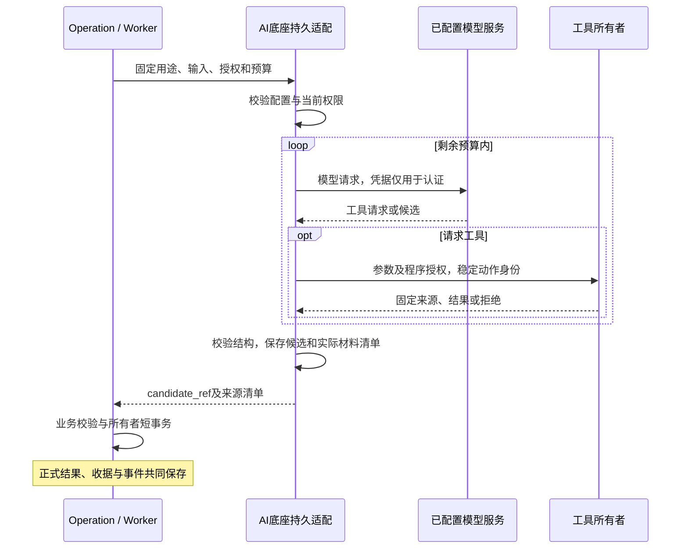

# M1 AI 底座设计

> **版本**：v0.17 
> **状态**：模型配置、工具、预算和结果合同详细稿待审；配置固定及不自动换模已确认 
> **维护与评审**：Codex编写及自检，用户审阅 
> **写作规范**：[系统设计写作规范](../../../top/DeerMind_System_Design_Writing_Standard.md) 
> **更新日期**：2026-11-15 
> **修订说明**：v0.16 → v0.17，细化用途配置、工具执行、预算、候选和失败合同；见MVP决定登记§79 

本文设计各业务和Space共用的模型调用、工具循环及通用材料处理能力。业务Operation决定取材、组装上下文和保存记忆；底座按调用方要求执行，代码不内置学习空间、活动或题目等业务概念。职责以[总体§3.4](System_Design.md#34-agent上下文和记忆)为准；持久任务生命周期归公共运行底座，共同输入见[工程入口§2](README.md#2-设计输入与历史参考)。

执行框架采用Pydantic AI，需要持久恢复的AI工作通过其[官方Temporal集成](https://pydantic.dev/docs/ai/capabilities/durable_execution/temporal/)运行。框架承接模型、工具调用及结构化输出；上下文与记忆逻辑由所属Operation实现；共用工具授权、预算和候选交接按本文接线。Operation以AI业务目标为边界，可包含模型调用和确定性步骤，不等同于一次Agent运行。普通保存、查询及确定性派生无需Pydantic AI；AI使用的普通工具函数也不因此成为Operation。组件分工以[总体§6.1](System_Design.md#61-已定技术与待选方案)为准。

## 1. AI任务协议与运行边界

业务Operation由产品业务或Space定义，AI底座提供`execute_ai_task`。它完成一次有边界的AI处理，可以包含多次模型／工具调用；它不接管整条教材、教学或评价业务链。Operation与Step身份见[公共运行§1.3](System_Foundation_Design.md#13-operationstep与operationrun)。

| 输入字段 | 类型／必填 | 责任与约束 |
| --- | --- | --- |
| `caller_ref` | 注册模块、Operation名、执行引用／是 | 持久步骤携带execution_id、attempt_id、step_name、occurrence_key；operation_run_id即execution_id，模型不能修改身份 |
| `purpose` | 调用方登记的用途标识／是 | 含义和输出合同由调用方提供，按§2.1取得本次固定配置；不能由模型临时命名 |
| `ai_config_ref, call_key` | 固定配置引用、调用键／是 | 配置随Execution固定；call_key为Step内调用位置，技术重试保持，新的内容修正另用新键 |
| `context_ref` | 固定材料包引用／是 | 结构见§4.1；指令、来源与取材限制在包内维护，实际工具取材另记清单 |
| `tool_grants` | 程序授予的工具与资源范围／是 | 可以为空；权限始终取当前服务端授权，不接受模型新增授权 |
| `output_schema_ref` | 已登记Schema引用／是 | 调用者定义候选结构；校验通过不表示业务已提交 |
| `execution_limits` | 上层预算引用、调用子限额／是 | 按§3.3扣除累计消耗；具体数值在接线评审确认，不使用无限默认值 |

结果外壳见§6.1。模型提出的needs_input属于合法候选，由业务Operation决定如何询问；模型超时、拒答或格式错误不是“需要学生补充”，不得伪造澄清候选。

执行顺序为：校验调用方提供的用途与权限→核对已提供材料并按显式要求适配模型输入→调用模型和允许的工具→验证候选结构→保存候选及调用记录→交回调用者。底座不在此流程中自行检索业务历史、启动摘要或保存业务记忆。结构错误可以在预算内要求模型修正；规则与业务语义仍由所属模块接受或拒绝。AI底座不写入正式Evidence、Belief、领域定义或章节采用关系。

input_hash按固定用途合同、配置、指令、输出Schema、材料版本／hash及初始工具授权生成，不包含密钥、时间戳或执行尝试号。当前权限收紧由执行检查处理，不篡改原输入。

同一Step可调用多次execute_ai_task；(execution_id,step_key,call_key)唯一确定call_id及input_hash。相同键和输入返回原调用；同键异内容拒绝。一次调用内部的模型请求另记request_ordinal及传输尝试。新执行尝试先复用已存候选；无候选时追加调用尝试，不覆盖旧轨迹。外部响应未保存仍可能重复调用和收费。

官方集成可从Temporal记录的已完成模型／工具调用继续执行；记录完成前中断的外部调用仍可能重复。恢复到哪一步取决于接入时确定的持久步骤边界，不能仅靠保留聊天历史恢复，也不能默认失败就从头重跑整个Operation。工具副作用和最终业务提交仍按所有者的幂等规则处理，持久执行映射见§1.2；SDK版本及用途限额仍待确认。

### 1.1 路由调用与业务调用

普通API／消息按登记处理器执行，不经过本AI框架。AI业务入口已明确则直接派发Operation；只有需要语义判断时，公共运行底座才调用AI判断目标Operation。输入为允许候选、请求原文和授权取得的必要材料；输出为候选或尚缺信息。公共运行底座负责候选校验、询问和派发，AI底座不自行执行目标Operation，也不先运行Interaction业务函数。方案见[总体§7.2.1一](System_Design.md#721-已确认的总体选择)。

目标Operation启动后，Worker中的业务代码自行调用AI底座生成内容或解释证据；不经公共路由逐步安排其业务流程。公共运行底座按声明准备路由及启动材料；Operation决定业务取材、组装及记忆保存，AI底座按调用要求提供通用能力。

上方`caller_ref`等字段保留为既有业务AI合同草案；路由在目标Operation启动前的调用身份、执行位置、候选Schema、澄清及恢复方式待讨论，不借用不存在的目标Run冒充已启动工作。路由分工已确认；具体候选协议、如何表达不确定及澄清答复接续仍待详细设计，模型技术失败与意图不明分别返回。

模型／工具调用层按自身合同管理重试，并接受上层剩余执行期限及累计资源约束；不因外层再次尝试重置消耗。上下层预算约束见[公共运行§3.4](System_Foundation_Design.md#34-分层重试与全局协调)，AI计量与错误接线见本文§3.3及§6。

### 1.2 与Temporal的执行接线

公共执行身份采用[系统底座§3.3](System_Foundation_Design.md#33-operationrun与步骤记录)。业务Workflow调用AI底座的持久适配，采用Pydantic AI官方Temporal集成，使模型请求和有I/O的工具调用成为可恢复Activity；不要再把整个Agent循环包进一个外层Activity，丢掉内部恢复位置。

2026-11-15的[官方集成说明](https://pydantic.dev/docs/ai/capabilities/durable_execution/temporal/)使用TemporalDurability／PydanticAIWorkflow等注册路径。项目通过AI底座隔离SDK入口；版本、包锁和实际注册写法在实现接线前确认，不以本文类名代替兼容检查。

| 执行部分 | 位置与保存 |
| --- | --- |
| Operation业务次序、等待与分支 | 所属模块Workflow；只编排可重放逻辑，不直接访问数据库或模型 |
| 模型请求和工具I/O | 官方集成注册的Activity；固定call_id和实际材料清单，重试仍受原预算及当前工具授权限制 |
| 候选接收 | 普通持久Activity保存candidate_ref及调用来源，所属业务另执行语义与提交校验 |
| 业务最终保存 | 所有者Activity参加既有短事务；AI底座不提交Domain、活动或概率状态 |

同一执行尝试恢复时，Temporal重放已记录调用结果。获准启动新尝试时，Operation先查Step和candidate_ref：已有候选直接重试接收或提交；没有持久候选则可能重跑该段AI调用。新尝试不承诺沿用旧Workflow内部未导出的每次工具结果，外部重复调用及费用要留痕，不能重复业务写入。

每次模型调用有可追溯调用身份，执行attempt与SDK／Activity重试次数分开。所有副作用工具都使用所有者的防重和尝试有效性检查；只读工具也重新检查资源权限。取消首先由业务废止提交资格，再尽力停止调用；不能把取消外部请求成功当作唯一防线。

部署必须显式限定Activity总执行预算、模型客户端重试及结构修正次数；不直接继承无上限默认值。数字由用途配置和运行预算共同审阅。Workflow业务输入尽量传引用，但官方集成可能将模型输入输出写入Temporal历史；基础设施需据此保护该历史并确认保留方式，不能宣称它只含ID。

## 2. 模型连接与能力适配

M1使用现成模型API，由AI底座统一接入；各类Agent可以分别配置模型，也允许共用模型，见[总体§6.1.1](System_Design.md#611-模型api接入边界)和[登记§63](../../DECISIONS.md#63-m1模型api统一接入与agent配置)。使用Pydantic AI的模型适配能力处理请求、多模态输入、工具调用、结构化输出和用量；业务模块不各自实现供应商调用逻辑。

配置区分Agent用途与所用模型；共享模型不共享上下文、工具授权或业务记忆。M1不自动切换备用模型。临时故障按有限重试处理，仍失败则交回所属Operation，保留已保存部分。

### 2.1 配置对象与受理快照

以下为服务端配置及代码登记，不新增管理页面。修订均不可覆盖，底座在受理AI工作时保存本次所需用途的配置清单及摘要。

| 对象 | 必填内容 | 维护者与校验 |
| --- | --- | --- |
| ModelConnectionRevision | connection_id、revision、adapter_id、base_url、credential_ref | 基础设施装配；adapter必须已注册，地址来自受控配置，credential_ref仅指向凭据位置 |
| ModelProfileRevision | profile_id、revision、connection_ref、model_name、capabilities、settings、limits_ref | AI底座；引用确切连接修订。settings按适配器白名单校验，不接受客户端自由透传 |
| PurposeContract | owner、entry_ref、purpose、contract_revision、prompt_contract_ref、output_schema_ref、allowed_tool_refs、required_capabilities | 所属模块代码登记；提示和输出含义归该模块，声明所需媒体、结构输出和工具能力 |
| AIExecutionConfig | config_id、execution_id、purpose_bindings、config_hash | 受理时固定PurposeContract与ModelProfileRevision的对应关系；包括可选的分类、摘要等内部用途，不等待模型决定后才补配置 |

代码登记所有允许用途及工具实现，模型适配按固定profile读取服务配置，不在Workflow中读取环境变量或密钥。程序按注册入口读取配置，受理短事务同时保存Execution和ai_config_ref；配置缺失或不满足用途时拒绝受理。短事务不测试网络，也不取得密钥。普通处理没有AI配置；已受理工作之后派生另一个AI工作时，在后者受理时固定自己的配置。

用户已确认：配置修改只影响新受理的工作；自动重试、暂停恢复和获准的新执行尝试均沿用原ai_config_ref。需要新模型请求而旧模型不可用时明确失败，不悄悄换模型；已保存候选的读取和业务接收不再访问模型服务。旧合同或适配器已不被部署支持时返回configuration_unavailable，不能把原用途绑定到新实现。服务商内部模型变化无法由本地快照冻结，须记录请求型号和服务商实际返回的型号，不能据此宣称结果可逐字复现。

密钥不进入配置快照、Workflow输入或调用记录；模型Activity执行时由连接适配读取credential_ref对应的当前有效凭据。轮换不改变本次用途和模型；连接被禁用或权限撤回则拒绝后续外发。权限与停用检查始终取当前状态，不因配置已固定而失效。

### 2.2 用途装配与能力检查

下表是接线索引，业务Schema和取材规则仍只在所有者文档维护。同一Operation可登记多个purpose；登记用途不增加Operation。

| 调用者与用途 | 必需能力及材料 | 模型工具／正式提交 |
| --- | --- | --- |
| Product教材解析、修正 | 页图、文字及结构化内容；固定页段、父题和改动依据 | §3.1四类受控工具；Product发布候选，管理员另行采用 |
| Domain定义提取、实例归类、供题中的生成与核验 | 对应Task、Solution、KC、具体题面及参考；有图时要求图像输入 | M1先由Operation取齐材料，工具集合为空；Domain校验并保存正式对象 |
| Interaction分类、回复、检测规划、主动建议、内部记忆处理 | 用途对应的ContextBundle；输入有图才要求图像能力 | 按§3.1限定只读工具；Interaction提交活动、答复和帮助事实 |
| Evaluation作答解释、教学机会解释 | 原始事实、获准Task候选、方法判据；原文图像不可用时不猜 | 由Operation取齐事实，工具集合为空；Evaluation检查Evidence并确定性更新概率 |
| 各Operation内部摘要 | Operation给出的原文范围及摘要要求 | 工具为空；所属Operation校验并保存记忆 |
| 公共运行的语义路由 | 有限入口候选、原请求及必要授权材料 | 不开放业务工具；具体身份和澄清接续见§1.1待设计项 |

教材使用多模态模型API，M1不另接OCR。能力配置分别声明可接受媒体、图像数量／字节限制、上下文容量、结构输出方式及工具支持；与PurposeContract比对后再调用。不支持所需图像或结构输出时返回unsupported_input或configuration_unavailable，不能自动退化为纯文本。容量字段及设置单位随具体供应商明确，缺失不能解释为无限。

HTTP成功只说明请求被接受。教材完整性、领域匹配、教学质量和证据可靠性按既有样例及所有者验收；本批没有验证具体模型。尤其Evaluation不得把已有Belief放入本轮表现解释材料；Interaction开放独立检测轮时只允许必要分类，结束检测轮并保存事实后才可准备提示材料。这些业务条件由Operation控制，底座只执行其显式授权。

Operation负责外发内容。AI底座只使用受控连接，不接受模型或教材中的新地址，不增加材料标签或内容审查系统。模型服务凭据不交给Operation或LLM；读取教材原页的工具不接收任意URL和磁盘路径。

## 3. 工具循环与动作校验

### 3.1 登记与授权集合

工具由所属模块实现，启动时登记到AI底座：tool_ref含owner、name和revision，另有输入／输出Schema、handler_ref、effect=read或draft_write、授权适配器及超时配置。Pydantic AI／Temporal的工具实现须在Worker启动前注册；运行中只缩小可用集合，不加载模型提供的代码或插件。[官方集成说明](https://pydantic.dev/docs/ai/capabilities/durable_execution/temporal/)对此有注册限制。

有效工具集合为“用途登记允许 ∩ 本次Operation授予 ∩ 当前服务端权限”。调用上下文携带执行、尝试、调用、授权范围和截止条件，由程序注入，不列为模型可填写的参数。查询所有者仍核验资源归属、字段视图和当前访问资格。

| 登记组 | 工具 | 副作用与所有者合同 |
| --- | --- | --- |
| Product教材助手 | read_material_pages、read_material_content、read_material_history | 只读；范围、父题和原件完整性见[Product§3.4.2](Product_Application_Design.md#342-operation取材与工具) |
| Product工作保存 | store_material_work | draft_write；只存本次草稿，不采用、不入Domain、不建章节关联 |
| Interaction学习助手 | read_activity_material、read_course_material、read_published_state | 只读；按当前用途裁剪，见[Interaction§3.10](Interaction_Space_Design.md#310-容量工具与提示合同) |
| Domain、Evaluation、内部摘要及路由 | 空集合 | 先由程序取材后调用；需要扩大工具范围时修订用途合同，不能自动开放已有全部查询 |

input_classification、memory_extract及memory_summary不开放上述学习读取工具；需要的材料由Operation事先准备，learning_reply等用途仍只能取授权子集。

本表不授予通用数据库、Shell、浏览器、任意文件或外网工具。正式保存、事件发布、关闭检测轮和概率计算都是程序步骤，不作为模型工具。已有受控草稿写入保留，不以“有副作用”为由另加人工审批。

### 3.2 一次工具调用

1. 底座从模型请求中取工具名和业务参数；检查登记版本、用途授权、参数Schema、当前执行尝试及剩余预算。
2. 分配tool_action_key=(call_id,attempt_id,model_turn_ordinal,tool_ordinal)。同一动作的Activity重试沿用该键；模型下一次主动调用是新动作。M1每次模型响应的工具按返回顺序执行，不并发写同一草稿。model_turn_ordinal沿本调用尝试递增，模型返回的工具ID只作诊断，不分配本地身份。
3. 只读工具调用所有者适配器，返回固定引用、必要内容和缺口。写草稿的工具另带Operation分配的稳定work_key；所有者按work_key、输入摘要和当前尝试防重，不能仅靠模型生成的tool_call_id防止重复。
4. 保存工具输入／输出引用、来源和结果。模型格式为status、data、source_refs、error_code及简短说明；执行异常不把堆栈、密钥或连接串交回模型。
5. 必需返回超限或缺失时报告限制；未超限工具结果作为有来源的数据加入后续模型输入，不替换系统规则。需要新的跨Space加工则返回Operation，由其发事件和等待。

工具状态为ok、not_found、invalid_arguments、forbidden、source_changed或technical_failure。参数可修正时在剩余预算内反馈模型；权限撤回、执行失效及来源变化交回Operation，不让模型用其他工具绕过。技术失败先按本层有限重试处理，耗尽后结束本次AI调用；不要求学生改答案解决服务故障。

恢复时，已有tool_action_key收据可防止同动作重复写；若新执行尝试重跑未保存候选的AI循环，新动作仍受原work_key约束。同一work_key输入变化交所有者核验或另建新草稿修订，不能覆盖原草稿冒充重试。授权或业务位置变化由所有者拒绝，模型不得以已成功过为理由强制提交。

### 3.3 执行预算与重试接线

预算按Execution累计，AI调用只获得子限额。配置给出以下字段，缺省不代表无限；具体值及供应商在接线评审前提交确认。

| 预算 | 单位与检查位置 |
| --- | --- |
| deadline_at、request_timeout、tool_timeout、finalize_reserve | UTC时刻／秒；每次I/O前核对剩余时间，为保存和失败收尾留余量 |
| max_model_requests、max_tool_attempts、max_repairs | 次；包含实际外发重试、失败工具尝试及格式修正，不能只统计成功次数 |
| max_input_tokens、max_output_tokens、max_total_tokens | token；前两项限制单次模型请求，后一项限制本Execution累计；先预留，返回后记录实际用量 |
| max_input_bytes、max_result_bytes、max_attachments | 字节／个；限制每次请求及单份工具结果／候选；Temporal传输上限另按§4.2处理 |

次数、token和字节限额为整数，时长以秒计；无工具／不允许修正时对应上限可为0，其余已启用项必须为正。每次请求先检查当前输入、已用量与未结算预约之和；超限即停止新增I/O，不占用保存／失败收尾的预留时间。

底座在模型请求前登记用量预约和request身份，Activity每次实际外发尝试单独记账。发送前失败可释放预约；已发出但结果未知，保留该次尝试，按本次输入估计加输出上限暂占额度，actual_usage=null，不能记零。取得用量后补充实际值，不重复累计。Workflow重放已存结果不消耗新额度；新的真实请求按新尝试计入原Execution。

Pydantic AI的UsageLimits作为调用内保护；原Execution的累计账本负责跨调用及恢复预算；记账Activity以Execution预算行作短锁，预约和结算使用同一request键防重。SDK的工具次数统计不等同于所有失败尝试，故底座另记max_tool_attempts。结构修正也是新模型请求，同时消耗max_repairs和max_model_requests。[用量合同](https://pydantic.dev/docs/ai/api/pydantic-ai/usage/)与[工具失败说明](https://pydantic.dev/docs/ai/tools-toolsets/tools-advanced/)于2026-11-15核对；具体接线以锁定SDK版本为准。

Temporal Activity承担模型传输的有限重试；供应商SDK关闭隐式重试，避免两个请求层相乘。格式修正由Pydantic AI控制并计入预算，业务内容修正由Operation决定并另留候选。每次调用满足“请求及重试总时长＋收尾余量≤上层剩余期限”；没有剩余额度返回budget_exhausted，不在恢复尝试中清零。停止后不启动新调用，迟到结果只留技术记录。

token与费用记录区分actual、estimated、unknown；费用只有具备价格依据时才计算，保存价格依据和币种。没有报价或用量不能显示零费用。本批以时间、请求次数及容量作为执行限制，金额阈值和量化验收仍须另审，不声称可以精确预封顶外部账单。权限和配置错误不进入传输重试；临时限流／连接失败受同一剩余预算约束。

## 4. ContextAssembler与取材合同

assemble_context是供Operation调用的通用适配草案，不是自动授予模型的工具，也不代表底座接管业务取材和组装。Operation决定读取哪些来源、使用哪些记忆、如何组合材料；可以调用共用工具执行读取、检索或格式处理。底座只执行调用方明确提供的内容、约束和授权工具，不按业务概念自动选材。业务取材以调用方的固定材料清单为准；本节细化其通用承载，不替Operation选择内容。

| 情况 | 通用能力与调用方责任 |
| --- | --- |
| 调用方已提供材料与要求 | 底座按要求适配模型输入，记录实际使用材料及来源；业务组织由Operation决定 |
| 可选历史超过容量 | 底座报告限制；Operation决定选取、缩减或调用LLM生成摘要，不自动压缩并保存业务记忆 |
| 调用方标记的必需材料缺失 | 底座报告缺口；Operation决定补取、澄清或缩小任务，不能静默丢弃必需材料 |
| 来源越权或禁止使用 | 通用授权检查拒绝，不以缓存或摘要绕过限制 |

各业务取材要求分别在[产品业务§3](Product_Application_Design.md#3-教材助手与内容准备)、[Interaction§3](Interaction_Space_Design.md#3-学习助手的决策与提交)和[Evaluation§2](Evaluation_Space_Design.md#2-原始事实到evidence)维护。教材原页、图表及公式的完整性由业务检查，底座按调用方声明保留其表示，不自行退化为纯文字。

### 4.1 通用材料包与限制反馈

材料包作为§1调用输入的context_ref承载instructions、materials和context_policy；调用身份、配置、Schema及execution_limits沿用外层。context_policy列出必需／可选材料及禁止来源；instructions区分强制规则和推荐策略，由Operation提供，底座不自行解释业务含义。materials每项含调用方给定的source_ref、固定内容或受控附件、媒体类型、角色、required及校验值；引用中的业务含义只由调用方解释。内联内容和附件不能只有一个底座无法解析的私有ID，读取通过已授权的所有者适配器。

底座校验模型能力、附件访问及调用容量，保存实际使用清单。必需材料放不下时返回required_context_too_large及材料引用；可选材料超量时返回超限项，由Operation重新组装。底座不悄悄删规则、截断公式或选取其他学生的摘要。模型容量、预留输出和工具返回预算按服务端配置检查；估算方法及限额随具体模型接线确认。

已存候选和输入清单可用于恢复；调用方改变材料必须创建新调用记录，不覆盖旧输入。通用包不包含由底座解释的“学习空间”“当前活动”“能力”等专用字段；这些信息由Operation放入有出处的材料。

### 4.2 图像和持久载荷

页图和附件保留文件引用、媒体类型、字节数和hash；读取通过授权文件适配，不将local-path路径发给模型服务。模型请求Activity按用途取出允许文件并转换为所配置API支持的输入；文件缺失或校验不符返回source_unavailable，不用其他页图替代。格式转换保留来源和转换参数，是否仍足以核对公式图表归教材业务验收。

原页及全册内容不能直接放进Workflow的deps或反复复制进历史。官方集成会记录模型和工具载荷，超限会阻断执行；保留业务文件引用本身不能解决SDK内部序列化的体积问题。[官方大载荷说明](https://pydantic.dev/docs/ai/capabilities/durable_execution/temporal/#large-payloads)提供外置存储路径，但API仍需按选定版本核对。

**接线前待确认：** 基础设施联合AI底座确定模型Activity如何装载受控附件、哪些载荷外置以及对应文件的恢复／保留规则；复用现有文件隔离层，不据此新增对象存储服务。不得以压低分辨率、删图或无上限提高载荷限制代替此项设计；本批不默选预览API。影响范围为教材多模态接线和执行历史恢复，其他合同继续设计。

## 5. 记忆、摘要与恢复刷新

记忆归所属业务模块。Operation决定保留内容、组织形式、隔离范围、来源及后续取用，通过共用存储能力完成读写；AI底座的模型调用记录不等于业务记忆。原始事件只追加，派生摘要可更新或重建，不能替代正式状态。

语义摘要通常需要LLM，由Operation提供原始材料和摘要要求，通过AI底座生成候选，再决定保存。M1把摘要放在所属Operation的内部步骤，不增加独立摘要Operation；存取记忆不要求调用LLM，也不要求每次交流都摘要。

例如讲解Operation需要整理历史时，选取相关原文、给出需保留内容的要求、调用模型生成摘要，再保存摘要及来源。下一次工作由Operation选择该摘要和必要原文，重新读取所需正式状态。底座不自行判断“学生已掌握”或“活动已完成”。

教材助手先保存结构化工作记录；历史超出上下文预算时才由所属Operation选取原文并按需生成摘要，具体合同见[Product§3.4.4](Product_Application_Design.md#344-分段处理记忆与恢复)。底座不安排每轮摘要，也不根据摘要恢复正式业务状态。Interaction取材、工作记忆和按需摘要见[§3.8—3.10](Interaction_Space_Design.md#38-三项operation的上下文)，Evaluation继续按原始事实取证；通用存储见§5.1，调用恢复及保存见§6。

### 5.1 记忆存取的通用边界

M1复用所属模块的仓储适配器保存记忆，不另建中央记忆服务。调用方提供owner、隔离范围、kind、key、固定revision及内容／来源；仓储只按该合同读写、执行权限和并发检查，不提取偏好、不决定何时摘要。业务表归所属模块，AI调用轨迹仍归AI底座。

摘要需要推理时作为现有Operation内部的execute_ai_task调用；恢复先查已保存候选及来源清单。结构校验、同空间引用检查不能证明摘要语义完全正确，业务调用方保留原文回查及语义验证责任。摘要失败不是学生失败，也不能回滚已经提交的作答、消息或Evidence。

## 6. 调用记录与结果交接

### 6.1 返回合同与失败分类

execute_ai_task返回status、call_ref、source_manifest_ref、usage_ref及trace_ref；三种追溯引用在生成前失败时可为null，error_code须说明阶段。status为candidate、failed或cancelled；candidate必须带candidate_ref和output_schema_ref，失败必须带error_code、stage和简短说明。没有产物不能返回空candidate。业务Schema中的needs_input、no_match等是候选内容，由调用者解释，不与底座技术状态混用。

| 情况 | 底座处理 | 所属Operation接续 |
| --- | --- | --- |
| 合法结构输出 | 固定候选、输入和调用依据后返回candidate | 复核来源、业务条件及当前执行，再提交或拒绝 |
| 输出格式不符 | 在修正预算内重问；耗尽返回invalid_output | 保存失败位置，不把错误内容显示给学生 |
| 必需材料缺失／超限 | source_unavailable／required_context_too_large | 重新取材或调整本次材料；新输入使用新调用键 |
| 模型不支持输入／配置不可用 | unsupported_input／configuration_unavailable | 明确配置问题，不自动换模型、不假装解析成功 |
| 服务拒答 | model_refused，保留原因类别 | 组织适当反馈；不当学生答错，不换模型绕过 |
| 临时网络、限流及服务故障 | 本层有限重试；耗尽technical_failure | 按所有者合同收尾；Evaluation仍按顺序暂停后续概率更新 |
| 权限撤回／输入冲突／来源变化／过期尝试 | forbidden／input_conflict／source_changed／stale_attempt | 停止本次业务提交，保留已有结果 |
| 预算耗尽／主动停止 | budget_exhausted／cancelled | 保留已做部分；不自动补一份新工作绕过限制 |

错误记录同时标明发生层、已尝试次数和是否耗尽；候选结构通过不证明语义正确。底座不把任何技术错误直接变成正式空间事件或学生能力结论。

### 6.2 保存和交接顺序

图1：没有可复用候选时的成功路径。复用和失败分支见§6.1及本节正文；两次保存分别属于AI底座与业务所有者。

AI底座的prepare_call在短事务按调用唯一键受理并固定input_hash，重复调用返回原记录；预执行错误也关联该call_id。已有候选先核对输入与读取权限，直接交回所有者，不要求模型在线。没有候选才继续模型循环。

AI底座先保存候选及实际取材清单，再返回引用。保存短事务先检查并锁定当前Execution尝试，再保存AI调用结果；旧尝试迟到仅记诊断产物，不占据本call_id的候选位置。候选固定后不可覆盖；保存回应丢失按call_key读取，不生成第二份。Operation接收失败时重试接收已存候选；业务需要新内容才另作模型调用。取消后只保留迟到诊断记录；取消前已保存的候选不删除，业务仍按当前提交资格拒绝采用。

同一尝试可使用Temporal已记录的模型／工具结果；跨执行尝试只保证复用已保存的Step及候选。候选所依赖的消息、原件或授权变化仍须由所有者核验。模型请求成功、候选保存成功、正式业务提交成功分开留痕，不能只写“AI成功”。

### 6.3 AI记录与查询

AI底座使用业务PostgreSQL中的独立schema；技术候选及调用材料的大内容经文件隔离层保存，数据库持固定引用和校验值。文件先完整保存并取得hash，再提交数据库引用；中断留下的未引用文件不算调用成功，重试复用匹配文件，清理由基础设施的保留策略另定。Temporal内部大载荷仍按§4.2另行确定。业务产物如教材CandidateBatch或正式Evidence归所属模块，不与以下技术候选共表。

| 逻辑记录 | 唯一键与主要内容 |
| --- | --- |
| execution_configs | execution_id；固定配置清单、修订和hash，不含密钥 |
| ai_calls | (execution_id,step_key,call_key)；call_id、input_hash、purpose、schema、状态及候选引用 |
| ai_call_attempts | (call_id,attempt_id)；调用恢复次数、开始结束、错误与有效性，不混淆模型传输次数 |
| execution_usage | execution_id；累计请求／工具／修正次数、token实值及未结算预约。与请求记录同事务登记，重放不再扣减 |
| model_requests | (call_id,attempt_id,request_ordinal,transport_attempt)；所用型号、请求依据、用量预约、实际值、未知状态及供应商请求ID（可空） |
| tool_actions | tool_action_key及其执行尝试；参数／结果引用、权限结果、work_key（写草稿时）和所有者收据 |
| ai_candidates | candidate_id；call_id、Schema修订、不可变内容、材料清单、工具来源及hash；每个call_id至多一个正式技术候选 |

内部读取接口为read_ai_call(access_context,call_id,view=summary)及read_ai_candidate(access_context,candidate_ref)。summary返回状态、用量和关联引用；读取正文须匹配调用所属模块及当前授权，维护人员排错权限另由公共运行落实。客户端不能凭call_id直接读Prompt或原始模型响应，不新增AI管理页面。

调用记录用于排错，不等于业务记忆或学习空间事件。日志每条含可读动作、结果、execution_id、attempt_id、call_id和关联请求；工具另带tool_action_key。正常日志不复制原文或完整Prompt；授权排查沿引用读取输入输出。服务凭据、HTTP认证头和隐藏思维过程不落普通日志或候选。

模型输入清单包括Operation提供材料以及实际工具取材，分别固定来源及hash。工具授权范围变化不回改历史清单，当前读取仍重新鉴权。结构化输出若由SDK用返回工具表达，该工具只负责解析最终候选，不授予业务操作。模型生成的出处须由所有者检查是否在实际清单内；底座不将“引用格式合法”当作内容正确证明。

## 7. 接收检查与未决项

本批是设计自检，不运行业务、LLM或故障测试。实现时分别检查程序合同与语义质量：

| 场景 | 必须得到的结果 |
| --- | --- |
| 受理后修改配置、恢复旧工作 | 使用原配置；旧模型不可用明确失败，不自动换模；密钥轮换取当前值 |
| 多种Agent共用模型 | 材料、工具和业务结果分别隔离；普通API、摘要和路由不增加AI Operation |
| 同动作重试、跨尝试恢复 | 稳定身份防止重复写；有候选不重调模型，未保存外部结果允许重复但记账 |
| 模型要求越权或提前提示 | 底座拒绝未授权工具；Interaction先关轮再生成帮助，Evaluation不读既有概率诱导判定 |
| 参数错误、格式修正与未知用量 | 修正次数及失败尝试都受限；未知不记零，不清零预算 |
| 图像缺失、内容超限 | 指明缺口；不静默删图、截断公式或退化为纯文本 |
| 取消后返回、业务保存失败 | 迟到内容不生效；保存失败复用候选，不重复生成或提交 |

| 尚需确认 | 责任及关闭时点 |
| --- | --- |
| 供应商、型号、能力配置、SDK锁定版本 | AI底座与基础设施提出；模型接线前审阅，语义按既有样例验证 |
| 各用途具体次数、时间、容量及费用验收 | AI底座按教材／学习／评价材料规模提出；数值配置启用及对应验收前确认，不复制SDK默认值 |
| 多模态装载、Temporal大载荷存放与保留 | AI底座及基础设施，见§4.2；教材执行接线前确认，不以接口可调用代替解决 |
| 路由前调用身份与澄清接续、登录授权、WebSocket | 公共运行、Product与客户端下一批细化；不借用尚未受理的业务OperationRun |

量化指标仍按[实施计划§2.1](Delivery_Plan.md#21-量化验收的提出与确认)提交；没有实测结果不声称费用、容量或语义质量达标。本批不扩大代表性测试范围。

## 修订记录

| 版本 | 日期 | 修改 |
| --- | --- | --- |
| v0.2 | 2026-11-12 | 明确AI执行和上下文接口、Operation交接、工具权限及候选恢复边界；框架和算法仍待细化 |
| v0.3 | 2026-11-13 | 确定Pydantic AI及官方Temporal集成；区分调用恢复、候选复用和业务幂等，保留上下文及接线待审 |
| v0.4 | 2026-11-13 | 补公共路由调用与业务AI调用边界、上下文责任及分层重试约束，接口保持待审 |
| v0.5 | 2026-11-13 | Operation决定取材、组装与记忆保存；底座只供通用能力，语义摘要作为内部步骤；纠正自动选材和摘要归属，具体机制待设计 |
| v0.6 | 2026-11-13 | AI底座只在需要语义判断时承接路由调用；不确定交公共运行询问，技术故障不冒充意图不明；未新增接口字段 |
| v0.7 | 2026-11-13 | 按Operation授权集合提供工具调用，允许受控候选保存；区分权限拒绝与业务校验，明确不可信内容不能授权 |
| v0.8 | 2026-11-13 | 落实外发内容归Operation、模型连接与凭据保护归底座；不增加材料标签或内容审查，具体接线待设计 |
| v0.9 | 2026-11-13 | 对齐日志与事件追溯要求，模型和工具日志须可读且可关联所属Operation；记录格式仍待设计 |
| v0.10 | 2026-11-14 | 明确统一模型API适配、按Agent配置模型及调用隔离；保留模型能力核对，不新增配置字段 |
| v0.11 | 2026-11-14 | 教材解析沿用统一多模态模型API，修正范围与业务处理归教材Operation，不新增OCR连接 |
| v0.12 | 2026-11-14 | 明确模型费用与能力限制的指标提出责任，统一总体引用 |
| v0.13 | 2026-11-14 | 明确AI业务能力与单次模型调用、普通工具函数的区别，普通API及消息不进入Agent框架 |

本轮修订（v0.14，2026-11-14）：承接Product教材助手的取材、工具、候选与记忆恢复详细稿；底座不内置章节或采用判断，不新增AI Operation。具体模型和通用接线待设计，见MVP决定登记§72。

本轮修订（v0.15，2026-11-15）：补通用材料包、容量反馈与记忆存取边界。仅修订文档，见MVP决定登记§77。

本轮修订（v0.16，2026-11-15）：明确官方Temporal集成、候选保存及跨尝试恢复边界。仅修订文档，见MVP决定登记§78。

本轮修订（v0.17，2026-11-15）：细化模型用途与配置固定、工具授权执行、预算记账、候选及失败保存；登记多模态载荷接线待决。仅修订文档，见MVP决定登记§79。
