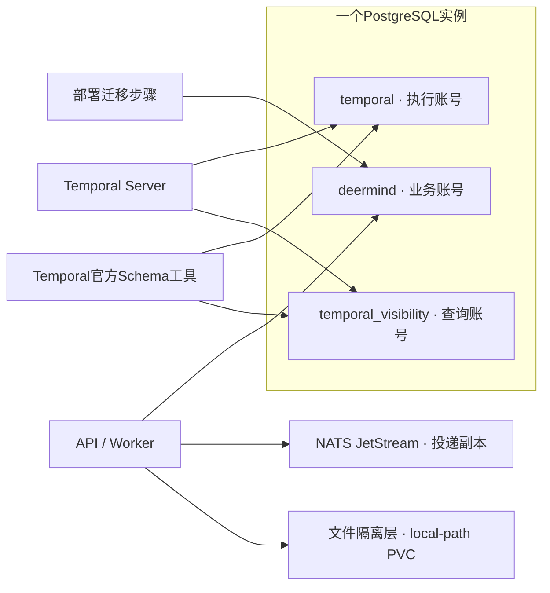
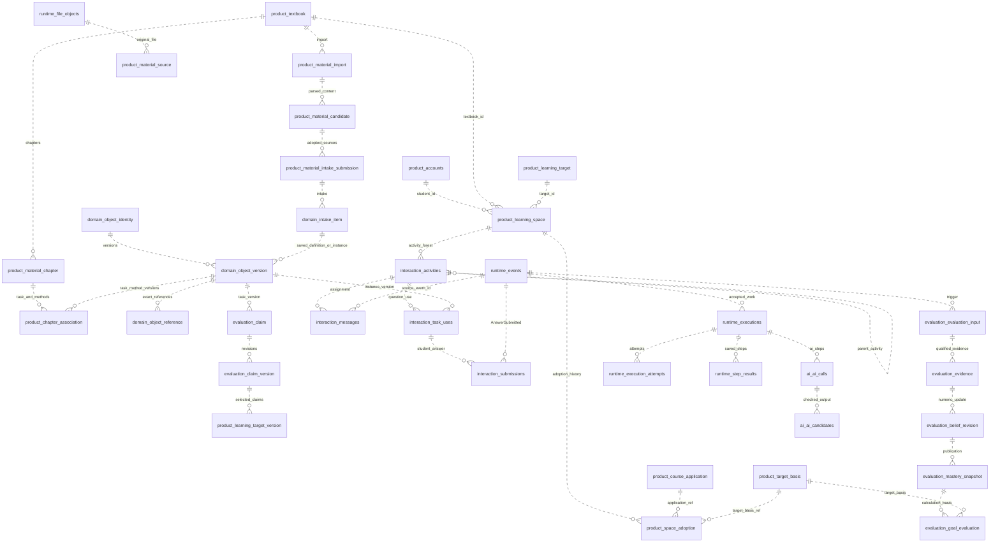

# M1 数据库设计

> **版本**：v0.4 
> **状态**：事件事实源修订稿待用户审阅；未编码、未修改原型 
> **维护与评审**：Codex 编写及自检，用户审阅 
> **更新日期**：2026-11-15 
> **修订说明**：v0.3 → v0.4，统一事件事实源、同步投影、正文读取及订阅合同；见MVP决定登记§96 

**一个PostgreSQL实例，三个数据库。** `deermind`保存业务与应用运行数据；`temporal`、`temporal_visibility`由Temporal管理。业务库内部按责任划分schema，schema不是独立数据库，也不等于独立服务。

模块文档维护接口、业务载荷、读写流程和事务边界；数据库分册维护表、物理字段、约束、索引及表关系；本册维护分库总览、公共存储规则和导航。模块通过链接引用分册，不再复制物理表定义。

用户确认M1继续采用同库分schema，数据库拆分留后续阶段；本轮沿用共同短事务并明确先追加事件、再同步投影，不增加拆库设计。字段稿仍待审阅，未建库或执行迁移。

## 1. 库与账号

| 数据库 | 内容 | 表数 | 管理方与账号边界 | 字段字典 |
| --- | --- | --- | --- | --- |
| `deermind` | 业务、事件、运行、文件元数据及AI调用 | 112 | 各模块维护各自schema；运行账号与迁移账号分开 | 本册§2及六个分册 |
| `temporal` | Workflow历史、执行、任务队列及组件元数据 | 39 | Temporal专用账号，官方Schema工具升级 | [执行库](database/Temporal.md) |
| `temporal_visibility` | Workflow检索视图及Schema记录 | 3 | Temporal查询库专用账号，官方工具升级 | [查询库](database/Temporal_Visibility.md) |

后两个库的表数按候选Server v1.32.2的官方Schema核对，包含各自两张Schema管理表；正式接收版本改变时更新附录，不据此提前锁定技术版本。PostgreSQL自带的`postgres`维护库、`template0/1`及系统目录不算应用数据库。

NATS、教材原件、派生图片和大载荷不是SQL表。文件字节经隔离层保存，`runtime.file_objects`登记位置与hash。Temporal内部History不是空间事件；消息队列副本也不替代`runtime.events`。Pod日志不写业务数据库。

## 2. 业务库表目录

| schema | 表数 / 列数 | 内容与完整字典 |
| --- | --- | --- |
| `product` | 28 / 246 | [产品业务](database/Business_Product.md) |
| `domain` | 9 / 91 | [领域空间](database/Business_Domain.md) |
| `interaction` | 35 / 306 | [交互空间](database/Business_Interaction.md) |
| `evaluation` | 13 / 127 | [评估空间](database/Business_Evaluation.md) |
| `runtime` | 19 / 194 | [公共运行及文件登记](database/Business_Runtime.md) |
| `ai` | 7 / 77 | [AI调用](database/Business_AI.md) |
| `public` | 1 / 1 | Alembic迁移记录，见§5 |

各分册逐表列出字段，不省略“通用字段”。JSONB只用于有既定结构的快照、内容、材料清单；可查询的身份、状态、顺序、时间和幂等键单列。表数包含版本、事实、当前索引和运行收据，不能将这些记录都合并成一个可覆盖的“状态表”。

### 2.1 业务库跨模块关系图

图中是主要追溯链，虚线为跨schema逻辑引用；完整表图在六个分册。`ObjectVersion`是Domain五类对象的统一版本表，不另建旧TaskTemplate/SolutionTemplate/SolutionInstance表。

### 2.2 关键关系及检查位置

| 关系 | 基数及版本 | 保存时由谁检查 |
| --- | --- | --- |
| 账号→学习空间 | 学生1:N；学生+教材+目标唯一 | Product检查学生身份；重复选择复用原空间 |
| 教材→领域 | N:1稳定Domain身份 | Product经Domain公开端口检查；导入后不改归属 |
| 领域身份→版本 | 1:N精确版本，头指向其中一版 | Domain；草稿、新版、软删除均不覆盖历史 |
| Task→Solution、先导Task；Solution→KC | 固定版本的N:M引用 | Domain同步写object_reference；不得重建旧“子调用树” |
| TaskInstance→Task | 一题一个主要Task精确版本 | Domain归类检查及入库；题内参考解法引用该Task的一种Solution |
| 章节→Task与采用方法 | 章节可多Task；每个Task选本章方法 | Product调用Domain核对；不直接关联KC |
| Task→Claim→目标项 | Task精确版本至多一个Claim；目标选Claim修订及方法条件 | Evaluation维护Claim；Product固定目标采用依据 |
| 课程应用→空间采用 | 1:N；同教材、同target_id内追加采用，当前指针可换 | Product核对应用与空间身份；换target_id进入另一空间，不修改旧应用、不重算旧作答 |
| 活动→消息、题目使用、作答 | 同空间；消息通过assignment唯一归属 | Interaction；学生作答不能只凭原题ID串联 |
| 原始事件→Evidence | 一事实可形成多个有独立依据的分项；来源去重 | Evaluation只在授权原文和Task候选范围内提取 |
| Evidence→Belief | 每Evidence至多一次数值处理；分项键固定 | Evaluation按空间事件顺序处理；无依据不传播概率 |
| Belief→目标结果 | 固定快照+目标依据；方法要求按目标计算 | Evaluation；Product短暂保护当前采用，旧依据结果只留历史 |
| Execution→Attempt→Step | 工作1:N尝试；已保存Step跨尝试复用 | Runtime；副作用仍由业务所有者幂等提交 |
| 业务引用→文件 | N:1固定file_id/hash；读取授权不随文件ID授予 | 基础设施登记文件，业务所有者校验来源及用途 |

## 3. 字段通则与JSON结构

以下是本批物理设计草案；不更改客户端已有的不透明ID合同。Domain已选uuid；其他应用内部ID统一使用uuid以便关联，生成算法留代码实现确定。外部请求键、Temporal Workflow ID、工具发生键保留text，不强转uuid。

| 项 | 定义 |
| --- | --- |
| 学习空间身份 | 当作用范围是learning_space时，各schema的scope_id与product.learning_space.space_id同值，不另生成或映射；其他范围按各自资源身份解释 |
| 空值 | 表中“可空”指SQL NULL；未知不得用0、空字符串、空数组冒充。JSON内部未知也使用显式null及原因 |
| 默认值 | “无”表示没有业务默认值，写入方明确提供；可空字段可明确写NULL。程序分配ID、时间、修订，不用默认now掩盖业务发生时刻 |
| 版本与序号 | version、revision、publication_seq为正整数；明确允许0的初始游标除外。递增在所属头行锁内分配，记录及指针同事务提交 |
| 时间 | 业务库timestamptz，服务端保存UTC；界面按北京时间显示。发生时间、记录时间、客户端报告时间分开；未知保持间隔不得猜测。Temporal官方timestamp不改类型 |
| 概率 | double precision且有限、0到1；NULL观测概率表示尚无合格观测，不等于0。参数/算法引用随更新记录保存，全局阈值沿Evaluation合同 |
| 字符串和枚举 | 名称、键非空；固定枚举以CHECK约束。长度/请求体上限引用原接口合同，不以物理text表示无业务限额 |
| 散列 | SHA-256为64位小写十六进制；散列命中仍比较关键规范化输入，不接受同键不同内容 |
| 外键 | 分册标FK的列使用同schema外键，NO ACTION，不级联删除。身份与首版本、当前指针等循环关系DEFERRABLE INITIALLY DEFERRED，在一次提交检查 |
| 跨schema关系 | 保留所有者明确接口和短事务校验；本稿不引入跨schema数据库外键。已有精确历史引用只读；M1无正式记录物理删除，不能借此绕过引用保护 |
| JSON内容 | 按所属Schema校验；顺序保存在数组，显示精度保存在字符串，不依赖对象键顺序 |
| JSON引用 | JSON内引用由所有者验证存在、归属、精确修订和可用性；数组内重复身份拒绝；不能仅靠JSON类型校验声称关系合法 |
| source_event_id | 事实投影的反向来源；逻辑引用runtime.events，正文以record_type与行主键定位。所有者投影器维护，不接受客户端写入；重建不分配新业务ID |
| 当前索引 | 允许更新的头、进度及缓存只指向已保存历史；不是另一份权威正文。写当前值同时保存支撑记录 |
| 索引 | 主键及UQ由数据库保证；复合版本引用建对应复合键。只对已列的过滤/排序/去重建索引；日志不落库、JSON不全部加GIN |

JSON字段不是未设计的占位。下表定义跨分册简称，具体业务载荷字段由各责任文档的既有结构表维护；物理列行直接给出该合同位置，不再另写一份容易漂移的正文。

| 类型 | 最小结构与规则 | 维护位置 |
| --- | --- | --- |
| EventPartRef | event_id、record_id或null、JSON Pointer path；完整定义见事件正文合同§2 | [事件正文](contracts/Event_Facts.md) |
| Ref | 跨模块持久引用含owner、type、id；引用版本记录必须有version或revision；引用内容片段另有path。所有者专用ObjectRef、ResultKey等沿各自结构，不强行改成同一JSON形状 | 各模块公开读取合同 |
| ObjectRef | kind、object_id、version；对象类型与目标版本一致 | [Domain§1.1](Domain_Space_Design.md) |
| ResultKey | scope_id、trigger_event_id、producer、result_kind；四者一起比较，不能只用correlation_id | [公共运行§3](System_Foundation_Design.md) |
| Issue | code:string、path:string、message:string；空数组表示无检查问题，不代替未知结论 | [Domain§1.2](Domain_Space_Design.md) |
| ArtifactValue | 小内容 `{storage:"inline", value:<schema_ref校验的对象>}`；大内容 `{storage:"file", file_id, sha256, media_type}`；恰选一种，hash对应规范化解码内容的规则须随Schema固定 | [AI§4.2、§6.3](AI_Foundation_Design.md)及[基础设施§2](Infrastructure_and_Deployment_Design.md) |
| RichContent | schema_version:string及有稳定ID的有序块；文字、公式、表格、图形和来源；每类必备字段、坐标/数据及渲染规则沿原合同 | [Domain§1.4](Domain_Space_Design.md) |
| 五类领域载荷 | Domain、Task、Solution、KC、TaskInstance的完整定义；题内ReferenceSolution含reference_id、solution_ref、content、origin、source_refs | [Domain§1.2](Domain_Space_Design.md) |
| 解析候选与采用集合 | 固定scope、read_set、write_set、coverage；候选KC/题目/解法各有正文、父题绑定和出处；批内键由程序分配 | [产品业务§3](Product_Application_Design.md) |
| GoalItem / ApplicationSnapshot | Claim修订、Task条件、章节依据、指定/任一/各方法要求和方面；应用固定教材与目标快照，不自动读最新版 | [产品业务§4.2.1、§5](Product_Application_Design.md) |
| 活动配置 | 蓝图nodes/transitions，Rule、Strategy、Binding及解析配置包；节点只保存本层绑定 | [Interaction§1.3](Interaction_Space_Design.md) |
| 消息parts | part_id、type；按type分别保存text、RichContent、文件引用、task_use或活动通知；学生原文不可覆盖 | [Interaction§2.4](Interaction_Space_Design.md) |
| Evidence及解释 | execution_checks、aspect_judgement、condition_facts、source_spans、reason、limitations；资格由程序核对后保存 | [Evaluation§2.3—2.4](Evaluation_Space_Design.md) |
| 发布快照 / 目标结果 | 分项键、概率、更新引用、覆盖/未完成状态；目标结果固定目标依据与所用快照 | [Evaluation§4—6](Evaluation_Space_Design.md) |
| 事件payload | 以event_type+schema_version登记精确载荷，不允许携带脚本或任意工具授权；完整正文及固定事件附件；原文不从投影表反查 | [事件目录](README.md#6-跨模块事件目录)及[公共运行§2.4](System_Foundation_Design.md) |
| 运行/模型配置 | 输入、权限、期限、结果身份以及固定模型配置；只保存credential_ref，不保存密钥或Cookie | [公共运行](System_Foundation_Design.md)、[AI底座](AI_Foundation_Design.md) |

### 3.1 事实、投影与控制数据

P为事件正文的业务投影，D为由事实生成的当前索引，C为运行控制/秘密/文件支持；E为正式事件。P表字段是正文DTO v1的复用定义，source_event_id由投影器注入；不是从业务表反向采集日志。D不独立保存历史。C不纳入业务投影重建，重要运行变化仍留事件；秘密不进入事件。

| 表 | 类别 | 说明 |
| --- | --- | --- |
| [ai.execution_configs](database/Business_AI.md#1-aiexecution_configs) | P | 完整正文及产生事件见事件正文§3 |
| [ai.ai_calls](database/Business_AI.md#2-aiai_calls) | P | 完整正文及产生事件见事件正文§3 |
| [ai.ai_call_attempts](database/Business_AI.md#3-aiai_call_attempts) | P | 完整正文及产生事件见事件正文§3 |
| [ai.execution_usage](database/Business_AI.md#4-aiexecution_usage) | C | 沿原模块恢复；不重放业务副作用 |
| [ai.model_requests](database/Business_AI.md#5-aimodel_requests) | P | 完整正文及产生事件见事件正文§3 |
| [ai.tool_actions](database/Business_AI.md#6-aitool_actions) | P | 完整正文及产生事件见事件正文§3 |
| [ai.ai_candidates](database/Business_AI.md#7-aiai_candidates) | P | 完整正文及产生事件见事件正文§3 |
| [domain.object_identity](database/Business_Domain.md#1-domainobject_identity) | D | 来源与重建见事件正文§3.1 |
| [domain.object_version](database/Business_Domain.md#2-domainobject_version) | P | 完整正文及产生事件见事件正文§3 |
| [domain.object_reference](database/Business_Domain.md#3-domainobject_reference) | D | 来源与重建见事件正文§3.1 |
| [domain.intake_submission](database/Business_Domain.md#4-domainintake_submission) | P | 完整正文及产生事件见事件正文§3 |
| [domain.intake_item](database/Business_Domain.md#5-domainintake_item) | P | 完整正文及产生事件见事件正文§3 |
| [domain.artifact](database/Business_Domain.md#6-domainartifact) | P | 完整正文及产生事件见事件正文§3 |
| [domain.kc_test_path](database/Business_Domain.md#7-domainkc_test_path) | P | 完整正文及产生事件见事件正文§3 |
| [domain.supply_batch](database/Business_Domain.md#8-domainsupply_batch) | P | 完整正文及产生事件见事件正文§3 |
| [domain.command_receipt](database/Business_Domain.md#9-domaincommand_receipt) | C | 沿原模块恢复；不重放业务副作用 |
| [evaluation.claim](database/Business_Evaluation.md#1-evaluationclaim) | D | 来源与重建见事件正文§3.1 |
| [evaluation.claim_version](database/Business_Evaluation.md#2-evaluationclaim_version) | P | 完整正文及产生事件见事件正文§3 |
| [evaluation.evaluation_input](database/Business_Evaluation.md#3-evaluationevaluation_input) | P | 完整正文及产生事件见事件正文§3 |
| [evaluation.interpretation](database/Business_Evaluation.md#4-evaluationinterpretation) | P | 完整正文及产生事件见事件正文§3 |
| [evaluation.evidence](database/Business_Evaluation.md#5-evaluationevidence) | P | 完整正文及产生事件见事件正文§3 |
| [evaluation.belief_revision](database/Business_Evaluation.md#6-evaluationbelief_revision) | P | 完整正文及产生事件见事件正文§3 |
| [evaluation.belief_current](database/Business_Evaluation.md#7-evaluationbelief_current) | D | 来源与重建见事件正文§3.1 |
| [evaluation.mastery_snapshot](database/Business_Evaluation.md#8-evaluationmastery_snapshot) | P | 完整正文及产生事件见事件正文§3 |
| [evaluation.mastery_head](database/Business_Evaluation.md#9-evaluationmastery_head) | D | 来源与重建见事件正文§3.1 |
| [evaluation.goal_calculation_input](database/Business_Evaluation.md#10-evaluationgoal_calculation_input) | P | 完整正文及产生事件见事件正文§3 |
| [evaluation.goal_evaluation](database/Business_Evaluation.md#11-evaluationgoal_evaluation) | P | 完整正文及产生事件见事件正文§3 |
| [evaluation.goal_current](database/Business_Evaluation.md#12-evaluationgoal_current) | D | 来源与重建见事件正文§3.1 |
| [evaluation.evaluation_progress](database/Business_Evaluation.md#13-evaluationevaluation_progress) | C | 沿原模块恢复；不重放业务副作用 |
| [interaction.inputs](database/Business_Interaction.md#1-interactioninputs) | P | 完整正文及产生事件见事件正文§3 |
| [interaction.input_results](database/Business_Interaction.md#2-interactioninput_results) | P | 完整正文及产生事件见事件正文§3 |
| [interaction.space_runtime](database/Business_Interaction.md#3-interactionspace_runtime) | C | 沿原模块恢复；不重放业务副作用 |
| [interaction.messages](database/Business_Interaction.md#4-interactionmessages) | P | 完整正文及产生事件见事件正文§3 |
| [interaction.message_assignments](database/Business_Interaction.md#5-interactionmessage_assignments) | P | 完整正文及产生事件见事件正文§3 |
| [interaction.activities](database/Business_Interaction.md#6-interactionactivities) | P | 完整正文及产生事件见事件正文§3 |
| [interaction.activity_revisions](database/Business_Interaction.md#7-interactionactivity_revisions) | P | 完整正文及产生事件见事件正文§3 |
| [interaction.activity_heads](database/Business_Interaction.md#8-interactionactivity_heads) | D | 来源与重建见事件正文§3.1 |
| [interaction.detection_plans](database/Business_Interaction.md#9-interactiondetection_plans) | P | 完整正文及产生事件见事件正文§3 |
| [interaction.plan_revisions](database/Business_Interaction.md#10-interactionplan_revisions) | P | 完整正文及产生事件见事件正文§3 |
| [interaction.plan_progress](database/Business_Interaction.md#11-interactionplan_progress) | P | 完整正文及产生事件见事件正文§3 |
| [interaction.detection_rounds](database/Business_Interaction.md#12-interactiondetection_rounds) | P | 完整正文及产生事件见事件正文§3 |
| [interaction.round_revisions](database/Business_Interaction.md#13-interactionround_revisions) | P | 完整正文及产生事件见事件正文§3 |
| [interaction.task_uses](database/Business_Interaction.md#14-interactiontask_uses) | P | 完整正文及产生事件见事件正文§3 |
| [interaction.submissions](database/Business_Interaction.md#15-interactionsubmissions) | P | 完整正文及产生事件见事件正文§3 |
| [interaction.answer_feedback](database/Business_Interaction.md#16-interactionanswer_feedback) | P | 完整正文及产生事件见事件正文§3 |
| [interaction.help_facts](database/Business_Interaction.md#17-interactionhelp_facts) | P | 完整正文及产生事件见事件正文§3 |
| [interaction.presentations](database/Business_Interaction.md#18-interactionpresentations) | P | 完整正文及产生事件见事件正文§3 |
| [interaction.teaching_opportunities](database/Business_Interaction.md#19-interactionteaching_opportunities) | P | 完整正文及产生事件见事件正文§3 |
| [interaction.opportunity_closures](database/Business_Interaction.md#20-interactionopportunity_closures) | P | 完整正文及产生事件见事件正文§3 |
| [interaction.blueprint_revisions](database/Business_Interaction.md#21-interactionblueprint_revisions) | P | 完整正文及产生事件见事件正文§3 |
| [interaction.rule_revisions](database/Business_Interaction.md#22-interactionrule_revisions) | P | 完整正文及产生事件见事件正文§3 |
| [interaction.strategy_revisions](database/Business_Interaction.md#23-interactionstrategy_revisions) | P | 完整正文及产生事件见事件正文§3 |
| [interaction.binding_revisions](database/Business_Interaction.md#24-interactionbinding_revisions) | P | 完整正文及产生事件见事件正文§3 |
| [interaction.resolved_configs](database/Business_Interaction.md#25-interactionresolved_configs) | P | 完整正文及产生事件见事件正文§3 |
| [interaction.config_heads](database/Business_Interaction.md#26-interactionconfig_heads) | D | 来源与重建见事件正文§3.1 |
| [interaction.decision_records](database/Business_Interaction.md#27-interactiondecision_records) | P | 完整正文及产生事件见事件正文§3 |
| [interaction.context_bundles](database/Business_Interaction.md#28-interactioncontext_bundles) | P | 完整正文及产生事件见事件正文§3 |
| [interaction.memory_revisions](database/Business_Interaction.md#29-interactionmemory_revisions) | P | 完整正文及产生事件见事件正文§3 |
| [interaction.memory_heads](database/Business_Interaction.md#30-interactionmemory_heads) | D | 来源与重建见事件正文§3.1 |
| [interaction.proactive_checks](database/Business_Interaction.md#31-interactionproactive_checks) | P | 完整正文及产生事件见事件正文§3 |
| [interaction.proactive_tasks](database/Business_Interaction.md#32-interactionproactive_tasks) | P | 完整正文及产生事件见事件正文§3 |
| [interaction.proactive_revisions](database/Business_Interaction.md#33-interactionproactive_revisions) | P | 完整正文及产生事件见事件正文§3 |
| [interaction.proactive_prompts](database/Business_Interaction.md#34-interactionproactive_prompts) | P | 完整正文及产生事件见事件正文§3 |
| [interaction.resume_actions](database/Business_Interaction.md#35-interactionresume_actions) | C | 沿原模块恢复；不重放业务副作用 |
| [product.accounts](database/Business_Product.md#1-productaccounts) | P | 完整正文及产生事件见事件正文§3 |
| [product.credentials](database/Business_Product.md#2-productcredentials) | C | 沿原模块恢复；不重放业务副作用 |
| [product.auth_sessions](database/Business_Product.md#3-productauth_sessions) | C | 沿原模块恢复；不重放业务副作用 |
| [product.guardian_records](database/Business_Product.md#4-productguardian_records) | P | 完整正文及产生事件见事件正文§3 |
| [product.student_guardian_relations](database/Business_Product.md#5-productstudent_guardian_relations) | P | 完整正文及产生事件见事件正文§3 |
| [product.usage_confirmations](database/Business_Product.md#6-productusage_confirmations) | P | 完整正文及产生事件见事件正文§3 |
| [product.usage_conditions](database/Business_Product.md#7-productusage_conditions) | P | 完整正文及产生事件见事件正文§3 |
| [product.textbook](database/Business_Product.md#8-producttextbook) | P | 完整正文及产生事件见事件正文§3 |
| [product.material_import](database/Business_Product.md#9-productmaterial_import) | P | 完整正文及产生事件见事件正文§3 |
| [product.material_source](database/Business_Product.md#10-productmaterial_source) | P | 完整正文及产生事件见事件正文§3 |
| [product.material_message](database/Business_Product.md#11-productmaterial_message) | P | 完整正文及产生事件见事件正文§3 |
| [product.material_turn](database/Business_Product.md#12-productmaterial_turn) | P | 完整正文及产生事件见事件正文§3 |
| [product.material_candidate_batch](database/Business_Product.md#13-productmaterial_candidate_batch) | P | 完整正文及产生事件见事件正文§3 |
| [product.material_candidate](database/Business_Product.md#14-productmaterial_candidate) | P | 完整正文及产生事件见事件正文§3 |
| [product.material_content_current](database/Business_Product.md#15-productmaterial_content_current) | D | 来源与重建见事件正文§3.1 |
| [product.material_adoption](database/Business_Product.md#16-productmaterial_adoption) | P | 完整正文及产生事件见事件正文§3 |
| [product.material_chapter](database/Business_Product.md#17-productmaterial_chapter) | P | 完整正文及产生事件见事件正文§3 |
| [product.material_intake_submission](database/Business_Product.md#18-productmaterial_intake_submission) | P | 完整正文及产生事件见事件正文§3 |
| [product.chapter_association](database/Business_Product.md#19-productchapter_association) | P | 完整正文及产生事件见事件正文§3 |
| [product.command_receipt](database/Business_Product.md#20-productcommand_receipt) | C | 沿原模块恢复；不重放业务副作用 |
| [product.learning_target](database/Business_Product.md#21-productlearning_target) | P | 完整正文及产生事件见事件正文§3 |
| [product.learning_target_version](database/Business_Product.md#22-productlearning_target_version) | P | 完整正文及产生事件见事件正文§3 |
| [product.application_check](database/Business_Product.md#23-productapplication_check) | P | 完整正文及产生事件见事件正文§3 |
| [product.course_application](database/Business_Product.md#24-productcourse_application) | P | 完整正文及产生事件见事件正文§3 |
| [product.application_head](database/Business_Product.md#25-productapplication_head) | D | 来源与重建见事件正文§3.1 |
| [product.target_basis](database/Business_Product.md#26-producttarget_basis) | P | 完整正文及产生事件见事件正文§3 |
| [product.learning_space](database/Business_Product.md#27-productlearning_space) | P | 完整正文及产生事件见事件正文§3 |
| [product.space_adoption](database/Business_Product.md#28-productspace_adoption) | P | 完整正文及产生事件见事件正文§3 |
| [runtime.file_objects](database/Business_Runtime.md#1-runtimefile_objects) | C | 沿原模块恢复；不重放业务副作用 |
| [runtime.file_uploads](database/Business_Runtime.md#2-runtimefile_uploads) | C | 沿原模块恢复；不重放业务副作用 |
| [runtime.events](database/Business_Runtime.md#3-runtimeevents) | E | 只追加，含完整事实及不可变附件 |
| [runtime.scope_event_heads](database/Business_Runtime.md#4-runtimescope_event_heads) | C | 沿原模块恢复；不重放业务副作用 |
| [runtime.execution_authorizations](database/Business_Runtime.md#5-runtimeexecution_authorizations) | C | 沿原模块恢复；不重放业务副作用 |
| [runtime.executions](database/Business_Runtime.md#6-runtimeexecutions) | C | 沿原模块恢复；不重放业务副作用 |
| [runtime.execution_attempts](database/Business_Runtime.md#7-runtimeexecution_attempts) | C | 沿原模块恢复；不重放业务副作用 |
| [runtime.step_results](database/Business_Runtime.md#8-runtimestep_results) | C | 沿原模块恢复；不重放业务副作用 |
| [runtime.handoffs](database/Business_Runtime.md#9-runtimehandoffs) | C | 沿原模块恢复；不重放业务副作用 |
| [runtime.handoff_attempts](database/Business_Runtime.md#10-runtimehandoff_attempts) | C | 沿原模块恢复；不重放业务副作用 |
| [runtime.delivery_failures](database/Business_Runtime.md#11-runtimedelivery_failures) | C | 沿原模块恢复；不重放业务副作用 |
| [runtime.subscription_receipts](database/Business_Runtime.md#12-runtimesubscription_receipts) | C | 沿原模块恢复；不重放业务副作用 |
| [runtime.waits](database/Business_Runtime.md#13-runtimewaits) | C | 沿原模块恢复；不重放业务副作用 |
| [runtime.wait_handling](database/Business_Runtime.md#14-runtimewait_handling) | C | 沿原模块恢复；不重放业务副作用 |
| [runtime.expected_results](database/Business_Runtime.md#15-runtimeexpected_results) | C | 沿原模块恢复；不重放业务副作用 |
| [runtime.result_attempts](database/Business_Runtime.md#16-runtimeresult_attempts) | C | 沿原模块恢复；不重放业务副作用 |
| [runtime.published_results](database/Business_Runtime.md#17-runtimepublished_results) | C | 沿原模块恢复；不重放业务副作用 |
| runtime.projection_receipts、runtime.projection_offsets | C | 重建及补读进度，不是事实源 |

## 4. 保存、恢复和删除约束

1. **单一业务库内的短事务。** 教材来源检查与Domain保存、课程采用检查与目标当前结果保存，由各所有者仓储参加同一短事务；AI、文件传输、NATS和Temporal调用始终在事务外。
2. **先事件、再投影、后交接。** 完整事件、由其生成的业务投影、投影收据和后续安排共同提交；底座之后投递。订阅方把收据与执行安排存好才确认收到，不等AI结束。
3. **事件是事实源。** 聊天、活动和评价是查询投影；原文保存在事件及固定附件。Temporal History是执行历史，不是业务事实源，清理它不删除正式依据。
4. **引用不自动升级。** 对象/Claim/教材候选/目标/活动配置引用精确版本。新版本不重写旧引用；空间的当前采用可以改变，但旧活动和旧评价保留原依据。
5. **M1不物理删除正式记录。** 领域软删除追加新版本，教材删除标记资源失效。文件、账号与学生记录的后续保留/删除仍按原设计待确认项处理；本批不发明定期清理。不能只因为没有数据库FK就删被逻辑引用的内容。
6. **访问权限不靠图中的线。** API/Worker可共用业务运行账号，各模块仍只通过所有者接口读取和写入。分schema不意味着已建立数据库级租户隔离。Evaluation不能遍历Interaction私有记忆。

## 5. `public.alembic_version`

业务库只维护一条Alembic迁移链，不为每个schema建独立head。迁移按模块文件维护，部署阶段统一执行。Temporal两个库使用自己的官方Schema工具。

| 字段 | 类型 | 可空 | 默认 | 定义 |
| --- | --- | --- | --- | --- |
| `version_num` | `varchar(32)` | 否 | 无 | 主键，当前Alembic迁移revision；不等于产品内容版本 |

没有业务外键。部署前检查只有一个head；不自动删库重建。版本ID长度在Alembic脚本生成时遵守此列限制。

## 6. 自检与审阅范围

首轮字段稿的表字段、官方Temporal Schema及Mermaid语法核对见[登记§92](../../DECISIONS.md#92-m1完整数据库设计与字段字典)。本轮检查字段承接、主外键及索引列、链接和升版；早期归并结果见[登记§93](../../DECISIONS.md#93-数据库定义单一维护与schema边界)。未执行DDL、运行数据库、做恢复试验或性能测试。

本次供审阅的选择是：业务字段的物理类型及枚举、JSON与列的分界、同schema外键/跨schema逻辑引用、索引以及少量此前只有逻辑对象的落表位置。它们不是已批准的实现。若审阅调整这些细节，只同步相关表和责任合同，不扩大产品范围。

首轮字段稿明确的落表位置包括最小监护关系/使用确认、Interaction的resume_actions和Alembic元表。已有账号、活动、文件、AI和概率记录按原职责落表，没有新增权限平台、算法配置页面、监控库或Evolution库。

实现阶段从本稿编写迁移，并核对精确JSON Schema、约束和回滚行为；不能用“实现再定”遗漏本册已列的字段。索引性能和容量用真实运行验证；不以文档静态检查替代工程验证。

## 修订记录

| 版本 | 日期 | 修改 |
| --- | --- | --- |
| v0.1 | 2026-11-15 | 首次汇总三个库、全部表与字段、关系图及维护边界；字段稿待审阅 |

本轮修订（v0.2，2026-11-15）：物理表定义集中到数据库分册；模块保留流程、接口和事务规则。保持同库schema划分，未改原型或编码。见MVP决定登记§93。

本轮修订（v0.3，2026-11-15）：明确学习空间身份同值及同目标内追加采用；不改表结构。见MVP决定登记§95。

本轮修订（v0.4，2026-11-15）：统一事件事实源、正文来源及查询投影，承接同事务写入与按需订阅；见MVP决定登记§96。本轮仅修改文档。
