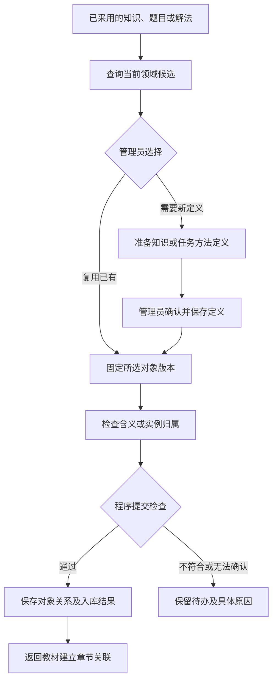

# M1 Domain Space 设计

> **版本**：v0.9<br>
> **状态**：Domain详细设计第一批待用户审阅；对象、内容与入库合同已展开，未编码或运行验证<br>
> **维护与评审**：Codex编写及自检，用户审阅<br>
> **写作规范**：[系统设计写作规范](../../../top/DeerMind_System_Design_Writing_Standard.md)<br>
> **更新日期**：2026-11-14<br>
> **修订说明**：v0.8 → v0.9，细化对象版本、统一内容结构、复用与入库、AI匹配归类及程序提交条件；补齐异常与设计算例，见MVP决定登记§70<br>

本文维护可复用领域内容及其业务操作，不保存学生作答、个人接触史或 Belief。依据为 [PRD R04](../PRD.md#34-维护领域处理入库并关联章节m1-r04)、[R07](../PRD.md#37-准备题目和参考m1-r07)与[内容规格§3.2–3.3](../design/Content_and_Model_Reference.md#32-领域对象与字段)；共同输入见[工程入口§2](README.md#2-设计输入与历史参考)。

入库受理和供题按Domain自己的业务合同执行并发布事实事件，公开结果保留来源引用。Product或Interaction是否等待、采用什么期限，不改变Domain的处理义务和执行预算；它们结束等待不自动取消Domain任务。消费方通过底座订阅匹配及处理自己的超时，见[总体§7.2.1三](System_Design.md#721-已确认的总体选择)。

## 1. 领域对象、身份与关系

### 1.1 公共输入与引用

Domain保留定义提取、实例归类和智能供题三项AI Operation。维护、受理、提交和查询仍是普通业务；保存流程需要语义判断时安排AI能力，取得检查结果后再提交。执行边界见[公共运行§1.3](System_Foundation_Design.md#13-operationstep与operationrun)。以下是模块逻辑合同；HTTP路径、消息序列化和物理表在后续设计中确定。

| 输入／类型 | 必填性、含义与约束 |
| --- | --- |
| `access_context`／程序上下文 | 必填；包含调用者及获准资源范围，模型输出不能授予权限 |
| `request_id`／非空字符串 | 直接写请求必填；同次重试沿用。同键不同载荷拒绝，不能当作新一次保存 |
| `trigger_event_id`／事件引用 | 消息受理必填；指向触发事实，不以投递次数新建请求 |
| `scope_id`／资源身份 | 必填；维护取Domain，教材受理取导入资源，供题取学习空间；新Domain取调用者账户范围 |
| `ObjectRef` | `{kind, object_id, version}`；`kind`为五类领域对象之一，`version`为从1开始的整数，均由程序维护 |
| `content_ref`／不可变内容引用 | 指向具体对象版本内的内容，或尚未入库的固定候选；带所有者，不能只凭引用绕过授权 |
| `expected_version`／正整数 | 追加已有领域对象版本必填；必须等于该对象提交时的最新版本 |
| `expected_revision`／并发令牌 | 保留用于待入库行等处理记录；不与领域对象版本混用 |
| `source_refs[]`／来源引用数组 | 来源可以是已采用教材内容及原页位置、管理员输入或生成记录；数组为空必须明确无外部来源，不能伪造教材出处 |

`domain_id`标识所属领域，不锁定Domain的某个版本；Domain本身没有父领域字段。读取关系目标必须使用完整`ObjectRef`，不在每次读取时替换成目标的最新版。领域归属由程序依据对象核对，不信任AI声称的归属。题内参考解法通过`{task_instance_ref, reference_id}`定位，继承题目版本，不建立独立SolutionInstance生命周期。

### 1.2 对象载荷与就绪检查

五类对象都采用§1.3的版本外壳，业务字段放入`content`。下表中的“必备”指正式用途前所需内容；定义草稿允许字段为`null`或数组为空，并返回具体`gaps[]`。名称必须非空；不存在的引用、越域关联及先导环不能作为草稿写入。正式题目入库必须已有一个主要Task且归类通过，尚无归属的内容保留在候选／待办。

| 类型 | `content`字段 | 条件与约束 |
| --- | --- | --- |
| Domain | `name:string, coverage:RichContent?, description:RichContent?` | 名称必填；不保存可由`domain_id`查询得到的成员列表 |
| Task | `name, responsibility, expected_output, completion_conditions, applicability, boundaries`；后五项为`RichContent` | 明确认知责任、要求的表现和条件，不能仅以题型名或公式替代 |
| Task关系 | `method_refs:ObjectRef[], prerequisites:Prerequisite[], parameters:Parameter[]` | 正式使用至少一法；参数可空；不接收Task→KC，也不存KC Task／复合Task角色 |
| Solution | `name, approach, rationale, applicability, key_process, kc_refs:ObjectRef[]`；说明字段为`RichContent` | 正式使用时方法依据与直接KC明确；可关联多个KC，不要求可执行子调用树 |
| KC | `name, definition, applicability, examples, non_examples`；说明字段为`RichContent` | 含义和条件必备；正反例可空并说明不足；直接检验路径单列在§4.3，不倒置为KC持有Task依赖 |
| TaskInstance | `title:string, task_ref:ObjectRef, statement:RichContent, answer_basis:RichContent?, reference_solutions:ReferenceSolution[], source_refs[]` | 一题一个主要Task；`answer_basis=null`是尚未准备，不等于无须核对；参考解法可为空 |

`Prerequisite`包含`task_ref, reason:string, applies_to=all|specified, method_refs[]`。`all`时数组为空，`specified`时非空且属于本Task直接方法。`Parameter`包含`name, meaning, type, constraints`；只在任务确有变量时填写，不把所有任务参数化。

`ReferenceSolution`包含题内唯一的`reference_id`、`solution_ref:ObjectRef`、`content:RichContent`、`origin=textbook|system_generated|admin_authored`及`source_refs[]`。具体解法必须指向本题所采用Task版本中的方法。参考编号在题目后续版本中保持，内容改动产生题目新版本；不另设参考版本号。教材没有给出的解法不能标成教材原解。

正式使用检查当前选定Task、方法及直接KC的内容和§4.3路径确认。先导缺口用于回补安排，不扩大课程或正式评价范围。`gaps[]/issues[]`统一包含`code, path, message`；`path`指向字段或内容块。就绪结果按固定输入另存检查记录，不为刷新检查状态改写领域对象。

`availability`是检查记录派生的只读结果：`check_status=not_checked|passed|failed`、`checked_purposes[]`及问题引用。归类通过、入库保存、允许用于某次检测是三个不同结论；`classification_check_ref`固定归属判断，`use_check_ref`固定本次供题用途检查。

### 1.3 只追加的对象版本

| 字段 | 类型与约束 |
| --- | --- |
| `object_id` | 程序生成的稳定身份；语义仍是同一对象时不换ID |
| `kind, domain_id` | 类型及所属领域固定；Domain根对象省略`domain_id` |
| `version` | 正整数，从1开始；仅在提交成功时分配下一版 |
| `content` | 当前版本完整业务快照，含本版持有的关系；历史版本不覆盖 |
| `is_deleted` | 布尔值；初始为`false`，软删除追加`true`的新版本 |
| `created_at, created_by` | 程序记录的创建时刻与执行者；AI工作另可追溯到运行记录 |
| `change_note` | 非空变更说明；新建、修订、软删除都记录原因 |

关系随持有者升版，不单独维护关系版本号。例如T1@1引用S1@1，创建S1@2不会改动T1@1；管理员明确采用后创建T1@2。领域显示名修改只增加Domain版本，不让全部成员升版。对象意义改变为另一项责任／概念时新建对象，不能以追加版本掩盖身份改变。

软删除保留完整快照及全部历史引用；默认列表和新建关联排除已软删除身份，不能通过选择其旧版本绕过。既有引用仍可授权读取历史内容，新供题／新关联须报告不可用。软删除Domain后，该领域不再接收新内容，成员不会被批量删除。M1不提供物理删除入口；后续清理必须先证明无对象、章节、事件、检查或其他记录引用，存在任何引用均不得物理删除。

旧版本仍可作为明确选择的依据，新版存在本身不使旧引用失效。并发控制只要求被追加版本的对象仍等于`expected_version`；读取依赖则核对所选精确版本及当前可引用状态。一次保存涉及多个对象时分别检查预期版本，全部成功才提交；不做自动合并、引用升级、历史迁移或Belief重算。

### 1.4 文字公式图表的统一内容结构

业务对象中的`RichContent`采用同一逻辑结构。教材候选、已保存定义、题面与参考解法使用同一内容语法，但分别由所属模块保存。内容块不是新增领域实体，候选修订号、内容格式版本及领域对象版本也不互相替代。

```text
RichContent
  schema_version: string                 内容格式版本
  role: definition | statement | reference | teaching_aid | derived_view
  blocks: Block[]                        有序内容，允许文中引用其他块
  data_tables: DataTable[]                图表共用数据，本内容内唯一
  source_refs: SourceRef[]                原件或加工输入的不可变引用

Block
  block_id: string                       程序维护的内容内标识
  type: paragraph | math_sequence | table | chart | diagram
  provenance: {source_refs[], transformation, note}
  payload: 该类型的数据
```

`transformation=extracted|normalized|derived|generated`分别记录来源提取、等义整理、加工与生成；不表示语义已验证。`SourceRef`保留来源所有者、固定内容／原件引用及可选文件页序、印刷页码、区域；不同页码字段不能替代。编号、引用和归属由程序分配或解析，AI只使用提供的候选标识和局部定位，不自行创造领域ID。

| `type` | 最小载荷 | 检查与重新展示 |
| --- | --- | --- |
| `paragraph` | 有序`spans[]`，成员为`text`、`math`或`response_blank` | 文字按文本展示；行内公式走公式渲染器；作答空白不携带答案 |
| `math_sequence` | `purpose=given_work|reference_work`、有序`lines[]`；每行含表达树、可选关系符与尾注 | `given_work`可能是辨错题中的错误演算；不因运算不成立而改写原题；`reference_work`不得放入题面 |
| `table` | `data_ref, caption` | 引用本内容数据表；按列定义显示数值和单位，不另存一份数值 |
| `chart` | `kind=bar|line|pie, data_ref, category_column, series[], axis, legend, caption` | 系列引用列及单位，保留轴、刻度、标签和比例语义；缺值不以0绘图 |
| `diagram` | `objects[], relations[], layout` | 几何对象、标签、明确关系和显示布局分开；按白名单生成SVG，坐标不自动产生数学条件 |

公式表达树只有一份权威结构：`number`保存十进制字符串，`symbol`保存符号名称；`group`有一个子表达式并保留括号；`add|subtract|multiply|divide|fraction|equal`各有两个有序子表达式，多项运算通过嵌套表达先后。约分等书写标记`cancel_to[]`附在原数字节点，记录划去与替换，不改写原操作数。LaTeX／MathML由树派生，不保存另一份可独立修改的公式正文。首批节点范围以四例为限；未支持的表达保留缺口，不能降成不可追溯图片或假装完整。

`DataTable`包含`data_id, columns[], rows[], provenance`。列包含`key, label, value_type, unit`；单元格包含`state=provided|response_blank|source_missing|unreadable`及条件必填的`value`。只有`provided`有值；小数用字符串保留1.30等显示精度，其余状态省略值，避免空白、未知和0混淆。行键和列键由程序维护；同一图的表格展示使用同一数据，不再次提取一份。合并单元格等未覆盖结构在实现前补协议，不在本批宣称已支持。

`diagram.objects[]`使用局部ID、形状类型及几何／文字属性；`relations[]`必须注明依据为原文明示、原图标记或视觉观察。视觉上的“点在图内”不能提升为“该点是圆心”；布局坐标只用于示意绘制。缺少附页或标记看不清时，记录缺口并请求材料，不补出隐藏条件。

### 1.5 提取保存与展示的交接

1. 教材助手读取限定原件及规则，输出KC、题目、具体解法的内容候选。题目与每份参考分别携带内容，教学提示单独标识；教材教学策略不自动写入Interaction配置。
2. 程序解析局部标识，检查结构、引用、值域和声明的修改范围。Agent再对照原件检查漏项，管理员通过对话修正并采用；Schema通过不能证明没有漏掉整张图。
3. 已采用内容送入Domain后，按§2和§5匹配定义。Domain保存采用内容的固定副本及来源，或固定其不可变内容引用；不得依赖导入页面的可变当前值。
4. 客户端读取授权内容后，程序按类型渲染文字、MathML、表格和SVG；纯重排不调用LLM、不改变领域版本。题面响应不返回答案、参考或辅助提示；后端先裁剪，不能只靠前端隐藏。
5. 加工出的提示、辅助图、解释或派生表保留输入引用和用途，由发起加工的模块保存。它们不覆盖原题；要改领域内容必须明确创建新版本，再进行受影响的归类／用途检查。

AI输出只是一份候选。表达不了的内容、疑似漏图、条件冲突保留问题；不执行模型生成的任意HTML、JavaScript或SVG。客户端展示机制见[客户端§3.1](Client_Design.md#31-统一内容的读取与渲染)。

## 2. 定义维护与教材内容入库

### 2.1 `domain.save_definition`

**触发与输入。** 管理员新建、修订、软删除或确认定义候选；需要领域维护权限。输入`object_kind`（Domain／Task／Solution／KC）、`action=create|update|soft_delete, request_id, change_note`。创建／修订给完整`definition`；修订／软删除另给`object_ref, expected_version`；采用提取结果给`candidate_ref`及来源。

1. 按请求身份查已提交结果，再校验权限、领域和动作。相同请求不同载荷返回`request_conflict`。
2. 新建对象由程序分配ID；修订读取基准版本。`soft_delete`复制原快照并标记删除，不要求管理员重填内容，不级联删除被引用或引用它的对象。
3. 按§1、§3、§4检查字段、引用和先导；合法草稿返回缺口，不自动创建任何依赖。定义的认知责任或概念已变为另一对象时，提示新建，不继续沿用旧身份。
4. 短事务内重查预期版本和引用状态，追加对象版本、关系及`DomainDefinitionSaved`事件，保存请求结果后提交。输出`object_ref, content_ref, gaps[]`；版本在`object_ref`中，不再返回第二个领域`revision`。

提交失败不产生半个版本。并发不一致返回`version_conflict`，非法引用／环返回`invalid_reference|dependency_cycle`。草稿缺方法可以保存，Task直接挂KC不可以；两者不能使用同一种错误处理。软删除不修改现有教材采用和历史事实，后续新用途检查说明不可用。

### 2.2 `domain.receive_intake`

**触发与输入。** 教材业务提交`DomainIntakeRequested`后异步处理；服务身份需有向目标领域提交内容的权限。输入`trigger_event_id, domain_id, intake_request_id, candidate_refs[]`。经教材公开接口读取已采用的知识／题目／具体解法、固定`content_ref`及教材／章节／原页出处；解法必须有`parent_candidate_ref`或已入库的`task_instance_ref`，不能只有方法名称。

1. 校验请求事件和资源范围，读取教材业务已采用且当前仍有效的不可变候选；未采用或已过时来源不进入待办。
2. 按题目与其解法建立 `group_ref`，KC 独立成组；解法父题可在本批、已有待办或已入库记录中，无法定位则返回 `missing_parent`。
3. 同次提交保存整批待办与 `DomainIntakeReceived`，发布 `producer=domain, result_kind=intake_receipt`。回执为 `intake_request_id, items[{candidate_ref,intake_item_ref,group_ref,state}]`；这里只接收，不创建定义、实例或章节关联。

事件重复沿用原受理记录；同领域、同已采用候选已有有效待办／入库结果时回传已有映射，避免重复排队。读取来源故障保留受理记录重试，不产生半批回执。**验收例：** 只提交题目可进入待办；另提交解法时可定位此前题目，不要求一起导入。

同操作接收 `MaterialCandidatesAdopted|MaterialImportDeleted` 的来源失效分支：输入为事件中的导入身份、被替代／删除的来源及受影响提交引用。只将未入库行标为 `source_invalid` 并追加 `DomainIntakeSourceInvalidated`，不覆盖已入库对象；不发布新的 `intake_receipt`。处理待办前仍查询教材公开有效性，不能依靠通知恰好先到。

### 2.3 `domain.process_intake`

**触发与输入。** 管理员处理待入库行；输入`request_id, intake_item_ref, expected_revision, action`及分支参数。这里的`expected_revision`只保护待办行，追加题目或Task版本另给各自`expected_version`。

| `action` | 参数与处理 | 成功输出 |
| --- | --- | --- |
| `add_kc` | `definition`与`existing_kc_ref`恰一；创建定义或按§2.4确认复用 | KC版本引用，`state=added` |
| `associate_task` | `task_ref`必填；可给明确选择的`existing_instance_ref`，否则按§5.1新建题目 | 题目版本引用，`state=associated` |
| `associate_solution` | `solution_ref, task_instance_ref, expected_version`必填；需要补Task方法时另给确认及Task预期版本 | 新题目版本、题内参考引用，`state=associated` |
| `discard` | 取消未入库父题且还有待处理解法时，必须明确确认一并取消 | `state=discarded, affected_item_refs[]` |

`task_ref`／`solution_ref`替代旧草案的`task_template_ref`／`solution_template_ref`，使用§1.1的精确版本引用；旧原型不在本批改名，登记见[变更清单§9](../design/Domain_Model_Revision_Checklist.md#9-评审修订与待迁移名称)。Operation和事件技术标识保持。

图1：教材内容入库流程。图中“保存”是普通业务提交，AI只产生候选或检查结果；末端章节关联只选Task及其方法。



**提交顺序。** 先检查来源有效性，再读取所选定义和精确内容；需要语义归类时固定输入并安排§5.3。取得结果后重新核对来源、引用及并发条件；一次短事务提交本次对象版本、关系、来源映射、待办结果、对应领域事实及`DomainIntakeItemProcessed`。结果含`group_pending_count`，整组完成后从待办移除，记录仍保留。事务内不调用LLM或等待外部服务。

图中的新定义可以先独立保存；后续题目关联失败不撤销它。补方法与追加题内参考属于同一次关联动作时按§2.5共同提交。分组只方便组织父题与解法，不是整组、整章或整本教材的事务。

### 2.4 复用已有对象与创建新对象

| 内容 | 复用判断 | 保存结果 |
| --- | --- | --- |
| 知识 | 与现有KC的含义、条件和边界一致 | 沿用KC版本，入库记录追加本次来源映射，不改旧KC的来源数组 |
| 任务定义 | 认知责任、交付表现和适用范围一致 | 沿用Task版本；题目通常新建TaskInstance |
| 方法定义 | 方法依据、适用条件和关键过程一致 | 沿用Solution版本；具体解法仍属于当前题目 |
| 同一道已有题 | 条件、图表、要求及主Task均一致，管理员明确选定 | 复用题目版本并记录来源映射；文字相近不自动合并 |

同一已采用候选的重复提交按身份防重，不调用AI证明它是重复内容。不同出处的题目相似，只给复用建议，不能自动覆盖或合并。若选定已有题却发现内容不同，必须改为创建新题或明确修订该题；不能一边称复用一边改正文。

没有合适定义时，管理员确认候选后创建KC、Task或Solution。新Task／Solution由§3.2提供提取建议；已采用的KC候选直接用于定义维护，不额外增设KC提取Operation。定义尚缺依赖时可保存草稿，缺口不会自动变成新对象。只有已有定义的含义不变、需要补充内容时才追加该对象版本；其他认知责任或概念使用新ID。

新建定义和实例归类是两个结果；AI提取出了Task，不代表来源题已通过该Task的归类。定义复用的建议可作为提取／归类过程中的比较步骤，不为每次查询或比较新建Operation。

### 2.5 题目与参考解法的关联

题目可以单独入库。解法的父题必须已入库，或已经在本批／既有待办中明确登记；父题尚待关联时保留解法待办，不先创建悬空参考。仅导入题目不自动生成教材参考解法。

追加具体解法依次检查：父题内容准确对应 → 所选Solution与具体解法符合 → 父题Task版本包含该Solution版本。最后一个条件不满足时，管理员可以明确确认给Task补方法；程序准备新的Task快照，重新核对题目及保留参考在新快照下仍成立，然后与题目新版本一起提交。未确认则保留待办；既有引用的Task版本不是当前编辑基准时，先处理版本冲突，不自动升级。

例如，T1@1含S-A@1，Q1@1引用T1@1但尚无参考解法。后续教材解法采用S-B@1，经确认创建T1@2并创建Q1@2，Q1@2引用T1@2且新增B参考。T1@1、Q1@1不变；Q1@2不会凭空多出教材没有提供的A参考。若只追加A参考，Task无需升版，只创建Q1@2。两份参考即使采用同一Solution，也分别保留题内身份和出处；只对同一来源提交防重。

### 2.6 失败与恢复

| 情况 | 处理及已生效范围 |
| --- | --- |
| `classification_failed` | 选定定义不符合，保留待办及依据；换对象或补新定义，不重试同一输入直到随机通过 |
| `classification_unresolved` | 缺材料或语义不清，保留未决；教材内容问题返回教材助手对话修正，再采用和提交新内容 |
| `parent_not_linked`／`confirmation_required` | 先关联父题或明确确认补方法，不写悬空关系 |
| `source_unavailable` | 当前待办来源已失效，不再新增入库；既有领域对象和历史入库结果不回滚 |
| `invalid_reference`／`version_conflict` | 非法引用拒绝；并发修订要求读取新基准，不覆盖别人的结果 |
| 模型超时、输出格式错误 | 记录技术失败，按公共预算重试；不能转换成语义“不符合” |
| 保存失败 | 当前事务全部回滚；此前独立保存的定义／题目保留。输入未变时复用有效检查，重新核对提交条件 |
| 保存成功但回执丢失 | 同请求读取原结果，不再创建对象版本或重复追加参考 |
| 已处理项被另请求改结果 | 返回`already_processed`；后续内容修改走对象版本维护，不改历史入库结论 |

入库完成返回对象及版本、来源映射、检查引用和未补缺口。Product据此供管理员建立章节→Task及所采用Solution的关联；入库不直接写章节，不建立章节→KC，也不隐式应用课程。

## 3. 任务的结构化表达

### 3.1 可检查的任务定义

Task必须描述责任、交付表现、完成条件、适用条件和边界。参数表可选；存在公式、单位或结构化变量时进行相应校验，不要求每类任务先参数化。

生成和反向归类使用同一责任边界：核对所需表现、条件及方法适用性，不仅比较题干、公式或KC重叠。新数字可以保持归属；新认知责任不能硬塞原Task。未知或冲突保留未决。Task完成条件不是个人目标达标规则。

### 3.2 `domain.extract_template`

本轮保留已登记的Operation标识，不新增或拆分AI能力。这里的template沿用旧技术命名，产物语义是Task或Solution定义候选；不是强制参数定义或运行流程。后续如更名须同步目录与调用方。

**触发与输入。** 管理员在题目／解法待办点击提取；需要领域维护权限。输入 `intake_item_ref, template_kind=task|solution, extraction_instruction`（可空）、可选 `prior_candidate_ref`。源元素类型必须相符，内容取当前已采用引用。

| 持久 Step | 输入与执行 | 保存产物与停止条件 |
| --- | --- | --- |
| `prepare_template_input` | 固定候选内容、来源、现有定义查询结果及用户要求 | `extraction_input_ref`；源不存在或权限不符即停止 |
| `derive_template_candidate` | 经 AI 底座提取可复用任务责任或方法依据、条件与关键过程；参数按需保留；只允许读取本领域内容 | `candidate_ref`，载荷为§1定义字段、依据与 `unresolved[]`；不允许模型写模型库或编造已存在对象身份 |
| `check_template_candidate` | 检查结构、引用与来源支撑；不能确认的依赖保留为建议 | `check_ref, issues[]`；不自动补建其他模型元素 |

受理返回 `operation_run_id`，通过公共 `read_operation_run` 读取状态及最终 `candidate_ref, check_ref, proposed_definition, issues[]`，追加 `DomainTemplateCandidatePrepared`。候选需管理员确认后调用 `domain.save_definition` 才成为定义，实例仍待关联。技术重试复用已完成产物；重新提出不同要求是新请求，保留前候选引用。**验收例：** 从例题具体解法提出Solution候选，不同时创建其他定义或修改题目参考；缺知识依据或方法条件时显示缺口。

### 3.3 已有定义的候选与匹配

查询按当前Domain、对象类型及管理员提供的名称／描述取得有限候选，固定各候选版本。查询只是检索，不宣称已证明语义相同；M1不以此引入向量库或全库Agent搜索。管理员可继续查找或直接指定对象。候选为空只表示本次未找到，不证明整个领域没有对应定义。

AI比较已有定义时，输入本次已采用内容、来源、管理员说明和候选的完整定义；Solution比较还给方法所依赖的KC。输出逐候选的`matched|mismatch|unresolved`及§5.3规定的依据和问题。KC比较含义／条件，Task比较责任／交付，Solution比较依据／过程；名称、公式或共享KC只能帮助检索，不能代替匹配。

定义匹配建议随现有教材候选、定义提取或实例归类过程提供，不新增AI Operation。管理员确认复用哪一版；多个匹配项不自动合并。已有对象的明确人工选用允许直接进入普通保存检查，定义复用不强制增加一轮AI审核；题目／参考的语义归类仍须满足§5.1。需要新定义时由管理员确认创建，AI不得静默修改候选定义以消除不匹配。

## 4. 方法知识与Task先导

### 4.1 直接知识与先导的不同用途

Solution直接关联多个KC。Task知识是其直接方法的KC并集；章节知识只汇总章节采用的方法。不沿先导继续汇总，不维持另一套KC先修图，不要求可执行的递归方法分解。

Task先导记录已有Task、理由和适用方法（全部或指定）。保存检查同领域引用、自引用、重复和循环；自引用按稳定对象身份检查，不能用另一个版本绕过。程序从拟保存快照沿精确版本引用查先导路径，任一路径重复同一Task身份即报环；有限版本图只遍历一次各引用。用于教学回补，不锁定学习入口，不直接传播概率。旧方法调用或KC先修不会自动转换为新先导。综合Task仍有自己的组织、选择和结果检查责任。

### 4.2 `domain.query_dependencies`

这是普通授权只读查询。调用方指定Task及需要的方法范围；Domain返回当前Task的直接方法、按方法标明来源的KC集合、直接检验路径确认记录、适用先导及缺口。知识汇总与先导列表分开返回，后者不扩充章节采用或正式评价范围。

校验方法确属所选Task版本，按KC身份汇总并保留每个方法实际引用的KC版本；同一KC被引用不同版本时全部列出来源，不任选一版冒充一致。缺引用和先导环明确报告，不裁掉问题伪造完整结果。不根据定义推断学生实际方法或更新Belief。具体查询载荷在接口设计中补齐。

**验收例：** 方法A用乘法意义，B用乘除互逆；查询A只返回A的KC及适用先导，不把B特有要求或先导的全部知识算进去。

### 4.3 KC直接检验路径的准备与确认

Domain的内容准备负责这项检查，管理员在维护定义时确认，Agent可提供建议。它回答“是否有任务能让学生直接表现这项知识”，不判断某个学生是否掌握；实际执行判据、方面资格及个人判断由Evaluation维护。

| 检查项 | 可确认条件 |
| --- | --- |
| 关系有效 | KC、Task和Solution均有可追溯定义；Solution是该Task的方法且直接关联该KC |
| 责任明确 | Task责任和完成条件明确要求理解或运用这项知识，而非仅在求解中顺带用到 |
| 表现可见 | 说明学生应给出什么可观察表现，以及哪些表现不足；能区分是否完成这项责任 |
| 方法支撑 | Solution的依据、适用条件与关键过程能支持上述表现，不能只有知识名称或“会做题”标签 |

确认记录由Domain维护入口保存，可与本次定义保存一并提交，也可对已有版本单独追加记录；不为确认一次路径改写KC定义，不增加审批入口。记录包含KC／Task／Solution的精确版本及内容引用、Task责任、预期可观察表现与不足示例、确认人和结论／待补原因。该记录是内容就绪依据，不是新增Task→KC依赖边、KC Claim或个人状态。选用的定义版本变化时，下一次使用检查核对相应版本的路径，不凭旧“已确认”标记宣称新内容已就绪；旧版本对应的确认和历史使用记录仍保留。

例如，要检验“d=v×t为何成立及适用条件”的理解，可用“解释每单位时间行进v、累积t个单位以及匀速条件”的Task和方法；只让学生把3和4代入得12，不能证明已直接检验这些理解责任。能检验计算使用，不等于覆盖同一知识的全部理解方面。

草稿保存和教材入库允许缺少路径，返回待补原因，不增加审核、发布或独立批准流程。课程应用由产品业务汇总两类就绪材料：Domain的路径确认和Evaluation的方法判据／方面规则；缺口落实到受影响的正式教学、检测或评价用途，不封禁全部阅读、提问和帮助。已有一条直接检验路径不自动把该Task加入教材章节或学习目标；学生正式评价范围仍按Evaluation§2.2生成。

## 5. 题目与解法供给

### 5.1 `domain.save_instance`

**触发与输入。** 管理员维护题目、追加参考，或§2.3关联教材内容时进入普通保存。输入`request_id, action=create|update|soft_delete, instance, change_note`；修订／软删除另给`object_ref, expected_version`；可给已取得的`classification_check_ref`。题内参考按§1.2传入，程序分配新参考编号，不能把其他题的参考直接移作本题内容。

1. 查询请求结果，校验权限、领域及来源。软删除按§1.3追加删除版本，无须重新归类；其余动作固定拟保存内容、Task、Solution和相关定义版本。
2. 按§1.4检查结构和引用。题面必要内容缺失且影响归属判断时保留候选；参考未准备不等同于题面缺失。
3. 复用输入完全一致的归类记录，或安排§5.3产生新记录；更新时只重查内容／定义发生变化的归类单元，未变的参考沿用有效记录。新增或变更参考须同时核对所属题目及所选方法。
4. 按下表执行最终提交检查；短事务内保存对象版本、内容及关系、检查／来源引用与`DomainInstanceSaved`。由入库流程调用时，待办结果同事务提交。
5. 返回`instance_ref, content_ref, classification_check_refs[], availability, gaps[]`。多条参考各有归类记录，不能用“题目已匹配”替代所有参考检查；请求的单条`classification_check_ref`只是可复用产物入口。

| 提交检查 | 通过条件 | 未通过结果 |
| --- | --- | --- |
| 权限与来源 | 操作获准，采用来源有效，未越域 | `forbidden|source_unavailable` |
| 对象与引用 | 精确版本存在，目标身份未软删除，题目只有一个主Task，参考确属该题 | `invalid_reference|parent_not_linked` |
| 检查有效性 | 检查记录属于本输入和所选定义；不是模型随意提供的成功标志 | 输入不同重新检查；伪造／不可读引用拒绝 |
| 归类结论 | 所有新增或受影响单元为`matched`，且有可定位的判断依据 | `classification_failed|classification_unresolved` |
| 方法关系 | 每份参考的Solution精确版本均在本题Task版本中，或已经明确确认§2.5的共同追加 | `confirmation_required|invalid_reference` |
| 并发与重复 | 所有待追加对象仍等于各自预期版本，同请求未提交不同内容 | `version_conflict|request_conflict` |

归类是否正确是AI语义判断，程序不能仅凭合法JSON证明它正确。程序检查引用、输入一致性、结论结构及上述不变量；管理员确认所选定义不能绕过实例`unresolved`或非法关系。匹配理由可复核，不使用置信分数阈值代替依据。

缺少参考答案或用途检查的题目可保存为`not_checked`，不能供正式检测。教材辨错题中的错误演算属于题面，应保留；作为正确参考的解法若已发现错误，则本次参考追加失败，来源候选保留。已有题目及其他已保存参考不回滚。

保存请求可以经过AI等待后再提交，不增加用户审核步骤。AI调用在数据库事务外；保存失败后复用仍有效的结果，最终状态重新检查。归类通过不代表检测可用，正式供题继续走§5.2的答案、条件、用途与接触检查。

### 5.2 `domain.supply_task`

**触发与输入。** Interaction 提交 `TaskSupplyRequested`，Domain 异步受理；需要本次学习空间的供题权限。输入 `trigger_event_id, domain_id, purpose=example|practice|assessment, task_ref, allowed_method_refs[], assessment_constraints, method_source_refs[], exposure_refs[], count`。`count` 为正整数；课程方法来源引用、目标条件和个人已见题面／解法／帮助的记录由调用方提供，Domain 不读个人私有表。

**供题职责。** `domain.supply_task`是按本次用途、方法、条件和接触史裁决适用实例的唯一入口；无论库存是否充足均走本流程。`query_content`只浏览或读取指定内容，不承担第二套供题筛选。Interaction负责题单安排及使用前条件复核，不重复实现`select_instances`。

`assessment_constraints` 包含本次参数范围、拟检查方面与表征／时间条件；空对象表示无额外条件，不能表示已满足所有方面。供题不证明保持已达标；实际间隔及 Evidence 资格由 Interaction／Evaluation 判断。`exposure_refs=[]` 只表示调用方确认无相关经历；来源未知须显式返回缺口，不能据此声称新题。

| 持久 Step | 执行与分支 | 可恢复产物 |
| --- | --- | --- |
| `prepare_supply` | 固定定义、允许方法及调用方条件；核对定义就绪、方法来源与用途 | `supply_input_ref`；无方法或非法范围时返回明确缺口 |
| `select_instances` | 查询已核对实例，逐题按当前用途和提供的接触史筛选，去除重复 | `selection_ref`；够数直接进入批次提交，不调用生成 |
| `generate_candidates` | 不足部分经 AI 底座按固定定义生成题目和必要解法参考；读取权限限本次材料 | `candidate_batch_ref`；不可扩大定义或通过读 Belief 改写题意 |
| `check_candidates` | 检查题意／图表、参数、答案、范围、归类及本次用途；失败候选隔离 | `check_batch_ref`；有合格替代继续，预算内仍无题则记录 `unfilled[]` |
| `commit_supply` | 将合格新实例、参考与检查保存，再提交供题批次；已有实例直接引用 | `supply_batch_ref`；本步失败从已有候选恢复，不重新生成已通过题 |

生成输出为§1.2的 题目及其参考解法候选、适用条件，参考解法、提示和题面分开。程序校验结构与引用，语义检查记录所用模型／规则及理由；检查无法确认不作通过。模型超时、格式错误走有界技术重试；合法但无合格题是业务结果，不无限换题。

提交保存 `DomainTaskSupplyCompleted`，按请求事件发布 `producer=domain,result_kind=task_supply`。载荷为 `supply_batch_ref, items[{task_instance_ref,content_ref,reference_solution_refs[],matched_method_refs[],use_check_ref}], unfilled[{condition,reason}]`；无合格题时记录空批及原因，作为本次供题事实发布；不因消费方等待到期提前伪造空批。检查通过、保存成功后方可交付，无须管理员逐题批准。

成功结果同键只发布一次；重试不追加第二批实例。Interaction取回后核对活动仍有效、条件未变及题面是否刚被展示，保存计划并返回题单摘要。学生确认当前计划后，Interaction才建立首轮及出题事件；题目就绪或晚到都不自动开始检测。**验收例：** 现有题都展示过答案时生成新题；生成检查失败且无替代时返回缺口，不能把旧题当新独立证据。

### 5.3 `domain.classify_instance`

本Operation只判断具体题目或参考解法是否符合所选定义，输出检查记录。调用方是实例保存、教材入库或供题流程；管理员不必再进入另一页面。供题可以复用相同内部步骤，不强制为每个子检查另建OperationRun。

#### 5.3.1 输入与取材

| 输入 | 必填条件与来源 |
| --- | --- |
| `subject_kind=task_instance|reference_solution` | 必填；决定检查题目还是某份具体解法 |
| `subject_content_ref` | 必填；程序固定的已采用／拟保存／系统生成内容，含完整文字、公式和必要图表 |
| `task_ref` | 必填；选定Task版本及责任、输出、完成条件、条件与边界，不能只给名称 |
| `solution_ref, parent_question_content_ref` | 检查参考解法必填；提供Solution完整定义、直接KC及对应题目；不得仅凭相同题名认父题 |
| `candidate_definition_refs[]` | 可选的有限候选；同领域、已授权、固定版本；管理员已选定时可只检查该对象 |
| `source_refs[], instruction` | 来源追溯及可选管理员说明；说明不能覆盖原题事实或要求模型强行判符合 |
| 检查规则及材料表 | Operation按本节组装，程序生成材料定位键；记录所用规则／提示及模型标识 |

程序读取必要材料后交给AI底座调用模型。允许按材料表读取已授权出处，不能自行遍历全领域、私人聊天或学生状态；不输入Belief，也不因学习目标希望达标而放宽归类。候选不足时返回未决／本次未找到，不能编造对象ID或自动扩展搜索范围。

#### 5.3.2 判定依据

| 检查对象 | 判断内容 | 明确排除的替代判断 |
| --- | --- | --- |
| 题目与Task | 题目条件与要求能否承载Task的责任、交付表现和完成条件；边界是否冲突 | 仅公式相同、数字相近或共享KC就判符合 |
| 解法与父题 | 解法使用的条件、对象及结论是否属于该题，推理是否存在明确缺失或错误 | 用相似题的解法代替本题；擅自补原题没有的条件 |
| 解法与Solution | 关键思路、依据、条件和过程是否符合该方法；文字与表达次序允许等义变化 | 只看最终答案相同；把另一种方法硬归到当前方法 |

归类不要求一道题同时检查全部方法或四个评价方面；题目承载哪个Task责任，由所选定义决定。先导关系也不是学生能否作答或题目能否归类的准入门槛。复杂题只有一个主Task，不能据共享知识自动添加其他Task归属或评价分项。

#### 5.3.3 输出与检查记录

模型按候选返回以下结构；编号和输入绑定由程序补齐。没有候选时返回空列表及具体问题，不宣称全库不存在对应定义。

| 字段 | 类型与条件 |
| --- | --- |
| `candidate_key` | 必须来自输入材料表；程序解析为选定对象／版本 |
| `result` | `matched`有充分支持且无明确冲突；`mismatch`有具体冲突；`unresolved`缺材料或无法判断 |
| `findings[]` | 每项含`criterion, conclusion, material_locations[], definition_locations[]`；依据定位到内容块／字段，不能虚构引用 |
| `issues[]` | 含`code, path, message`；不符合给出冲突，未决给出缺失信息；不以泛泛“可能不合适”替代 |

`matched`必须有支持所选责任／方法的依据；`mismatch`不得只有低相似度分数；`unresolved`不参与保存通过计算。多个候选匹配时保留各自理由，由管理员选定，不能自动合并定义。无输出、格式错误或模型失败是技术结果，不写成语义否定。

程序保存`ClassificationCheck`：`check_id, input_ref, subject_content_ref, selected_definition_refs[], rule_ref, model_call_ref, results[], created_at`。`input_ref`固定此次全部判断材料及提示要求；`rule_ref`固定本次规则／提示内容，具体配置格式后续由AI底座承接。记录只追加，`classification_check_ref`指向它。局部ID由程序核对和映射，模型不能构造一个成功记录编号供保存使用。

#### 5.3.4 执行与停止

1. 固定输入并检查权限、来源及结构。缺来源或选定版本不存在时，在调用模型前返回错误。
2. AI按责任和方法检查，返回结构化理由；程序核对候选白名单、引用定位及结果完整性。
3. 技术失败按公共重试预算处理；有效的`mismatch`或`unresolved`直接保存结果，不循环换提示直到判通过。
4. 返回检查引用；普通保存按§5.1决定是否提交。Operation本身不创建正式题目、补方法、改定义或更新学生状态。

检查结论只能复用于相同内容、定义及规则输入。重试保存不重跑已有效的语义检查；来源失效、软删除或并发变化仍由提交检查拦截。内容发生修正时建立新输入与新结果，保留旧判断供追溯。

#### 5.3.5 d=v×t的归类样例

以下为设计样例，不是已运行的模型结果。T1要求“在匀速条件下解释路程、速度和时间的关系及公式为何成立”；S-A采用单位时间路程的重复累加解释。

| 输入 | 结论及理由 | 保存动作 |
| --- | --- | --- |
| 每小时60千米、3小时，只要求计算路程 | 对T1为`mismatch`：只有计算要求，没有承载解释责任 | 不关联T1；可选择合适计算Task |
| 同条件，要求计算并解释60×3的含义和成立条件 | 对T1为`matched`：要求明确，条件支持 | 程序其余检查通过后保存题目；仍未证明检测用途已就绪 |
| 解法说明三个小时分别60千米，合计三个60 | 对S-A及上述父题为`matched` | Task包含S-A时追加题内参考 |
| 解法通过其他依据推导公式，没有采用重复累加 | 对S-A为`mismatch`，不因结果相同而归类 | 选择相应Solution；必要时确认补Task方法 |
| 题目依赖速度表，但原表缺关键单位且无法从上下文确定 | `unresolved`，说明需补哪项材料 | 保留候选，由教材助手核对原件，不猜单位 |

本表只说明内容与定义的关系，不产生Evidence、Belief或目标达成结果。

## 6. 持久化、公开接口与并发修改

### 6.1 `domain.query_content`

调用范围按[总体§6.6.1](System_Design.md#661-最小调用授权矩阵)核对。Evaluation可按已授权事件关联读取固定定义、实例和参考解法；学生查询仍受题面／答案展示权限限制。Domain不因内部调用便开放所有内容，也不为供题读取整段私人对话。

**触发与输入。** 管理员列表／详情、教材选关联、Interaction浏览／读取既定题目和Evaluation读取参考；需要相应内容读取权限。输入 `domain_id, kinds[], filters, cursor, limit`，或 `object_ref/content_ref` 精确读取；`cursor` 可空，`limit` 为受服务上限约束的正整数。候选和待办查询还需该来源处理权限。

`filters` 仅接受名称、对象类型、关联Task／方法和可用性等注册字段，不接受个人能力条件。默认列表为未软删除身份的最新版本；精确读取遵循`ObjectRef`版本，历史读取标出其身份是否已软删除，不自动跳最新。输出`items[], next_cursor, read_token`或对象内容、来源与`gaps[]`；`next_cursor=null`表示当前读取范围结束。分页按稳定对象身份排序，游标固定本次读取范围；修改后需刷新，不混拼两个读取结果。

实例按 `view=statement|reference|full` 返回；学生题面只允许 `statement`，解法和教学辅助内容不能混入。原始参考由获授权的 Interaction／Evaluation 读取，是否向学生展示由活动规则控制。不存在、越权、故障分别返回 `not_found|forbidden|temporarily_unavailable`；查询无业务事件、不触发提取／生成／检查。**验收例：** 查询题面不会附带其参考解法；换领域不能读到另一领域的候选。

### 6.2 提交边界与保存记录

| Domain 记录 | 保存内容与唯一约束 |
| --- | --- |
| 对象身份与版本 | 身份记录维护最新版本定位；版本记录保存§1.3完整快照，`(object_id, version)`唯一。定位可更新，历史版本不可改；对象删除也追加版本 |
| 定义与实例关系 | 按所属对象版本保存Task→Solution、Solution→KC、Task先导、题目→Task及题内参考→Solution；反向查询索引由这些关系生成，不作为第二份可编辑关系 |
| 入库及来源 | 已采用候选、处理组、待办行修订、处理结果和来源映射；同领域同候选防重。新增来源映射不修改被复用对象；已完成结果保留 |
| 生成与检查产物 | 输入内容、定义版本、规则及模型引用、候选、检查结论和失败理由；就绪记录与语义检查都固定输入，不覆盖旧结果 |
| 供题批次 | 请求事件、固定条件、实例与参考引用、未满足项；同请求事件只一份成功批次 |
| 请求结果与事实事件 | 同授权范围、同请求身份只提交一份结果，保存载荷指纹以拒绝同键改内容；事件引用本次实际版本，可靠投递另由底座承接 |

维护写入与对应领域事件在同一提交边界内生效；异步结果还需按[公共运行§4](System_Foundation_Design.md#4-可靠交接与提交控制)可靠登记结果及待发通知。事件载荷含操作引用、受影响对象／内容引用和来源，不能用通知代替事实。

AI OperationRun及Step尝试由公共运行维护；普通保存和消息受理保留自己的请求／事件防重及结果，不借用AI执行身份。提交前重查待追加对象的预期版本、引用状态和来源有效性；依赖已有精确版本不因另有新版自动冲突。保存与事件先落库，再由底座可靠投递；数据库与NATS不被写成一个原子事务。教材章节关联只能由Product写入。

### 6.3 设计范围与后续承接

本批完成对象版本、最小内容语法、入库与匹配归类的逻辑设计。程序负责身份、权限、引用、并发、原子提交及检查输入绑定；Agent负责内容理解、提取和语义判断。字段命名与细节作为本稿供用户review，不据写入文档宣称全部已确认或已实现。

| 后续事项 | 主责与关闭时点 |
| --- | --- |
| PostgreSQL物理表、索引、并发提交与版本分配 | Domain下一批存储设计，在编码前说明；保留本节逻辑唯一约束 |
| 教材来源有效性与提交之间的并发保护、候选读接口 | Product与Domain接口设计共同确定；不能只依赖失效消息先到，不能声称一次远程查询就消除了竞态 |
| 公开请求／响应序列化、分页与错误码落地 | Domain接口设计；当前逻辑名不是已发布兼容协议 |
| Schema代码、提示模板、渲染器、结构检查器及四例复验 | 实现阶段，按§7案例验收；非架构问题允许修订详细设计后继续实现，不再把代码试验作为本阶段前置 |
| 未覆盖的数学符号、复杂表格与图形 | Domain内容协议与客户端共同补充；遇到无法表达的内容先留缺口，不静默丢失 |
| 真实语义准确率与整册准备效果 | 沿验证计划在实现后评价，不用手工四例或mock结果替代 |

跨模块事件名称、生产方及用途见[工程入口§6](README.md#6-跨模块事件目录)。本模块维护入库与供题的业务含义，公共运行维护通用事件机制；目录不为已有留痕事件额外创建消费方。

## 7. 设计核对与实现验收案例

本节用于文档逻辑走查，并给实现阶段提供验收输入。本轮不编写或运行验证代码，不调用LLM、不修改原型。既有四例资产只作结构参考，既有运行报告不成为本设计的实现通过结论。

### 7.1 四例内容结构稿

首批只覆盖已有C02、C03、C05、C06，不新增教材样本。四例的[原件与作者结构稿](../../../../src/mvp_foundation/m1/content-representation/structure-draft-v0.1/README.md)保留；该目录的Schema是实验格式，不是生产接口。当前业务归属和逻辑字段以§1.2、§1.4为准；可执行Schema在实现时建立后作为字段定义的唯一机器版本。

| 样例 | 结构安排 | 不能遗漏或推断的内容 |
| --- | --- | --- |
| C02：49—50页跨页双解法 | 一个`statement`承载题目；两个独立`reference`分别承载原解法；`math_sequence.lines`保留分数、括号与约分标记；答句用`response_blank` | 两种解法各自有来源；入库后分别引用Solution；人物外观不要求复刻，教学旁注不提前混入题面 |
| C03：错误演算 | `statement`中的`math_sequence(purpose=given_work)`保存原运算树及变形行 | `÷1/3`错误改成`×1/3`及原结果7/32都保留，不能因为可求出正确答案而重写题面 |
| C05：第93页三张统计图 | 三个`chart`分别表达柱、线、扇图；引用对应`data_tables`，同一数据的另表展示是`derived_view` | 轴、单位、图例与数值显示精度保留；重叠年龄组不相加堆叠；未知不记0，不漏整图 |
| C06：六种平面图 | 六组图形对象及可见点，`relations`只保存有依据的关系；`layout`提供示意排布 | 点在图内不等于圆心；形状布局不能推出额外等边条件；缺少附页仍列缺口，不宣称完整任务材料已齐 |

内容片段示意（省略完整外壳及来源，非可直接提交的JSON）：

```text
C02  number(value="12", cancel_to=["4", "1"])
     数字12仍是原操作数，4、1只描述原书依次约分的标记。
C03  divide(..., fraction(1, 3)) → multiply(..., fraction(1, 3))
     两行按原件分别保存；箭头描述原演算顺序，不表示系统认可等价。
C05  cell={state: provided, value: "1.30"}
     chart.series引用该列；派生table也读取该列，不另存1.3或补未知值。
C06  relation={subject: point_1, predicate: inside, object: circle_1,
               basis: visual_observation}
     绘制坐标与该关系分开；不能派生center_of。
```

四例没有独立KC提取样本，也没有覆盖任意几何约束、合并表格和全部数学表达。它们用于检查格式能否保留已知信息，不证明未知原页完整性、自动提取成功率或整册可用。

### 7.2 正常异常与并发案例

| 合同 | 输入／异常 | 预期 |
| --- | --- | --- |
| 维护与依赖 | 同Task两法关联不同KC合法；Task直接挂KC非法；先导A→B→A非法 | 返回具体路径与错误；合法草稿缺字段可保存但不可正式使用 |
| 版本固定 | T1@1用S1@1；创建S1@2；明确升级T1 | 原引用不动，明确采用才追加T1@2；已有题目和章节不自动跟随 |
| 软删除与引用 | 删除被引用Solution；随后新建关联或读历史 | 追加删除版本；新关联拒绝，历史仍可读；M1无物理删除入口 |
| 并发与同键 | 两次从Q1@1追加；同请求重投；同键改内容 | 一次成为Q1@2，另一次冲突；同请求返回原版，同键不同内容拒绝 |
| 定义提取 | 初中分类讨论、高中参数题、K8s排查各提取一次 | 保留变量角色、分支／有界复查及完成条件；不擅自生成所依赖对象 |
| 入库重放 | 同候选重复提交；题目成功后解法失败；取消尚未入库父题 | 不重复排队／实例；保留已完成题；待处理子解法一起取消且模型不删除 |
| 实例引用 | 解法父题未入库；Solution不在Task的方法中；管理员未确认补方法 | 失败不创建半关联；确认后方法引用与题内参考一并提交；不修改定义含义 |
| 来源复用 | 新教材复用已有KC／题目；旧候选重复提交 | 新来源写入入库映射，旧对象版本不改；同源重复不创建第二份对象 |
| 匹配与正确性 | 仅计算题归到解释Task；辨错题含错误原式；参考解法明显错误 | 第一项不符合；第二项保留原题；第三项不追加为有效参考，不以Schema合法冒充正确 |
| 检查复用 | 归类通过后改了题面或所选方法；仅保存重试 | 前者重新检查，后者复用有效结果并重查提交条件 |
| 供题 | “增加四分之一”，方法A/B；无库存；候选答案错误或缺图 | 优先已有适用题；不足生成检查保存；错误候选不下发、不宣称掌握不足 |
| 恢复 | 生成后崩溃；保存后通知丢失；成功结果重复投递；活动已切换 | 复用产物，不重复实例；仍可读取批次；由Interaction决定是否采用迟到结果 |
| 消费方等待 | 没有等待者；Interaction或Product先超时 | Domain按自身规则处理并发布；不读取消费方期限，不因等待结束取消任务 |
| 读取 | 学生读取statement；跨领域引用；分页期间更新 | 不泄漏答案；拒绝越域；固定读取范围或要求刷新，不静默漏项 |

作者本轮核对字段、关系、条件分支、例子和相关模块引用；检查结论见[决定登记§70](../../DECISIONS.md#70-domain详细设计对象内容与入库)。未执行上述案例，不填写“测试通过”；原型和历史试验不因本稿升版而自动符合新增合同。

## 修订记录

| 版本 | 日期 | 修改 |
| --- | --- | --- |
| v0.1 | 2026-11-11 | 按 SwDD 分工建立七章目录 |
| v0.2 | 2026-11-12 | 展开八项 Operation、必要持久 Step、来源失效、供题提交和验收合同；不选择存储或生成算法 |
| v0.3 | 2026-11-13 | 明确Domain独立发布入库与供题事实，消费方管理自身等待和超时；按原头部修订说明及登记§50补登 |
| v0.4 | 2026-11-14 | 统一供题筛选入口，区分内容查询与使用前复核，确认后开测并引用事件目录，补登v0.3并纠正存储待选旧状态 |
| v0.5 | 2026-11-14 | 对齐内容查询的调用授权与资源范围，区分评价参考和学生展示权限 |
| v0.6 | 2026-11-14 | 区分模板提取、实例归类和供题AI能力与普通入库保存，拆清归类检查与正式提交 |
| v0.7 | 2026-11-14 | 同步Task／Solution新定义、多KC方法、Task先导、题内参考及相关Task独立取证；保持既定数值规则和工程边界 |
| v0.8 | 2026-11-14 | 明确KC直接检验路径的确认责任、判断条件和记录；区分草稿保存与正式用途检查；登记旧字段 |
| v0.9 | 2026-11-14 | 写入不可变版本、软删除、五类对象字段、统一图文结构、复用与入库、归类输入输出及程序保存条件；保留四例为设计参考，验证后移实现阶段 |
