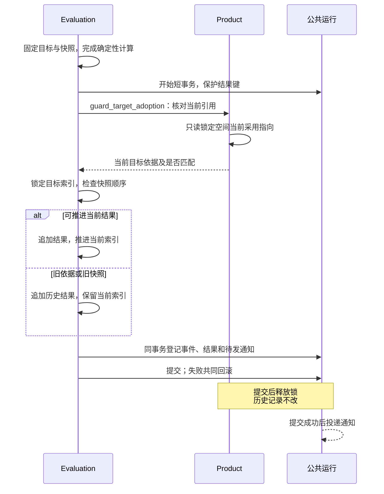
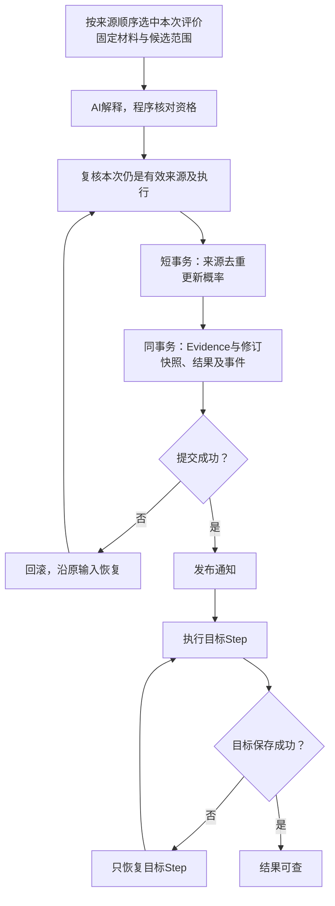

# M1 Evaluation Space 设计

> **版本**：v0.19 
> **状态**：主流程合同检查及修正稿待用户审阅；未编码 
> **维护与评审**：Codex编写及自检，用户审阅 
> **写作规范**：[系统设计写作规范](../../../top/DeerMind_System_Design_Writing_Standard.md) 
> **更新日期**：2026-11-15 
> **修订说明**：v0.18 → v0.19，对齐顺序评价图与正文，修正时间及存储的过期说明；见MVP决定登记§91 

本文设计评价定义、Evidence形成、Belief更新和个人目标达成计算，明确语义解释与确定性计算怎样衔接。学习目标定义归产品业务，原始交互事实及当题判题反馈归Interaction，Evaluation不直接控制教学；共同输入见[工程入口§2](README.md#2-设计输入与历史参考)。

算法和目标规则沿用[内容规格§4.16–4.20](../design/Content_and_Model_Reference.md#416-m1-belief按方法和方面保存分项概率)。本轮把产品规则接到以下操作，未新增算法配置、KC Claim、人工改概率或历史重算。

| 处理入口（命名空间`evaluation`） | 触发与结果 | 合同位置 |
| --- | --- | --- |
| `manage_claim` | 管理员维护Task Claim、执行判据与方法的评价方面规则 | §1.1 |
| `evaluate_submission` | 订阅实际作答，按关联事实形成Evidence、Belief结果和目标结果 | §2.1 |
| `apply_learning_opportunity` | 订阅已经收束的教学机会，核对资格后更新预测及目标结果 | §3.2 |
| `reassess_target` | 订阅目标采用变化，只重新对照目标 | §4.1 |
| `query_basis` | 授权查询评价处理、目标依据、Evidence和原事件引用 | §5.4 |

只有`evaluate_submission`和`apply_learning_opportunity`是AI Operation：前者解释学生表现，后者识别实际教学机会。`manage_claim`、`query_basis`和`reassess_target`是普通维护、查询及确定性消息处理。共同执行边界见[公共运行§1.3](System_Foundation_Design.md#13-operationstep与operationrun)。两类处理均按触发身份防重，不能由Interaction同步调用评价计算，技术重试不另造学生表现。

两个AI Operation在原Run内复用目标计算函数，不为确定性计算创建子Operation。目标采用变化则由普通`reassess_target`处理，保留本次受理、结果及失败记录，不创建AI OperationRun；两类生产处理都可发布`goal_result`，公共结果关联不能限定为AI运行身份。

## 1. Claim、方法判据与评价方面

### 1.1 `manage_claim`：维护评价定义

管理员维护本Task的Claim、执行判据及方法方面规则；课程检查和教学模块只能按授权读取。字段见§1.3，保存动作见§1.4，存储与接口见§1.5。

方法列表包含Task全部直接Solution，不在Claim勾选课程方法或沿先导继承判据。方法执行判据与四方面规则分开，工具许可仍读取Solution。保存只追加定义和ClaimDefinitionChanged，不改已应用版本、个人概率或历史作答。

KC直接检验路径由Domain在内容准备时确认，见[Domain§4.3](Domain_Space_Design.md#43-kc直接检验路径的准备与确认)。本Space维护相应Task的方法执行判据及方面规则，判断学生实际表现；不能用Domain的路径确认代替Evidence，也不负责给KC入库设审批关卡。

### 1.2 课程检查的定义读取

`read_claim_contract(access_context, claim_ref)`是`manage_claim`的内部只读端口。Product按精确修订查询，不授予个人状态读取或写入权限。

| 返回 | 约束 |
| --- | --- |
| claim_ref、task_ref、aspects[] | 精确版本；Task由Domain核对，不以最新版本替换 |
| methods[] | 每个直接方法的method_ref、执行判据引用及定义、方面规则；不完整处明确列gaps |
| 方面条件 | 每方面返回aspect_ref、rule_ref、判断要求、condition_schema和default_values；Schema只声明该规则允许目标配置的条件 |

条件Schema校验字段类型、必填项及取值边界，不能包含自选概率阈值、固定答对题数或永久反证否决。Product固定所选值及规则修订，见[目标条目§4.2.1](Product_Application_Design.md#421-目标条目)。缺规则返回缺口；引用不存在、权限不足和读取故障分别报错，不返回空规则冒充成功。

### 1.3 定义结构与引用

M1把Claim、Task内判据库、方法关联及方面规则保存为一个定义快照。每次修改追加Claim修订，避免课程读到不同次保存的混合配置；不另建跨Task判据库。

| 类型／字段 | 约束 |
| --- | --- |
| `ClaimRef={claim_id,revision}` | revision为正整数；claim_id绑定一个精确task_ref，不原地换Task版本 |
| `ClaimDefinition` | `domain_id,task_ref,title,description,aspects[],criteria[],methods[]`；task_ref采用Domain ObjectRef |
| `AspectDefinition` | `code,label,description,change_reason?`；code在Claim内唯一，至少一个方面；默认四方面，裁剪／新增须说明理由 |
| `ExecutionCriterion` | `criterion_id,title,required_inputs[],judgement_basis,pass_description,fail_description,unknown_description`；正文非空，ID由程序分配 |
| `MethodDefinition` | `method_ref,criterion_ids[],aspect_rules[]`；覆盖Task全部直接方法，顺序沿Domain；只关联本Claim现有判据 |
| `AspectRule` | `aspect_code,judgement_basis,evidence_requirements,condition_schema,default_values`；每方法每方面至多一条 |

标准方面code为independent、understanding、transfer、retention；新增方面使用稳定code。定义可先保存缺口，正式使用前须有可解释的规则、证据资格和数值处理依据；不能将新增方面自动套成独立或理解，也不能默认获得学习转移。

判据身份criterion_id在本Claim各修订间保持。完整引用为`{claim_ref,criterion_id}`；aspect_ref为`{claim_ref,aspect_code}`；rule_ref为`{claim_ref,method_ref,aspect_code}`。快照内部只存局部ID，公开读取时补齐完整引用。修改任一部分都保留旧快照，已应用课程继续读取原修订；不复制旧Belief到新修订。

**目标条件。** condition_schema使用JSON Schema的对象、标量、枚举和范围约束；不接收脚本、查询表达式或模型生成的可执行代码。default_values必须通过同一Schema；字段省略仅在已定义默认值时补齐，null只有Schema明确允许时合法。Task参数范围仍由Domain定义。

程序能比较的条件保留类型化事实，如迁移类型、实际间隔；自然语言要求保留原文及固定规则引用。目标对照不再次调用LLM解释旧答案，缺少可比较事实时返回待确认，见§4.2。帮助条件记录实际受助要求，不在此配置工具许可。

### 1.4 保存与删除判据

写请求共用`request_id,action,domain_id,task_ref`；修改已有Claim另带claim_id、expected_revision。查询走GET，不创建请求收据。

| action | 追加输入 | 保存行为 |
| --- | --- | --- |
| `create_claim` | title、description、aspects | 创建Claim及首个快照；从Domain加入全部直接方法，未配置处列gaps |
| `save_claim` | title、description、aspects | 更新基本信息；裁剪方面同时从新快照移除其规则，旧快照保留 |
| `save_criterion` | criterion；新建不带criterion_id | 新建或替换本Task判据；关联方法在新快照使用更新后的判据 |
| `set_method_criteria` | method_ref、criterion_ids[] | 替换该方法本层关联；空数组可存为草稿缺口 |
| `save_aspect_rule` | method_ref、rule | 更新本方法的该方面规则；方法和方面须已存在 |
| `remove_criterion` | criterion_id | 当前仍被方法引用则拒绝；否则从新快照移除，历史引用不删除 |

1. 鉴权并核对请求身份，读取Domain固定Task／方法；校验字段、引用和条件默认值。不完整但结构合法的定义可保存，悬空引用不可保存。
2. 短事务依次保护请求、Domain根和Claim，重查expected_revision；新建通过唯一`(domain_id,task_id,task_version)`约束防止重复Claim。
3. 追加完整快照和gaps，推进头修订，登记ClaimDefinitionChanged及请求收据，共同提交。不启动AI、个人评价或课程应用。

同请求同正文返回原claim_ref；同键异正文为identity_conflict；不同请求改同修订为revision_conflict。已存在同Task版本的Claim返回claim_exists及授权可见引用，不再建第二份。合法新版本的Task另建其评价定义，M1不自动迁移判据或个人状态。无实际内容变化返回原修订、changed=false。

### 1.5 定义存储与HTTP

表归evaluation schema。主键、引用中的ID均为程序分配的不透明值；时间使用公共事件时间合同，不以客户端时间排序修订。

| 表／主键 | 内容与约束 |
| --- | --- |
| `claim`／claim_id | domain_id、固定task_ref、head_revision；Task精确版本唯一 |
| `claim_version`／(claim_id,revision) | 完整Definition、gaps、request_ref、操作者及时间；只追加，不覆盖或物理删除 |

当前列表按Domain、Task及名称查询；方法和判据列表从指定快照读取。正式定义、已应用引用和旧判据正文只增不改不删；可变的head_revision仅是最新草稿索引。历史Task已软删除仍可追溯，新增关联和定义写入按Domain保护端口拒绝；读取不能自动换成新Task版本。

| 方法与路径（相对`/api/m1`） | 合同 |
| --- | --- |
| `GET /evaluation/claims` | domain_id必填，task_id、名称、cursor和limit可选；返回当前头引用和gaps |
| `GET /evaluation/claims/{claim_id}` | revision可选，省略读头；返回完整快照和方法列表 |
| `POST /evaluation/claim-commands` | §1.4写请求；200返回claim_ref、changed、gaps及受影响方法 |

403权限不足；404引用不存在；409身份／修订冲突、claim_exists或criterion_in_use；422非法结构、越域或引用关系。技术失败与草稿缺口分开。列表沿公共游标合同，完整参数上限由公共接口设计给出；本批不新定数值。

## 2. 原始事实到Evidence

取材授权按[总体§6.6.1](System_Design.md#661-最小调用授权矩阵)执行；Interaction原文能力见[Interaction§2.3](Interaction_Space_Design.md#23-评价原文的授权读取边界)。答案不必是一条聊天消息，答题区作答和附件也须按事件引用取得；不直接读其私表、未提交草稿或私有记忆。内部取材端口及其输入输出见§2.3，不通过分页聊天历史猜测原文是否齐全。

Evaluation按自身订阅和规则运行、保存并发布事实及公开结果，不读取Interaction等消费方的等待条件或期限。有没有等待者不影响本Space的评价；消费方超时或结束等待不判定评价失败，也不自动取消本次评价。共同边界见[总体§7.2.1三](System_Design.md#721-已确认的总体选择)。

### 2.1 `evaluate_submission`：评价一次实际作答

只由原始作答事件触发本次作答评价；既有合同以`AnswerSubmitted`表示该事件。Evaluation不等待Interaction判题，也不复用其语义判题结论更新能力。判题事件不是学生的新表现，不触发第二次作答评价。该边界已确认；下文已有操作、结果键及字段仍为待审合同。

一次评价可查询多个关联事件。事件2作为作答触发，引用事件1对应的本次出题；事件3是Interaction对事件2的判题，不属于本次能力判断的输入结论。材料来源如下：

| 所需材料 | 来源 |
| --- | --- |
| 原始答案与过程 | 作答事件及其引用的实际提交内容；聊天正文经Interaction授权查询读取 |
| 实际题面、作答要求与检测条件 | 本次出题／题目使用、活动及检测轮记录 |
| 作答前帮助、提示及解法呈现 | 服务端正式帮助与提供记录；区分内部候选、正式提供及作答时点 |
| 迁移参照、保持基准及期间练习 | 相关历史事件与Evaluation已有的评价记录 |
| Task、方法及参考解法 | Domain公开定义，按当时采用的内容依据读取 |
| Claim判据与目标要求 | Evaluation的评价定义及本次采用的目标条件 |

事件由公共运行底座提供授权查询；当时题面、原始作答及帮助正文经Interaction授权查询取得，Task／Solution、题目及题内参考解法由Domain公开查询提供。事件记录和内容原文是两步读取，整体路径见[总体图4](System_Design.md#43-学习检测与评价接续)。Evaluation的Operation按本次评价需要取材、组织上下文，再通过AI底座调用模型；AI底座不自行选择证据。共同边界见[总体§3.4](System_Design.md#34-agent上下文和记忆)。Evaluation不读取Interaction私有聊天记忆，历史摘要不能代替原始作答及资格事实；需要保存的派生材料仍由本Space的Operation决定，不新增独立摘要Operation。

作答须关联这次出题，而非仅凭相同题目编号匹配。取材固定当时事实或可追溯快照，后续提示不算作答前帮助；无法核实记录完整性时保留未知，不把“未查到提示”等同独立完成。聊天消息与事件按[总体§3.2.1](System_Design.md#321-聊天消息与空间事件分开存储)分别保存。Evaluation沿事件引用读取内容所有者提供的当时正文，不访问其私有表；引用不可读或无权限时保留缺失／失败原因，不用空答案、摘要或当前改写内容补位。取材合同见§2.3，公共事件信封仍由底座维护。

现有入口使用`trigger_event_id`及所属`scope_id`，其他事实从事件与受控引用读取；不接收Interaction传来的“应提高多少”或客户端自报帮助等级。

| 材料／输出 | 必选、可选及约束 |
| --- | --- |
| 作答材料 | 必选作答、题目使用、活动、题面／参数、实际提交内容与时间引用；正式轮还须轮开始／结束及采用条件 |
| 判断材料 | 必需可追溯的目标及教材采用依据，由§2.2生成并记录候选Task／Claim与适用方法；再读取可靠题目参考、判据及局部表现引用。缺失不可猜测补全；题单引用仅在存在题单时提供 |
| 帮助与背景 | 必须带字段或明确未知：正式提供、提示、已知接触经历、迁移参照与保持基准；缺记录不能按无帮助处理 |
| 结果 | 分别发布`belief_result`、`goal_result`，每个阶段有自己的处理情况；载荷及失败语义见§5–6 |

1. **受理。** 核对源事件、空间和作答身份；登记本Run及Belief、目标两类结果键，冻结原提交引用。源事实被重复投递时复用原受理记录。读取后来的帮助只能作为后续事实，不改写提交当时条件。
2. **取材与限定范围。** 按§2.2读取实际采用依据，生成并保存本次候选清单；沿作答取得本次出题、轮次、帮助和所需历史事实，按清单读取Domain参考与评价判据，保留来源和未知项。题面或参考冲突不能硬判学生错；不等待或使用Interaction的当题判题结论。
3. **解释候选。** 给AI本次有限候选清单、原始表现、题目、适用方法、Claim判据、实际帮助及资格背景，不给既有概率和旧“已掌握”标签。输出候选列表，每项含实际方法及可辨认的局部表现、方面、判据结果、来源片段、资格条件及不确定原因；不得扩展Task范围、生成掌握率或虚构步骤。
4. **程序核对。** 先核对Task、Claim和方法属于§2.2保存的候选范围，再核对引用、时间、帮助及本次实际采用定义。按“同一作答＋Claim＋实际方法＋方面”合并判据候选，只保留至多一次观测更新。明确局部表现分别核对其方法、判据和方面资格；同一来源去重，没有明确依据就跳过，不沿先导传播。
5. **数值提交。** 调用§3.1的确定性函数，在正确前序上更新合格分项；明确反证／未决／不适用分别保留依据。Evidence、Belief修订、快照、派生事件及`belief_result`按§6.2共同提交。没有合格证据时记录未更新事实并按本Space业务发布，供评价追溯；不为唤醒等待者伪造完成，也不把技术失败写成无证据。
6. **目标Step。** 复用§4的目标对照函数，沿本Run和原事件发布`goal_result`。目标阶段失败只恢复该Step，不重做成功的观测更新。

综合Task的Claim评价自身选择、组织、结果组合与检查；其他Task仅对实际可辨认的表现形成Evidence。各Task可共用来源，但必须分别归因和去重；一个Task的Belief不传播给另一个Task。模型语义沿用内容规格§4.15–4.17，不新增聚合算法。

| 分支 | 业务处置 |
| --- | --- |
| 只有正确答案，方法／解释不明 | 方法及其他Task不猜测归因，相关分项不更新；当题反馈由Interaction独立处理 |
| 受助练习或提示后订正 | 按真实条件核对其他适用表现；不作为无帮助独立新题成功 |
| 迁移背景或保持间隔未知 | 仅对应方面保留未决；不影响其他有独立依据的分项 |
| 自由交谈、草稿、系统反馈误送为作答 | 拒绝错误源类型或资格；不产生伪造成功／失败Evidence |
| 纲内未映射题 | 记录评价限制，概率不更新；Interaction仍可提供当题帮助，后续补建不补算此旧作答 |

**恢复与验收。** 取材依据、解释候选和已提交阶段分别保存恢复引用；合法解释结果可重用，不能因目标故障再调一次LLM并再加分。批内任何真正技术处理未完成时，该批不发布成功；已完成阶段保留。验收按内容§4.19复算、只答150不猜方法、范围内的整体负证与局部正证分别处理、同源同分项只更新一次、范围外候选不更新、求助不记负证，以及后续帮助不污染先前提交。

### 2.2 本次评价候选范围的生成与留痕

这里的“范围”是允许核对哪些Task及方法，不是学生已经掌握的范围，也不是让AI遍历整个Domain的权限。

1. **来源。** 产品业务维护学习空间实际采用的目标及教材采用依据。候选Task集合只取该目标所引用Claim对应的Task；每个Task的方法仍受教材实际采用及章节适用条件约束。目标要求某方法或方面达标，与该Task下哪些合法表现可形成Belief证据是两件事；目标结果仍只对照自己的要求。
2. **传递。** Interaction在出题／题目使用、作答和教学机会事实中记录实际采用依据、题目及题单引用；无题单时明确无题单。它记录业务事实，不签发“可评价哪些Task”的权限。活动沿用旧采用依据时，事件继续引用该依据，不能取处理时的最新目标替换。
3. **生成。** Evaluation经产品业务授权查询读取采用依据与目标Claim引用，再按引用取得本Space的Claim和Domain公开的Task、Solution及方法适用材料，由程序生成有限候选清单。题单覆盖、题内其他参考解法、共享KC和先导关系均不能向清单增加Task。读取范围受当前服务权限约束，不允许AI自行搜索其他空间或整库补全候选。
4. **保存并使用。** 在解释前保存采用依据、候选Task／Claim、适用方法及章节来源、缺口与排除原因；证据和处理记录引用这份范围依据。AI仅在清单内定位实际方法及可辨认的局部表现，程序再次检查候选是否属于清单，再核对判据及四方面资格。范围有效不等于证据合格。
5. **缺失或范围外。** 采用依据不可读时不推断权限、不开展该批正式更新，区分业务缺口和读取故障；单项定义不完整则保留对应缺口，不扩大到替代Task。范围外表现保留原始记录和未更新原因，Interaction仍可帮助；以后扩大目标不补算这次旧作答。目标变化本身不清除旧Belief或提高概率。

采用和目标依据通过[Product§5.2.1](Product_Application_Design.md#521-采用依据的公开读取)取得；事件保留当时application_ref和target_basis_ref。该边界同时适用于作答与教学机会：目标只选“求增加后的数量”时，不更新未选用的“求对应部分”Task；同时选用两者且局部表现合格，才分别取证、防重。候选清单结构见§2.3，不新增权限配置。

### 2.3 固定本次材料

`EvaluationInput`在调用AI前保存。引用均指向不可变记录；正文留在内容所有者，Evaluation保存引用、摘要校验值和实际使用的结构化事实。读取失败不生成空材料包。

| 字段 | 类型／必填 | 约束 |
| --- | --- | --- |
| input_id、scope_id、trigger_event_id | ID／是 | 程序分配；同一空间、触发事件只有一份输入 |
| source_event_seq | 正整数／是 | 底座分配的空间事件序号；按§6.7取最早尚未完成的评价来源 |
| source_kind、source_id | 枚举、ID／是 | answer对应submission_id；teaching对应opportunity_id。来源身份不使用消息条数或Run次数 |
| adoption_ref、application_ref、target_basis_ref | 固定引用或null／是 | 来自源事实；已确认的缺口填null并记录原因，不开展正式更新；读取故障不能填null蒙混过去 |
| task_use_ref、activity_ref、round_ref | 引用或null／是 | 作答须有实际题目使用；普通教学可无题目／检测轮，不能用空引用冒充正式检测 |
| candidate_scope | 列表／是，可空 | 每项含task_ref、claim_ref、method_refs、章节适用来源及缺口；由程序按§2.2生成 |
| materials | 来源列表／是 | 事件、正文／附件及内容块引用、内容校验值、用途、事实完整性；未知项单列 |
| history_basis | 固定引用列表／是，可空 | 仅保留判据所需的接触史、迁移参照和保持基准；不遍历无关聊天 |
| interpretation_contract_ref、parameter_ref、algorithm_ref | 固定引用／是 | 本次输入输出约定、资格规则及数值配置；执行时的模型配置另由AI调用记录关联 |

取材按以下顺序完成：

1. 底座授权读取触发事件，核对类型、空间及来源身份。重复事件沿原input_id恢复。
2. Product读取当时采用依据；Evaluation生成有限候选清单，读取精确Claim及Domain定义、题目参考。
3. 调用Interaction的`read_evaluation_facts(access_context, scope_id, trigger_event_id, related_event_refs=[])`，取得本次题面、已提交原文、help_basis和正式提供事实。该端口只读，不启动活动或评价。
4. 按方面规则补取有界历史：同一Task／方法的接触记录、指定迁移参照、保持基准及基准至本次提交的相关练习。先从底座查询授权事件，再以related_event_refs读取所需原文。查询固定截止依据并返回完整性；缺页、未知业务时间和未知接触条件不能补成“没有”；缺浏览器回执不构成评价材料缺口。
5. 固定材料及资格背景后调用AI。读取故障沿原引用重试；同一不可变引用返回不同内容时报source_conflict，停止处理。

历史来源按事实身份关联。保持基准可以引用已保存评价，但送给AI的材料只含规则所需的时间、内容和资格事实，不含旧概率或“已经掌握”的标签。只对本次Rule允许的历史取材；接口不能提供任意跨空间搜索。

本批来源固定字段沿[Interaction§3.7](Interaction_Space_Design.md#37-帮助与教学机会的服务端事实)：help_basis在提交时保存，provision_facts引用正式内容，教学使用closure_ref及provided_part_refs。AI不以浏览器显示回执或其缺失判断独立、教学完成或更新顺序。未知来源和真实帮助缺口仍按原资格规则处理。

### 2.4 AI候选与程序接受

AI输出`candidates[]`及`unattributed[]`；后者仅含source_spans、reason及缺失信息，不猜测分项身份。无候选可以是合法结果；格式错误、越界引用和读取故障不是“没有Evidence”。提示词要求逐项给来源，不允许输出概率、更新SQL或新对象身份。

| 候选字段 | 类型／必填 | 含义 |
| --- | --- | --- |
| claim_ref、method_ref、aspect_code、rule_ref | 引用／是 | 必须在固定候选清单及该Claim内；方法不明则放入unattributed |
| execution_checks | 列表／是 | 本方法判据ID、met／not_met／unknown、来源片段及简短理由；与方面判断分开 |
| aspect_judgement | met／not_met／unknown／是 | 按该方面规则解释实际表现；未提供解释不直接判理解失败 |
| condition_facts | 类型化事实列表／是 | 每项含条件名、known／unknown／not_applicable、值及来源；unknown不得填猜测值 |
| source_spans | 列表／是 | 指向已提供内容的块、文本范围或图表元素；图中可见内容不能虚构成学生写出的步骤 |
| reason、limitations | 文本、列表／是 | 支持判断的理由及尚未确认的条件；不能用模型自报置信度替代资格 |

程序按“来源身份＋Claim＋方法＋方面”合并候选；重复片段不增加样本数。判据或方面结论冲突且不能按固定规则解释时，本项为unknown。未覆盖的方法不生成失败项；涉及多个Task时各项分别给出方法和来源。

观测候选必须引用学生本次提交的实际片段；参考解法、既有Belief或Interaction判题不能替代学生表现。教学候选必须引用本次机会在服务端正式提供的教学内容。程序验证块及范围确实属于材料、引用文本未被改写；引用存在仅证明出处有效，语义是否支持结论仍按判据解释。

正式`EvidenceItem`由程序分配evidence_ref，并保存input_ref、source_kind／source_id、分项身份、判据结果、rule_ref、题目参数、condition_facts、source_spans、source_refs、qualification、verdict和reason_codes。source_refs由有效片段及输入追溯出源事件和正文引用；题目参数从实际题目使用记录读取，缺失不让AI补猜。所有结果只追加，候选不能直接作为正式Evidence读取。

| 核对结果 | qualification／verdict | 数值处理 |
| --- | --- | --- |
| 方面资格已知成立，表现明确符合／违背该规则 | eligible／positive或negative | 观测更新一次；负证同样必须有合格来源 |
| 明确不满足资格，如独立检测已受助、同题提示后订正 | ineligible／null | 保留表现和原因，不代入失败公式 |
| 方法、条件或表现无法确定 | unknown／null | 保留未决；其他明确分项可独立处理 |
| 完整且相关的教学机会 | eligible／null，source_kind=teaching | 仅独立／理解可学习转移；不作为正向作答Evidence |
| 引用越界、Schema非法或服务故障 | 不保存成功Evidence批 | 记录处理失败，按原输入恢复 |

四方面分别核对：独立检查帮助及完整执行；理解检查学生自己的原理说明；迁移检查指定变化和此前接触；保持检查基准、实际间隔及期间相关练习。语义判断由AI按固定规则解释，程序负责引用、已知条件、身份及数值资格，不能宣称程序已证明语义正确。

同一次来源的同一分项只有一条正式Evidence；不同触发事件若重复引用该来源，引用原Evidence和原更新，返回unchanged。新的学生表现使用新来源，不能以新Run或新算法版本重复处理旧来源。

## 3. Belief分项与数值更新

### 3.1 数值函数与提交前提

这些是Evaluation内部确定性函数，不是单独Operation，不开放给学生、管理员或LLM写概率。

| 函数合同 | 输入和输出 |
| --- | --- |
| `validate_parameters(parameters)` | 校验`M1-BELIEF-PARAM-01`中的p0、S、G、L及约束；非法返回参数错误，停止相关更新 |
| `update_observation(p_current, verdict, parameters)` | 仅接收资格已成立的明确正／反证；按内容§4.18公式返回新`p_obs`和`p_current`，两者此时相等；未决不调用 |
| `predict_learning(p_current, aspect, qualified_opportunity, parameters)` | 合格独立／理解机会按L计算新的`p_current`；迁移／保持的有效L为0；不改变`p_obs`、实际验证时间或证据状态 |
| `derive_target(target_basis, mastery_snapshot, evidence_coverage)` | 按§4读取目标的方法、方面及适用证据条件；返回逐项判断、依据和限制，不改Belief |

参数、公式和数值样例完整维护在[内容§4.18–4.20](../design/Content_and_Model_Reference.md#418-概率计算学习转移与共享参数)。计算不提前按展示位数舍入；目标对`p_obs`使用同一0.90阈值。缺数值、非法输入或数值异常是技术失败，不按零概率继续。

每次写入固定分项身份、前序修订、来源身份、参数／算法依据、更新前后值和跳过原因。观测去重针对同一作答的同一Claim／方法／方面；机会去重另用稳定机会身份。按§6.7取得提交权后再读取正确前序，§6.6锁定本空间提交；恢复只重算尚未提交的确定性部分，不重复提取已合格的语义事实。

### 3.2 `apply_learning_opportunity`：处理已发生的教学机会

只由`TeachingOpportunityClosed`订阅触发。必填`scope_id`、源事件和稳定`opportunity_id`；材料包括教学目的、活动／Task责任、正式提供内容引用及服务端收束原因。实际方法和方面候选可为空，但必须保留未知，不能默认为全部适用。事件不是“学生已经学会”的证明。

1. 按源事件登记Run及`belief_result`、`goal_result`。读取Interaction固定的正式教学内容和收束记录；不把候选、活动启动或“懂了”当作完整教学。浏览器回执不参与资格及触发。
2. 先按§2.2生成并记录本次候选范围；AI在该范围及不读取既有概率的材料中定位实际教到的Task／方法／独立或理解责任、完整内容及具体片段；程序按内容§4.18核对相关性、来源、收束和资格。缺条件则记录不转移，不借活动结束自动判合格。
3. 用空间＋Claim＋方法＋方面＋`opportunity_id`去重。多个消息、暂停恢复、多个调用路径和新技术尝试不重新计机会；其他Task只有在候选范围内且有明确教学片段时分别处理。
4. 调用`predict_learning`并提交机会资格、来源、前后预测、Belief修订／无变化、快照及`belief_result`。不增加成功题数，不刷新`last_observed_at`，不把未知改为已观测。依据仍不足时保留原因、概率不变。
5. 在本Run内执行目标Step并发布`goal_result`。仅预测上升不能使目标达标；没有受影响目标也返回正常空批原因。

同一事件重复投递返回原处理；若另一个合法源事件重复引用已经处理的`opportunity_id`，本次结果注明`unchanged`并引用原更新，仍完成本次结果键，不再加L。已完成的Belief阶段不可因目标重试再次转移。语义核对失败保留未决，服务故障保留技术失败，两者区分。验收包含三条消息只算一个机会、暂停恢复不再加L、只教当前任务责任不提升所有其他Task，以及迁移／保持不随讲解加分。学习机会识别启用前须满足内容规格的验证条件，不能仅凭流程接通就开启所有输入的L更新。

### 3.3 数值配置与记录

算法配置是随服务交付的只读数据，不开放管理员增删改页面。`parameter_ref=M1-BELIEF-PARAM-01`使用p0=0.50、S=0.15、G=0.25、L=0.05；约束及公式只维护在内容规格§4.18。每份输入固定参数及算法引用，失败恢复不静默采用新配置。

分项键为`(scope_id,claim_ref,method_ref,aspect_code)`。学生身份由空间归属核对，不跨空间合并；题目分率、情境及难度不是新分项。内部初始值为p_current=p0、p_obs=null；合格观测后两者等于新后验；合格教学只改变p_current。没有观测时，不对外展示0.50为实测结果。

数值实现稿采用有限的64位浮点数，PostgreSQL按double precision保存，JSON返回数值。计算、存储及0.90比较均使用未按显示位数舍入的值；不加隐藏容差。客户端四舍五入只影响显示。输入须有限且在合法范围，分母非正或结果非法则报错，不截断成0或1继续。实现阶段核对边界和跨保存恢复的同值计算；这是数值实现约定，不是参数校准通过。

| 输入 | p_obs结果 | p_current结果 |
| --- | --- | --- |
| 无历史，首次合格正证 | 0.772727… | 同左 |
| 上述状态后发生一个合格独立教学机会 | 仍为0.772727… | 0.784090…；只保存预测变化 |
| 上述教学后出现新的合格正证 | 约0.92508 | 同左；使用0.784090…作为本次先验 |
| 帮助或时间未知，不具备该方面资格 | 保持原值或null | 保持原值；保存未更新原因 |

表中第三行是公式说明，不改变§5.3“两题之间没有教学机会”的原算例。所有分项分别计算，不能把多方面相乘或平均。教学Evidence不参与目标的实际观测覆盖；目标仍读取p_obs及合格作答条件。

## 4. 学习目标达成计算

### 4.1 `reassess_target`：目标采用变化后的重新对照

只由产品业务的`LearningTargetApplied`订阅启动普通目标对照处理，不调用LLM，包含首次采用及实际目标条件变化。必填`scope_id`、`trigger_event_id`、`target_basis_ref`、`application_ref`、`applied_at`；`previous_target_basis_ref`首次为空。Evaluation读取业务模块公开的不可变采用条件，不能直接查询其私有表。

1. 核对采用事实及条件引用，登记本次处理的`goal_result`。已有表现不重新解释、不做观测或学习转移，也不等待本触发下不存在的`belief_result`。
2. 固定一份合法掌握快照及其已纳入Evidence；缺少数据与读取失败分别处理。
3. 按§4.2—4.3核对条件、比较概率并汇总；不再解释旧答案，不写Belief。
4. 保存计算使用的采用、定义、快照及规则引用，结果载荷见§4.4。
5. 按§6.2保存本次目标结果及事件，检查当前采用条件与依据顺序后才推进当前目标状态；旧依据仍可留存但不覆盖当前。发布`goal_result`及来源，条件变化与学生能力变化分开说明。

重复采用事件返回原结果；目标对照重试不更新概率。作答和教学机会Run复用步骤2–5，目标Step开始时读取空间当前已采用的目标，不把取证时的旧目标当作当前目标。Evidence仍绑定原活动依据；两者分别留痕，不改旧活动。沿原Run和原触发键发布goal_result，不另造采用事件。

验收包括首次采用无证据为待确认、改目标不改变概率、两法要求不能被A单法满足、读取失败不伪装待确认，以及旧目标结果不能覆盖新采用条件下的当前判断。对当前目标结果的公开查询通过§5.4提供，历史结果仍可按引用读取。

### 4.2 目标对照输入与判定

`derive_target`是纯函数，只读固定输入，不访问数据库、不调用AI、不改概率。

| 输入 | 必需内容 |
| --- | --- |
| target_basis | Product的精确目标依据、条目、允许方法与章节来源、所需方法方面、条件和准备缺口 |
| mastery_snapshot | 本空间一个不可变掌握快照；snapshot_ref、publication_seq及分项。确无快照为null，读取失败不能填null |
| evidence_coverage | 截至该快照实际纳入的Evidence及资格事实、来源、条件和不可判定原因；不得混入快照之后才处理的证据 |
| calculation_rule_ref | 固定本节程序规则和θ=0.90的实现依据；不来自管理员输入或LLM |

每个分项依次判断：

| 条件 | readiness／attainment | 原因示例 |
| --- | --- | --- |
| Claim／方法规则或课程准备缺失 | unprepared／null | definition_missing、course_gap |
| 准备完整，但没有适用于目标的观测／资格事实 | ready／unknown | no_observation、scope_uncovered、condition_unknown |
| 有适用观测，未舍入p_obs≥0.90 | ready／met | threshold_met |
| 有适用观测，未舍入p_obs<0.90 | ready／needs_strengthening | below_threshold |

非法数值、断裂引用或读取故障使本次计算失败，不输出能力状态。无快照或尚无分项不创建0.50观测。p_current和历史答对题数不参加达标比较。

**条件复用。** 只比较已保存的事实：Task参数按类型和值域核对；方面条件使用固定规则及已有资格事实。最小间隔改变时可用已记录的实际间隔重新比较，不能改证据发生时间。自然语言条件若无法从现有结构化事实或同一固定资格结论核对，返回condition_unknown；不重新解释旧作答，也不按文字相似认定满足。

目标计算读取Evidence的最小投影为`evidence_ref, claim_ref, method_ref, aspect_code, rule_ref, verdict, qualification, task_parameters, condition_facts, source_refs`。qualification明确eligible／ineligible／unknown；eligible包括正证和反证。只返回快照实际纳入的作答Evidence，完整条目见§2.4；教学Evidence不计作目标的实际观测覆盖。

| 条件输入 | 确定性比较 |
| --- | --- |
| Task参数值或范围 | 与task_parameters中同名、同类型值比较；不支持的形式返回unknown，不靠字符串近似 |
| 迁移类型／参照表征 | 与condition_facts记录的代码及参照引用核对；新数值不自动满足新表征 |
| 保持最小间隔 | 使用资格处理中已核实的基准、实际间隔及期间练习；时间未知不以0补齐，沿§6.8已确认的服务端UTC时间口径 |
| 规则内的语义资格 | 仅复用对应rule_ref及已核对条件下的结论；新条件没有可比较事实时返回unknown |

条件名及比较器由Evaluation代码登记，condition_schema只声明其中可供目标填写的字段。新增未知条件可保存在定义草稿中，但列为规则未准备；不能仅有Schema就宣称程序已经会判断。

同Task／方法／方面仍共用p_obs。例如1/4和1/5的合格表现更新同一概率；目标要求1/5时还须存在该范围Evidence，不为1/5重算另一概率。关联事件必须来自此快照覆盖，旧负证继续保留，但不额外永久否决达标。

### 4.3 方法与目标汇总

分项准备完整才计算attainment；方法、each项及整个目标有必需项未准备时为unprepared／null，保留已有子项结果。any_one按下述例外处理。处理状态pending／failed属于执行，不与这些学习结果混用。

| 汇总对象 | met | needs_strengthening | unknown |
| --- | --- | --- | --- |
| 一种方法的所有所需方面 | 全部met | 至少一个needs_strengthening | 无明确未达标项，但仍有unknown |
| specified／each目标项 | 指定方法／每种方法均met | 至少一种必需方法needs_strengthening | 无明确未达标项，但仍有unknown |
| any_one目标项 | 至少一种方法整体met | 所有候选方法均needs_strengthening | 尚无整法met，至少一种方法unknown |
| 整个目标 | 所有目标项met | 至少一个目标项needs_strengthening | 无明确未达标项，但仍有unknown |

any_one有一种已准备方法整体met时即可met，其他候选方法缺口仍展示但不阻止该结论；否则未准备候选不能当成已经失败。表中“至少一个”不抹掉其他分项未知，只说明已有明确不足；不把多方法概率相乘、平均或拼接。

“四分之一”只要求独立和理解的设计例：

| A：独立／理解 | B：独立／理解 | any_one | each |
| --- | --- | --- | --- |
| met／met | unknown／unknown | met，依据A | unknown，B待确认 |
| met／unknown | unknown／met | unknown，不拼接 | unknown |
| met／met | needs_strengthening／unknown | met，依据A | needs_strengthening，保留B理解未知 |
| met／met | unprepared／null | met并列B缺口 | unprepared／null |

### 4.4 目标结果载荷

本结构作为§5.2的goal_result内容，按结果引用读取；通知不携带完整个人评价。

| 字段 | 类型及含义 |
| --- | --- |
| goal_evaluation_ref、scope_id、target_basis_ref | 本次不可变计算、空间及固定目标条件 |
| snapshot_ref、publication_seq | 所用掌握快照；确无快照时分别null、0。0仅为排序哨兵，不是已发布快照 |
| calculation_rule_ref、trigger_event_id、computed_at | 程序规则、触发事实及计算时间；不替代学生表现时间 |
| readiness、attainment、reasons[] | §4.2—4.3判断；attainment为met／needs_strengthening／unknown或null |
| items[] | item_id、claim_ref、method_mode、逐方法方面结果；各项含p_obs、Evidence引用、条件覆盖／缺口和原因；有准备缺口仍保留子项 |
| current_state_applied、not_applied_reason | 提交时是否推进当前目标；历史依据或较旧快照分别说明，不修改历史结果 |

items按目标定义顺序输出；方法／方面使用固定身份，不按显示名配对。依据包括支持、反对及未决的相关Evidence，不能只选正证。大正文和源事件沿引用授权读取，不复制进结果。p_obs来自快照，可为null；前端只格式化，不重新判断阈值。

## 5. 评价数据与公开接口

### 5.1 学习者掌握状态的发布视图

**Learner Mastery State是现有Belief的只读发布视图。** Evaluation是Belief、Evidence及个人目标判断的唯一写者；发布视图不增加第二套权威能力实体，不合并不同学习空间，不新增KC概率或总掌握率。

调用者通过[公共运行§1](System_Foundation_Design.md#1-共用合同与调用边界)的`read_publication(scope_id, publication_type, publication_ref?)`读取，`publication_type=learner_mastery_state`。公共`publication_ref`就是下表的`snapshot_ref`，二者指向同一份不可变发布内容。省略引用取得最新已发布快照；读取不启动评价，不访问Evaluation私有表，也不等待正在处理的作答。

| 字段 | 类型／必填 | 含义与约束 |
| --- | --- | --- |
| `scope_id` | ID／是 | 学习空间；授权同时核对空间及所属学生 |
| `snapshot_ref` | 不可变引用／是 | 固定这次读取的全部内容；后续发布不覆盖旧快照 |
| `publication_seq` | 正整数／是 | 同一空间的掌握状态发布序号，成功发布时单调增加；是运行序号，不是Evolution模型版本 |
| `published_at` | 时间／是 | 发布完成时间，不替代学生实际表现时间 |
| `items` | 分项列表／是 | 按Claim引用、实际方法和评价方面唯一定位；保留各自实际取证时的精确Claim版本，不因课程换版替换旧身份 |
| `result_coverage` | 结果覆盖记录／是 | 已纳入处理的`belief_result`引用、触发事件及其分项范围；无Evidence而合法完成的结果也可列入 |

`result_coverage`是发布物的一部分，用于精确核对某次结果是否已纳入；它不是“所有时间早于发布的事件均已处理”。快照存储见§5.6；公开读取必须能核对指定结果，不能要求调用方查询私有处理表。

每个`items`条目包含以下内容：

| 字段 | 类型／必填 | 含义与约束 |
| --- | --- | --- |
| `claim_ref`、`method_ref`、`aspect` | 引用、引用、稳定code／是 | 默认independent／understanding／transfer／retention；扩展code须已在Claim定义且处理依据就绪，不能由运行AI临时增加。与scope_id共同定位分项 |
| `p_obs` | [0,1]数值或空／是 | 最近一次合格能力观测形成的后验；未有此类观测时公开为`null`，不能把内部0.50先验说成测得结果 |
| `p_current` | [0,1]数值／是 | 当前计算概率，可包含合格教学机会的学习转移；不是达标结论 |
| `observation_status` | `observed`／`unknown`，是 | 是否已有合格能力观测；教学机会单独更新不把`unknown`改成`observed` |
| `last_observed_at` | 时间或空／是 | 最近合格观测的实际发生时间；无观测为空，发布、重试和教学转移均不刷新它 |
| `evidence_coverage` | 结构化摘要列表／是，可空 | 已有Evidence引用、适用条件及资格、覆盖限制；未知条件明确保留，不能仅给一个题数 |
| `unknown_reasons` | 原因列表／是，可空 | 缺少观测、方法归因不明、迁移背景或保持条件未知等；不能从概率值反推这些原因 |
| `source_refs` | 类型及引用列表／是 | Belief修订、Evidence、实际教学机会及相应来源；用于解释数值和覆盖从何而来 |

这里的“合格观测”指证据资格满足要求，既可以支持掌握，也可以构成反证，不等于学生答对。

Interaction只取与当前教学有关的分项，保留快照引用、证据覆盖和未知原因。目标是否达成由`goal_result`另行发布，不能把`p_current`或多个方法／方面的平均值当作目标结果。Evidence解释任务不使用既有概率来决定本次表现的正负。

### 5.2 一次触发的批结果

公共结果键沿用系统底座：`result_key=(scope_id, trigger_event_id, producer, result_kind)`。本Space的`producer=evaluation`，结果种类如下；一键对应本次触发的一批条目，不对应某一个Claim。

| `result_kind` | 批内对象与内容 | 与其他结果的关系 |
| --- | --- | --- |
| `belief_result` | 本次涉及的Claim×方法×方面：是否更新、前后值、依据及未更新原因 | 引用发布快照；成功处理可以没有数值变化，不能把技术失败写成反证 |
| `goal_result` | 本次目标及目标项的readiness、attainment、依据与变化原因；见§4.4，课程未准备时不填个人判断 | 引用实际采用的Belief结果／快照；目标结果单列，目标对照失败不回滚已成功的Belief |

生产方载荷统一包含以下字段；`result_key`、`result_ref`及执行尝试由系统底座合同维护，不在此重复定义。

| 字段 | 类型／必填 | 含义与约束 |
| --- | --- | --- |
| `covered_subjects` | 对象结果列表／是，可空 | 明确本批处理了哪些对象，每项含`subject_ref`、`outcome`、`reason`、该种结果的内容及`source_refs`；不能以一个分项完成代替整批完成 |
| `snapshot_ref` | 引用或空／是 | Belief结果必须引用所发布的掌握状态；目标结果引用实际使用的快照，尚无快照时为空并说明无观测 |
| `source_refs` | 类型及引用列表／是 | 至少能回到触发事件；数值或目标结果另保留使用的Evidence、机会、Belief修订等依据 |
| `empty_reason` | 原因或空／是 | 批内没有对象时必填，例如没有受影响目标；有对象时为空 |

每个目标条目另保存`target_basis_ref`（实际采用的目标条件引用）和`current_state_applied`（布尔值）。后者表示该结果提交时是否成为当前目标判断；为`false`时记录旧依据或已被更晚结果覆盖的原因，仍保留本次计算结果。

`subject_ref`按结果种类取Claim／方法／方面组合或目标项引用。`outcome`表述处理结果，与学生能力状态分开：

- `updated`：已形成该种结果，或其数值、依据覆盖发生变化。
- `unchanged`：已处理并确认保持原结果，例如E3使用B方法而A未受影响；必须说明原因。
- `no_evidence`：没有支持本次能力更新的合格Evidence或教学机会，保留原判断。它不表示学生失败。
- `undetermined`：本次处理正常结束，但依据不足以归因或判定；列出不能确定的部分，不作负向更新。

技术错误不占用上述业务结果：由公共读取返回`failed`及失败尝试。`available`表示这一批已经处理完成，不表示每个分项都已更新，更不表示学生达标。目标判断无需改变时，本Space记录并发布`unchanged`；没有受影响目标时记录空批及原因。这些内容描述评价处理事实，不承担结束某个消费方等待的责任。消费方是否收到事件、何时超时，由它自己的等待规则判断。

若本次存在一个真正尚未完成的技术处理，不能把它伪装成`undetermined`来提前完成整批。调用者既核对结果键，也核对`covered_subjects`是否涵盖其所需对象；批内没有声明的对象，不据此推断已经处理。

### 5.3 “四分之一”的发布与读取

以下只复用[内容规格§4.19](../design/Content_and_Model_Reference.md#419-四分之一可复算的记录与目标结果)的合成算例；A为先求增加量再相加，B为先求5/4倍。轮间没有学习转移，因此本表已观测分项的`p_obs=p_current`；数字仅作显示，存储和阈值比较不提前舍入。

| 触发及发布 | A：独立／理解／迁移／保持的`p_obs` | B：独立／理解／迁移／保持的`p_obs` | 本次处理覆盖 |
| --- | --- | --- | --- |
| E1：120本→150；快照S1，序号1 | .772727／.772727／空／空 | 空／空／空／空 | A独立与理解有合格证据；其余未取得观测 |
| E2：40米表格→50；S2，序号2 | .920382／.920382／.772727／空 | 空／空／空／空 | A前三方面更新；保持仍未知 |
| E3：48升→60；S3，序号3 | 保留S2及原观测时间 | .772727／.772727／空／空 | B独立与理解更新；A列为`unchanged`，不能因快照更新而刷新A的观测时间 |

空值分项内部可有0.50先验，公开条目仍为`p_obs=null, observation_status=unknown`。S3同时保留已处理E1、E2、E3的结果覆盖；例如E3的`belief_result`引用S3，并分别说明B的有效变化、A的未变化和其余方面没有新证据。

如果教学要依据“刚才的E3”继续，先按`(该空间,E3,evaluation,belief_result)`取得结果，再读取它引用的S3。采用更晚快照时仍须核对其`result_coverage`含本次结果及所需分项，不能仅凭发布序号较大就继续。目标结果另按各目标条件形成：E2后的A独立、理解可达标，迁移需加强，保持待确认；E3不能替A补出保持证据。

本节定义发布内容；Evidence／Belief存储见§5.6，授权依据读取见§5.4，提交与顺序见§6.6—6.7。发布快照不能代替原始依据记录。

### 5.4 `query_basis`：查询处理情况与判断依据

学生仅查自己空间，管理员按试用管理权限读取，Interaction按本次教学授权读取；各类访问均校验空间与学生关系。必填`scope_id`和`view`（`processing`／`target`／`belief`／`evidence`）；可选确切结果、目标项、Claim／方法／方面或Evidence引用，列表使用游标及分页量。指定引用必须与空间一致。

1. 查询当前目标时经Product读取当前target_basis_ref，返回匹配依据的结果、条件和来源；Product调用时可指定本次读取的target_basis_ref，缺相应结果返回pending或已有失败，不用旧结果补位。指定历史结果则标明历史身份及时间。
2. 查询Belief分项返回当前或指定修订、观测与预测区别、限制和Evidence摘要列表。目标详情从该列表进入Evidence，不把“查看依据”直接转换成另一个事件列表页面。
3. 查询Evidence返回方法／方面、判据、资格与正反依据、原始片段和来源事件引用。原事件通过公共授权查询读取，再沿来源引用读取授权原文；不在Evaluation复制一套可编辑事实或聊天库。
4. 查询处理情况按结果键返回阶段就绪、失败或未受理信息；完成但无证据与技术失败分开。需要掌握快照时使用§5.1公共发布接口，不因此启动评价。

返回对象不存在、越权与读取故障分别为`not_found`、`forbidden`、`temporarily_unavailable`。查询无写入、无OperationRun和数值副作用；分页固定对象修订及排序，避免浏览期间同一依据重复或漏项。完整HTTP路由和分页上限待客户端与存储接线确认。验收包含目标→Evidence→源事件追溯、查看旧修订不改当前结果、跨空间引用被拒绝，以及读取不能重算概率。

跨模块触发及结果使用方见[工程入口§6](README.md#6-跨模块事件目录)。belief_result和goal_result是结果类型。目标计算事件为GoalEvaluationCompleted，载荷见§6.5；Evidence／Belief事件随其详细设计确定。

### 5.5 目标结果HTTP与查询状态

本节是query_basis的传输投影，不开放重新计算或修改个人结果的API。Product的空间目标页面读取此端口后合并自己的目标定义。

| 方法与路径（相对`/api/m1`） | 输入／输出 |
| --- | --- |
| `GET /evaluation/spaces/{scope_id}/goals` | 可选target_basis_ref；返回所查依据、processing、current_result_ref及§4.4结果；省略依据时先经Product读取当前采用 |
| `GET /evaluation/spaces/{scope_id}/goal-results/{ref}` | 精确读取历史结果；另返回查询时是否仍为当前结果，不改保存时的current_state_applied |

| 情况 | 返回 |
| --- | --- |
| 当前目标有匹配结果 | processing=available；同时返回结果依据及源触发。更晚更新尚未结束时另列pending，不抹掉已有结果 |
| 已有采用，尚未收到处理／尚未完成 | processing=pending，current_result_ref=null；不把未受理误报为学生无证据 |
| 该次处理最终失败 | processing=failed及失败引用；旧结果可单列，不顶替本次结果 |
| 指定依据／历史结果不属于此空间 | 返回404或权限错误，不按相同Claim跨空间查找 |
| 查询服务失败 | 503，不返回空结果或unknown冒充成功 |

查询时的“当前”由Product采用引用和Evaluation当前索引共同确定，是读取时的判断，不回写历史。未完成任务的进度由公共运行读取，不在结果表复制运行状态机。只读接口均不占Interaction输入入口。

### 5.6 Evidence与Belief存储

以下表归evaluation schema；原文与事件不迁入本schema。共用SubitemKey表示scope_id、精确claim_ref、method_ref和aspect_code；拆为可索引列，不能仅放在JSON正文中。

| 表／主键 | 必需内容与唯一约束 |
| --- | --- |
| `evaluation_input`／input_id | §2.3固定输入，唯一(scope_id,trigger_event_id)；只追加。执行受理及失败尝试沿底座记录，不在此再建执行状态机 |
| `interpretation`／interpretation_id | input_ref、AI调用引用、候选正文、所用协议及程序核对结果；候选只追加，失败尝试不冒充正式Evidence |
| `evidence`／evidence_id | §2.4正式条目、input_ref及interpretation_ref；唯一(SubitemKey,source_kind,source_id)，只追加 |
| `belief_revision`／belief_revision_id | SubitemKey、前序修订、evidence_ref、update_kind、前后p_obs／p_current、last_observed_at、参数／算法引用、触发及记录时间；evidence_ref唯一，只记录真实数值更新 |
| `belief_current`／SubitemKey | 当前修订引用、p_obs／p_current和last_observed_at；可变派生索引，无记录时按先验与未知读取 |
| `mastery_snapshot`／snapshot_id | scope_id、publication_seq、分项及修订引用、证据覆盖、result_coverage、发布时间；唯一(scope_id,publication_seq)，只追加 |
| `mastery_head`／scope_id | 当前snapshot_ref及publication_seq，首次为空／0；可变派生索引，也是§6.6空间提交锁的载体 |

evidence按(scope_id,claim_ref,method_ref,aspect_code)和input_ref建立查询索引；belief_revision按分项及前序引用追溯；mastery_snapshot按空间、序号读取。正式批次结果引用input_ref、正式Evidence及无法归因的候选说明；无可归因方法时不造虚假SubitemKey。

**更新与覆盖分开。** 未决、不适用、重复来源和有效L=0不写数值修订，但保留Evidence／原因和本次结果。每个合法完成的belief_result发布一个新空间快照，含当时全部分项、累计证据覆盖和已处理结果引用；无数值变化也能证明本次已处理。公开覆盖可分页，但页必须固定snapshot_ref，不能翻页时换成最新结果。

快照中的证据覆盖固定到本次提交；后续追加的Evidence不进入旧快照。目标读取时只用同快照内的作答Evidence及条件；教学条目沿source_refs追溯，不能替代实际验证。新的不确定表现不抹掉此前p_obs，限制说明另存。

`query_basis(view=evidence)`返回资格、表现、方法判据、方面规则、原文片段引用、更新或未更新原因；`view=belief`返回前后值、前序修订、参数、算法及Evidence引用。沿Evidence再查源事件和所有者原文，不把目标查询重定向成事件列表。页面筛选及分页上限沿公共查询合同，本批不扩展UI。

## 6. 处理顺序、提交与恢复

### 6.1 事件订阅是唯一触发路径

Evaluation通过已注册的订阅接收事实事件，按触发身份去重，登记本次生产操作及应有结果键，再安排自己的处理任务。Interaction不直接调用计算接口，也不另建同一事件的评价任务；`read_result`和`register_wait`都不触发计算。

| 触发事实 | 登记的`result_kind` | 处理范围 |
| --- | --- | --- |
| 作答提交（`AnswerSubmitted`） | `belief_result`、`goal_result` | 按关联事件取材、核对本次表现、提取合格证据并更新相关分项和目标 |
| 教学机会收束（`TeachingOpportunityClosed`） | `belief_result`、`goal_result` | 核对正式提供的教学内容及机会资格后执行允许的学习转移，再对照目标 |
| 学习空间目标采用（`LearningTargetApplied`） | 仅`goal_result` | 读取已有有效掌握状态并重新对照目标，不更新能力概率；定义就绪但无快照时为待确认，准备缺口另列 |

目标变化不等待同一触发产生`belief_result`，因为本次不会生产该结果。上述对应关系描述本Space会产生哪些业务事实，供消费方定义订阅条件，不是Evaluation对等待者的应答承诺；生产方不读取等待登记。

采用相关事实见[事件目录](README.md#6-跨模块事件目录)。`LearningTargetSaved`、`CourseApplied`、`LearningSpaceCreated`、`LearningSpaceAdoptionChanged`不是额外重评触发；LearningSpaceEntered仅供Interaction检查主动任务。首次采用及目标依据变化由Product发出LearningTargetApplied，通过§1.2和Product§5.2.1取得固定条件。无个人证据可判待确认；课程缺口及技术失败另列，不算学生未掌握。

同一事件重复投递只返回已有受理记录；尚未受理可读到`not_found`，受理后结果进入`pending`。作答与教学机会安排AI Operation，目标采用安排普通对照处理；各事件材料见§2–4；源事件载荷由Interaction或产品业务维护，公共信封见系统底座。Interaction判题、Evidence形成、Belief更新和目标更新等派生事件不再当成学生新表现，防止自己触发自己并重复增权。

### 6.2 分阶段处理与可靠提交

| 阶段 | Evaluation负责的处理与提交 | 失败边界 |
| --- | --- | --- |
| Evidence与Belief | 解释原始表现、核对资格和共同来源，按既定算法更新；同一提交边界保存有效依据、数值变化／未更新结论、状态快照、`belief_result`发布及通知待发记录 | 解释、资格或数值提交失败不能生成成功结果。合法无证据／未知则正常完成，保留概率及原因 |
| 目标对照 | 根据已成功的Belief结果与适用Evidence对照目标；保存目标结果／无变化结论、`goal_result`发布及通知待发记录 | 失败仅保持本次目标处理未完成；此前Belief及旧目标判断保留原身份和时间 |

每个成功阶段共同提交业务结果、事件、公共发布及通知待发记录，提交后才通知。目标阶段使用§6.4的同业务库短事务；Evidence／Belief存储及提交见§5.6、§6.6，来源顺序和失败暂停见§6.7。

同一学习空间的作答评价和教学机会按源事件记录顺序处理，不按NATS投递或LLM返回顺序覆盖。Belief阶段提交后才能处理下一个来源；不同空间可以并行。目标Step使用固定快照另行保存，其失败不阻塞后续Belief更新。

目标结果按触发事件留存；当前索引按目标依据及掌握快照顺序推进，规则见§6.4。current_state_applied只记录提交当时是否采用，不保证以后一直最新。已应用定义、采用记录及计算结果不修改；可变索引不是这些历史事实本身。

### 6.3 重试、失败和消费结果

- 本次执行内的自动重试沿用execution_id、attempt_id、result_key及原来源；Activity重试次数另记。只有本次尝试明确失败且获准恢复时，才为同一execution_id新增attempt_id。已成功的结果不重做；同键发布返回原引用，不能再增一次概率或学习转移。
- 请求响应丢失时先查原键或沿原引用恢复，不能通过新触发事件绕过去重。失败记录保留，后续成功结果可以使同一键由`failed`转为`available`。
- 失败不是负Evidence，也不要求学生重做原题。既有成功阶段不回滚；错误评价纠正和历史重算继续后置。
- `belief_result`完成但无新证据时，`goal_result`仍完成相应的对照／无需变化判断。合法无变化与技术失败必须分开。
- Evaluation按自己的业务发布事实事件及公开结果，不主动切换活动或决定下一轮。消费方自行设定事件条件、等待期限和超时处理；其等待到期不改变Evaluation的运行状态和执行期限。

等待注册、资源释放、结果先到／等待先到、通知丢失补查及幂等唤醒，统一见[系统底座§1](System_Foundation_Design.md#1-共用合同与调用边界)、[§3](System_Foundation_Design.md#3-持久任务与执行资源)和[§4](System_Foundation_Design.md#4-可靠交接与提交控制)。Evaluation不实现第二套等待系统；其调用方也不通过轮询私表绕过发布合同。

自动重试结束时按[总体§6.5.1](System_Design.md#651-自动重试结束后的收尾责任)保存本次未完成阶段、失败依据及已成功结果。授权恢复只接续未完成工作，不重做已经提交的数值更新，不进入错误评价纠正或历史重算。保持／时效判定使用§6.8时间合同，未知不猜测补值。

### 6.4 目标结果存储与原子提交

用户已确认：目标没变就保存为当前结果；空间已采用新目标时，旧结果只留历史，新目标另算。保护只在保存的短事务内，不等AI；见[登记§74](../../DECISIONS.md#74-evaluation定义目标计算与结果保存)。

| 表／主键（evaluation schema） | 内容与约束 |
| --- | --- |
| `goal_calculation_input`／input_id | 触发、固定target_basis_ref／adoption_ref、snapshot_ref及序号、证据覆盖引用、calculation_rule_ref、预分配的goal_evaluation_ref；唯一(scope_id,trigger_event_id)，只追加，恢复沿原输入计算 |
| `goal_evaluation`／goal_evaluation_id | input_ref及§4.4完整结果、previous_current_ref；唯一(scope_id,trigger_event_id)，本表只保存goal_result，成功只保存一次 |
| `goal_current`／scope_id | 当前结果引用、target_basis_ref、所用publication_seq；可空的派生索引，按空间串行提交；不保存另一份Belief |

受理、执行尝试及失败由公共运行记录。goal_calculation_input在计算前保存，计算在事务外；失败不写伪造成功结果。只接受§6.1三类已核对的源事实；新的事实用新输入，技术重试不换依据。新采用事件固定其目标依据；作答／教学机会的目标Step按§4.1读取当前采用。

**提交次序：**

1. 核对授权与本次执行身份，保护结果键；已有成功结果直接返回原引用。
2. Product的guard_target_adoption锁定空间当前采用指向，返回实际target_basis_ref及本次是否匹配；Evaluation不读取Product私表。
3. 创建或锁定本空间goal_current，按下表决定是否推进。只在首次使用时插入空索引行，再取FOR UPDATE；并发创建按scope_id唯一键合并。
4. 追加goal_evaluation；必要时更新goal_current。底座同事务登记GoalEvaluationCompleted、goal_result和待发通知，完成处理收据。
5. 提交后释放保护，底座另行投递；任何写入失败全部回滚。响应丢失查询原结果，不再计算或推进一次。

| 保存时的情况 | 结果及索引 |
| --- | --- |
| target_basis_ref已非当前采用 | 保存历史；current_state_applied=false，reason=target_changed；不回写旧目标 |
| 依据仍当前，快照序号小于当前索引 | 保存历史；reason=older_snapshot，不覆盖较新判断 |
| 依据相同、序号相同且计算规则、业务结果相同 | 保存本次触发结果并引用已有当前结果；reason=already_current，不重复推进 |
| 依据当前，序号不早于当前索引，且未被上一行涵盖 | 推进索引，current_state_applied=true；可以是达标、不足、未知或课程未准备 |

比较业务正文时排除本次触发、处理时间和提交标志。相同依据及快照却出现不同规则或判断正文时返回calculation_conflict，停止推进，不能用新处理覆盖已保存结论。无快照序号0不能覆盖已使用有效快照的当前结果。新目标与旧目标都读取本空间快照序列，不为换目标重置序号。

锁序为本次请求／结果键 → Product空间行FOR SHARE → Evaluation目标索引 → 公共提交登记。应用新目标时Product对同一空间行取FOR UPDATE。各适配器共享短事务但只操作自己的schema；不能在持有Evaluation锁时反向取得Product锁。Belief阶段先提交并释放事务，再进入目标阶段。

图1：按旧目标算出的结果可以留存，但不能冒充当前目标结果。

应用先提交：旧计算留历史，LearningTargetApplied已触发新目标计算。目标结果先提交：结果在该时点有效；随后应用追加新采用，查询按新依据过滤旧结果并等待新计算。二者不丢已保存记录，也不取消对方工作。

### 6.5 事件与结果交接

| 事件 | 载荷和用途 |
| --- | --- |
| ClaimDefinitionChanged | domain_id、task_ref、前后claim_ref、action、受影响方法／判据、request_ref；非学生空间事件，不自动重评或替换课程引用 |
| BeliefEvaluationCompleted | scope_id、trigger_event_id、input_ref、Evidence／Belief修订引用、snapshot_ref、result_ref及更新／未更新原因；一批合法处理完成后记录一次，零数值变化也可产生 |
| GoalEvaluationCompleted | scope_id、trigger_event_id、goal_evaluation_ref、target_basis_ref、snapshot_ref、result_ref、previous_current_ref、current_state_applied及未采用原因；表示本次计算事实，不表示学生达标 |

历史结果也记录GoalEvaluationCompleted；技术失败不记录计算成功。消费者沿result_ref授权读取，核对目标依据和当前性后组织展示或接续；不按事件名称直接宣告达标。通知协议由底座维护，事件与公开结果共同登记，不假定两者到达顺序。

重复触发只返回原成功结果；失败恢复只接续未完成目标步骤，不重做Belief更新。管理员可查看或按公共恢复权限处理技术失败，不允许手填目标状态。错误评价纠正、历史重算和跨版本迁移仍后置。

### 6.6 Evidence与Belief的共同提交

AI解释和资格核对在事务外完成。按§6.7取得该批的有序提交资格后，Evaluation才开始短事务；不使用LLM返回时间排序。

1. 底座保护本次belief_result键，已有成功结果即返回。核对当前执行尝试仍可提交，迟到的旧尝试不能覆盖新尝试。
2. 锁定本空间evaluation_progress并核对active_trigger_event_id仍为本次触发，再锁定mastery_head。两行首次按空间唯一键建立；锁不跨AI调用持有。
3. 按来源唯一键检查正式Evidence。已处理来源复用原引用；新增条目核对完整资格，读取belief_current的正确前序，调用确定性函数。一个批次对一个分项最多更新一次。
4. 追加Evidence、需要的belief_revision并推进belief_current。资格未知／不适用的条目不调数值函数。任何分项技术失败回滚整批，不能提交半份成功结果。
5. 固定累计覆盖和下一publication_seq，追加mastery_snapshot并推进mastery_head；evaluation_progress推进至本次源事件，清空active引用。底座同事务登记BeliefEvaluationCompleted、belief_result、发布引用和待发通知／下一次扫描依据。
6. 提交后释放锁，底座再投递。目标Step用该快照另起计算与§6.4事务；其失败不撤回或重复本批更新。

锁序为本次结果键 → Evaluation空间进度 → 空间发布索引 → 分项索引 → 公共提交登记。本事务不取得Product锁、不读取其他模块私表；取材已在前面固定。行锁用于提交互斥，来源顺序由§6.7保证。

图2：一次来源只产生一次能力更新，目标失败只恢复目标步骤。

提交成功但响应丢失时，先查原结果键；已available则不再生成Evidence或修订。通知重发只重发引用，不调用数值函数。技术失败不占用Evidence来源唯一键；业务合法的unknown／ineligible已是本次正式解释，不借失败恢复重新判定它。

### 6.7 按空间顺序评价

用户已确认：同空间顺序评价，前序技术故障时暂停后续更新；学生仍可学习，保留上次掌握结果并标明评价未完成。顺序按底座的space_event_seq，不按消息到达时间。该序号表示空间内记录顺序，不等于实际发生时间，合同见[公共运行§2.2](System_Foundation_Design.md#22-空间事件顺序与有界读取)。

Evaluation保存`evaluation_progress(scope_id, scanned_through_seq, active_trigger_event_id, active_source_seq)`。初始序号0、active为空。它只记录已扫描位置和当前来源，不复制Temporal执行状态；失败原因及尝试沿运行引用查询。

1. 作答／机会通知先由底座可靠保存受理及普通扫描安排，再确认收到；通知只是唤醒信号。结果键在实际选中来源并受理时登记，不按通知顺序启动AI。
2. 没有active时，授权读取scanned_through_seq之后的已提交事件区间，找最早的AnswerSubmitted或TeachingOpportunityClosed。即使其通知尚未到达，也沿同一源身份登记处理。无适用事件则推进至已完整扫描位置，不发布伪造评价结果。
3. 用进度原值比较后设置active，共同登记该来源的结果键、原输入和稳定待派发工作；并发扫描失败者重读，不能启动另一来源。进度登记与待派发依据同事务保存，事务内不调用Temporal。持有进度锁时不反向申请其他运行的结果键。
4. 底座按稳定身份派发已有AI Operation。该来源Belief批次成功后按§6.6推进，继续扫描；未知／不适用等合法无更新同样可以推进。
5. 前序技术失败保留active，不跳过、不把失败算作负证。授权恢复沿原Run和输入继续；不同空间不受阻塞。源输入确实有缺口且已正常形成未知结果，与技术失败分开。

LearningTargetApplied只对照已发布快照，不进入概率更新序列。每次Belief完成后的目标Step也可独立运行；它读当前目标、固定本次快照，依§6.4防止旧结果覆盖新结果。仅目标阶段失败不封锁下一次作答评价。

派发及恢复按[公共运行§3.3／4.4](System_Foundation_Design.md#33-operationrun与步骤记录)；不在Evaluation另建执行器。失败恢复保留同一逻辑Run和来源，另记尝试；已提交belief_result直接复用，目标失败只补目标步骤。扫描不是新AI Operation，已有active时保留唤醒依据并按原来源继续，不排第二个概率更新。恢复须兼顾“有active但未派发”和“已提交但下一次扫描未发生”，依共同待发登记恢复，不靠学生重新作答。已完成评价不因迟到的其他来源回滚重排；资格仍按源事实检查，不能把后提供的帮助伪装成提交前已提供。显示回执不触发处理或重算。

### 6.8 保持及资格时间

用户已确认：服务端确认时间作为计算依据，UTC保存、界面按Asia/Shanghai显示；客户端时间仅供参考。七天按7×24小时计算，不按跨过七个日期或AI处理完成时间计算。

| 使用位置 | 固定依据及未知处理 |
| --- | --- |
| 原始作答 | Interaction接受实际提交的服务端时间；处理、重试及发布不刷新它，last_observed_at沿该来源 |
| 保持基准 | 已采用规则指定的基准引用及其已核实时间；不以快照发布时间或教学预测升高时刻替代 |
| 保持检测 | 比较规则指定的基准与本次检测开始／题目使用时点，并核对提交时点；不能靠提前开始、拖延提交凑足间隔 |
| 帮助与教学机会 | 按服务端正式提供、收束及提交的时间／顺序核对；显示回执仅供追溯，不作为概率更新条件 |
| 时间缺失或冲突 | 对依赖该时间的方面记unknown；其他条件明确的方面继续，不把未知填0或按日期猜测 |

condition_facts保存start_ref、end_ref、两端时间、elapsed_seconds及known／unknown原因。时间必须能回查到事件或所有者事实，AI不能自行生成时间。保持同时核对期间练习及规则条件；满足间隔本身不构成保持正证。具体信封及时钟接线见公共运行§2.3与基础设施§6。

## 7. 评价验证与实现接收

下表是本轮合同的待实现测试，不是已完成的验证结果。数值与资格的完整案例仍按§1–4和[验证计划](../validation/Validation_Plan.md)展开。

| 验证输入 | 必须得到的结果 |
| --- | --- |
| E1、E2、E3按§5.3顺序处理 | 数值与内容规格一致；E3不更新A，保持无观测；目标结果与能力快照分开 |
| 只有0.50先验，或仅发生合格教学转移 | `p_obs`／实际观测时间仍空，不声称已检测，不靠`p_current`宣告达标 |
| 快照发布时间很新，但未覆盖所等事件 | 不能解除该事件的结果等待；核对结果键及`covered_subjects` |
| 只提交答案150，能核对正确性但方法不明 | 能力归因未决，概率不因猜测更新；目标阶段结束处理并说明依据；Interaction可独立反馈答案正确 |
| 相同题目重复使用，且作答后另有提示 | 通过本次出题及作答身份取材；原题面固定，后续提示不倒灌，未知帮助不冒充独立 |
| 作答及其Interaction判题事件先后到达 | 只按原始作答受理本次评价；判题事件不产生第二次能力更新 |
| 同一事实重复投递、调用重试或通知重复 | 同一生产操作、同一键一次成功发布；同一作答／机会不重复增权 |
| 后一源事件通知先到，或旧尝试迟到 | 先扫描记录顺序并处理前一来源；迟到尝试不能重复提交，旧快照仍可读取 |
| E3基于S3的目标结果先提交，E2基于S2的结果后到 | E2计算结果保留，`current_state_applied=false`；当前目标状态保持E3结果 |
| 目标采用变化，没有新作答 | 只登记与发布`goal_result`；沿用既有能力判断，无快照则待确认，不等待不存在的Belief结果 |
| Interaction反馈成功后Evidence技术失败；Belief成功后目标失败 | 当题反馈不受评价失败阻塞；已成功数值阶段保留，失败不记反证；只等待所需掌握或目标结果 |
| 成功提交后通知丢失，或等待在受理前登记 | 持久结果可查并由底座补查恢复；读取和登记等待不创建第二个评价任务 |
| 跨空间读取／外部模块要求写概率 | 授权拒绝，不暴露私有记录或修改个人判断 |
| 无Evidence、无变化或无受影响目标 | 记录并发布本Space的业务结果及原因，区别于技术失败；不承担消费方等待的完成义务 |
| 没有等待者，或消费方先结束等待 | 仍按自身规则处理及发布事实；消费方超时不写成评价失败或负Evidence |
| 两次请求同时为同一Task版本创建Claim | 只有一个Claim；同请求取原结果，不同请求返回claim_exists |
| 修改判据／移除未关联判据后查询旧Claim修订 | 旧定义及引用保持；当前草稿追加修订，不自动应用或重算 |
| 独立来自A、理解来自B，各自另一方面未知 | any_one仍unknown，不拼接成整法达标 |
| 共享概率超过阈值，但目标所需分率／迁移类型没有Evidence | 对应方面unknown，不新建范围概率、不重新解释历史 |
| 新目标应用与旧计算同时保存 | 按§6.4顺序只将匹配依据的结果作为当前；所有成功事实可追溯 |
| 源活动沿旧目标，但Belief更新时已采用新目标 | Evidence保留旧依据；目标Step读取当前采用，再对照新目标；不改旧活动 |
| 新目标事件先处理，旧活动随后提交新的Belief | 旧活动的目标Step仍对照当前目标，补入新快照；不能只计算旧目标而漏更新当前结果 |
| 目标结果／事件登记任一步失败，或提交成功但响应丢失 | 前者共同回滚；后者查询原结果；均不重复Belief更新 |
| 同一作答同一分项有多条判据片段，或另一个事件引用同一提交 | 合并后只有一条正式Evidence、至多一次数值更新；来源身份不随事件／Run更换 |
| 正式教学已提供但无显示回执，或只给最终答案 | 前者按既有机会资格核对，缺回执不阻塞；后者内容不足的方面不更新，均不自动算学生失败 |
| 一个批次有合格正证、合格负证和未知项 | 前两项各自计算，未知项保留原因；任一技术失败则整个Belief批次不提交 |
| Belief事务保存中断，或保存成功但通知未送达 | 中断共同回滚；已提交则从原结果恢复通知，不再加一次概率 |
| 读取旧快照时新Evidence已经追加 | 目标和追溯仍使用旧快照固定的覆盖，不混入后来的依据 |
| 前序作答评价最终技术失败，后续作答已产生 | 当前active保留，后续数值更新等待；学生可学习；恢复原来源后再继续 |
| Belief已提交但目标Step失败 | 后续Belief可以继续，目标沿原快照单独恢复；不重复更新概率 |
| 七天条件仅客户端时间满足，或检测开始早于要求 | 保持资格不成立或未知；不以晚提交、AI晚处理或界面日期补成满足 |

本批补齐取材、候选、资格、Evidence／Belief存储、数值接线、顺序处理和共同提交稿；时间及失败暂停口径已确认。本批已与Interaction事实记录和检测交接对齐；公共运行与AI底座的恢复接线继续细化。以上均为实现输入，本批不运行代码或语义验证，不宣称评价管线已验收。

## 8. 修订记录

| 版本 | 日期 | 修改 |
| --- | --- | --- |
| v0.3 | 2026-11-12 | 定义五项评价Operation、资格与确定性函数接线、教学机会及目标采用触发；明确单Run阶段复用、去重与只读依据查询 |
| v0.2 | 2026-11-12 | 补充Belief只读发布视图、按事件关联的批结果、订阅触发、分阶段可靠提交与相关验证；其余章节保留设计入口 |
| v0.4 | 2026-11-12 | 只处理掌握状态及目标结果；按原始作答关联事件和模型定义取材，不等待或复用Interaction判题结论；现有字段仍待审 |
| v0.5 | 2026-11-13 | 明确评价独立处理和事件发布；合法无更新仍用于业务追溯，不为消费方回包；消费方等待超时不改评价状态或期限 |
| v0.6 | 2026-11-13 | 评价Operation负责取材、组装和派生材料保存；底座不自动选证据，摘要不替代事实，不新增摘要Operation |
| v0.7 | 2026-11-13 | 沿事件引用通过授权查询读取原始消息，保留当时内容及缺失边界；Evaluation不另建聊天库 |
| v0.8 | 2026-11-14 | 对齐事件后授权取原文、父子Claim分别归因及结果类型与事件名的区别 |
| v0.9 | 2026-11-14 | 对齐原文授权读取、采用事件触发与失败接续，登记时间基准确认要求 |
| v0.10 | 2026-11-14 | 保留作答解释与教学机会识别AI能力，目标重评为确定性消息处理，结果发布不要求AI运行身份 |

本轮修订（v0.11，2026-11-14）：同步Task／Solution新定义、多KC方法、Task先导、题内参考及相关Task独立取证；保持既定数值规则和工程边界。完整范围和检查见MVP决定登记§68。

本轮修订（v0.12，2026-11-14）：定义候选范围的来源、生成与留痕；作答和教学机会共用边界；清理旧子调用取证语义。本轮仅改文档；完整记录见MVP决定登记§69。

本轮修订（v0.13，2026-11-15）：补课程检查的Claim读取及条件Schema，衔接固定目标依据、进入事件排除和当前结果查询；目标提交的原子交接留下一批设计，见MVP决定登记§73。

本轮修订（v0.14，2026-11-15）：补Claim定义快照、目标判定、结果存储接口及原子提交；本批只修订文档，见MVP决定登记§74。

本轮修订（v0.15，2026-11-15）：补取材、资格、数值、存储及提交，落实顺序评价与服务端时间；本批仅修订文档，见MVP决定登记§75。

本轮修订（v0.16，2026-11-15）：按正式提供内容取材；回执不作为资格或更新触发。本批仅修订文档，见MVP决定登记§76。

本轮修订（v0.17，2026-11-15）：对齐通知受理、顺序扫描与原来源恢复，不按通知启动AI。仅修订文档，见MVP决定登记§78。

本轮修订（v0.18，2026-11-15）：修正自动重试与授权恢复的attempt身份。仅修订文档，见MVP决定登记§83。

本轮修订（v0.19，2026-11-15）：对齐顺序评价图与正文，修正时间及存储的过期说明。仅修订文档，见MVP决定登记§91。
