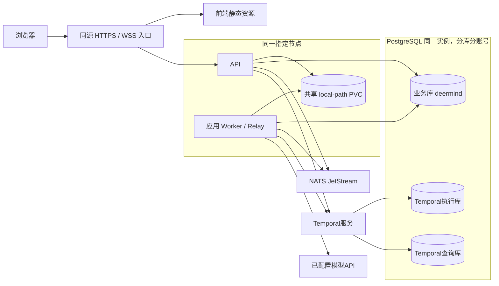
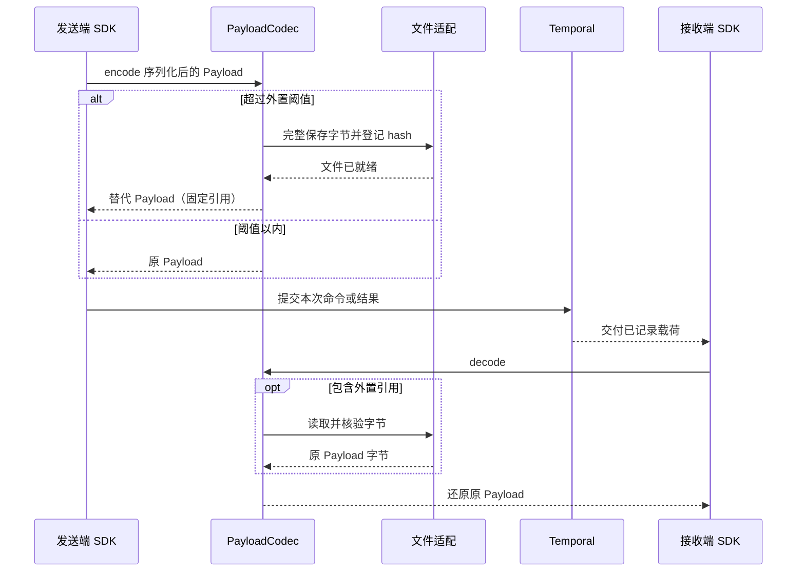
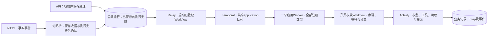
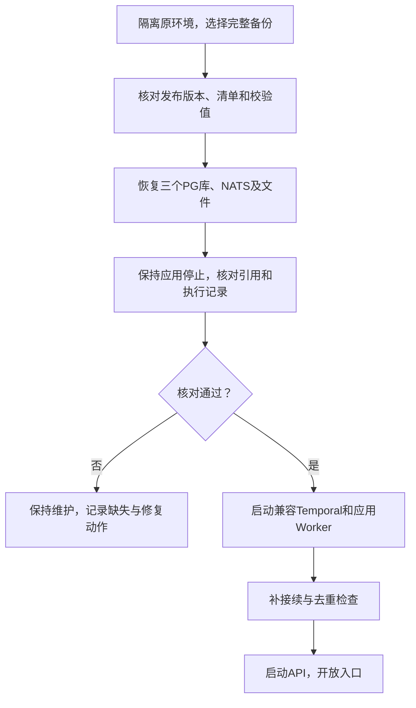

# M1 基础设施与部署设计

> **版本**：v0.49 
> **状态**：E01-04已接收；E01-05原子保存接线进度见实施计划 
> **维护与评审**：Codex编写及自检，用户审阅 
> **写作规范**：[系统设计写作规范](../../../top/DeerMind_System_Design_Writing_Standard.md) 
> **更新日期**：2026-11-16 
> **修订说明**：v0.48 → v0.49，接收E01-04并登记E01-05共同事务验证入口 

本文确定计算资源、存储、外部服务连接、网络和部署运维的实现方式，将总体架构落实为可启动和可恢复的运行环境。业务字段及规则留在所属模块，本文维护技术适配和运行配置；共同输入见[工程入口§2](README.md#2-设计输入与历史参考)。

## 1. 运行环境与部署单元

M1采用Kubernetes，API与Worker使用同一套Python后端模块、分别启动；前端为Vue 3＋TypeScript＋Vite单工程双入口。Temporal调度持久执行，NATS JetStream投递事件，PostgreSQL保存业务数据；Pydantic AI是Worker中的库，不新增Agent服务。职责见[总体§5.2／6.1](System_Design.md#52-进程与持久状态)。

| 环境 | 运行方式 | 持久化要求 |
| --- | --- | --- |
| 本机集成测试（已确认） | 新建Ubuntu 24.04 WSL2发行版，单节点K3s运行全套服务 | 复用正式部署形态及PVC；保留旧WSL，不把Temporal开发服务作为集成验收环境 |
| Kubernetes试用 | 正式Temporal服务、NATS、PG、API／Worker与前端入口 | 持久卷、配置及秘密由部署清单管理；不以Temporal开发模式承担试用服务 |

用户已确认业务库、Temporal执行库和查询库共用一个PG实例、分数据库和账号。它们共用容量和故障范围，M1接受这一简化；不将同实例称为高可用。Temporal的查询库用于Workflow查找，不是DeerMind学生状态库，依据[Temporal Visibility](https://docs.temporal.io/self-hosted-guide/visibility)。

图1：试用部署的连接与存储。框表示部署责任；应用Worker首轮单进程已确认，其他副本与资源见§5.7。

API和Worker挂载同一文件PVC；其他组件各用自己的数据卷，不能共用文件根目录。Temporal内部服务按正式部署包组织，应用Worker与Temporal内部Worker服务不是同一进程。浏览器不能直连PG、NATS或Temporal。初期部署不增加Dapr、Redis、SSE或OCR服务。

### 1.1 本机WSL测试与适用范围

用户确认先用本机WSL建立单机Kubernetes；采用新的Ubuntu 24.04发行版和K3s，保留现有Ubuntu 20.04。部署入口须能切换目标集群。本轮仅作只读环境检查，未安装或修改系统。

| 2026-11-15实测 | 结果及设计判断 |
| --- | --- |
| Windows资源 | 8个逻辑CPU、约15.8GiB内存；WSL可见约7.6GiB内存，systemd已运行 |
| 磁盘 | 现有WSL在D盘，D盘剩余约71.8GiB；C盘约13GiB，不作为新增镜像及持久卷主要存放位置 |
| WSL文件系统 | df显示约917GiB可用，这是虚拟盘内上限，不能当作宿主可用容量 |
| 工具 | 现有发行版能找到Docker和systemctl，未找到kubectl／k3s／Helm；未据此确认Docker服务状态或新发行版环境 |
| 网络 | WSL启动提示localhost代理未映射；模型外连和镜像拉取须在环境实施时检查，不关闭TLS或擅改全局代理 |

判断：可作为低并发功能接线起点，先跑一名学生及一名管理员的代表流程；不是100人试用容量或既定10人并发场景已通过。暂按现有8GiB级内存做精简部署，不直接把Windows剩余内存全部分给WSL。API、应用Worker、PG、NATS建议各1副本，Temporal内部服务使用正式组件的最小副本布局；资源requests／limits及卷容量在锁定Chart后计算，不在没有测量时承诺整册处理空间足够。

K3s控制面最低资源不包括DeerMind工作负载，见[K3s要求](https://docs.k3s.io/installation/requirements)。新发行版及数据建议放D盘；WSL的虚拟上限与物理空间区别见[Microsoft说明](https://learn.microsoft.com/en-us/windows/wsl/disk-space)。Ubuntu 24.04仍在常规维护期，20.04已转入扩展维护，见[Ubuntu周期](https://ubuntu.com/about/release-cycle)。采用新环境不意味着允许删除旧发行版或移动现有数据。

计算和数据库文件放WSL的Linux文件系统，由local-path提供PVC，不把/mnt/c或/mnt/d上的Windows目录直接充当数据库目录。新发行版的VHD位置、镜像缓存和备份位置在安装前列出；同一D盘备份可以练习恢复，不能作为磁盘损坏时的独立备份。

## 2. 数据库、文件与存储适配

数据库清单、schema归属、表字段及关系统一见[数据库设计](Database_Design.md#1-库与账号)。部署使用同一映射，不由各模块随意创建库或schema。

本模块维护数据库连接、账号权限、迁移与备份，以及NATS和文件卷的部署。NATS保存投递副本，正式事件保存在业务库；文件字节经隔离层保存。共同提交按[公共运行§4.1.1](System_Foundation_Design.md#411-同库事务适配)执行，AI和外部服务调用不进入事务。

### 2.1 文件存储隔离与切换

已定范围见[总体§5.3](System_Design.md#53-文件存储与初期部署)。infrastructure/files对上提供固定文件引用、授权字节读取和不可变保存，物理路径由适配管理。

| 场景 | 适配 |
| --- | --- |
| 本地开发 | 读写配置的本地目录，API／Worker共享同一目录 |
| M1 Kubernetes | 同节点、同local-path PVC，沿用文件系统适配 |
| 后续共享存储 | 改用共享挂载，业务引用不变，文件搬迁另行核对 |
| 后续对象存储 | 保留适配替换点，M1不实现或采购该服务 |

PVC不提供跨节点容灾。节点／磁盘损坏时，依赖原节点恢复或备份；不能只换一个空PVC继续处理原引用。API与Worker的同节点约束不要求PG、NATS也在同一节点。

### 2.2 数据库连接与短事务

用户已确认SQLAlchemy 2＋psycopg 3，Alembic管理业务表迁移。E01-04确认SQLAlchemy 2.1.8（asyncio扩展）、psycopg 3.3.9（binary扩展）、Alembic 1.20.1，传递依赖及hash由uv.lock锁定。SQLAlchemy支持psycopg的[同步与异步连接](https://docs.sqlalchemy.org/en/20/dialects/postgresql.html#module-sqlalchemy.dialects.postgresql.psycopg)，不另加第二层驱动连接池。

API及Worker的异步入口使用异步Engine；迁移命令独立运行，可以使用同步Engine。每个进程创建自己的有限连接池；一个请求／Activity使用自己的连接，不共享Session给并发任务，不在Temporal Workflow函数中直接执行SQL。只读查询使用短连接范围，调用模型或等待其他Space前释放连接。

事务由最外层用例创建。参加同一次保存的Product、Domain、Evaluation及runtime适配器接收同一连接，不能各自commit；任一校验或写入失败整体回滚。SQLAlchemy的[事务上下文](https://docs.sqlalchemy.org/en/20/orm/session_transaction.html)承接此生命周期；默认采用Read Committed，业务竞争靠已定行锁、预期修订及唯一约束，不以提高隔离级别替代幂等。

| 身份 | 权限 |
| --- | --- |
| 应用运行身份 | 连接业务库，按表授予所需权限；不可变版本、正式事件等只授SELECT／INSERT，不授DDL或任意DELETE |
| 业务迁移身份 | 仅部署升级时使用；可在受控业务schema内执行审核后的DDL及数据调整，API／Worker不持有此凭据 |
| Temporal运行与迁移身份 | 只访问Temporal专用数据库；按其发布版本要求配置，业务应用不持有这些凭据 |
| 备份／恢复维护身份 | 只供维护流程；权限及秘密与应用运行身份分开 |

同一连接参与多个模块提交，意味着应用运行身份具备这次保存所需表权限。schema用于组织所有权，并非模块之间的数据库安全沙箱；跨模块访问由公开端口、仓储封装及依赖检查约束。不能声称“每个模块只有自己的数据库账号”同时又让它们共用一个事务。

连接失败返回服务错误；提交回应丢失先查原业务收据，不能认定回滚后另起一份业务。池大小、等待、SQL及锁超时由配置给出有限值；所有API／Worker／Temporal连接上限加维护余量不得超过PG容量。部署检查配置关系，数值在接收前确认。

E01-05已沿本节接通事件、生产者投影及请求收据的共同事务；运行权限只扩展到本次五张表，不扩大连接池或依赖范围。测试与本机升级见[原子保存交付](../../../../src/m1/deploy/environments/local-wsl/facts.md)。

### 2.3 文件对象与上传合同

文件适配仅处理字节、校验值和存储位置。Product维护教材来源，Domain维护已采用内容引用，AI底座维护候选，SDK持久历史引用运行载荷；文件适配不根据文件名决定业务归属。

技术登记表见[文件对象](database/Business_Runtime.md#1-runtimefile_objects)与[上传记录](database/Business_Runtime.md#2-runtimefile_uploads)。本节维护文件保存和恢复机制；HTTP协议见运行分册，不重复物理列。

`FileReceipt`是接口收据，包含storage_ref、media_type、byte_size、sha256；由完整写入后的技术登记生成。持有收据不授予读取权。所有者仍维护教材来源、候选和执行材料等业务引用。

技术登记存于runtime schema，由`infrastructure/files`仓储维护；公共运行只引用，不取得教材或AI正文的管理权。文件名和客户端申报类型只作输入，原始名称进入Product的显示信息，不作为磁盘路径或MIME判定依据。

上传登记、传输、状态查询及授权文件读取字段见[运行协议R01—R03、R07](contracts/Runtime_Protocols.md#r01)。内部read_file(access_context,file_ref)只接收所有者授权引用；save_derived(access_context,source_refs,transform_ref,bytes)按固定产物身份保存，返回FileReceipt，不覆盖来源。

上传正文走HTTPS流式传输，不走WS或模型提示。管理员可一次选择全册文件，客户端逐文件登记成功／失败；已成功文件保留原收据，只重传失败文件。批量并行数、单文件大小和总量均有限；缺配置拒绝接入，不默许无限上传。

保存顺序：

1. 检查账号、用途、资源和原上传状态；短事务取得write_attempt_id及有限写入租约，已有有效租约返回upload_busy。传输中续租，失去租约的旧尝试不能提交ready；故障后可沿原upload_id建立新尝试。
2. 写入配置根目录下的专用临时文件，同时计算字节数和hash；中断不产生可用收据。
3. 按用途核对真实格式、解析可用性及限额。教材原件允许PDF／JPEG／PNG；扩展名、浏览器MIME和模型判断不能代替程序检查。PDF页数及图像解码资源也受限。
4. 完整写入并刷新后，在同一文件系统内发布不可变文件，刷新目录；文件键包含本次尝试，旧尝试不能覆盖新文件。随后短事务核对当前写入尝试，登记StoredFile并将Upload置ready。数据库事务不包住上传和文件I/O。
5. Product.receive_material校验收据、账号、用途及准备上传时的Domain依据，再保存来源和事件；此步成功才算加入教材。

| 中断位置 | 恢复 |
| --- | --- |
| 文件尚未完整保存 | 无ready收据；原upload_id可重传，部分文件不供读取 |
| 文件完整、登记未提交 | 按原身份核对已存字节及hash后补登记；不能仅凭路径存在宣布成功 |
| ready已提交、响应丢失 | 查询原上传得到同一收据；重复发送若字节不同则identity_conflict，不覆盖 |
| 收据已形成、教材保存失败 | 收据仍可核验，按原业务请求继续；不重新上传整批 |
| 已引用文件缺失／hash不符 | 返回source_unavailable并保留故障记录，不拿另一页或空内容替代 |

实际路径由程序生成并限制在根目录内；拒绝路径穿越和符号链接逃逸。临时区与正式区位于同一挂载，发布不能依赖跨卷rename；已有正式路径只允许校验复用，不覆盖。API／Worker以相同文件组访问共享卷，禁止任一容器把未挂载目录误当文件根目录。

M1不开放文件物理删除或自动清理已ready文件。导入删除只改变业务可用性，仍被Domain、Evidence或执行记录引用的文件继续保留；未完成临时文件的清理也须先核对没有活跃上传。清理期限单独确认，不把容量不足作为删历史依据。

### 2.3.1 上传容量建议

以下为本机首轮**待审值**，与模型单次输入限制分开。教材仍支持整册批量选择和后续补页，不要求管理员逐页发解析请求。

| 项目 | 建议上限 | 超限处理 |
| --- | --- | --- |
| 单份PDF／单张JPEG或PNG | 512MiB／32MiB | 拒绝该文件，保留其他成功收据；不通过降质覆盖原件 |
| 一次上传批次 | 2GiB、最多600份文件；最多2份同时传输 | 可以分批继续上传到同一导入，原册关系不拆成多本教材 |
| PDF页数／图像解码 | 单PDF最多600页；单图最多4000万像素；逐页转换 | 先检查元数据及解码预算；异常文件不一次性展开到内存 |

数值是防止本机资源被一次请求占满的起点，不是已验证整册容量。页数和文件量不会替代磁盘检查；沿§5.7.3核对宿主与PVC实际空间。正文始终流式落盘，接收字节超过声明或用途上限即停止；已ready原件不因本次失败被删除。租约及上传时限建议见§4.5的U01–U04，仍待审；临时文件清理另定。模型90秒请求上限不适用于整册上传。

### 2.4 授权展示与派生资源

浏览器通过业务所有者的文件查询入口读取，入口核对当前身份、预期会话和资源范围，再调用read_file。私有文件不暴露本地路径或裸静态目录，响应禁止缓存；客户端使用授权fetch取得Blob，切换账号或离开资源时释放Object URL。

原件与派生资源分开：PDF转页图保留原件hash、文件内页号和转换参数；页图可用于阅读和交给模型，不替代原PDF。公式、表格和图形的正式表达仍按Domain统一内容结构渲染；不把截图当成语义结构。格式转换失败明确到文件／页，不能静默丢页或缩图后声称无损。

AI底座的大内容也使用固定文件引用。业务候选保存与SDK内部载荷分别处理：模型材料装载见[AI底座§4.2](AI_Foundation_Design.md#42-图像和持久载荷)，SDK边界按§2.6外置；只有文件适配而未装配Codec仍会受到历史载荷限制。

### 2.5 PVC装配与检查

API与Worker声明同一业务文件PVC，使用受控节点标签约束到同一节点；local-path StorageClass使用WaitForFirstConsumer，并核对PV的nodeAffinity。需要更换节点时先迁移文件及引用，不能让Pod在新节点自动获得一个空目录继续运行。依据[Kubernetes卷绑定](https://kubernetes.io/docs/concepts/storage/storage-classes/#volume-binding-mode)和[local-path-provisioner](https://github.com/rancher/local-path-provisioner)。

PG数据、NATS数据和业务文件分别使用卷，不能混放或共用同一存储目录。NATS的store_dir必须显式配置到持久卷；每个NATS节点使用自己的目录，不能靠共享目录实现副本。[NATS文件存储配置](https://docs.nats.io/running-a-nats-service/configuration)。

启动检查文件卷标识、根目录、读写权限及可用空间；只在隔离探针目录做技术读写，不创建教材或学习事件。卷不匹配、不可写或容量不足时，对依赖写文件的动作返回明确错误。副本和容量参数仍待接收，挂载成功不证明备份可恢复。

### 2.6 Temporal载荷外置

用户确认采用Temporal的PayloadCodec扩展点，接入现有文件存储；不启用预览版ExternalStorage，不增加S3或其他存储服务。API、Worker和受控恢复工具使用同一套转换器；Temporal服务只保存转换后的载荷。[Temporal官方示例](https://docs.temporal.io/ai/cookbook/claim-check-pattern-python)说明这种引用替换机制，以下为DeerMind的文件接线设计。

责任分三处：公共运行装配DataConverter并处理执行故障；AI底座保留Pydantic AI的序列化和模型／工具Activity集成；`infrastructure/files`实现PayloadCodec及不可变字节存取。Codec不读取业务表、解释提示或决定取材，不另建Operation。

**保存格式。** 对超过配置阈值的SDK Payload，先序列化整个Payload（含原metadata和data），再保存到文件适配的`runtime-payload`用途；不是只存图像或Payload.data。历史中的替代Payload使用版本化encoding，正文为`format_version, storage_ref, byte_size, sha256`。storage_ref是不透明文件引用，不是磁盘路径或可执行URL。小载荷保持原样；载荷顺序和数量不变。

| 编解码步骤 | 程序动作与失败 |
| --- | --- |
| encode | 校验单个及本批载荷预算；按字节hash生成内部存储身份。相同字节可复用已就绪文件，同身份不同字节拒绝 |
| 保存 | 复用§2.3的完整写入、校验、原子发布及文件登记；文件和登记均就绪后才把替代Payload交给SDK。写失败不发引用，重试不覆盖旧文件 |
| decode | 识别自有encoding并校验版本、受控存储范围、大小和hash，读取后还原完整原Payload；其余encoding交原转换器处理 |
| 解码异常 | 缺文件、hash不符、未知格式或权限失败记录明确技术错误；不返回空材料，不用新模型调用填补历史 |

Codec运行在SDK数据转换边界，不在Workflow业务代码中执行文件I/O。自动解码使用应用服务身份，只访问本部署的运行载荷区；它不依赖浏览器登录，也不调用Product的教材授权入口。原始业务取材和每次新的模型外发仍分别鉴权；技术解码权不授予用户读取正文的权限。文件上传接口和普通下载接口不能读写运行载荷。

Codec不要求SDK在每次调用时提供execution_id。文件登记以存储引用和hash为依据；能够取得Workflow／Activity身份时记录关联日志。业务AI调用另按call_id保存输入清单，不通过猜测文件所属空间补造事件。业务事件保存实际业务事实及自己的不可变附件；NATS仍只投递事件通知。Temporal Codec载荷不是业务原文唯一来源，不能用执行历史代替正式事件。

图2：一次Activity边界的成功路径；失败见上表。两端使用同一编解码合同，反向返回同样处理；文件就绪不代表业务提交成功。

**恢复与保留。** 文件已存但SDK提交失败只留下未被历史引用的文件；重试复用相同字节，不据此登记业务成功。历史已有引用但文件不可读时，恢复依赖尚未满足，按公共运行§4.5记录并收尾；不能因业务PG可读就宣称工作已恢复。模型已返回但尚未完成持久记录时仍可能重调，此机制不保证外部调用只发生一次。

M1不自动清理运行载荷区，包括尚未确认被历史引用的文件；达到容量上限明确拒绝新增写入。后续清理须证明活动历史、仍可读取的关闭历史及保留备份均不再依赖该文件，不能只凭工作已完成或文件较旧删除。整套备份先复制完整就绪载荷区并保留存储映射；M1不依赖扫描Temporal历史反推“有用文件”后再挑选复制。备份和原件一起按§6.2—6.3核验。

**接收边界。** 配置外置阈值、最大原始载荷、每批解码字节预算、内存和历史预算；同时限制请求总大小和事件数量。具体值待版本／模型配置评审，不照抄服务端默认值。API、Worker或恢复工具缺少所需encoding支持时拒绝接入。Temporal Web UI可显示技术引用；M1不增加面向浏览器的Codec解码服务。

实现时检查双向往返、工具返回累积后再调用、重复保存、缺失／损坏文件、不同进程重放和整批备份恢复；代码验证留实现阶段。本方案不提升模型上下文容量，也不能消除解码内存或事件数量限制。

## 3. 模型、识别及其他外部连接

模型接入按[总体§6.1.1](System_Design.md#611-模型api接入边界)采用现成API，不把模型推理平台或GPU推理部署纳入DeerMind的M1交付。基础设施提供已配置服务的连接与凭据，AI底座统一调用；各类Agent可分别指定模型，或引用同一服务和模型。

连接、用途配置与错误合同见[AI底座§2—3](AI_Foundation_Design.md#2-模型连接与能力适配)。首轮供应商／型号已确认为DeepSeek Flash；SDK版本及限额候选仍待确认。服务不可用在有限重试后明确失败，M1不自动切换备用模型。教材识别按[总体§6.1.2](System_Design.md#612-教材agent解析与对话修正)使用同一模型API接入机制，M1不部署或外接独立OCR／文档识别服务；原件文件存储、授权读取及模型调用失败处理保持。

模型外发边界沿用[总体§6.6](System_Design.md#66-已确认的读取工具与越权边界)：Operation负责内容，AI底座限制可调用服务并保护凭据。基础设施提供受控的服务配置及凭据装配；模型服务密钥只用于认证，不暴露给客户端，不进入提示词或普通日志。受理时固定非秘密配置快照，配置变化只影响新工作；恢复使用原快照。模型Activity通过credential_ref取当前有效密钥，配置停用或权限撤回仍即时拒绝后续调用。秘密载体及刷新方式见§5.1；M1不增加材料标记或内容审查系统。

### 3.1 配置装配检查

API与Worker加载同一修订的用途／工具登记，核对适配器、所需模型能力、有限预算和输出Schema；旧执行引用的配置须仍可解析。缺配置时拒绝相应用途，不以空值代替无限额度。密钥只在模型Activity连接服务时读取，不能序列化入Workflow历史。连接失败与配置错误分别记录，健康检查不冒充真实语义验收。

多模态装载见AI底座§4.2，SDK载荷按§2.6使用PayloadCodec。运行载荷属于恢复数据，配置、解码器和文件一起随部署接收；具体SDK锁定版本及有限阈值仍待审，不增加存储产品。

## 4. 网络与异步传输

前后端实时交互已选WebSocket，生产使用WSS，普通查询、管理操作和文件传输保留HTTPS；不增加SSE并行通道。登录Cookie和Origin按Product§2.5—2.7，信封、授权及补取按[公共运行§5.3—5.5](System_Foundation_Design.md#53-websocket连接与命令)；代理与数值配置在本节落实。

后台业务事件通过NATS JetStream投递；公共运行适配关联事件，进入普通消息处理器、启动AI Operation或向已有持久执行发Signal，具体交接见[公共运行§4](System_Foundation_Design.md#4-可靠交接与提交控制)。Temporal自己的任务队列分派Worker执行Operation的Workflow／Activity代码，NATS不替代该队列。普通后台工作也可由Worker执行，按恢复要求使用Temporal；不因进入Worker就要求Pydantic AI或OperationRun，执行身份、普通后台和AI工作映射见公共运行§3.3；实际SDK及队列配置仍待审。

Operation业务步骤归所属模块，公共底座的接入、路由、输出适配是API／Worker共用代码，不据此新增中央业务编排服务。浏览器只连接API，由API回传进度与结果。订阅承接、Workflow启动和Signal交接采用[公共运行§4.4](System_Foundation_Design.md#44-受理投递与执行交接)，失败收尾见§4.5；WebSocket接线已有公共运行§5详细稿；数值限额及部署配置仍待审。

保持检查仅在学生再次进入空间时触发，不部署离线保持检查定时作业。Relay补发和未收尾执行的技术核对可随Worker部署；它们只处理交接和运行记录，不安排学生学习。NATS消费者采用持久订阅及显式Ack；确认发生在业务受理与后续安排共同保存之后，不等待LLM。重复交接靠稳定ID防重，具体subject、Task Queue、租约及重试限额随部署配置审阅。

### 4.1 浏览器接入装配

生产前端、认证API、业务API和/ws对外同源；反向代理转发HTTP与WebSocket Upgrade，TLS在受控入口终止。仅信任登记代理传入的转发头，来源和Cookie策略使用对外地址；不能以任意Forwarded头判断可信Origin。本地开发通过Vite代理取得同源访问，不开放带凭据的任意来源。

每个API实例维护自己的连接与watch，使用NATS实时订阅接收刷新提示，不使用竞争消费组抢走其他实例通知。该通道不做业务消费和持久确认；领域、评价等仍使用JetStream受理协议。刷新遗漏由客户端补读修复，不因增加API副本而引入另一个MQ或共享浏览器连接库。

部署须配置：登录有效期与登录尝试限额、WS握手期限／心跳、帧字节上限、每连接watch与输出队列上限、只读同步周期、重连退避上限及查询页量。候选统一见§4.5，接线前确认；缺值不得采用无限默认。参数组合按§4.6检查。

auth_sessions位于业务PG，API重启后凭有效Cookie查回会话；进程内缓存不作为唯一认证来源。浏览器请求和输出均通过会话认证；内部调用使用执行授权，不能要求后台携Cookie。日志隐藏Cookie、CSRF、密码和完整帧正文。部署维护凭据与模型密钥分别配置，不授予浏览器Worker／NATS／Temporal访问权。

### 4.2 消息交接参数草案

以下为**待确认的接线值**，只约束事件承接和技术交接，不约束AI业务完成。交接顺序、失败责任沿公共运行§4.4—4.5。

| 环节 | 建议参数 | 到上限后的处理 |
| --- | --- | --- |
| NATS订阅承接 | 持久pull consumer，显式Ack；每次拉取1条，MaxAckPending=1；受理处理总限20秒，AckWait=30秒，MaxDeliver=5 | 只保存Receipt及后续安排；没有提交不Ack，临时失败延迟30秒NAK；不在回调里等Temporal或AI |
| NATS重投间隔 | 本轮不设置BackOff；使用AckWait及明确的延迟NAK | 避免BackOff覆盖AckWait，或无延迟NAK造成密集重投 |
| 发布／启动／Signal／取消交接 | 单次外部请求5秒；每轮最多5次，间隔2、5、10、20秒，总限90秒 | 沿原交接身份留exhausted；已启动状态不明继续核对，不另起业务、不自动重置次数 |
| Relay租约 | 30秒；每次外部请求后写结果并释放，本轮间隔通过next_attempt_at记录 | 租约失效允许重新检查同一交接，旧持有者不能覆盖新状态 |
| 技术核对 | 建议30秒一次，读取未交接／未收尾的技术记录 | 查不到服务先记录核对失败，不能据此放开学生入口或重建任务 |

20秒承接上限包含读取、身份检查和数据库提交；短语句／锁等待仍受§4.5 D01已确认的业务SQL约束，不能因执行多条SQL绕过总限。每个订阅者独立承接，MaxAckPending=1只限制交接，不限制已受理AI工作的并发。5次外部请求及4段间隔共62秒，90秒为该轮等待和记账留余量；进程停机可能使实际交接更迟，不能当作恢复SLA。

JetStream达到MaxDeliver后不会自动建立死信队列。失败通知持久采集和消息流装配见§4.3；通知缺失时按公共运行§4.6核对发布记录和Receipt，不能只依赖进程内订阅。获准修复后只重送指定事件并沿原Receipt去重；已经接住但AI失败的工作交Temporal恢复，不重新投递业务事件。上述语义依据[NATS确认与重投文档](https://docs.nats.io/learn/jetstream/acknowledgment)，于2026-11-15核对；数值是本项目建议。

工作时限短于交接预算时取剩余时间；没有成功启动且已确认原尝试终止，才按公共运行失败收尾释放入口。部署把AI工作预算、Wait和消息交接配置分别装配，不用AckWait表示“等待模型回答”。

### 4.3 消息流与接收方装配

用户已确认投递副本的清理边界；采用InterestPolicy落实“所有匹配消费者确认后清理”。同时使用DiscardNew、MaxAge=0，不设置消息TTL，避免未接住的副本因过期或容量压力被删除。原件与正式事实保留在业务存储，NATS不承担历史查询。[NATS保留策略](https://docs.nats.io/learn/jetstream/retention-policies)及[容量限制](https://docs.nats.io/learn/jetstream/shaping-the-stream)，2026-11-15核对。

| 项目 | 装配草案 | 状态 |
| --- | --- | --- |
| 业务stream | `<prefix>_EVENTS`，file存储，InterestPolicy；subject为`dm.<deployment_key>.event.<event_type>` | 命名待审；事件类型取工程目录，不含学生姓名或正文 |
| 业务consumer | 每个subscriber_id一个durable，过滤其已登记事件；进程副本共用；显式Ack，断开不删consumer | 沿已定订阅边界 |
| 失败通知stream | `<prefix>_DELIVERY_FAILURES`，file＋InterestPolicy；仅接业务stream的MAX_DELIVERIES及MSG_TERMINATED通知，配固定采集consumer | 待审装配；不采集自身失败形成递归 |
| 容量 | 业务768MiB、失败通知32MiB；单条信封64KiB | 待审值；800MiB低于既有1GiB文件存储候选，仍须核对物理开销 |
| 清理 | 各自所需consumer已可靠接收后清理；无自动过期、无删旧腾空间 | 已确认；满额保留PG待发记录，按原身份报错和恢复 |

InterestPolicy在没有匹配consumer时可能立即移除消息，因此初始化先建失败通知stream及collector，再建业务stream和全部durable，核对订阅后才开放发布／消费。应用账号无删除stream／consumer权限；升级不通过删建消费者重置位置。需要改变过滤条件时先暂停相关发布并处理既有积压，不静默缩小旧消息的接收范围。

collector保存技术失败记录后才确认，不生成新的学习空间事实。通知提供stream、consumer和stream_seq；用发布回执或仍保留的原消息关联event_id，关联不了则保留未定位故障。通知流满额、采集异常或通知遗漏仍可通过公共运行的收据核对发现，不能把advisory当作唯一可靠账本。[失败通知字段](https://docs.nats.io/reference/jetstream/advisory/max-deliver)。

部署同时核对本环境的stream、consumer、账号权限与prefix，连接到共享NATS时使用隔离账号／命名范围，不订阅其他部署的通知。具体账号装配及这些配置值在E01接线前审阅。M1不新增消息管理页面或第二套业务调度器。

### 4.4 共享Worker与Temporal队列

用户确认首轮一个应用Worker进程、一个共享逻辑Task Queue；API独立运行。Worker执行9项AI能力及普通后台工作，各Space的代码和数据所有权不变。E01-03已确认本机namespace为`dm-local-wsl`、逻辑队列为`dm.local-wsl.application`；其他部署须显式配置。

| 装配项 | M1接线 |
| --- | --- |
| Temporal namespace | 环境配置必填；建议`dm-<deployment_key>`，不与Kubernetes namespace混同 |
| 应用Task Queue | 建议`dm.<deployment_key>.application`；所有业务Workflow和Activity使用此逻辑名称，不按Space或学生分队列 |
| 应用Worker | 一个进程装配全部[业务注册](System_Foundation_Design.md#331-入口与worker注册对应)与AI活动；Relay／订阅桥仍沿既有同进程装配 |
| API及Relay | 使用同一namespace、队列配置与实现登记；API不运行Temporal Worker。Relay根据已提交的启动记录派发，订阅桥接住事件后不等待整项业务完成 |
| AI活动 | Pydantic AI集成随业务Workflow注册，模型／工具I/O在Activity执行；普通后台处理不经过Agent |
| 信号与恢复 | Signal／Cancel按Workflow ID及attempt发送；重启继续原历史，获准恢复另建attempt并复用原Step；不靠换队列避开失败 |

一个逻辑队列名对应Temporal内部不同类型的任务队列，不是让Workflow等待占住Activity执行槽。同一队列的Worker必须具有相同的类型注册；新增兼容副本才可共同消费。依据[Temporal任务队列](https://docs.temporal.io/task-queue)，2026-11-15核对。SDK内部缓存队列由SDK管理，不另列为业务部署单元。

图2：事件接入、执行派发与应用Worker。箭头表示交接，不表示Space代码归公共运行所有。

**并行和资源。** 共用队列不保证学生消息或事件的业务顺序；Interaction和Evaluation按各自合同控制。同一进程内的Workflow任务、Activity任务与Relay循环分别执行；等待Timer／Signal不长期占用模型调用或数据库连接。阻塞文件处理不放在异步主循环。工作共用资源，教材处理可能增加教学或评价等待，M1接受这一取舍，不引入优先级或专属资源。

E01-03已确认Workflow任务并发2、Activity并发4；拉取、缓存和线程池按§4.5的W02接线并随本增量评审；不批准SDK默认并发或不限量排队。新工作资源不足按既定入口规则返回错误；已受理工作按有限期限执行与恢复，不能静默丢弃。队列名和资源限额随发布清单固定，不能由客户端或模型传入。

**启动与升级。** 启动前对照业务登记核验Workflow、Activity和Agent清单及摘要；API／Worker登记不一致时不开放相应能力。拼错队列名可能创建无人消费的新队列，不能把Temporal接收启动当作Worker能执行的证明。就绪检查核对指定namespace、队列与注册，不通过试跑AI来检查。

升级沿§5.3维护流程停旧应用执行，再启动兼容新代码；不让注册不一致的两版应用Worker共同拉取。未完成历史所需实现和解码器未保留时停止升级，不自动将旧工作改投新队列。初期无需增加Worker Versioning、按Space隔离队列或动态Agent服务；未来拆分需重新审阅登记及恢复关系。

### 4.5 首轮入口与执行参数建议

下表W01已在E01-03确认；W02按其候选接线、待本增量评审，其余未单独接收的项仍为候选。所有值均不是性能承诺。按一个API进程、一个应用Worker及§5.7的资源候选估算；不增加优先级、专属队列或自动扩容。数值在本表维护，业务模块只引用本表及对应处理规则。

| 编号／责任 | 建议值 | 到上限或失败时 |
| --- | --- | --- |
| W01 Worker执行／公共运行 | Workflow任务并发2，Activity并发4 | 控制正在执行的任务，不是最多2个学生；已受理工作排队时间仍计入原期限 |
| W02 Worker装配／公共运行 | Workflow／Activity拉取上限各2；Workflow缓存8；Workflow线程池2、同步Activity线程池4 | 缓存淘汰后按历史恢复，不丢业务；不同时启用另一套自动调优参数 |
| A01 登录／Product | 登录成功起固定24小时 | 到期重新登录；草稿按原账号隔离，已受理后台工作不因此取消 |
| A02 密码／Product | 15–128个Unicode码点；预置账号建议生成16位随机密码 | 不截断密码，不增加强制大小写组合；开户与重置仍走既有入口 |
| A03 密码校验／Product | Argon2id：内存19456KiB、迭代2、并行度1；API同时最多2次密码校验 | 超出处理能力明确提示稍后重试，不无限启动散列任务 |
| A04 登录尝试／Product | 同一登录标识15分钟内最多5次失败；同一来源IP15分钟内最多60次尝试 | 临时限流并返回可重试时间，不把账号改为停用、不撤销已受理工作；未知账号也计数 |
| H01 普通请求／公共运行及客户端 | 应用处理30秒；浏览器等待35秒；反向代理响应等待40秒 | 仅约束查询、保存、受理及收据；返回未知结果时先查原请求，不重做业务 |
| H02 普通JSON／公共运行 | 请求正文2MiB；单页JSON响应4MiB；列表默认50项、最多100项 | 同时按条数及字节分页；完整内容块不截断，大内容沿授权引用读取；WS共用动作另按[运行协议](contracts/Runtime_Protocols.md#动作与授权视图)的共同输入限额校验 |
| D01 业务PG／基础设施（E01-04已确认） | 建连5秒、连接池等待3秒、statement_timeout 10秒、lock_timeout 3秒、idle_in_transaction_session_timeout 10秒 | 失败回滚或沿原收据核对；多条SQL共用上层总时限，不逐条重新领取整份时间 |
| S01 WS接入／公共运行 | Upgrade后完成hello／ready最多10秒 | 未完成鉴权不处理业务帧；不创建后台工作 |
| S02 WS保活／公共运行及客户端 | 应用心跳30秒；90秒无有效心跳判失联；代理空闲期限120秒 | 只处理连接失联；原工作、活动和评价不改为失败，不延长登录期限 |
| S03 WS消息／公共运行 | 每条重组后的JSON消息最多64KiB，按UTF-8字节计算 | 超限拒绝或关闭连接，客户端保留原输入并提示；文件改走已有上传接口，不静默截断 |
| S04 WS连接／公共运行 | 每API最多64条，每账号最多4条已认证连接 | 新连接明确拒绝；已有连接不被新连接挤掉，不等于支持64个学生同时调用模型 |
| S05 WS缓冲／公共运行 | 每连接最多4个watch；接收队列8条；发送队列32条或256KiB先到；单次发送最多10秒 | 同资源changed合并；仍超限或发送超时则断开，收据和结果通过原身份补查 |
| S06 同步／客户端 | 可见且已watch时30秒补读；有未完成请求时5秒补查；同资源同时最多1次补读 | 合并刷新，不叠加两套轮询；只读失败按重连退避降低频率，后台标签页暂停周期请求 |
| S07 重连／客户端 | 一轮最多6次，间隔1、2、4、8、16、30秒；加±20%抖动且最终间隔不超过30秒 | 仍失败提供手动重连；鉴权失败先重新登录，不自动重发写请求 |
| U01 上传并发／基础设施及客户端 | 每API同时最多2份文件，每账号也最多2份；文件检查执行器并发1 | 新上传暂不受理，已成功收据保留；既有上传查询和同键重试先查原记录 |
| U02 上传时限／基础设施 | 一次写入尝试从受理到ready最多20分钟；接收正文期间连续60秒无新字节停止 | 总时限包括检查及登记；正文收完后的检查不适用“无新字节”判定，仍受总时限限制 |
| U03 上传租约／基础设施 | 有效期90秒，每30秒续租；每次续租不得超过本次20分钟总期限 | 失去租约或无法续租时停止新写入；旧尝试不能登记ready，按原upload_id核对或重传 |
| U04 文件流／基础设施 | 每次读取最多1MiB，流式计算hash和落盘 | 不把512MiB原件读成一个内存对象；检查与转页仍按§2.3.1的像素／页数预算逐项处理 |

**已有候选的归属。** 单文件及批量容量在§2.3.1，业务连接池和PG总连接数在§5.7.2，消息交接在§4.2—4.3；模型单次调用已确认值见公共运行§3.6，工作总预算仍见AI§3.4。它们不因本表补齐自动成为已确认配置。临时文件删除仍按§2.3另行确认，本批不增加自动清理。

**计时与占用。** D01只设置业务连接，不修改Temporal内部数据库的超时。H01不覆盖WS连接寿命、文件传输或AI执行时长；WS命令的校验和受理使用同一普通处理预算。上传路径单列接收及20分钟上限，不受普通请求40秒代理时限误杀。API在事务外等模型、文件传输或Space结果时不得持有连接。

**WS接线。** S02对应公共运行§5.3的应用ping／pong；握手和业务命令分开计时。服务器及客户端按相应存活信号判断连接，普通消息不伪装为登录续期。所选WS实现不得以更短的未审默认心跳超时覆盖本表。S03约束完整消息，不只约束单个分片；库的接收缓冲和应用发送缓冲分别有界。补读失败不增加写请求；单对象超过普通响应上限时返回可授权读取的内容引用，不返回半个对象。

**审阅依据。** W01／W02参照[Temporal Python Worker](https://python.temporal.io/temporalio.worker.Worker.html)的执行槽、缓存及执行器约束；锁定版本使用其支持的固定拉取配置，不同时填新旧同义参数。S03／S05参照[Uvicorn消息与队列设置](https://uvicorn.dev/settings/)；其HTTP keep-alive不是请求总时限。A02参考[NIST单因素密码长度](https://pages.nist.gov/800-63-4/sp800-63b.html)，A03采用[OWASP Argon2id最低配置](https://cheatsheetseries.owasp.org/cheatsheets/Password_Storage_Cheat_Sheet.html)作为待测起点；不据此声称系统整体符合该标准。资料核对日期2026-11-15，以上并发、时限及容量都是项目建议。

### 4.6 参数组合检查

配置接收时同时检查下列关系，不只逐项检查数值为正。

| 关系 | 本批静态结论／实现接收 |
| --- | --- |
| Workflow缓存与执行器 | 缓存非零时Workflow并发及拉取均不低于2；同步Activity线程池4不小于Activity并发4；缓存8不等于8份独占Agent |
| 业务连接 | 沿§5.7.2共60条规划连接，小于PG上限80；不能为每个Space另建5条池。是否够用由接线测试判定 |
| SQL与上层期限 | 锁等待3秒计入10秒语句时间；建连5＋池等待3＋一条语句10为18秒，低于20秒订阅承接和30秒普通请求；多语句必须受剩余总时限约束 |
| 浏览器与代理 | 普通请求30＜35＜40秒；WS心跳30＜失联90＜代理空闲120秒；上传走独立超时设置 |
| 上传租约 | 30秒续租＋18秒业务I/O预算小于90秒租约；续租失败不延长总期限，过期尝试不能发布可用收据 |
| 内存 | 4个Activity、8份缓存及输入／载荷上限都有限，但不据此证明1536MiB Worker足够；实现时测最坏材料、解码及并发峰值，超限则调整候选 |
| 重试与身份 | 只读同步、WS重连和上传重传不重置后台工作预算；任何受理不明先查原身份，既有Step、文件和作答不重复提交 |

已受理工作按原Execution期限处理，Worker并发值不能替代入口的资源可用性检查；队列等待也计入期限。资源不足按既定规则拒绝新的工作，不引入优先级。全部数值在用户确认后才能进入环境values和实现默认值；格式、协议、并发及故障测试留实现阶段。

**工程资产。** 技术SDK适配位于`server/src/deermind/infrastructure/`；镜像、Helm、组件和环境配置、发布模板分别位于`deploy/`，路径唯一维护在[源码组织§8](Source_Organization.md#8-构建部署与维护)。业务表映射属于各模块，基础设施不集中接管六个schema的业务存储。

## 5. 配置、部署与启动

### 5.1 发布清单与配置

每次部署使用一个ReleaseManifest，固定release_id、源码提交、后端／前端镜像digest、依赖锁文件hash、业务Schema head、Temporal服务／Schema版本、NATS版本、事件解码版本、Workflow实现版本、Worker注册清单摘要、Temporal namespace／队列配置、Codec格式／解码器、文件后端映射、配置修订和前一可恢复备份引用。不给生产使用latest镜像或启动时自动升级依赖。

| 配置 | 载体与使用 |
| --- | --- |
| 连接地址、用途登记、预算、网络限额 | 本地受控配置文件；Kubernetes ConfigMap。API／Worker核对同一配置修订 |
| PG／NATS／模型服务凭据 | 本地不入库的受限秘密文件；Kubernetes Secret只读挂载。按credential_ref读取，不复制到Prompt、事件、日志或发布清单 |
| 维护凭据 | 与应用分开，仅迁移／备份／恢复命令使用；应用镜像不含可用默认密码 |
| 文件根目录、卷标识、组件数据目录 | 显式配置；启动核对实际挂载，不回退到容器临时目录 |
| 保留和容量配置 | 分业务文件、日志、NATS和Temporal列出；没有批准值的维护动作不自动开启 |

模型非秘密配置仍在受理时固定；当前密钥通过秘密适配读取。Kubernetes挂载更新存在传播延迟，使用整个Secret目录挂载，不使用不能自动更新的subPath；新密钥可读并核验后才撤销旧密钥。连接池用旧连接时，按受控重连切换；不能将“Secret已修改”等同于所有调用已切换。[Kubernetes Secret更新行为](https://kubernetes.io/docs/concepts/configuration/secret/#using-secrets-as-files-from-a-pod)。

### 5.2 初始化和正常启动

初始化是受控部署命令，不由每个API／Worker进程争抢建表。重跑先检查既有版本和身份，只补未完成项，不能清库、覆盖管理员或重建消息流。

| 顺序 | 执行者和操作 | 继续条件 |
| --- | --- | --- |
| 1 | 部署命令核对发布清单、配置、节点、卷和秘密引用 | 必需值齐全；镜像、Schema及配置组合支持 |
| 2 | 启动PG和NATS持久服务；创建指定数据库及最小账号 | 库和卷可读写；已有数据不被初始化脚本覆盖 |
| 3 | 单独Job执行业务Alembic及Temporal官方Schema工具 | 版本达到清单目标；任何失败立即停止发布 |
| 4 | 启动Temporal，登记namespace及30天关闭历史保留；按§4.3先建失败通知采集，再核对业务stream／durable | 名称、保留与订阅一致；冲突不自动purge或重置游标 |
| 5 | 按§4.4启动一个共享应用Worker及其Relay／订阅适配 | 业务／AI注册与发布清单一致；namespace、队列和转换器正确，支持现有执行 |
| 6 | 启动API及前端；按Product端口完成首个管理员初始化 | 认证、库、共享文件及已配置能力可用；未准备好的能力明确拒绝受理 |
| 7 | 读取启动检查结果，开放浏览器入口 | 能查询既有数据；新部署不自动导入教材、生成题目或评价学生 |

本机集成环境按§1.1运行正式组件及PVC。单模块临时调试可以使用开发服务，但其记录不进入集成接收或备份基线。重置仅针对显式标识的可丢弃环境，不作为升级方式。

应用后端使用同一镜像、不同入口命令启动API与Worker；前端单独构建静态资源，经同源入口提供。Kubernetes使用分别管理的Deployment，生产Temporal使用正式服务部署，不使用开发模式。应用Worker首轮单进程已确认；组件Chart、镜像、其他副本及资源在部署清单评审确认，不在此预填容量结论。

API的liveness只判断进程是否正常；readiness核对必要装配和数据库／卷可用性。下游故障不触发所有Pod循环重启。新AI工作还须检查对应服务及本机资源，不满足返回明确不可受理；已有查询可用性和新工作可受理性分开报告。

### 5.3 Schema迁移与版本兼容

用户确认使用Alembic迁移，不自动删库重建。M1业务库维护一条发布迁移链：各所有者提交自己schema的脚本，装配层按依赖排序形成唯一head；迁移任务在数据库取得独占部署锁，其他迁移任务退出。API／Worker只核对兼容版本，不运行DDL。

1. 固定当前／目标发布清单，核对表、事件解码和未完成Workflow的兼容性；安排维护窗口并取得可恢复备份。
2. 暂停新请求，停止应用执行和消息消费；未完成工作保留既有身份，不改成业务失败。
3. 用迁移身份执行已审脚本。自动生成仅作草稿，列／表改名、非空回填、索引和权限须人工核对；依据[Alembic迁移说明](https://alembic.sqlalchemy.org/en/latest/autogenerate.html)。
4. 检查head、约束、记录数量与关键引用，部署新代码；旧代码仍可兼容时才允许切回旧镜像。
5. 不兼容失败时保持维护状态，修复脚本或按整套备份恢复；不能自动运行可能删数据的downgrade。

普通事务性DDL失败整体回滚。必须在事务外执行的操作单列可重入步骤和前置／完成判据，不能将部分完成记为迁移成功。正式对象内容的追加版本、业务Schema迁移和Temporal内部Schema升级是三件事；本流程不启动历史重算。

Temporal数据库只用其版本对应的官方工具升级，不纳入业务Alembic链。先核对目标发布的Schema要求，再按支持的服务升级顺序执行；不同大／次版本的兼容不能凭经验跳过。[Temporal升级说明](https://docs.temporal.io/self-hosted-guide/upgrade-server)。

事件保留原schema_version和载荷，已保存事实不改写。新增字段要有可读旧记录的解释；破坏性变更保留旧解码器，在接收新版本前先部署消费者。未完成Workflow恢复仍使用兼容实现；改变历史步骤顺序或名称时，保留旧实现或使用经审阅的Temporal兼容方案。没有该方案就不能切换相关执行，不以“模型版本演进后置”跳过技术兼容。

### 5.3.1 首批迁移接线

`deploy/helm/database-migration`以应用后端镜像运行`deermind-database upgrade`。Job仅注入迁移密码，API／Worker只注入运行密码；沿既有初始化Job的120秒期限和不自动重试约束。`deploy.sh`等待Job完成，失败返回非零，发布步骤立即停止。新尝试使用新release名，保留失败记录。

首批只建六个schema及Alembic版本表；业务DDL随所属增量增加。API／Worker持有各自唯一Engine，启动前核对运行身份、精确revision和schema；API就绪探针继续检查。D01用于应用连接，迁移使用NullPool单连接，不套用短SQL时限。不兼容时停止服务，不自动降级、清库或修改Temporal两库。

### 5.4 停止与维护窗口

维护由部署命令执行，不新增管理员调度页面。入口先返回维护提示并停止受理新写请求；已受理记录仍可恢复。停止新Workflow拉取、订阅承接和Relay新交接，给正在提交的短事务及文件发布有限收尾时间，再退出应用进程。超时退出留下原记录，不能把技术停机伪造为学生取消或评价失败。

进入备份静止窗口前，确认所有API／Worker及维护写入者已经停止，数据库没有其活动事务，文件目录没有活跃写入；再停止Temporal服务，避免内部定时器继续改变执行库。不能只关浏览器入口就宣称已停止后台写入。PG与NATS可以为备份工具保持运行，但无业务客户端继续提交或确认消息。

停机期间流逝的UTC时间不回拨。恢复后等待到期仍按既定“先查结果，再按超时处理”合同；未完成工作可恢复不等于所有原等待仍有效。模型服务可能已经执行过的调用也不能保证撤销，恢复沿Step保存结果和幂等约束处理。

### 5.5 依赖版本候选

**E01-03已接收范围。** Python 3.14.10、FastAPI 0.163.0、Uvicorn 0.54.0、Pydantic 2.14.3、Temporal Python SDK 1.36.1；前端Node 24.22.3、npm 11.19.1、Vue 3.5.43、TypeScript 5.9.3、Vite 7.3.7。后端由uv 0.13.8锁定依赖、Hatchling 1.33.0构建wheel；前端使用npm锁文件。镜像用BuildKit 0.35.0按需构建，Nginx 1.30.6提供静态入口和同源转发，基础镜像固定digest。确切清单见[应用交付说明](../../../../src/m1/deploy/environments/local-wsl/application.md)。AI、数据库客户端、事件订阅及界面组件库不在本次接线范围。

应用Chart只部署API、Worker及静态服务，各一个副本；同节点挂载既有文件PVC。命名空间初始化为显式Job，不在应用启动时自动执行。Worker readiness文件仅证明配置、存储及Temporal初始连接已检查；实际队列执行由部署探测验证，不能把就绪文件视为持续执行健康保证。测试Workflow不属于9项AI Operation，不写学习事实。

K3s、PostgreSQL 17.12、Temporal Server/admin-tools 1.32.2、NATS Server 2.15.3及§5.7所列Helm/组件Chart已确认并部署，制品锁定见实现清单。下表除本节已接收范围外的SDK与工具仍为候选，按对应增量确认。

| 组件 | 首轮候选 | 依据与限制 |
| --- | --- | --- |
| Python | 3.14.10，普通GIL构建 | [官方版本记录](https://www.python.org/doc/versions/)；选已有维护系列，不引入free-threaded运行方式 |
| FastAPI／Uvicorn | 0.163.0／0.54.0 | [FastAPI元数据](https://pypi.org/pypi/fastapi/0.163.0/json)、[Uvicorn](https://pypi.org/project/uvicorn/0.54.0/)；FastAPI不是继承历史架构试验的锁文件 |
| Pydantic／Pydantic AI Slim | 2.14.3／2.68.0，extras为openai、temporal | [Pydantic](https://pypi.org/project/pydantic/2.14.3/)、[AI依赖元数据](https://pypi.org/pypi/pydantic-ai-slim/2.68.0/json)；AI要求Pydantic≥2.12、Python≥3.11 |
| Temporal Python SDK／供应商协议SDK | temporalio 1.36.1／openai 3.51.0 | [Temporal SDK](https://pypi.org/pypi/temporalio/1.36.1/json)、[协议SDK](https://pypi.org/project/openai/3.51.0/)；满足上述AI声明的最低版本，不等于运行接线已验证 |
| SQLAlchemy／psycopg／Alembic | 2.1.8／3.3.9／1.20.1 | [SQLAlchemy](https://pypi.org/project/sqlalchemy/2.1.8/)、[psycopg](https://pypi.org/project/psycopg/3.3.9/)、[Alembic](https://pypi.org/project/alembic/1.20.1/)；沿已选工具，安装制品与传递依赖一起锁定 |
| PostgreSQL | 17.12 | 复核[11月12日补丁发布](https://www.postgresql.org/docs/release/17.12/)，17.12已按E01-02确认。Temporal的PG Visibility见[官方说明](https://docs.temporal.io/self-hosted-guide/visibility) |
| Temporal Server | 1.32.2 | [官方发布](https://github.com/temporalio/temporal/releases/tag/v1.32.2)；Server/admin-tools已确认；Schema工具和部署Chart必须匹配，不能用同号推断Python SDK版本 |
| NATS Server／Python客户端 | 2.15.3／nats-py 2.16.0 | [服务发布](https://github.com/nats-io/nats-server/releases/tag/v2.15.3)、[客户端](https://pypi.org/project/nats-py/2.16.0/)；Server已确认，Python客户端仍待确认；启用JetStream，客户端版本号无需与服务相同 |
| 本机K3s | v1.37.2+k3s1 | E01-01已确认并安装；固定发布，不自动追随stable。来源与hash见[实现清单](../../../../src/m1/deploy/components/manifest.yaml)，远程集群不要求同为K3s |
| Node.js | 24.22.3 LTS | [发布索引](https://nodejs.org/dist/index.json)与[支持状态](https://nodejs.org/en/about/previous-releases)；用于前端构建，浏览器运行不依赖Node服务 |
| Vue／TypeScript／Vite | 3.5.43／5.9.3／7.3.7 | 来自现有[原型package.json](../prototype/package.json)的候选；只复用构建起点，不复制mock业务。已在E01-03生成正式锁文件，随应用增量评审 |

Helm、组件Chart和Temporal管理工具已按§5.7接收；镜像digest及Chart校验值已写入实现清单。Chart不得静默带入额外数据库、监控栈或另一套NATS。全部直接与传递依赖在实施时形成带hash的锁文件；E01-03已生成uv.lock及package-lock.json；未接线依赖不生成占位锁，也不据此宣称整套业务已验证。

#### 5.5.1 E01-01本机环境接收

用户确认新建Ubuntu 24.04 WSL，名称`DeerMind-M1`、目录`D:\wsl\DeerMind-M1`；K3s固定为`v1.37.2+k3s1`，节点/context/namespace使用`deermind-m1`。保留旧发行版和现有WSL内存设置，不据此批准后续组件的资源值。

实际安装、校验值、只读目标检查、启动/停止及复核命令见[本机环境说明](../../../../src/m1/deploy/environments/local-wsl/README.md)。使用同版本官方离线镜像补齐内置组件，不增加镜像服务；下载受阻时可使用用户提供的代理。WSL测试期间保留一个进程，避免终端退出导致发行版停止；不增加系统开机任务。该本机处置不改变远程部署合同。

部署代码与配置遵循[编程规范](Coding_Standard.md)。自有PG与Temporal Schema Chart已补values Schema，拒绝缺项和错误类型；离线检查、显式集群测试分别由`check.sh`与`test.sh`承载。开发工具版本见`src/m1/quality/`，不变更本节应用运行依赖候选。

### 5.6 可切换集群的部署入口

用户确认“薄脚本＋Helm”。集群安装与应用部署分开：本机初始化说明负责WSL／K3s；通用部署脚本只连接已有集群，不给远程集群安装K3s。业务和依赖使用同一套版本清单，按环境覆盖必要参数。

| 部署输入 | 合同 |
| --- | --- |
| kubeconfig、context、namespace、release | 显式提供；每个kubectl／Helm调用都携带，不运行use-context或依赖全局默认值 |
| 环境values | 指定镜像及digest、StorageClass、节点约束、资源、域名与现有Secret引用；不含明文密码或模型密钥 |
| 镜像来源 | 所有目标节点可访问的仓库；本机导入镜像只作为本地辅助，不能成为通用脚本的唯一供给方式 |
| 存储条件 | API与Worker共用文件PVC并落到同一已选节点；local-path目标核对绑定方式和节点，其他集群使用其提供的StorageClass |
| 数据与迁移 | 接新空库走初始化；接已有库核对来源和迁移状态。换context不复制数据库、NATS或PVC，数据转移按§6整套恢复执行 |

部署依次执行目标识别／权限及存储预检、配置渲染、既有依赖核对、Schema迁移Job、服务发布及就绪检查。先显示目标集群API地址、context、namespace和release，隐藏凭据；任何不匹配或迁移失败即停止，不自动删资源重建。应用脚本不管理无关release、namespace或PVC；卸载与数据删除是分开的维护动作。

本机与远程配置使用不同values文件，业务代码不分叉。Kubernetes Secret由目标环境准备，脚本只核对所需名称；既有同名资源不得冒认为本项目。标准kubeconfig访问依据见[K3s集群访问](https://docs.k3s.io/cluster-access)；本机管理凭据不发给应用Pod。

**载荷参数候选。** PayloadCodec外置阈值建议128KiB，单次decode全部还原载荷合计最多64MiB；两项均待确认。encode按相同还原预算预检，超过时返回明确限制，不能先写成以后无法解码的历史。传输侧还须限制本批未外置载荷及引用的累计字节；引用替换不能保证任意批量请求均低于Temporal传输上限。实际门槛随锁定SDK和模型请求限制核对，超限由Operation缩小取材或分批，不静默丢材料。

### 5.7 本机部署配置草案

E01-02已确认PG、NATS各1份和Temporal四个内部服务各1份，常驻内存limit合计2816Mi；PG/NATS/文件PVC分别8Gi/2Gi/8Gi，PG最多80连接、shared_buffers=128MiB，NATS文件上限1Gi。已完成本机功能接线，见[部署与自检](../../../../src/m1/deploy/environments/local-wsl/components.md)。应用、前端资源和业务连接池仍为候选；本机实测不代表100人试用或10人并发容量。

#### 5.7.1 组件包与启用项

| 组件 | 建议包／版本 | 装配内容 |
| --- | --- | --- |
| 部署工具 | Helm 4.3.2；kubectl采用所选K3s附带版本 | [Helm发布](https://github.com/helm/helm/releases/tag/v4.3.2)；4.3.x的[支持范围](https://helm.sh/docs/topics/version_skew/)覆盖Kubernetes 1.37，不据此宣称所有Chart已验证 |
| Temporal | 官方Chart 1.8.0、Server和admin-tools 1.32.2 | [版本定义](https://github.com/temporalio/helm-charts/blob/temporal-1.8.0/charts/temporal/Chart.yaml)；连接已有PG的两个专用库，不另装数据库 |
| NATS | 官方Chart 2.15.2，显式覆盖Server为已确认2.15.3 | [版本定义](https://github.com/nats-io/k8s/blob/nats-2.15.2/helm/charts/nats/Chart.yaml)默认Server为2.15.2；补丁覆盖须在实施接收时验证，不把Chart号当服务号 |
| PostgreSQL | 官方17.12镜像；项目维护最小单实例Helm模板 | 一套StatefulSet、Service、Secret引用和独立PVC；不引入数据库Operator。权限初始化、升级和备份沿§2.2及§5—6 |
| DeerMind | 项目应用Chart | API／应用Worker分别Deployment，共用后端镜像；独立前端静态服务和同源路由，外部依赖地址显式传入 |
| 浏览器入口 | 本机复用K3s的Traefik，远程指定已有IngressClass | [K3s内置组件](https://docs.k3s.io/installation/packaged-components)；不向远程集群擅自安装第二个入口控制器 |

Temporal保留frontend、history、matching和内部worker，各1副本；这些不是DeerMind应用Worker。本机已关闭常驻web、admintools和internal-frontend；管理工具以临时Job运行。保留官方默认512个history shards，并显式写入配置；它不表示512个Pod，初始化后不能随意改变，故不靠降低分片数节省本机资源。依据见[固定版values](https://github.com/temporalio/helm-charts/blob/temporal-1.8.0/charts/temporal/values.yaml)。

Schema只由§5.2的部署Job维护。Temporal关闭Chart内自动建库／manageSchema及自动namespace创建，避免Helm安装时再次迁移或变更既有环境。迁移Job使用同版admin-tools，按发布清单显式运行；失败停止部署。Chart默认迁移重试与期限不直接继承，统一按项目迁移流程配置。

NATS采用单副本、JetStream文件存储，关闭cluster、memoryStore、常驻natsBox、promExporter和reloader；配置变化通过受控重启生效；本机已启用podTemplate.configChecksumAnnotation，让配置变更触发滚动重启，不自动热改服务。JetStream数据保留在PVC；临时管理工具按需运行。字段及默认值依据[固定版values](https://github.com/nats-io/k8s/blob/nats-2.15.2/helm/charts/nats/values.yaml)。不安装Prometheus、Grafana或Elasticsearch。

依赖与应用分别使用release，部署命令按§5.2排序。修改应用不连带升级PG、Temporal或NATS；包版本、镜像digest及渲染后的启用清单都进入ReleaseManifest。安装包与薄脚本目录已在源码组织分册展开，已扩展到E01-03的应用包、双入口前端、构建与应用Chart；后续业务模块按增量建立。

#### 5.7.2 CPU、内存与连接数

应用Worker按已确认的单进程设置1副本；PG、NATS及Temporal资源已按上文接收，API、应用Worker和前端资源值已在E01-03确认，不额外启动多个应用Worker进程。CPU单位m，1000m为1个逻辑CPU；资源值是试运行假设，不是厂商最低需求。requests供调度使用，limits限制容器消耗；超限可能导致限速或OOM，不能把配置上限当实际用量。[Kubernetes资源语义](https://kubernetes.io/docs/concepts/configuration/manage-resources-containers/)。

| 常驻容器 | CPU request／limit | 内存request／limit |
| --- | --- | --- |
| API | 250m／1000m | 256Mi／512Mi |
| 应用Worker（含Relay） | 500m／2000m | 512Mi／1536Mi |
| Temporal frontend | 100m／500m | 128Mi／256Mi |
| Temporal history | 250m／1000m | 384Mi／1024Mi |
| Temporal matching | 100m／500m | 128Mi／256Mi |
| Temporal内部worker | 100m／500m | 128Mi／256Mi |
| PostgreSQL | 250m／1000m | 256Mi／768Mi |
| NATS | 100m／500m | 128Mi／256Mi |
| 前端静态服务 | 25m／100m | 32Mi／64Mi |
| 合计 | 1675m／7100m | 1952Mi／4928Mi（约1.91／4.81GiB） |

在当前约7.6GiB的WSL可用内存上，另按2GiB预算给Linux、K3s、CoreDNS、入口和容器运行时，约余0.8GiB作为瞬时余量；这不是已配置的系统预留，也不是运行保证。CPU上限之和允许争用，不要求各容器同时跑满。实施时核对节点Allocatable及实际启动峰值；不足则调整本机资源或测试安排，不靠缩小requests掩盖真实用量。[K3s基线不含应用负载](https://docs.k3s.io/installation/requirements)。

WSL2内存设置作用于共享虚拟机，新发行版不会额外获得一份8GiB，见[Microsoft配置说明](https://learn.microsoft.com/en-us/windows/wsl/wsl-config)。上述预算以旧发行版没有并发服务负载为前提；保留旧环境不等于允许两套服务同时占满资源。实施时先列出仍在运行的负载，再确认测试安排，不擅自停止旧服务。

迁移、管理和备份Job建议一次只运行一个，内存request 128Mi、limit 256Mi；迁移在应用启动前，备份按维护窗口执行。构建镜像与整册解析分时运行，构建不是常驻服务，不把构建进程漏入宿主预算。该安排不新增业务优先级或改变受理后的恢复规则。

已确认并配置PG max_connections=80、shared_buffers=128MiB和Temporal各SQL datastore最多5连接。E01-04已确认应用连接池：API和应用Worker各1个进程、各1个共享业务Engine，pool_size=5、max_overflow=0，不按Space重复建池。Temporal四个内部服务的两个SQL datastore各设maxConns=5，最坏40条；应用10条，维护与检查预留10条，共60条，余20条。增加副本、进程或工具前重算；不把公共运行§3.6的业务SQL超时套到Temporal内部库。[PG内存说明](https://www.postgresql.org/docs/17/runtime-config-resource.html)。

#### 5.7.3 卷容量与宿主磁盘

| 存储项目 | 本机预算候选 | 使用边界 |
| --- | --- | --- |
| PG数据PVC | 8GiB | E01-02已确认并配置；同实例三个数据库含执行历史，不代表100人试用；另见§6.4.1 |
| 业务文件PVC | 8GiB | E01-02已确认并配置；后续承载事件附件、原件、候选及Codec；API／Worker同节点挂载，100人试用另核定 |
| NATS数据PVC | 2GiB | JetStream fileStore.maxSize已配置1GiB，留存储开销余量；stream保留规则另审 |
| 新WSL系统及工具 | 6GiB | 使用D盘新VHD，现有WSL保留 |
| 镜像、构建缓存及日志 | 10GiB | 技术文件也计入宿主占用；仅使用节点容器日志，不新增日志卷或采集器 |
| 同盘恢复演练备份 | 20GiB | 临时预算，不是容灾副本；备份前按实际数据重新估算 |
| 宿主空闲余量 | 12GiB | 不分给PVC；批量导入、构建及备份前检查 |

合计规划66GiB；相对上次D盘约71.8GiB空闲，只有约5.8GiB额外余量，不能证明长期整册试验空间足够。安装前重新读取物理空闲容量；其他Windows程序、旧发行版和镜像的新增占用都会消耗同一磁盘。实际备份超过20GiB预算时，先另定目的地或扩容，不生成缺文件的备份。

local-path当前不强制卷容量，见[官方限制](https://github.com/rancher/local-path-provisioner/blob/master/README.md)。PVC写8Gi不等于最多写8Gi；WSL内部df也看不到Windows卷的真实剩余空间。本机维护检查须同时读取宿主盘和Linux文件系统；已知批次写入量加12GiB余量不足时不启动批量写入。接收前补齐应用文件及NATS容量限制，并核对目标集群已有的容器日志轮转；不承诺检查一次即可防止长期磁盘耗尽。容量不足保留原记录并明确失败，不删除正式对象或历史来腾空间。

本机整套恢复验证可先在同盘完成；真实试用前仍须按§6.2确认独立备份位置。换集群只替换地址、存储与资源配置，不能把本机数据自动当作远程数据。

#### 5.7.4 设计接收与实施检查

先确认组件包、启用项、资源／卷预算和连接候选，再形成部署values及依赖锁。模型输出配置和单次请求／尝试上限已确认，见AI§2.4及公共运行§3.6；本节部署候选仍待审，不自动作为默认值。

实施阶段依次核对：Chart渲染后只含预期组件；同库分账号、共同PVC及迁移次序正确；资源与磁盘预检通过；服务启动并能读取既有数据；完成既定四例与一名学生的学习／评价链；受控重启能恢复原工作。渲染、安装及业务测试本轮均未执行。10人并发、整册质量、费用和灾难恢复另按实施计划验收。

## 6. 监控、备份与故障恢复

### 6.1 日志、事件及运行检查

应用日志格式、字段与正常／异常示例统一见[公共运行§6.1](System_Foundation_Design.md#61-必记日志与存储)：UTF-8单行JSON，换行在字符串内转义。部署侧不维护第二套字段表。库与服务错误保留脱敏后的原因链，常见业务拒绝不打印无意义堆栈。凭据和完整学生正文不进入普通日志。

M1应用直接向stdout／stderr输出日志，运维使用kubectl logs查看；PostgreSQL、Temporal、NATS沿用组件的容器日志格式。不部署Fluent Bit、日志sidecar、集中存储或检索平台，也不为日志增加清理任务。

容器日志由目标集群的kubelet／容器运行时轮转；部署核对已有配置，不擅自修改目标集群的全局日志设置。kubectl logs只返回当前日志文件，Pod被驱逐等情况可能丢失旧日志，不能据此承诺保留14天或跨Pod重建查询。[Kubernetes日志说明](https://kubernetes.io/docs/concepts/cluster-administration/logging/#log-rotation)，2026-11-15核对。

普通日志清理规则已确认：保留14天或总量2GiB，先到任一上限即清理最旧日志。该规则的执行机制随集中日志后置，本轮不把它写成集群已具备的能力；正式事件、聊天、结果、Step和文件不适用该清理规则。

| 必须可发现的情况 | 核对入口与处理者 |
| --- | --- |
| 交接耗尽、订阅拒绝、执行最终失败 | 按runtime持久状态查询；维护人员交给记录的owner处理，不能仅看消息已Ack |
| 同空间评价因故障停住 | 查看Evaluation游标及失败执行；保持上次有效结果，不跳过前序继续更新 |
| 库／文件不可用、容量不足、校时异常 | 基础设施健康检查和结构化日志；停止受影响操作，修复后按原记录恢复 |
| 备份失败或超过已批准检查间隔仍无成功批次 | 备份清单及维护日志；不能把失败批次算作已有保障 |

正式事件仍在PG，只追加、按学习空间和类型查询；不随日志轮转删除。消息承接收据及失败记录仍按公共运行§4.6落库，NATS投递失败通知的承接不属于后置的日志采集。维护人员与基本检查安排在真实试用前确认；集中日志和告警平台不作为M1接线前置。

### 6.2 整套备份

用户确认M1在维护窗口暂停服务后整批备份、整批恢复。下列步骤按业务写入静止组织，不承诺不停机或灾难场景零损失。备份频率、停机上限、外部存放位置和保留期仍须确认。

1. 按§5.4停止所有业务写入和Temporal服务，记录backup_id、静止时点、发布清单和执行／交接状态摘要。
2. 导出业务库、Temporal执行库和查询库；保存角色／权限恢复所需信息。PG使用custom格式逻辑备份，并核对每库完成状态。单库快照不自动等于跨库一致，因此先静止所有写入；依据[PostgreSQL备份说明](https://www.postgresql.org/docs/current/backup-dump.html)。
3. 用选定版本的NATS官方工具备份业务及失败通知stream，包含consumer配置与消费位置；同时保存服务／权限配置。备份前后核对stream清单、消息序号范围和consumer状态，变化无法解释时本批失败。消息保留策略须覆盖维护窗口，不能在备份时清掉未承接消息。[NATS备份恢复](https://docs.nats.io/learn/backup-recovery/stream-backup-restore)。
4. 复制不可变原件、派生资源、业务候选及完整就绪的运行载荷区；记录file_id、存储键、大小、hash和Codec格式支持。文件映射随业务库备份；不能只复制教材页或只挑当前候选。
5. 对整批内容生成清单和校验值；全部成功才将批次标为complete。备份复制到独立于工作卷的受保护位置，凭据恢复材料加密并限制访问。具体目的地尚未选定，不能把同一PVC中的目录当作容灾备份。

备份工具可以并行读取已静止的数据，但恢复依据只认一份完整批次。任一部分缺失、校验失败或仍有写入者，本批标incomplete，不拼用上一次的某个文件冒充完整备份。完成后按§5.2恢复服务；失败也保留上一个完整批次。

### 6.3 恢复步骤与失败边界

图3：整套恢复；检查通过前不开学生入口，也不让Worker自动消耗恢复出的工作。

1. 停止并隔离原环境，防止旧Worker继续对新库或模型提交；选择complete批次，在新的恢复目录／库中还原，不覆盖唯一故障副本。
2. 恢复PG角色与权限、三个数据库、NATS stream及consumer状态、文件及引用目录；使用清单锁定的兼容版本，不同时做升级。工具报错即停止，不能忽略部分失败。
3. 在应用停止时核对正式事件及不可变正文附件、ready文件hash、执行尝试和Step结果、待发交接、订阅Receipt、等待与公开结果。已提交业务若缺失其恢复依赖，保持维护并列出差异；不修改Belief或凭摘要补造聊天来掩盖缺口；受控投影重建只使用完整事件及附件。
4. 使恢复出的旧登录会话失效，重新核实当前账号资格；恢复点后的账号变更列入差异处理，不能把旧备份视为当前授权。启动Temporal后先核对Workflow身份，启动兼容Worker。公共运行只补未完成的交接，按Receipt和业务键处理重复通知；不清空消费游标或重发全部历史事件。失败工作仍按原授权恢复入口，不因重启自动新建尝试。
5. 恢复检查确认既有数据可读、未完成工作可定位且没有重复业务结果，再开放API。恢复演练使用隔离环境和受控模型出口，不向真实用户发送消息或无意重复收费调用。

普通进程重启用现有持久状态接续，不执行整套回档。数据损坏才按批准的备份恢复；备份之后受理的工作可能丢失，须明确报告恢复点与受影响范围，不能声称仍满足进程重启场景的零丢失。恢复耗时和允许损失窗口按实施计划§4.4在试用前确认。

### 6.4 保留、增长与时间

保留规则分别执行：

| 数据 | M1保留口径 |
| --- | --- |
| 正式事件、聊天、Evidence、Belief、领域版本、已保存Step及其原件／候选 | 不自动删除；引用和版本规则不变 |
| NATS投递副本 | 所有应接收方可靠处置后清理，未接住的不自动过期；容量满不删旧，见§4.3 |
| Temporal已关闭执行历史 | 用户确认关闭后保留30天，由Temporal清理；不包括仍在运行或等待的执行 |
| Codec运行载荷文件 | 继续按§2.6保留；历史到期不授权同步删除文件，备份和其他历史可能仍引用 |
| 普通运行日志 | M1仅输出Pod日志，当前可查范围由节点轮转及Pod生命周期决定；14天或2GiB先到清理最旧的规则已确认，执行机制后置，见§6.1 |

Temporal保留从Workflow关闭计时，不能按业务页面显示完成或首次受理时间计时。受控部署显式设置namespace的30天retention，不沿用默认值；既有已关闭执行遵循关闭时的设置，改配置不重写其清理时间。依据[Temporal保留范围](https://docs.temporal.io/temporal-service/temporal-server)，2026-11-15核对。

30天后，恢复依赖业务库中固定输入、Step、候选和新执行尝试，不能声称还能重放旧Workflow的全部内部过程。未保存的模型中间结果可能需要重新调用，仍计入原额度。技术核对器必须把关闭状态与失败收尾保存到业务库；若长期故障导致未登记关闭而历史已过期，NotFound不能证明执行未发生，须核对业务收据或备份，不自动重跑。

容量按100人试用及已定并发场景估算：事件数×平均完整载荷及附件、消息／候选查询投影、教材原件及派生图、执行历史、NATS积压、日志和备份分别计算。初始粗算、候选限额及保留确认点见§6.4.1；实现采样后修正预算；业务或消息存储达到配置上限时拒绝新增相关工作并提示维护，不静默淘汰正式事件；普通日志按§6.1单独处理。

时间统一UTC，PG使用timestamptz；界面显示Asia/Shanghai。运行节点使用宿主机校时，容器不自行改钟。记录数据库／API／Worker及消息服务的偏差检查结果；超过批准阈值停止依赖可靠时间的判断并保留事实，不回写历史时间来满足“七天保持”。校时工具、偏差阈值及检查周期在部署接收前确认。

### 6.4.1 事实载荷与保留候选

**状态：粗算及数值候选，待用户确认。** 本机配置用于接线，不代表100人长期试用容量。先确定预算与存储边界，实现在同样条件采样修正；不以等待实测为由省略初始预算。

| 假设 | 基线 / 敏感情形 | 统计方法 |
| --- | --- | --- |
| 使用量 | 100人，每人每日20轮，按365日上界估算 | 年轮数730,000；10并发决定峰值，不替代累计轮数 |
| 聊天事实 | 每轮8KB | 包含输入、消息、必要作答的文字重复；不含图片 |
| 模型材料 | 每轮2次调用，每次请求+响应50KB / 200KB | 已发送的上下文也计入，不能只算新增一句话 |
| 状态快照放大 | 模型材料按2倍计 | 预约、结果及重试造成的重复快照；这是预算假设，不代表固定调用次数 |
| 其他事件 | 每轮20件，每件1KB | AI/工具/活动/评价元数据；不再次计上项完整模型材料 |

按十进制KB/GB计算：每轮完整事实=8+2×B×2+20=228KB / 828KB。内联和附件只是存放位置不同，必须合计。

| 场景 | 基线事实量 | 长上下文事实量 | 使用边界 |
| --- | --- | --- | --- |
| 2人、每日20轮、7日接线 | 63.84MB | 231.84MB | 另加整册原件、派生图和真实服务开销；不是性能验收 |
| 100人、每日20轮、30日 | 13.68GB | 49.68GB | 仅事实及附件，未含查询投影和备份 |
| 100人、每日20轮、365日 | 166.44GB | 604.44GB | 年增长量级，不是批准一年的保留期 |

查询投影、PG索引及WAL余量先按事实量的额外1.5倍预算，主数据合计2.5倍；30日约34.2GB / 124.2GB。再加一份完整备份，约68.4GB / 248.4GB，教材、Temporal、NATS及操作系统另计。系数不是PG压缩实测，也不是配置值；图片、反复失败或更长上下文须另增。现有8GiB PG＋8GiB文件PVC不能据此承诺100人30日试用，首次接线仍用原本机候选，正式试用另确认资源与备份位置。

| 边界 | 建议起点（待确认） | 处理 |
| --- | --- | --- |
| 单个FactRecord解码前的规范化DTO | 32KiB以上整体外置 | FactRecord.content保存固定file引用；加载后仍按原DTO校验；不改变parts表结构 |
| 单事件编码后字节数 | 最多1MiB，含信封、payload及外置引用 | 外置后仍超限则拒绝本次提交；可按既定业务批次拆分，不能截断记录或把一次原子采用改成部分成功 |
| 原件及图形二进制 | 始终文件存储 | 不把base64图像写入事件JSON；正文记录身份/hash和已定义附件字段 |
| 单批/全库容量 | 接线前按环境预算确认 | 提交前检查预计文件量和可用容量；临时文件失败不追加半份事实；满额拒绝新工作，不删历史腾空间 |

计数统一使用UTF-8字节，不用字符数；原始网络响应只保存允许保留的正文，凭据及隐藏思考不入事件。外置减少events.payload体积，但messages等查询投影仍可能保存展开正文，不能承诺降低同等总容量。HTTP输入上限、NATS投递副本和Temporal Codec阈值属于不同边界，不能套用以上数值。事实文件必须与事件及引用它的历史一并备份；仅清理无引用临时文件不等于删除事件附件。

**保留口径。** 已确认M1正式事实及附件不自动删除，事件只增不改；这不构成永久保存所有学生材料的决定。试用持续时间、累计预算、停止试用后的保留/访问处理及任何未来物理删除均由用户确认。建议先按一个30日试用窗口核定资源；窗口到期不自动删除，检查后再决定继续、扩容或停止新增。该建议尚未批准，也不新增自动归档服务。

| 接收点 | 必须确认或取得的证据 | 责任 |
| --- | --- | --- |
| E01存储/事件接线前 | 内联及单事件上限、超限原子失败、测试环境预算 | 公共运行/基础设施提出，用户确认；实现按候选确认值接线 |
| 首次真实学生数据写入前 | 试用期、正式事实与附件的保留范围和停止使用处理 | Product牵头，用户确认；未确认不以测试默认值代替 |
| 100人试用部署前 | 真实样本每轮事件数/编码字节/附件字节、PG实际占用、投影/备份体积及增长余量 | 基础设施测量，实施计划记录；用户确认实际环境预算 |

### 6.5 发布资产与源码接收

API、Worker和业务维护命令共用同版server镜像；前端同版产物包含admin/student两个入口。OpenAPI导出不连接基础设施或启动服务。部署CI只调用项目薄脚本，各集群显式传目标和环境values；CI供应商、生成器及依赖锁定工具在接线时确认，不新增部署平台。发布清单同时记录合同快照hash，Schema/Workflow兼容检查失败不能继续发布。目录、产物和维护脚本见[源码组织§8](Source_Organization.md#8-构建部署与维护)。

## 7. 本批接收与剩余决定

E01-01/02与E01-03应用骨架已实施；E01-04迁移交付见[数据库实施](../../../../src/m1/deploy/environments/local-wsl/database.md)，自检入口见本机部署说明，其余内容按实施计划接收。后续实现至少检查：首次启动与重复初始化；未迁移时拒绝启动；同库共同回滚；上传中断及收据丢失；同卷读写和错误挂载；兼容／不兼容升级；同一备份批次恢复；迟到消息与已提交结果不重复生效。

| 未决项 | 责任与最晚确认点 |
| --- | --- |
| 组件／SDK及部署配置 | §5.5版本、§5.7包与资源候选待审；环境和部署方式已确认。依赖锁、镜像digest及配置在E01接线前接收 |
| 消息及执行配置 | 投递副本清理与Temporal关闭历史30天已确认；§4.2—4.3交接限额、命名、容量及账号装配待审，共享Worker及队列已确认，E01-03装配参数已接收，业务执行上限仍按对应增量确认；E01接线前确认 |
| 模型及载荷参数 | 首轮输出及单次调用上限已确认；AI§3.4／4.4工作与材料预算、公共运行§3.7等待及本文§2.3.1／2.6／5.6容量候选待审 |
| Worker并发、上传、会话、WS及数据库限额 | D01及E01-03装配参数已确认；其余候选见§4.5，§4.6检查组合；相应入口接线前由用户确认，实际效果在实现阶段验证 |
| 备份目的地、频率、保留、停机上限、恢复时限及损失窗口 | 维护环境负责人提供资源，Codex形成建议，用户确认；真实试用前 |
| 基本维护与校时 | 维护人员、检查安排及校时阈值由基础设施提出，真实试用前确认；日志集中采集与保留机制已后置，不再列为M1接线前置 |

数据库工具、同实例分库及维护窗口备份已确认；表名、文件端口、配置和具体步骤随本稿审阅。无需重新比较已定技术栈，未决值也不以默认参数替代用户确认。

## 修订记录

| 版本 | 日期 | 修改 |
| :--- | :--- | :--- |
| v0.3 | 2026-11-12 | 确认Dapr＋Redis与Kubernetes，明确运行数据和待定配置，取消独立选型验证前置 |
| v0.4 | 2026-11-13 | 替换为Temporal、Pydantic AI、NATS JetStream及PostgreSQL；区分开发／生产、业务／执行／消息存储，保留配置与物理布局待审 |
| v0.5 | 2026-11-13 | 明确Temporal调度Worker执行业务、共用底座跨进程适配及无离线保持作业，接线待定 |
| v0.6 | 2026-11-13 | 对齐断线与进程重启的恢复目标，区分持久数据损坏的恢复指标；部署和备份机制待讨论 |
| v0.7 | 2026-11-13 | 承接Temporal恢复、NATS持久投递和PostgreSQL业务保存的保障分工；配置及灾难恢复指标待审 |
| v0.8 | 2026-11-13 | 承接允许的模型连接与凭据保护，外发内容由Operation负责；凭据装配待设计，不建设内容审查系统 |
| v0.9 | 2026-11-13 | 落实允许短暂停机与备份恢复的交付边界；不预定副本数、备份工具、频率或灾难恢复指标 |
| v0.10 | 2026-11-13 | 按日志与事件承接M1运行观测，明确日志保留与事件只追加的区别；采集查询工具及存储配置待审 |
| v0.11 | 2026-11-13 | 区分聊天消息与正式事件的存储所有权，允许共用PostgreSQL；备份恢复保留正文及关联，物理结构待审 |
| v0.12 | 2026-11-13 | 承接单仓后端的API／Worker启动方式及前端单工程双入口；框架已定，文件存储和部署配置待审 |
| v0.13 | 2026-11-13 | 明确同节点共卷、文件系统适配及后续存储切换边界；不扩展其他组件的部署约束 |
| v0.14 | 2026-11-14 | 承接现成模型API的连接和凭据配置，不部署模型推理平台；OCR与具体服务尚未选择 |
| v0.15 | 2026-11-14 | 移除独立OCR接入的待选依赖，教材识别使用既有模型API；保留原件存储与失败处理 |
| v0.16 | 2026-11-14 | 明确四类数据恢复覆盖，登记Schema迁移、事件增长及时间口径待设计，落实指标提出责任 |
| v0.17 | 2026-11-14 | 落实时间、保留、升级兼容和运行检查的提出责任与确认时点 |
| v0.18 | 2026-11-14 | 区分消息处理、AI派发与恢复通知，Worker可承接普通后台工作而不引入Agent包装 |
| v0.19 | 2026-11-14 | 确认教材、Domain及事件的同业务库和模块schema，承接短事务、运行权限及连接装配；其他组件物理部署与工具仍待定 |
| v0.20 | 2026-11-15 | 登记evaluation schema及同库事务装配范围；本批只修订文档，见MVP决定登记§74。 |
| v0.21 | 2026-11-15 | 承接UTC记录、服务端取时及保留校时实施事项；本批仅修订文档，见MVP决定登记§75。 |
| v0.22 | 2026-11-15 | 补interaction schema及连接装配边界。本批仅修订文档，见MVP决定登记§76。 |
| v0.23 | 2026-11-15 | 承接事件确认、技术核对及执行历史的数据保护责任。仅修订文档，见MVP决定登记§78。 |
| v0.24 | 2026-11-15 | 承接模型配置、凭据轮换、能力校验及多模态载荷待决。仅修订文档，见MVP决定登记§79。 |
| v0.25 | 2026-11-15 | 承接Cookie登录、同源WS、通知广播和通信配置。仅修订文档，见MVP决定登记§80。 |
| v0.26 | 2026-11-15 | 补数据库工具、同实例分库、文件上传、启动迁移与整套备份恢复。仅修订文档，见MVP决定登记§81。 |
| v0.27 | 2026-11-15 | 落实PayloadCodec文件接线、编解码与备份保留。仅修订文档，见MVP决定登记§82。 |
| v0.28 | 2026-11-15 | 记录WSL资源与新环境，补依赖候选、Helm目标切换及载荷参数。仅修订文档，见MVP决定登记§84。 |
| v0.29 | 2026-11-15 | 补齐本机部署包、资源、连接与磁盘预算候选，更新PG补丁建议。仅修订文档，见MVP决定登记§85。 |
| v0.30 | 2026-11-15 | 提出事件承接、重投与交接参数，登记失败通知持久采集待决。仅修订文档，见MVP决定登记§86。 |
| v0.31 | 2026-11-15 | 落实两项保留决定，补上传容量、消息流及失败通知装配。仅修订文档，见MVP决定登记§87。 |
| v0.32 | 2026-11-15 | 撤销集中日志前置要求，记录14天或2GiB清理规则与后置实施边界。仅修订文档，见MVP决定登记§88。 |
| v0.33 | 2026-11-15 | 定义共享Worker与Temporal队列装配，统一启动和升级核对。仅修订文档，见MVP决定登记§89。 |
| v0.34 | 2026-11-15 | 集中入口与执行限额候选，补组合检查及超限处理。仅修订文档，见MVP决定登记§90。 |
| v0.35 | 2026-11-15 | 同步数据库总目录、完整字段及关系图；维护字段与处理合同的单一职责，物理设计待审阅。仅文档修订，见MVP决定登记§92。 |
| v0.36 | 2026-11-15 | 物理表定义集中到数据库分册；模块保留流程、接口和事务规则。保持同库schema划分，未改原型或编码。见MVP决定登记§93。 |
| v0.37 | 2026-11-15 | 集中API与消息传输合同，模块保留业务语义和处理规则；字段与入口待审，未编码。见[MVP决定登记§94](../../DECISIONS.md#94-api与消息设计分册及唯一维护位置)。 |
| v0.38 | 2026-11-15 | 补充HTTP与WS共用动作限额引用；数值候选保持待审。见MVP决定登记§95。 |
| v0.39 | 2026-11-15 | 统一事件事实源、正文来源及查询投影，承接同事务写入与按需订阅；见MVP决定登记§96。本轮仅修改文档。 |
| v0.40 | 2026-11-15 | 同步工程目录、职责依赖、Vue客户端及OpenAPI生成边界。仅文档修订，见MVP决定登记§97。 |
| v0.41 | 2026-11-15 | 补齐事件正文、记录映射、状态或读取边界；容量及保留候选仍待确认。仅文档修订，见MVP决定登记§98。 |
| v0.42 | 2026-11-15 | 更新实施计划量化验收及验证章节引用，未改本模块合同。见MVP决定登记§99。 |
| v0.43 | 2026-11-15 | 接收E01-01的WSL/K3s配置、固定版本及实际验证入口；其他资源与组件候选保持待确认 |
| v0.44 | 2026-11-15 | 接收E01-02组件版本和本机资源，引用部署及重启验证，见决定登记§106 |
| v0.45 | 2026-11-15 | 补E01-01/02编码整改、配置Schema与离线检查入口，见决定登记§107 |
| v0.46 | 2026-11-15 | 对齐单行JSON日志合同及原生组件格式边界；见决定登记§108 |
| v0.47 | 2026-11-15 | 登记E01-03应用依赖、资源和执行队列接线，见决定登记§110 |
| v0.48 | 2026-11-16 | 接收E01-04依赖、连接池及D01；登记迁移Job和启动检查 |
| v0.49 | 2026-11-16 | 接收E01-04并登记E01-05共同事务验证入口 |
