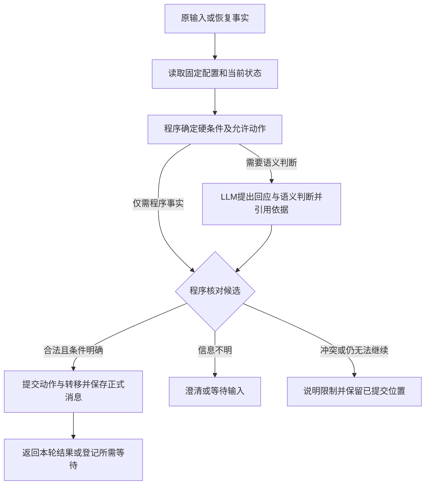
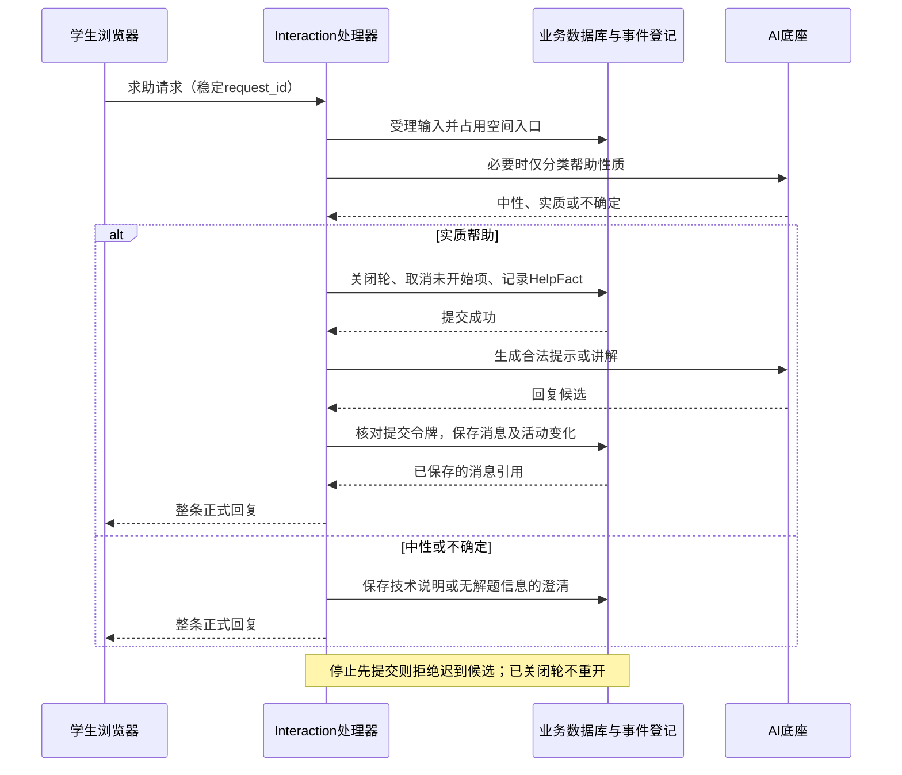

# M1 Interaction Space 设计

> **版本**：v0.31<br>
> **状态**：工程设计；实施与评审状态见[实施计划](Delivery_Plan.md)<br>
> **维护与评审**：Codex编写及自检，用户审阅<br>
> **写作规范**：[系统设计写作规范](../../../top/DeerMind_System_Design_Writing_Standard.md)<br>
> **更新日期**：2026-11-23<br>
> **修订说明**：v0.30 → v0.31，明确摘要失败后的原文取材范围<br>

本文设计四类活动、持续对话、学习助手及主动任务的运行方式，负责决定当前学生交互如何推进。模型与工具调用交AI底座执行，持久等待和调度交系统底座，当题判题与反馈由Interaction负责，掌握状态及目标判断交Evaluation；共同输入见[工程入口§2](README.md#2-设计输入与历史参考)。

当题反馈与掌握状态的分工及事件取材沿[登记§42](../../DECISIONS.md#42-当题反馈与掌握状态评价的分工及事件取材)。本批细化蓝图执行、上下文／记忆及主动任务；接口、字段和存储仍为待审工程稿。Operation、OperationRun、Step、请求身份与授权上下文采用[公共运行§1.3](System_Foundation_Design.md#13-operationstep与operationrun)。表中省略共同的access_context；变更请求使用稳定request_id，重试同一请求不能改正文。同一Run内复用处理函数不另建OperationRun。

| 处理入口（命名空间`interaction`） | 业务结果 | 合同位置 |
| --- | --- | --- |
| `manage_activity_config` | 查询、保存活动蓝图、规则、推荐策略及引用 | §1.1 |
| `control_activity` | 明确暂停、恢复、结束、切换或开始已确认检测 | §2.1 |
| `query_conversation` | 取得当前位置、活动目录和聊天记录 | §2.2 |
| `handle_input` | 把一次学生交流转为合法活动动作和回应 | §3.3 |
| `record_presentation` | 记录客户端显示情况；不触发评价 | §3.4 |
| `prepare_detection` | 准备可确认的检测题单与覆盖说明 | §4.1 |
| `submit_answer` | 保存一次实际作答并产生评价源事件 | §4.2 |
| `check_proactive_task` | 核对是否有必要提出或更新主动任务 | §5.1 |
| `respond_proactive_task` | 接受、暂缓或拒绝已有主动任务 | §5.2 |
| `continue_after_result` | 消费确切结果，恢复仍然合法的接续动作 | §6.4 |

`handle_input`、`prepare_detection`、`check_proactive_task`是AI Operation；其余入口是普通API、消息或内部回调。下列标识用于合同定位，不表示统一的Agent调用。

蓝图节点不是Operation或Step：一个节点可以经历多次学生输入，一次操作也可能完成子活动建立和节点迁移。编号步骤写出程序次序；只有需独立恢复、重试或等待的段落才形成持久Step。短查询不建立后台任务，短保存也不要求先排队。

入口路由由公共运行底座完成，Interaction提供普通处理入口、AI能力说明、授权查询与业务校验。明确的提交、活动控制、查询直接进入普通处理器；需要学习交流、检测准备或主动建议时派发AI Operation，由Worker在Temporal之上执行其业务代码。公共底座不先执行本模块的意图识别函数，也不逐步指挥教学。

普通请求不必先经过`handle_input`。求助中的语义理解及提示生成属于学习交流能力，暂用现有`handle_input`承接，不新增独立`handle_help`；是否需要更细的AI能力拆分在详细设计审阅。完整边界见[总体§3.5及求助时序](System_Design.md#45-从求助请求到前端回显)。

**事件事实源。** 学生输入、正式消息、活动/轮变化、当时题面、提交、帮助、记忆和主动任务先记录完整事实，再生成本Space查询数据。未正式提供的AI候选不能投影成学生已见内容。字段及投影登记只在[事件正文合同](contracts/Event_Facts.md)维护；本稿中的“保存业务对象”均指共同短事务内由事件生成投影。

**源码落点。** `server/src/deermind/spaces/interaction/`承载definitions、activities、conversation、detection、proactive、context、memory及三项operations。公开合同、私有存储、投影及依赖规则见[源码组织§3—4](Source_Organization.md#3-后端源码)；HTTP按[OpenAPI合同](API_and_Message_Design.md#7-openapi与可执行合同)导出，本文继续维护业务行为。

## 1. 活动定义与配置

### 1.1 `manage_activity_config`：维护活动配置

管理员通过本操作查询、保存四类活动配置。读操作允许获授权的课程检查调用方使用；只有管理员可写，运行LLM没有配置写权限。产品依据见[PRD§3.6](../PRD.md#36-管理-interaction-活动模型m1-r06)。

| 输入／输出 | 类型及约束 |
| --- | --- |
| `activity_type`、`action` | 必填枚举；类型为讲解、答疑、检测、自由交谈；动作是查询或保存指定对象 |
| `config_kind`、`config_ref` | 必填类型：蓝图／规则／策略／活动引用；已有对象必填引用，新建规则或策略时为空 |
| `expected_revision`、`definition` | 保存时必填；前者用于并发核对，新建使用明确的新建条件；后者按下述对象填写，不接受概率或学生运行状态 |
| 查询结果 | 对象定义、修订引用、启用状态及引用位置；不存在返回`not_found` |
| 保存结果 | `config_ref`、新修订引用和受影响引用；失败返回字段缺口、引用冲突或并发冲突，保留原定义 |

1. 校验权限及当前修订。蓝图输入包含节点身份、目的、所需信息、产出、允许动作、无法继续时的处理，以及有序条件转移；规则输入包含适用条件、约束和依据；策略输入包含目的、适用边界、开展、调整与结束条件。
2. 蓝图检查开始和结束节点仍存在且不可删除、结束无出边、转移目标有效，以及开始可达和通往结束的路径。检查不能证明自然语言条件绝无冲突；运行时仍按§3.3核对。
3. 规则、策略引用只能指向本活动的定义。节点只保存本层引用，生效时合并活动层；重复引用去重，停用定义保留引用，新采用包中不生效；进行中活动按固定包执行。子活动采用自身配置。系统约束不接受普通编辑或停用。
4. 保存本对象修订和`ActivityConfigSaved`事件。蓝图草稿一次保存；规则、策略及活动引用各按页面的确认操作保存。取消本地草稿不调用保存。

**恢复与验收。** 同请求重复保存返回原结果；并发冲突要求重读，不覆盖另一份修改。新活动取当前有效定义，进行中活动保留原引用；已确认不可靠的定义阻止相关动作。验收包含删开始节点被拒绝、策略未命中仍可讲解、活动规则不能被节点放宽，以及普通保存不改变旧活动。

### 1.2 课程检查与活动采用

`read_activity_contract(access_context, activity_type, config_ref?)`是配置查询的内部只读端口。省略引用读取当前有效配置；指定引用读取确切修订。返回蓝图、活动及节点规则、推荐策略、生效引用和gaps；固定全部引用后供Product检查，不创建活动或调用LLM。推荐策略为空或未命中不是必需配置缺失。

Product的应用保留检查时配置，仅作检查依据。新根活动读取空间当前采用和本Space当前有效配置；旧活动恢复仍用原采用及配置，不因管理员应用而换题、清空消息或结束活动。子活动沿所属根的课程依据，使用自己类型的活动配置；具体配置在创建时固定，不继承父活动规则。读取合同见[Product§5.2.1](Product_Application_Design.md#521-采用依据的公开读取)。已确认不可靠的定义仍限制对应动作。

### 1.3 配置对象与采用快照

首次保存蓝图时，同一事务建立空的活动级／节点级绑定和解析配置包。缺活动级规则可保存为草稿，课程检查显示缺项。删除节点时，新配置包移除该节点的绑定，历史包仍按原引用读取。

本节是工程结构，不新增规则编程器。所有ID由程序分配，revision为递增正整数；对象修订只追加，当前指针可改变。每份规则／策略归属一种活动，跨活动复用文字不能共享可变定义。

| 对象 | 必填结构与约束 |
| --- | --- |
| BlueprintRevision | blueprint_id、revision、activity_type、nodes、transitions；开始及结束节点固定身份。节点有node_id、name、purpose、required_inputs、execution_guidance、outputs、allowed_actions、fallback |
| Transition | transition_id、source_node_id、target_node_id、order、when、condition_text、required_facts、evidence_required；同来源顺序唯一，目标在本蓝图内，规则与条件不接受可执行脚本 |
| RuleRevision | rule_id、revision、activity_type、name、applies_when、requirement、basis、limitations、enabled；编辑另建修订，普通停用不能解除程序硬限制 |
| StrategyRevision | strategy_id、revision、activity_type、name、purpose、applicability、materials、approach、adaptation、finish_conditions、enabled；推荐内容不成为必经步骤 |
| ActivityBindingRevision | binding_id、revision、activity_type及活动／节点引用；活动和节点各自引用rule_id／strategy_id；节点仅保存本层引用。删除普通节点时同时在本次蓝图草稿中清除对应转移及绑定 |
| ResolvedActivityConfig | config_ref、activity_type、blueprint_revision_ref、binding_revision_ref、已解析规则／策略的精确修订及enabled值；供活动一次固定采用 |

when使用on_enter／on_input／after_reply／on_child_return／on_result／on_control。required_facts从程序登记的plan_confirmed、round_closed、plan_has_next、child_finished、result_ready等已知事实选用，只比较声明的布尔值，不接受脚本；无额外要求填空列表。fallback包含clarify／wait_input／blocked动作及说明要求。运行记录中未知事实保留unknown，不转为false。

管理端保存时按activity_type锁定配置当前指针，核对expected_revision；在一次事务保存修改对象、新解析配置及ActivityConfigSaved，再推进当前指针。一个规则被多个节点引用，只保存一份规则修订；新配置包解析到新修订，旧包不变。运行时只读已固定config_ref，不逐节点读取“最新规则”。

保存前检查：同活动引用、开始无入边、结束无出边、普通节点有出边、所有节点从开始可达且存在通向结束的路径、节点输入／动作／fallback齐全。允许循环回补，不能据静态可达性声称运行一定终止。推荐策略可以为空；引用了不存在的规则、转移目标或动作代码则拒绝保存。

read_activity_contract只读当前包或指定包，不在查询时偷偷建版本。新根及新子活动读取各自类型当前包；旧活动恢复仍使用原包。规则停用影响新采用包，不能回改进行中活动；已确认不可靠的配置按既有失效检查阻止相关动作，保留原引用供追溯。

### 1.4 节点执行与条件判断

用户已确认两种检查分开：程序检查权限、轮状态和允许动作等硬条件；LLM解释教学语义并引用原文。后台文字不编译成任意程序，M1不引入表达式引擎。程序校验来源不等于证明语义正确，教学判断仍须在实现阶段验证。

| 判断 | 依据与责任 |
| --- | --- |
| 是否可提交、已确认题单、轮是否关闭、是否还有计划项、子活动是否结束、依赖结果是否可取 | 程序读取正式记录；LLM的true不能覆盖正式false或未知 |
| 是否已明确问题、解释是否回应当前疑问、需要怎样调整表达 | LLM按当前节点条件给met／not_met／unknown及source_refs；只有本次材料中的原文或正式结果可作依据 |
| 是否已掌握、目标是否达成 | 只读Evaluation已发布结果；教学语义判断不能代替概率或目标判断 |

一次节点处理使用固定配置和本次材料，顺序如下：

1. 读取当前位置与生效规则：系统硬限制＋活动规则＋本节点规则。启用策略取两层并集，仅作为推荐；子活动重新按自己的包计算。可全部由程序事实判断的分支不为形式调用LLM。
2. 处理明确暂停、结束、停止等已授权控制；其余按当前输入、子活动返回或所等结果确定本次判断时机。没有事件，不后台自行循环蓝图。
3. 程序计算可执行动作及确定事实。调用LLM时同时提供当前节点、有序候选转移及条件所需原文；LLM返回语义判断和动作候选，不写node_id或运行状态。
4. 核对每条适用语义判断的来源和结论。按顺序查找首个满足且合法的转移；排在前面的必要条件unknown时先澄清或采用fallback，不把unknown当false跳过去。
5. 动作违反硬限制、活动／节点规则冲突或必需依据不足时，不提交该动作。可在同一执行预算内修正候选；仍不能确定则保存明确限制并等待输入或阻塞，不以循环调用兜底。
6. 按§7.2提交动作、实际转移和来源依据；回复正式保存后才回传。进入下一节点不等于必须立即多次调用LLM，按输入／输出条件停在等待学生或依赖结果的位置。

开始节点只进入首个合法工作节点；结束节点只收束该活动，不产生掌握结论。普通循环需要新的输入、子活动结局或业务结果；同一输入不得重复提交同一节点动作。执行预算耗尽保留最后已提交位置，未结束活动不伪装完成。

图2：一次节点处理。这里展示程序处理流程，不是管理员蓝图中的新增判断节点。



### 1.5 动作与四类活动的衔接

allowed_actions是登记代码及必要参数约束，不接受函数名、SQL或脚本。M1登记reply、clarify、wait_input、start_child、prepare_detection、start_detection、continue_detection、record_answer、return_parent、pause、finish、switch。prepare_detection只准备题单；开始／继续检测复用§2.1确认和轮状态检查。记录答案复用§4.2。节点不能通过加入代码绕过系统限制。

| 活动 | 关键执行约束 |
| --- | --- |
| 讲解 | 明确重点、核对起点、讲解互动；可直接准备检测，不强制先完成示例或引导练习。独立疑问可建答疑子活动，局部澄清留在当前节点 |
| 答疑 | 定位问题、回应、收束；必要时委派讲解／检测，子活动返回后重新核对原问题，不因子活动结束就自动标为已解决 |
| 检测 | 准备→确认→检测轮→轮后处理；开放轮只允许作答、暂停／结束、技术澄清等合法动作。实质帮助先关闭轮并取消剩余计划，再建子活动；继续检测重新准备 |
| 自由交谈 | 交流／澄清或结束；明确学习意图后转交，不反复询问已表达的意愿。闲聊本身不产生Evidence、教学机会或主动任务依据 |

ActivityRevision保存实际node_id、动作及transition_id；新增DecisionRecord记录input_ref、config_ref、source_node、程序事实引用、condition_checks、rule_checks、选定动作及原因。规则检查保存适用／不适用／未知和依据；不保存模型隐藏思考。程序拒绝及不迁移也有执行记录，不制造ActivityChanged。

例如“四分之一”：学生“为什么还要加回去”可在讲解节点澄清；若形成独立答疑子活动，父层保存返回点。学生要求检测时进入准备，取得并确认题单后才开轮。轮内“给点提示”先执行轮关闭；未命中推荐策略仍可解释原量和增加量，但不能跳过上述步骤。


## 2. 活动森林与持续对话

同一空间同时只接受一个推进交互的请求。用户已确认忙时不受理新消息、保留客户端草稿，不建消息队列；活动控制、提交和接受主动任务同样不能并行推进。查询、教材浏览、呈现回执及匹配当前等待的通知不占这一入口。停止本次回复是已确认的控制例外，见§3.6。活动等待学生回答时，上一请求已经结束，可以接收下一请求。

### 2.1 `control_activity`：控制活动与检测开始

学生可控制自己的活动；Interaction可根据已接受的输入执行相同迁移函数。管理员查询不能调用此操作替学生推进活动。活动动作必填scope_id、activity_ref、action及expected_activity_revision；action为pause、resume、finish、switch、start_detection、continue_detection或内部return_from_child。切换另需内容请求，开测另需已确认plan_ref及修订；轮后继续只在原计划仍有效时开始下一轮。stop_reply使用§3.6独立输入，不改变活动运行结局。草稿按§2.4保留。

1. 核对空间、当前叶活动及请求修订。暂停保存当前节点、父层返回位置和未完成动作；客户端保留草稿。单纯暂停且未获实质帮助的检测轮可保持等待。
2. 开始检测时，核对题单仍适用、确认覆盖及未覆盖部分，再创建首轮。原计划题量固定；做错不能直接追加题目。
3. 结束、改学或实质帮助需要收束检测轮时，先记录轮结束原因；实质帮助取消旧计划未开始轮次。未提交草稿不自动变成作答。已结束轮不重开。
4. 切换保存旧树暂停点并建立新根；子活动返回读取其实际结局和父层返回位置。取消或失败不能伪装成子活动成功。恢复前若采用定义已知失效，返回`blocked`及原因，保留历史。
5. 按空间消息顺序处理并核对当前路径后，提交活动、轮及计划变化，追加对应的`ActivityChanged`／`DetectionRoundClosed`事件，形成聊天提示，再返回当前活动路径与运行修订。

`handle_input`产生的嵌套、返回和控制动作也使用此迁移函数，但属于原Run的提交步骤。后续控制输入不抢占当前消息；修订检查用于拒绝过期提交，已完成请求重试只取原结果。关键验收是忙时切换被拒绝、重新提交后只保留一个进行中的叶活动，历史定位不调用本操作，求助后的旧轮不能重新提交。

### 2.2 `query_conversation`：查询当前交流和历史

学生查询自己的空间；管理员及内部取材调用方按授权范围读取。必填`scope_id`和`view`（`current`／`activity_tree`／`messages`）；可选`activity_ref`、消息锚点、游标和分页量，不允许跨空间拼接游标。

1. 返回当前叶活动、上层路径和可执行操作；已结束顶层没有伪造的当前活动。
2. 目录按根活动开始时间分批读取，子活动保持开始顺序；消息按不可变顺序定位，可围绕活动首条消息读取邻页。
3. 返回已提交消息身份、内容、归属活动、处理状态和下一游标；不返回模型候选、私有判题或未提交草稿。

此查询不改变活动、计证据或开启教学，点击历史名称也不恢复活动。无历史返回空列表；故障返回读取失败，不能用空列表掩盖。分页期间新消息可继续追加，但已返回消息身份和排序不重写。消息页返回last_seq、upper_seq及next_cursor：首屏固定该空间已提交消息上界，续页沿同一上界；历史锚点／筛选绑定游标。当前活动另查询current，不因补读改变活动。完整多条件历史搜索不在M1；历史查询的索引见[数据字典](database/Business_Interaction.md#4-interactionmessages)，条数和字节限额统一引用[基础设施§4.5 H02](Infrastructure_and_Deployment_Design.md#45-首轮入口与执行参数建议)，候选数值待审，本模块不另定上限。

聊天历史读取本Space的消息投影，不在每次查询时扫描全部事件。消息正文、内容块、归属和作答原文首先保存在事件及固定附件；本Space在同一短事务生成查询投影，并记录source_event_id。事件时间不能替代聊天顺序。InputAccepted、ChatMessageRecorded及AnswerSubmitted各自保存完整业务正文，事件来源引用不替代必填parts/answer；附件仍用固定文件引用。共同存储和追溯边界见[总体§3.2.1](System_Design.md#321-聊天消息与空间事件分开存储)。

### 2.3 评价原文的授权读取边界

Evaluation取得来源事件后，由业务取材入口核对范围和字段后调用read_facts读取本次所需原文。Interaction的read_evaluation_facts只负责关联限定和用途检查，内部仍读事件正文及固定附件，不把本模块查询表当成另一个事实源。原文purpose采用evaluation_basis；读取记录和字段白名单见[事件正文§2.2](contracts/Event_Facts.md#22-原文读取用途与权限)。授权范围按[总体§6.6.1](System_Design.md#661-最小调用授权矩阵)检查，持有事件引用不能自动获取整个空间的内容。

| 必须可读取的事实 | 范围与排除项 |
| --- | --- |
| 当时题面及呈现依据 | 实际向学生出示的文字、公式、图表和必要附件引用；不能用后来修改的题目替代 |
| 已提交作答 | 包括聊天中接受的答案、独立答题区提交及其附件；不包含未提交草稿，不要求把答题区记录复制成聊天消息 |
| 帮助及相关条件 | 服务端正式提供的帮助内容、提交时条件及活动、检测轮事实引用；不返回私有Agent记忆或无关对话 |

为Evaluation提供内部只读端口`read_evaluation_facts(access_context, scope_id, trigger_event_id, related_event_refs=[])`。它属于本模块公开查询适配器，不是新增AI Operation，也不把答题区原文复制到聊天历史。

| 输入／返回 | 合同 |
| --- | --- |
| access_context | Evaluation内部服务身份及本次处理身份；端口重新校验权限和空间，不能仅凭事件ID访问 |
| scope_id、trigger_event_id | 必填；只接受本空间的AnswerSubmitted或TeachingOpportunityClosed，核对源事件及其正文归属 |
| related_event_refs | 可选，默认空；Evaluation经底座授权取得的相关呈现、帮助或历史事实。逐项核对空间、事件用途及正文归属；不接受任意消息ID替代 |
| source | submission_id或opportunity_id、活动／轮、题目使用、当时采用依据、已提交内容引用 |
| content_parts | 实际题面、原始作答／教学内容及所需帮助；正文按Domain统一内容结构返回，附件保留受控文件引用；每项带EventPartRef及校验值，原文来自事件正文或固定附件 |
| provision_facts、help_basis | 正式提供的内容／帮助引用、服务端时间及提交时已固定条件；草稿与私有候选不纳入 |
| presentation_facts | 可选显示追溯；回执缺失不构成评价材料缺口，不触发或阻塞评价 |
| completeness | complete／incomplete及missing_reasons；标明事实窗口和未知项。故障返回错误，不能返回complete空列表 |

Interaction只沿该来源的题目使用、活动／轮及帮助关联取材；返回的内容必须在源事件正文中有依据。查询不改活动、不启动教学或评价、不占学生输入入口。原文无权、引用不存在、永久材料缺口和暂时读取故障分别返回；不会以当前改写内容替换历史原文。

Evaluation先查底座事件，再调用本端口；需要有界历史时，按固定Task／方法、指定参照和截止事实取得事件引用，再放入related_event_refs读取。Interaction按服务权限及事件的原文用途授权，拒绝私有记忆、草稿、判题结论和无关用途；不提供任意空间全文检索。保持基准和个人评价由Evaluation自己读取。完整取材结构见[Evaluation§2.3](Evaluation_Space_Design.md#23-固定本次材料)。

### 2.4 输入、消息与活动引用

ID由程序分配或在受理时校验；客户端request_id仅用于重试，不授予资源访问权。[空间交互索引](database/Business_Interaction.md#3-interactionspace_runtime)保存当前入口和活动位置，历史内容与迁移记录只追加。以下只说明记录用途，字段和约束见各表链接。

| 记录与表定义 | 业务含义 |
| --- | --- |
| [Input](database/Business_Interaction.md#1-interactioninputs) | 固定收到的原文或操作，不把后来的AI改写当原输入 |
| [Message](database/Business_Interaction.md#4-interactionmessages) | 已提交的聊天正文；主动提示引用实际触发，不伪造学生输入 |
| [MessageAssignment](database/Business_Interaction.md#5-interactionmessage_assignments) | 一条消息只归属一个活动；待辨认输入可暂未归属，显示处理中或失败，不挂到猜测的新活动 |
| [Activity](database/Business_Interaction.md#6-interactionactivities) | 保存根/子活动及固定配置、课程依据；子活动沿根的课程依据 |
| [ActivityRevision](database/Business_Interaction.md#7-interactionactivity_revisions) | 保存节点、运行情况与返回位置的变化，当前引用只是历史修订的索引 |

parts为有序列表：`text`保留提交原文；`rich_content`采用Domain的RichContent；`attachment`引用受控文件；`task_card`／`answer_form`引用本次task_use；`activity_notice`展示已提交的开始、返回或结束。每部分有稳定part_id，文字、公式、图表不另造一套内容语法。学生手写图片保留原文件，不把AI转写覆盖原文。

**受理步骤。** 先校验当前身份可访问该空间，再按request_id查询原收据；同正文返回原引用，异正文为identity_conflict。新请求短暂锁定space_runtime：忙则返回interaction_busy，不创建Input、聊天消息或AI工作；空闲则递增turn_epoch；先追加InteractionInputAccepted及需要的ChatMessageRecorded，保存完整输入，再同步投影Input和消息，登记active_input_id、收据和待派发依据，一起提交。明确普通控制不生成虚假的学生聊天文本。

底座按已登记入口派发，Operation持input_id和turn_epoch处理。每次业务提交核对两者仍匹配；成功、等待补充、合法无法继续或最终技术失败后释放入口。依赖结果的等待期间仍占本入口但不占Worker；用户可停止本次回复。独立后台评价不持有该入口。

草稿由浏览器按账号、空间及题目使用引用缓存；不进消息、事件或Evidence，不承诺跨设备同步。未知受理结果先查原request_id，不能清空草稿再换ID重发。已停止输入不自动恢复；学生明确重试时，与失败输入一样，只有仍未被新输入接续且当前业务依据有效才可恢复。恢复沿原input_id取得新的turn_epoch，并核对当前入口空闲；否则返回stale_input，保留原记录，由新输入表达继续意图。

### 2.5 活动运行与返回

蓝图决定节点和有序条件转移；以下run_state只表达活动运行情况，不把节点改成固定状态机。每次迁移追加修订及ActivityChanged，并在同一事务更新当前路径和必要聊天提示。

| 情况 | 运行记录与处理 |
| --- | --- |
| 新建根／子活动 | active；保存精确配置、课程依据和名称。名称可由AI建议，ID、父子关系由程序确定 |
| 创建子活动 | 父为waiting_child，保存返回节点及所需结果；子为active，成为当前叶。不能在开放检测轮中创建帮助子活动 |
| 暂停 | paused并保留暂停前run_state、节点及路径；不把暂停写成完成。恢复从原位置继续 |
| 子活动结束 | 子为completed／cancelled／blocked，按实际结局返回父保存的位置；不能无条件当作成功 |
| 结束根活动 | completed／cancelled；清空该树的当前叶。改学可保留旧树为paused，再新建根 |
| 业务无法继续 | blocked并留原因；技术Run失败只记处理失败，不自动把教学目标判为未完成 |

程序检查父子同空间、无环、父层返回点有效，以及全空间只有一个可推进的叶活动。暂停整条活动路径时保存各层位置；恢复子活动同时恢复其等待父层，不唤醒其他根。顶层已结束时自由交谈或新学习请求建立新根；历史定位只读消息锚点，不调用恢复。

运行配置、课程引用及历史迁移不因管理员改定义而替换；新的子活动采用本类型当时有效配置，但不继承父活动规则。node_id只能来自固定蓝图，转移依据包含学生请求或有效子活动结果；ActivityChanged不产生能力Evidence。

## 3. 学习助手的决策与提交

本Space的Operation决定本次材料、上下文组织和记忆保存；AI底座提供模型与工具调用，其代码不内置活动、检测轮或掌握状态的业务判断。历史和摘要归本Space；取材、工作记忆、按需摘要及工具限制见§3.8—3.10。共同边界见[总体§3.4](System_Design.md#34-agent上下文和记忆)。

### 3.1 取得本次教学所需的掌握状态

Interaction读取Evaluation发布的[学习者掌握状态](Evaluation_Space_Design.md#5-评价数据与公开接口)，不复制维护另一份Belief。取用过程如下：

1. 根据学生请求、当前活动和目标，确定相关Claim、方法与评价方面。
2. 通过公共运行的`read_publication`读取本学习空间已发布的状态，保留`snapshot_ref`；无发布时按未知处理。
3. 由当前Operation选择相关分项，将概率、证据覆盖、未知原因及本次尚未完成的评价组织进本次上下文，再通过AI底座调用模型。
4. 保存本次使用的快照引用与分项身份。LLM提出教学动作后，Interaction校验活动、帮助规则和所需结果，再提交。

`p_obs`表示有效观测形成的判断，`p_current`还可能包含教学后的预测变化；初始概率不能当成学生已被检测的结果。目标达成使用Evaluation另行发布的目标结果，Interaction不自行比较概率生成第二套达标结论。

普通讲解可使用已有状态。若有较新的作答尚未评价，上下文须标明该事实，不能声称旧快照已经包含它。用刚才作答决定下一步时，按§6等待对应结果；仅凭最新发布时间不能解除等待。

### 3.2 动作提交边界

每次读取固定一个快照，避免一份上下文混用不同发布时点的分项。恢复执行时重新读取允许刷新的状态；原作答、实际帮助及活动使用的定义依据保持原引用。摘要不能替代掌握状态，既有概率也不得送入Evidence解释任务作为本次表现的判断依据。

LLM生成期间若当前活动或必要依据改变，Interaction重新校验候选；已失效的接续动作不提交。下文定义操作材料与分支；完整意图及候选动作Schema仍待接线设计。

### 3.3 `handle_input`：处理一次学生交流

学生聊天入口由公共运行直接派发本操作；Interaction也可针对已保存作答安排反馈。入口前不另调LLM选Operation。它负责本次交流的业务处理，不承担公共底座的入口路由职责。获授权的空间身份由产品业务提供；不接受客户端自行指定模型权限或已经达标。

| 输入／输出 | 类型及约束 |
| --- | --- |
| `scope_id`、`input_id` | 必填；Operation读取已受理输入的文本／公式／附件；不重新接受前端正文。客户端受理参数见§7.3 |
| `activity_ref`、`expected_activity_revision` | 有当前活动时填写；服务端复核，不以客户端路径为准 |
| `explicit_source_refs` | 可选列表；只有学生明确引用书页、题目或历史内容时传入，固定当时的来源 |
| `reply_to_ref` | 可选；回应哪条提问或题目，引用必须在本空间有效 |
| 提交收据 | `input_id`、OperationRun引用及当前处理状态；收据不表示回应已生成 |
| 业务结果 | 归属活动、已提交消息引用、节点／活动变化，或`need_clarification`／`blocked`及原因；等待时带恢复记录引用 |

Operation输入分两类：`kind=student_input`引用已接受input_id；`kind=submission_feedback`引用submission_id和承接的input_id，不再带新content。两类都读取所属消息／作答原文。正式受理先执行§2.4的短保存，再由底座派发；HTTP收据不等待AI。

1. 读取已受理输入及处理令牌；既有作答反馈复用已提交事实。已明确归属当前活动的消息直接关联；需要辨认新意图时先保留待归属，不能将识别候选当成正式活动变化。
2. 读取当前路径、活动配置、课程方法来源和明确引用。在本Operation内解释学生诉求、补充取材；程序检查树和轮的约束，不能把意图候选当成活动已合法改变。检测轮中含糊求助先中性澄清；实质帮助先执行§2.1的轮收束，之后才允许生成提示。尚未提交的明确作答交§4.2处理；已保存作答只读取，不重复提交。
3. 按§3.1取得相关掌握状态，由本Operation组装上下文后调用AI底座。材料必须包含当前节点、活动及节点规则、允许动作、真实帮助和显式来源；推荐策略只是可用材料。必要依据缺失返回澄清或阻塞；未命中推荐策略不阻止合法表达。
4. AI按§3.5返回回应候选及拟执行动作；程序校验允许动作、实际方法、课程适用及规则。条件转移按§1.4选择首个满足且合法的项；必要的在先条件未知时先澄清，无命中按配置等待、澄清或阻塞。意图不明时先澄清，不据猜测结束、切换或启动检测。
5. 候选有效且当前路径仍匹配时，提交回应、活动变化与相应事件；新学生输入另提交消息归属。基于既有作答的反馈不再创建学生消息或`AnswerSubmitted`。发布可展示内容。调用了领域新供题或等待评价时，只保存相应接续，不占执行资源等待。无适用Claim的纲内问题可帮助并标明评价限制，不能临时建Claim或降低目标。

需要持久边界的段落是输入受理、AI候选取得、外部结果等待及最终提交；取材和字段校验不各建一个后台任务。需要整理历史时，由本Operation提供材料及摘要要求，调用模型后保存摘要与来源；摘要先作为内部步骤，不因一次交流或模型调用自动新建Operation。

模型超时／格式错误保留输入并标技术失败，重试沿用Run；提交成功后响应丢失只重发原消息身份。候选因活动已改变失效时不展示。关键验收包含没有推荐策略仍可讲解、翻页不改主题、未映射问题可帮助、后续输入不抢占当前处理、过期候选不再输出，以及学生说“懂了”不直接生成掌握判断。

#### 3.3.1 澄清与下一条输入

`need_clarification`是本次交流的业务结果，不是技术失败。程序保存不含解题提示的澄清消息、来源输入和必要上下文引用，结束本次Execution并释放输入入口；当前活动可继续等待学生。回复引用原消息及part_id，不另建入口路由会话。

学生补充是新的request_id／input_id，可用reply_to_ref指向该问题；不是重试或唤醒旧Execution。学习助手重读问题及当前活动，引用过期则重新核对；学生明确改换意图时按新诉求处理，不强行补旧问题。开放检测轮中的含糊请求只作中性澄清，不能提前给提示或关闭检测轮。

### 3.4 `record_presentation`：记录内容呈现

登录客户端提交scope_id、presentation_id、surface（chat／history／textbook）、resource_ref及content_part_refs；客户端时间可空。程序核对资源归属、可见权限和分段身份，保存接收时间及可选客户端报告，按presentation_id去重。

回执只说明客户端报告的显示情况，不证明阅读或理解。缺失、重复、迟到均不触发Evaluation，不阻止作答，不补发教学机会，也不重算旧结果。服务器正式提供内容的时间由消息发布记录确定，不用客户端时间替换。

历史和教材浏览不切换活动，也不自动成为教学机会。实现阶段接线只收集已有展示所需事实，不建设阅读时长或注意力检测。回执存储及业务事件见§3.7、§6.5；客户端行为见[客户端§3.2](Client_Design.md#32-输入草稿与整条回复)。

### 3.5 AI候选与正式回复

上下文固定本次输入、当前位置、已采用配置、允许动作、实际帮助和显式引用；所用掌握快照另留引用。正在浏览的书页不自动成为聊天主题，服务端已知接触条件按提交时记录；浏览器回执不作为评价输入。

| AI输出字段 | 约束 |
| --- | --- |
| intent、action_candidates | 候选意图、活动／节点动作及理由；只可引用提供的对象和允许动作，不能自行分配正式ID |
| response_parts | 待显示的文字、RichContent、题目／答题组件引用或活动提示；不接受任意HTML或可执行脚本 |
| source_refs、transition_basis | 所用事实、内容及转移依据；未命中推荐策略可以给出合规表达，不要求补造策略命中 |
| condition_checks、rule_checks | 按转移／规则引用逐项返回。语义条件为met／not_met／unknown；规则另报适用性、satisfied／violated／unknown及source_refs。仅返回本次需解释的项，程序硬条件仍由正式记录计算 |
| help_classification | neutral／substantive／uncertain及依据；uncertain只允许中性澄清，不能同时附带解法 |
| teaching_purpose | 实际教学的Task／方法责任候选、内容引用及是否收束；仅是机会登记输入，不是已学会或应加概率 |

检测轮仍开放时，先只做意图和帮助分类；判为实质帮助后，程序先提交轮结束及计划处置，再调用模型生成帮助正文。不能一次调用边判断边把提示流给学生。形成性练习留在讲解活动，沿实际帮助取证，不伪装为独立检测。

候选通过结构、引用、当前处理令牌和业务规则检查后，保存正式消息及必要事件。M1回复检查、保存后整条显示；生成中只回传处理进度，不透传模型token。正式消息可含多个富文本／卡片部分，已保存正文不可改写，失败候选不进入历史或Evaluation。

### 3.6 停止本次回复

用户已确认保留处理中停止。`stop_reply`是control_activity的普通动作，输入为scope_id、request_id及要停止的input_id；它不识别新教学意图，不启动AI，不把“停止回复”解释为结束整棵活动树。

1. 短事务锁定空间交互索引，核对仍由该input_id占用；追加停止事实并废止其提交令牌，释放聊天入口。
2. 保留已提交消息、作答、轮结束和草稿；未提交候选不得再公开。底座接到技术取消请求后尽力停止调用，业务安全不依赖取消是否及时成功。
3. 本次最终回复已提交时不能撤回，返回already_committed及原引用；已有中间活动提示不阻止停止剩余工作。停止先提交则迟到结果因令牌失效被拒绝，不再建立消息或改变活动。

停止仅影响本次Interaction输出／接续。若停止同时结束当前教学目的，按已正式提供的内容收束机会；尚无正式内容则没有教学机会。已发供题、已提交作答及Evaluation工作继续独立运行；迟到结果可查询，不自动抢回当前对话。若求助已关闭独立轮，停止提示生成也不重开旧轮。重试和停止均保留原输入与已完成步骤，不把部分成功回滚成未发生。

### 3.7 帮助与教学机会的服务端事实

M1以服务端正式提供的内容为依据：回复通过规则检查、保存为学生可读消息后，才算已提供。内部候选和仅保存的私有判题不算。浏览器是否显示不改变这个事实；这是“已提供教学”的试用口径，不是学生已经阅读或学会的证明。

| 记录 | 必填信息与约束 |
| --- | --- |
| HelpFact | help_id、scope_id、source_input_ref、activity_ref、task_use_ref（可空）、classification、reason、round_closure_ref（适用时）；先记请求分类及轮处置，提供内容时另记message_ref和part_refs |
| Presentation | presentation_id、scope_id、surface、resource_ref、part_refs、received_at、client_reported_at（可空）；只追加展示事实 |
| TeachingOpportunity | opportunity_id、scope_id、activity_ref、adoption_ref、purpose、opened_by_input_ref；程序按教学目的分配身份，多条消息、暂停与重试沿用 |
| OpportunityClosure | opportunity_id、provided_part_refs、purpose、close_reason、closed_at、source_input_ref、event_ref；每机会至多一条正式收束记录 |

1. 实质帮助先按§4.4关闭检测轮、取消旧题单剩余轮；中性技术说明不关闭。分类不明时仅澄清，不先给提示。
2. 正式提交讲解时，将实际内容块关联到机会。结束本段教学、转入练习／检测或终止该教学目的时收束；仅等待学生追问、技术重试或临时暂停不另建机会。
3. 内容及目的已经固定后，提交一次TeachingOpportunityClosed，Evaluation再判断完整性、相关责任和允许的学习转移。只有寒暄、安排或尚无正式教学内容时，不发教学机会事件。中断后已提供的部分可按实际内容收束，不能伪装完整。
4. 若讲解和转入检测同次提交，先提交讲解、机会收束和题目使用，再开放作答。此前尚未收束的教学在接受下一次相关作答时先收束，事件顺序为TeachingOpportunityClosed→AnswerSubmitted；不等待浏览器。

提交答案时固定help_basis：截至本次提交，针对该题已经正式提供的帮助内容、帮助请求／轮处置、服务器已知接触情况及材料缺口。无正式帮助记录不等于没有任何外部帮助；学生自述和未知条件照实保留，由Evaluation核对资格。后来的讲解、显示回执或判题不能回写这份依据。服务端此前已提供的解法即使未收到显示回执，也不能再把同题当作未接触新题。

机会是否足够完整由Evaluation解释，Interaction只提交可核对的教学事实。收束后不追加内容到旧机会；新的教学目的另建身份，不按回执、拆消息或技术重试增加L。

### 3.8 三项Operation的上下文

每次模型调用先固定ContextBundle。字段为bundle_id、scope_id、run_ref、input_ref或trigger_ref、purpose、activity_revision_ref（适用时）、adoption_ref、config_ref、materials、memory_refs、publication_refs、omissions。材料项含owner、resource_ref、revision或内容校验值、用途及required标记。ID和版本由程序填；引用不授予权限。

| 调用用途 | 必需材料 | 可选材料及禁止混用 |
| --- | --- | --- |
| handle_input：开放检测轮中的意图／帮助分类 | 本次原文、所答题面、当前轮及允许动作、硬限制 | 可读近期相关交流；本次分类不提供参考答案或生成帮助正文 |
| handle_input：讲解／答疑／轮后反馈 | 原输入或已提交答案、当前路径、固定配置及本节点规则、必要题面和参考、正式帮助记录、明确引用 | 可读相关掌握发布、活动工作记忆及近期原文；不能把摘要当学生的新答案 |
| prepare_detection | 明确检测目的、实际采用范围、合法Task／方法来源、题目条件、已知接触事实、已有计划及帮助 | 有效掌握快照帮助安排；无快照可按未知准备。来源缺口不能让AI补成事实 |
| check_proactive_task | 触发事实、当前目标及有效结果、现有建议／拒绝／暂缓依据、当前活动、服务端时间 | 有界近期表现可解释理由；不拿聊天摘要证明七天条件或达标 |

系统和活动规则放在指令层；学生输入、教材、工具结果及记忆作为有来源的数据。推荐策略另列，未命中仍可选择合法表达。模型输出活动候选及理由，不能把材料中的指令提升为新的工具权限。

取材顺序：读取当前业务状态及本次原文→按用途读取固定配置、内容和结果→读取同活动工作记忆及必要父层返回记录→按消息身份补取有关原文→记录实际送入模型的材料清单。阅读器当前章节不自动进入材料；只有显式引用或任务本身需要的已授权内容才读取。原始消息不因摘要生成而删除。

恢复时区分不变材料和当前提交条件。题面、学生答案、规则快照及已取得模型候选按原引用读取；权限、活动位置、输入令牌和结果当前性重新检查。已保存候选的提交重试不顺带重跑摘要或换一份教学依据。确需新推理时另记调用和ContextBundle，不改前次调用输入。

### 3.9 工作记忆与按需摘要

M1先使用原始记录、结构化工作记忆和按需摘要，不引入跨空间画像或向量记忆库。正式活动／检测／帮助状态直接读取，不复制到摘要作为另一份权威状态。记忆只辅助Interaction组织下一轮回应，Evaluation不以它取证。

| 内容 | 表定义与业务结构 |
| --- | --- |
| 工作记忆 | [memory_revisions](database/Business_Interaction.md#29-interactionmemory_revisions)的working内容含entries；每项有entry_id、type、text、source_refs、state、resolution_refs。type为pending_question／discussion_point／explicit_preference，state为open／resolved |
| 摘要 | 同表的summary内容含covered_refs、text、model_call_ref；只概括声明的原文范围，保留来源和覆盖位置 |
| 当前记忆 | [memory_heads](database/Business_Interaction.md#30-interactionmemory_heads)引用当前修订；无记录返回明确空值，历史修订保留 |

工作记忆的entries可以为空；每项有entry_id及source_refs，resolved必须另给resolution_refs。不能从整段无出处摘要反推一个已解决事项。

“尚未解释为什么加回原量”可以成为pending_question，但须引用学生的问题或本轮未完成事项；解决时引用相应回应或学生确认。此处resolved只表示会话事项已处理，不等于Claim已掌握。学生明确说“先用图说明”可以记为当前活动偏好，不能推断成永久学习风格。已给提示从HelpFact读取，不靠摘要猜测。

Operation在正式回应或活动暂停／返回时，可从本次原文与已接受回应提取记忆候选；普通位置和待返回点直接由程序保存。程序检查来源、空间、内容身份及合法类别；候选中的能力结论、跨空间信息或无来源偏好拒绝。记忆不得修改正式活动或评价状态。

只有上下文容量不足以保留有关历史时，才在当前Operation内生成摘要：固定原文范围→调用AI底座→检查出处和结构→保存摘要修订。每次不必生成；不为摘要新建Operation，也不在后台无限整理历史。新消息追加不改变旧摘要覆盖范围，下一次读取使用“摘要＋其后必要原文”。涉及题目条件、明确承诺或存在矛盾时回读原文。

记忆读取仅使用当前已保存摘要的覆盖位置。摘要失败或依据过时，本轮继续读取未覆盖的近期原文，最多 12 条且合计不超过 32 KiB。超出预算按§3.10处理。已提交回应不因摘要失败撤销，后续可由原文重试摘要，不重复保存教学机会。

### 3.10 容量、工具与提示合同

Operation按照用途保留以下材料顺序，AI底座只报告通用容量和执行限制：

1. 保留硬限制、有效活动／节点规则、当前原始输入、必要题面／参考和授权依据；不压缩关键公式、图表或学生作答。
2. 移除与本次动作无关的可选历史，再用有出处的摘要替换较早讨论；必需事实仍按原文读取。
3. 剩余必需材料仍超出可用容量时，缩小本次解释范围或请求学生明确引用；不能静默丢弃规则和题面。一次模型调用及重试受底座预算约束，具体限额在接线评审中确认，不以无上限循环兜底。

| 学习助手可请求的工具 | 输入和返回 | 权限限制 |
| --- | --- | --- |
| read_activity_material | 程序提供的activity／message／task_use引用→相关原文和当前状态 | 同空间、所需范围；不读草稿，不提供任意空间全文搜索 |
| read_course_material | 明确章节、Task／Solution或实例版本→内容及来源 | 使用Product／Domain公开查询；按用途限制参考答案；不改定义 |
| read_published_state | 程序选定Task／Claim和snapshot_ref→相关掌握／目标分项 | Evaluation公开只读发布；不写概率，不把旧结果当本轮结果 |

工具名为本Operation的登记草案，复用已有所有者查询，不新增公开业务入口。LLM没有关闭轮、创建活动、发事件、确认检测或写记忆的直接工具；它交候选，由Operation按本模块提交合同执行。需要供题或新评价仍用既定事件，不开放同步加工工具。

提示合同登记用途：input_classification、learning_reply、detection_planning、proactive_proposal、memory_extract、memory_summary。每次调用保存prompt_contract_ref、模型配置及ContextBundle引用；具体Prompt文件在实现时建立，模板改动需对既有案例核对。提示词必须要求列出依据与未知项，不要求输出隐藏思维过程。推荐策略与硬规则分别标识；程序提交与模型生成不混在同一条自然语言指令里。

### 3.11 讲解例题与形成性练习的供题

讲解／答疑需要新例题或练习时，handle_input在原Execution内固定Task、方法、课程来源、接触事实及`purpose=example|practice`，发布TaskSupplyRequested并登记等待。供题输入复用§4.1第3步及Domain§5.2；不新建检测活动、题单或prepare_detection。原供题Step保存用途和活动返回位置，恢复时不从通知推测用途。

| 使用方式 | 取得内容后的处理 |
| --- | --- |
| 学生明确引用已有题，或继续已提供的题 | 按固定引用读取，不重新筛选或生成；新一轮实际使用仍记录本次TaskUse及条件 |
| 新例题（example） | Domain交付已保存批次后，复核本次用途与活动；保存题面、讲解及必要参考引用。例题属于教学材料，不创建学生作答或独立检测结果 |
| 新练习（practice） | 同样取得并复核批次；保存TaskUse、题面卡片和答题区，round_ref／plan_ref为空。学生实际提交后走§4.2，按真实帮助条件评价 |
| 正式检测（assessment） | 沿§4.1保存待确认题单；学生确认后才建立检测轮 |

题面与答案／提示分开读取和提交；学习助手不能把自行编写的新练习包装成已核对的领域实例。对学生提供的未映射问题仍可就地帮助，不伪造Task、实例或评价资格。普通解释、类比和辅助图沿教学内容规则，不强制每段表达都入题库。

无合格题时说明本次缺口，不发空题卡、不记学生不会。供题等待到期按§6.3收尾；已生成的批次保留，晚到不自动插入当前聊天。新的明确请求可查回原批次并重新核对用途，不能复活旧等待或重做已保存供题。


## 4. 检测计划、轮次与求助

### 4.1 `prepare_detection`：准备本次检测

学生明确要求检测，或接受系统检测建议后，由Interaction准备。必填`scope_id`、检测目的和本次范围；可选父活动、主动任务引用、方法／方面要求及学生明确选择的章节。没有明确范围且无法从请求确定时，先澄清，不把阅读器位置默认成范围。

**执行归属。** 聊天中要求检测时，handle_input在当前Execution／执行尝试中调用本节的共用准备流程，不再派发第二份prepare_detection，也不再次占用输入入口。明确检测入口或接受检测建议可独立派发prepare_detection。两种入口使用同一套规划、供题和保存逻辑，最后都须等待学生另行确认题单。

共用流程的持久Step以准备段及题单要求项区分；技术重试复用原Step、供题事件与结果。聊天路径的停止、恢复、收据查询和总预算均沿原工作，不因进入准备段重新计数。handle_input受理配置预先包含可选的检测规划用途；独立入口使用自身配置，两者引用同一规划合同，见AI底座§2.1。共用实现不是新增Operation，也不在内部再次调用HTTP受理入口。

1. 核对当前活动衔接，建立或复用处于“准备检测”节点的检测活动；无父活动时建立顶层，有合法父活动时保存其返回位置。此时没有检测轮，不因后台供题直接开始答题。后续等待归属该检测活动及本Run。
2. 读取目标、已发布判断和本次内容采用关系。形成有限的题单要求：逐项Task、方法／方面、迁移／保持条件、题量、预计负担和未覆盖项。AI可提出安排，程序核对课程方法来源；已有适用表现可复用，不为四方面机械各出一套题。准备不等于学生已同意开始。
3. 按同一Task及用途条件分组，各追加稳定的`TaskSupplyRequested`，统一交`domain.supply_task`筛选已有题并补齐不足部分，等待`(scope_id, trigger_event_id, domain, task_supply)`。每组输入为`domain_id`、`purpose`、`task_ref`、`allowed_method_refs[]`、`assessment_constraints`、`method_source_refs[]`、`exposure_refs[]`及`count`；以计划要求项身份区分持久Step，技术重试沿用原组和事件。Domain统一检索、生成、检查并保存，返回`supply_batch_ref`、实例列表及`unfilled`，不能另开Interaction生成题目的路径。
4. 取得结果后复核活动、计划条件和接触情况是否在供题期间发生变化，并核对返回内容可供本次使用；不另行实现Domain的实例筛选或排序。答案／提示已暴露、迁移背景未知或内容不足，分别列出不能用于哪项检查。合法部分可形成有限题单；缺口不能伪装成学生不会。检查失败且没有替代题时返回不能检测的具体范围。
5. 保存`plan_ref`、修订、题目引用、覆盖、未覆盖及反馈安排，追加`DetectionPlanPrepared`；返回供学生确认的题单摘要。本条准备消息处理到此结束，不占住同空间串行入口等待学生；确认是下一条输入，§2.1的`start_detection`复核确认的计划后才开始首轮。

同一供题事件重试不再次建生成请求；已取得结果先读取原批结果。恢复时活动已变更或题目已暴露，旧题单不能直接开始；返回计划失效，新的准备保留新原因。关键验收包括聊天内准备保持同一Execution、停止和恢复不另开任务、两入口均先确认再开轮，以及无备用题可自动生成、失败候选不出题、部分覆盖先告知、求助后重新准备新题新轮，以及开始后不无声追加题目。

### 4.2 `submit_answer`：提交实际作答

这是普通提交处理，不创建AI OperationRun；其职责是保存事实和发出事件。若在学习交流Operation内部识别到作答，复用本节提交函数，保留同一原始输入与提交身份。

学生点击提交或在聊天中明确提交针对某题的回答时调用。`handle_input`识别出的提交复用本节函数并沿用其Run，不把同一消息再投递为第二次作答操作。

| 输入／输出 | 类型及约束 |
| --- | --- |
| `scope_id`、`submission_id`、`task_use_ref`、`answer` | 必填；稳定作答身份、本次题目使用引用和学生实际文本／公式／图片内容。空草稿不能伪装成已作答 |
| `activity_ref`、`round_ref` | 活动必填；正式检测轮引用必填，教学练习可空并保留练习条件 |
| `expected_round_revision`、`source_input_ref` | 检测提交必填轮修订；从聊天识别时带原输入引用，避免重复处理同一回答 |
| 收据 | 原`submission_id`、触发`event_id`、轮／练习状态及两类评价结果键（掌握状态、目标）；评价未受理也可先返回收据 |

1. 核对题目使用记录、活动、轮状态和实际内容。已经结束的检测轮拒绝新提交；更正说明另留新事件，不能改写原答案。
2. 作答关联本次出题／题目使用，不能只按题目编号匹配。固定当时的教材／目标采用依据、题面、方法条件、实际帮助与展示引用、接触及时间事实；有题单时保留实际题单引用，无题单则明确无题单。未知字段保持未知；不能用“独立检测”标签代替实际无帮助判断。
3. 一次提交边界保存作答及`AnswerSubmitted`，正式轮同时记录提交和轮结束；教学练习保留其帮助条件。重复身份同正文返回原收据，异正文返回冲突；同一个已关闭轮即使换请求身份也不能再提交。
4. 原始作答经公共运行底座进入Evaluation；Interaction另行负责当题核对与反馈，见§6.1。不生成Evidence、不写概率，也不另建评价任务。原题单还有独立轮时只确认收到；允许按既定计划继续，仅依赖新掌握状态或目标结果的动作等待，反馈展示规则见§6.2。

提交与求助竞争时按当前轮修订决定先后。求助先收束则不能把后到作答补为轮内独立提交；提交先成功则按当时条件保留，后续帮助另留痕。技术失败保留草稿／原收据，不让学生因未知处理结果重做。验收检查重复点击、断网重投、求助竞争、后续提示不改写旧作答及受助练习不冒充独立证据。

### 4.3 计划、题目使用与提交记录

记录身份由程序分配，引用必须属于同一空间。下表说明业务责任；物理字段与约束见对应数据表。题面、提交和历史依据不覆盖。

| 记录与表定义 | 业务含义 |
| --- | --- |
| [DetectionPlanRevision](database/Business_Interaction.md#10-interactionplan_revisions) | 固定本次题单；items每项含稳定item_id、实例精确版本、方法/方面条件及供题检查。学生确认精确修订，开始后不增题 |
| [PlanProgress](database/Business_Interaction.md#11-interactionplan_progress) | 记录确认、取消与完成；计划改变时旧确认不沿用 |
| [TaskUse](database/Business_Interaction.md#14-interactiontask_uses) | 固定本次实际题面和受控附件；待映射自然提问题不伪造实例 |
| [DetectionRound](database/Business_Interaction.md#12-interactiondetection_rounds) | 对应已开始的题单项；未开始项不建立虚假检测轮 |
| [RoundRevision](database/Business_Interaction.md#13-interactionround_revisions) | 记录开放、暂停或关闭的原因；关闭后不能重开 |
| [Submission](database/Business_Interaction.md#15-interactionsubmissions) | 保留原始答案、提交条件与帮助依据；检测轮最多一个正式提交 |
| [AnswerFeedback](database/Business_Interaction.md#16-interactionanswer_feedback) | 当题核对的私有结果；正式反馈另通过Message提供，不作为Evaluation的Evidence |

TaskUse.statement使用Domain RichContent的statement用途，只含题面；参考答案及教学辅助图分别取用，不能混进学生题目卡片。聊天提交的answer_ref引用原Message及片段；答题区提交保存独立原文，历史可显示其卡片，不另复制一份答案消息。练习中的同一输入即使换submission_id也不能重复入账；新输入确为新练习时另留事实，是否属于新Evidence由Evaluation判断。

### 4.4 作答、求助与反馈的提交顺序

**答题区提交。** 使用§2.4受理检查，短事务保存Input、Submission、关闭轮、机会收束（如有）和事件。原题单仍有独立轮时只回“已收到”，释放入口，按已确认计划的继续动作开启下一轮。允许反馈时，同一事务登记handle_input的submission_feedback输入并保留该input_id占用；不在保存和安排反馈之间开放新消息。若已在handle_input中识别作答，复用提交函数并继续原Run。

**求助。** 明确点击或语义分类为实质帮助后，先提交轮关闭、剩余题单取消和HelpFact，再安排子讲解／答疑及生成提示。开放检测轮没有讲解子活动。提交先完成则保留提交时的条件；求助先完成则旧轮拒绝新作答，草稿留在客户端。两个新请求同时到达时，后受理者先得到busy，不靠后到AI结果决定先后。

图1：检测中求助的提交边界。数据库提交与AI调用分开；已提交作答的Evaluation独立继续。



反馈私有结果生成成功不等于可以公开。程序按plan_ref核对反馈安排；其余独立轮尚未结束时，不提交含答案或提示的Message。允许反馈后也须检查并保存，再整条回传。学生停止、模型失败或断网均不撤销已保存的Submission及AnswerSubmitted。

## 5. 主动任务的触发与接续

### 5.1 `check_proactive_task`：核对主动任务

进入学习空间、活动结束或新评价结果形成时触发。实际进入由Product追加LearningSpaceEntered，公共底座按订阅派发本Operation；同触发事件只受理一次。重连补取、浏览教材和历史查询不产生进入事件，进入请求也不等待本Operation完成。

保持条件仅在实际进入时检查，离线不检查、不自动开测。必填scope_id、trigger_ref和原因；可选proactive_task_ref。时间由程序提供，用户时区从Product公开资料读取；重复进入仍按下述basis_key防止重复提醒。

1. 通过Product读取当前目标，通过Evaluation公开发布及依据查询读取所需结果与来源；不读评价私有表。再读取本Space的帮助与时间事实、现有待办、学生响应和当前活动。依赖评价未完成时记录等待原因；技术失败不是需要补课的证据。
2. AI可提出目的、建议类型、内容和依据；程序核对实际依据、延迟条件、当前范围及可开始条件。没有可靠理由返回`no_task`及原因，未知不自动视为不会。
3. 以空间、目的／目标项和实际新依据形成稳定`basis_key`。相同依据重复进入、重试或跨午夜不新建；同一理由被拒绝后，仅新表现、新目标或新延迟条件可构成新依据。
4. 按§5.3保存任务或更新其未开始状态，追加`ProactiveTaskChanged`；新结果使理由失效则停止旧提醒，保留历史。已执行但评价未完成保留待结果，不催重做。
5. 提示时核对暂缓的本地日期和最近提示记录：当天不再提示；之后学生进入该空间且仍必要时，当天最多一次。无新进入不补发多条错过提醒，也不产品外推送。

输出为`no_task`、已有任务、可提示任务或等待原因，附任务、依据和来源引用。提示按§5.4在合法时点提交，不随后台候选完成立即插入；重复投递沿用提示身份。LLM失败可技术重试原Run，不产生新依据。验收包括重复进入不建重单、拒绝不降概率、次日暂缓规则及到期不自动开测。

### 5.2 `respond_proactive_task`：响应主动任务

学生对自己空间中的任务提交`accept`／`defer`／`reject`；必填`scope_id`、`proactive_task_ref`、`response`、预期任务修订，可选明确的活动衔接选择。

1. 核对任务是否仍有效及是否已有同一响应。已失效返回原因，不按旧任务启动活动。
2. 仅pending／deferred任务可接受、暂缓或拒绝；同一响应重试返回原结果。`defer`记录本次日期；`reject`记录相同依据不再提醒。两者都不提交作答或负Evidence。
3. `accept`重新核对必要性及当前活动。明确可以接入时建立讲解活动或准备检测题单；检测还需学生确认开始。有其他活动且衔接不明时返回需确认，不抢占。
4. 保存响应、任务与关联活动／准备操作的关系，追加`ProactiveTaskResponded`。任务被接受、活动已执行、评价完成及目标达成是不同结果，不能一次写为全部完成。

输出响应状态、关联活动／计划准备引用或等待衔接原因。重复响应返回原记录；后续响应按空间消息顺序处理，并核对任务当前状态，不重复生效。接受后的准备失败保留接受事实与失败原因，重试原准备，不重新创建同义任务。验收检查重复接受只产生一个执行入口、拒绝只停止对应依据、检测接受不等于已经开始。

### 5.3 主动任务的依据和生命周期

后台check_proactive_task只核对并保存建议，不占active_input_id、不迁移活动；正式提示及学生接受时再按当前交互位置检查；运行控制按§5.4处理，不允许后台建议抢占。触发可来自LearningSpaceEntered、ActivityChanged的结束事实或评价结果可用通知；创建／暂停等其他活动事件不触发重复建议。保持到期仅在真实进入空间时检查，不增离线定时任务。

订阅登记见工程入口§6.1。ActivityChanged先由Interaction普通接入检查其固定修订是否表示结束；创建、暂停及普通节点迁移不派发检查Operation。评价完成通知先授权读取结果；旧目标依据或已被覆盖的结果不能作为当前建议依据，同一原始表现通过Belief和目标两次通知仍按basis_key去重。这里核对既有触发资格，不新增Operation或后台计时器。

| 记录与表定义 | 业务含义 |
| --- | --- |
| [ProactiveCheck](database/Business_Interaction.md#31-interactionproactive_checks) | 固定本次触发、课程/评价/活动依据及检查时刻，记录候选、无需建议或等待的结论 |
| [ProactiveTask](database/Business_Interaction.md#32-interactionproactive_tasks) | 保存建议的目的、理由和开始条件；不是Domain的Task |
| [ProactiveRevision](database/Business_Interaction.md#33-interactionproactive_revisions) | 保留每次状态变化及接受后执行的活动关联 |
| [ProactivePrompt](database/Business_Interaction.md#34-interactionproactive_prompts) | 保存正式提示；重发沿原身份，不靠浏览器回执判断是否已提示 |

basis_key由程序按空间、目的、目标要求、Task／方法／方面及实际新依据规范化生成，模型只提出候选。表现依据用提交或Evidence来源；目标依据用确切目标条目；保持依据用合格表现基准及首次满足的延迟条件。相同来源的新通知、快照编号、跨午夜、不同措辞或重试均不是新理由；目标只有选用或具体要求实际改变才构成新依据，单纯换修订号不算。

| 当前情况／输入 | 处理及状态 |
| --- | --- |
| 依据充分且未存在同依据任务 | pending；保存理由和可开始条件，不启动学习 |
| 相同basis_key已存在 | 读取原任务；拒绝、暂缓和执行记录不被新候选覆盖 |
| 相关评价未完成 | check为waiting；既有执行保持waiting_result，不因旧概率或未知新建补测 |
| 学生暂缓／拒绝 | deferred／rejected；前者当天不再提示，后者同依据不再提示；不生成负Evidence |
| 学生接受 | accepted，登记唯一执行关联；准备成功为running。检测仍需题单确认 |
| 已执行，必要评价尚未完成 | waiting_result；可读已有反馈，不催重做 |
| 已取得必要结果 | finished并保留resolved／not_resolved／unknown结局；任务完成不等于目标达成，有新理由再判断是否建议 |
| 依据失效且尚未开始 | cancelled；不再显示。已经运行的活动不被后台自动取消，沿原采用依据完成 |
| 准备／执行技术失败 | execution_failed，保留已接受与执行关联；恢复原工作，不把失败当作新学习理由 |

不同check并行完成时，通过唯一(scope_id,basis_key)及预期任务修订拒绝覆盖。提交候选与提示／接受前都核对所用目标和结果仍适用；过时仅记录stale_basis，不静默换目标继续。后台检查不能修改当前活动或学生已作出的响应。理由来源是与目标有关的正式表现、已提供帮助或有效结果，不以自由交谈或私有记忆新建依据。

### 5.4 提示、接受与返回

用户已确认：只在实际进入空间、当前交流处理结束或活动结束时提示；开放检测轮中不插入。准备好的建议先存为pending，不自动开始活动，也不另建聊天消息排队器。暂缓后的再次提示只在次日及以后真实进入时核对，其他触发不能绕过当天抑制。

提示函数是Interaction普通内部处理：读取必要性及当前任务修订→检查提醒条件→短事务锁定space_runtime和任务当前指针→再次核对无活动推进请求、无未关闭检测轮、没有仍须保护的后续独立轮且时点仍有效→保存提示、系统卡片及事件。若前一请求正在结束，可在该请求的最终提交内追加卡片；竞争时无法安全提示就保留pending，等下次合法时点，不轮询等待。提示绑定触发事件及当时交互位置；期间新输入／活动改变使该时点失效，不能把旧进入事件当作永久提示许可。

卡片带名称、理由、所涉内容及接受／暂缓／拒绝引用。归属当前活动只表示它出现的位置，不建立执行子活动；没有当前活动时，以已有自由交谈类型承载系统交流。该卡片依据后台任务事实，不把自由交谈本身当作生成任务或评价的理由。历史卡片按task_id读取当前状态，旧按钮不绕过修订检查。

接受取得交互入口后，重新核对任务与当前活动，记录accepted及唯一执行关联，并共同登记已有handle_input或prepare_detection的派发依据。衔接不明确先澄清，不能先把任务写成running；再次点击只返回原关联。后台检查不取得此入口，接受后的执行则遵守正常busy和停止规则。

暂缓或拒绝只改该任务响应，不推进学习活动；与后台更新竞争时按预期修订返回冲突。已开始任务的结束／求助由活动合同处理，不能靠旧卡片拒绝撤销执行事实。新产生的能力或目标结果通过授权读取用于核对原任务目的，不能将结果通知直接改写为新的学生聊天。

**四分之一实例。** 基准表现满足七天条件后，学生进入空间，程序提供服务端间隔事实，AI建议保持检测。当天暂缓仍保存同一basis_key；次日进入且仍必要才再提示。接受后生成题单、确认开测、完成作答；评价未完为waiting_result，失败不催重做。结果到达后结束原任务的等待；同一基准的新通知不新建第二份任务。


## 6. 事实记录与评价协作

### 6.1 提交事实，由Evaluation订阅处理

Interaction先追加包含原始作答、活动/轮和帮助依据的AnswerSubmitted，再在同一事务生成Submission及相关查询数据，提交后返回收据。聊天中提交的答案复制实际作答正文并保留来源依据；答题区提交同样保存完整正文，不要求伪造聊天消息。重复提交沿用同一个提交身份和事件身份。Evaluation订阅该事件，自行受理评价工作并按关联查询出题及相关事实；Interaction不另建评价任务或调用评价计算接口。

题目使用、轮开始、实际提交及机会收束保留服务端确认时间。空间事件序号由底座同事务分配，不由Interaction或客户端编排；教学机会不能按其首次消息时间插入旧序号。Evaluation按记录顺序处理，资格按当时事实判断，两者不混用，见[公共运行§2.2—2.3](System_Foundation_Design.md#22-空间事件顺序与有界读取)。

呈现回执保留接收时间和客户端报告，不能把接收时间当成首次显示时间；未确认时保持未知。提交前正式提供的帮助按§3.7纳入help_basis，不以显示回执缺失判为“无帮助”。后提交的提示／判题不改写先前作答条件；物理存储见§7.1。

当题判题与反馈由Interaction的学习交流Operation `handle_input`承接：读取本次题面、参考解法和原始回答，核对正确性及可说明的错误，保存判题结论、依据及关联作答的事件，再按活动规则展示反馈或调整讲解。无法可靠核对时说明限制，不硬判学生错。判题结果已经生成不等于已经向学生展示，实际呈现继续按§3.4留痕。

判题事件经公共运行底座留存，不作为Evaluation的第二个作答触发，也不代替原始表现。Interaction不等待掌握状态就能进行当题反馈和局部讲解；正式检测的反馈时机仍受活动规则约束。答题区提交后的反馈使用已保存的作答引用安排学习交流Operation；若当前已在学习交流Run内，则继续原Run，不另起相同处理。两条路径均不再次保存答案或重复发出`AnswerSubmitted`。原题单尚不允许反馈时不提前调用讲解生成。反馈交接和事件载荷见§4.4、§6.5，不新增专门判题Operation。

教学机会同样由事实事件进入Evaluation。稳定机会身份及收束见§3.7，事件载荷见§6.5；资格沿用[内容规格§4.18](../design/Content_and_Model_Reference.md#418-概率计算学习转移与共享参数)。

### 6.2 只等待当前动作所需的结果

Interaction作为消费方，自行决定要等的事件条件、期限及命中／超时后的业务处理，底座提供匹配、计时与恢复；Evaluation和Domain不接收这些等待要求。收到事件后按公开合同读取结果，未收到不能推断生产失败。结果键及读取状态的既有草案见[公共运行§1](System_Foundation_Design.md#1-共用合同与调用边界)。例如本轮提交事件为`E100`，其能力更新键为：

```json
{
  "scope_id": "LS01",
  "trigger_event_id": "E100",
  "producer": "evaluation",
  "result_kind": "belief_result"
}
```

同一键返回一批受影响分项及其处理结果，不能把其中一个Claim处理完成理解为全部分项已更新。

| 下一步动作 | 需要的结果 | 未就绪时的处理 |
| --- | --- | --- |
| 普通讲解、答疑；不依赖上一轮判断的既定题 | 适用的已发布掌握状态，允许未知 | 按活动规则继续，标明新评价尚未纳入 |
| 当题反馈、依据当前错误调整讲解 | Interaction自己的判题结果与活动规则 | 不等待Evaluation；其余独立轮未结束时仍不提前展示答案或提示 |
| 根据本轮更新后的掌握状态调整教学或选题 | 本轮`belief_result`及相关分项的处理结果 | 只挂起该接续动作；无明确证据时按未知或已有依据处理 |
| 宣告本轮引起的目标达成变化 | 本轮`goal_result`中的对应目标结果 | 显示评价处理中或失败，不用旧目标状态代替本轮结论 |
| 完成已委派的供题 | 对应Domain请求的`task_supply` | 按原Step用途返回：例题／练习走§3.11，检测走§4.1题单确认；无需等待新的掌握快照 |
| 检测中请求实质帮助 | 本轮收束与旧计划取消的提交结果 | 先结束当前轮、取消未开始旧轮，再提供帮助；不等待概率更新 |

表中掌握状态与目标结果是否有效由Evaluation判断，Interaction核对覆盖对象是否满足本动作需要；当题判题由Interaction核对自身材料及活动规则。技术失败不产生反证，也不能作为学生重做题目的理由。

### 6.3 保存等待与恢复动作

本节已定义的业务接续依据持久化到`interaction.resume_actions`，公共等待状态仍由runtime.waits维护；两者分别保存业务继续条件与通用通知/到期决议，见[完整字段](database/Business_Interaction.md)。

Interaction为依赖结果的动作保存恢复位置，并将本方等待条件、期限及超时处理交给底座。下表保存业务恢复位置；等待条件、期限和唯一结局采用[公共运行§3.1—3.2](System_Foundation_Design.md#31-等待记录)。按此边界调整`register_wait`；公共`owner_ref`填`interaction / activity / owner_activity_id`。每个所需结果登记一个等待；单个等待就绪只触发检查，全部必需结果就绪后才提交接续，否则保留动作未完成。通用等待状态和竞争处理见[公共运行§3–4](System_Foundation_Design.md#3-持久任务与执行资源)。

| 字段 | 类型／必填 | 用途 |
| --- | --- | --- |
| `resume_action_id` | ID，必填 | 本次接续动作身份；重复通知不得重复执行 |
| `owner_activity_id` | ID，必填 | 哪个活动需要该结果 |
| `operation_run_id`、`waiting_step_ref` | ID／步骤引用，必填 | 保存等待的原Run与恢复位置；结果通知不能新建第二份教学执行 |
| `expected_activity_revision` | 整数，必填 | 恢复前检查活动是否仍处在本次等待位置；只是运行并发标记 |
| `submission_id` | ID，作答触发时必填 | 固定本次作答；不借用同一会话的其他提交 |
| `required_results` | 结果键列表，必填且非空 | 动作真正需要的阶段，通常只有一个 |
| `required_subjects` | 对象引用列表，必填 | 评价依赖的Claim／方法／方面／目标项，或供题依赖的Task及原Step用途／计划要求项；避免误用其他批结果 |
| `consumed_result_refs` | 结果引用列表，初始为空 | 成功接续时记录实际使用的结果 |

公共运行匹配本方登记的事件条件后，恢复当前处理；到期先查结果，可用则接续，否则处理超时；超时已处理后不自动重启。等待期间释放资源，仍不受理该空间的新消息；停止当前回复除外。到期通知同样恢复当前消息的超时处理，不排在后续输入后面。以下步骤仅描述事件命中路径：

1. 按键读取结果，校验学习空间、触发事件、阶段和受影响对象；存在失败或缺失时不执行依赖结论。展示目标达成变化时，还须核对目标采用依据和当前结果引用；旧计算仅作历史反馈，不作为当前达标结论。
2. 检查当前活动路径、运行修订号及该动作是否已经消费结果。失效动作结束等待，评价结果仍保留。
3. 按生产方、结果种类与原等待Step分派。Evaluation结果按其合同读取掌握状态或目标；使用更晚快照须核对本次覆盖。Domain的`task_supply`读取`supply_batch_ref/items/unfilled`；example／practice恢复§3.11的教学使用，assessment恢复§4.1的题单提交。用途由本方固定请求确定，不要求新掌握快照，检测供题也不提前生成讲解。
4. 在活动提交检查内，保存动作结果与`consumed_result_refs`，再发送可展示内容。重复恢复返回已有提交。

原消息未等待评价且已处理结束、后续消息已切换活动时，迟到结果只保留可查，不并行抢回对话。学生明确回到原活动后，按消息顺序创建或继续合法动作并读取已有结果，无需重新计算原作答。超时、通知丢失或浏览器关闭不改变Evidence资格；后续帮助也不能倒填为先前作答已受助。

等待到期先按公共运行§3.2查结果；已可用走上述接续，尚不可用才执行下表。`on_timeout`是原Workflow中的本模块收尾分支，不新增Operation，也不要求生产方配合超时。

| 原等待用途 | Interaction收尾 |
| --- | --- |
| 例题／练习供题 | 保存“题目暂未准备好”及原请求引用；不创建TaskUse或答题区，不推进依赖该题的节点 |
| 检测供题 | 保留准备记录及缺口；没有已保存题单就不显示确认开测，不创建轮 |
| 依据本轮掌握状态接续 | 说明本轮评价尚未取得，保留原活动位置；不使用旧快照冒充本轮结果，不据此自动换题 |
| 宣告目标变化 | 保留已有正式结果并标明本次尚未完成；不自行判断达标 |

收尾短事务重查input占用、活动修订和resume_action_id，保存未完成说明及已提交引用，结束本次接续并释放本请求占用；仅清除仍属于本请求的占用。若已停止或位置失效，只记录不再接续，不追加旧提示。收尾提交失败沿原处理恢复，不能仅在内存中解除busy。

学生随后可另发消息；不依赖本次结果的讲解和当题反馈仍按§6.2继续。已知生产方技术失败时记录其失败引用，按相应用途说明不能继续，不伪装为无证据或空供题。等待到期不等于生产失败，不取消生产工作、不要求重新作答；迟到结果只保留可查，不自动重启旧接续。

### 6.4 `continue_after_result`：结果就绪后接续

这是公共通知触发的普通恢复入口，核对结果与当前业务条件后恢复原AI OperationRun，不把每次通知包装成新的AI能力。

本操作只承接消费方条件命中的结果事件，由公共运行按已登记的恢复合同触发；超时由§6.3的on_timeout分支处理，不由生产方调用本操作回包。不允许客户端通过伪造结果要求恢复。必填`owner_ref`、`resume_action_id`、已就绪`result_key/result_ref`；恢复位置和所有必需结果从§6.3已保存的动作记录读取，不从通知正文接受教学指令。

1. 校验身份、所属空间和动作；按§6.3读取全部必需结果。一个结果就绪而其他仍未完成时保持等待，不能提前提交教学动作。
2. 按原Step判断结果：Evaluation合法完成但没有Evidence时，使用未更新原因及已有状态；Domain返回空题批时，保留供题缺口。两者都可结束技术等待；缺失对象、技术失败或查询故障不冒充成功。目标宣告还核对当前目标依据及结果指针。
3. 重新核对活动位置、权限和必要性。动作已失效时记录不再执行；旧结果只保留可查，不抢回当前活动。
4. 仍有效时恢复原Step：评价接续可按§3.3组织合法反馈或下一步；供题按原用途进入§3.11例题／练习或§4.1待确认题单。成功记录消费引用与原`resume_action_id`，再发送可展示内容；取得题目不自动开始检测轮。

单个短操作结束不代表整条消息已处理完；同一消息的必要接续完成前，新输入返回busy并保留草稿；不在服务端排队。恢复是原OperationRun等待Step的继续，恢复投递不另起相同业务Run或再次启动Evaluation。登记接续的Run在动作完成前保持等待；普通作答保存没有AI Run可恢复；需要后续AI反馈时，由学习交流Run接手已提交事实并在必要时登记自己的等待。不能把保存收据当成AI工作已受理，也不能恢复一个不存在的Run。输出`waiting`、`resumed`或`no_longer_needed`及已提交引用；这些是业务处置，不替代底座执行状态。回执丢失可重投，但不能重复教学消息。验收包含结果早到、重复通知、空证据结果、权限失效及新活动期间旧结果迟到。

已得知相关执行失败时，Interaction按本活动处理无法取得结果的情况；仅因本方等待到期，不能宣称Evaluation或Domain已失败。自动重试结束与授权恢复遵循[总体§6.5.1](System_Design.md#651-自动重试结束后的收尾责任)，不强迫学生重新作答来绕过技术失败。

### 6.5 本Space的事件载荷

以下为业务载荷，event_id、scope_id、scope_event_seq、时间和执行来源沿底座共同信封。事件保存完整事实，消息/活动/作答由其投影；大正文使用固定附件。只有AnswerSubmitted和TeachingOpportunityClosed触发能力评价。

逐事件字段、产生时点及消费关系见[事件消息分册](contracts/Event_Messages.md#answersubmitted)；活动、计划、求助及主动任务的处理规则保留在本模块。

TaskUseCreated不是浏览器阅读证明；独立资格核对提交时的正式帮助和接触事实。帮助处置后尚未提供内容时，HelpHandled的provided_message_ref为空；正式提供后追加新事件引用同一help_id。事件名称的跨模块登记见[入口§6](README.md#6-跨模块事件目录)。

## 7. 存储、接口与实现接收

### 7.1 存储和约束

活动配置、消息、作答、帮助、记忆、主动任务和接续的完整表定义见[Interaction数据字典](database/Business_Interaction.md)。本模块维护读写顺序、业务状态与恢复行为。

运行事实通过自身或所属记录确定学习空间，保存时核对全部引用属于同一空间。历史正文和修订不覆盖；当前头与进度是派生索引。保存配置时固定一份完整配置包；保存计划进度时防止同时开放两轮。具体提交次序见§7.2。

模型记忆候选只在其引用的正式消息／动作保存后接收；已提交回复不等待可重建摘要成功。摘要失败记录memory_unavailable，本轮仍返回已保存结果；下次按§3.9回查。不同输入的记忆提交通过head比较处理，不用旧input令牌重新修改活动。

活动配置HTTP见[Interaction API I01—I02](contracts/Interaction_API.md#i01)；运行取材仍走read_activity_contract内部读取，不开放学生修改配置。

主动任务查询只返回已正式提供的卡片；尚待安全时点的建议不混入聊天。响应见[Interaction API I08](contracts/Interaction_API.md#i08)，由respond_proactive_task校验，不新增AI Operation。


### 7.2 短事务与恢复

按“空间交互索引→本次活动／轮／计划→底座事件序号及待发登记”的顺序加锁；AI、Domain供题及Evaluation不在锁内等待。业务处理器写interaction数据，底座适配器使用同一连接写runtime事件及派发依据，各自只操作自己的表。

- 受理：输入、学生原文、占用标记与后台派发依据共同提交。派发失败由底座恢复；不可出现显示已受理却没有持久输入。
- 提交：先查(input_id,提交步骤键)原结果；已成功直接返回。新提交核对active_input_id、turn_epoch及业务修订，再保存事实、消息、事件及回传依据。
- 结束：在最终业务提交中释放入口。最终技术失败由失败收尾函数按原input_id及令牌释放；不能清掉已被新输入占用的入口。
- 中断：进程退出不直接释放入口。底座恢复原Run；已提交步骤只读原结果，未提交候选重新生成前核对令牌。释放入口不是Worker租约到期的副作用。
- 重连：客户端按原请求／消息序号读取已保存结果。回传失败不重新判题、出题或产生教学机会。

停止与最终提交使用同一space_runtime锁，先提交者生效。停止不清除已完成步骤；原请求重发只返回状态，不隐式重启已停止工作。显式重试通过底座恢复入口沿原input_id登记新尝试，不新建学生消息。恢复沿公共运行§3.3—4.5：原input_id及逻辑Run不变，获准重试另建执行尝试；有效尝试及输入令牌共同限制旧候选。停止的工作不自动重启。

### 7.3 HTTP与内部读取

学生输入、活动控制、作答、呈现、历史和主动任务字段统一见[Interaction API](contracts/Interaction_API.md)；HTTP和[WebSocket](contracts/Runtime_Protocols.md#websocket-信封)复用同一业务处理器。登录到期不取消已受理后台工作，后续读取仍核对本人空间与当前权限。

202只表示受理；已保存作答不随反馈失败变回未提交。重复请求取原收据，busy不排队；停止保留已提交事实。prepare_detection、反馈及主动任务由已受理输入/事件派发，不允许浏览器指定任意Operation。

原文内部读取合同仍以§2.3为准：answer_ref定位业务身份，原文沿该作答的EventPartRef取得，help_basis不随浏览器回执变化，provision_facts只取正式提供内容。Evaluation不能绕过范围限制读完整历史，缺显示回执不令材料completeness变成incomplete。

### 7.4 接收用例


本轮合同须覆盖以下测试；这是待实现的验收输入，不是测试通过记录。

| 情况 | 预期结果 |
| --- | --- |
| 快照较新，但不含`E100` | 不能解除依赖`E100`的等待 |
| 当题反馈已好，能力更新未好 | 反馈及依据当前错误的讲解按活动规则继续；仅依赖新掌握状态的接续等待 |
| `belief_result`完成但无合格Evidence | 停止技术等待，保留概率和未知原因，不宣称本轮已证明掌握 |
| 同一结果通知两次 | 同一`resume_action_id`最多提交一次 |
| 期限内未收到匹配事件，包括生产方没有发出完成事件 | 底座唤醒Interaction的超时处理；本方决定接续，不把生产任务或学生状态改成失败 |
| 本方已处理超时，之后收到原评价事件 | 评价事实可查；不自动恢复已结束的接续，采用与否按当前活动核对 |
| 当前消息等待必要评价，学生又发切换请求 | 切换请求返回interaction_busy并保留草稿；不排队。当前消息结束后由学生重新发送 |
| 原消息不等评价且已结束，后续消息切换活动后旧评价到达 | 更新结果可查，不并行抢占当前活动 |
| 前一消息已结束，检测轮等待学生作答时求助，另有后台评价未完成 | 按当前轮规则先收束检测再帮助，不等待无关评价，不污染原提交记录 |
| 一条消息关联提交、判题与呈现事件 | 聊天历史只保留原消息及实际回复；事件分别留痕，可沿引用读取当时内容，不重复创建原消息 |
| 答案通过答题区提交，没有对应聊天消息 | Evaluation经§2.3仍可读取当时原文；无权限拒绝，不复制消息或用摘要补位 |
| 尚无掌握快照 | 教学可按未知开始，不制造概率或目标达成结果 |
| 顶层检测供题返回但没有新掌握快照 | 恢复原准备活动的题单核对；可形成待确认计划，不误等Evaluation或自动开始检测 |
| 讲解中的example／practice供题返回 | 进入原活动的例题／练习步骤；不创建检测活动、题单或轮，练习作答沿真实条件取证 |
| 供题／评价等待超时 | 正式保存未完成说明后释放本请求占用；不清除其他请求的占用，不撤销生产方工作 |
| 超时收尾与停止或新活动竞争 | 复核令牌和活动位置；失效收尾不再插入消息，迟到结果不自动重启 |
| 活动创建／暂停与结束通知、同源两类评价通知 | 仅结束事实触发相应主动检查；两类评价通知按同依据去重，提示仍受安全时点限制 |

各操作末尾的验收条件与本表共同作为接收输入。活动配置、消息、检测、帮助、主动任务和记忆的设计均在本稿维护；Temporal映射及传输沿公共运行，模型预算沿AI底座，入口限额沿基础设施§4.5，候选仍待审。数值计算和证据资格测试归Evaluation；公共通知竞态测试归系统底座。

正式评价范围按[Evaluation§2.2](Evaluation_Space_Design.md#22-本次评价候选范围的生成与留痕)由Evaluation程序核对。Interaction的题目使用、作答及`TeachingOpportunityClosed`保留实际采用目标／教材依据与存在时的题单引用；活动沿用旧依据时不可改填最新目标。引用用于追溯事实，不授予权限，也不允许以题单或其他参考方法扩大Task集合。当前原型尚未演示这些新增范围记录，本轮仅补文档合同。

补充实现验收：忙时无新Input且草稿保留；停止与提交竞争只有一个结果；先关闭轮再调用提示生成；答题区只保存一次原文；未允许反馈时不泄露答案；讲解关闭事件先于后续提交；无回执或迟到回执不改变评价；重连只补读消息；后台评价不占输入入口。上述是待执行用例，本批只作文档走查。

本批补充用例（实现阶段执行）：规则多处引用后形成新包但旧活动不变；在先条件unknown不跳到后续成功分支；子活动不继承父层局部规则；无推荐策略仍可回应；摘要超限／失败时不丢必需原文；旧摘要不覆盖新记忆；主动建议准备时不占聊天入口；检测中不提示；拒绝／暂缓不被新通知绕过；接受重试只有一个执行关联。


## 8. 修订记录

| 版本 | 日期 | 修改 |
| :--- | :--- | :--- |
| v0.3 | 2026-11-12 | 定义十项M1交互Operation及输入输出、AI与程序步骤、原始事件、去重恢复和验收；明确展示回执、教学机会及结果恢复归属 |
| v0.2 | 2026-11-12 | 补充掌握状态取用、分阶段结果依赖、事件触发与幂等接续；其余章节保留设计入口 |
| v0.4 | 2026-11-12 | 当题判题与反馈归本Space，原始作答关联本次出题；掌握状态处理从原始事件独立触发；收窄等待条件，未新增Operation |
| v0.5 | 2026-11-13 | 入口路由归公共底座，Operation自行组织业务；保持检查改为再次进入空间，操作拆分仍待讨论 |
| v0.6 | 2026-11-13 | 承接同空间消息串行；活动控制不抢占前一消息，依赖通知恢复当前处理；修正迟到结果和验收案例，不新增接口字段 |
| v0.7 | 2026-11-13 | 等待条件、期限及超时业务由Interaction决定；事件命中与到期分别恢复本方处理，不取消生产任务或绕过消息串行 |
| v0.8 | 2026-11-13 | 上下文由本Space的Operation组织，记忆由其取用及保存；AI底座只执行通用能力，摘要作为内部步骤，具体规则待设计 |
| v0.9 | 2026-11-13 | 明确聊天消息由Interaction独立保存，事实事件通过底座追加并引用原文；补充历史读取与追溯检查 |
| v0.10 | 2026-11-14 | 统一异步供题，明确题单确认是下一条输入及授权原文查询，引用事件目录 |
| v0.11 | 2026-11-14 | 明确评价原文覆盖答题区及附件，查询入口待确认；区分等待超时与执行失败 |
| v0.12 | 2026-11-14 | 区分三项AI能力与普通活动控制、作答和恢复入口，明确保存后反馈及原Run接续 |
| v0.13 | 2026-11-14 | 明确出题、作答和教学机会保留实际采用依据；Interaction记录事实而非授予评价范围。本轮仅改文档；完整记录见MVP决定登记§69。 |
| v0.14 | 2026-11-15 | 补课程检查的配置查询、新旧活动采用边界及LearningSpaceEntered触发；重连查询不触发主动任务，见MVP决定登记§73。 |
| v0.15 | 2026-11-15 | 细化评价原文读取、来源顺序与时间采集边界；本批仅修订文档，见MVP决定登记§75。 |
| v0.16 | 2026-11-15 | 细化输入、消息、活动、检测轮、帮助及机会、存储与接口；补求助时序。本批仅修订文档，见MVP决定登记§76。 |
| v0.17 | 2026-11-15 | 细化活动配置执行、上下文与记忆、主动任务及安全提示。仅修订文档，见MVP决定登记§77。 |
| v0.18 | 2026-11-15 | 对齐等待到期、停止和新执行尝试的提交保护。仅修订文档，见MVP决定登记§78。 |
| v0.19 | 2026-11-15 | 对齐登录授权、请求补查和消息分页上界。仅修订文档，见MVP决定登记§80。 |
| v0.20 | 2026-11-15 | 明确业务内意图判断、澄清接续及同工作检测准备。仅修订文档，见MVP决定登记§83。 |
| v0.21 | 2026-11-15 | 补齐教学供题接续、等待超时收尾及主动检查触发登记。仅修订文档，见MVP决定登记§91。 |
| v0.22 | 2026-11-15 | 同步数据库总目录、完整字段及关系图；维护字段与处理合同的单一职责，物理设计待审阅。仅文档修订，见MVP决定登记§92。 |
| v0.23 | 2026-11-15 | 物理表定义集中到数据库分册；模块保留流程、接口和事务规则。保持同库schema划分，未改原型或编码。见MVP决定登记§93。 |
| v0.24 | 2026-11-15 | 集中API与消息传输合同，模块保留业务语义和处理规则；字段与入口待审，未编码。见[MVP决定登记§94](../../DECISIONS.md#94-api与消息设计分册及唯一维护位置)。 |
| v0.25 | 2026-11-15 | 分页限额统一引用基础设施H02。见MVP决定登记§95。 |
| v0.26 | 2026-11-15 | 统一事件事实源、正文来源及查询投影，承接同事务写入与按需订阅；见MVP决定登记§96。本轮仅修改文档。 |
| v0.27 | 2026-11-15 | 同步工程目录、职责依赖、Vue客户端及OpenAPI生成边界。仅文档修订，见MVP决定登记§97。 |
| v0.28 | 2026-11-15 | 补齐事件正文、记录映射、状态或读取边界；容量及保留候选仍待确认。仅文档修订，见MVP决定登记§98。 |
| v0.29 | 2026-11-22 | 厘清跨模块取材的授权位置 |
| v0.30 | 2026-11-23 | 登记蓝图首次保存与配置包版本 |
| v0.31 | 2026-11-23 | 明确摘要失败或过时后的原文读取范围 |
