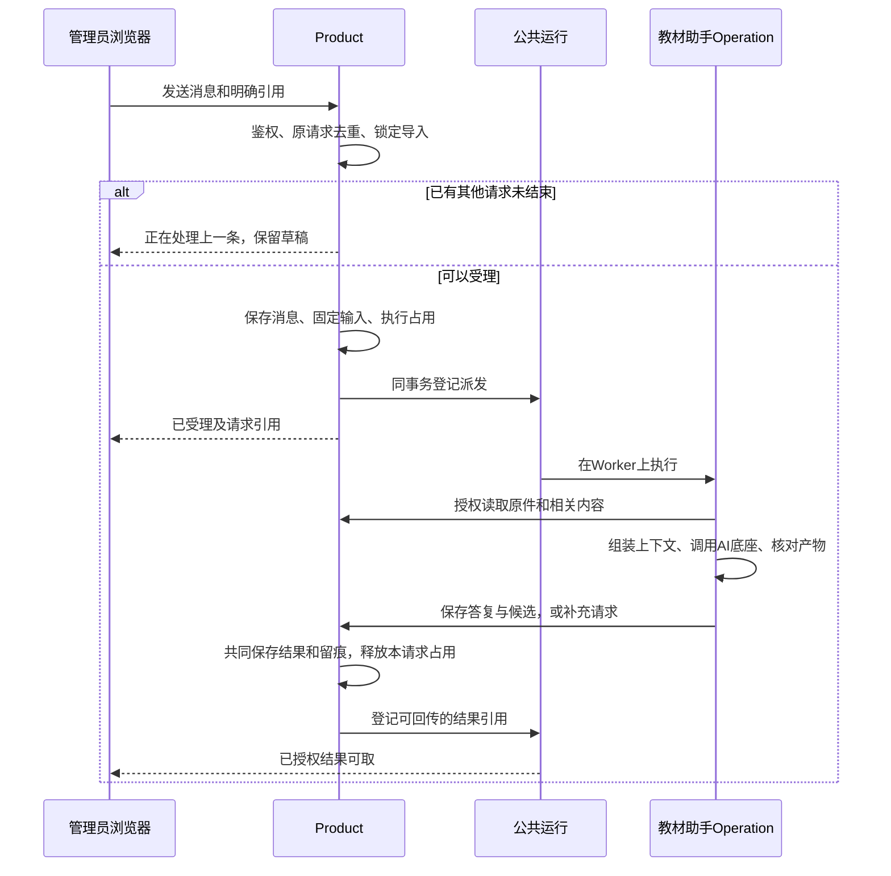
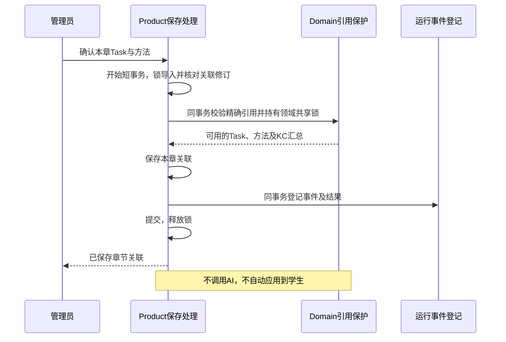
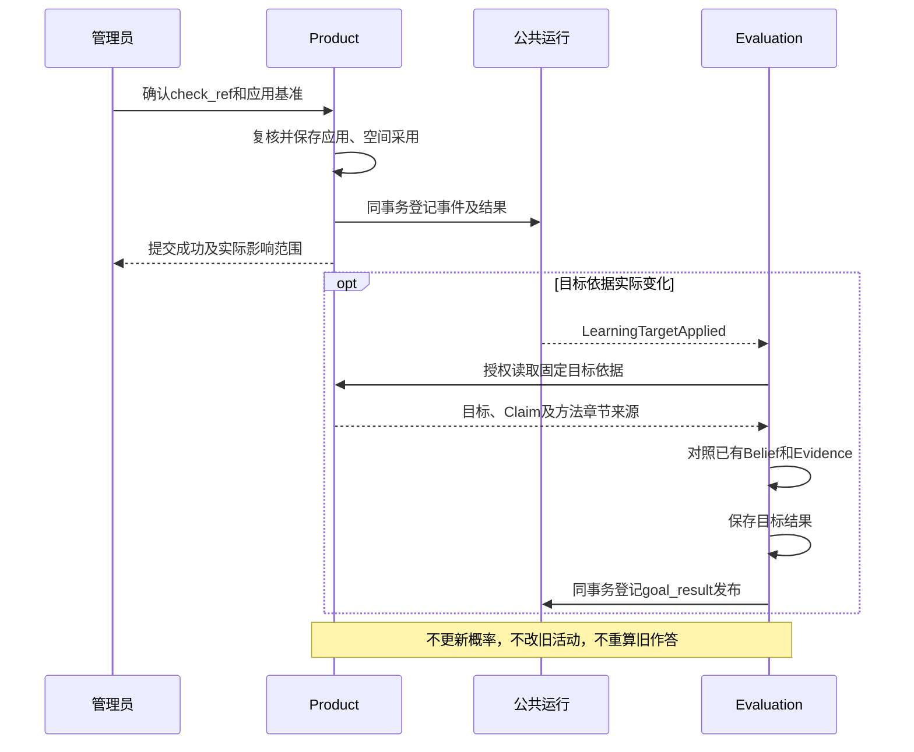

# M1 产品业务设计

> **版本**：v0.33 
> **状态**：登录与账号事实已按增量接线；其他能力及待确认项见实施计划 
> **维护与评审**：Codex编写及自检，用户审阅 
> **写作规范**：[系统设计写作规范](../../../top/DeerMind_System_Design_Writing_Standard.md) 
> **更新日期**：2026-11-16 
> **修订说明**：v0.32 → v0.33，落实E01-09登录参数、持久限流、来源检查及认证原子保存 

本文设计教材准备、学习目标、学习空间和账号关系等产品业务，说明这些业务如何调用核心Space。教材助手归本模块管理，个人能力与目标达成计算仍由Evaluation负责；共同输入见[工程入口§2](README.md#2-设计输入与历史参考)。学习用时统计与提醒后置，不作为M1模块或验收条件。

**事件事实源。** 教材输入、助手输出、候选、采用、章节关联、目标与空间变更先成为完整事件，再同事务生成Product查询数据。消费者处理Domain通知时保存自己的派生事实；不改生产方事件。字段及投影登记只在[事件正文合同](contracts/Event_Facts.md)维护；本稿中的“保存业务对象”均指共同短事务内由事件生成投影。

**源码落点。** `server/src/deermind/product/`承载identity、materials、targets、courses和learning_spaces；教材AI能力位于operations/converse_material_assistant。公开合同、私有存储、投影及依赖规则见[源码组织§3—4](Source_Organization.md#3-后端源码)；HTTP按[OpenAPI合同](API_and_Message_Design.md#7-openapi与可执行合同)导出，本文继续维护业务行为。

## 1. 业务对象与模块组织

本文件维护产品业务处理合同；只有教材助手持续对话属于AI Operation。账号、上传、候选采用、章节关联、目标及空间维护是普通API／消息处理。它们可以调用已有查询或安排AI能力，但不因多步骤而各建OperationRun。共用边界见[系统底座§1.3](System_Foundation_Design.md#13-operationstep与operationrun)。本批补最小认证及授权来源，目标、应用与选用合同保持；字段和提交方案为待审详细稿。

| 对象／责任 | 本模块拥有的数据与边界 |
| --- | --- |
| 账号与使用条件 | 固定管理员／学生身份、必要监护确认；产品业务对接认证组件，底座执行授权检查，M1不建设完整账号权限平台或家长产品 |
| 教材与导入 | 原文件引用、教材信息、章节目录、助手对话、内容候选及采用；原件不被候选覆盖 |
| 领域交接 | 保存待入库提交及来源有效性；Domain订阅请求后维护其待办、模板、知识和实例，本模块不写Domain私有数据 |
| 目标与采用 | 章节→Task／Solution关联、目标定义、应用结果与空间当前引用；Claim及个人判断归Evaluation |
| 学习空间 | 学生所有权、选用教材／目标、采用记录；持续对话与活动归Interaction，Evidence／Belief与目标达成归Evaluation |

### 1.1 共用入参与类型

所有操作接收程序建立的`access_context`。有写入的调用携带稳定`request_id`；同操作、同作用范围、同请求身份只执行一次，参数变化返回`identity_conflict`。仅AI业务执行使用`operation_run_id`，由程序生成，不由LLM指定。更新请求带`expected_revision`，用于检查并发变化，不是Evolution版本。

| 类型 | 必需字段／允许的可选字段 | 约束与唯一维护位置 |
| --- | --- | --- |
| `ID`、`Ref`、`Revision` | 非空不透明标识；`Ref`固定对象与采用依据 | 不用标题或数组位置当身份；空值须由下文显式允许 |
| `AccountInput` | `login_identifier:string, display_name:string`；学生另需`guardian:{existing_ref:Ref? , verified_identity_ref:Ref}, verification_ref:Ref` | guardian无existing_ref时按已核实身份建立必要监护记录，不开通家长应用。凭据使用`CredentialProof`／`CredentialReset`受保护对象，格式由认证设计确定，不入普通事件 |
| `ConfirmationInput` | `student_id:ID, kind:enum, notice_ref:Ref, decision:enum, occurred_at:timestamp, source_ref:Ref` | kind为`guardian_consent`／`student_assent`；decision为`accepted`／`declined`／`pending`，分别表示同意／未同意／待确认，不把缺值当同意 |
| `MaterialInput` | `domain_ref:Ref, title:string, source:string, files:MaterialFile[]`非空；`edition:string?` | MaterialFile含`receipt:FileReceipt, original_name:string, order:int`；收据固定文件引用、真实媒体类型、大小和hash，见基础设施§2.3；文件内分页保留顺序，版权页未知如实留空 |
| `MaterialSelection` | `import_id:ID, scope:batch|chapter|content, basis_revision:Revision, source_refs:Ref[]` | chapter／content需对应对象引用；引用按本次明确请求确定，浏览位置不能自动替代选区 |
| `CandidateRef` | `candidate_id:ID, candidate_revision:Revision, basis_revision:Revision` | 内容为KC／TaskInstance及题内参考解法候选；图表和公式随所属元素，参考解法必须归属于题目；结构语义见[内容规格§3.1](../design/Content_and_Model_Reference.md#31-提取什么以及怎样保存图表和来源) |
| `GoalItem` | §4.2.1定义 | 目标内条目，不是独立“学习要求”实体；Claim按精确Task版本核对 |
| `ApplicationRef` | 不可变应用结果引用 | 固定教材、目标、Domain、章节方法、Claim、活动定义及逐行为可用条件；不是新增课程模型 |

既有入参与动作族保留为待审合同；编号条目说明处理次序，不统一当作持久Step。只有AI Operation中需要恢复的步骤按执行合同保留身份；普通函数、查询和短事务按自身提交边界处理，不逐项进入Agent框架。

## 2. 账号、角色与业务权限

调用授权按[总体§6.6.1](System_Design.md#661-最小调用授权矩阵)细化；内部Space身份不冒充管理员。账号模块不因为维护身份而获得修改评价结果或私有Agent记忆的权限。

依据：[PRD R01](../PRD.md#31-初次启动与试用账号m1-r01)、[R17](../PRD.md#51-谁定义谁产生谁可以修改m1-r17)。真实学习输入前必须核对使用条件；登录成功不代表必要确认已经完成。

本轮确认的最小范围：试用账号提前创建并统一发放、简单登录、固定学生／管理员角色、学生仅访问自己的学习空间，以及Agent／后台任务的受限身份。必要的监护与使用确认记录保留。

不建设自助注册、自定义角色、权限配置、完整亲子关系管理、复杂找回或单点登录。开户与必要重置通过受控管理命令或已有后台操作完成，不新增自助找回页面。用户已确认预置账号＋密码＋服务端登录会话，具体合同见§2.5—2.7；不引入独立认证服务。

账号及学习空间归产品业务，所属Space定义资源访问规则，公共运行底座在路由、派发、读取及恢复处执行授权检查。按已登记的公开查询向底座提供必要路由事实，不转移数据所有权。

读取与工具边界见[总体§6.6](System_Design.md#66-已确认的读取工具与越权边界)。学生学习Operation的个人取材限当前学习空间，公共教材和领域内容按授权使用；管理员按已有后台权限读取。Operation按验证后的身份选材和声明所需工具，底座检查通用权限，所属模块仍校验候选采用、章节关联及正式保存的业务条件。输入中的空间编号或教材文字不能扩大权限，教材助手保存候选也不等于有权完成领域入库。

### 2.1 `product.save_trial_account`：初始化或维护试用账号

**调用与合同。** 部署者仅可在尚无首个管理员时调用`action=bootstrap_admin`；管理员可调用`create_student`／`update_student`。输入为`action, AccountInput`，新建另需受保护的`CredentialReset`，更新另需`student_id, expected_revision`且不修改凭据。输出账号引用、角色、关系记录与使用条件缺口；完成不代表已允许处理真实学习输入。

1. 校验初始化资格或管理员权限；核对登录标识唯一、学生与监护关系的核实记录。
2. `bootstrap_admin`只建立首个管理员；`create_student`建立独立身份，复用或建立必要监护记录；`update_student`仅修改该学生基本信息及核实后的关系，不更换身份或授予管理员角色。
3. 通过受保护机制建立／保持凭据，保存账号、关系及`TrialAccountSaved`操作事件，返回结果。

**恢复与验收。** 重复请求返回同一账号；关系核实缺失或并发修订冲突不写入。凭据建立失败不得返回可登录成功。验收首个管理员重复创建被挡、学生更新保留原空间、角色边界不能绕过；初始化密钥交付方式在认证设计中定。

### 2.2 `product.record_usage_confirmation`：记录必要首次确认

**调用与合同。** 管理员记录线下监护确认及已核实的学生意愿；学生仅能提交本人的使用意愿。输入`ConfirmationInput`及该学生使用条件记录的`expected_revision`（开户时建立）；输出确认记录与当前使用条件结果，不接受调用者直接传入“可用=true”。

1. 校验学生、监护关系、确认材料与记录者权限；学生不能代替监护人确认。
2. 追加实际确认记录，按已定条件计算是否允许真实输入；未同意或缺失保持不满足。
3. 保存`UsageConfirmationRecorded`事件与结果；确认不创建学习活动或个人能力判断。

**恢复与验收。** 同请求去重，冲突先重读；失败不默认为已同意。验证监护确认缺失时不能提交真实学习输入，补齐后按原账号继续，合成案例准备不因此禁止。本操作不新增撤回授权流程。

### 2.3 `product.sign_in`：登录原账号

**调用与合同。** 未认证的学生或管理员提交`login_identifier, CredentialProof`，可选客户端返回位置（仅允许站内）；输出认证会话收据、角色、可进入的业务范围和必要确认缺口，密钥及凭据不进入业务日志。

1. 按§2.5核验密码与账号，不根据请求中的角色授权。
2. 取得角色、关系及必要确认结果；校验返回位置。
3. 建立认证会话，留`AccountSignedIn`安全操作记录，返回进入页面所需身份；缺确认者仅进入允许完成确认的流程。

**恢复与验收。** 认证失败不创建空间或暴露账号是否存在。登录响应丢失先查当前登录；没有有效Cookie则重新验证密码，允许建立新登录会话，不创建新学生身份。登录不套用业务写请求的“原凭据重放”合同；服务器不能通过普通收据重新返回登录秘密。

### 2.4 `product.recover_account`：管理员协助找回

**调用与合同。** 管理员在线下重新核实后提交`account_id, verification_ref, CredentialReset, expected_revision`；输出恢复收据及原账号身份，不返回学生历史内容给未获授权的人。

1. 核对管理员权限、找回对象和有效核实依据。
2. 先计算新密码摘要，短事务核对账号修订，更换摘要并递增credential_revision，使该账号旧登录会话失效；细则见§2.6。
3. 追加`AccountRecovered`记录，保留学生ID、关系与空间引用，返回恢复结果。

**恢复与验收。** 同请求只恢复一次；核实不足拒绝，认证组件未确认成功不返回完成。验收恢复后仍进入原空间，失败不新建学生或清空历史。

### 2.5 密码与登录会话

账号、凭据、登录会话及必要确认的表定义见[Product数据字典](database/Business_Product.md#1-productaccounts)。本节维护认证过程，不新增家长账号平台、角色配置平台或用时管理。

用户确认同一浏览器配置的标签页共用一个当前账号。两种角色同时测试使用不同浏览器或浏览器配置；学生／管理员入口不各存一套登录凭据。这里的登录会话只用于认证，与学习空间的一条持续对话无关。

密码采用成熟库校验的Argon2id摘要，盐由库生成，数据库不存明文或可逆密码。已确认采用pwdlib[argon2] 0.4.2；传递依赖锁定于server/uv.lock；参考[FastAPI密码散列](https://fastapi.tiangolo.com/tutorial/security/oauth2-jwt/#password-hashing)及[OWASP密码存储](https://cheatsheetseries.owasp.org/cheatsheets/Password_Storage_Cheat_Sheet.html)，不继承该教程的JWT方案。

登录成功后生成密码学安全的随机session_token，数据库仅保存其hash及会话记录。浏览器通过HttpOnly、Secure、SameSite=Lax、Path=/且不带Domain的`__Host-dm_session` Cookie携带token；不向JavaScript或localStorage返回token。开发环境使用受控本地代理和独立配置，不能将生产Cookie的保护选项随意关闭。[会话保护依据](https://cheatsheetseries.owasp.org/cheatsheets/Session_Management_Cheat_Sheet.html)。

csrf_token是会话绑定的防伪值，不是登录凭据；作为受限字段保存，仅通过已认证的会话查询返回，不能写日志。后台会话记录与账号身份均归Product；底座通过认证端口核验，不直接读凭据表。M1采用固定到期时间，不因WebSocket心跳无限续期；时限、密码长度、散列成本和尝试限额统一见[基础设施§4.5 A01–A04](Infrastructure_and_Deployment_Design.md#45-首轮入口与执行参数建议)，A01—A04已确认，缺值不得默认无限。

本机HTTP例外仅接受localhost/127.0.0.1的显式Origin，Cookie名dm_session_local；其他环境强制HTTPS Origin及Secure Cookie。部署提供M1_AUTH_ORIGINS、M1_AUTH_LOCAL_HTTP和可信代理网段；不信任浏览器传入的来源IP。代理覆盖X-Real-IP，应用只在直连地址属于配置的代理网段时采用该头。

登录过程：检查来源及请求格式→执行有限登录尝试控制→读取账号和密码修订→事务外校验密码→短事务重查账号及凭据修订→生成会话并登记安全记录→提交后设置Cookie。密码重置先完成时，旧密码验证结果不得建立新会话。未知账号也走受控等价校验，错误只返回“账号或密码不正确”；不记录密码或整段登录请求。登录限额由Product按登录标识及可信来源执行；临时限流不改账号状态，服务过载不记成密码错误。成功登录及重置不能让并发旧校验建立过期会话。

限流采用[login_attempts](database/Business_Product.md#29-productlogin_attempts)，数据库检查与占位原子完成；密码散列在事务外，API同时最多两个校验任务，断开请求不提前释放仍在执行的散列槽位。会话保存前按账号ID顺序锁定账号事件头，再复核状态和密码修订；成功会话与AccountSignedIn共同提交。账号切换时旧会话撤销与AccountSignedOut在同一事务内完成。事件只含账号和会话身份，不含token、密码、散列或csrf_token。重建消费这些审计事实但不恢复登录。

同一浏览器切换账号时，成功登录事务撤销请求携带的旧会话，再设置新Cookie；其他浏览器的会话不因这次切换失效。账号数据、草稿及已受理工作不迁给新账号，客户端处理见[Client§5](Client_Design.md#5-网络异步结果与展示回执)。

### 2.6 退出、重置与初始化

退出先撤销当前会话，提交后清除Cookie；重复退出成功。密码重置递增credential_revision，所有旧会话在下次检查时失效；接口和WebSocket不能仅在连接建立时鉴权。退出、登录到期及密码重置不取消已合法受理的后台工作；工作按[公共运行§5.2](System_Foundation_Design.md#52-后台执行授权)继续检查自身权限。

首个管理员由部署命令调用bootstrap_admin，密码通过受保护输入取得，不作为命令行参数、代码默认值或日志。数据库唯一约束保证只能初始化一次。后续学生开户／重置仍按§2.1／2.4核实，返回账号及操作收据，不返回历史密码。受保护凭据载荷不保存到通用请求正文；业务收据只留“凭据已设置”及修订。重试不重复更换密码。

管理员遗失自身凭据由部署维护者经受控命令恢复原账号，复用同一凭据更新函数及日志，不开放无身份的远程重置入口。监护／使用确认不由密码重置推定为已完成。

### 2.7 认证端口与请求保护

认证HTTP字段见[Product API P01—P03](contracts/Product_API.md#p01)；下表保留内部端口。

以下属于认证技术子接口，不新增AI Operation或独立账号产品。业务入口目录仍以sign_in、recover_account等动作族定位。

| 接口／端口 | 处理和输出 |
| --- | --- |
| authenticate_session(credential) | 底座内部调用；核对token hash、账号状态、凭据修订、撤销和到期，返回Identity或unauthenticated |
| check_execution_subject(account_id) | 后台只读核对账号及使用条件；不要求浏览器Cookie仍有效，不授予其他空间权限 |

普通浏览器API请求另带X-Expected-Session，值为页面已核验的session_id；它不是凭据。服务端先认证Cookie，再比较该ID，身份已切换则返回session_changed，不按新账号继续执行旧页面的请求。GET /auth/session及登录入口不带此预期，用于取得当前身份；客户端收到不匹配后清空旧视图并重新核验。私有读取返回前复查会话有效性，响应禁止缓存。

认证身份只来自上述服务端校验。登录请求限定同源JSON及精确Origin；已登录的写请求另携带会话csrf_token，GET不产生业务写入。WebSocket首帧验证同一csrf_token，避免只靠浏览器自动携带Cookie建立可写连接。写请求Origin必须精确匹配受控列表，不接受通配或缺失Origin；同源GET可能没有Origin，此时仍核对Host并拒绝跨站Fetch Metadata；开发来源单独配置。[WebSocket安全依据](https://cheatsheetseries.owasp.org/cheatsheets/WebSocket_Security_Cheat_Sheet.html)。

缺少必要确认的学生可以登录、查看自己的确认状态和提交本人意愿；不能提交真实学习输入、取用学习内容或建立学习活动。初始化、后台内容准备和合成案例不因此被阻止。401表示需登录，403表示身份有效但不允许操作，服务故障不伪装成密码错误。

## 3. 教材助手与内容准备

依据：[PRD R02–03](../PRD.md#32-批量导入教材m1-r02)。本节管理员操作记录归教材业务，不写成学生空间聊天或能力Evidence。

教材助手Operation决定取用哪些原件、对话、候选及采用记录，组装上下文并保存需要保留的记忆。共同边界见[总体§3.4](System_Design.md#34-agent上下文和记忆)，本模块的材料、工具和恢复合同见§3.4。

教材解析与纠错按[总体§6.1.2](System_Design.md#612-教材agent解析与对话修正)由教材Agent通过多模态模型API完成，M1不单独接入OCR。管理员通过对话指出问题，Agent查看对应原页和当前内容后提出修正候选；不增加手工内容编辑器。候选采用、领域入库、章节关联和课程应用是四次不同的业务提交，任何一步成功都不代替后一步。

### 3.1 `product.receive_material`：接收整批或补充材料

**调用与合同。** 管理员提交`action=new_import|append_files, MaterialInput`；补充另需`import_id, expected_revision`，沿用原Domain，不能借补页另换领域。输出导入ID、原件收据、页序及失败部分，完成表示材料可供解析，不表示已解析或已应用。

1. 只读核对Domain存在；校验文件类型、收据和顺序，未选领域立即拒绝。
2. 保存已成功接收的原件及页序；PDF内部分页，保留文件内页与印刷页码的区别，不猜版次。
3. 建立或补充同一导入记录及`MaterialReceived`事件；失败文件单列，已有内容可继续使用。

**恢复与验收。** 同请求、同文件收据不重复追加；部分上传失败按原导入继续接收，删除中的导入拒绝新材料。验证整批PDF／图片、未选领域、补页及重试保留已收部分。上传与收据按[基础设施§2.3](Infrastructure_and_Deployment_Design.md#23-文件对象与上传合同)接线；大小／数量上限仍在接线前确认。

上传登记先调用Product的用途校验，核对必选Domain、现有导入归属及管理员权限；没有Domain不发教材上传授权。接收时复核准备上传与本次教材的Domain相同。

文件收据须经存储适配核实上传完成、访问权限及实际类型；浏览器给出的文件名不是有效收据。原文件字节不被后续识别覆盖，原件定位使用固定文件引用与文件内页号；印刷页码为可为空的内容信息。PDF转页图属于文件准备，不等于OCR或语义提取。补充文件追加新的原件身份；“用这张替代上一张”的含义由助手提出候选并经采用确认，不直接改写旧原件。

首次接收创建教材草稿、一个导入资源及其持续对话；补页沿用同一导入。保存原件不启动整本解析，后续明确的“解析整本”请求可以覆盖全册，管理员不必逐页发送。整册识别的内部拆批见§3.4.4；文件传输和落盘不能占住业务数据库事务。

### 3.2 `product.save_material_metadata`：补录教材基本信息

**调用与合同。** 管理员提交`textbook_id, expected_revision, metadata_patch`；patch仅含书名、来源说明、已核实版次／版权页引用，不接收解析内容、Domain替换或章节方法配置。输出新基本信息修订。

1. 核对对象及字段白名单，未知版次保持空值。
2. 比较并发修订，保存指定字段及`MaterialMetadataSaved`事件。
3. 返回已保存信息；已应用组合继续使用原采用结果，须另行应用更新。

**恢复与验收。** 冲突不覆盖；同请求复用结果。验证补录版权页不改题面、模型或既有活动，普通保存不令新内容立即供学生采用。

### 3.3 `product.delete_material_import`：删除未完成导入

**调用与合同。** 管理员提交`import_id, expected_revision, confirmed_scope_ref`，expected_revision对应导入控制修订revision，确认引用固定界面已说明的原件、候选及执行情况；输出删除收据。已应用教材不能从本入口撤下。

1. 核对导入未完成、确认范围仍有效，列明领域已入库内容不受影响。
2. 按§3.6.1锁定导入并复核后，标记该导入不再可操作，追加`MaterialImportDeleted`事件；取消该导入未完成的助手工作及提交等待，晚到结果在提交检查时失效。
3. 返回列表移除结果；相关未入库来源失效通过事件交Domain处理，不删除其已保存对象。

**恢复与验收。** 重复删除返回原收据；应用状态已变化则拒绝。验收旧助手候选不能在删除后采用，已入库定义、实例及其他教材不受影响。原文件物理保留／销毁不由此操作决定。

### 3.4 `product.converse_material_assistant`：持续对话解析与纠错

**调用与合同。** 管理员提交`request_id, import_id, message:string`；可选`selection:MaterialSelection, previous_batch_ref, supplementary_file_refs[]`。显式引用固定版本，文字可以明确指定“整本”“第49—50页”等范围。浏览位置不是引用；没有选区但请求已明确时可以执行，只有范围含糊时才询问。返回受理收据，完成后可取得助手答复、补充问题或候选批。

#### 3.4.1 请求受理与忙时处理

同一导入只允许一条尚未结束的助手请求。忙时新消息返回`assistant_busy`，不排队、不追加服务端聊天，客户端保留草稿。查看教材和已有候选不受影响，不同教材可以同时处理。`needs_input`表示本轮已结束、需要人补充，不占住执行位置。该规则由用户确认，见[登记§72](../../DECISIONS.md#72-教材助手与内容采用详细设计)。

受理的短事务依次执行：鉴权 → 检查同请求收据 → 锁定导入 → 复核可用及忙闲 → 保存用户消息、固定请求输入和当前执行引用 → 由底座登记持久派发。提交后返回202。相同请求先返回原收据；同键改内容返回`identity_conflict`；不能因为本请求正在执行就把它的重试当成新消息拒绝。

`active_request_ref`覆盖已受理、执行中和可恢复的技术重试。完成、`needs_input`或最终失败时，程序仅在该引用仍等于本请求的条件下清空。客户端断线、超时或Worker暂时离线不释放它；恢复处理先查询底座的持久执行结果，再按同一请求完成收尾。旧执行晚到时必须再次核对执行归属与导入状态，不能覆盖较新请求。具体Temporal状态接线归公共运行，不在本模块设另一套超时解锁器。

最终失败已经释放占用后，若经公共恢复入口继续原请求，须重新在导入锁内检查空闲、来源和相关基准，并重新登记原请求为当前执行；已有其他请求运行或相关内容已变时拒绝恢复，不抢占或排队。新的补充消息始终是新请求；已结束的旧请求不会因浏览器重连自动复活。

图1：教材助手从消息受理到候选交付；采用与领域入库不在这次Operation内执行。

图中的保存与派发登记均通过所属模块参加同库事务；模型调用在事务外。底座不会把通用模型产物未经Product核对就推成可采用内容。

#### 3.4.2 Operation取材与工具

每轮建立固定`MaterialTurnInput`，字段由Product准备：

| 字段 | 类型／必填 | 含义 |
| --- | --- | --- |
| `import_id, message_ref, request_ref` | ID／是 | 当前导入、已保存原文及本轮身份；账号和权限来自服务端上下文 |
| `scope` | MaterialSelection或待定位标记／是 | 已明确引用的全册、章节或元素范围；只有自然语言定位时保留原文及待定位标记 |
| `source_manifest_ref` | Ref／是 | 本轮可用原件、页序及校验摘要；新增补页不会悄悄进入旧输入 |
| `basis_refs, dependency_refs` | Ref数组／是，可空 | 已采用内容及必要依赖；修正解法须含其父题，新增内容用明确的章节／页段范围标识 |
| `previous_batch_ref, history_refs` | Ref可空、Ref数组／是 | 继续核对的候选和相关原始对话；跨教材历史不在本次授权中 |
| `work_state_ref` | Ref／可选 | 上次缺口、已处理页和未闭合的跨页题目；不能代替原件或当前采用内容 |

必需输入为当前请求原文、实际要处理的原页／完整跨页内容、被修改元素及其依赖。相关历史按引用补取；超过模型容量时分段处理，不能裁掉题目条件以换取“成功”。教材中的指令是材料，不得改变工具权限或操作范围。

范围需语义定位时，模型先依据本导入目录和请求提出定位，程序核验后另存固定的resolved_scope及依据，不回改原MaterialTurnInput。含糊则needs_input询问；已经明确“整本”或指定页码不必再次确认。后续读取和候选write_set受该范围约束，不能把处理过程中偶然浏览的章节扩入请求。

提示协议由Product维护：固定规则说明“只提取／修正候选、保持未知和原题信息、题面与参考分离”；本轮指令给出明确范围及所需改动；材料区给出带来源引用的原页和内容；输出区要求§3.4.3结构。既有候选和教材原文作为数据传入，不拼进系统规则。实现时该协议落为本模块的提示模板并记录模板标识；AI底座不维护教材业务提示词，模型配置和预算另沿其公共合同。

| 授予助手的普通工具 | 返回内容与限制 |
| --- | --- |
| `read_material_pages` | 本导入获准文件的指定页图及定位；相邻页仅在请求授权范围内补取，否则询问，不接受任意URL或磁盘路径 |
| `read_material_content` | 指定候选／已采用元素及父题、完整内容、出处、采用状态；读取结果固定引用，不读取Domain私表 |
| `read_material_history` | 同一导入内指定消息、候选和决定的原文；按用途限定范围，不给其他教材全量历史 |
| `store_material_work` | 保存本轮工作草稿或候选建议；Product检查来源、结构、执行归属和范围，不改变当前采用、Domain或章节关联 |

页图工具通过[AI底座§4.2](AI_Foundation_Design.md#42-图像和持久载荷)返回带可见来源标签的图文；只返回文件ID不能代替模型实际看图。初始材料和工具补取都登记固定来源及hash；分段由本Operation决定，SDK载荷外置不改变内容范围、候选采用或入库资格。

这些工具是本Operation内部能力，不新增AI Operation。最终发布候选由程序执行§3.4.3检查；工具保存草稿不等于已向管理员交付候选。助手无权调用采用、删除导入、提交Domain或保存章节关联的写入口。

#### 3.4.3 Agent输出与程序接收

模型输出是`MaterialProposal`，不是可直接写入的领域对象。下列结构为本模块唯一的候选外壳；元素正文复用[Domain§1.4](Domain_Space_Design.md#14-文字公式图表的统一内容结构)，不另造公式／图形语法。

| 字段 | 类型／条件 | 程序检查 |
| --- | --- | --- |
| `outcome` | `proposal|needs_input|reply`／必需 | proposal至少含一项changes或catalog_changes；needs_input含可回答的问题；reply只用于说明已有内容，不宣称修改成功 |
| `reply` | string／必需 | 给管理员的简短说明；技术失败由执行层返回，不让模型伪造成功答复 |
| `changes` | Change数组／proposal必需，可空 | 每项`action=add|replace|retire, local_key, target_ref?, chapter_ref或chapter_key, source_refs[], content?, reason`；chapter_key指本批新目录项，两种章节定位恰一；replace／retire须指向本轮固定目标，add不得覆盖既有身份 |
| `content` | 候选正文／add、replace必需 | `kind=kc|task_instance|reference`及RichContent；reference须带`parent_key`或固定`parent_ref`，两者恰一 |
| `catalog_changes` | 目录候选数组／可选 | 每项含action、local_key、target_chapter_ref可空、名称、顺序、页段及理由；新目录用局部key配对，修正用已有引用，程序分配正式章节ID。不能改变章节Task／Solution采用关系 |
| `coverage` | 页／元素处理清单／proposal必需 | 记录已处理、缺失、读不清和明确不提取的内容及理由；跨页问题须闭合，不以进度100%证明无遗漏 |
| `issues, questions` | 有定位的问题数组／可空 | 每项含问题位置、原因及对内容完整性的影响；必需图形／条件缺失时不能生成可采用批次 |

`local_key`只用于本批配对。程序分配候选ID、修订、章节ID、父题引用、来源锚点和改动集合；模型返回的官方ID只有在输入白名单中才可引用，不能通过自行编号插入对象。新解析元素新建candidate_id；替代同一元素沿用candidate_id并追加candidate_revision，不覆盖旧正文。绑定新章节和同批父题在保存批次时一次完成，不能先保存悬空参考。模型返回的出处必须落在实际提供的页／内容中；结构校验不能证明语义正确，管理员仍需对照原件核对。

程序按请求范围、已有正文、变更目标及依赖生成`CandidateBatch`：`batch_id, batch_revision, turn_ref, scope, basis_revision, read_set[], write_set[], candidate_refs[], catalog_changes, coverage, issues, diff_summary`。`read_set`记录实际依据的不可变引用；`write_set`列明新增／替代／撤下的目标和前后引用。它们由程序固定，不能仅相信模型声称“未修改其他部分”。新增目标还记录所在章节／页段的占用基准，避免两批相同位置内容同时新增。

`basis_revision`只是定位本轮读取快照，**不要求等于整本最新修订**。是否仍可采用按§3.5的相关内容／依赖检查。批次内容固定后不能原地编辑；“继续修正”产生新批次，成功保存新候选后才将明确被替代的旧待审批次标为`superseded`。修正失败不使旧候选凭空消失；已采用批次始终保留其历史决定。

题目与参考分别列候选，例题有参考也必须有独立题面；教学辅助不放进题面。题目数据表和统计图共享相同值来源，无法识别的值保持未知。`retire`只表示经明确请求移除错误／重复的解析元素，须列入采用对照；缺少某项输出不等于删除它。本操作不能撤下已入库Domain对象。目录修改不得使已有章节关联悬空，遇到已有采用无法对应的章节拆合须先澄清，不自动迁移关联。

#### 3.4.4 分段处理、记忆与恢复

全册请求在同一Operation中按页段处理：固定原件清单 → 读取目录与页段 → 逐段提取 → 合并跨页题和独立解法 → 检查覆盖与引用 → 交付候选批。页段大小服从模型输入限额，不是产品章节限制。中间草稿可以保存和恢复，但未闭合的片段不能冒充完整可采用批次；缺页、限额耗尽或服务失败时保留已做部分及未完成范围，不能把全册请求默默缩成几页完成。

| 可恢复位置 | 保存内容 | 再执行时的规则 |
| --- | --- | --- |
| 请求受理后 | 原消息、授权引用、固定输入、当前执行引用 | 同请求复用；不因断线再追加消息 |
| 页段处理后 | 已完成段的结构稿、原页引用、剩余范围及跨页依赖 | 复用已保存结果；没有可靠结果的外部调用可能重做，记录重复费用风险 |
| 候选交付后 | 不可变批次、对照、助手答复、事件和最终收据 | 回传失败只补取；不重调模型生成第二批 |
| `needs_input`／最终失败 | 缺口、已完成工作引用及明确结果 | 结束本轮、释放占用；新补充消息开始新请求，技术重试仍由原运行按底座规则处理 |

Product的最小工作记忆是结构化工作记录：本轮范围、已处理页、未解决问题、当前候选和采用引用。原始对话另存，不要求每轮生成摘要。历史超出上下文预算时，由本Operation选定相关原文生成带来源引用的摘要，作为内部步骤保存；下次取用前重新核对正式内容。摘要不替代题面、父题、采用决定或授权范围，不能据此自动扩大修改范围。

候选发布前检查导入仍可用、请求仍归当前执行、相关依据是否仍有效。若处理中发生相关采用变化，保存工作草稿及冲突说明，不发布可采用批次；无关章节变化不阻止发布。删除发生后，迟到产物只作运行留痕，不重新创建导入或可操作候选。所有AI调用、页图读取和WebSocket发送均在最终保存事务之外。

### 3.5 `product.decide_material_candidate`：采用或不采用候选

**调用与合同。** 管理员提交`request_id, import_id, batch_ref, decision=adopt|decline, expected_revision`；`batch_ref={batch_id,batch_revision}`，expected_revision比较该批决定状态的修订，不比较整本教材修订。输出决定收据、已采用内容引用和影响说明；批次内元素用CandidateRef标识，不以单个元素引用代替整批决定。

1. 鉴权并查询原请求收据；按§3.6.1锁定导入，复核批次仍待核对。已处理批的新请求返回`already_decided`，不反向改写原决定。
2. `decline`只登记不采用，不要求旧正文仍是当前正文。`adopt`则比较程序保存的read_set／write_set：修改目标、父题及相关目录／原页映射仍须相同；无关章节变化忽略。相关变化返回`candidate_basis_changed`及变化引用，不自动合并、不自行重解析，管理员可通过助手重新核对。
3. adopt时验证本批内容结构、完整性和所有父题关系。若题面被修正，原来绑旧题面的参考不能自动沿用为有效；本批须明确重核参考，或将这些参考保留为历史并标明需继续核对，禁止以旧参考提交新题。不能只改parent_ref声称已核对。decline不做这些内容合格检查。
4. adopt只更新write_set声明的当前内容／目录指针，追加采用决定、失效来源清单和`MaterialCandidatesAdopted`事件；decline仅保存拒绝决定和`MaterialCandidateDeclined`。不改变Domain对象和章节采用。事件、决定及发生的指针变更与请求结果共同提交。冲突／失败不留下半批采用。

已有Domain对象不因采用修正而失效；未完成待办由通知及入库时的来源保护阻止使用旧内容。解法和题目的分别入库选择发生在§3.6，不把采用操作改成任意删改候选块的编辑器。同请求重取原决定前仍检查权限；结果回包丢失不重复采用。

例如A章候选修正题Q，依据Q@1和原页P；B章随后采用修正，A仍可采用。若Q@1已被Q@2替代，或参考R的父题Q改变，则A必须重新核对。单纯增加另一份文件不使未受影响的P失效；被替换的是P对应的语义内容／定位时才纳入冲突。

### 3.6 `product.submit_domain_intake`：提交已采用内容到领域

**调用与合同。** 管理员提交`request_id, import_id, adopted_content_refs:CandidateRef[]`；每项引用固定内容修订，不用整本expected_revision阻止其他章节提交。另可带按参考候选逐项对应的`parent_bindings`：父题为本批题目、已有待办或确切TaskInstance版本，三者恰一。输出提交收据；取得Domain受理结果后补充待办引用，不输出“模板已建立”或“章节已关联”。

1. 核对所选内容均已采用且来源有效；KC、题目、解法分别选择。选解法必须定位同一道父题：本批同时提交、此前已有有效待办，或准确引用已入库题目版本。父题待入库时只允许解法进入待办，不能提前完成关联；父题均未登记则先提交题目，不能偷偷附带其他内容。
2. 保存按来源修订固定的提交包，追加`DomainIntakeRequested`事件；Domain的`domain.receive_intake`订阅创建待办，Product不直接写其模板或实例。
3. 产品业务以本次固定触发事件对应的`intake_receipt`等待Domain受理，期限交底座执行。结果available后检查outcome：received且映射覆盖全部候选才标接收完成；rejected则记录issues并结束本次等待，不继续假等待办。等待到期显示“已提交，尚未确认领域受理”，保留原提交并允许查询，不能显示入库失败或新建一批请求。

**恢复与验收。** 同一来源修订的重复提交复用待办／已有入库引用；确认原事件未投递时可按底座保障重投，不再生成提交包；仅等待超时不能证明Domain未受理，也不触发新的入库请求。来源已替代不得继续入库，需提交新内容。验证只选题不带解法、缺父题被挡、重复投递只建一次待办。

Domain返回本次新建／复用对象的精确版本、来源映射和检查引用。新增出处记入入库结果，不要求复用对象为此修改内容或升版。Product不能把“定义已创建”“题目已关联”或“参考已追加”当成章节采用成功，章节关系仍由§4.1明确保存。Domain入库、失败与恢复的唯一规则见[Domain§2](Domain_Space_Design.md#2-定义维护与教材内容入库)。

提交记录只维护`submitted|received|rejected`：submitted为请求已共同保存并等待受理；received为取得outcome=received的完整待办映射；rejected为取得outcome=rejected及具体原因。投递／执行故障通过底座只读`delivery_state`展示，本方等待到期记录为`wait_state`，不把消息迟到当业务拒绝。Domain待办后续的入库、放弃或失效通过其授权查询读取，Product不复制一套待办状态机。消息重复或乱序按trigger_event_id关联同一提交；迟到的受理结果仍可登记，但不把已失效来源改回有效。程序核对结果覆盖本次候选，不能把其他提交的成功通知填入本批。

delivery_state是底座投递／执行结果的只读投影，不在Product自建发送队列或重试计数；wait_state为`waiting|timed_out|closed`，按本消费方等待决定变化。收到明确成功／业务拒绝后关闭等待；底座技术失败只关闭本次等待并展示恢复条件，不推导领域业务拒绝。公共技术失败读取原执行／交接及失败引用，见公共运行§4.3—4.5；业务拒绝的唯一载荷见Domain§2.2。补齐内容后由管理员明确新提交，不借技术重试翻转原拒绝。

### 3.6.1 教材来源读取与提交保护

教材、Domain及事件共用业务PostgreSQL，模块各操作自己的schema；只在最后保存时参加同一个短事务。确认见[登记§71](../../DECISIONS.md#71-domain存储接口与同库短事务)。这不把Domain入库改成同步调用教材Agent，也不允许Domain直接读取教材私有表。

| Product端口 | 输入与输出 | 执行条件 |
| --- | --- | --- |
| `read_adopted_content` | `access_context,candidate_refs[]` → `items[{candidate_ref,domain_id,kind,content_ref,content,parent_ref,source_refs,adoption_state}]` | 普通只读；返回不可变已采用内容及当时有效性，用于准备检查，不能当作最终入库许可 |
| `read_intake_submission` | `access_context,intake_request_id` → `import_id,domain_id,trigger_event_id,candidate_refs[],parent_bindings` | Domain按事件引用读取固定提交，候选必须与事件相同；父题绑定说明本批选择，不替代Domain核对待办／实例的真实来源映射 |
| `guard_adopted_sources` | `access_context,transaction_context,source_refs[]` → `valid_source_refs[]`，或具体失效原因 | 只能在同进程、同业务数据库事务中调用；按导入ID排序取得`FOR SHARE`，校验候选仍已采用、内容未被替代、父题引用有效、导入可用及领域一致；锁保持到外层提交／回滚 |

三个端口均校验授权；已知来源失效返回`source_unavailable`，数据库故障返回`temporarily_unavailable`，不混为“来源不存在”。内容里的图表、公式和教学辅助仍按各自用途交付；候选不是任意教材文件的访问凭证。read_intake_submission返回的原提交不会随候选失效改写，当前来源资格仍由其余端口独立检查。

`decide_material_candidate`和`delete_material_import`必须先对同一`product.material_import`记录取`FOR UPDATE`，再复核状态并修改采用／有效性；任何其他改变来源资格的入口也使用同一锁。校验针对所选内容，不能仅因为另一章采用了新内容就使本候选失效。表与投影见§3.7，Domain仍只使用端口。

若教材变更先提交，Domain随后取得锁会拒绝旧来源。若Domain已锁定有效来源并先提交，教材变更随后生效，已入库对象保持合法历史；失效事件只处理尚未完成的待办。仅靠通知先到、读取候选一次或保留旧原件，都不能替代此提交保护。完整锁序、事务步骤与时序图维护于[Domain§6.5](Domain_Space_Design.md#65-短事务与来源并发保护)。

Domain持有已入库内容的结构化副本，Product继续拥有原件、采用记录和出处。教材随后替代或删除不改写Domain正文，也不自动建立／更新章节关联。回到教材后仍由管理员明确采用精确Task及Solution版本。

### 3.7 教材持久化与状态

教材相关表的字段、约束和关系见[Product数据字典](database/Business_Product.md#8-producttextbook)。本节维护内容采用、并发与恢复规则。

原件、消息、提案正文和采用决定保留历史，当前内容与目录可以推进。浏览旧候选不表示来源仍可入库；恢复已保存提案时不能覆盖其原输入和内容。

候选引用含元素身份与修订；读取旧版本不代表该内容仍有效。`material_content_current`可重建，但重建不得产生第二次采用事件。`material_adoption`记录管理员采用／拒绝；被新提案取代的未采用批次在批次处理记录留痕，不伪造管理员拒绝。父题变动引起的requires_review也须在采用影响集合中记录，其参考不能提交Domain。

业务查询可用`{owner:"product",candidate_ref,path}`定位；返回原文必须同时给出对应EventPartRef，path是事件候选正文内的JSON Pointer；批次和原件使用各自有类型的引用，不混用路径。读取器同时检查所属导入、视图和授权；有引用不等于有原件或参考权限。工作草稿通过turn_ref／步骤身份保持幂等。material_turn.work_state_ref只随受理或轮结束事实更新；执行中的检查点由runtime Step保存，查询经公开运行接口组合。已经交付的候选内容和原输入不被恢复覆盖。

批次采用的read_set由固定候选／父题／目录依据和必要的页段占用基准组成；write_set包含每个更新的旧引用。事务内逐项比较，所有受影响投影在同一导入行锁下检查并提交。content_revision仅作整本变化游标，不作为局部采用的唯一乐观锁。原件、消息、提案正文和决定历史不原地改写；物理删除及留存期限不在本批决定。

普通请求收据保存业务结果，不替代Temporal、OperationRun或事件outbox。请求通过鉴权后先查收据，再按“命令收据→导入→Domain→本模块目标行→运行登记”的顺序锁定；Domain参与的完整顺序见其§6.5。§3.4消息受理及最终完成各有一个短事务，AI执行不贯穿事务。先由公共运行向事件记录写入完整输入或结果，再同步生成Product的消息、候选及采用投影；数据、事件、收据和交接安排共同提交。

### 3.8 HTTP与客户端交接

教材上传、助手消息、候选查询与采用、待入库提交的路径和字段见[Product API P04—P16、P26](contracts/Product_API.md#p04)。认证、回执和错误沿[总册](API_and_Message_Design.md#2-认证回执与错误)，文件字节走[运行协议R01—R03](contracts/Runtime_Protocols.md#r01)。

首次回执丢失时按原request_id查询或重发，不要求客户端已知丢失的request_ref。202只表示可靠受理；候选是否产生、Domain是否接收分别读取原收据，不能把后台完成当成领域入库。

章节、候选和导入引用必须相互归属。正文读取固定内容修订，历史消息按上界续页，不混接不同修订。无权、业务不满足与技术失败分别表达；忙时保留客户端草稿，不保存第二条待处理消息。具体字段、错误码及样例只在分册维护。

### 3.9 本批逻辑核对与实现检查输入

本节记录设计应满足的分支，不声称已运行测试。内容仍限定既有C02、C03、C05、C06，原件及结构语法见[Domain§7.1](Domain_Space_Design.md#71-四例内容结构稿)。

| 输入／中断 | 应得到的结果 |
| --- | --- |
| C02跨页题、两个参考解法 | 原题独立一项、参考分两项且均绑同一父题；只提交题目不暗带参考，分别提交时核对父题身份 |
| C03辨错题原错误被识别成正确式 | 对话指出后产生修正候选；采用保留原题错误式，参考正确答案不混入题面 |
| C05必要图形漏提 | 读取原页后补入所属元素；无法确认关系则needs_input，不用原图或“已识别”标签掩盖缺口 |
| C06统计图表 | 共享数值、单位、标签及出处；改值时相关表图共同修正，未知不变成零 |
| 忙时新消息／原消息重发 | 新消息409且草稿保留；原消息返回原受理，不追加聊天 |
| B章变化／同题或父题变化 | 前者不阻止A章采用；后者拒绝覆盖，交回助手核对 |
| 候选已保存、通知丢失 | 查询原结果，候选和答复只一份，不再次执行模型 |
| 导入删除／内容替代与入库竞争 | 按来源锁决定先后；Domain已保存版本不回滚，失效来源不能晚到入库 |
| Domain受理晚于Product等待期限 | 原提交保持，按同一trigger查询并登记结果；不重复创建待办 |
| 关联方法在最终保存前软删除 | Domain引用保护拒绝该次关联，章节、事件和成功收据不能半提交 |

尚需后续模块给出：文件上传与大小限额、通用运行／回传及最终失败恢复、模型配置和调用预算、全局时间、数据保留与迁移工具。它们各有既定责任文档；本批不臆定数值或宣称语义提取可靠率达标。

教材助手的执行接线采用[公共运行§3.3／4.5](System_Foundation_Design.md#33-operationrun与步骤记录)：busy和候选提交资格由Product维护，底座启动及恢复原Run。明确失败后只释放匹配原请求的忙闲标记；获准恢复时再次检查导入可用、无其他运行且来源仍适用，再建立新尝试。原消息和已保存候选不重建；输入确需修改则要求新消息，不以技术重试覆盖旧请求。

**教材状态投影。** turn的业务状态为accepted及已提交轮结果；running/waiting只来自Execution视图。Prepared同时保存新pending批及被替代旧批的superseded快照；Adopted/Declined保存决定、批状态及导入修订。消息和候选始终含完整正文。每事件记录集合、原ID及事务规则见[事件正文§3.2—3.3](contracts/Event_Facts.md#32-事件携带记录与条件)，不在完成事件重复创建旧候选或输入。

## 4. 章节关联、目标定义与课程应用

依据：[PRD R04–05](../PRD.md#34-维护领域处理入库并关联章节m1-r04)、[R08](../PRD.md#38-检查应用与更新m1-r08)及[内容规格§3.7](../design/Content_and_Model_Reference.md#37-课程应用结果与学生选用交接)。保存草稿、确认应用与学生采用是不同提交，不用一个成功标志代替。

### 4.1 `product.save_chapter_association`：添加、编辑或取消章节关联

**调用与合同。** 管理员提交`request_id, action=add|update|remove, textbook_id, chapter_id`。add带`task_ref, method_refs:Ref[]`及读取时的chapter_revision；update／remove带association_id及expected_revision（该关联修订），update另带非空method_refs。Task身份及版本从原关联读取；换用另一Task须明确新建关联，不能借编辑方法更换Task。输出已保存的关联修订及所选方法直接汇总去重的只读KC；不接收直接KC关联。

1. 页面从Domain公开读取所选Task及直接方法；这次读取只供选择，不是最终保存许可。add／update至少一法，每项引用必须是该Task固定版本实际包含的Solution。
2. 最终短事务先鉴权与去重，锁定教材对应导入并核对章节／关联修订；add拒绝同章同Task身份重复，update不能修改已取消关系，remove只将本章关联标为无效并递增修订，不删领域对象。
3. add／update在同事务中调用[Domain引用保护端口](Domain_Space_Design.md#67-模块端口与消息交接)，确认同领域、对象身份可用及精确方法关系；程序使用该结果汇总KC，不接受浏览器自报知识。remove不要求旧Domain引用仍可建立新关联，否则会无法取消已失效关系。
4. 保存章节关联、`ChapterAssociationSaved`事件及请求结果，共同提交；本次失败全部回滚。原已应用采用记录不被草稿改写，目标缺口在重新检查时按新关联核对，不直接重算个人状态。

Task和方法均使用[Domain的ObjectRef](Domain_Space_Design.md#11-公共输入与引用)，引用确切版本。方法新版本不会自动改章节引用；需要采用时先确认Task与方法版本关系，再明确保存章节关联。已软删除身份不能建立新关联，已有采用和历史读取保留原引用，不能用新版本覆盖历史。新用途的就绪检查仍须核对当前引用是否可用。

**恢复与验收。** 同请求复用结果；无效引用或并发冲突不生效。验收取消弹窗无写入、确认即保存；第一章A与第二章B保留各自来源，不能被计算成全章只允许交集或任意章均开放两法。

图2：章节添加／修改的最终提交；取消关联不需要Domain新引用校验。

Domain软删除需要领域排他锁。若删除先完成，本次新关联拒绝；若关联先提交，随后删除保留旧引用可追溯，新用途检查报告已失效。M1不自动更换章节方法或批量升级引用。关系数据及锁顺序维护于§3.7；模型内容与有效性判断仍由Domain负责。

### 4.2 `product.save_learning_target`：维护目标定义

管理员提交`request_id, action=create|update, textbook_id, title, items:GoalItem[]`；update另带`target_id, expected_revision`。教材身份创建后不换，title与items非空。返回`target_ref={target_id,revision}, gaps[]`；保存不应用、不创建Claim、不写个人结果。

1. 按精确引用读取Claim及其Task，从本教材章节关联取得方法来源。引用不存在、越域、Task版本不一致或方法不在指定章节时拒绝。
2. 校验§4.2.1条目。方法／方面已定义但判据尚不完整，可保存并列准备缺口；不虚构条件，不删要求。
3. 短事务内按§5.3锁序复核教材、章节关联和目标修订；调用Domain的guard_references保护所选Task／方法，再追加目标版本、LearningTargetSaved及请求收据。新条目由程序编号；同请求返回原版本，冲突返回revision_conflict。

#### 4.2.1 目标条目

| 字段 | 类型／必填 | 校验 |
| --- | --- | --- |
| `item_id, title` | ID、string／是；新增item_id可省 | 同一条目更新沿用ID；同一目标内唯一 |
| `claim_ref` | 精确修订引用／是 | Evaluation所有；其task_ref须与所选章节关联的Task版本一致，不自动兼容不同版本 |
| `chapter_refs` | 章节ID数组／是，非空 | 本教材内的要求来源；不是学生长期选章，也不是聊天限制 |
| `task_conditions` | `{description:string, parameter_values:object}`／是 | description说明本项范围；parameter_values只用Task已声明参数及值域，可空。无形式化参数的范围由Evaluation核对证据，不能凭文本当作已满足 |
| `method_mode` | `specified|any_one|each`／是 | specified恰一法；any_one须同一法满足全部要求；each逐法满足，不拼接不同方法的方面 |
| `methods` | MethodRequirement数组／是，非空 | 每项`method_ref, chapter_refs[], aspects[]`；章节是本条目的子集，且确实采用该方法；方法不得重复 |
| `aspects` | `{aspect_ref, condition_values:object}[]`／是，非空 | 来自Claim；值仅可填写该方面规则声明的可配置条件，缺省取该修订默认值并固定；无规则时仅可留空并列缺口 |

本条目实际方法范围为相关章节方法的并集，同时保留“方法→章节”的来源；不能算成交集，也不能将某章方法对所有章开放。Claim重复出现在不同条目时分别对照要求，不因此新增Belief或重复更新概率。

`condition_values`由Evaluation返回的条件Schema校验，Product不另建判据库。自填概率阈值、固定答对题数和永久反证否决字段一律拒绝；M1沿[内容§4.20](../design/Content_and_Model_Reference.md#420-从-belief-与证据基础派生目标达成)使用全局0.90和适用Evidence。条件不足是准备缺口或证据未知，不能靠浏览器补默认判断。

### 4.3 `product.apply_course`：检查并应用教材与目标组合

普通管理操作分check与confirm。check只读取已保存定义，不调用教材助手、不出题、不计算个人状态；confirm只采用管理员已核对的结果。没有新增课程实体或审批步骤。

| 动作 | 必需输入（均含request_id） | 输出 |
| --- | --- | --- |
| `check` | textbook_id、target_ref、待应用章节／内容引用、activity_config_refs；base_application_ref首次可空 | check_ref、固定的拟应用内容、逐行为检查、阻塞项及变化摘要 |
| `confirm` | check_ref、expected_application_ref（首次明确为null） | application_ref、受影响space_id及各自采用引用、是否实际改变 |

#### 4.3.1 检查与固定输入

1. 从Product读取目录、已采用内容、章节关联和目标；从Domain读取对应定义、KC检验路径及供题依据；从Evaluation读取Claim合同；从Interaction读取四类活动配置。均使用授权查询，不读私表。
2. 形成完整拟应用快照：首次只纳入明确选择的已准备内容，其余保留未准备说明；更新以当前应用为基准，只替换本次选中的部分，未选中的部分沿用原应用，不能顺带发布其他草稿。范围不足以承载所选目标引用时列为阻塞。
3. 固定实际引用及修订、目标条件、方法章节来源、活动配置和检查结论。检查期间相关资料变化时重新取一致输入或返回`check_stale`；技术读取失败不伪装成业务缺口。

| 检查结果 | 影响 |
| --- | --- |
| 教材／目标不存在、领域不符、所引用Task／方法关系无效 | 阻止confirm，不形成学生选项 |
| 原页或语义内容缺失 | 标明受影响阅读／取材；不把尚未解析内容当作完整题目 |
| 方法、KC路径或讲解／答疑配置缺口 | 限制相应的正式讲解用途；可靠材料仍可用于回应问题，不封禁整章聊天 |
| 检测活动、方法执行判据或方面规则缺口 | 限制对应检测／评价；课程准备不足不写成学生“待确认”或“需加强” |
| 无备用实例，但Task／方法和检查依据可用于生成 | 不阻止应用；实际供题由Domain统一筛选、生成、检查并保存 |
| 学生尚无证据、保持间隔未到 | 不属于课程检查，不在应用阶段判断 |

每条结果保存`subject_ref, purpose, status=ready|limited|blocked, reasons[], basis_refs[]`。subject可定位教材章节、Task、方法或方面；purpose为reading／explanation／qa／practice_feedback／detection／evaluation。没有覆盖到的用途不是ready。检查不是保证未来模型服务或每道生成题都可用，运行时仍核对。

#### 4.3.2 确认与提交

1. 鉴权并查原请求收据；取得同教材的导入锁，比较base_application_ref、目标版本及本次选择的内容／关联基准。只要相关依据变化就返回`check_stale`；不自动采用最新内容。未选中的草稿变化不阻止确认。
2. Domain在同一短事务内保护所引用Task／Solution，检查当前身份可用。Claim和活动按检查时的固定修订采用，不追最新头版本；其历史定义由各所有者保存，运行时仍执行已知不可靠内容的限制。
3. 保存不可变应用结果和组合当前指针；按space_id顺序更新同教材、同目标的已有空间，追加采用记录及事件。所有写入和公共事件登记在一个业务库短事务内完成；不等待AI或Evaluation，不调用NATS发送。
4. 提交后返回结果，底座投递通知。失败回滚整次应用；回执丢失查询原请求。完全相同的采用内容返回现有引用，不重复更新空间或发目标事件。

M1沿首批小规模使用共同提交，暂不做分批更新／补偿平台；若实际空间数量使事务超出预算，拒绝本次应用并保留旧结果，不能只更新一部分却宣布完成。事务时限由公共运行设计，不在这里设数值。

#### 4.3.3 应用依据与目标依据

`ApplicationRef`固定教材内容、章节方法、目标版本、Claim、检查时活动配置及使用限制。活动配置引用用于追溯检查；新活动仍按Interaction读取当前有效配置，已开始的活动保留自己的配置。`target_basis_ref`仅标识影响评价范围和目标对照的部分：

| 变化 | 处理 |
| --- | --- |
| 书名、来源说明、教材正文或活动配置变化，评价要求未变 | 新application_ref，沿用target_basis_ref；更新空间采用，不重评目标 |
| 目标条目、Task／Claim／方法／方面、任务条件、证据条件、适用章节方法或评价准备限制变化 | 新target_basis_ref；每个受影响空间追加LearningTargetApplied，只重新对照已有状态 |
| 同目标不同内容修订，但规范化的评价依据完全相同 | 沿用target_basis_ref；显示名称从应用中的目标版本读取，不制造学习进步 |

比较由程序对固定字段做规范化摘要：集合排序、数值保持精度，自然语言范围与证据要求也参与比较，不用LLM判断语义等价。排除纯展示名称、来源说明、操作时间和目标文档修订号；所引用Claim等模型修订不可排除。目标要求的方法子集与教材允许取证的方法集合分别保存。

首次创建空间产生LearningSpaceCreated与LearningTargetApplied。后续应用总记录CourseApplied；空间采用实际变化记录LearningSpaceAdoptionChanged；仅目标依据变化另发LearningTargetApplied。事件目录见[工程入口§6](README.md#6-跨模块事件目录)，前三种事件不重复触发目标计算。

图3：确认应用到目标结果；Evaluation通过事件独立处理，应用成功不等待评价。

Evaluation按自己的§2.2生成有限候选Task清单；Product提供采用事实，不让浏览器自报可评价Task。题单、题内其他参考、KC和先导不能扩大清单，参数变化不创建新的概率分项。

## 5. 学习空间生命周期与核心输入

依据：[PRD R09–10](../PRD.md#41-选用课程与阅读教材m1-r10)。空间属于学生，课程采用只提供内容／目标依据；不把阅读位置、一次活动内容或长期章节范围混为一谈。

### 5.1 `product.open_learning_space`：创建或进入个人空间

学生提交`request_id, action=create|enter`；create带application_ref，enter带space_id。学生身份从认证取得，不能由请求代填。首个真实学习输入仍复核必要使用条件。

用户已确认：同一学生、同一教材、同一目标只有一个M1学习空间。再次选用直接进入原空间；不同目标可分别建空间。此唯一性按稳定身份判断，与应用版本无关，见[登记§73](../../DECISIONS.md#73-目标应用与学生选用详细设计)。

本节的“同一目标”指稳定的target_id，不是TargetRef的revision。同一目标升版或采用依据变化，只追加原空间的采用记录；选择另一个target_id则创建或进入另一空间，不迁移或清空原空间记录。

例如目标A从修订1升级到修订2，仍使用原space_id；改选目标B则进入B的空间。apply_course只推进同textbook_id、同target_id的空间；Product保存采用时同时核对应用、目标依据与空间的这两个身份一致。

| 条件 | 处理／返回 |
| --- | --- |
| 无权限或必要使用确认未成立 | 拒绝新建／进入，不暴露他人内容；说明允许完成的确认操作 |
| create，同组合已有本人空间 | 返回原space_id及当前采用，created=false；不清空聊天、活动、Evidence或Belief，不重发首次目标事件 |
| create，无已有空间且应用仍为当前有效版本 | 保存新空间、首次采用、LearningSpaceCreated及LearningTargetApplied；created=true |
| create，无已有空间但选项已更新 | `application_changed`，返回可重新选择的当前选项；不悄悄替学生接受新版本 |
| enter，本人已有空间 | 读取当前采用及恢复入口；读取失败不新建替代空间，不因旧活动存在而重新开活动 |

新建和应用更新按§5.3共同锁序执行：应用先完成则新空间只能采用新结果；新建先完成则随后应用更新会包含该空间。数据库唯一约束处理不同request_id的并发创建；请求重放则返回原收据。

每次实际进入追加`LearningSpaceEntered`并返回entry_ref，同请求重试不重复追加。公共底座按订阅交Interaction核对主动任务；该事件不触发能力评价，也不自动开测。重连补取和只读页面查询不作为新进入。

返回`space_id, created, adoption_ref, application_ref, target_basis_ref, entry_ref, usage_conditions`。Interaction提供持续聊天和活动恢复内容，客户端恢复阅读／草稿；Product不复制聊天或创建空Belief。Evaluation尚未完成首次目标对照时显示处理中；取得无证据结论后才显示待确认。

### 5.2 `product.query_product_view`：按权限读取业务视图

**调用与合同。** 学生／管理员或已注册的模块身份提交`resource_kind`，按下表提供筛选／对象引用；模块只读获授权的交接材料，不冒用管理员权限。可选不透明分页`cursor`和`limit:positive integer`。输出只读内容、采用／发布时间、未完成说明及`next_cursor`；不创建持久OperationRun、不触发Agent或评价。

| `resource_kind` | 必需定位／可选筛选 | 可见范围与数据所有者 |
| --- | --- | --- |
| `accounts` | 管理员；可选学生ID／登录标识 | Product账号与关系，不返回凭据 |
| `materials`／`material_import` | 后者需导入ID；可选Domain、教材名 | 管理员看草稿、对话和候选；学生教材内容走本人空间采用，不读后台候选 |
| `adopted_material_content` | `CandidateRef`；Domain服务另绑定其Domain身份 | 返回固定内容、类别、父题及来源引用、当前是否仍可入库和原因；过时内容可追溯但不可继续入库 |
| `application_basis`／`target_definition` | `ApplicationRef`／目标依据引用；服务另绑定使用空间 | 返回Product拥有的实际采用依据、目标Claim引用、教材Task／方法及章节适用来源；保留活动当时依据可读。不夹带Evaluation结果，防止目标读取反向递归调用评价 |
| `selectable_combinations` | 学生使用身份；可选教材ID | 只列成功应用组合及主要限制，不列未经应用的草稿 |
| `learning_spaces`／`space_material` | 后者需空间ID；管理员可按学生筛选 | 学生仅本人；教材读取固定当前采用与请求书页，不自动附入聊天上下文 |
| `space_goal`／`space_evidence` | 空间ID；Evidence详情另需证据引用 | Product目标要求结合Evaluation公开结果；目标内先看Evidence，再看来源事件，不直读私表 |
| `space_events`／`activity_trace` | 空间ID；可选活动／事件类型／时间范围 | 经事件与Interaction公开读取取得原始事实、轮次、步骤及运行依据；学生只见允许本人查看内容 |

1. 校验kind与必需定位，先做所有权及字段权限过滤，再查询，不能先读全部后在客户端隐藏。
2. 调用所属模块公开读取，固定所用采用／结果引用；列表以稳定顺序和游标返回，页量和字节上限沿基础设施§4.5 H02候选，确认前不转为默认值。
3. 区分空列表、未知判断、处理中和读取失败；只有全部成功的部分可标为完成，不拼接跨空间个人状态。

**恢复与验收。** 读取故障可以重读，无写入去重要求；无权限、对象不存在与参数非法分别返回受保护错误。验证领域筛选、本人空间隔离、目标→Evidence→事件追溯及无数据不显示零掌握率。关闭窗口或历史浏览不触发新活动。

#### 5.2.1 采用依据的公开读取

下列为`query_product_view`的内部端口，不新增Operation或写权限。指定历史引用时读取当时值，不用当前教材／目标替换。

| 端口 | 输入 | 输出及使用方 |
| --- | --- | --- |
| `read_space_adoption` | access_context、space_id；adoption_ref可空 | 省略引用读当前；返回adoption_ref、adoption_seq、application_ref、target_basis_ref及实际采用时间。Interaction用于新活动，Evaluation核对事实依据 |
| `read_application_basis` | access_context、space_id、application_ref | 固定教材目录／内容引用、Task／方法章节来源、目标版本、Claim、活动配置及用途限制；该应用须确被此空间采用过 |
| `read_target_basis` | access_context、space_id、target_basis_ref | 固定目标条目、Task／Claim、允许方法来源、所需方法方面、证据条件及评价准备缺口；不包含掌握概率或目标结果 |

`guard_target_adoption(access_context, transaction_context, space_id, target_basis_ref)`供Evaluation保存目标结果时调用：Product对learning_space行取FOR SHARE，读取当前采用及其固定目标依据，返回adoption_ref、target_basis_ref和is_current。空间不存在／越权报错；依据已换返回is_current=false，不阻止对方保存历史结果。只读本模块、不自行提交；持有引用不授予Evaluation修改空间的权限。

空间应用更新对同一行取FOR UPDATE后追加space_adoption并移动当前指向。正式应用、目标版本和旧采用记录保持不变；本保护只防止“检查当前指向”与“保存当前结果”之间交错。

管理员检查未应用草稿走管理查询，不借学生空间读取端口扩权。返回内容只供被授权用途；知道application_ref或target_basis_ref不构成访问其他学生资料的凭证。

目标展示合并当前采用和Evaluation结果时，必须匹配target_basis_ref；不匹配的旧结果保留为历史，当前显示等待重新对照。评价服务故障显示处理失败，不显示待确认；课程缺口单列。原目标→Evidence→来源事件的查询路径保持。

### 5.3 目标与采用的存储和提交

目标、课程应用和空间采用的完整表定义见[Product数据字典](database/Business_Product.md#21-productlearning_target)。历史定义、检查、应用和采用不覆盖；当前引用的推进按下列提交规则执行。

**锁序：** 请求收据 → 教材导入 → Domain根 → 本模块目标／组合 → 按ID排序的空间 → 公共提交登记。目标保存及确认应用取导入FOR UPDATE；新建／进入取FOR SHARE。需要Domain引用保护时按其§6.5执行，无需时跳过；取材查询在事务前完成，事务内只做同库授权校验和写入，不调用LLM或外部服务。

检查保存的是固定引用和结论；confirm锁内只核对基准及引用有效性、写当前指针与事件，不重跑检查或AI。不同教材不共用教材锁。空间当前采用只允许应用或首次选择处理更新，学生浏览、活动恢复和Evaluation不能写它。

Evaluation按[§6.4](Evaluation_Space_Design.md#64-目标结果存储与原子提交)使用同库短事务：Product保护当前引用，Evaluation写自己的结果，底座登记事件。锁序为请求／结果键→Product空间→Evaluation目标索引→公共登记；计算在事务外。双方不修改已应用版本，展示仍按当前目标依据匹配。

### 5.4 HTTP与失败处理

目标保存、检查/确认应用、组合选择、空间进入及采用/目标/教材查询见[Product API P17—P28](contracts/Product_API.md#p17)。写入分支和提交规则仍在§4—5维护；字段不再在本节重复。

检查不等于应用；确认采用时再检查固定依据。学生重复选择相同组合进入已有空间，网络重试不新记一次进入。目标依据不匹配的历史结果不顶替当前结果；真实查询故障与课程缺口、尚未评价分别展示。目标依据追溯沿[Evaluation API](contracts/Evaluation_API.md#e06)，不直接跳过Evidence。

### 5.5 逻辑核对与实现检查输入

| 输入／竞争 | 应有结果 |
| --- | --- |
| “四分之一”目标从A、B任选改为两法分别达标 | 新目标依据，只重新对照两法已有结果；不复制A的概率给B |
| 只改教材来源说明 | 更新采用引用，沿用目标依据，不发LearningTargetApplied |
| 同组合、不同请求同时首次选用 | 仅一个空间和一次初始目标采用；两次真正进入各自留痕，主动任务仍按依据去重 |
| 创建空间与应用更新竞争 | 遵循同一锁序，空间采用最终应用；无漏更新或半次应用 |
| 检查后相关章节关联变化／无关草稿变化 | 前者要求重查；后者可确认，不附带发布无关修改 |
| 应用事务失败／成功后响应丢失 | 前者全部回滚；后者同请求取原结果，不再发目标事件 |
| 无备用题／保持规则缺失／学生尚无证据 | 分别为可按模板供题、对应用途未准备、个人待确认；不得混为一类 |
| 旧目标计算晚于新应用返回 | 保留历史结果，当前目标不显示旧依据；不改变已有活动或概率 |

本表为设计走查和后续实现输入，未运行代码验证。

## 6. 数据、接口与业务验证

跨模块事件见[工程入口§6](README.md#6-跨模块事件目录)：区分触发Domain／Evaluation处理的事件、领域处理结果及可查询的留痕，不以教材候选采用自动改写领域定义或启动历史重算。

### 6.1 写入、事件与跨模块交接

每项变更操作在结果可见前共同保存业务写入、请求去重收据及需投递的事件；AI能力保存OperationRun及必要Step位置；普通异步工作保留受理与处理进度，短事务不强制建立后台任务。跨Space异步工作仅由事件触发；本模块作为消费方决定等待条件、期限及超时处理，底座提供通用支持。本方结束等待不自动取消Domain或Evaluation工作；具体恢复机制采用底座合同，内部函数不另起同源OperationRun。

事件字段统一见[事件消息分册](contracts/Event_Messages.md)。本模块的交接规则：

- DomainIntakeRequested提交固定已采用内容；Domain受理与后续入库分别查询。
- MaterialCandidatesAdopted／MaterialImportDeleted只使尚未入库的过时来源不可继续，最终保存仍须来源保护。
- LearningTargetApplied只在空间首次采用或目标依据实际变化时触发目标重新对照，不更新Belief。
- LearningSpaceEntered只记录真实进入；查询、重连及同请求重试不触发新的主动任务。

本模块其他事件记录对应操作对象、前后引用、操作者与原因；学校／使用时长不由这些操作推算。账号及教材管理事件不冒充学生学习事件；空间创建和采用变化进入该空间只追加事件列表。

教材助手受理与本轮完成另记模块内事实`MaterialAssistantMessageReceived`、`MaterialAssistantTurnFinished`，载荷保留import_id、request_ref等身份，并以records保存完整消息/本轮结果；大内容为固定事件附件。它们用于查询与恢复追溯，不新增跨Space订阅。候选提出、拒绝及章节保存仍沿既有模块事件；技术日志另存，不要求模型输出隐藏思考过程。

### 6.2 共同错误与待细化边界

`forbidden`拒绝越权，`invalid_request`说明字段／引用错误，`revision_conflict`要求重读，`identity_conflict`拒绝同请求换参数，`not_ready`说明使用／应用条件，`dependency_pending`表示本方尚未取得所需处理依据，不凭缺少通知推断对方未完成，`temporarily_unavailable`保留已提交结果等待技术恢复。空结果与合法未决不是技术失败；认证错误的外部披露由认证合同裁剪。

15项业务入口分为1项AI Operation与14项普通处理；工具、读取端口和HTTP投影不新增AI业务。教材准备见§3，目标／应用／空间数据与接口见§4—5；目标提交保护见§5.2.1。后续补凭据／首次初始化、上传限额、列表分页及公共传输；公共预算、时间、保留与迁移政策由责任模块提出。

端到端接收按以下顺序核对：账号与确认 → 批量接收 → 对话及候选采用 → 领域受理／入库 → 章节关联与目标 → 检查及确认应用 → 学生创建／进入空间 → 只读追溯。每项最小验收须配正常和本节失败分支；当前只定义验收输入，不声称已有实现或测试通过。

自动重试结束后的失败收尾按[总体§6.5.1](System_Design.md#651-自动重试结束后的收尾责任)处理；本模块保留已采用／已提交部分，不以恢复名义重复采用或生成新请求。教材、学生消息和取证原文的保留／删除业务范围由本模块牵头提出，各数据所有者配合；未完成导入从列表移除不等于获准物理销毁来源，责任和确认时点见[总体§7.2.3](System_Design.md#723-详细设计事项的责任与确认时点)。

### 6.3 修订记录

| 版本 | 日期 | 修改 |
| :--- | :--- | :--- |
| v0.3 | 2026-11-12 | 定义15项产品业务Operation、共享输入类型、事件交接及恢复和验收边界；保留未选型的实现细节待设计 |
| v0.5 | 2026-11-13 | 入库交接由产品业务自定等待和超时；缺少通知不等于Domain未受理，不通过超时重建生产请求 |
| v0.6 | 2026-11-13 | 教材助手Operation决定材料、上下文及记忆保存，摘要作为内部步骤；通用能力复用，候选与正式采用仍分开 |
| v0.7 | 2026-11-13 | 对齐当前学习空间取材与后台授权，明确Operation选材及业务提交、底座通用权限检查的分工 |
| v0.8 | 2026-11-14 | 承接教材Agent根据提示查看原页、修改候选及管理员核对采用的边界，不增加手工内容编辑器 |
| v0.9 | 2026-11-14 | 接入跨模块事件目录，保持候选、入库与章节采用的边界 |
| v0.10 | 2026-11-14 | 明确采用相关事件与唯一目标重评触发，承接授权、失败恢复及保留删除的业务责任 |
| v0.11 | 2026-11-14 | 保留教材助手AI能力，账号、采用及空间维护改列普通处理，纠正Step及运行记录口径 |
| v0.12 | 2026-11-14 | 同步Task／Solution新定义、多KC方法、Task先导、题内参考及相关Task独立取证；保持既定数值规则和工程边界。完整范围和检查见MVP决定登记§68。 |
| v0.13 | 2026-11-14 | 明确采用依据的所有权与授权读取内容；应用检查汇总Domain路径与Evaluation判据就绪情况。本轮仅改文档；完整记录见MVP决定登记§69。 |
| v0.14 | 2026-11-14 | 教材候选使用统一内容语法，解法可引用已有父题待办，入库返回精确版本与来源映射，章节明确采用固定版本。仅修改交接合同；未改原型、编码或执行验证，见MVP决定登记§70。 |
| v0.15 | 2026-11-14 | 明确同库短事务中的教材来源读取与锁定端口，采用／删除使用相同导入锁，区分入库前失效与入库后的历史保留。具体锁序与Domain存储互引，未改原型或运行代码，见MVP决定登记§71。 |
| v0.16 | 2026-11-14 | 落实教材助手忙时不受理、保留草稿及相关内容／依赖冲突判断；补取材与工具、候选结构、分段处理和记忆恢复、采用与Domain受理、章节引用保护、存储与HTTP合同。用户已确认两项并发取舍，其余细则待审；仅做文档核对，不改原型、不运行业务验证，见MVP决定登记§72。 |
| v0.17 | 2026-11-15 | 补目标条目、检查应用、采用依据、空间复用、存储接口及并发分支；登记进入事件和跨模块读取。用户确认同学生同教材目标复用空间，其余细则待审，见MVP决定登记§73。 |
| v0.18 | 2026-11-15 | 补当前目标引用保护，衔接Evaluation短事务保存；本批只修订文档，见MVP决定登记§74。 |
| v0.19 | 2026-11-15 | 补教材助手失败释放与原请求恢复接线。仅修订文档，见MVP决定登记§78。 |
| v0.20 | 2026-11-15 | 细化预置账号、登录会话、凭据重置和授权来源。仅修订文档，见MVP决定登记§80。 |
| v0.21 | 2026-11-15 | 补教材上传授权、文件收据及数据库迁移交接。仅修订文档，见MVP决定登记§81。 |
| v0.22 | 2026-11-15 | 对齐教材页图工具的来源、模型可见输入与载荷边界。仅修订文档，见MVP决定登记§82。 |
| v0.23 | 2026-11-15 | 接通领域接收及拒收结果，分开业务拒收与技术失败。仅修订文档，见MVP决定登记§83。 |
| v0.24 | 2026-11-15 | 引用登录候选参数，区分限流、认证失败与后台执行。仅修订文档，见MVP决定登记§90。 |
| v0.25 | 2026-11-15 | 对齐已集中维护的查询分页参数引用。仅修订文档，见MVP决定登记§91。 |
| v0.26 | 2026-11-15 | 同步数据库总目录、完整字段及关系图；维护字段与处理合同的单一职责，物理设计待审阅。仅文档修订，见MVP决定登记§92。 |
| v0.27 | 2026-11-15 | 物理表定义集中到数据库分册；模块保留流程、接口和事务规则。保持同库schema划分，未改原型或编码。见MVP决定登记§93。 |
| v0.28 | 2026-11-15 | 集中API与消息传输合同，模块保留业务语义和处理规则；字段与入口待审，未编码。见[MVP决定登记§94](../../DECISIONS.md#94-api与消息设计分册及唯一维护位置)。 |
| v0.29 | 2026-11-15 | 区分目标身份与修订，明确空间复用及采用身份核对。见MVP决定登记§95。 |
| v0.30 | 2026-11-15 | 统一事件事实源、正文来源及查询投影，承接同事务写入与按需订阅；见MVP决定登记§96。本轮仅修改文档。 |
| v0.31 | 2026-11-15 | 同步工程目录、职责依赖、Vue客户端及OpenAPI生成边界。仅文档修订，见MVP决定登记§97。 |
| v0.32 | 2026-11-15 | 补齐事件正文、记录映射、状态或读取边界；容量及保留候选仍待确认。仅文档修订，见MVP决定登记§98。 |
| v0.33 | 2026-11-16 | 落实E01-09登录参数、持久限流、来源检查及认证原子保存 |
