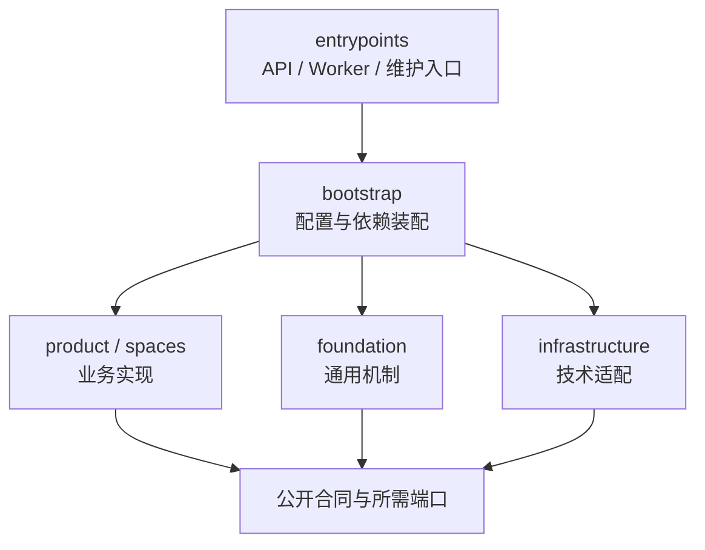

# M1 源码与工程资产组织

> **版本**：v0.12<br>
> **状态**：代码按已批准目录逐增量接线；进度见实施计划<br>
> **维护与评审**：Codex编写及自检，用户审阅<br>
> **写作规范**：[系统设计规范](../../../top/DeerMind_System_Design_Writing_Standard.md)<br>
> **更新日期**：2026-11-16<br>
> **修订说明**：v0.11 → v0.12，登记E01-12交接底座、NATS适配及验证入口<br>

## 1. 范围与维护位置

本册维护正式工程的目录、模块归属、代码依赖和构建边界。编码规则引用[编程规范](Coding_Standard.md)；实际检查入口为`src/m1/scripts/check.sh`及`test.sh`。处理逻辑引用模块设计，物理字段引用数据库分册，HTTP与消息字段引用合同分册。下列树是实现规划，不是已存在文件清单；实现相应能力时创建文件，不先建立空目录。

| 内容 | 唯一维护位置 |
| --- | --- |
| 工程根、后端模块、测试与部署目录、允许依赖 | 本册 |
| Vue入口、业务功能、组件、状态与通信目录 | [客户端§2](Client_Design.md#2-页面组件与状态组织) |
| OpenAPI生成、客户端生成及接口兼容检查 | [API§7](API_and_Message_Design.md#7-openapi与可执行合同) |
| 环境参数、集群部署次序、升级和恢复机制 | [基础设施§5](Infrastructure_and_Deployment_Design.md#5-配置部署与启动) |
| 实现增量、接收案例与实际证据 | [实施计划](Delivery_Plan.md) |

M1沿用一个后端包、API和共享Worker分别运行、一个Vue工程两个入口。后续阶段在本工程继续演进，不复制出第二套M2源码。Evolution、独立OCR、插件市场不创建占位模块。

## 2. 仓库与工程根

```text
仓库根/
├── doc/                                  # 现有产品、系统设计和原型
│   └── mvp/m1/
│       ├── engineering/                  # 正式工程设计
│       └── prototype/                    # 历史交互原型，独立构建
├── src/
│   ├── m1/                               # 本册规划的正式工程
│   │   ├── README.md                     # 安装、启动、测试与部署入口
│   │   ├── .editorconfig
│   │   ├── .gitignore
│   │   ├── server/
│   │   │   ├── pyproject.toml            # 后端依赖、打包、检查配置
│   │   │   ├── src/deermind/             # 唯一可导入的应用包
│   │   │   ├── migrations/               # 业务库Alembic迁移
│   │   │   ├── alembic.ini
│   │   │   └── tests/                    # 后端单元、合同与依赖检查
│   │   ├── clients/                      # Vue 3＋TypeScript＋Vite
│   │   ├── contracts/generated/          # 由代码导出的合同快照
│   │   ├── tests/                        # 跨模块与整系统验证
│   │   ├── deploy/                       # 镜像、Helm、环境与发布
│   │   ├── quality/                      # 独立开发检查依赖锁、前端规则基线及边界检查
│   │   ├── AGENTS.md                     # AI编程入口，只引用规范和执行约束
│   │   ├── scripts/                      # 本地和CI共用的薄入口
│   │   └── ci/                           # 流水线阶段及执行说明
│   ├── spike/                            # 既有试验，仅按清单参考
│   ├── architecture_validation/          # 既有架构试验
│   ├── mvp_foundation/                    # 既有样例与验证资产
│   └── mvp_prototype/                     # 既有旧原型
└── scripts/                              # 既有工具，本轮不移动
```

后端采用Python `src`布局，避免工作目录中的源码掩盖安装包缺文件；开发可用可编辑安装，CI还需验证实际构建包可导入。依据[Python Packaging指南](https://packaging.python.org/en/latest/discussions/src-layout-vs-flat-layout/)。Python依赖锁文件为`server/uv.lock`，由已接收的uv生成，wheel使用Hatchling构建；前端运行依赖锁文件归`clients/`。`quality/`另有开发检查工具锁，仅供lint/类型检查与规则样例，不是第二套应用依赖；同一用途只维护一份锁。

正式工程不导入旧原型、spike或`.tmp`中的模块。复用时登记来源与修改点，将确需代码或小型固定样例迁入所属目录；原测试报告不转成新实现的通过结果。教材整册、学生数据、密钥、PVC内容、备份、镜像和测试录像不入Git。临时输出统一写被忽略的`.artifacts/`或CI产物区。

## 3. 后端源码

所有Python路径相对`src/m1/server/src/deermind/`。模块目录表示代码和数据所有权，不表示独立进程或独立数据库。

### 3.1 产品业务与核心Space

```text
product/
├── public/                     # 产品对外服务、DTO及事件Schema
├── identity/                   # 账号、会话、必要首次确认
├── materials/                  # 上传组织、助手对话、候选采用及入库申请
├── targets/                    # 学习目标定义，不计算掌握结果
├── courses/                    # 章节采用、检查及应用组合
├── learning_spaces/            # 空间身份、采用记录及授权聚合视图
├── operations/
│   └── converse_material_assistant/
├── projections/                # product查询表的确定性转换
├── persistence/                # product表映射与私有存储
└── ports/                      # 来源保护等外部协作端口
spaces/
├── domain/
│   ├── public/                 # 固定引用、统一内容及事件合同
│   ├── definitions/            # Domain、Task、Solution、KC、TaskInstance
│   ├── dependencies/           # Task先导与KC直接检验路径
│   ├── intake/                 # 待入库、复用、新建及提交校验
│   ├── supply/                 # 实例筛选、生成结果检查及保存
│   ├── operations/
│   │   ├── extract_template/
│   │   ├── classify_instance/
│   │   └── supply_task/
│   ├── projections/
│   ├── persistence/
│   └── ports/
├── interaction/
│   ├── public/
│   ├── definitions/            # 四类蓝图、规则、推荐策略及采用配置
│   ├── activities/             # 活动森林、节点、子活动返回
│   ├── conversation/           # 输入、消息、归属、停止及历史查询
│   ├── detection/              # 题单、确认、检测轮及提交
│   ├── proactive/              # 建议、接受、暂缓、拒绝
│   ├── context/                # 学习交流的业务取材
│   ├── memory/                 # 未解决事项、已给提示等业务记忆
│   ├── operations/
│   │   ├── handle_input/
│   │   ├── prepare_detection/
│   │   └── check_proactive_task/
│   ├── projections/
│   ├── persistence/
│   └── ports/
└── evaluation/
    ├── public/
    ├── definitions/            # Claim、方法判据与评价方面
    ├── evidence/               # 来源、范围、资格与证据接受
    ├── belief/                 # 参数校验及确定性概率更新
    ├── goals/                  # 目标对照、结果与发布
    ├── processing/             # 同空间顺序、批结果和失败收尾
    ├── operations/
    │   ├── evaluate_submission/
    │   └── apply_learning_opportunity/
    ├── projections/
    ├── persistence/
    └── ports/
```

`definitions/`与各运行功能目录区分静态配置和动态处理；不强迫不同Space拥有相同业务结构。一个小功能可先用单文件，只有需要拆分时才升级为包。每个模块的`public/`只导出公开协议、DTO、Schema与必要纯值类型，不能在导入时加载ORM、启动连接或创建Agent。实现由装配层绑定；`__init__.py`不批量转出私有模块。

具体功能按需使用`commands.py`、`queries.py`、`rules.py`，而不是全系统建立巨大的`services/`或`utils/`。模块根的`persistence/`统一维护本schema的SQLAlchemy表映射、存取与事务适配；功能目录不复制表定义。纯数值函数不导入数据库、FastAPI、Temporal或模型SDK。

### 3.2 Operation与普通处理

[九项AI Operation](README.md#5-m1-operation总目录)分别对应上树中的九个目录；技术标识`extract_template`保留，使用现行Task/Solution模型。普通查询、保存、活动控制和目标派生留在功能目录，不包装成Operation。

```text
spaces/interaction/operations/handle_input/
├── workflow.py                 # 持久编排、分支和等待
├── steps.py                    # 有I/O的步骤及提交适配
├── context.py                  # 本次输入需要的材料与记忆选择
├── schemas.py                  # AI候选结构，不等于HTTP响应
├── validate.py                 # 候选接受、允许动作及引用检查
└── prompts/                    # 本能力的指令模板，随包发布
```

这是复杂Operation的拆分示例，不要求九项机械复制六个文件。Workflow只组织可重放流程；数据库、文件和模型I/O通过步骤或AI底座的持久适配执行。允许编排文件使用Temporal定义，但不让框架依赖进入纯业务规则。公共Worker只注册这些实现，不拥有业务流程。聊天内检测复用`detection/`的准备步骤，沿用当前执行，不另启一个OperationRun。

Prompt、AI输出Schema和语义样例由业务所有者维护。已应用的蓝图、规则和策略来自正式事件及查询投影，不在Prompt文件里另维护一份后台配置。基础提示模板随构建包包含，CI检查包内资源；不读取开发机绝对路径。

### 3.3 底座、适配与入口

```text
foundation/
├── system/
│   ├── public/                 # 通用信封、授权、事件和执行端口
│   ├── events/                 # 追加、授权读取、序号及Schema登记
│   ├── projections/            # 应用收据、扫描进度、受控重建机制
│   ├── executions/             # Execution、Attempt、Step与受理
│   ├── waits/                  # 条件匹配、期限、唤醒及超时
│   ├── delivery/               # 待发、订阅承接、Relay及失败记录
│   ├── realtime/               # WS协议、watch与结果通知
│   ├── files/                  # 文件身份、固定附件与授权访问端口
│   ├── authz/                  # 通用执行授权，不定义学生业务权限
│   ├── logging/                # 结构化Pod日志
│   ├── persistence/            # runtime schema
│   └── ports/                  # PG、消息、执行与文件适配协议
└── ai/
    ├── public/
    ├── configuration/          # 用途、模型配置与受理快照
    ├── execution/              # 有预算的AI任务及候选交接
    ├── tools/                  # 工具注册、授权、执行与结果记录
    ├── context/                # 通用材料包装与大小检查
    ├── budgets/                # 调用与用量累计
    ├── persistence/            # ai schema
    └── ports/
infrastructure/
├── postgres/                   # engine、连接、session与短事务上下文
├── files/                      # 本地磁盘/PVC文件系统适配
├── nats/                       # JetStream连接及投递适配
├── temporal/                   # Client、Worker注册、Codec及执行接线
├── pydantic_ai/                # 已定Agent框架及持久集成适配
├── model_providers/            # 模型API协议适配
└── credentials/                # 当前有效凭据读取
bootstrap/
├── settings.py                 # 配置载入、类型检查及缺项拒绝
├── services.py                 # 公开服务和私有实现的绑定
├── registries.py               # Operation、普通处理、事件、投影及工具登记
├── transactions.py             # 注入同库短事务；不写业务表
└── metadata.py                 # 汇总六个schema的表元数据，供迁移使用
entrypoints/
├── api/
│   ├── app.py                  # FastAPI工厂与生命周期
│   ├── routes/                 # product/domain/interaction/evaluation/runtime
│   ├── websocket.py            # WS接入；业务动作仍走登记处理器
│   ├── dependencies.py         # 身份、授权上下文及已装配服务
│   └── errors.py               # 共同错误外壳与状态码映射
├── worker/main.py              # 一个共享Worker及受控Relay生命周期
└── maintenance/main.py         # 迁移、初始化、重建等受控命令
```

底座只提供机制。事件payload和业务投影函数由各所有者注册；AI取材与记忆内容由Operation决定。对象存储在文件端口后续扩展，不先编写未启用适配；不保留`recognition/`或独立OCR入口。

HTTP路由调用已装配的公开服务；公共运行按明确入口派发AI工作。Worker启动时汇总业务Workflow、步骤与AI持久适配；注册冲突、遗漏或不兼容直接拒绝启动。API和Worker使用同一后端包与镜像，启动命令不同；维护命令使用同版包及独立维护授权。API启动和导出OpenAPI均不得自动执行迁移。

## 4. 模块依赖与装配



图1：箭头表示代码使用或装配依赖，不表示运行时消息流。端口仍位于所属模块的`public/`或`ports/`，不是另建中央“全部模型”包。运行时通过注入的实现调用；基础设施可以实现端口，但通用底座不反向导入业务实现。

| 代码位置 | 允许依赖 | 检查拒绝 |
| --- | --- | --- |
| entrypoints | bootstrap、模块public及协议适配 | 路由直接SQL、计算Belief、组织Agent业务步骤 |
| bootstrap | 所有待装配实现与登记；metadata只加载表定义 | 装配时创建业务事实、调用LLM、连接隐式默认集群 |
| product / spaces | 本模块实现、底座公开合同、已登记的跨模块公开合同 | 导入其他模块persistence、访问其私有表或直接启动其AI流程 |
| foundation | 自身实现、通用端口与公开底座合同 | 导入Task、活动、Claim等业务实现决定流程 |
| infrastructure | 技术SDK及所实现端口 | 教学策略、评价阈值、章节关联等业务判断 |
| projections | 本模块确定性转换及存储；通用投影上下文 | 模型调用、网络、发送通知、安排历史工作 |
| clients/shared | 自身、生成合同和前端基础库 | 导入admin或student功能、嵌入掌握计算 |

跨模块读取和同库提交协作仍由[总体授权矩阵](System_Design.md#661-最小调用授权矩阵)限制。源码中能导入公开DTO不等于有权读数据：Evaluation只能按获准范围取事件原文；Domain入库通过Product来源保护端口；目标提交通过Product采用保护端口。需异步加工的协作经事件和等待，不以注入端口绕过确认的异步边界。

跨模块端口放在请求方，装配层以提供方公开服务绑定；公开合同不得导入对方实现。共享内容结构由Domain公开合同提供，通用底座把材料视为受约束数据，不因此理解数学语义。依赖检查按模块白名单执行，禁止通过动态导入或SQL绕过。当前直接导入检查已用正反样例验证；E01-03已接入正式路径，并补入口访问和反向依赖拒绝；后续业务路径出现时补相应用例。静态导入检查不代替运行时权限与私表访问测试。

## 5. 客户端与生成合同

客户端完整目录、业务功能和Vue依赖规则只在[客户端§2.1—2.5](Client_Design.md#21-vue工程目录)维护。两端共享一份`package.json`、依赖锁文件和Vite配置；管理员和学生分别有HTML与Vue入口，单独路由和业务状态，共享通信与内容渲染。模块不对应独立npm包。

```text
contracts/generated/
├── http/openapi.json            # FastAPI导出的HTTP合同
├── websocket/                  # command、changed、error等版本化Schema
├── events/                     # 信封、逐事件payload及FactRecord Schema
├── content/                    # 统一内容公开Schema
└── manifest.json               # 来源提交、Schema版本及文件hash
```

上述均为派生产物，不手改；稳定生成快照可提交Git用于审阅和漂移检查。事件Schema源归所有者`public/`，通用信封归`foundation/system/public/`；消息和事件不是OpenAPI接口。浏览器只生成获准使用的HTTP、WS与内容类型，不导入内部事件正文全量模型。完整生成规则见[API§7](API_and_Message_Design.md#7-openapi与可执行合同)。

## 6. 数据表、迁移与配置

```text
server/migrations/
├── env.py                       # 只载入表元数据和迁移配置
├── script.py.mako
└── versions/                    # 一条Alembic发布链、一个head
    └── <revision>_<owner>_<change>.py
```

各模块维护自己schema的表映射；迁移脚本集中排序，文件名标出所有者。涉及多schema的迁移显式列出参与者和顺序，不分成六条互不协调的升级链。`metadata.py`只登记表，不启动API、Worker或外部服务；迁移Job沿基础设施合同执行。Temporal两个内部库使用官方工具，业务Alembic不维护其表。

| 配置或资产 | 归属与生效 |
| --- | --- |
| 技术配置结构 | bootstrap/settings.py与bootstrap/database.py；环境取值来自deploy/environments或本机忽略文件 |
| 蓝图、规则、目标、领域定义 | 所属模块正式数据；初始化也走业务处理和事实事件，不在values.yaml维护第二份 |
| 模型用途与受理配置 | AI底座及正式配置记录；密钥只取当前凭据 |
| 指令模板与AI输出Schema | 所属Operation，随Python包发布 |
| API/Worker依赖 | server依赖清单及唯一锁文件；不分两套版本 |
| 前端依赖 | clients/package.json及其锁文件 |
| 敏感连接、密码、模型密钥 | Secret引用或本地受限文件；Git、OpenAPI和VITE变量均不包含秘密 |

### 6.1 E01-04落地

本批建立`server/migrations/env.py`及首个schema revision；迁移命令位于`entrypoints/maintenance/database.py`。Hatch将迁移目录打入wheel的`deermind/_migrations`；容器无需源码目录。连接配置由`bootstrap/database.py`装配，Engine与版本检查在`infrastructure/database/connection.py`。

首批没有业务表，不建立空的六模块表映射或metadata汇总。后续有表时按本节所有权补入；Alembic生成模板也在需要生成新revision时增加。实际数据库测试位于`tests/migrations/`，由`scripts/test-database.py`在显式集群的临时Pod中使用已构建包运行；部署Job归`deploy/helm/database-migration/`。

### 6.2 E01-05落地

`foundation/system/events/`维护通用登记、批次校验、序号分配和事实保存；不导入Product或Space。`product/accounts/facts.py`将首个固定正文Schema、记录矩阵及其确定性投影放在同一功能文件；`product/accounts/save.py`拥有短事务，`product/persistence/receipts.py`维护普通命令防重。`bootstrap/events.py`汇总登记，业务模块不反向导入装配层。

本批用SQLAlchemy连接执行显式SQL，尚无ORM表映射，不为凑目录添加空metadata。迁移`0002_atomic_facts`固定历史DDL，不导入可变业务模型。`tests/migrations/test_atomic_facts.py`在已构建包与随机PG测试库中验证，`test.sh facts`是显式集群入口。

### 6.3 E01-06落地

`foundation/system/files/ports.py`定义字节存储端口；`infrastructure/files/local.py`处理local/PVC，`records.py`维护文件登记Schema和确定性写入。`foundation/system/events/attachments.py`负责事务外附件准备及FileReceived接线；事件保存器保留外置引用并向投影器提供完整DTO。

迁移`0003_file_objects`独立追加，不改旧DDL；`server/tests/test_files.py`验证文件失败边界，`tests/migrations/test_file_facts.py`经`test.sh files`验证真实PG与PVC。浏览器授权读取、上传租约和Codec不提前建空模块。

### 6.4 E01-07落地

`foundation/system/events/reading.py`维护读取合同与JSON Pointer处理；`query.py`维护固定上界查询、受信用途核验及授权后解引用。所有者在既有facts/records文件登记固定DTO及字段许可，`bootstrap/events.py`汇总已实现的维护读取。不引入通用全文访问或业务空模块。

`server/tests/test_event_pointers.py`验证指针规则；`tests/migrations/event_read_fixture.py`提供隔离的业务授权夹具，`test_event_reads.py`通过`test.sh reads`验证构建包和真实PG。不新增表或迁移，正式浏览器入口随登录及业务功能实施。

### 6.5 E01-08实际接线

`foundation/system/projections/contracts.py`登记维护记录及结果Schema；`rebuild.py`负责固定上界、隔离副本、检查点、原子替换和失败留痕。`bootstrap/projections.py`只装配已有账号投影与代码摘要，业务转换仍在`product/accounts/facts.py`，底座不反向导入Product。

`entrypoints/maintenance/rebuild.py`提供prepare/resume/status三个维护动作，安装命令为deermind-rebuild；`0004_projection_rebuilds`追加控制表。`test_projection_rebuild.py`经`test.sh rebuild`验证构建包与真实PG；不新增API、Agent工具或未实现业务占位。

## 7. 测试目录与执行边界

```text
server/tests/
├── unit/                        # 按product/spaces/foundation镜像组织
├── contracts/                   # Schema、HTTP错误、事件兼容与公开协议
├── architecture/                # 导入白名单、私有存储与纯函数依赖检查
├── packaging/                   # 安装包、Prompt资源与启动登记完整性
└── conftest.py                  # 后端固定依赖和事务替身
clients/tests/
├── unit/                        # composables、输入和通信状态转换
├── components/                  # Vue组件和复杂内容渲染
└── fixtures/                    # 小型授权响应样例
tests/
├── integration/                # PG事务、NATS交接、Temporal与跨Space
├── migrations/                 # 空库升级、既有库升级、失败回滚
├── e2e/                        # 管理员准备→学生学习→评价追溯
├── recovery/                   # Worker退出、重复消息、恢复及投影重建
├── deployment/                 # Helm渲染、目标集群检查及部署后冒烟
├── semantic/                   # AI解析、归类、供题、教学与证据解释
├── capacity/                   # 已批准场景的资源与并发测量
├── fixtures/                   # 共用固定输入、事件链与预期结果
└── support/                    # 临时环境、故障注入及结果采集
```

| 层次 | 依赖与结果 | 默认执行边界 |
| --- | --- | --- |
| 单元、合同、架构、打包、Vue组件 | 无真实模型；固定输入、精确断言 | 普通变更检查 |
| 接线、迁移、恢复 | 隔离PG/NATS/Temporal；可注入模型替身 | 显式测试环境；不碰现有试用数据 |
| 浏览器E2E、部署冒烟 | 同版前后端与隔离配置 | 发布候选接收；记录浏览器及部署身份 |
| 语义质量、容量 | 已批准模型、样例、预算和测量条件 | 单独启用；不在普通提交中自动付费或打生产 |

数值核心样例放`server/tests/unit/spaces/evaluation/`；事件事实重建放`tests/recovery/`，断言业务内容相同且AI调用、通知和新任务为0。HTTP与WS重复写入、跨账号晚到响应、检测求助先关轮、目标依据变化均由现有合同案例转成测试，不新增产品行为。四个教材代表样例从既有资产按清单复用，不扩增本轮解析试验范围；整册验收仍保留原要求。

现有部署及检查器测试使用Python标准库unittest。部署命令替身位于`tests/deployment/fixtures/`，只由测试复制到临时PATH，作为普通Python文件接受类型、格式和人工检查，不把大段可执行代码藏入字符串。Ruff/Pyright、前端静态检查和Shell工具已固定版本并形成统一入口，见编程规范；正式业务测试框架、前端组件测试工具和类型生成器的具体版本仍在依赖接线时确认。建议方向为pytest、Vue官方测试指南中的Vitest＋Vue Test Utils、既有Playwright浏览器工具；本轮不安装。测试源码归本节目录；运行报告、录像、截图及模型输出归`.artifacts/<run-id>/`或CI产物，经过人工确认的设计截图才进入doc。

## 8. 构建、部署与维护

```text
deploy/
├── images/
│   ├── server.Dockerfile        # API、Worker和业务维护命令共用镜像
│   └── clients.Dockerfile       # 两个入口的同版前端产物
├── helm/
│   ├── deermind/
│   │   ├── Chart.yaml
│   │   ├── values.yaml
│   │   ├── values.schema.json
│   │   └── templates/
│   │       ├── api.yaml
│   │       ├── worker.yaml
│   │       ├── clients.yaml
│   │       ├── services.yaml
│   │       ├── ingress.yaml
│   │       ├── configmap.yaml
│   │       ├── files-pvc.yaml
│   │       └── jobs/           # 迁移、初始化、维护按命令显式执行
│   ├── postgres/              # 单实例PG及显式账号/库初始化Job
│   └── temporal-schema/       # 官方Schema工具的显式Job；不使用隐式hook
├── components/
│   └── manifest.yaml          # 上游Chart/镜像来源、版本与校验依据
├── environments/
│   ├── local-wsl/             # 本机values、文件PVC、环境及组件部署说明
│   └── remote.example/        # 远程目标模板，无真实凭据
└── release/
    ├── manifest.schema.json   # ReleaseManifest结构
    ├── checklist.md           # 升级、兼容、恢复前置
    └── runbooks/              # 备份、整套恢复、失败处理操作
scripts/
├── dev.sh                      # 显式启动已选后端或前端
├── check.sh                    # 类型、合同、依赖与静态检查
├── test.sh                     # 显式选择测试层和环境
├── export-contracts.sh         # 导出Schema并生成浏览器客户端
├── build.sh                    # 安装包、前端、镜像及清单
├── check-target.sh             # 只读核对显式集群、namespace与节点就绪
├── deploy.sh                   # 显式目标集群、配置检查及单release发布；迁移单独执行
├── backup.sh                   # 维护窗口整批备份
├── restore.sh                  # 核对后整批恢复
└── lib/                        # 出现实际复用需求后再提取共用函数
ci/
├── README.md                   # 阶段、凭据边界和人工启动条件
├── checks.sh                   # 调用scripts，不复制业务逻辑
├── integration.sh
└── release.sh
```

脚本在已确认的WSL/Linux环境执行；Windows需要入口时仅转发WSL，不维护另一套部署逻辑。CI厂商接线文件由实际平台决定，例如GitHub工作流放仓库`.github/workflows/`，只调用`src/m1/ci/`；本轮不选新CI服务。

Helm沿[官方Chart文件结构](https://helm.sh/docs/topics/charts/)组织。应用、PG、Temporal和NATS保持独立release；不把上游服务源码复制进项目，也不把组件全塞进应用Chart导致每次发布连带升级。迁移Job由薄脚本按已定次序执行，不在API启动或未经控制的Helm hook中重复迁移。

本机API与Worker同节点共享local-path PVC，节点与卷条件写环境values，代码只使用文件端口。远程切换显式传kubeconfig、context、namespace和values；不改变默认context、不自动搬迁数据。部署权限、同源路径及备份恢复规则引用基础设施，不在脚本里发明第二套。

构建输出分为Python安装包、同版后端镜像、两个前端入口的产物/镜像、合同快照和ReleaseManifest。后端镜像还携带同版Alembic脚本和配置，维护Job不依赖开发机源码；生产镜像不包含测试数据和本地秘密。实际digest、依赖hash、Schema head、Workflow和事件解码版本在构建时生成，归发布产物；模板可入Git，真实凭据和备份不入Git。回退应用镜像不等于回退数据库或历史事件。

## 9. 实现接收与保留事项

| 检查 | 接收条件 |
| --- | --- |
| 模块落点 | 九项Operation、普通处理、六个schema及事件投影均能定位；没有额外AI Operation |
| 依赖 | 公开合同与实现分开；无跨模块私表访问、底座业务反向导入或前端共享层反向依赖 |
| 合同 | OpenAPI及消息Schema可重复导出；生成客户端无手改；现有60条HTTP路由、6个WS动作逐项对应 |
| 打包与部署 | 安装包包含Prompt；API/Worker同版；两个前端入口独立启动；部署显式选择目标 |
| 测试 | 四层验证及恢复、迁移、权限案例均有位置；真实模型测试单独启用 |
| 历史资产 | 正式构建不引用旧原型或试验运行目录，既有资料不因整理被删除 |

尚待接线确认：Python锁定工具、Vue路由/状态库、类型生成器、测试工具的版本、CI平台和原有组件/资源参数。它们不改变本册责任边界，不因目录中出现文件名而自动获得批准。新增类型生成工具只承担构建工作，不引入新后端服务。

## 10. 参考与裁剪

| 资料 | 本项目采用 |
| --- | --- |
| [FastAPI全栈模板](https://github.com/fastapi/full-stack-fastapi-template) | 后端、前端、测试与部署资产共同组成工程；不采用其业务模型与前端技术栈 |
| [Apache Superset](https://github.com/apache/superset) | 独立前端、数据库迁移、测试、脚本与Helm资产；不照搬其全部模块 |
| [DeepTutor依赖检查](https://github.com/HKUDS/DeepTutor/blob/main/.importlinter) | 明确禁止反向导入，用自动检查维护边界 |
| [Temporal Python样例](https://github.com/temporalio/samples-python/blob/main/hello/hello_activity.py) | 区分Workflow、Activity与Worker注册；业务能力仍归DeerMind模块 |

资料于2026-11-15核对。目录及模块细分是结合DeerMind合同作出的项目设计，不宣称官方规定唯一目录模板。

### E01-12事件交接接线

`foundation/system/delivery/`维护固定通知/收据合同、原子发布安排、承接去重、失败留痕及受控重送；`infrastructure/nats/`封装SDK、资源核对和Worker桥接循环。`bootstrap/messaging.py`登记当前业务订阅，`bootstrap/events.py`接入生产者发布安排；底座不导入业务模块。

Worker只绑定已初始化的消息资源。`entrypoints/maintenance/messaging.py`提供初始化和获准重送；`scripts/prepare-messaging-secret.py`在显式集群中补齐维护/应用凭据。`test.sh delivery`通过构建镜像、随机PG库及随机NATS流验证，不登记假的生产业务订阅。

## 修订记录

| 版本 | 日期 | 修改 |
| :--- | :--- | :--- |
| v0.1 | 2026-11-15 | 完整工程目录、模块依赖、合同/迁移归属、测试和部署规划；未创建源码 |
| v0.2 | 2026-11-15 | 登记E01-01实际目标检查入口及增量建目录原则；不创建应用或客户端占位 |
| v0.3 | 2026-11-15 | 登记E01-02部署脚本、组件Chart和测试入口；不创建应用占位 |
| v0.4 | 2026-11-15 | 落实编程规范和独立开发检查工具；不建立E01-03应用，见决定登记§107 |
| v0.5 | 2026-11-15 | 登记部署命令夹具及可读性评审要求，不创建后续应用；见决定登记§109 |
| v0.6 | 2026-11-15 | 落实E01-03后端包、双入口客户端、镜像与应用测试；不建立后续功能占位 |
| v0.7 | 2026-11-16 | 登记首批迁移脚本、wheel打包和数据库验证入口 |
| v0.8 | 2026-11-16 | 登记E01-05事件登记、所有者投影和收据代码位置 |
| v0.9 | 2026-11-16 | 补齐E01-06文件端口、适配、附件准备及测试位置 |
| v0.10 | 2026-11-16 | 补齐E01-07读取合同、查询实现和授权测试位置 |
| v0.11 | 2026-11-16 | 登记重建合同、实现、白名单装配及维护测试位置 |
| v0.12 | 2026-11-16 | 登记E01-12交接底座、NATS适配及测试入口 |
