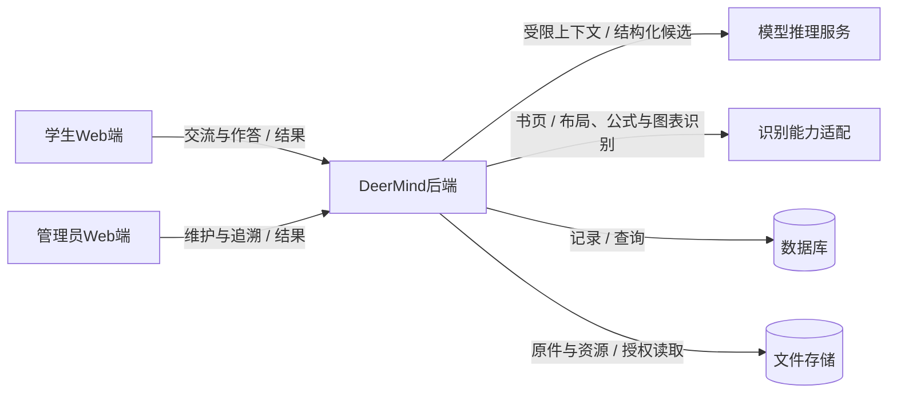
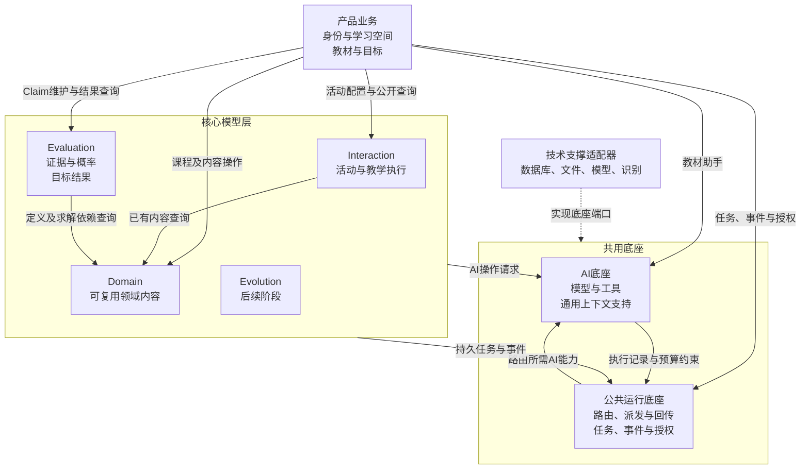
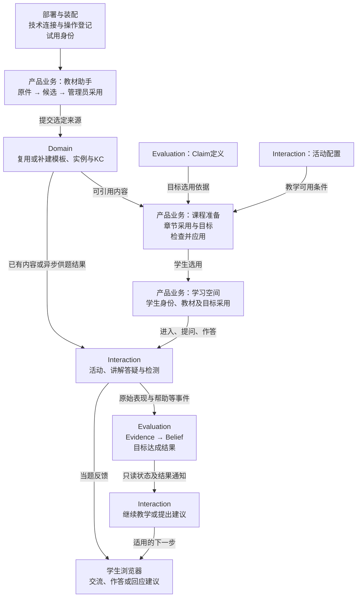
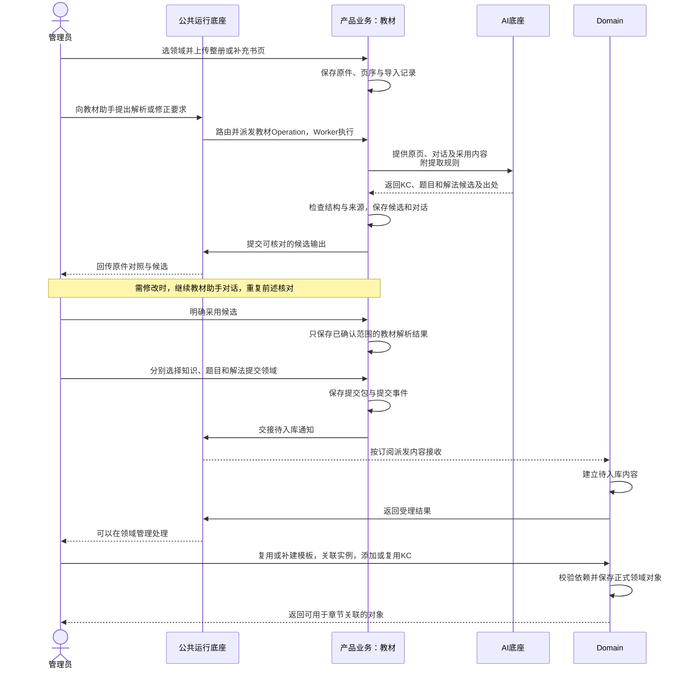
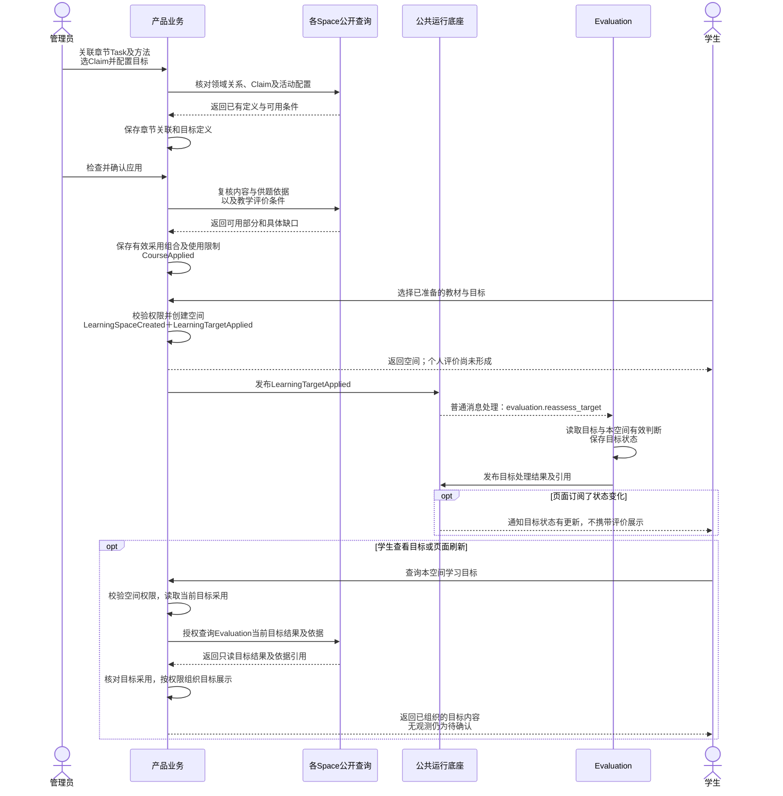
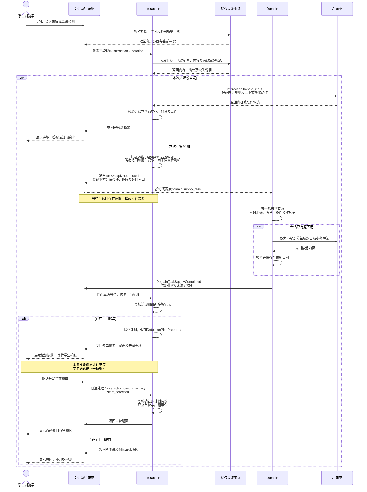
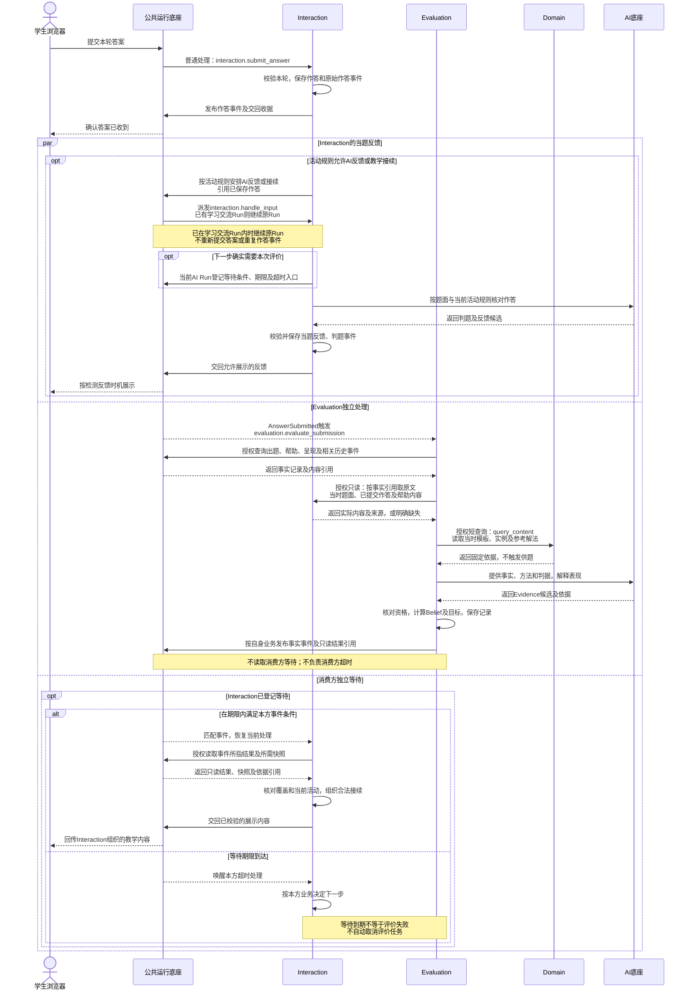
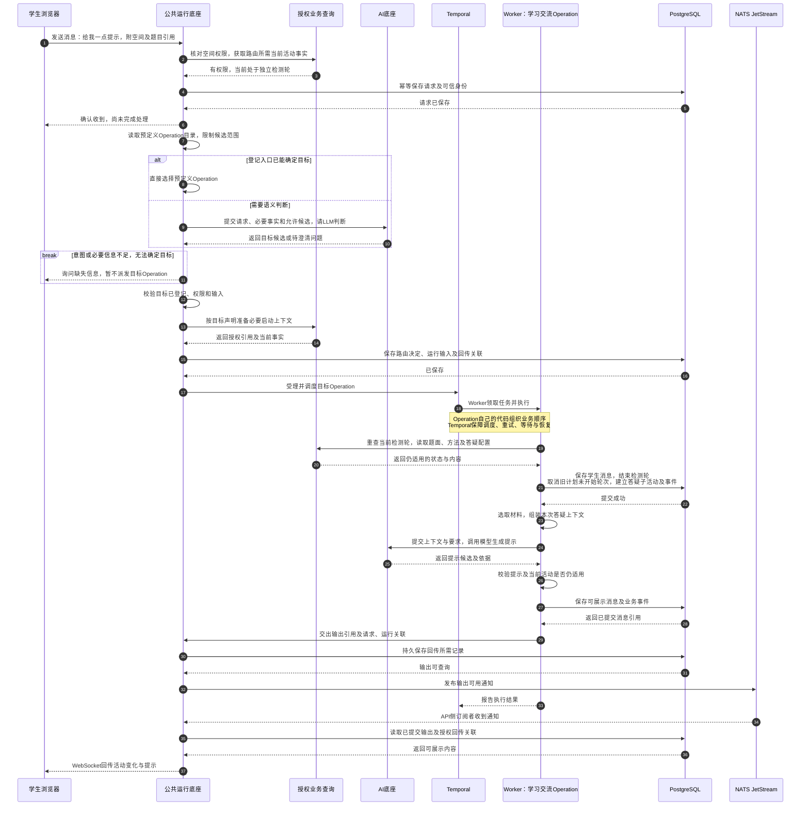
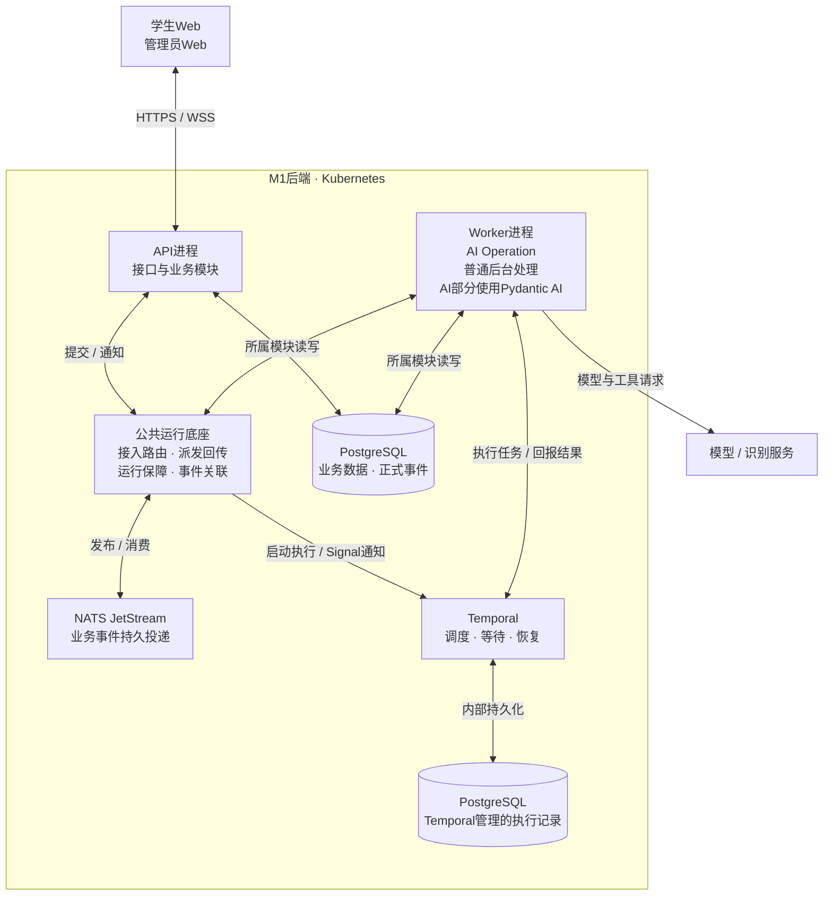
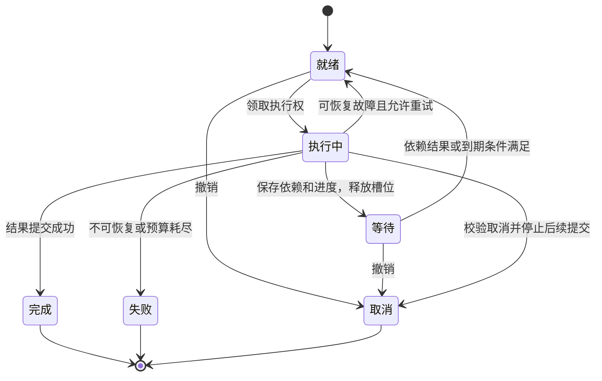

# M1 系统总体设计

> **版本**：v0.38<br>
> **状态**：文档修订待用户审阅；本轮未修改原型或实现真实服务<br>
> **维护与评审**：Codex编写及自检，用户审阅<br>
> **写作规范**：[系统设计写作规范](../../../top/DeerMind_System_Design_Writing_Standard.md)<br>
> **更新日期**：2026-11-14<br>
> **修订说明**：v0.37 → v0.38，在总体评价合同明确候选范围的责任链与扩展禁区；逐文件记录见MVP决定登记§69<br>

M1采用**一个代码仓库、一套模块化后端，API与Worker分别运行**；后端使用Python＋FastAPI，前端使用Vue 3＋TypeScript＋Vite，见[登记§61](../../DECISIONS.md#61-m1代码组织与前后端框架)。产品业务与核心Space分别组织代码；AI底座提供模型、工具及上下文处理的通用能力，公共运行底座负责接入、路由、派发、运行保障、事件和输出回传。Space边界是代码与数据所有权边界，M1不按Space分别部署微服务。

产品输入见[工程入口§2](README.md#2-设计输入与历史参考)。确认范围和未决项统一由[§7.2](#72-总体架构问题清单)维护，决定过程见[登记§67](../../DECISIONS.md#67-operation限定为ai业务能力)。本轮纠正Operation的范围，区分AI能力与普通处理；具体接口及执行映射仍待审，未定机制按§7.2.3交接。

**图表索引**

| 图 | 内容 | 正文合同 |
| --- | --- | --- |
| 图1 | 系统上下文 | §2 |
| 图2 | 模块与依赖 | §3.1 |
| 图2A | 端到端业务协作 | §4 |
| 图3 | 教材解析与领域入库 | §4.2；产品业务§3、Domain§2 |
| 图3A | 课程应用与学生选用 | §4.2；产品业务§4–5、Evaluation§5 |
| 图3B | 学习输入、统一供题及确认开测 | §4.3；Interaction§4.1／2.1、Domain§5.2 |
| 图4 | 当题反馈、取材与掌握状态更新 | §4.3；Interaction§4.2、Evaluation§2／5 |
| 图4A | 独立检测中求助 | §4.5；Interaction§2.1／6.3 |
| 图5 | 运行组件与职责 | §5.2 |
| 图6 | OperationRun后台执行状态 | §5.2 |

图中区分AI Operation、普通处理及授权短查询，不展开接口字段；事件名称和使用方统一见[工程入口§6](README.md#6-跨模块事件目录)。

## 1. 设计目标、范围与约束

### 1.1 本次设计要支撑的交付

| 交付约束 | 架构上的处理 |
| --- | --- |
| 指定北师大六上数学教材整册导入、核对与建模 | 保留原件，按导入和章节保存解析进度；教材助手、领域入库、章节采用分别提交，局部失败不要求重来整册 |
| 学生在浏览器讲解、提问、检测 | 学生Web客户端连接同一后端；活动和消息保存在服务端，页面关闭不销毁学习活动 |
| 每个学习空间一条持续对话、多个活动树 | Interaction维护活动父子关系和当前执行位置；教材浏览不改变活动或限制自然提问 |
| 根据表现更新能力判断、目标结果及后续任务 | Evaluation解释证据并运行确定性计算；Interaction读取有效结果决定教学，等待只约束依赖该结果的动作 |
| 管理员看清内容、活动、事件和判断依据 | 模块提供授权查询；公共事件保存发生事实，Evaluation提供Belief→Evidence→来源事件的查询 |
| M1控制复杂度 | 复用一套Agent机制和持久执行机制；Evolution、错误评价纠正、历史重算及跨版本迁移平台留到M2/M3；学习用时功能后续再规划 |

“四分之一”用于核对运行链，不能替代整册交付。教材暂以用户提供的链接为准，版权页和版次确认不阻塞上述机制设计。原型是交互参考，mock答案、概率和预写分支不作为生产实现。

M1不开发学习用时统计、跨空间累计、30分钟提醒、空闲判断或补记。事件时间、保持检测的间隔及后台执行超时仍须保留。M1在学生再次进入学习空间时检查保持检测条件，离线时不运行后台保持检查或提醒。

### 1.2 仍需确认的实现条件

- **部署条件：** 已确定生产采用Kubernetes，运行组件见§6.1；集群资源、网络、模型服务与试用预算在基础设施接入前确认；按§1.3已确认规模设计，实际承载能力及响应时限仍待实测。
- **终端条件：** 学生端和管理员端均通过电脑浏览器交付与验收，不交付原生安装包或要求平板真机验收。支持的浏览器及版本、窗口条件在客户端设计中确认；不默认承诺所有浏览器或移动设备兼容。
- **设计接收：** 本轮确认结构与关键取舍；接口、权限、恢复和数值函数的具体合同完成后，才接收相应模块进入实现。

### 1.3 已确认的试用与容量验证假设

首批试用总人数上限按100人，由用户控制试用名额。第一轮容量验证覆盖10名学生同时学习，期间允许管理员导入教材；同时检查学习对话、检测及其评价与教材后台处理争用资源的情况。决定来源见[登记§38](../../DECISIONS.md#38-m1首批试用与并发验证规模)。

100人是试用总人数，10人是同时学习的验证规模，两者均不等于并行Agent、LLM请求或worker数量。这是已确认的设计与验证假设，不是实测容量，也不自动成为客户端限额或自动限流功能。具体资源分配机制、请求节奏、模型费用、可接受等待与部署资源仍须讨论和验证；组件选型另见§6.1，不由人数直接推导。

M1不区分教学、评价与教材解析的资源优先级，不建设专门的资源预留、抢占或降速调度；没有可用资源时直接返回错误并提示。见[登记§55](../../DECISIONS.md#55-m1资源不足的简化处理)，覆盖此前§39的教学优先决定。发现资源不足时不能伪报已受理或处理中；已受理工作保留输入和已完成结果，按既有失败与恢复边界记录、回传。具体资源不足信号和错误接线留待详细设计，不在本轮设置限额数值。

## 2. 系统边界与外部连接

**图1：系统上下文。** 箭头表示请求及其返回内容，存储位于受控部署环境；模型API统一经AI底座接入，教材Agent负责解析与对话修正，M1不单独接入OCR。



| 外部能力 | 传入与返回 | 失败时保留什么、停止什么 |
| --- | --- | --- |
| 模型推理 | 指定范围的文本、图像、结构化对象与工具描述；返回候选内容或工具调用建议 | 保留输入、执行身份及已有结果；本次生成或解释失败，不伪造答案或扣减能力概率 |
| 教材多模态解析（沿用模型API） | 原页及页序；返回带出处的内容块、公式、图表候选与缺口 | 保留原页和已解析部分，教材助手可补充取材；缺图不能当成纯文字题继续正式采用 |
| 文件存储 | 原件、派生图像、结构化展示资源的写入和读取 | 未完成的上传不能标为可解析；资源不可读时指出影响范围，不能只剩文本却报告内容完整 |

图中的识别能力适配沿用统一模型API；M1不单独接入OCR，教材Agent解析与对话修正见§6.1.2。四例试验及整册验证检查实际质量，不把Agent声明完成视为验证通过。Operation负责选择和检查发送给模型的内容；底座只使用允许的模型服务并保护凭据，不增加材料标记和内容审查，见§6.6。模型凭据不发给客户端。文件下载同样校验资源归属，不能凭文件路径获得访问权。

## 3. 分层、模块与数据所有权

### 3.1 分层与允许依赖

**图2：后端代码依赖。** 实线指向允许使用的公开合同，不表示跨空间同步启动加工。各Space通过公共事件与结果合同协作；技术适配器实现上层端口。客户端入口和依赖装配未画入本图。



技术适配器也实现产品业务和各Space的存储端口，图中省略这些重复连线；业务存储并非全部经底座代理。核心到共用底座的连线只代表M1三个模块，Evolution仅标规划位置。AI与公共运行之间的箭头表示所需公开能力，具体装配与模块内部依赖按A02在详细设计讨论，不据此建立循环导入。

已有内容或已发布结果可通过授权短查询读取。跨Space需要新加工结果时，提交事件，由接收方创建自己的工作，再发布结果通知；调用方保存依赖并释放执行资源。Interaction不调用Evaluation的计算入口，Evaluation不回调教学逻辑。按用途和接触条件供题统一通过异步`domain.supply_task`，无论最终使用已有题还是生成新题；直接读取既定题面或参考仍是短查询，不触发供题判定。

核心需要学习空间资料时，产品业务提供只读输入：身份、空间、教材采用范围、目标条件及依据标识。后台恢复时，通过装配入口注入的只读查询函数重查权限和必要条件，已开始活动仍读取当时保存的依据，不能被当前新定义覆盖；核心不导入产品业务的数据库对象。底座执行已注册的模块处理函数，注册由装配入口完成；底座不导入具体Space；它按普通入口映射及AI Operation说明、授权上下文和候选约束完成路由。选定后的教学分支由Operation决定，不能在路由器中再实现一套教学流程。

### 3.2 数据归属：定义和运行分在模块内部

| 模块及建议代码名 | 定义／可复用内容 | 运行记录与写入责任 | 主要公开入口建议 |
| --- | --- | --- | --- |
| 产品业务 `product` | 账号关系、教材与章节、教材采用Task／Solution、学习目标条件 | 导入对话与候选、导入记忆与摘要、采用记录、学习空间选用 | `receive_material`、`converse_material_assistant`、`apply_course`、`open_learning_space`等；完整合同见产品业务设计 |
| Domain `domain` | Domain、Task、Solution、KC、依赖、TaskInstance及题内参考解法 | 入库处理、内容校验与生成结果；不保存学生作答 | `save_definition`、`extract_template`、`process_intake`、`save_instance`、`supply_task`等 |
| Interaction `interaction` | 四类活动蓝图、节点、两层规则与推荐策略 | 活动森林、消息、对话记忆与摘要、检测轮、实际帮助、主动任务 | `handle_input`、`submit_answer`、`record_presentation`、`continue_after_result`等 |
| Evaluation `evaluation` | Task Claim、判据、试用数值参数 | 评价处理记录、Evidence、Belief、目标结果及只读发布 | `manage_claim`、`evaluate_submission`、`apply_learning_opportunity`、`reassess_target`、`query_basis` |
| AI底座 `ai` | 调用协议、工具描述、通用材料处理与预算机制 | 模型调用、工具结果及本次调用的材料清单；业务记忆归所属模块 | `execute_ai_task`、`assemble_context`为既有工具草案；按调用方要求执行，不自行取材或保存业务记忆 |
| 公共运行 `system` | 普通处理与AI Operation登记、路由、事件、结果与依赖及授权执行合同 | 请求与路由记录、持久任务、尝试、事件、结果引用及等待记录 | `read_result`、`read_publication`、`register_wait`、`cancel_wait`、`publish_result`；其余操作待细化 |

目录用`module.verb_snake`定位所属合同，其中只有AI业务能力称为Operation；普通API、消息处理和只读查询另列，见[工程入口§5](README.md#5-m1-operation总目录)。标识不预定HTTP路径或消息Schema。`product`内部按业务拆模块，不建立拥有所有数据的“大服务”。

**Operation是一项AI业务能力**，例如教材解析、智能供题、学习交流或证据解释。它组织上下文、模型／工具、业务步骤及结果校验；一次执行记录为OperationRun。普通查询、保存、活动控制及确定性目标对照通过API或消息处理，不因多步骤、异步或使用Temporal就成为Operation。AI能力内部可有确定性步骤和结果复用，不要求每次都调用LLM。蓝图节点、解法步骤、单次模型调用和持久Step不一一对应，共同边界见[公共运行§1.3](System_Foundation_Design.md#13-operationstep与operationrun)。

Domain保存Task、Solution、KC及TaskInstance；具体参考解法是题目内容，不是独立实例或学生过程。Solution直接关联多个KC，Task以带理由及方法条件的先导关系表达学习依赖。章节采用Task和方法，KC只按选定方法直接汇总；Claim绑定领域Task，目标结合教材范围选用Claim和方法。学生Belief归Evaluation，同一空间中的目标状态也由它派生。

定义和运行记录可以引用同一套标识，但分别维护：例如Interaction读取蓝图定义创建活动实例，活动保存实际使用的依据。子活动使用自身配置，不因嵌套自动继承父活动规则。M1记录实际依据和必要修订标识，不因此增加发布审核、历史迁移或Evolution服务。

#### 3.2.1 聊天消息与空间事件分开存储

聊天相关事件是空间事件的一部分，**聊天消息与事件记录是不同对象，分开存储、通过引用关联**。本边界按[登记§60](../../DECISIONS.md#60-聊天消息与空间事件分开存储及总体收口检查)确认。

| 对象 | 保存什么、用于什么 | 所有权 |
| --- | --- | --- |
| 学习空间聊天消息 | 学生和助手的正文、内容块及活动归属，供对话显示与历史定位 | Interaction维护，按授权提供查询 |
| 空间事件 | 消息收发、作答提交、内容呈现、活动变化、Belief及目标更新等已发生事实，供订阅、查询和追溯 | 业务模块定义事实与归属；公共运行底座追加保存并提供授权查询 |

- **通过引用关联：** 事件引用相关消息、活动和业务结果；消息正文不作为事件载荷中的第二份聊天记录维护。事件仍保存自身必要事实，不退化为空指针。一次消息可以关联提交、判题、呈现等多个事件；没有聊天消息的业务变化也可以产生事件。
- **按用途读取：** 聊天历史从消息记录读取，空间事件列表从事件记录读取。Evaluation先查来源事件，再沿引用通过内容所有者的授权查询取得当时题面、原始作答和帮助内容；不直接读取Interaction私有表或用摘要代替原文。能读取事件不等于获得所有被引用内容的访问权。
- **保存与恢复：** 分开存储不拆散既有可靠提交要求。消息、事件及关联须按§6.5可靠保存，不能留下可查询事件却丢失已受理正文，也不能因重试多出一条相同消息。事实引用必须能追到当时内容；本轮不新增消息编辑、删除或清理权限。
- **部署边界：** 可以共用PostgreSQL，分开管理记录，不要求拆成两个数据库。公共运行保存的请求及恢复输入服务于执行保障，不代替所属模块的正式聊天记录。管理员教材助手对话仍归产品业务，不混入学生空间。

具体存储结构、引用字段和查询协议留待详细设计；聊天、正式事件与技术日志不共用清理规则，事件继续只增不删不改。

### 3.3 全局事件与可靠交接

跨Space协作的职责已确认，见[登记§41](../../DECISIONS.md#41-跨space评价接续的职责分工)。以提交作答后的评价接续为例：

| 责任方 | 负责什么 |
| --- | --- |
| Interaction | 保存作答和事件，负责当题反馈；自行决定等待哪些事件、等多久，以及命中或超时后怎样继续 |
| Evaluation | 订阅原始事实，独立形成Evidence、更新掌握状态及目标，按自身业务发布事实事件和公开结果；不读取Interaction的等待条件或期限 |
| 公共运行底座 | 提供事件发布订阅、条件匹配、等待计时和恢复；匹配事件或期限到达时，进入消费方登记的处理入口 |

生产方与消费方的工作独立：消费方停止等待不终止生产任务，等待超时也不证明生产失败。双方共享[事件目录](README.md#6-跨模块事件目录)登记的事件含义与关联事实约定；生产方不承担逐个回应等待者的责任。完整边界见§7.2.1三。§6.5的受理与提交保障已确认；具体事务组织、关联字段及故障接线仍待设计。

公共运行机制提供一处事件追加和授权查询能力。事件含义及载荷由生产模块定义：Interaction产生出题、作答、判题、帮助和活动变化，Evaluation产生Evidence、Belief更新及目标计算结果，产品业务产生教材采用等事实。事件可以按学习空间归集；教材导入、账号维护等无学习空间的事件使用自身资源归属，不能塞入任意学生空间。

业务持久化保留**当前状态与不可变事件记录**，不要求回放全部事件重建系统。执行恢复由Temporal承接；业务OperationRun与其运行历史的映射另行设计，不另设自建领取队列。PostgreSQL中的业务提交与NATS投递仍需通过待发记录可靠交接，不能假定两者天然原子提交。以下顺序说明受理、执行与交接关系，沿用§6.5；具体事务拆分仍待审：

1. 入口校验身份、输入和当前状态；短事务保存本次输入、事实事件和待投递记录，提交后返回收据。仅涉及本模块的后台操作可同时登记本模块任务。
2. 事件消费方按处理合同去重，通过公共运行适配受理对应工作流；消息确认与工作流可靠受理的交接待详细设计。生产方不再为同一事实重复建立消费方任务。
3. 执行器读取已保存输入，在事务外完成模型或外部服务调用，不持有数据库事务等待外部返回。
4. 结果提交时重新检查状态和执行权；共同保存模块结果、对应事件、发布结果引用及待通知记录。通知失败可重发，不能先发成功通知再保存结果。
5. 公共运行按消费方登记的事件条件匹配和唤醒，或在其期限到达时唤醒超时处理；消费方授权读取所需结果后决定接续，客户端按收据补查。稳定业务身份和唯一约束防止重复提交，模型调用ID不能代替作答或教学机会的去重身份。

全局事件记录事实，持久任务表达“还要做什么”。作答事件由Evaluation订阅后建立一份评价工作；事件查询、结果读取和等待登记均不触发第二份评价。订阅的事件类型由模块声明，不能把Belief更新事件再次当作新作答评价。

事件信封至少承载身份、生产方、类型、资源归属、发生／记录时间和因果引用；完整字段及追加权限在[公共运行§2–4](System_Foundation_Design.md#2-全局事件的追加与查询)定义。事件只追加；模块当前状态可按合法操作改变。M1无人工改概率或改达标结果入口。

### 3.4 Agent、上下文和记忆

上下文是一次AI调用实际使用的材料；记忆是后续工作可取用的历史记录及派生摘要。**业务Operation决定取材、组装和记忆保存，AI底座只提供通用能力。** 本边界已确认，见[登记§51](../../DECISIONS.md#51-operation负责上下文与记忆)。

- **Operation：** 按本次工作选择正式数据、历史及来源，组织上下文；决定是否生成摘要、摘要要求、保存内容及后续使用。记忆归所属业务模块，通过共用存储能力读写。
- **AI底座：** 提供模型调用、工具执行及通用材料处理，执行调用方给定的要求。代码不内置学习空间、活动、题目等业务概念，不根据用途名称自行推断取材范围或保存记忆。
- **摘要：** 语义摘要可调用LLM，保存与查询不要求调用LLM。M1按需在所属Operation内部完成摘要步骤，不将每次摘要或模型调用另建为Operation；调用多少次、何时摘要仍待详细设计。
- **公共运行底座：** 按已登记声明准备路由及启动所需材料；目标Operation启动后，自行组织业务上下文。运行底座承接派发、事件、等待恢复和回传，不接管业务记忆。

| AI工作 | 所属Operation的责任模块 | 由Operation组织的主要上下文 | 程序接受结果前检查 |
| --- | --- | --- | --- |
| 教材助手 | 产品业务的教材模块 | 原页、明确引用、当前解析结果、导入对话 | 内容结构、来源、编号与引用；候选须经管理员采用，不能直写Domain或章节关联 |
| 学习助手 | Interaction | 当前活动路径、规则、可用动作、目标、领域内容、相关对话和有效判断 | 节点转移、求助顺序、内容与权限；策略未命中仍可在规则内提出动作 |
| 证据解释 | Evaluation | 原始作答／教学事实、帮助、题目方法、判据及资格所需背景 | 来源、方法与方面归因、资格与重复；已有概率不能诱导本次表现解释 |

三者共享执行框架，历史与摘要按各自授权范围取用。Operation保留摘要来源；原始事件只追加，摘要可更新或重建，不能代替正式状态。由Operation保证本次所需规则与事实进入上下文；必需材料缺失或容量不足时，由其补取、澄清或缩小处理范围，不能静默删掉强制规则。结构化显示、公式和图表按内容合同渲染，LLM输出不能直接作为可执行页面代码。

Evaluation将Belief发布为“学习者掌握状态”的只读快照，仍是唯一写入者；目标达成结果单独发布。Interaction按当前任务取相关分项，保存所用快照引用；不在记忆库维护第二套概率。快照内容及发布合同见[Evaluation§5](Evaluation_Space_Design.md#5-评价数据与公开接口)，取用与刷新见[Interaction§3](Interaction_Space_Design.md#3-学习助手的决策与提交)。

同一学生可以同时有学习助手等待、评价解释运行及教材后台处理。执行资源只在实际运行时占用；等待依赖时保存位置并释放执行槽，恢复后可以由另一执行器承接。M1暂不建设动态插件市场，工具以程序注册且授权的操作进入框架；替换模型连接不等于放宽工具权限。

### 3.5 公共运行底座与Operation的职责

公共运行底座接收API或消息，明确普通入口直接交所属处理器，需要AI业务能力时才派发已登记Operation；进度和结果按原请求回传。两类处理都由所属模块组织业务、校验和提交。底座不逐步决定“先结束检测、再讲解”等行为，也不要求普通业务先经过Agent。

| 责任 | 公共运行底座 | 产品业务与Space |
| --- | --- | --- |
| 接入与路由 | 核对可信身份与资源范围；执行自己的路由函数；校验候选操作及输入 | 登记普通处理器与AI Operation各自的用途、入口和必要输入；提供授权查询及业务校验 |
| 上下文与留痕 | 按声明准备路由和启动上下文，保存请求、路由结果、运行与回传关联 | Operation决定取材、组装及记忆保存；执行时重读可刷新的状态；正式业务数据由所有者提交 |
| 派发与执行 | 普通入口按登记执行；AI Operation交Temporal调度；普通后台任务按需要复用执行保障 | Worker执行所属模块的AI流程或普通后台处理；只有AI部分使用Pydantic AI |
| 事件与等待 | 封装NATS发布订阅，按消费方条件匹配事件、计时并唤醒相应入口 | 生产方发布自身事实；消费方定义等待条件、期限及命中／超时处理；各模块处理自己的执行失败 |
| 分层重试 | 提供调度及执行恢复，承接各层期限、状态、累计资源约束 | 各层只管理自己的重试；上层根据下层真实结果决定是否再尝试 |
| 提交与去重 | 提供持久提交和技术重复识别能力 | 决定哪些数据必须一起生效，识别同一次业务表现；Evaluation防止重复更新同一Belief分项 |
| 输出回传 | 持久关联进度／结果与原请求，经API发送到有权限的前端；不再调用AI反向猜测目标 | 生成和校验可展示内容及活动变化；生成成功不等于学生已经看到 |

同一执行调用链内，各层独立重试，下层执行与重试总预算受上层分配的执行期限约束，累计耗时和费用不因重试清零。跨Space独立工作的等待期限由消费方决定，不作为生产方的执行期限传入；讲解停止等待评价，不表示评价失败或必须停止。具体期限、重试参数和取消协议待讨论。

M1只保留预置并统一发放的试用账号、简单登录、固定学生／管理员角色、本人空间隔离及后台受限执行身份。产品业务维护账号和必要确认记录，Space定义资源规则，底座执行授权检查。自助注册、完整亲子关系管理、自定义角色／权限配置、复杂找回及单点登录后置；认证组件尚未选定。

职责已确认，路由算法、提交与补发、重复处理和跨层期限的具体机制仍待讨论，见[公共运行§7.2](System_Foundation_Design.md#72-尚待落实的技术设计)。

## 4. 主流程的跨模块协作

本节沿已确认的职责串起主流程。图中AI Operation对应工程目录；普通处理、授权查询另行标明，不因出现在图中成为AI能力。已确认的协作选择见§7.2.1，剩余选择及承接安排见§7.2.2，接口、事务与重试机制不在本节定案。图中“保存消息及事件”表示所属模块保存消息、通过公共运行追加事件的业务提交，不表示同一份记录或同一个存储所有者，边界见§3.2.1。

**图2A：从内容准备到教学接续。** 方框写处理者和产物，箭头表示业务交接，不表示同步函数调用。Interaction的两个方框表示同一模块先后参与处理。短查询和普通保存可在API执行；需后台执行、等待或恢复的操作，经公共运行底座交Temporal调度，由Worker运行所属模块代码。图中省略这一共用路径。



| 流程 | 输入与可检查的交付结果 | 主要责任位置 |
| --- | --- | --- |
| 启动与准备身份 | 部署配置和试用名单 → 可接入的服务、受限身份；内容尚未准备不能报告可教学 | §4.1；基础设施、公共运行、产品业务 |
| 教材解析与领域融合 | 原件和管理员对话 → 已采用内容、正式领域对象及来源 | §4.2图3；产品业务、Domain、AI底座 |
| 课程应用与学生选用 | 章节方法、Claim和目标 → 可选组合、个人学习空间、待评价的目标状态 | §4.2图3A；产品业务、Evaluation、Interaction |
| 学习与检测 | 当前输入及活动 → 可展示内容或已开始的检测轮；新题须先由Domain保存 | §4.3图3B、§4.5；Interaction、Domain、AI底座 |
| 评价与接续 | 作答及关联事实 → Evidence、分项概率、目标结果；Interaction自行决定下一步 | §4.3图4、§4.4；Evaluation、Interaction |

### 4.1 初始化与身份准备

1. **部署入口准备技术连接。** 启动PostgreSQL、Temporal、NATS JetStream、API和Worker，注入文件存储及各类Agent的模型API配置；教材识别与对话修正沿用多模态模型API，不单独配置OCR服务。分别报告连接和能力是否可用；未配通模型不能报告AI功能就绪。副本、凭据管理及启动工具在部署设计中确认。
2. **装配入口连接模块。** 将普通处理入口、预定义AI Operation、事件订阅、授权查询和AI工具交给对应底座登记。公共运行底座据此接入、路由和派发；具体目录、代码装配与启动检查方式仍待A02／A05确认。
3. **产品业务准备身份。** 预置并发放试用账号，保留固定管理员／学生角色、本人空间隔离和必要使用确认。M1不在本流程建设完整亲子管理或复杂账号找回。
4. **管理员准备教学内容。** 通过所属模块维护Domain、活动蓝图与规则、Claim、教材及目标。领域允许从空模型开始，通过手动维护和教材入库逐步补齐；服务启动不要求先完成整册建模。
5. **学生登录并选用。** 产品业务校验身份、使用条件及可用组合；没有组合就返回尚未准备，已有空间则恢复其引用与页面。首个真实学习输入仍须核对当时权限和使用条件。

配置先由受保护的部署入口承载，不新增AI配置页面。连接检查、内容可用检查和教学质量验证分别进行。M1整册建模的交付要求保留，不因允许逐步准备而缩小验收范围。

### 4.2 教材准备到学生选用

**图3：教材助手与领域入库。** 产品业务的教材Operation在Worker中运行时调用AI底座；管理员采用、领域处理等短请求仍经API进入所属模块。图中省略HTTP适配，公共运行代表API／Worker共用能力，不新增中央业务服务。



教材助手只修改候选；管理员采用不等于Domain入库。Domain可调用AI底座提出模板候选，再由管理员确认；需要后台执行的提取工作同样经公共运行派发。题目可以不带教材解法入库，具体解法作为TaskInstance的参考内容保存，关联Solution并保留来源。章节最终选用Task和Solution，KC按所选方法直接汇总。原图、表和公式的语义内容随所属模型元素保存，原件仍作为核对来源。

**图3A：课程应用、个人空间与初始目标。** 各Space公开查询只读取已有定义、配置或已形成结果，不同步启动新计算。产品业务通过该入口读取Evaluation的当前目标结果，按权限组织目标页面内容。图中“应用”是教材与目标的采用结果，不新增课程实体。



产品业务汇总各模块公开条件，区分可浏览、可帮助和可正式评价的范围。部分评价依据缺失不封禁整章提问；缺少备用题也不等于无法检测。跨章节汇总方法保留适用章节，不能将一章允许的方法无条件开放给全书。

学生选用不复制领域模型，也不创建另一套Claim。学习空间绑定学生及教材／目标采用，不设置长期章节范围。Evaluation负责初始目标对照；尚无观测的分项仍为未知，内部先验不能显示为已经掌握。

底座可向已授权且订阅相关资源的浏览器发送“状态已更新”通知，通知本身不是目标展示。页面通过产品业务查询入口读取；产品业务组合目标要求与Evaluation公开结果，不自行比较概率生成达标结论，也不访问Evaluation私有表。当前目标及依据读取见[Evaluation§5.4](Evaluation_Space_Design.md#54-query_basis查询处理情况与判断依据)。这条查询路径不要求启动Interaction活动；页面订阅和刷新协议留到客户端详细设计。

教材或目标重新应用后，产品业务更新采用同一组合的空间当前引用，进行中活动及历史保留实际依据。目标条件变化通过事件交Evaluation重新对照，不当作学生能力变化，也不要求学生手动维护引用。

图3A展示首次选用；已有空间重应用沿用[产品业务§4.3](Product_Application_Design.md#43-productapply_course检查并应用教材与目标组合)。`LearningTargetApplied`是首次采用或目标条件实际变化时的唯一目标重评触发；保存目标定义、应用组合及更新空间引用分别留痕，不各自再触发一次评价。名称、生产方和使用方式统一登记在[事件目录](README.md#6-跨模块事件目录)。

| 中断位置 | 保存的结果与下一步 |
| --- | --- |
| 解析或对话修正失败 | 保留原件和已采用内容；继续同一导入对话，不用失败候选覆盖结果 |
| 领域入库缺模板、父题或依赖 | 保留待处理内容，由Domain补齐或关联；来源已被教材修正替代时返回教材重新提交 |
| 章节关联或应用不成立 | 已入库内容保留；产品业务返回缺口，旧有效采用不被半成品覆盖 |
| 初始目标对照未完成 | 空间已建立，目标显示处理中；完成但无表现时显示待确认，两者分开 |

详细合同归[教材助手](Product_Application_Design.md#3-教材助手与内容准备)、[领域入库](Domain_Space_Design.md#2-定义维护与教材内容入库)、[课程应用](Product_Application_Design.md#4-章节关联目标定义与课程应用)和[个人空间](Product_Application_Design.md#5-学习空间生命周期与核心输入)。

### 4.3 学习、检测与评价接续

**图3B：从学习输入到可用检测题。** 只读查询由数据所有者授权提供，不触发新的评价或供题裁决。供题统一进入`domain.supply_task`，准备题单不等于开始检测。对应合同为[Domain§5.2](Domain_Space_Design.md#52-domainsupply_task)、[Interaction§4.1](Interaction_Space_Design.md#41-prepare_detection准备本次检测)及[§2.1](Interaction_Space_Design.md#21-control_activity控制活动与检测开始)。AI Operation由Worker执行；确认开测是普通控制请求。Temporal调度路径见§4.5。



教材浏览位置不限制提问，只有明确引用书页时才把它作为本次输入。学习助手按蓝图和规则执行；推荐策略未命中仍可提出合规动作。候选由Interaction接受后才成为正式消息或活动变化，公共运行底座不逐步安排教学。

**Domain提供内容，Interaction安排使用。** Interaction给出用途、方法、题目条件和必要的接触信息；适用实例的筛选统一由`domain.supply_task`完成，先用已有题，不足再生成、检查、保存。普通`domain.query_content`只浏览或读取既定内容，不另设库存预查或第二套供题判定。Interaction取得批次后只复核活动、条件及接触情况是否变化，不能用旧条件开始检测。没有合格替代题时说明缺口；有可用题单时返回摘要，学生确认后才建立首轮。题单摘要返回即结束本条准备消息，等待学生确认不占住消息处理；确认作为下一条输入。图3B仅绘制及时供题及确认有效路径，确认取消或失效不建立检测轮。等待超时由Interaction自行处理，Domain独立完成并保留结果，迟到结果不自动开测。

**图4：当题反馈与掌握状态更新。** 出题、作答和当题判题分别产生事件，均关联本次实际作答。Evaluation由原始作答触发，自行取材；Interaction判题用于当题反馈和追溯，不是第二次评价触发或必等前提；M1不复用其语义判题结论形成Evidence。底座负责投递、调度和回传；Evaluation发布结果，Interaction授权读取后组织教学展示。通知不等于可展示内容，掌握快照经公开的`read_publication`读取；目标页面的查询路径见图3A。



图4的原文读取由内容所有者执行授权校验；取得事件引用不等于取得原文访问权。Interaction须提供当时题面、已提交作答及帮助原文，包括答题区提交而未形成聊天消息的内容，见[Interaction§2.3](Interaction_Space_Design.md#23-评价原文的授权读取边界)。现有`query_conversation`仅描述交流与历史查询，是否扩展它或另设公开只读入口留待详细设计确认；本图不预定新查询接口，也不把查询登记为AI Operation。Domain固定内容沿`query_content`读取。两类读取均不启动新业务处理，缺失或无权时明确返回，不能用私有记忆或摘要补位。

图4展示需要AI解释的作答；已有可核实结果或确定性检查足够时，相应模块可直接处理，不强制每份事件都调用LLM。Evaluation按原始作答及关联事实独立解释表现，不复用Interaction的语义判题结论；沿用[登记§42](../../DECISIONS.md#42-当题反馈与掌握状态评价的分工及事件取材)。是否有帮助、是否满足迁移或保持条件，须有相应事实；缺材料不能由已有概率或摘要补出。

结果读取与展示分开：Interaction读取本次结果及其引用的掌握快照，选取相关分项作为教学依据；目标达成使用另行发布的`goal_result`，不自行比较概率。需要生成教学内容时再调用AI底座，由Interaction校验并提交展示，公共运行底座按原关联回传。没有相应接续需求时不强制唤醒Interaction；评价结果仍可经图3A的授权查询用于目标页面。

Evaluation按Task Claim下的方法×评价方面更新。综合Task有自己的Claim，评价方法选择、组织、结果组合及检查。评价候选Task仅来自空间本次实际采用目标所引用Claim对应的Task，保留教材方法适用限制。产品业务提供采用依据，Interaction事件保留当时引用，Evaluation授权读取后生成并记录有限候选范围；题单、共享方法和先导不能扩大它。明确局部表现仅在该范围内形成其他Task的Evidence，分别核对方法、判据与四方面资格。当前Task不必先通过；先导边不传播概率，某Task的后验不成为另一Task的新证据；共用来源去重。完整语义沿用内容规格§4.15–4.17及[Evaluation§2](Evaluation_Space_Design.md#2-原始事实到evidence)，LLM不产生新概率。资格过滤、观察更新、教学机会学习转移和0.90目标比较均由确定性程序完成。Belief与目标分别提交和发布的具体合同仍待详细设计；图中的连写不表示必须放进一次事务。无有效Evidence时，Evaluation按自身业务记录未更新原因；这些记录用于评价追溯，不是为等待者补造成功回包。消费方有自己的等待期限，不依赖生产方回包才可结束等待。

Interaction通常读取已有有效掌握状态。若接下来要按刚才作答的评价选题或宣布目标结果，则等待**这次输入所需的结果**，不能随手取“最新状态”冒充完成。消费方等待边界见§7.2.1三；具体事件条件、期限值及关联字段仍待详细设计。

| 情况 | 后续行为 |
| --- | --- |
| 当题判断已有依据，掌握状态仍在计算 | 可给规则允许的反馈和讲解；依赖新掌握状态的动作继续等待 |
| Belief已更新，目标计算失败 | 保留有效概率及事件；恢复目标计算，不重算同一表现的概率 |
| 检测轮中请求实质帮助 | 先结束该轮、取消未开始旧轮，再建立讲解或答疑子活动；重新检测另起新题新轮，见§4.5 |
| 只是操作澄清或意图不明 | 先澄清，不提前提供答案或实质提示 |
| 原消息未等待评价且已处理结束，后续消息已暂停或切换活动，旧评价才到达 | 保留有效评价；后续接续时按当前活动判断，不并行抢回对话 |

生成、保存、网络发送和学生端实际呈现分别留痕；发送成功不表示已提供帮助，实际呈现也不表示已理解。呈现回执与评价取材时点须共同确认，不能依赖两个进程恰好按预想顺序运行。查询判断依据仍按目标／Belief→Evidence→来源事件展开。

详细行为与数值合同见[Interaction§3–6](Interaction_Space_Design.md#3-学习助手的决策与提交)及[Evaluation§2–5](Evaluation_Space_Design.md#2-原始事实到evidence)。

### 4.4 主动任务

主动建议与当前活动的接续是两种输出：接续由正在运行的活动决定；主动建议由Interaction依据目标和有效表现另行提出，学生接受后才启动活动。

1. **进入空间时检查。** 产品业务记录实际进入事件；公共运行底座按订阅调度Interaction，检查实际经过时间、当前目标、有效表现和已有任务。M1保持检测不做离线周期扫描。
2. **相关结果到达时重查。** 活动结束或新评价结果可触发下一步判断。Interaction判断是否有新的行动依据；LLM可建议，程序核对必要性、重复和当前活动。
3. **保存并展示建议。** Interaction保存依据及建议任务，底座通知浏览器。相同依据已有待办或已经被拒绝时，不换一个ID再次创建。
4. **处理学生选择。** 接受后重查必要性并沿§4.3准备活动；暂缓当天不再催，次日或之后再次进入空间且仍有必要时最多提示一次；拒绝不记答错、不降Belief，只有新表现、目标或延迟条件才重新考虑。
5. **任务结束后对照结果。** 执行完成与评价完成分别记录。评价未完成不催学生重做；有有效结果后，Interaction判断原任务目的是否已解决。

已受理的解析或评价可在浏览器离线后继续运行，这与离线主动扫描不同。再次进入恢复既有记录和合法待办；到达的旧结果仍由当前活动判断是否采用。提醒和接续的具体合同归[Interaction§5](Interaction_Space_Design.md#5-主动任务的触发与接续)。

### 4.5 从求助请求到前端回显

**图4A：公共底座路由、Worker执行与输出回传。** 学生正在独立检测，输入“给我一点提示”。浏览器携带稳定消息身份、学习空间、原文及可选活动／题目引用；身份来自认证连接，引用由服务端核对。浏览器不指定路由结论或自行结束检测轮。具体字段名留待接口设计。

求助的语义理解与提示生成由学习交流Operation `interaction.handle_input`承接，结束当前检测轮是它必须执行的程序规则，不另建“结束检测”AI能力。入口明确时直接派发；需要语义判断才调用LLM，拿不准则询问。具体入口映射留待详细设计，本图不新增`handle_help`。



底座参与者同时表示API侧接入／订阅适配和Worker侧输出适配，并非新建中央服务。AI底座内部的模型调用未展开。Worker执行Operation的Workflow和Activity代码，业务读写通过所属模块完成，模型调用走AI底座；Temporal服务负责调度和持久历史，不运行这些业务代码。一次Operation与Workflow／Activity如何映射仍待详细设计。

图展示路由选择、澄清退出及成功执行的责任和次序。图中受理前的保存包含后续处理依据，业务结果提交包含需发出的事件；可靠交接与失败接续按§6.5。跨存储事务、待发记录实现、消息确认及重连协议仍由A04／A09／A10在详细设计中落实。Operation可以沿同一输出通道发送中间进度，不必等全部结束才回显。这里只展示已校验消息，不决定逐字流式输出的检查粒度。

| 关键分支 | 处理边界 |
| --- | --- |
| 意图或必要业务信息不足，无法明确目标 | 底座询问用户，补足前不派发猜测的目标；澄清答复的关联及接续方式待详细设计 |
| 权限拒绝、非法候选或模型调用故障 | 按相应拒绝或技术失败返回，不伪装成用户没有说清，也不通过猜测派发绕过检查；具体恢复方式待定 |
| 路由后学生已提交或切换活动 | 学习交流Operation重查业务状态，旧候选不能直接改变新活动 |
| 轮已结束，提示生成失败 | 保留轮结束和活动事实；Operation从失败处恢复，不重开旧轮；按分层重试约定处理 |
| 前端断开或输出通知重复 | 保留已受理工作及输出；按原请求关联回传／补取，不重新执行路由生成第二份业务效果；接线机制待定 |

本请求无需等待Evaluation。求助请求、生成消息与实际呈现分别记录，不因求助直接更新概率；展示回执继续按Interaction及客户端合同处理。

## 5. 源码组织与运行单元

### 5.1 已确认的源码组织

正式源码在现有仓库的`src/m1/`组织，与`doc/mvp/m1/prototype/`的交互代码分开。用户已确认下列模块组织及前后端框架，见[登记§61](../../DECISIONS.md#61-m1代码组织与前后端框架)。API和Worker分别启动，共用后端业务与底座代码；前端一个工程、两个入口。本轮只确定结构，不创建源码或空工程。

```text
src/m1/
  server/deermind/
    product/             identity、materials、targets、learning_spaces
    spaces/              domain、interaction、evaluation
    foundation/          ai、system
    infrastructure/      persistence、files、model_providers、recognition
    entrypoints/         API入口、Worker入口与依赖装配
  clients/               一个Vue 3＋TypeScript＋Vite工程
    src/
      admin/             管理员入口、页面与状态
      student/           学生入口、页面与状态
      shared/            共用内容渲染与基础组件
  tests/                 数值、模块合同、故障接线、客户端及语义案例
```

`product`承载产品业务，`spaces`承载核心模型，`foundation`承载共用AI和运行能力，`infrastructure`承载外部技术适配，`entrypoints`完成接入及装配。Evolution在后续阶段加入。各Space内部区分定义管理与运行处理，子目录和内部接口继续在详细设计中讨论。

后端统一使用Python，FastAPI承接HTTP和WebSocket；持久执行仍由公共运行底座配合Temporal交Worker处理。前端两个入口各自维护页面和状态，共享适用的渲染组件；实际权限由后端校验。原型组件逐项评估复用，mock响应和硬编码概率不进入正式业务。框架版本、前端路由及状态库、构建发布配置尚未确认。

每个业务／Space模块对外集中导出公开操作和数据合同，持久化实现不对其他模块开放。不要为一个简单查询机械生成多层类；只有存在外部依赖或需要替换验证的位置定义端口。依赖检查拒绝反向导入、跨模块访问内部存储以及Space直接读取另一Space的数据表。HTTP适配器调用资源所属模块；跨模块用例由明确的发起方编排，不集中到一个万能控制器。

### 5.2 进程与持久状态

代码模块定义职责与数据所有权，运行进程决定在哪执行。已确认API进程同时承接学生端与管理员端请求，按各自身份和资源权限调用业务模块；Worker进程执行后台工作。两类入口复用相应模块代码，不分别实现一套业务逻辑；具体确认范围见[登记§40](../../DECISIONS.md#40-代码模块与运行进程的职责边界)。

| 代码归属 | 负责逻辑 | 怎样参与运行 |
| --- | --- | --- |
| 接口接入模块 | HTTP／WebSocket请求、身份接入、业务入口调用、结果回传 | 运行在API进程；不承包各Space业务或调度算法 |
| 产品业务及各Space | 教材、领域定义、活动、证据、数值更新及目标等各自业务 | 普通查询和短事务可在API进程执行；需后台执行、等待或恢复的工作在Worker中执行 |
| 公共运行底座 | 接入、路由、上下文准备、派发、事件、运行保障与回传 | API／Worker使用共用适配；普通处理按登记执行，AI Operation由Temporal调度Worker运行，NATS通知，底座提供技术重复识别和授权检查，业务去重归所有者 |
| AI底座 | 模型调用、工具执行及通用上下文支持 | 使用Pydantic AI承接调用，需要持久执行时接入Temporal；业务Operation决定取材、组装及记忆保存 |

Worker不只执行LLM调用，API也不是“所有非LLM逻辑”的模块。工作根据处理时长、等待和恢复要求选择执行方式，代码始终保留在责任模块：

- 管理员修改KC：API进程调用Domain，由Domain校验、保存并返回结果。
- 学生提交检测：API侧底座按已登记入口派发，由Interaction保存作答；后续Worker执行Evaluation的证据处理、确定性概率计算和目标派生。是否使用LLM不改变这些步骤的模块归属。
- 提交后台工作：调用公共运行底座，不在HTTP或WebSocket处理代码内实现另一套调度逻辑。

需要后台执行、等待或恢复的Operation由Temporal调度与恢复，Worker运行Operation自己的业务编排代码；其中AI处理通过共用AI底座使用Pydantic AI。NATS JetStream负责跨进程、跨服务的业务事件发布订阅，PostgreSQL保存业务数据和正式事件。普通后台处理也可在Worker中运行并按需要使用Temporal，不因此成为AI Operation；其持久执行方式待设计。Space不是常驻独占Agent进程，短查询和事务直接执行。

**图5：运行组件与职责。** 公共运行适配是API／Worker使用的共用代码，不表示新增独立服务。Worker与底座之间的双向连线表示运行保障、事件和输出交接；普通消息先进入登记处理器，需要持久执行时才使用Temporal，AI Operation由Temporal调度。具体普通后台接线仍待设计。图中两个PostgreSQL节点区分数据管理责任，不代表已决定使用两个物理集群。API与Worker初期同节点共用文件卷，见§5.3；图中分框表示职责，不表示跨节点部署。Pod划分、副本和其他存储布局待部署设计。



Temporal的持久状态采用PostgreSQL，由Temporal自身管理；业务模块不读写其内部表。NATS JetStream使用自身消息存储，两者均不替代PostgreSQL中的正式业务事件。文件存储未在图中展开，API／Worker通过文件适配访问原件和产物；初期采用同节点local-path＋PVC，边界见§5.3。图中的模型服务通过API接入，不在DeerMind内部部署推理平台；识别服务表示同一多模态模型API提供的教材识别能力，不表示另有OCR服务，见§6.1.2。

API先持久化长任务再返回收据，客户端以收据查询并订阅结果；断线后可以补取已保存结果。M1前后端实时交互统一采用WebSocket，生产使用WSS；普通查询、管理操作和文件上传下载继续使用HTTPS，不并行维护SSE。浏览器连接API，不直接订阅NATS或调用Temporal。WebSocket收到消息不代表任务已完成，最终状态以服务端记录为准。重连补取、连接授权和慢客户端处理仍待设计与验证。书页批处理按可恢复部分保存进度，不把整本教材放入一个不可恢复的模型请求。

**图6：OperationRun的后台执行状态。** 这是AI业务执行状态，不是教学蓝图节点或活动运行状态；普通处理不建立AI OperationRun，其必要执行记录的映射待详细设计。



状态、依赖及恢复输入持久保存，等待时不依赖存活的协程。登记等待和发现已有结果须防止竞态，通知丢失后也能查回；具体合同见公共运行§3–4。执行器故障后，具备所需数据访问条件的执行器可接续同一任务；初期需要教材文件的Worker受§5.3同节点约束，不承诺节点故障后的自动跨节点接续。提交时检查执行权、当前状态及去重身份，过期执行器不能写入。外部模型请求可能重复且产生费用，业务效果不重复不代表外部调用恰好一次。

Interaction按学习空间串行处理消息，当前消息处理结束后才处理下一条，完整边界见§7.2.1二。公共运行底座保障这一顺序及当前处理的等待恢复；Interaction负责活动迁移和提交校验，保持一个进行中的叶活动。等待释放执行资源，不表示可以开始处理下一条消息。Evaluation、Domain及其他学习空间仍可并行；同一Belief分项的有序更新由[Evaluation](Evaluation_Space_Design.md#6-处理顺序提交与恢复)负责。排队与恢复的具体实现由[公共运行底座](System_Foundation_Design.md#3-持久任务与执行资源)承接，当前不指定锁、队列或Workflow映射。

### 5.3 文件存储与初期部署

用户确认M1初期API与Worker在同一Kubernetes节点运行，共用local-path供应的同一个PVC，见[登记§62](../../DECISIONS.md#62-m1初期文件存储与同节点部署)。业务要求是两者读取同一份文件；初期不要求跨节点共享，不因此合并API与Worker的职责或启动入口。

- **统一访问：** 业务通过文件存储隔离层读取和保存原件、附件及派生产物，使用文件标识，不依赖物理路径或对象存储地址。技术适配归`infrastructure/files`，归属和访问权限仍由所属业务模块判断。
- **初期实现：** 本地磁盘与PVC挂载目录共用文件系统适配；PVC是部署挂载方式，不新增一套业务存储接口。API和Worker读取同一个卷内的文件，不分别创建各自的教材副本。
- **后续替换：** 可改用共享文件存储或对象存储，业务调用保持稳定；切换时仍需迁移已有文件并核对引用。不要求M1初期同时部署三种存储或建设迁移平台。
- **限制与恢复：** 同节点约束仅适用于本批API／Worker文件访问，不指定PostgreSQL、Temporal、NATS的节点或卷布局。节点或磁盘故障时不能假定文件会自动迁到其他节点；既定原件备份与恢复要求继续生效。

具体挂载、调度、文件接口和备份配置由[基础设施§2.1](Infrastructure_and_Deployment_Design.md#21-文件存储隔离与切换)承接，当前不展开参数或Schema。

## 6. 技术选择与系统质量

### 6.1 已定技术与待选方案

已确认采用Temporal＋Pydantic AI＋NATS JetStream＋PostgreSQL，替代讨论中的RabbitMQ和此前落盘的Dapr＋Redis方案，见[登记§44](../../DECISIONS.md#44-m1执行框架与事件组件选型)。生产继续采用Kubernetes。组件选择已定，不另设选型PoC门槛；版本、适配和部署参数仍待审，正常实现与故障测试保留。

| 决策 | 已定方案或建议 | 确认边界及剩余问题 | 代价与实现责任 |
| --- | --- | --- | --- |
| 后端组织（已确认） | 一个仓库、一套模块化后端；API与Worker分别启动，共用模块代码 | 顶层组织见§5.1；模块内部结构、PostgreSQL物理布局及Kubernetes部署配置待审 | 公开入口、写入权和依赖检查保持Space隔离；同仓共用代码不允许跨模块访问私有存储 |
| 后端语言与API框架（已确认） | Python＋FastAPI；AI执行沿用Pydantic AI | 语言及框架已定，具体版本与接线待详细设计 | 统一后端语言和类型校验；FastAPI承接HTTP／WebSocket，持久任务仍归公共运行与Temporal |
| 持久化（已确认） | PostgreSQL保存业务数据、正式事件及待发通知；Temporal内部持久化也采用PostgreSQL | 业务存储与Temporal存储分开管理；是否共用物理实例、备份及容量待定 | 业务事务提交与事件送达之间仍须可靠交接，数据库不承担消息订阅或执行调度 |
| 持久执行（已确认） | Temporal保障AI Operation及需要持久执行的普通后台工作，Worker运行所属模块代码 | Workflow、Activity与业务Operation／Step的映射后续设计，不默认一一对应 | Temporal负责执行恢复；业务方仍负责幂等、取消边界和结果提交，不自建恢复引擎 |
| 业务事件（已确认） | NATS JetStream跨进程、跨服务发布订阅及持久投递 | 订阅、保留、确认和故障处理配置待定；不能退化为Core NATS的即时投递 | 公共运行适配关联事件与执行；需处理重复、早到和迟到通知，消息留存不代替正式事件 |
| AI执行（已确认） | Pydantic AI封装模型、工具调用与结构化结果，通过官方Temporal集成承接持久执行 | 具体SDK版本及接线待定；模型供应商、上下文与记忆机制仍需设计 | Operation负责取材、组装和记忆；AI底座执行通用授权、预算及候选结构检查；业务校验与提交仍归Space |
| 模型服务（接入方式已确认） | M1调用现成模型API，AI底座统一接入，各类Agent可分别配置模型 | 不自建模型推理平台；允许不同Agent共用模型，供应商、型号和配置细节待审；教材不单独接入OCR | 共用技术适配，分别保留上下文、工具权限及输出合同，不把统一接入做成统一业务Agent |
| 部署平台（已确认） | Kubernetes运行API、Worker及后台组件；本地可使用Temporal开发服务与单二进制NATS | API与Worker初期同节点共用文件PVC；Pod划分、副本、资源、其他组件存储及备份待定；开发模式不是生产方案 | 维护Temporal、NATS和PostgreSQL的运行与数据恢复；不再要求Dapr或Redis |
| 管理员与学生UI（已确认） | Vue 3＋TypeScript＋Vite；一个前端工程、管理员与学生两个入口 | 分别维护页面和状态，共享内容渲染与基础组件；具体版本及构建发布配置待审 | 可复用适用原型组件；mock逻辑须由真实合同替换，浏览器输入、渲染和恢复仍需验证 |
| 前后端实时传输（方向已确认） | WebSocket；生产使用WSS；普通查询、管理操作及文件传输保留HTTPS | M1不再同时建设SSE结果通道；连接组织及与后台结果通知的接线仍待审 | 需验证连接授权、重连补取、代理超时及慢客户端；连接不能代替任务持久性 |
| 文件存储（初期方案已确认） | API与Worker同节点，共用local-path＋PVC；通过文件存储隔离层访问 | 本地磁盘与PVC共用文件系统适配，保留后续共享存储／对象存储替换能力；具体配置和替换产品未定 | 文件标识与物理位置分开，保留授权及备份；同节点限制与切换边界见§5.3 |

逻辑模块分离而不强制多服务部署，可参考[Microsoft应用架构说明](https://learn.microsoft.com/en-us/dotnet/architecture/modern-web-apps-azure/common-web-application-architectures)。这是M1当前规模的取舍，不是该资料对DeerMind的结论。FastAPI支持异步I/O，但[异步处理](https://fastapi.tiangolo.com/async/)不能替代持久任务及崩溃恢复。

选择理由与限制：

- Pydantic AI提供[官方Temporal集成](https://pydantic.dev/docs/ai/capabilities/durable_execution/temporal/)，可承接模型与工具调用的持久执行，减少自行实现Agent恢复的工作。业务工具的幂等与提交仍由DeerMind负责，不能据此承诺外部调用恰好一次。
- [JetStream](https://docs.nats.io/concepts/jetstream)提供持久消息及独立消费进度；它与路由等能力包含在同一[nats-server二进制](https://docs.nats.io/concepts/ecosystem)内，符合M1简化本地环境的取舍。
- [Temporal开发服务](https://docs.temporal.io/cli/command-reference/server)可本地启动并保存开发数据；生产仍需独立设计服务、存储与恢复。启动方便不等于生产成本或可靠性已验证，也不表示RabbitMQ不适用。

Temporal的Workflow／Activity是程序执行概念，不是Interaction的学习活动或蓝图节点。公共运行适配接收NATS事件后，启动相应执行或向已有执行发送Signal；跨Space需要新加工结果时按事件协作，已有内容和已发布结果仍可授权读取。事件被接收、Signal被受理与业务结果已提交是不同事实，可靠交接仍须设计。

本节选型资料于2026-11-13核验，其余架构资料沿用此前核验。前后端框架已按[登记§61](../../DECISIONS.md#61-m1代码组织与前后端框架)确认，初期文件存储按[登记§62](../../DECISIONS.md#62-m1初期文件存储与同节点部署)确认，模型API接入已按[登记§63](../../DECISIONS.md#63-m1模型api统一接入与agent配置)确认，教材解析与对话修正按§6.1.2执行，不单独接入OCR；浏览器中的mock不能替代真实后端、AI与评价流程的验收。

### 6.1.1 模型API接入边界

M1调用现成模型API，由AI底座统一接入，各类Agent可以分别配置模型，见[登记§63](../../DECISIONS.md#63-m1模型api统一接入与agent配置)。DeerMind不自行建设模型推理平台；已有服务通过受控连接接入，不要求业务代码绑定某家供应商。

教材助手、学习助手和证据解释分别按各自用途配置，也可以共用一个模型。共用模型不合并上下文、工具权限、运行记录或输出合同；业务Operation仍决定取材与提交，底座执行通用调用。使用哪个模型由服务端配置决定，学生输入或模型输出不能自行改写模型连接或取得凭据。

具体供应商、型号、能力要求及配置方式由[AI底座§2](AI_Foundation_Design.md#2-模型连接与能力适配)和[基础设施§3](Infrastructure_and_Deployment_Design.md#3-模型识别及其他外部连接)继续细化。教材解析与对话修正按§6.1.2执行；不单独接入OCR，不宣称多模态模型已通过整册识别验证。

### 6.1.2 教材Agent解析与对话修正

M1不单独接入OCR或专用文档识别服务。教材Agent通过AI底座调用具备多模态输入能力的现成模型API，读取教材原页并提取内容，依据管理员的自然语言提示修改解析结果，见[登记§64](../../DECISIONS.md#64-m1教材agent解析与对话修正)。

例如管理员指出“这道题漏了右侧统计图，补上图中的数据，其他题不变”，教材Operation取出对应原页、当前解析结果和相关对话，组织Agent生成修改候选。程序核对结构、引用及修改范围，管理员对照原件核对后采用。无法确定引用对象或原页信息时，Agent询问或请求补充材料，不凭猜测完成修正。具体处理沿用§4.2和[产品业务§3](Product_Application_Design.md#3-教材助手与内容准备)。

Agent修改的是教材解析候选，不直接改写已入库领域对象或章节采用关系；M1不增加手工内容编辑器。采用后的内容仍分别提交领域处理，再建立章节关联。原件与来源引用继续保存，支持后续核对。

验证须检查漏图补全、公式纠正、解法拆分及局部修改未误改其他内容。结构检查通过和Agent声称已修正都不能代替原页对照与语义验收；先沿既有代表样例检查，最终仍须完成指定教材整册建模。若模型持续无法满足必要质量要求，保留未解决问题并重新讨论方案，不静默启用OCR或将不完整结果记为完成。本轮未运行新试验。

### 6.2 质量要求落实到实现位置

本节保留既有产品约束及验证方向；恢复目标与保障见§6.4–6.5，三项权限边界见§6.6，其他行不据此获得批准。其余质量事项集中登记在§6.3；M1允许短暂停机并保留备份恢复能力，见§6.4，运行观测按§6.7的日志与事件记录落实；收口检查及剩余安排见§7.2.2。

| 要求 | 负责机制 | 接收时怎样检查 |
| --- | --- | --- |
| 已受理输入不丢、结果不重复生效、未完成工作可恢复 | 目标和保障方案见§6.4–6.5；底座保障交接，数据所有者保证提交不重复，客户端补取结果 | 受理后断线、提交后重试、执行中进程重启；核对原输入、结果生效次数及恢复或明确失败 |
| 权限不被模型输出绕过 | §6.6：Operation选择授权资料和工具，底座执行通用权限检查，所属模块校验业务与正式提交 | 跨空间引用、伪造工具授权、教材指令和非法业务动作被拒绝；受控候选保存仍可正常执行 |
| 可解释的数值结果 | Evaluation纯函数、参数校验、资格记录和事件 | 同一fixture可复算；未知、跳过、教学机会、重复及相关Task取证分别对照 |
| 多模态内容没有悄悄丢失 | 原件留存、语义结构、缺口标记、采用前核对 | 同时检查文字、公式、图表和解法；结构合法不替代内容正确 |
| 模型成本和失败可控 | AI底座累计调用预算、超时及可识别停止原因 | 模拟格式失败、工具失败、预算耗尽；不无限重试或编造成功 |
| 教学等待不冻结无关工作 | 持久依赖和活动级提交校验 | 一个评价等待时仍能浏览教材和查询历史；同空间下一条消息仍须等待当前处理结束 |
| 端到端可定位 | §6.7：详细且可读的运行日志、可按所属范围查询过滤的事件；两者沿请求和Operation关联 | 从某学习空间的事件定位具体执行与失败原因，再核对已提交结果；不能仅凭一条报错日志推断业务完成 |

性能、费用和识别质量先测实际样本，再提出可接受阈值。已确认§1.3的试用规模假设，尚无实测容量与预算数据，不写“毫秒级”“高并发”或虚构SLA。技术日志可以按运维策略保留，学习空间事件则遵守只增不改不删的产品约束；两者不可混用。

### 6.3 非功能质量属性待讨论清单

本清单记录质量问题及确认进展。§4的主流程边界已明确，三项恢复目标与四点保障方案已确认，见§6.4–6.5；其余目标和保障方案逐项讨论，不将这些事项整体移出M1。

| 质量方面 | 后续需要确认的问题 | 对应架构问题／详细设计归属 |
| --- | --- | --- |
| 数据可靠性与一致性 | 先保存再确认、可靠交接、结果与待发事件共同保存、业务防重已确认；物理提交与交接实现待详细设计 | A03／A04／A09；公共运行、各数据所有者 |
| 可用性与故障恢复 | M1允许短暂停机，恢复后按既定机制接续任务；数据库和教材原件必须可备份、可恢复。不要求首版持续不中断，恢复时限、损失窗口、人工介入和备份配置待详细设计确认 | A04／A11；公共运行、基础设施 |
| 性能与容量 | 对话、评价、教材解析各自可接受的等待；峰值及积压；并行学习与导入的资源竞争 | A01／A07；公共运行、AI底座、基础设施、客户端 |
| AI可控性与结果质量 | 如何验证规则执行、资料不足时的停止、语义错误及不可信输入的处理；内容质量与确定性程序正确性如何分别验收 | A05／A06／A08／A12；AI底座、各Space及验证计划 |
| 安全与隐私 | 读取、工具与越权职责已确认；外发内容归Operation，底座限制模型服务并保护凭据，M1不加材料标记或内容审查，见§6.6。认证与工具接线、凭据保存及技术日志保护在详细设计落实 | A08；产品业务、公共运行、AI底座、客户端、基础设施 |
| 资源与成本 | 单次及累计模型用量、费用与执行预算；资源耗尽如何表现；各层重试怎样服从总体限制 | A01／A07；公共运行、AI底座、基础设施 |
| 可观测性与可测试性 | M1可观测采用日志与事件记录，完整性、可读性及学习空间查询过滤要求见§6.7；字段、查询和存储待详细设计，完整验证出口已在§7.2.2核对，尚待实现验证 | A12；公共运行、AI底座、各模块、基础设施、实施计划 |
| 可维护性与可扩展性 | 替换模型或增加活动会影响哪些模块；怎样检查Space边界及公共合同；哪些扩展明确不在M1建设 | A02／A05／A12；总体及各模块设计 |
| 部署与兼容性 | 开发和生产怎样安装、升级、回退；支持哪些浏览器和材料格式，怎样检查兼容及资源引用 | A10／A11；客户端、基础设施、产品业务 |

已确认的100人试用、10名学生同时学习的验证规模、空间隔离、事件只追加及分层重试等边界继续生效；资源不足按§1.3直接报错，不保留业务优先级。允许短暂停机及具备备份恢复能力已确认；具体停机时限、数据损失窗口、人工介入、响应时限、预算及保障实现细节仍待讨论，不因总体边界确认而预填数值或部署方案。

后续逐项记录场景、目标、验证条件和责任位置：影响模块边界、跨模块协作或部署的取舍在总体设计确认，具体事务、去重、重试及配置在责任文档细化。质量目标若要求调整已讨论的主流程架构，应返回相应决定复核。教学、解析及评价内容质量沿用PRD和验证计划，不在此另设一套产品指标。

### 6.4 已确认的恢复目标

用户确认以下三个目标，见[登记§53](../../DECISIONS.md#53-m1三项恢复目标)。适用于浏览器断线、重试及服务进程退出或重启；范围包括学生学习与管理员已受理的内容处理工作。目标不要求故障期间持续可用，也不预定恢复时限、存储损坏后的数据损失窗口或备份方案。

| 目标 | 必须得到的结果 | 责任与验证入口 |
| --- | --- | --- |
| 已确认收到的输入不丢 | 服务端已确认受理的答案、请求及必要输入，在断线或重启后仍能查回并用于处理；不能要求用户重新提供已经受理的内容 | 公共运行承接受理保障，所属模块维护业务记录；V03／V06／V07 |
| 已完成的结果不重复生效 | 重复请求、事件重投或执行恢复不能重复创建同一业务结果、推进同一动作或按同一依据再次更新Belief；已完成结果仍可查回 | 底座提供通用保障，数据所有者保证本模块业务提交不重复；V03／V08 |
| 未完成的任务可以恢复 | 已受理且尚未完成的工作在运行环境恢复后能够接续；无法继续时明确记录并报告失败，保留已成功部分，不能长期伪装成正在处理 | 底座提供恢复保障，所属业务处理器或AI Operation决定接续与失败含义，客户端呈现结果；V04／V06／V07 |

“不重复生效”不等于执行代码、事件传输或外部LLM调用只能发生一次；检查的是业务结果。浏览器只发出请求但未收到受理确认时，不能据此认定服务端未受理，重连核对与重发方式待设计。正常等待学生输入与任务故障分别表示；消费方等待超时不证明生产任务失败，沿用§7.2.1三。

**M1可用性与备份。** 首版允许服务故障造成短暂停机，不将持续不中断作为交付要求；运行环境恢复后按上述目标及既定机制接续任务。恢复检查覆盖业务PostgreSQL、Temporal执行数据、NATS消息交接数据和教材原件，见[基础设施§6](Infrastructure_and_Deployment_Design.md#6-监控备份与故障恢复)。这不是要求四类数据使用同一种备份方法；各自恢复或重建方式及恢复后交接核对仍待设计，不预定消息重放策略。

允许停机不撤销进程重启时已受理输入不丢、结果不重复生效的要求。持久存储损坏后的恢复另按备份方案验收；具体恢复时长、允许的数据损失窗口、备份频率、保留范围和部署配置后续确认，本轮不承诺灾难场景零丢失，也不固定单副本或多副本方案。

上述目标由§6.5的已确认方案承接。具体表结构、接口、事务组织、重试期限和人工处理入口仍待详细设计，不因总体方案通过而批准全部既有模块草案。

### 6.5 已确认的恢复保障方案

用户确认以下四点，见[登记§54](../../DECISIONS.md#54-m1四点恢复保障方案)。沿用现有组件和模块边界，确认的是总体处理方式，尚未完成实现接收。

| 保障点 | 总体处理方式 | 负责方 |
| --- | --- | --- |
| 先保存，再确认受理 | 持久保存输入及后续处理依据后，才向用户确认已收到。尚未交给Temporal的已受理工作保留补派发依据，恢复后继续交接 | 公共运行底座；业务资料由所属模块维护 |
| 执行恢复与事件交接 | Temporal恢复持久执行，Worker运行AI Operation或普通后台处理；NATS JetStream持久投递事件。交接中断可以重试，接收方可靠承接后才完成交接，不能以内存收到消息代替 | 公共运行适配及基础设施 |
| 业务防重与事件补发 | 各模块将业务结果与已处理依据共同提交，并共同保存需要发出的事件。重复执行返回已有结果，未发出的事件由底座补发；通知重投不再次产生业务效果 | 数据所有者保证本模块提交；底座保障投递 |
| 回传与失败处理 | 浏览器重连读取已保存进度及结果，回传失败不重新执行业务。可恢复工作接续，无法继续或重试耗尽时明确报告失败并保留已成功部分；重试沿用分层与全局协调原则 | 所属模块决定业务处理；底座记录和回传；客户端展示 |

例如Evaluation已更新Belief，进程在报告成功前退出：恢复时核对同一依据的已处理记录，复用已提交结果，补齐尚未完成的通知；不能再更新一次概率。生产方仍独立发布，消费方仍自行决定等待期限和超时行为，恢复保障不改变这条边界。

输入已保存到执行受理、业务提交到事件送达、NATS接收到Temporal承接、结果保存到浏览器读取，分别检查交接缺口。补派发／补投怎样触发、怎样识别重复及协调并发，由公共运行和数据所有者在详细设计中确定。本节不规定表结构、接口、重试参数或跨组件分布式事务，也不把传输确认当成业务完成。

#### 6.5.1 自动重试结束后的收尾责任

**重试停止必须有可查询的结果，不能一直显示处理中。** 这表示当前自动处理已结束，不表示永远不可恢复；也不把消费方等待超时当成生产任务失败。各层负责自己的重试和限额，公共运行协调上下层期限，参数仍待设计。

| 失败位置 | 收尾责任 | 恢复边界 |
| --- | --- | --- |
| 需交接的事件尚未被消费方可靠承接 | 公共运行保存投递／派发失败及原事件依据，基础设施负责组件故障处理 | 保留补交接依据；没有消费方受理记录时，不伪造消费方业务已执行失败 |
| 消费方已承接，执行无法继续或自动重试耗尽 | 所属普通处理器或AI Operation记录业务失败及已成功部分；底座记录执行失败并提供授权查询和回传 | 所属模块判断能否接续，底座按原工作身份恢复未完成部分；已提交结果不重复生效 |
| 调用方等不到所需事件 | 调用方处理本方超时；底座负责到期唤醒 | 不要求生产方取消或重试，不据此改写生产任务状态 |

失败记录须能追到原事件／输入、交接或执行位置、原因及已完成部分。授权维护人员据此检查；重新执行仍须通过底座权限检查和所属模块的恢复校验，不能手改概率、达标结果或事实事件。具体检查职责和确认时点见§7.2.3。

仅用于查询或留痕的事件不要求有订阅者；“无人订阅”本身不是失败。需要交接却未被可靠承接才按第一行处理。死信、补偿、失败通知方式、人工处理入口及重试数值仍待讨论，本轮不新增运维页面。恢复未完成工作不包含M2/M3的错误评价纠正或历史重算。

### 6.6 已确认的读取、工具与越权边界

本节维护三项权限边界，决定来源见[登记§56](../../DECISIONS.md#56-m1读取工具与越权边界)。权限由程序授予和检查，LLM只能在授权范围内选择动作。

**读取资料。** Operation根据已验证身份、当前任务和授权范围选择资料，读取时由程序核对权限。学生学习Operation使用的个人记录限于当前学习空间；公共教材和Domain资料按授权读取。管理员按已有后台权限访问，不沿用学生的范围，也不因此获得无限制访问权。学生输入或LLM提供其他空间编号、内容引用，均不能扩大授权。

**使用工具。** 每个Operation声明当前用途需要的工具，程序按调用身份和资源范围确定实际可用集合。AI可在集合内选择检索、计算、核验、生成等工具，也可通过受控工具保存候选；不要求所有写操作都由人工处理。正式结果仍由所属模块校验并提交，不能用模型输出替代活动规则、数值计算或保存成功的事实。

| 责任方 | 必须控制的内容 |
| --- | --- |
| 产品业务及各Space的Operation | 决定业务取材、所需工具和允许动作；执行本模块的业务规则；由数据所有者保存正式记录及事件 |
| 公共运行底座 | 按已授予的身份和资源规则检查接入、读取、派发、恢复与回传权限；不理解教学步骤或替Space作业务决定 |
| AI底座 | 只暴露已授权工具，调用前检查工具与资源授权及输入；执行通用调用控制，返回结果或拒绝原因；不从模型文本产生新权限 |

**拦截越权与非法动作。** 底座拦截无权限的调用，所属Operation拦截违反业务规则的动作。有工具调用权限不等于任意业务动作都合法。学生消息、教材内容和模型输出不能覆盖程序授权与强制规则；拒绝结果进入执行记录并给出明确反馈。Operation可继续完成仍允许的部分；若必要步骤无法执行，则明确说明不能继续，不伪造成功，也不必因一次拒绝终止整场学习活动。

例如，学生在独立检测中请求提示，AI可以选择提示内容，Interaction必须先结束当前检测轮再允许提供提示。Evaluation可使用AI解释证据，但Evidence资格、Belief计算和目标判定由其程序执行，AI不能直接指定概率；这类控制不放入通用底座。

**外发内容。** M1由Operation负责选择和检查发给模型的内容。AI底座只限制可调用的模型服务并保护连接凭据，不判断教材、作答或学习记录是否应当外发，也不增加材料标记和内容审查机制。既有读取权限、工具授权及业务校验继续生效，决定见[登记§57](../../DECISIONS.md#57-m1模型外发的简化边界)。

模型服务凭据只用于连接认证，不进入提示词、客户端或普通调用日志；具体保管与注入方式留待部署详细设计。程序只允许调用服务端配置的模型服务，LLM或请求内容不能自行增加外部地址。模型供应商与具体型号仍待选择。

本轮不新增权限配置后台或审批流程。工具目录、认证组件、身份传递及授权接线留待详细设计。外发边界确认不等于通过内容质量、权限或凭据保护的实现验收。

#### 6.6.1 最小调用授权矩阵

本表是调用方与业务处理类别的共同边界；普通API／消息和AI Operation均须遵守，具体资源校验在数据所有者合同维护。学生／管理员是用户角色；内部模块是执行身份，两者不能互相冒充。未列明的调用不默认获权；持有对象引用、来自内部进程或LLM提出请求均不构成授权。

| 调用方 | 可调用类别与可读内容 | 允许写入与禁止项 |
| --- | --- | --- |
| 学生 | 本人空间的交流、活动控制、作答和授权教材／目标查询 | 通过获授权API或消息提交本人的输入；不能读他人空间、独立检测未允许展示的答案，不能改定义及评价结果 |
| 管理员 | 账号、教材、Domain、活动配置、Claim、目标维护及授权的空间追溯查询 | 按既有确认流程保存定义和采用；不能手改Evidence、Belief、目标达成或事件，不因此获得私有Agent记忆 |
| 产品业务模块处理器（含AI Operation） | 查询组合所需Domain／Claim／活动定义，读取授权空间的Evaluation公开目标及依据 | 只提交本模块业务；不代替Space写入其结果，教材Agent候选不能直接改已入库定义或章节采用 |
| Interaction模块处理器（含AI Operation） | 查询当前空间的采用条件、Domain内容和Evaluation公开状态；参考解法按当前活动规则取用 | 保存本Space的活动、消息、作答和呈现；不能写Evidence／Belief，不能把可取用参考答案直接当成可展示内容 |
| Evaluation模块处理器（含AI Operation） | 先查获授权的来源事件，再读Interaction的当时题面、已提交作答、帮助及呈现依据；读Domain固定参考和产品业务的实际目标条件 | 只提交本Space的评价与发布；不改活动或作答，不取未提交草稿、私有记忆及无关空间资料 |
| Domain模块处理器（含AI Operation） | 读取产品业务已提交的采用内容及来源；供题只取本次用途必需且获授权的接触事实 | 只维护Domain对象及供题结果；不读取完整私人聊天或改个人掌握状态 |
| 公共运行底座 | 按已验证身份接入、路由、派发、交接事件、授权查询及回传 | 保存通用执行和事件记录；不直接读写Space私表，不代替所有者判断业务结果 |
| AI底座 | 按Operation授权调用模型和工具，只访问本次获准资源 | 保存调用技术记录，受控业务写入仍经所有者校验；不能接受模型文本扩权或修改正式评价结果 |
| 获授权的运行维护执行 | 查询失败交接、执行及关联日志，按所属模块校验结果重试未完成工作 | 仅进行获准恢复，不改正式业务结论；具体维护身份及入口在详细设计确认，不新增产品角色或权限配置页 |

原文读取按事实引用限定本次任务所需范围，不能借一个来源事件遍历整个学习空间；聊天查询也不能默认覆盖答题区原文。公开读取不启动新的业务计算，不进入学生消息串行队列。接线方式由Interaction、Evaluation和公共运行共同确认，见[Interaction§2.3](Interaction_Space_Design.md#23-评价原文的授权读取边界)。

### 6.7 已确认的日志与事件记录

M1用详细日志和事件记录实现运行追溯，见[登记§59](../../DECISIONS.md#59-m1日志与事件的可观测边界)。本轮不新增监控后台；日志方案和事件字段在详细设计中单独审阅。

| 记录 | 必须说明什么 | 责任 |
| --- | --- | --- |
| 运行日志 | 当前执行了什么、执行到哪里、结果是什么、为何失败或停止；保留定位所需的关联信息、耗时和调用用量 | 公共运行记录接入、路由、派发、等待恢复与回传；AI底座记录模型及工具调用；所属模块记录普通处理及AI Operation的业务校验与提交结果 |
| 事件记录 | 发生了什么事实、属于哪个范围、由什么触发、关联哪些结果；学习空间内的事实可查询、过滤和追溯 | 业务模块定义事件含义并提供归属与关联；公共运行底座追加保存并提供授权查询 |

**日志质量。** 关键正常路径与失败路径都要留有必要记录，不能只有异常堆栈或一句“处理失败”。日志应包含可检索的结构化信息和可直接读懂的说明，让人能分清请求未受理、执行失败、业务未提交及结果已提交但回传失败。具体记录点、级别、格式和保留方式后续设计，服务凭据不进入日志。

**事件查询。** 事件应能直接按学习空间查询，并能进一步筛选所需记录，不能靠人工翻看全部事件或解析一大段正文。字段设计须承接范围、事件类别、时间及关联信息的查询需要；完整筛选项、字段名称、类型、分页与索引在详细设计中逐项确认。业务提供学习空间等资源归属，底座按通用资源范围执行过滤，不据此接管Space语义。

聊天消息与空间事件的存储、归属及引用读取按[§3.2.1](#321-聊天消息与空间事件分开存储)执行；聊天列表不充当空间事件列表。

**两类记录相互关联。** 从事件能定位产生或处理它的普通处理器或AI Operation及相关日志；执行日志存在对应事件或结果时，应能回查这些记录。异步交接、重试与恢复仍沿用已有追溯关系；日志不能替代正式事件。事件只增不删不改，技术日志按独立运维规则管理，两者不共用删除或轮转规则。

本节确认追溯能力与记录质量要求，不预定日志组件、物理表、事件字段或新增接口；各模块以本节为共同要求，后续统一设计和审阅。

## 7. 设计验证与实现交接

### 7.1 从总体设计进入详细合同

| 本轮总体位置 | 产品规则 | 下一份详细合同及输出 |
| --- | --- | --- |
| §3.2、§4.1–4.2 | R01–05、R08、R10、R17 | 产品业务与Domain：身份、导入采用、模板实例、章节方法来源、课程应用的请求／结果与提交 |
| §3.4、§4.3 | R06–07、R11–14、R16 | Interaction与Evaluation：活动／轮输入、求助顺序、Evidence、数值函数、分层结果及等待条件 |
| §3.3、§5.2 | R09、R14、R18 | 公共运行与AI底座：事件、任务、上下文、工具、事务和失败恢复合同 |
| §4.4 | R15 | Interaction与客户端：主动任务依据键、提醒状态及活动接续 |
| §2、§5–6 | R18及验证计划 | 客户端与基础设施：真实服务适配、Web交付、运行参数、备份和技术验证 |

产品规则的完整索引保留在[工程入口§3](README.md#3-本轮必须承接的实现与复测要求)，AI能力与具体合同对应见[§5目录](README.md#5-m1-operation总目录)，普通处理另见[§7](README.md#7-普通业务处理目录)。本轮只分类现有职责并分出实例AI归类，接口细节仍待审。先完成以下总体问题的讨论；其结果再约束各模块详细设计，不按九本文档串行推进。

### 7.2 总体架构问题清单

本清单用于检查架构问题是否有归属，不以章节数量证明设计完整。内容依据沿用[工程写作规范](../../../top/DeerMind_System_Design_Writing_Standard.md#1-依据与适用方式)中的SwDD；本次补用[arc42覆盖目录](https://arc42.org/overview/)检查结构、运行、部署、质量和风险，用[SEI ATAM](https://www.sei.cmu.edu/library/architecture-tradeoff-analysis-method-collection/)的场景分析方法检查取舍。资料于2026-11-12核验；本次是项目裁剪检查，不声称执行了完整ATAM评估。

**状态口径。** 决定与验证分别记录：已确认表示用户已认可所列边界；待讨论表示仍需比较和确认；待验证表示方案尚缺运行或实测证据。已确认方向仍可待验证，列出验证场景不等于验证通过。正文已有建议不能自动记为已确认。

**已确认的边界。** 下表限定确认范围；未列出的实现选择仍须审阅。

| 主题 | 已确认内容 | 依据 |
| --- | --- | --- |
| M1范围 | 指定教材整册建模、浏览器教学与评价主链；Evolution、错误评价纠正、历史重算及学习用时功能后置 | §1；产品输入；[登记§28](../../DECISIONS.md#28-m1全局达标阈值与工程阶段边界)、[§34](../../DECISIONS.md#34-mvp浏览器交付与学习用时功能后置) |
| 试用规模 | 首批总人数上限100人；首轮验证10名学生同时学习，并允许管理员同期导入教材 | §1.3；[登记§38](../../DECISIONS.md#38-m1首批试用与并发验证规模)；规模已确认，容量未实测 |
| 资源不足 | M1不区分业务优先级，不做专门资源调度；资源不足返回错误和提示，保留已受理记录 | §1.3；[登记§55](../../DECISIONS.md#55-m1资源不足的简化处理)覆盖§39；错误接线待设计 |
| 分层与归属 | 产品业务与核心Space分开；AI及公共运行属于共用底座；技术支撑单独组织；定义与运行数据区分 | §3；[登记§31](../../DECISIONS.md#31-m1系统设计首轮实现草案)；顶层代码目录、PostgreSQL及API／Worker分别运行已确认，具体副本数、内部装配和物理布局待设计 |
| 模块与进程职责 | 一个仓库、一套模块化后端；API服务两端，Worker执行AI Operation和普通后台工作，共用所属模块代码 | §5.1–5.2；[登记§40](../../DECISIONS.md#40-代码模块与运行进程的职责边界)及[登记§61](../../DECISIONS.md#61-m1代码组织与前后端框架)；内部装配、具体副本及存储布局仍待确认 |
| 前后端框架 | 后端Python＋FastAPI；前端Vue 3＋TypeScript＋Vite，一个工程两个入口 | §6.1；[登记§61](../../DECISIONS.md#61-m1代码组织与前后端框架)；具体版本、接线和构建发布细则待审 |
| 读取、工具与越权 | Operation选择授权资料和工具并校验业务；底座检查通用权限。模型外发内容由Operation负责，底座限制模型服务并保护凭据，不加材料标记与内容审查 | §6.6；[登记§56](../../DECISIONS.md#56-m1读取工具与越权边界)、[§57](../../DECISIONS.md#57-m1模型外发的简化边界)；授权、模型连接与凭据接线待详细设计 |
| AI职责 | 教材助手、学习助手和证据解释分属各自业务；蓝图与规则约束执行，策略是推荐；数值更新由程序完成 | §3.4、§6.1；框架、按需LLM路由及上下文记忆职责已定，具体取材、摘要及工具授权接线待审 |
| 跨Space协作 | Interaction负责当题反馈及教学接续；Evaluation按原始作答和关联事实更新掌握状态；公共运行底座负责查询、投递、调度与唤醒 | §3.3／4.3；[登记§41](../../DECISIONS.md#41-跨space评价接续的职责分工)、[§42](../../DECISIONS.md#42-当题反馈与掌握状态评价的分工及事件取材)；结果合同及异常恢复接线仍待审；运行组件见下方已定技术 |
| 入口路由 | 已明确入口直接派发，需语义判断才调用LLM，意图或必要信息不足时询问；选定后由所属普通处理器或AI Operation组织业务 | §7.2.1一；[登记§52](../../DECISIONS.md#52-m1入口路由方案)；具体登记、筛选和澄清接续待细化 |
| Interaction处理顺序 | 同一学习空间按消息串行，当前处理的依赖通知用于恢复本次处理；Evaluation、Domain及其他空间可并行 | §7.2.1二；[登记§49](../../DECISIONS.md#49-同一学习空间内interaction按消息串行)；排队机制未定 |
| 发布与等待 | 生产方独立发布事件；消费方定义等待条件、期限及超时处理；底座提供订阅、匹配、计时和唤醒 | §7.2.1三；[登记§50](../../DECISIONS.md#50-生产方独立发布与消费方等待边界)；具体事件合同及机制待细化 |
| 上下文与记忆 | Operation决定取材、组装和记忆保存；AI底座只提供通用能力；摘要先作为Operation内部步骤 | §3.4、§7.2.1四；[登记§51](../../DECISIONS.md#51-operation负责上下文与记忆)；取材细则、摘要时机及存取机制待设计 |
| 消息与事件存储 | 聊天正文归所属业务模块，正式事件归公共运行；分开存储、通过引用关联，保留授权读取和当时内容 | §3.2.1；[登记§60](../../DECISIONS.md#60-聊天消息与空间事件分开存储及总体收口检查)；物理结构及查询协议待详细设计 |
| 事件与评价 | 事件只追加；Evidence、Belief及目标结果由Evaluation维护；M1沿用已定分项算法与试用参数 | §3.2–3.3；内容规格§4.16–4.21；算法效果仍需验证 |
| 实时传输 | 前后端实时交互统一WebSocket，普通业务及文件传输保留HTTPS；后台业务事件由NATS JetStream投递 | [登记§37](../../DECISIONS.md#37-总体架构覆盖检查与实时通信方向)；连接接线与故障恢复待验证 |
| 运行与部署选型 | Temporal持久执行、Pydantic AI智能体执行、NATS JetStream业务事件、PostgreSQL持久化；生产Kubernetes部署 | §5.2／6.1；[登记§44](../../DECISIONS.md#44-m1执行框架与事件组件选型)；不另设选型PoC，实现测试保留，版本、资源及部署细节未定 |
| 文件存储 | 初期API与Worker同节点共用local-path＋PVC，统一文件接口保留后续替换能力 | §5.3；[登记§62](../../DECISIONS.md#62-m1初期文件存储与同节点部署)；具体挂载、调度和备份配置待设计 |
| 模型API接入 | 使用现成模型API，AI底座统一接入；各类Agent可分别配置或共用模型 | §6.1.1；[登记§63](../../DECISIONS.md#63-m1模型api统一接入与agent配置)；供应商、型号待定；教材Agent解析与对话修正见§6.1.2 |
| 故障恢复 | 已受理输入不丢、结果不重复生效、未完成工作可恢复；允许短暂停机；恢复检查覆盖业务数据、执行数据、消息交接及原件，具体恢复方式待审 | §6.4–6.5；[目标§53](../../DECISIONS.md#53-m1三项恢复目标)、[保障§54](../../DECISIONS.md#54-m1四点恢复保障方案)、[可用性§58](../../DECISIONS.md#58-m1可用性与备份恢复边界)；具体实现、恢复时限及备份配置待设计 |
| 运行观测 | 详细且可读的日志与事件记录；事件支持按学习空间查询过滤，两者可关联追溯，事件只追加 | §6.7；[登记§59](../../DECISIONS.md#59-m1日志与事件的可观测边界)；日志方案及事件字段待详细设计 |
| 本轮合同补齐 | 目标采用仅由`LearningTargetApplied`触发重评；失败收尾责任、最小调用授权及按所有者读取原文；具体接线不在本轮定案 | §6.5.1／6.6.1；[登记§66](../../DECISIONS.md#66-事件登记失败收尾与授权读取边界)；未定事项按§7.2.3提出并确认 |
| 操作抽象 | Operation只表示AI业务能力；普通处理通过API或消息承载，保持各模块所有权和执行保障 | [登记§67](../../DECISIONS.md#67-operation限定为ai业务能力)修正原§36的泛化定义；目录已分类，接口、执行映射及内部Step待审 |

公共底座按登记分派普通请求及AI Operation；Worker在Temporal之上运行AI流程，也可承接普通后台处理，具体执行映射待设计；底座承接输入输出及运行保障。事件处理与成功／最终失败／超时入口由业务登记；采用分层重试、全局协调；技术去重不替代业务去重。M1采用最小账号能力，保持检查仅在再次进入空间时执行。依据见[登记§45](../../DECISIONS.md#45-公共运行底座路由与operation执行边界)，具体职责及求助时序见§3.5／4.5。

**待讨论的问题。** P0／P1表示影响程度，不作为本轮逐项讨论的机械顺序。主流程关键边界、恢复目标及四点保障方案已确认；资源不足已按§1.3简化，权限与模型外发边界见§6.6，可用性与备份边界见§6.4；运行观测按§6.7采用日志与事件记录；收口检查已按§7.2.2分开列出未定选择、详细设计和验证事项，不自动将全部质量事项标为已完成。各项在总体架构接收前仍须给出结论或有边界的验证安排，不表示后置M2。编号用于讨论与追溯，不是新模块或新功能。

| 编号／优先级 | 要确认的问题与来源 | 当前决定状态及未决内容 | 总体位置／后续责任 | 验证入口 |
| --- | --- | --- | --- | --- |
| A01／P0 | M1首先保护哪些质量，按什么规模与资源设计？整册导入和学生学习可能同时运行 | 部分已确认：总人数100人，验证10名学生同时学习并行教材导入；资源不足直接报错，不区分业务优先级；其余质量取舍、可接受等待、模型费用和部署资源仍待讨论，A01未关闭 | §1、§6；实施计划、基础设施 | V01 |
| A02／P0 | 已定分层怎样落到代码、进程与依赖？哪些责任共用，哪些属于Space？ | 单仓、模块化后端、API／Worker共用代码及分别运行已确认；Python＋FastAPI与前端技术栈已定；模块内部组织、装配、路由目标目录及操作拆分命名待详细设计 | §3.1–3.2、§5、§6.1；各模块、公共运行、基础设施 | V02 |
| A03／P0 | 跨Space怎样对应请求与结果，何时等待，何时用已有掌握状态？ | 原始事实触发、生产方独立发布及消费方等待／超时职责已确认；具体事件合同、事实齐备、状态覆盖及迟到结果机制仍待审 | §3.3、§4.3、§7.2.1三；公共运行、Interaction、Evaluation | V03 |
| A04／P0 | 谁调度、谁通知、谁保存恢复位置？ | 订阅匹配、按消费方期限计时、命中／到期唤醒及分层重试职责已确认；不以等待超时判定生产任务失败；恢复目标与交接保障见§6.4–6.5；排队、补派发及竞争处理的实现待设计 | §5.2、§6.1；公共运行、基础设施 | V03、V04 |
| A05／P0 | 通用Agent框架与各业务Agent如何分工，程序怎样约束LLM动作？ | 明确入口直接派发、按需LLM判断和拿不准询问已确认；现成模型API由AI底座统一接入，各类Agent可分别配置。模型与工具接线、候选登记、澄清及Temporal集成待细化；教材解析与对话修正按§6.1.2不单独接入OCR，不建设动态插件平台 | §3.4、§6.1、§7.2.1一／四；AI底座、业务模块 | V05 |
| A06／P0 | 上下文与记忆由谁生成、保存、取用及刷新？ | Operation负责取材、组装和记忆保存，AI底座只供通用能力，摘要先作为内部步骤，边界已确认；取材要求、摘要时机、检索与存取及恢复刷新细则待设计验证 | §3.4、§7.2.1四；产品业务、各Space、AI底座 | V05 |
| A07／P0 | 教材解析、教学和评价争用模型与执行资源时如何处理？ | 不区分业务优先级，资源不足直接报错，不增加专门资源调度；等待释放资源及分层重试／全局协调保留。资源错误接线及既有运行限制的细节待设计 | §5.2、§6.2；公共运行、AI底座、基础设施 | V01、V04 |
| A08／P1 | 浏览器、各模块、外部模型和工具的信任边界在哪里？ | 最小账号、读取及工具边界已确认；外发内容由Operation负责，底座限制模型服务并保护凭据，不建设材料标记和内容审查。认证、身份传递、工具接线、凭据保存与日志保护在详细设计落实，效果待验证 | §2、§3、§6.6；产品业务、公共运行、AI底座、客户端、基础设施 | V05、V06 |
| A09／P1 | 业务数据、聊天消息、只追加事件、待执行工作和原件怎样共同保存？ | 消息与事件分开存储并引用关联；结果与已处理依据、待发事件共同保存，补发与业务防重已确认；物理事务、重复识别及并发控制待详细设计 | §3.2–3.3、§5.2；各数据所有者、公共运行、基础设施 | V03、V07、V08 |
| A10／P1 | 浏览器与后端的实时连接怎样与持久任务配合？ | 底座按原请求／用户／空间回传，WebSocket及重连补取、回传失败不重做业务已确认；关联记录、连接组织、补取协议、输出排序及慢客户端机制待讨论，不重开SSE并行方案 | §5.2、§6.1；客户端、公共运行、基础设施 | V06 |
| A11／P1 | M1部署在哪里，如何启动、监控、备份和恢复？ | Kubernetes及本地简化启动已确认；API与Worker初期同节点共用local-path＋PVC，文件适配保留替换能力。M1允许短暂停机，恢复范围按§6.4覆盖业务、执行、消息交接及原件；Pod划分、资源、恢复时限、损失窗口和备份配置待详细设计确认 | §2、§5–6；基础设施、实施计划 | V07 |
| A12／P1 | 如何发现问题并判断架构可交接？如何保持后续修改成本可控？ | 日志与事件的追溯、可读性及查询过滤要求已确认，见§6.7；收口检查见§7.2.2，字段和工具待详细设计，V01–V08待实现验证；替换模型、增加活动和未来Evolution不提前建设 | §6.2、§6.7、§7；公共运行、AI底座、基础设施、实施计划及各责任模块 | V02、V08 |

**讨论顺序与完成条件。** 按[登记§46](../../DECISIONS.md#46-先审主流程架构质量属性登记后讨论)，已沿§4梳理端到端主流程：初始化与身份准备→教材解析和领域融合→课程应用与学生选用→学习交流和检测→评价、教学接续及主动任务。这是架构审阅顺序，不是新增模块或已批准的完整时序。

每条流程先明确起点、参与模块、主要输入输出、数据所有权、事件交接、何时等待及结果怎样返回。结合流程讨论AI取材与Operation组织边界，暂不深入接口字段、内部Step、补发、去重和重试参数。关键交接清楚后，再按§6.3确认质量目标与总体保障方案，最后细化责任模块。A01–A12及V01–V08继续用于追溯；既定质量约束不撤销，新目标如影响框架则返回复核。

总体接收前，每项须有已确认结论，或经用户认可的受限假设、验证办法和失败后的处理；影响模块边界、通信语义和部署方向的未决不能直接转交编码。接口字段、表结构、内部Step和配置数值留在后续详细设计中讨论。本轮已完成覆盖检查，剩余选择与承接建议见§7.2.2；用户尚未接收总体设计。

<a id="721-本轮需要确认的总体选择"></a>

#### 7.2.1 已确认的总体选择

本节展开入口路由、同空间消息串行、生产方发布与消费方等待、Operation上下文记忆的行为边界；确认状态和未决项统一见§7.2，不在此另维护一份进度清单。

**一、M1怎样分派普通请求和AI请求（A02／A05，边界已确认）。** 路由归公共运行底座，按已登记入口、允许候选及授权资料选择目标，见[登记§52](../../DECISIONS.md#52-m1入口路由方案)。

- **明确入口直接派发：** 提交答案、采用候选等确定请求直接调用普通处理器；明确的教材助手或学习交流入口直接派发AI Operation。均先校验权限和必要输入，不让LLM重猜已有入口。
- **需要语义判断时调用LLM：** 入口和已有信息不足以确定目标、确需理解请求含义时，底座通过AI能力在允许候选中判断。LLM提出候选，程序仍检查登记、权限和输入。
- **拿不准先询问：** 意图或必要业务信息不足时，向用户询问，补足前不派发猜测的目标。权限拒绝、非法候选和模型调用故障按各自错误处理，不混作澄清。
- **执行边界：** 普通请求交所属处理器；AI请求选定Operation后由其组织业务与AI步骤。是否进入讲解、答疑或检测，由Interaction的业务逻辑处理；路由不逐步选择教学节点。
- **待细化：** API／消息到普通处理器或AI Operation的具体映射、AI候选登记和筛选、澄清答复如何关联和接续、路由执行位置及失败恢复。M1本轮不增加向量路由或单独训练的决策模型。

**二、同一空间的Interaction按消息串行（A02／A04，已确认）。** 前一条消息未处理完，不处理下一条消息，见[登记§49](../../DECISIONS.md#49-同一学习空间内interaction按消息串行)。

- **处理单位：** 串行的是消息，不是整场活动。本轮回复及必需动作处理结束后，可以处理下一条消息；讲解或检测活动仍可保持等待学生回答。活动切换、暂停和求助等新输入同样遵守这一顺序。
- **等待依赖：** 当前消息需要等评价或供题时，仍算未处理完。结果通知用于恢复当前处理，不能作为下一条学生消息排在它后面。等待时可释放Worker和模型资源，但不能因此启动后续消息的Interaction处理。
- **并行边界：** Evaluation、Domain及其他学习空间可并行，教材浏览和历史查询不受这一消息顺序限制。与当前等待无关的后台结果保留可查；需要推进活动时，遵守同一串行约束并核对当前活动，不能并行改变活动路径。
- **M1取舍：** 接受慢消息使后续消息等待，暂不引入新消息抢占当前处理的机制。排队位置、具体顺序与恢复实现留到详细设计，不预设一个空间对应一个Temporal Workflow。

**三、生产方独立发布，消费方自行等待（A03／A04，边界已确认）。** 跨Space协作使用事件发布订阅，生产方不承接某个等待者的回包责任，见[登记§50](../../DECISIONS.md#50-生产方独立发布与消费方等待边界)。

- **生产方：** 按自己的订阅和业务规则处理、保存并发布事实事件及公开结果。不查询谁在等待，不接受消费方的等待期限作为自己的执行预算，也不负责让每个等待者结束等待。
- **消费方：** 决定需要哪些事件、怎样匹配本次工作、最多等待多久，以及命中或超时后的业务行为。事件命中后仍须授权读取、核对覆盖；超时只表示本方没有按期取得所需事件，不证明生产失败或学生未掌握。
- **底座：** 提供发布订阅、条件匹配、计时及恢复能力。匹配事件或等待到期时，进入消费方登记的相应处理；底座不自行选择下一教学动作。消费方结束等待，不自动取消生产工作；迟到事件按消费方当前状态处理。
- **共同约定：** 事件说明发生了什么、属于哪个资源、关联哪些事实。事件和公开结果可被多个消费方使用，不携带某个消费方的等待业务要求。通知不替代授权读取与展示组织，沿用§4.2–4.3。
- **待细化：** 事件关联字段、条件表达、期限值、事件早到或迟到、命中与到期竞争及可靠恢复。Evaluation的取材完整性仍由其业务规则判断，不能把未知帮助当无帮助；事实齐备的具体判定待细化。本轮不新增接口字段或终态枚举。

**四、Operation负责上下文与记忆（A05／A06，职责已确认）。** 完整边界见§3.4及[登记§51](../../DECISIONS.md#51-operation负责上下文与记忆)。

- **已确认：** 所属Operation决定取材、组装和记忆保存；AI底座执行通用调用与工具机制，不内置业务概念。语义摘要先作为Operation内部步骤，不新增独立摘要Operation。
- **取舍：** 各业务维护自己的取材与记忆要求，共用模型、工具和存取能力；摘要保留来源，正式状态仍向原所有者读取。
- **待细化：** 各用途具体保留项、摘要触发时机、检索及容量策略、存取接口和恢复刷新。不把职责确认当作完整机制已通过，也不增加向量数据库或自动后台摘要任务。

<a id="722-总体收口检查2026-11-13"></a>

#### 7.2.2 总体收口检查

本次检查日期为2026-11-14。沿五条主流程及A01–A12核对总体图、模块合同、Operation和事件目录。前轮已对齐供题、开测、事件登记、失败收尾与原文授权；本轮将AI Operation与普通处理分开，核对了路由、Worker、结果发布及恢复的职责。当前确认状态统一见§7.2；本节只登记尚需交接的工作，文档自检不替代运行验证或用户接收。

| 检查范围 | 待完成工作与责任位置 |
| --- | --- |
| A01／A07：规模、资源与成本 | 客户端及公共运行提出等待测量口径；AI底座提出模型费用口径；基础设施提出资源边界；实施计划统一验收条件，V01／V04实测 |
| A02：代码与进程 | 各模块及基础设施细化内部目录、装配与部署配置，V02检查依赖边界 |
| A03／A04／A09：事件、执行与数据 | 公共运行和数据所有者细化事件关联、提交、防重及恢复；事件目录见工程入口§6；V03／V04／V07／V08检查 |
| A05／A06／A08：AI、记忆与权限 | AI底座与业务模块提出模型候选、取材及工具接线；V05与内容语义验证分别取证 |
| A10：前后端通信 | 客户端及公共运行细化流式输出、重连、呈现确认和确认开测的接线，V06验证 |
| A11：部署与恢复 | 基础设施细化挂载、调度、资源及四类数据恢复；登记表结构迁移、时钟来源／时区、事件增长估算，具体方案待审；V07验证 |
| A12：观测与验收 | 公共运行定义日志和事件公共记录，各业务补齐记录点；实施计划按V01–V08保存证据，不以mock通过代替 |

**仍需确认的选择和安排：** 模型供应商及型号尚未确定；可接受等待、模型费用、资源、恢复时间和数据损失窗口尚无批准指标。责任文档在详细设计评审时提出场景、测量条件、阈值建议及未达到时的处理，由用户确认。影响模块边界、协作或部署方向的目标必须在总体接收前确认；其余指标在对应详细设计接收、相关验收执行前确认，不能测试后再决定及格线。具体承接见[实施计划§2.1](Delivery_Plan.md#21-量化验收的提出与确认)。

Operation命名与步骤、字段、表结构、事务与重试参数、上下文细则、日志格式及浏览器协议留待模块详细设计。表结构迁移不属于已后置的Evolution业务版本演进，但采用何种工具、何时允许重建尚未决定。事件规模与时钟口径仍待设计，未批准归档删除、分区或校时机制；责任与确认时点见§7.2.3。

V01–V08仍待实现验证。消息／事件分存须证明聊天能读原文、事件可独立过滤、Evaluation能经授权取得原文，不能以摘要或空内容补位；恢复检查须贯穿业务状态、Temporal执行、NATS交接及原件。用户接收总体设计后，再审详细合同；本次修订不授权编码。

#### 7.2.3 详细设计事项的责任与确认时点

下表分派尚未确定的机制，不预填默认值。Codex在责任文档提出方案，用户审阅确认；相关合同接收前须完成对应项，不能留给编码临时选择。已确认的总体边界仍由§7.2维护。

| 事项 | 主责与配合方 | 必须提出的内容 | 最迟确认时点 |
| --- | --- | --- | --- |
| 失败后的恢复接线 | 公共运行；所属Operation、基础设施及客户端配合 | 分层重试期限的协调、交接失败与执行失败记录、失败查询和授权恢复入口；是否采用死信／补偿单独论证 | 公共运行可靠交接及模块失败合同接收前 |
| 原文读取与调用授权 | Interaction维护原文查询；Evaluation提出必需材料，公共运行承接授权 | 答题区、聊天、附件及帮助原文的引用读取；复用查询还是新增入口；逐Operation允许调用方和资源范围 | 原文查询及Evaluation取材合同接收前 |
| 时间基准与语义 | 公共运行定义事件时间语义；基础设施提出时钟／时区，Interaction与客户端说明采集，Evaluation定义业务使用 | 发生与记录时间、客户端时间可信度、未知／偏差处理，以及七天保持如何据此判断；不默认时间数值或时区 | 涉及保持、时效的Evidence资格合同接收前 |
| 数据保留与删除 | 产品业务提出业务范围；各数据所有者、公共运行、基础设施及客户端配合 | 消息、作答原文、附件、原件和已取证引用的保留与失效；区分隐藏／停止使用和物理清理，避免悬空依据 | 删除及持久化合同接收前；清理策略确认前不得据此删除 |
| 契约兼容与升级 | 公共运行牵头公共事件、执行及引用合同；各模块维护载荷，基础设施与客户端配合升级 | 字段变化对已保存事件、未完成处理（含AI Operation）及旧客户端的影响和处理；不预定版本字段或迁移机制 | 首批持久事件、执行和公开接口合同接收前 |
| 发现问题与处理职责 | 基础设施维护运行检查方案；公共运行提供失败记录，各模块判断业务接续，实施计划承接验收 | 谁看哪些日志／事件／健康结果，哪些情况转交谁；检查频率、阈值及负责人员待确认，不新增自动告警平台 | 记录与判定要求在日志合同接收前；人员、检查安排在试用部署验收前 |

时间基准不恢复已后置的学习用时功能；契约兼容和数据库结构升级不等于建设Evolution。量化验收仍按[实施计划§2.1](Delivery_Plan.md#21-量化验收的提出与确认)提出和确认，未获批准不得填写“已通过”。

### 7.3 技术验证的范围与完成条件

以下编号保留为设计走查和实现验收入口，本批均未执行。§6.1的组件与Kubernetes方向已定，不另设独立选型PoC或候选比较门槛；V03／V04／V07中的重复消息、恢复和部署场景在实现接线与验收中检查。其余测试按已确认范围安排，结果写入[实施计划](Delivery_Plan.md#2-必要技术验证)所引用的实际证据；不据mock或选型决定预填通过。

| 编号 | 要检验的场景 | 判定依据与未通过时的处理 |
| --- | --- | --- |
| V01 资源与质量 | 按§1.3验证10名学生同时学习并行教材导入，覆盖聊天、检测及评价；测等待、吞吐、外部调用费用 | 按已确认规模记录等待、吞吐和费用；资源不足明确报错且不丢已受理记录，不以教学优先或教材降速为验收要求；通过阈值确认后再判定容量 |
| V02 边界与可修改性 | 沿主链检查读写所有权；推演替换模型、增加活动以及未来新增Space | 无跨模块私有数据写入，技术替换不要求改学生能力语义；先做设计走查，后续用依赖检查验证 |
| V03 异步交接 | 受理后未派发、业务提交后未发事件、NATS到Temporal交接中断、重复提交、通知早到／迟到及丢失；无等待者仍发布，多消费方独立等待 | 超时只影响本方等待，不判定或取消生产工作；原始事实可查，遗漏交接可补，已提交业务效果不重复，事件不夺回旧活动；按§6.5在实现中验证 |
| V04 执行与调度 | 同空间Interaction消息串行；Evaluation、Domain及其他空间并行；等待释放资源；外部服务超时与费用耗尽 | 后续消息不提前执行，当前依赖通知能恢复原处理；按A07检查分配和停止规则，恢复不依赖原执行器存活，无法继续明确失败并保留已成功部分；按§6.4验收，不足时修复调度或资源限制 |
| V05 AI与记忆 | 明确入口、需语义判断、路由待澄清及模型故障；不同业务共用AI、Operation内摘要、长活动恢复、摘要过时、材料不足、恶意教材指令及越权工具建议 | 明确入口不经LLM路由，拿不准先询问，技术失败不伪装成意图含糊；Operation决定取材与记忆，强制规则与必要事实保留，摘要可追溯且不替代正式状态，越权调用由底座拒绝，非法业务动作由Operation拒绝；教材文字不能扩大权限，受控候选保存可用，拒绝后的反馈和允许部分接续可查；Operation负责外发内容，未配置模型服务被拒绝，凭据不进入提示词或普通记录；不以材料标记或内容审查作为M1验收要求；结构与权限通过不等于语义正确 |
| V06 浏览器连接 | WSS授权、重复发送、断线重连、代理超时、慢客户端及公式图表展示 | 查回持久结果、不重复作答、不跨空间泄露、不无限堆积发送；生成、接收与呈现分别核对 |
| V07 部署与数据恢复 | API／Worker同节点读写同一文件卷、服务中断、文件写入失败、业务PostgreSQL、Temporal执行数据、NATS交接数据及原件恢复、部署失败回退 | 允许短暂停机；环境恢复后按§6.4核对输入、结果与任务接续；按各自已确认的恢复方式检验四类数据及任务交接一致性，不强制同一备份方法，不以持续不中断为M1门槛。恢复时长与损失窗口按验收前批准的指标检查 |
| V08 评价与追溯 | 同一结构化输入复算概率、追踪目标到Evidence和原始事件，再沿引用读取授权消息正文；按学习空间查询过滤事件并定位相关执行日志；另检验AI证据归因与参数效果 | 数值核心先做fixture验证；语义、校准及学习效果按产品验证计划另取证，失败按已有停用边界处理，不引入M1人工纠错平台 |

当前交付包括端到端总览、教材与课程交接、学习供题和评价接续时序、求助路径，以及§7.2统一维护的确认状态和§7.2.1的行为边界；尚不是可编码的完整机制设计。总体方向确认后，再审阅各模块的输入输出、授权、状态、提交、异常及测试预期；相应合同和必要选择通过后才进入编码。

## 8. 修订记录

| 版本 | 日期 | 修改 |
| --- | --- | --- |
| v0.4 | 2026-11-12 | 以事实事件触发跨空间加工，补充掌握状态只读发布、分阶段关联与恢复；调度和通知组件保持待选 |
| v0.5 | 2026-11-12 | 对齐各模块Operation及Step合同，明确AI调用与持久执行区别，教材入库交接改为明确事件 |
| v0.6 | 2026-11-12 | 增加总体架构确认边界、A01–A12问题清单与V01–V08验证入口；同步WebSocket方向，暂停细化Operation及字段 |
| v0.7 | 2026-11-12 | 确认100人总规模与10名学生同时学习并行教材导入的验证假设；A01仍保留质量和资源未决 |
| v0.8 | 2026-11-12 | 确认教学及必要评价优先、教材批量解析可排队减速；A01／A07保留机制与指标未决 |
| v0.9 | 2026-11-12 | 区分接口模块、业务模块、公共底座与API／Worker进程；确认管理及学生共用入口，不按LLM与否划分工作 |
| v0.10 | 2026-11-12 | 确认跨Space评价接续分工；业务模块决定等待及教学动作，公共运行底座负责调度与唤醒；结果关联及组件仍待审 |
| v0.11 | 2026-11-12 | 当题判题与反馈归Interaction；Evaluation按原始作答和关联事件取材；纠正无条件等待及流程图，不新增接口字段 |
| v0.12 | 2026-11-12 | 确认Dapr＋Redis及Kubernetes；更新运行图、技术选择与A04／A09／A11边界，撤除独立选型验证前置 |
| v0.13 | 2026-11-13 | 采用Temporal＋Pydantic AI＋NATS JetStream＋PostgreSQL；统一执行、AI、事件与存储职责及运行图，保留可靠交接和部署未决，不展开接口 |
| v0.14 | 2026-11-13 | 确认公共运行职责、路由与Worker执行边界；补求助时序，统一最小身份、分层重试及进入空间检查，机制仍待讨论 |
| v0.15 | 2026-11-13 | 登记九类非功能质量待讨论事项，先审端到端主流程；保留既定约束，未确认指标和机制不定案 |
| v0.16 | 2026-11-13 | 串起启动、教材入库、课程选用、学习供题、评价及接续；补总览与时序，修正最小账号范围，四项总体建议待确认 |
| v0.17 | 2026-11-13 | 修正图3A和图4的评价结果路径：通知与内容分开，授权读取后由产品业务或Interaction组织展示；保留无接续时的独立查询 |
| v0.18 | 2026-11-13 | 确认同空间Interaction按消息串行；区分消息与活动、依赖等待与等待学生；保留跨Space并行，撤回新输入抢占当前处理的建议 |
| v0.19 | 2026-11-13 | 确认生产方独立发布、消费方自定等待与超时；底座负责通用匹配计时；对齐图3B／图4、职责与验证清单，机制仍待细化 |
| v0.20 | 2026-11-13 | 确认Operation负责取材、组装及记忆保存，AI底座只提供通用能力，摘要作为内部步骤；对齐归属、求助时序与A06，入口路由仍待审 |
| v0.21 | 2026-11-13 | 确认明确入口直接派发、必要时LLM判断、拿不准先询问；修正图4A与A05，保留具体接线未决；下一项讨论可靠性与恢复目标 |
| v0.22 | 2026-11-13 | 确认三项恢复目标，明确断线与进程重启的验收边界；保障方案、恢复时限及灾难恢复指标待讨论 |
| v0.23 | 2026-11-13 | 确认四点恢复保障方案，明确共同保存、补派发补投、业务防重和失败回传；下一项讨论资源竞争与过载 |
| v0.24 | 2026-11-13 | 取消M1业务优先级与专门资源调度，资源不足返回错误；同步A01／A07及验证口径 |
| v0.25 | 2026-11-13 | 确认读取、工具与越权三项边界，集中明确Operation和两类底座职责；更新A08及验证入口，外发资料范围仍待讨论 |
| v0.26 | 2026-11-13 | 确认Operation负责模型外发内容，底座仅限制模型服务与保护凭据；不增加材料标记或内容审查，转入A11总体讨论 |
| v0.27 | 2026-11-13 | 确认M1允许短暂停机、恢复后接续及数据库和教材原件备份恢复；保留指标与配置待定，转入A12总体讨论 |
| v0.28 | 2026-11-13 | 确认M1以日志和事件记录实现可观测，明确完整性、可读性及空间查询过滤；保留字段和组件待审，转入总体收口复核 |
| v0.29 | 2026-11-13 | 明确聊天消息与空间事件分开存储、引用读取和归属；完成总体收口检查，区分未定选择、详细设计与验证 |
| v0.30 | 2026-11-13 | 确认单仓模块化后端及API／Worker共用代码，选定Python＋FastAPI与Vue 3＋TypeScript＋Vite；更新目录与收口状态，文件存储待讨论 |
| v0.31 | 2026-11-13 | 确认初期API与Worker同节点共用local-path＋PVC，保留文件存储隔离；依据登记§62补登修订记录 |
| v0.32 | 2026-11-14 | 确认现成模型API统一接入及各类Agent分别配置，OCR当时仍待讨论；依据登记§63补登修订记录 |
| v0.33 | 2026-11-14 | 确认M1不单独接入OCR，由教材Agent通过多模态模型API解析及对话修正；保留核对采用与质量验证 |
| v0.34 | 2026-11-14 | 对齐统一供题、确认开测及评价授权原文读取；补事件索引、父子Claim责任与恢复范围，统一状态并补登v0.31／v0.32 |
| v0.35 | 2026-11-14 | 补齐事件用途、失败收尾及最小调用授权；明确原文读取边界和未决事项的责任与确认时点 |
| v0.36 | 2026-11-14 | 将Operation限定为AI业务能力，修正普通请求、Worker职责及主流程图，授权和恢复覆盖两类处理 |

本轮修订（v0.37，2026-11-14）：同步Task／Solution新定义、多KC方法、Task先导、题内参考及相关Task独立取证；保持既定数值规则和工程边界。完整范围和检查见MVP决定登记§68。

本轮修订（v0.38，2026-11-14）：在总体评价合同明确候选范围的责任链与扩展禁区。本轮仅改文档；完整记录见MVP决定登记§69。
