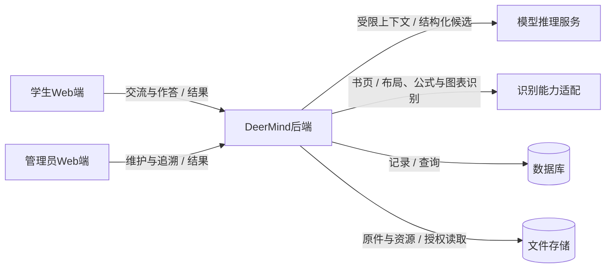
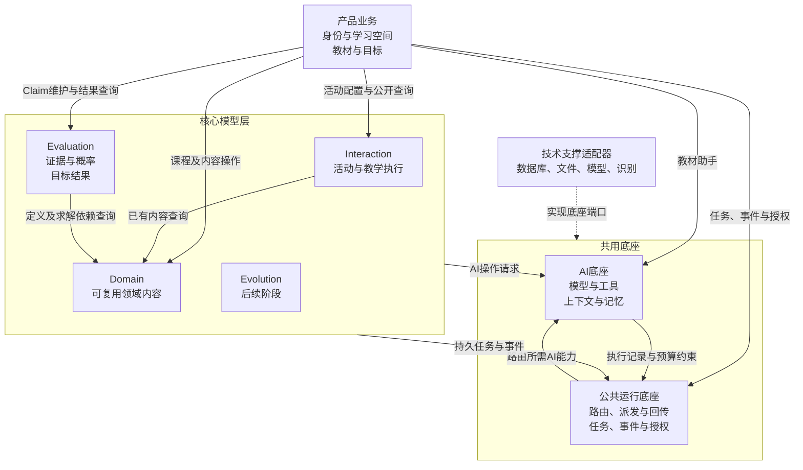
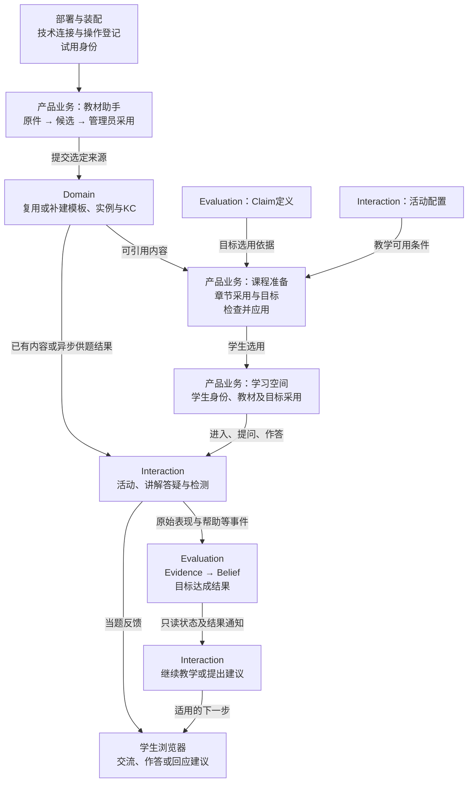
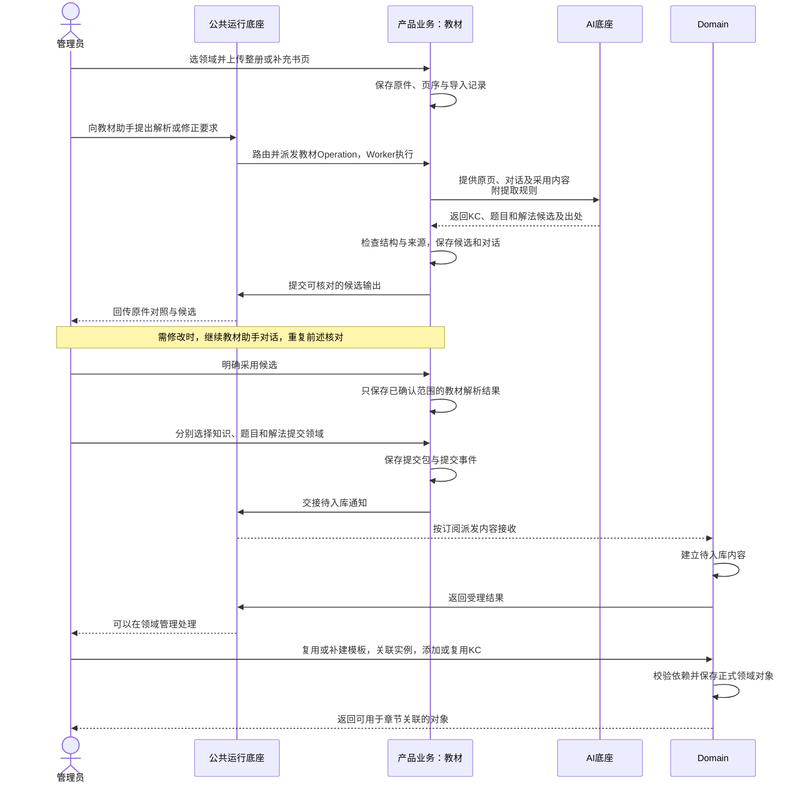
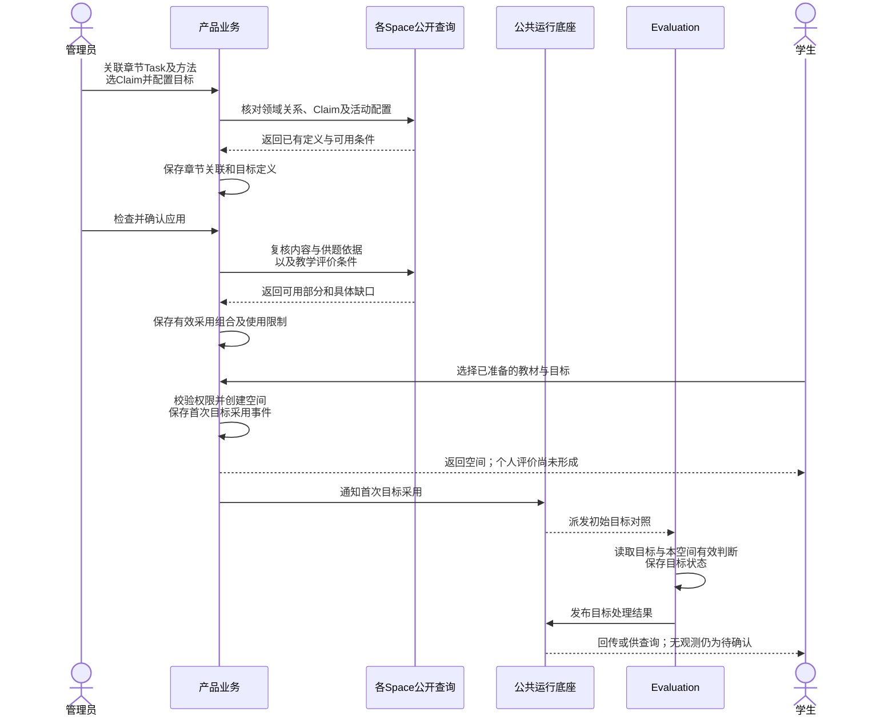
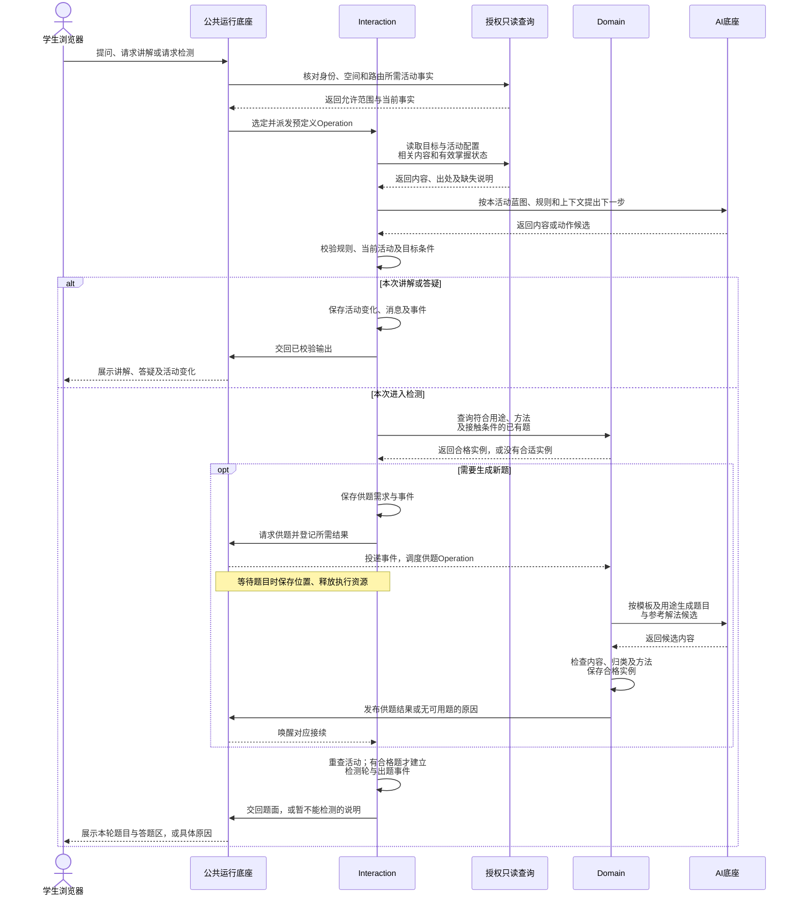
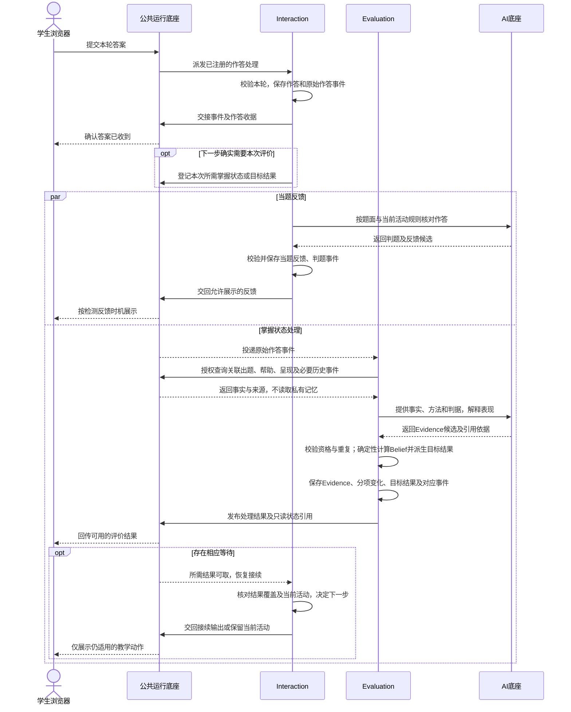
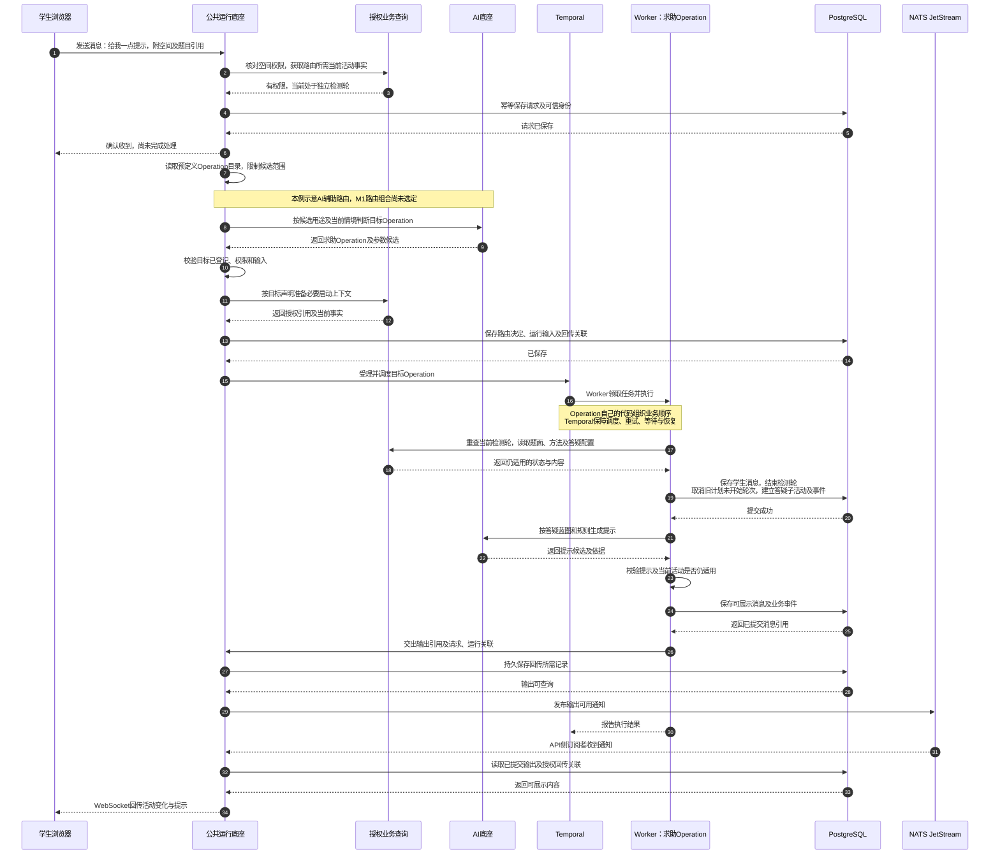
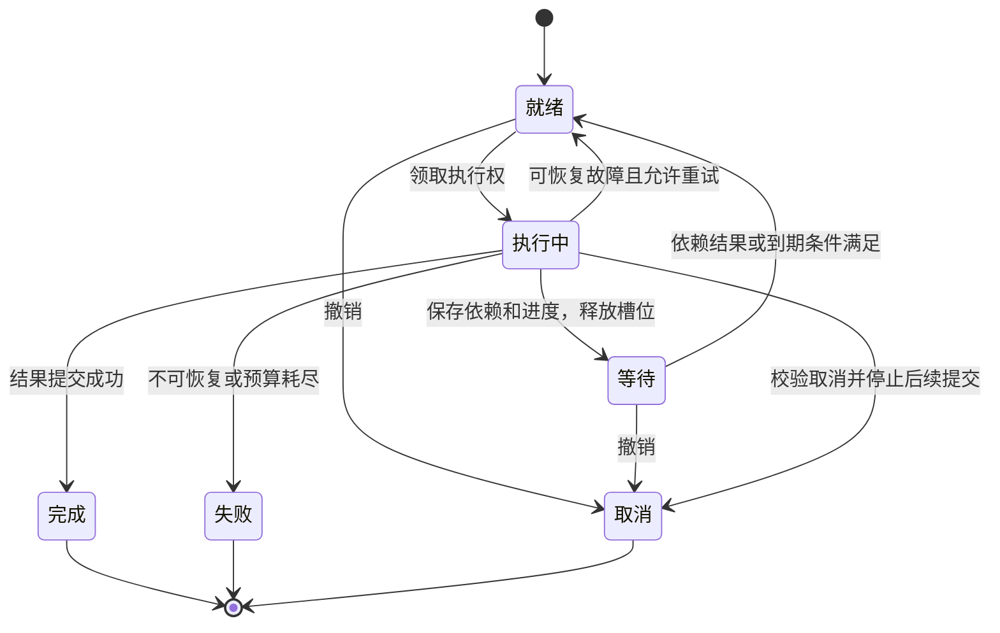

# M1 系统总体设计

> **版本**：v0.16<br>
> **状态**：端到端总体协作草案待审；已确认边界保留，四项总体建议待确认，未编码<br>
> **维护与评审**：Codex编写及自检，用户审阅<br>
> **写作规范**：[系统设计写作规范](../../../top/DeerMind_System_Design_Writing_Standard.md)<br>
> **更新日期**：2026-11-13<br>
> **修订说明**：v0.15 → v0.16，补端到端总览、课程选用及异步供题时序，统一数据与事件交接；四项总体建议待确认，不展开接口<br>

M1建议采用**模块化后端、独立后台执行进程、共享持久存储**。产品业务与核心Space分别组织代码；AI底座提供模型、工具和上下文机制，公共运行底座负责接入、路由、派发、运行保障、事件和输出回传。Space边界是代码与数据所有权边界，M1不按Space分别部署微服务。

已确认的产品规则沿用[工程入口§2](README.md#2-设计输入与历史参考)中的输入；架构决定状态以[§7.2问题清单](#72-总体架构问题清单)为准。后台采用Temporal＋Pydantic AI＋NATS JetStream＋PostgreSQL，生产部署在Kubernetes；已确认的分层、API／Worker职责、跨Space异步协作和WebSocket不变。公共运行底座的接入、路由、派发、运行保障和回传边界已确认，见[登记§45](../../DECISIONS.md#45-公共运行底座路由与operation执行边界)。路由实现、代码组织、上下文机制、可靠交接及部署配置仍待讨论。现有Operation合同保留为草案，本轮不继续展开操作步骤和接口字段。

## 1. 设计目标、范围与约束

### 1.1 本次设计要支撑的交付

| 交付约束 | 架构上的处理 |
| --- | --- |
| 指定北师大六上数学教材整册导入、核对与建模 | 保留原件，按导入和章节保存解析进度；教材助手、领域入库、章节采用分别提交，局部失败不要求重来整册 |
| 学生在浏览器讲解、提问、检测 | 学生Web客户端连接同一后端；活动和消息保存在服务端，页面关闭不销毁学习活动 |
| 每个学习空间一条持续对话、多个活动树 | Interaction维护活动父子关系和当前执行位置；教材浏览不改变活动或限制自然提问 |
| 根据表现更新能力判断、目标结果及后续任务 | Evaluation解释证据并运行确定性计算；Interaction读取有效结果决定教学，等待只约束依赖该结果的动作 |
| 管理员看清内容、活动、事件和判断依据 | 模块提供授权查询；公共事件保存发生事实，Evaluation提供Belief→Evidence→来源事件的查询 |
| M1控制复杂度 | 复用一套Agent机制和持久执行机制；Evolution、错误评价纠正、历史重算及跨版本迁移平台留到M2/M3；学习用时功能后续再规划 |

“四分之一”用于核对运行链，不能替代整册交付。教材暂以用户提供的链接为准，版权页和版次确认不阻塞上述机制设计。原型是交互参考，mock答案、概率和预写分支不作为生产实现。

M1不开发学习用时统计、跨空间累计、30分钟提醒、空闲判断或补记。事件时间、保持检测的间隔及后台执行超时仍须保留。M1在学生再次进入学习空间时检查保持检测条件，离线时不运行后台保持检查或提醒。

### 1.2 仍需确认的实现条件

- **部署条件：** 已确定生产采用Kubernetes，运行组件见§6.1；集群资源、网络、模型服务与试用预算在基础设施接入前确认；按§1.3已确认规模设计，实际承载能力及响应时限仍待实测。
- **终端条件：** 学生端和管理员端均通过电脑浏览器交付与验收，不交付原生安装包或要求平板真机验收。支持的浏览器及版本、窗口条件在客户端设计中确认；不默认承诺所有浏览器或移动设备兼容。
- **设计接收：** 本轮确认结构与关键取舍；接口、权限、恢复和数值函数的具体合同完成后，才接收相应模块进入实现。

### 1.3 已确认的试用与容量验证假设

首批试用总人数上限按100人，由用户控制试用名额。第一轮容量验证覆盖10名学生同时学习，期间允许管理员导入教材；同时检查学习对话、检测及其评价与教材后台处理争用资源的情况。决定来源见[登记§38](../../DECISIONS.md#38-m1首批试用与并发验证规模)。

100人是试用总人数，10人是同时学习的验证规模，两者均不等于并行Agent、LLM请求或worker数量。这是已确认的设计与验证假设，不是实测容量，也不自动成为客户端限额或自动限流功能。具体资源分配机制、请求节奏、模型费用、可接受等待与部署资源仍须讨论和验证；组件选型另见§6.1，不由人数直接推导。

资源紧张时，优先保障学生当前对话，以及继续教学所必需的评价；教材批量解析可以排队或减速。该优先级方向已确认，见[登记§39](../../DECISIONS.md#39-m1资源紧张时优先保障教学)。队列、执行槽、模型并发、限流及是否抢占的具体方式仍待A04／A07讨论；本次不设置固定配额或响应时限。

## 2. 系统边界与外部连接

**图1：系统上下文。** 箭头表示请求及其返回内容，存储位于受控部署环境；模型和识别可以来自同一供应商，但适配合同分开。



| 外部能力 | 传入与返回 | 失败时保留什么、停止什么 |
| --- | --- | --- |
| 模型推理 | 指定范围的文本、图像、结构化对象与工具描述；返回候选内容或工具调用建议 | 保留输入、执行身份及已有结果；本次生成或解释失败，不伪造答案或扣减能力概率 |
| 识别／OCR／版面 | 原页及页序；返回带出处的内容块、公式、图表候选与缺口 | 保留原页和已解析部分，教材助手可补充取材；缺图不能当成纯文字题继续正式采用 |
| 文件存储 | 原件、派生图像、结构化展示资源的写入和读取 | 未完成的上传不能标为可解析；资源不可读时指出影响范围，不能只剩文本却报告内容完整 |

识别适配允许多模态模型直接解析，也允许专用识别工具参与；选用哪种组合由四例试验及整册代表页验证决定。学生内容经服务端授权取材后才发送给模型，模型凭据不发给客户端。文件下载同样校验资源归属，不能凭文件路径获得访问权。

## 3. 分层、模块与数据所有权

### 3.1 分层与允许依赖

**图2：后端代码依赖。** 实线指向允许使用的公开合同，不表示跨空间同步启动加工。各Space通过公共事件与结果合同协作；技术适配器实现上层端口。客户端入口和依赖装配未画入本图。



技术适配器也实现产品业务和各Space的存储端口，图中省略这些重复连线；业务存储并非全部经底座代理。核心到共用底座的连线只代表M1三个模块，Evolution仅标规划位置。AI与公共运行之间的箭头表示所需公开能力，具体装配与代码依赖待A02讨论，不据此建立循环导入。

已有内容或已发布结果可通过授权短查询读取。跨Space需要新加工结果时，提交事件，由接收方创建自己的工作，再发布结果通知；调用方保存依赖并释放执行资源。Interaction不调用Evaluation的计算入口，Evaluation不回调教学逻辑。取题需要新生成时也遵循这一异步合同，读取已有题目不触发生成。

核心需要学习空间资料时，产品业务提供只读输入：身份、空间、教材采用范围、目标条件及依据标识。后台恢复时，通过装配入口注入的只读查询函数重查权限和必要条件，已开始活动仍读取当时保存的依据，不能被当前新定义覆盖；核心不导入产品业务的数据库对象。底座执行已注册的模块处理函数，注册由装配入口完成；底座不导入具体Space；它根据已登记的Operation说明、授权上下文和候选约束完成路由。选定后的教学分支由Operation决定，不能在路由器中再实现一套教学流程。

### 3.2 数据归属：定义和运行分在模块内部

| 模块及建议代码名 | 定义／可复用内容 | 运行记录与写入责任 | 主要公开入口建议 |
| --- | --- | --- | --- |
| 产品业务 `product` | 账号关系、教材与章节、教材采用TT/ST、学习目标条件 | 导入对话与候选、采用记录、学习空间选用 | `receive_material`、`converse_material_assistant`、`apply_course`、`open_learning_space`等；完整合同见产品业务设计 |
| Domain `domain` | Domain、TaskTemplate、SolutionTemplate、KC、依赖、TaskInstance和SolutionInstance | 入库处理、内容校验与生成结果；不保存学生作答 | `save_definition`、`extract_template`、`process_intake`、`save_instance`、`supply_task`等 |
| Interaction `interaction` | 四类活动蓝图、节点、两层规则与推荐策略 | 活动森林、消息、检测轮、实际帮助、主动任务 | `handle_input`、`submit_answer`、`record_presentation`、`continue_after_result`等 |
| Evaluation `evaluation` | Task Claim、判据、试用数值参数 | 评价处理记录、Evidence、Belief、目标结果及只读发布 | `manage_claim`、`evaluate_submission`、`apply_learning_opportunity`、`reassess_target`、`query_basis` |
| AI底座 `ai` | 调用协议、工具描述、取材与预算机制 | 模型调用、工具结果、上下文清单和可失效摘要 | `execute_ai_task`、`assemble_context`；返回候选，不直接改业务状态 |
| 公共运行 `system` | 预定义Operation登记、路由、事件、结果与依赖及授权执行合同 | 请求与路由记录、持久任务、尝试、事件、结果引用及等待记录 | `read_result`、`read_publication`、`register_wait`、`cancel_wait`、`publish_result`；其余操作待细化 |

公开入口的完整Operation名采用`module.verb_snake`，表中省略模块前缀。全部业务入口与责任位置见[Operation总目录](README.md#5-m1-operation总目录)，HTTP路径、传输Schema和具体存储适配继续在工程设计中细化。`product`内部按业务拆模块，不建立一个拥有所有数据的“大服务”。

Operation是现有模块对外提供的一项业务操作，不新增架构层。长操作保存一次OperationRun，按需要记录Step结果以供重试、等待和恢复；短查询及普通维护事务无需套后台工作流。教学蓝图节点、解法步骤、模型调用与持久Step各有用途，不能一一等同。共同合同只在[公共运行§1.3](System_Foundation_Design.md#13-operationstep与operationrun)维护，各模块填写本操作的输入、步骤、结果和异常。

Domain的TI/SI是题目和参考解法内容，不是学生的检测或解题过程。KC Task通过方法直接关联一个KC；复合Task通过方法中的子Task表达依赖。章节采用TT及该章节允许的方法，KC经方法依赖汇总；Claim绑定领域Task，目标结合教材范围选用Claim和方法。学生Belief归Evaluation，同一空间中的目标状态也由它派生。

定义和运行记录可以引用同一套标识，但分别维护：例如Interaction读取蓝图定义创建活动实例，活动保存实际使用的依据。子活动使用自身配置，不因嵌套自动继承父活动规则。M1记录实际依据和必要修订标识，不因此增加发布审核、历史迁移或Evolution服务。

### 3.3 全局事件与可靠交接

跨Space协作的职责已确认，见[登记§41](../../DECISIONS.md#41-跨space评价接续的职责分工)。以提交作答后的评价接续为例：

| 责任方 | 负责什么 |
| --- | --- |
| Interaction | 保存作答并产生事件，负责当题判题与反馈；依赖新掌握状态或目标结果的动作才登记等待，被唤醒后检查当前活动再决定教学动作 |
| Evaluation | 订阅原始作答等事实事件，按关联取得评价材料，自行形成Evidence、更新掌握状态及目标结果；不依赖Interaction的当题判题结论 |
| 公共运行底座 | 投递事件、调度执行、保存等待关系，结果到达后唤醒相应工作；不判断学生是否掌握或下一步讲什么 |

业务模块决定做什么、需要等什么，公共运行底座负责安排执行与恢复。以下事务、结果关联及故障处理方式仍是设计建议，不因职责确认而定案。

公共运行机制提供一处事件追加和授权查询能力。事件含义及载荷由生产模块定义：Interaction产生出题、作答、判题、帮助和活动变化，Evaluation产生Evidence、Belief更新及目标计算结果，产品业务产生教材采用等事实。事件可以按学习空间归集；教材导入、账号维护等无学习空间的事件使用自身资源归属，不能塞入任意学生空间。

业务持久化建议保留**当前状态与不可变事件记录**，不要求回放全部事件重建系统。执行恢复由Temporal承接；业务OperationRun与其运行历史的映射另行设计，不另设自建领取队列。PostgreSQL中的业务提交与NATS投递仍需通过待发记录可靠交接，不能假定两者天然原子提交。一次有后续工作的提交建议采用以下顺序：

1. 入口校验身份、输入和当前状态；短事务保存本次输入、事实事件和待投递记录，提交后返回收据。仅涉及本模块的后台操作可同时登记本模块任务。
2. 事件消费方按处理合同去重，通过公共运行适配受理对应工作流；消息确认与工作流可靠受理的交接待详细设计。生产方不再为同一事实重复建立消费方任务。
3. 执行器读取已保存输入，在事务外完成模型或外部服务调用，不持有数据库事务等待外部返回。
4. 结果提交时重新检查状态和执行权；共同保存模块结果、对应事件、发布结果引用及待通知记录。通知失败可重发，不能先发成功通知再保存结果。
5. 消费方按结果键读取，公共运行恢复已登记的等待；客户端按收据补查。稳定业务身份和唯一约束防止重复提交，模型调用ID不能代替作答或教学机会的去重身份。

全局事件记录事实，持久任务表达“还要做什么”。作答事件由Evaluation订阅后建立一份评价工作；事件查询、结果读取和等待登记均不触发第二份评价。订阅的事件类型由模块声明，不能把Belief更新事件再次当作新作答评价。

事件信封至少承载身份、生产方、类型、资源归属、发生／记录时间和因果引用；完整字段及追加权限在[公共运行§2–4](System_Foundation_Design.md#2-全局事件的追加与查询)定义。事件只追加；模块当前状态可按合法操作改变。M1无人工改概率或改达标结果入口。

### 3.4 Agent、上下文和记忆

| AI工作 | 谁决定任务与结果含义 | 主要上下文 | 程序接受结果前检查 |
| --- | --- | --- | --- |
| 教材助手 | 产品业务的教材模块 | 原页、明确引用、当前解析结果、导入对话 | 内容结构、来源、编号与引用；候选须经管理员采用，不能直写Domain或章节关联 |
| 学习助手 | Interaction | 当前活动路径、规则、可用动作、目标、领域内容、相关对话和有效判断 | 节点转移、求助顺序、内容与权限；策略未命中仍可在规则内提出动作 |
| 证据解释 | Evaluation | 原始作答／教学事实、帮助、题目方法、判据及资格所需背景 | 来源、方法与方面归因、资格与重复；已有概率不能诱导本次表现解释 |

三者共享执行框架，不共享一份全局聊天记录。摘要是带来源的派生材料，不能变成第二套Belief。程序先装入当前节点、未结束检测轮等必需事实，再按任务取历史；上下文不足时缩小处理范围或报告缺口，不能静默删掉强制规则。结构化显示、公式和图表按内容合同渲染，LLM输出不能直接作为可执行页面代码。

Evaluation将Belief发布为“学习者掌握状态”的只读快照，仍是唯一写入者；目标达成结果单独发布。Interaction按当前任务取相关分项，保存所用快照引用；不在记忆库维护第二套概率。快照内容及发布合同见[Evaluation§5](Evaluation_Space_Design.md#5-评价数据与公开接口)，取用与刷新见[Interaction§3](Interaction_Space_Design.md#3-学习助手的决策与提交)。

同一学生可以同时有学习助手等待、评价解释运行及教材后台处理。执行资源只在实际运行时占用；等待依赖时保存位置并释放执行槽，恢复后可以由另一执行器承接。M1暂不建设动态插件市场，工具以程序注册且授权的操作进入框架；替换模型连接不等于放宽工具权限。

### 3.5 公共运行底座与Operation的职责

公共运行底座接收请求，在已登记的Operation中确定目标，准备必要输入并派发；输出返回后，按原请求关联回传。Operation由所属业务模块或Space定义，自己组织执行顺序、业务分支和提交。底座不逐步决定“先结束检测、再讲解”等业务行为。

| 责任 | 公共运行底座 | 产品业务与Space |
| --- | --- | --- |
| 接入与路由 | 核对可信身份与资源范围；执行自己的路由函数；校验候选操作及输入 | 登记Operation用途、适用入口和所需上下文；提供授权查询及业务校验 |
| 上下文与留痕 | 按声明准备路由和启动上下文，保存请求、路由结果、运行与回传关联 | 定义业务取材范围；执行时重读可能变化的状态；正式业务数据由所有者提交 |
| 派发与执行 | 将目标Operation交Temporal调度，提供运行保障 | Worker执行所属模块定义的Workflow／Activity代码，组织业务与AI步骤 |
| 事件及结果通知 | 封装NATS发布订阅；支持指定事件和注册处理入口，以及成功、最终失败、超时的处理入口 | 定义订阅范围及收到通知后的业务行为；不把技术失败解释为学生未掌握 |
| 分层重试 | 提供调度及执行恢复，承接各层期限、状态、累计资源约束 | 各层只管理自己的重试；上层根据下层真实结果决定是否再尝试 |
| 提交与去重 | 提供持久提交和技术重复识别能力 | 决定哪些数据必须一起生效，识别同一次业务表现；Evaluation防止重复更新同一Belief分项 |
| 输出回传 | 持久关联进度／结果与原请求，经API发送到有权限的前端；不再调用AI反向猜测目标 | 生成和校验可展示内容及活动变化；生成成功不等于学生已经看到 |

各层重试独立实现，但下层执行与重试间隔的总预算不得超过上层分配的剩余执行期限，并预留返回时间。累计耗时和费用不因重试清零。等待期限与任务执行期限分开：讲解停止等待评价，不表示评价也必须停止。具体期限传递、重试参数和取消协议待讨论。

M1只保留预置并统一发放的试用账号、简单登录、固定学生／管理员角色、本人空间隔离及后台受限执行身份。产品业务维护账号和必要确认记录，Space定义资源规则，底座执行授权检查。自助注册、完整亲子关系管理、自定义角色／权限配置、复杂找回及单点登录后置；认证组件尚未选定。

职责已确认，路由算法、提交与补发、重复处理和跨层期限的具体机制仍待讨论，见[公共运行§7.2](System_Foundation_Design.md#72-尚待落实的技术设计)。

## 4. 主流程的跨模块协作

本节是端到端总体协作草案。沿已确认的职责串起正常路径和必要业务分支；图中操作名称表示用途，不新增正式Operation。需要用户确认的架构选择集中列在§7.2.1，接口、事务与重试机制不在本节定案。

**图2A：从内容准备到教学接续。** 方框写处理者和产物，箭头表示业务交接，不表示同步函数调用。Interaction的两个方框表示同一模块先后参与处理。短查询和普通保存可在API执行；需后台执行、等待或恢复的操作，经公共运行底座交Temporal调度，由Worker运行所属模块代码。图中省略这一共用路径。



| 流程 | 输入与可检查的交付结果 | 主要责任位置 |
| --- | --- | --- |
| 启动与准备身份 | 部署配置和试用名单 → 可接入的服务、受限身份；内容尚未准备不能报告可教学 | §4.1；基础设施、公共运行、产品业务 |
| 教材解析与领域融合 | 原件和管理员对话 → 已采用内容、正式领域对象及来源 | §4.2图3；产品业务、Domain、AI底座 |
| 课程应用与学生选用 | 章节方法、Claim和目标 → 可选组合、个人学习空间、待评价的目标状态 | §4.2图3A；产品业务、Evaluation、Interaction |
| 学习与检测 | 当前输入及活动 → 可展示内容或已开始的检测轮；新题须先由Domain保存 | §4.3图3B、§4.5；Interaction、Domain、AI底座 |
| 评价与接续 | 作答及关联事实 → Evidence、分项概率、目标结果；Interaction自行决定下一步 | §4.3图4、§4.4；Evaluation、Interaction |

### 4.1 初始化与身份准备

1. **部署入口准备技术连接。** 启动PostgreSQL、Temporal、NATS JetStream、API和Worker，注入文件存储、模型及识别服务配置。分别报告连接和能力是否可用；未配通模型不能报告AI功能就绪。副本、凭据管理及启动工具在部署设计中确认。
2. **装配入口连接模块。** 将预定义Operation、事件订阅、授权查询和AI工具交给对应底座登记。公共运行底座据此接入、路由和派发；具体目录、代码装配与启动检查方式仍待A02／A05确认。
3. **产品业务准备身份。** 预置并发放试用账号，保留固定管理员／学生角色、本人空间隔离和必要使用确认。M1不在本流程建设完整亲子管理或复杂账号找回。
4. **管理员准备教学内容。** 通过所属模块维护Domain、活动蓝图与规则、Claim、教材及目标。领域允许从空模型开始，通过手动维护和教材入库逐步补齐；服务启动不要求先完成整册建模。
5. **学生登录并选用。** 产品业务校验身份、使用条件及可用组合；没有组合就返回尚未准备，已有空间则恢复其引用与页面。首个真实学习输入仍须核对当时权限和使用条件。

配置先由受保护的部署入口承载，不新增AI配置页面。连接检查、内容可用检查和教学质量验证分别进行。M1整册建模的交付要求保留，不因允许逐步准备而缩小验收范围。

### 4.2 教材准备到学生选用

**图3：教材助手与领域入库。** 产品业务的教材Operation在Worker中运行时调用AI底座；管理员采用、领域处理等短请求仍经API进入所属模块。图中省略HTTP适配，公共运行代表API／Worker共用能力，不新增中央业务服务。



教材助手只修改候选；管理员采用不等于Domain入库。Domain可调用AI底座提出模板候选，再由管理员确认；需要后台执行的提取工作同样经公共运行派发。题目可以不带教材解法入库，SolutionInstance则须关联具体TaskInstance及SolutionTemplate。章节最终选用TaskTemplate和SolutionTemplate，KC经方法依赖汇总。原图、表和公式的语义内容随所属模型元素保存，原件仍作为核对来源。

**图3A：课程应用、个人空间与初始目标。** 本图中的模块查询只读取已有定义或配置，不同步启动其他Space的新计算。图中“应用”是教材与目标的采用结果，不新增课程实体。



产品业务汇总各模块公开条件，区分可浏览、可帮助和可正式评价的范围。部分评价依据缺失不封禁整章提问；缺少备用题也不等于无法检测。跨章节汇总方法保留适用章节，不能将一章允许的方法无条件开放给全书。

学生选用不复制领域模型，也不创建另一套Claim。学习空间绑定学生及教材／目标采用，不设置长期章节范围。Evaluation负责初始目标对照；尚无观测的分项仍为未知，内部先验不能显示为已经掌握。

教材或目标重新应用后，产品业务更新采用同一组合的空间当前引用，进行中活动及历史保留实际依据。目标条件变化通过事件交Evaluation重新对照，不当作学生能力变化，也不要求学生手动维护引用。

| 中断位置 | 保存的结果与下一步 |
| --- | --- |
| 解析或对话修正失败 | 保留原件和已采用内容；继续同一导入对话，不用失败候选覆盖结果 |
| 领域入库缺模板、父题或依赖 | 保留待处理内容，由Domain补齐或关联；来源已被教材修正替代时返回教材重新提交 |
| 章节关联或应用不成立 | 已入库内容保留；产品业务返回缺口，旧有效采用不被半成品覆盖 |
| 初始目标对照未完成 | 空间已建立，目标显示处理中；完成但无表现时显示待确认，两者分开 |

详细合同归[教材助手](Product_Application_Design.md#3-教材助手与内容准备)、[领域入库](Domain_Space_Design.md#2-定义维护与教材内容入库)、[课程应用](Product_Application_Design.md#4-章节关联目标定义与课程应用)和[个人空间](Product_Application_Design.md#5-学习空间生命周期与核心输入)。

### 4.3 学习、检测与评价接续

**图3B：从学习输入到可用检测题。** 授权查询汇集产品业务的空间／目标、Interaction的活动、Domain的已有内容及Evaluation的已发布状态。它不复制数据所有权，也不触发新的评价。后台Operation均由Worker执行；图中仅展开业务交接，Temporal调度路径见§4.5。



教材浏览位置不限制提问，只有明确引用书页时才把它作为本次输入。学习助手按蓝图和规则执行；推荐策略未命中仍可提出合规动作。候选由Interaction接受后才成为正式消息或活动变化，公共运行底座不逐步安排教学。

**Domain提供内容，Interaction安排使用。** Interaction给出用途、方法、题目条件和必要的已接触信息；Domain不自建学生接触史。现成题不足时生成、检查、保存再用，不要求管理员逐题批准。检查失败且没有合格替代题才暂不能检测。结果迟到时，Interaction先核对原活动是否仍需要这道题，再决定呈现。

**图4：当题反馈与掌握状态更新。** 出题、作答和当题判题分别产生事件，均关联本次实际作答。Evaluation由原始作答触发，自行取材；Interaction判题只是可复用材料，不是第二次评价触发或必等前提。底座负责事件追加能力、投递和调度，业务状态及事件含义仍由生产模块负责。



图4展示需要AI解释的作答；已有可核实结果或确定性检查足够时，相应模块可直接处理，不强制每份事件都调用LLM。Evaluation取材可包含已经产生的Interaction判题，但独立核对其依据。是否有帮助、是否满足迁移或保持条件，须有相应事实；缺材料不能由已有概率或摘要补出。

Evaluation按方法×评价方面更新。子Task仅在有明确表现时更新相应分项；LLM不产生新概率。资格过滤、观察更新、教学机会学习转移和0.90目标比较均由确定性程序完成。Belief与目标分别提交和发布的具体合同仍待详细设计；图中的连写不表示必须放进一次事务。无有效Evidence时也需返回未更新原因，技术失败则保留未完成状态。

Interaction通常读取已有有效掌握状态。若接下来要按刚才作答的评价选题或宣布目标结果，则等待**这次输入所需的结果**，不能随手取“最新状态”冒充完成。结果如何关联和等待见§7.2.1的A03／A04提案；现有字段草案尚未定案。

| 情况 | 后续行为 |
| --- | --- |
| 当题判断已有依据，掌握状态仍在计算 | 可给规则允许的反馈和讲解；依赖新掌握状态的动作继续等待 |
| Belief已更新，目标计算失败 | 保留有效概率及事件；恢复目标计算，不重算同一表现的概率 |
| 检测轮中请求实质帮助 | 先结束该轮、取消未开始旧轮，再建立讲解或答疑子活动；重新检测另起新题新轮，见§4.5 |
| 只是操作澄清或意图不明 | 先澄清，不提前提供答案或实质提示 |
| 活动已暂停或切换，旧评价才到达 | 保留有效评价；接续前重新判断，不自动夺回对话 |

生成、保存、网络发送和学生端实际呈现分别留痕；发送成功不表示已提供帮助，实际呈现也不表示已理解。呈现回执与评价取材时点须共同确认，不能依赖两个进程恰好按预想顺序运行。查询判断依据仍按目标／Belief→Evidence→来源事件展开。

详细行为与数值合同见[Interaction§3–6](Interaction_Space_Design.md#3-学习助手的决策与提交)及[Evaluation§2–5](Evaluation_Space_Design.md#2-原始事实到evidence)。

### 4.4 主动任务

主动建议与当前活动的接续是两种输出：接续由正在运行的活动决定；主动建议由Interaction依据目标和有效表现另行提出，学生接受后才启动活动。

1. **进入空间时检查。** 产品业务记录实际进入事件；公共运行底座按订阅调度Interaction，检查实际经过时间、当前目标、有效表现和已有任务。M1保持检测不做离线周期扫描。
2. **相关结果到达时重查。** 活动结束或新评价结果可触发下一步判断。Interaction判断是否有新的行动依据；LLM可建议，程序核对必要性、重复和当前活动。
3. **保存并展示建议。** Interaction保存依据及建议任务，底座通知浏览器。相同依据已有待办或已经被拒绝时，不换一个ID再次创建。
4. **处理学生选择。** 接受后重查必要性并沿§4.3准备活动；暂缓当天不再催，次日或之后再次进入空间且仍有必要时最多提示一次；拒绝不记答错、不降Belief，只有新表现、目标或延迟条件才重新考虑。
5. **任务结束后对照结果。** 执行完成与评价完成分别记录。评价未完成不催学生重做；有有效结果后，Interaction判断原任务目的是否已解决。

已受理的解析或评价可在浏览器离线后继续运行，这与离线主动扫描不同。再次进入恢复既有记录和合法待办；到达的旧结果仍由当前活动判断是否采用。提醒和接续的具体合同归[Interaction§5](Interaction_Space_Design.md#5-主动任务的触发与接续)。

### 4.5 从求助请求到前端回显

**图4A：公共底座路由、Worker执行与输出回传。** 学生正在独立检测，输入“给我一点提示”。浏览器携带稳定消息身份、学习空间、原文及可选活动／题目引用；身份来自认证连接，引用由服务端核对。浏览器不指定路由结论或自行结束检测轮。具体字段名留待接口设计。

“求助Operation”表示预定义并登记的业务处理入口，不是LLM临时创建的函数。是否独立命名为`interaction.handle_help`，还是映射到现有操作族，尚待讨论；图中的LLM路由仅展示一种允许的实现，不代表已选定M1的路由算法。



底座参与者同时表示API侧接入／订阅适配和Worker侧输出适配，并非新建中央服务。AI底座内部的模型调用未展开。Worker执行Operation的Workflow和Activity代码，业务读写通过所属模块完成，模型调用走AI底座；Temporal服务负责调度和持久历史，不运行这些业务代码。一次Operation与Workflow／Activity如何映射仍待详细设计。

图只确认成功路径上的责任、次序及输出方向，不据此选定跨存储原子提交、待发记录实现、消息确认或重连协议；这些机制见§7.2的A04／A09／A10。Operation可以沿同一输出通道发送中间进度，不必等全部结束才回显。这里只展示已校验消息，不决定逐字流式输出的检查粒度。

| 关键分支 | 处理边界 |
| --- | --- |
| 路由拿不准、参数或引用不足 | 底座返回澄清或可识别失败，不派发未经确认的目标；澄清内容与恢复协议待定 |
| 路由后学生已提交或切换活动 | 求助Operation重查业务状态，旧候选不能直接改变新活动 |
| 轮已结束，提示生成失败 | 保留轮结束和活动事实；Operation从失败处恢复，不重开旧轮；按分层重试约定处理 |
| 前端断开或输出通知重复 | 保留已受理工作及输出；按原请求关联回传／补取，不重新执行路由生成第二份业务效果；接线机制待定 |

本请求无需等待Evaluation。求助请求、生成消息与实际呈现分别记录，不因求助直接更新概率；展示回执继续按Interaction及客户端合同处理。

## 5. 源码组织与运行单元

### 5.1 建议源码结构

工程实现建议在`src/m1/`建立正式源码，与`doc/mvp/m1/prototype/`的交互代码分开。以下是待审目录，不在本批创建空工程。

```text
src/m1/
  server/deermind/
    product/             identity、materials、targets、learning_spaces
    spaces/              domain、interaction、evaluation
    foundation/          ai、system
    infrastructure/      persistence、files、model_providers、recognition
    entrypoints/         HTTP入口、worker入口、命令行与依赖装配
  clients/
    admin/               管理员Web客户端
    student/             学生Web客户端
    shared/              经确认共用的协议与内容渲染
  tests/                 数值、模块合同、故障接线、客户端及语义案例
```

每个业务／Space模块对外集中导出公开操作和数据合同，持久化实现不对其他模块开放。不要为一个简单查询机械生成多层类；只有存在外部依赖或需要替换验证的位置定义端口。依赖检查拒绝反向导入、跨模块访问内部存储以及Space直接读取另一Space的数据表。HTTP适配器调用资源所属模块；跨模块用例由明确的发起方编排，不集中到一个万能控制器。

### 5.2 进程与持久状态

代码模块定义职责与数据所有权，运行进程决定在哪执行。已确认API进程同时承接学生端与管理员端请求，按各自身份和资源权限调用业务模块；Worker进程执行后台工作。两类入口复用相应模块代码，不分别实现一套业务逻辑；具体确认范围见[登记§40](../../DECISIONS.md#40-代码模块与运行进程的职责边界)。

| 代码归属 | 负责逻辑 | 怎样参与运行 |
| --- | --- | --- |
| 接口接入模块 | HTTP／WebSocket请求、身份接入、业务入口调用、结果回传 | 运行在API进程；不承包各Space业务或调度算法 |
| 产品业务及各Space | 教材、领域定义、活动、证据、数值更新及目标等各自业务 | 普通查询和短事务可在API进程执行；需后台执行、等待或恢复的工作在Worker中执行 |
| 公共运行底座 | 接入、路由、上下文准备、派发、事件、运行保障与回传 | API／Worker使用共用适配；Temporal调度Worker执行预定义Operation，NATS通知，底座提供技术重复识别和授权检查，业务去重归所有者 |
| AI底座 | 模型调用、工具执行、上下文及记忆机制 | 使用Pydantic AI承接公共路由和业务AI任务，需要持久执行时接入Temporal；不接管业务数据写入权 |

Worker不只执行LLM调用，API也不是“所有非LLM逻辑”的模块。工作根据处理时长、等待和恢复要求选择执行方式，代码始终保留在责任模块：

- 管理员修改KC：API进程调用Domain，由Domain校验、保存并返回结果。
- 学生提交检测：API侧底座按已登记入口派发，由Interaction保存作答；后续Worker执行Evaluation的证据处理、确定性概率计算和目标派生。是否使用LLM不改变这些步骤的模块归属。
- 提交后台工作：调用公共运行底座，不在HTTP或WebSocket处理代码内实现另一套调度逻辑。

需要后台执行、等待或恢复的Operation由Temporal调度与恢复，Worker运行Operation自己的业务编排代码；其中AI处理通过共用AI底座使用Pydantic AI。NATS JetStream负责跨进程、跨服务的业务事件发布订阅，PostgreSQL保存业务数据和正式事件。Space不是常驻独占Agent进程，短查询和事务也不必经过工作流。

**图5：运行组件与职责。** 公共运行适配是API／Worker使用的共用代码，不表示新增独立服务。Worker与底座之间的双向连线表示运行保障、事件和输出交接；底座将业务事件对应到新执行或已有执行的通知。图中两个PostgreSQL节点区分数据管理责任，不代表已决定使用两个物理集群。Pod、副本和存储布局待部署设计。


Temporal的持久状态采用PostgreSQL，由Temporal自身管理；业务模块不读写其内部表。NATS JetStream使用自身消息存储，两者均不替代PostgreSQL中的正式业务事件。文件存储未在图中展开，API／Worker仍通过文件适配访问原件和产物，具体选型待定。

建议API先持久化长任务再返回收据，客户端以收据查询并订阅结果；断线后可以补取已保存结果。M1前后端实时交互统一采用WebSocket，生产使用WSS；普通查询、管理操作和文件上传下载继续使用HTTPS，不并行维护SSE。浏览器连接API，不直接订阅NATS或调用Temporal。WebSocket收到消息不代表任务已完成，最终状态以服务端记录为准。重连补取、连接授权和慢客户端处理仍待设计与验证。书页批处理按可恢复部分保存进度，不把整本教材放入一个不可恢复的模型请求。

**图6：OperationRun的后台执行状态。** 这是程序执行状态，不是教学蓝图节点或活动运行状态；短操作不要求建立此记录。



状态、依赖及恢复输入持久保存，等待时不依赖存活的协程。登记等待和发现已有结果须防止竞态，通知丢失后也能查回；具体合同见公共运行§3–4。执行器故障后，其他执行器可接续同一任务；提交时检查执行权、当前状态及去重身份，过期执行器不能写入。外部模型请求可能重复且产生费用，业务效果不重复不代表外部调用恰好一次。

Interaction对同一学习空间的当前活动路径、顶层切换及子活动进入／返回做并发检查，保证同时只有一个进行中的叶活动；不能仅锁单个活动而允许并发创建两个顶层活动。同一Belief分项的有序更新由Evaluation负责。保护的是相关状态提交，不把模型调用期间的整个空间锁住；无关后台工作仍可并行。粒度、顺序、租约与重试限额在[公共运行§3–4](System_Foundation_Design.md#3-持久任务与执行资源)和[Evaluation§6](Evaluation_Space_Design.md#6-处理顺序提交与恢复)确定。

## 6. 技术选择与系统质量

### 6.1 已定技术与待选方案

已确认采用Temporal＋Pydantic AI＋NATS JetStream＋PostgreSQL，替代讨论中的RabbitMQ和此前落盘的Dapr＋Redis方案，见[登记§44](../../DECISIONS.md#44-m1执行框架与事件组件选型)。生产继续采用Kubernetes。组件选择已定，不另设选型PoC门槛；版本、适配和部署参数仍待审，正常实现与故障测试保留。

| 决策 | 已定方案或建议 | 确认边界及剩余问题 | 代价与实现责任 |
| --- | --- | --- | --- |
| 后端组织（职责部分已确认） | API与Worker执行各自工作，业务代码归所属模块；模块化后端及共享存储仍为建议 | 代码组织、PostgreSQL物理布局及Kubernetes部署单元待审；不按Space强制拆服务 | 靠公开入口、数据写入权和依赖检查保持隔离；调度不能塞入接口接入代码 |
| 后端语言与API框架 | Pydantic AI执行侧使用Python；API采用Python＋FastAPI仍为建议 | API框架与完整代码组织待确认，不能由Agent框架推定全部后端技术 | 共享数据合同与测试，避免前后端手写两套不同协议 |
| 持久化（已确认） | PostgreSQL保存业务数据、正式事件及待发通知；Temporal内部持久化也采用PostgreSQL | 业务存储与Temporal存储分开管理；是否共用物理实例、备份及容量待定 | 业务事务提交与事件送达之间仍须可靠交接，数据库不承担消息订阅或执行调度 |
| 持久执行（已确认） | Temporal编排需等待、重试和恢复的Operation，Worker执行业务与AI步骤 | Workflow、Activity与业务Operation／Step的映射后续设计，不默认一一对应 | Temporal负责执行恢复；业务方仍负责幂等、取消边界和结果提交，不自建恢复引擎 |
| 业务事件（已确认） | NATS JetStream跨进程、跨服务发布订阅及持久投递 | 订阅、保留、确认和故障处理配置待定；不能退化为Core NATS的即时投递 | 公共运行适配关联事件与执行；需处理重复、早到和迟到通知，消息留存不代替正式事件 |
| AI执行（已确认） | Pydantic AI封装模型、工具调用与结构化结果，通过官方Temporal集成承接持久执行 | 具体SDK版本及接线待定；模型供应商、上下文与记忆机制仍需设计 | AI底座负责取材、授权、预算与候选校验；Space保留业务规则和提交权 |
| 部署平台（已确认） | Kubernetes运行API、Worker及后台组件；本地可使用Temporal开发服务与单二进制NATS | Pod、副本、资源、持久卷及备份待定；开发模式不是生产方案 | 维护Temporal、NATS和PostgreSQL的运行与数据恢复；不再要求Dapr或Redis |
| 管理员与学生UI | 两端均为Web应用，建议使用Vue并复用适用组件 | 只有现有组件或框架不能满足已定交互时，再比较其他Web实现；原生客户端不在本轮范围 | 原型组件需拆开mock后接线，浏览器输入、渲染、刷新恢复及权限仍须验证 |
| 前后端实时传输（方向已确认） | WebSocket；生产使用WSS；普通查询、管理操作及文件传输保留HTTPS | M1不再同时建设SSE结果通道；连接组织及与后台结果通知的接线仍待审 | 需验证连接授权、重连补取、代理超时及慢客户端；连接不能代替任务持久性 |
| 文件存储（候选） | 文件访问端口可先接受控磁盘 | 对象存储在跨主机或备份要求触发时比较，不因传输方向确认而固定存储 | 需设计授权下载、原件与数据库关联及备份恢复 |

逻辑模块分离而不强制多服务部署，可参考[Microsoft应用架构说明](https://learn.microsoft.com/en-us/dotnet/architecture/modern-web-apps-azure/common-web-application-architectures)。这是M1当前规模的取舍，不是该资料对DeerMind的结论。FastAPI支持异步I/O，但[异步处理](https://fastapi.tiangolo.com/async/)不能替代持久任务及崩溃恢复。

选择理由与限制：

- Pydantic AI提供[官方Temporal集成](https://pydantic.dev/docs/ai/capabilities/durable_execution/temporal/)，可承接模型与工具调用的持久执行，减少自行实现Agent恢复的工作。业务工具的幂等与提交仍由DeerMind负责，不能据此承诺外部调用恰好一次。
- [JetStream](https://docs.nats.io/concepts/jetstream)提供持久消息及独立消费进度；它与路由等能力包含在同一[nats-server二进制](https://docs.nats.io/concepts/ecosystem)内，符合M1简化本地环境的取舍。
- [Temporal开发服务](https://docs.temporal.io/cli/command-reference/server)可本地启动并保存开发数据；生产仍需独立设计服务、存储与恢复。启动方便不等于生产成本或可靠性已验证，也不表示RabbitMQ不适用。

Temporal的Workflow／Activity是程序执行概念，不是Interaction的学习活动或蓝图节点。公共运行适配接收NATS事件后，启动相应执行或向已有执行发送Signal；各Space不直接同步调用彼此。事件被接收、Signal被受理与业务结果已提交是不同事实，可靠交接仍须设计。

本节选型资料于2026-11-13核验，其余架构资料沿用此前核验。具体前端框架、模型服务和文件存储仍按候选审阅；浏览器中的mock不能替代真实后端、AI与评价流程的验收。

### 6.2 质量要求落实到实现位置

本节保留既有产品约束及验证方向，不代表对应技术机制已获批准。待补的质量目标集中登记在§6.3；当前先审端到端主流程架构。

| 要求 | 负责机制 | 接收时怎样检查 |
| --- | --- | --- |
| 不丢已提交作答、不重复更新概率 | Interaction提交收据；公共运行事务与去重；Evaluation分项顺序 | 提交成功后断线、重复请求、worker中断，再查原记录及更新次数 |
| 权限不被模型输出绕过 | 产品身份与资源规则；模块写入校验；工具授权执行 | 其他空间ID、伪造工具参数、过期身份和引用越界均被拒绝 |
| 可解释的数值结果 | Evaluation纯函数、参数校验、资格记录和事件 | 同一fixture可复算；未知、跳过、教学机会、重复及子Task分别对照 |
| 多模态内容没有悄悄丢失 | 原件留存、语义结构、缺口标记、采用前核对 | 同时检查文字、公式、图表和解法；结构合法不替代内容正确 |
| 模型成本和失败可控 | AI底座累计调用预算、超时及可识别停止原因 | 模拟格式失败、工具失败、预算耗尽；不无限重试或编造成功 |
| 教学等待不冻结无关工作 | 持久依赖和活动级提交校验 | 一个评价等待时仍能浏览及执行允许动作，恢复不抢回旧活动 |
| 端到端可定位 | 请求、活动／轮、后台任务、模型调用及事件之间有引用 | 从目标Evidence追到原始事件，再定位产生结果的具体执行尝试 |

性能、费用和识别质量先测实际样本，再提出可接受阈值。已确认§1.3的试用规模假设，尚无实测容量与预算数据，不写“毫秒级”“高并发”或虚构SLA。技术日志可以按运维策略保留，学习空间事件则遵守只增不改不删的产品约束；两者不可混用。

### 6.3 非功能质量属性待讨论清单

本清单只记录后续需要讨论的问题，不新增质量阈值或批准保障方案。先确认§4的端到端主流程及模块交接，再结合具体流程讨论质量目标和架构取舍；本次后移的是讨论顺序，不是将这些事项整体移出M1。

| 质量方面 | 后续需要确认的问题 | 对应架构问题／详细设计归属 |
| --- | --- | --- |
| 数据可靠性与一致性 | 断线、重试、进程退出时，已受理与已提交的工作分别如何保护；哪些变更共同生效，哪些重复不得再次生效 | A03／A04／A09；公共运行、各数据所有者 |
| 可用性与故障恢复 | 哪些故障允许暂时停服或人工介入；最多中断多久；存储损坏时允许丢失多长时间的数据，怎样备份和恢复 | A04／A11；公共运行、基础设施 |
| 性能与容量 | 对话、评价、教材解析各自可接受的等待；峰值及积压；并行学习与导入的资源竞争 | A01／A07；公共运行、AI底座、基础设施、客户端 |
| AI可控性与结果质量 | 如何验证规则执行、资料不足时的停止、语义错误及不可信输入的处理；内容质量与确定性程序正确性如何分别验收 | A05／A06／A08／A12；AI底座、各Space及验证计划 |
| 安全与隐私 | 身份与资源隔离、工具访问、资料外发、凭据与日志保护；最低防护和检查范围 | A08；产品业务、公共运行、AI底座、客户端、基础设施 |
| 资源与成本 | 单次及累计模型用量、费用与执行预算；资源耗尽如何表现；各层重试怎样服从总体限制 | A01／A07；公共运行、AI底座、基础设施 |
| 可观测性与可测试性 | 怎样定位请求、运行、事件和结果；必须保留哪些记录；哪些故障和语义案例需要自动或人工验证 | A12；公共运行、各模块、实施计划 |
| 可维护性与可扩展性 | 替换模型或增加活动会影响哪些模块；怎样检查Space边界及公共合同；哪些扩展明确不在M1建设 | A02／A05／A12；总体及各模块设计 |
| 部署与兼容性 | 开发和生产怎样安装、升级、回退；支持哪些浏览器和材料格式，怎样检查兼容及资源引用 | A10／A11；客户端、基础设施、产品业务 |

已确认的100人试用、10名学生同时学习的验证规模、教学优先、空间隔离、事件只追加及分层重试等边界继续生效。上表中的停机时限、数据损失窗口、响应时限、预算及具体保障机制仍待讨论；此前“允许短暂停机或人工恢复”只是建议，未作为M1决定。

后续逐项记录场景、目标、验证条件和责任位置：影响模块边界、跨模块协作或部署的取舍在总体设计确认，具体事务、去重、重试及配置在责任文档细化。质量目标若要求调整已讨论的主流程架构，应返回相应决定复核。教学、解析及评价内容质量沿用PRD和验证计划，不在此另设一套产品指标。

## 7. 设计验证与实现交接

### 7.1 从总体设计进入详细合同

| 本轮总体位置 | 产品规则 | 下一份详细合同及输出 |
| --- | --- | --- |
| §3.2、§4.1–4.2 | R01–05、R08、R10、R17 | 产品业务与Domain：身份、导入采用、模板实例、章节方法来源、课程应用的请求／结果与提交 |
| §3.4、§4.3 | R06–07、R11–14、R16 | Interaction与Evaluation：活动／轮输入、求助顺序、Evidence、数值函数、分层结果及等待条件 |
| §3.3、§5.2 | R09、R14、R18 | 公共运行与AI底座：事件、任务、上下文、工具、事务和失败恢复合同 |
| §4.4 | R15 | Interaction与客户端：主动任务依据键、提醒状态及活动接续 |
| §2、§5–6 | R18及验证计划 | 客户端与基础设施：真实服务适配、Web交付、运行参数、备份和技术验证 |

产品规则的完整索引保留在[工程入口§3](README.md#3-本轮必须承接的实现与复测要求)，Operation与具体合同对应见[§5总目录](README.md#5-m1-operation总目录)。已有操作草案供核对职责，本轮不扩展。先完成以下总体问题的讨论；其结果再约束各模块详细设计，不按九本文档串行推进。

### 7.2 总体架构问题清单

本清单用于检查架构问题是否有归属，不以章节数量证明设计完整。内容依据沿用[工程写作规范](../../../top/DeerMind_System_Design_Writing_Standard.md#1-依据与适用方式)中的SwDD；本次补用[arc42覆盖目录](https://arc42.org/overview/)检查结构、运行、部署、质量和风险，用[SEI ATAM](https://www.sei.cmu.edu/library/architecture-tradeoff-analysis-method-collection/)的场景分析方法检查取舍。资料于2026-11-12核验；本次是项目裁剪检查，不声称执行了完整ATAM评估。

**状态口径。** 决定与验证分别记录：已确认表示用户已认可所列边界；待讨论表示仍需比较和确认；待验证表示方案尚缺运行或实测证据。已确认方向仍可待验证，列出验证场景不等于验证通过。正文已有建议不能自动记为已确认。

**已确认的边界。** 下表限定确认范围；未列出的实现选择仍须审阅。

| 主题 | 已确认内容 | 依据 |
| --- | --- | --- |
| M1范围 | 指定教材整册建模、浏览器教学与评价主链；Evolution、错误评价纠正、历史重算及学习用时功能后置 | §1；产品输入；[登记§28](../../DECISIONS.md#28-m1全局达标阈值与工程阶段边界)、[§34](../../DECISIONS.md#34-mvp浏览器交付与学习用时功能后置) |
| 试用规模 | 首批总人数上限100人；首轮验证10名学生同时学习，并允许管理员同期导入教材 | §1.3；[登记§38](../../DECISIONS.md#38-m1首批试用与并发验证规模)；规模已确认，容量未实测 |
| 资源优先级 | 资源紧张时先保障学生当前对话及继续教学所必需的评价；教材批量解析可排队或减速 | §1.3；[登记§39](../../DECISIONS.md#39-m1资源紧张时优先保障教学)；调度机制与效果待确认和验证 |
| 分层与归属 | 产品业务与核心Space分开；AI及公共运行属于共用底座；技术支撑单独组织；定义与运行数据区分 | §3；[登记§31](../../DECISIONS.md#31-m1系统设计首轮实现草案)；不等于批准进程数量、数据库或目录候选 |
| 模块与进程职责 | 接口接入、业务／Space、公共运行、AI底座分别维护代码；API承接两端，Worker不限于LLM工作 | §5.2；[登记§40](../../DECISIONS.md#40-代码模块与运行进程的职责边界)；Kubernetes及PostgreSQL已定，部署单元与存储布局仍待确认 |
| AI职责 | 教材助手、学习助手和证据解释分属各自业务；蓝图与规则约束执行，策略是推荐；数值更新由程序完成 | §3.4、§6.1；Pydantic AI框架已定，上下文、记忆与工具授权接线待审 |
| 跨Space协作 | Interaction负责当题反馈及教学接续；Evaluation按原始作答和关联事实更新掌握状态；公共运行底座负责查询、投递、调度与唤醒 | §3.3／4.3；[登记§41](../../DECISIONS.md#41-跨space评价接续的职责分工)、[§42](../../DECISIONS.md#42-当题反馈与掌握状态评价的分工及事件取材)；结果合同及异常恢复接线仍待审；运行组件见下方已定技术 |
| 事件与评价 | 事件只追加；Evidence、Belief及目标结果由Evaluation维护；M1沿用已定分项算法与试用参数 | §3.2–3.3；内容规格§4.16–4.21；算法效果仍需验证 |
| 实时传输 | 前后端实时交互统一WebSocket，普通业务及文件传输保留HTTPS；后台业务事件由NATS JetStream投递 | [登记§37](../../DECISIONS.md#37-总体架构覆盖检查与实时通信方向)；连接接线与故障恢复待验证 |
| 运行与部署选型 | Temporal持久执行、Pydantic AI智能体执行、NATS JetStream业务事件、PostgreSQL持久化；生产Kubernetes部署 | §5.2／6.1；[登记§44](../../DECISIONS.md#44-m1执行框架与事件组件选型)；不另设选型PoC，实现测试保留，版本、资源及部署细节未定 |
| 操作抽象 | 使用Operation名称组织模块操作 | [登记§36](../../DECISIONS.md#36-operation与step的工程定义)；具体操作、Step及字段草案暂不继续展开 |

本轮补充确认：公共底座执行路由并派发预定义Operation，Worker在Temporal之上运行所属模块的业务编排；底座承接输入输出及运行保障。事件处理与成功／最终失败／超时入口由业务登记；采用分层重试、全局协调；技术去重不替代业务去重。M1采用最小账号能力，保持检查仅在再次进入空间时执行。依据见[登记§45](../../DECISIONS.md#45-公共运行底座路由与operation执行边界)，具体职责及求助时序见§3.5／4.5。

**待讨论的问题。** P0／P1表示影响程度，不作为本轮逐项讨论的机械顺序。当前先沿端到端主流程确认框架；质量目标与保障机制登记后再议。各项在总体架构接收前仍须给出结论或有边界的验证安排，不表示后置M2。编号用于讨论与追溯，不是新模块或新功能。

| 编号／优先级 | 要确认的问题与来源 | 当前决定状态及未决内容 | 总体位置／后续责任 | 验证入口 |
| --- | --- | --- | --- | --- |
| A01／P0 | M1首先保护哪些质量，按什么规模与资源设计？整册导入和学生学习可能同时运行 | 部分已确认：总人数100人，验证10名学生同时学习并行教材导入；教学及其必要评价优先方向已确认；其余质量取舍、可接受等待、模型费用和部署资源仍待讨论，A01未关闭 | §1、§6；实施计划、基础设施 | V01 |
| A02／P0 | 已定分层怎样落到代码、进程与依赖？哪些责任共用，哪些属于Space？ | 公共底座路由／派发／运行保障／回传与Worker执行业务Operation已确认；代码组织、装配、路由目标目录及操作拆分命名仍待讨论 | §3.1–3.2、§5、§7.2.1一／二；各模块、公共运行、基础设施 | V02 |
| A03／P0 | 跨Space怎样对应请求与结果，何时等待，何时用已有掌握状态？ | 当题反馈与掌握状态职责、原始作答触发及关联取材已确认；结果对应、状态新鲜度、部分失败与迟到结果处理仍待审，不展开字段 | §3.3、§4.3、§7.2.1三；公共运行、Interaction、Evaluation | V03 |
| A04／P0 | 谁调度、谁通知、谁保存恢复位置？ | 组件与订阅、成功／最终失败／超时处理边界已确认；分层重试原则已定，事件到执行／Signal的可靠交接、终态通知及取消协议仍待讨论 | §5.2、§6.1；公共运行、基础设施 | V03、V04 |
| A05／P0 | 通用Agent框架与各业务Agent如何分工，程序怎样约束LLM动作？ | 业务AI及底座可调用AI辅助路由的边界已明确；M1路由算法、候选筛选与澄清机制、Temporal集成及工具授权接线待讨论；动态插件平台不在M1范围 | §3.4、§6.1、§7.2.1一／四；AI底座、业务模块 | V05 |
| A06／P0 | 上下文与记忆由谁生成、保存、取用及刷新？ | 状态所有权已明确；原始记录、派生摘要、检索及临时执行信息的完整协作方案待审，不能另建一套掌握状态 | §3.4、§7.2.1四；AI底座、Interaction、Evaluation | V05 |
| A07／P0 | 教材解析、教学和评价争用模型与执行资源时如何处理？ | 教学优先、等待释放资源及分层重试／全局协调已确认；各层次数、剩余期限传递、累计用量、并发与停止机制仍待讨论 | §5.2、§6.2；公共运行、AI底座、基础设施 | V01、V04 |
| A08／P1 | 浏览器、各模块、外部模型和工具的信任边界在哪里？ | 最小账号、固定学生／管理员角色、本人空间隔离和后台受限执行已确认；认证组件、身份传递、外发资料和工具防护机制待讨论 | §2、§3、§6.2；产品业务、公共运行、AI底座、客户端 | V05、V06 |
| A09／P1 | 业务数据、只追加事件、待执行工作和原件怎样共同保存？ | 存储职责、底座技术去重与Space业务去重边界已定；业务状态与事件共同保存、补发、重复消费及物理事务机制待讨论 | §3.2–3.3、§5.2；各数据所有者、公共运行、基础设施 | V03、V07 |
| A10／P1 | 浏览器与后端的实时连接怎样与持久任务配合？ | 底座按原请求／用户／空间关联回传，WebSocket方向已确认；关联记录、连接组织、补取、输出排序及慢客户端机制待讨论，不重开SSE并行方案 | §5.2、§6.1；客户端、公共运行、基础设施 | V06 |
| A11／P1 | M1部署在哪里，如何启动、监控、备份和恢复？ | Kubernetes生产部署及本地简化启动方向已确认；集群资源、部署单元、配置与凭据、恢复目标及回退细节尚待确认 | §2、§5–6；基础设施、实施计划 | V07 |
| A12／P1 | 如何发现问题并判断架构可交接？如何保持后续修改成本可控？ | §6.2已有追溯与验证方向；需确认最小运行观测、关键风险及验证出口。替换模型、增加活动、日后接入Evolution只检查现有边界，不提前实现 | §6.2、§7；实施计划及各责任模块 | V02、V08 |

**讨论顺序与完成条件。** 按[登记§46](../../DECISIONS.md#46-先审主流程架构质量属性登记后讨论)，当前先走§4的端到端主流程：初始化与身份准备→教材解析和领域融合→课程应用与学生选用→学习交流和检测→评价、教学接续及主动任务。这是架构审阅顺序，不是新增模块或已批准的完整时序。

每条流程先明确起点、参与模块、主要输入输出、数据所有权、事件交接、何时等待及结果怎样返回。结合流程讨论AI取材与Operation组织边界，暂不深入接口字段、内部Step、补发、去重和重试参数。关键交接清楚后，再按§6.3确认质量目标与总体保障方案，最后细化责任模块。A01–A12及V01–V08继续用于追溯；既定质量约束不撤销，新目标如影响框架则返回复核。

总体接收前，每项须有已确认结论，或经用户认可的受限假设、验证办法和失败后的处理；影响模块边界、通信语义和部署方向的未决不能直接转交编码。接口字段、表结构、内部Step和配置数值留在后续详细设计中讨论。当前清单尚未逐项完成审阅。

#### 7.2.1 本轮需要确认的总体选择

五条主流程已有责任归属；以下四项仍影响它们如何配合，不能只交给接口设计处理。它们沿用A01–A12编号，不新增一套问题清单。**下列是作者建议，尚未获得用户确认。**

**一、M1怎样选择Operation（A02／A05）。** 路由归公共运行底座已定，但不能只写“规则、向量或LLM均可”。

- **建议：** 提交答案、采用候选等明确操作，按登记入口确定目标；自由文字先限定当前身份和场景可用的Operation，再由模型判断意图，信息不足时澄清。M1先不增加向量路由或单独训练的决策模型。
- **理由与代价：** 不必让模型重新猜按钮含义，同时能处理自然表达；自由输入仍增加一次模型判断，需要在后续验证中测误路由和延迟。所有输入都问模型更统一，但无助于确定操作的准确性；纯规则则难覆盖自然提问。
- **确认后再细化：** 路由执行位置、候选目录、澄清如何接续，以及与具体Operation的映射。路由只选入口，不选教学蓝图中的下一节点。

**二、同一空间多个工作怎样并行（A02／A04）。** 学生追加问题、评价返回和旧回复生成可能同时发生；现有分层并未决定谁先推进当前活动。

- **建议：** Interaction按学习空间组织活动推进顺序。新输入可先接收保存；评价、供题及其他空间的工作并行。教学候选提交前核对当前活动，过期候选不得推进新活动。等待评价不能阻止学生提出求助、暂停或新的问题。
- **理由与代价：** 防止两个结果同时改变活动，又保留后台并行。将整个空间所有Operation串行最简单，却会让一次慢评价堵住交流；让所有教学结果自由提交则可能重复回复或回到旧活动。推荐方案需要明确新输入怎样排队、改变或终止原动作。
- **确认后再细化：** 活动推进权、输入顺序与中断协议；不据此提前规定一个空间必须对应一个Temporal Workflow。

**三、何时认为跨Space依赖已经满足（A03／A04）。** “有新消息”或“快照更新了”不足以判断刚才那次检测已处理完成。

- **建议：** 依赖明确到触发事实、提供结果的模块、所需结果种类及对象范围。通知表示结果可查；等待方读取持久结果，检查是否覆盖本次需要，再由业务决定继续。供题、Belief更新和目标计算采用同一关联原则，结果内容分别由Domain或Evaluation定义。
- **取材前提：** Evaluation须检查本次出题、作答及必要帮助／呈现事实是否齐全。未知帮助不能当无帮助；缺少决定性事实时返回缺口或继续等待，不先更新再留待M1人工纠错。完整性何时成立、哪个模块提供该事实集，须与检测轮收口及客户端呈现机制一起确认。
- **理由与代价：** 比“收到通知就继续”多一次核对，但能区分本次无证据、仍在处理和真正失败；Interaction无须调用Evaluation计算，也不会把无关的新快照当成所需结果。事件查询不重新发起评价。
- **确认后再细化：** 关联字段、事实集完成标记、结果先于等待到达时的处理及可靠通知。已有字段草案不作为本项已批准的证据。

**四、上下文和记忆如何进入每次AI工作（A05／A06）。** 只把聊天记录和学生状态拼在一起，无法保证恢复后仍使用正确规则、题目和活动。

- **建议：** 每类调用声明所需材料，由AI底座提供通用组装：先取身份与强制规则、当前业务事实及明确引用，再补相关历史和带来源的摘要。业务模块决定取材范围和缺失后的行为；恢复时重读可能变化的事实。具体摘要时机、检索算法和存储留到详细设计。
- **分别取材：** 教材助手读本次导入和原件；Interaction读本空间的活动、对话、目标、领域内容及Evaluation只读状态；Evaluation读本次表现和资格所需事实、方法与判据，不以已有概率或Interaction私有摘要替代证据。
- **理由与代价：** 可复用同一组装能力而不共享一份无限增长的全局记忆；摘要可缩短输入，但必须能追溯、失效或回到原始记录。直接复制掌握状态到记忆更省查询，却会产生第二个过时的权威来源。
- **确认后再细化：** 各用途上下文合同、摘要更新、检索及裁剪；当前不增加向量数据库或动态插件平台。

**本轮自检边界。** §4已覆盖启动、内容准备、学生选用、教学、检测、评价与后续任务，也区分短查询和异步加工、候选和正式记录、反馈和掌握状态。发现并修正两处表达遗漏：原教材图未体现运行派发，原学习图未展开Domain异步供题；初始化中的完整亲子管理／账号找回表述也按已确认M1最小范围收窄。四项建议通过前不将总体设计标为完成。

审阅先确认§4整体链路和上述四项；接着完成§6.3质量目标及总体保障、部署和验证安排，再接收总体设计。后续发现单点问题时回填对应A项，不改变主线，也不立即展开Operation字段或内部Step。

### 7.3 技术验证的范围与完成条件

以下编号保留为设计走查和实现验收入口，本批均未执行。§6.1的组件与Kubernetes方向已定，不另设独立选型PoC或候选比较门槛；V03／V04／V07中的重复消息、恢复和部署场景在实现接线与验收中检查。其余测试按已确认范围安排，结果写入[实施计划](Delivery_Plan.md#2-必要技术验证)所引用的实际证据；不据mock或选型决定预填通过。

| 编号 | 要检验的场景 | 判定依据与未通过时的处理 |
| --- | --- | --- |
| V01 资源与质量 | 按§1.3验证10名学生同时学习并行教材导入，覆盖聊天、检测及评价；测等待、吞吐、外部调用费用 | 按已确认规模与教学优先原则检查资源竞争；可接受等待和费用界限确认后再判定容量，不满足则修订运行组合 |
| V02 边界与可修改性 | 沿主链检查读写所有权；推演替换模型、增加活动以及未来新增Space | 无跨模块私有数据写入，技术替换不要求改学生能力语义；先做设计走查，后续用依赖检查验证 |
| V03 异步交接 | 重复提交、结果早到、通知丢失、部分完成、worker中断、旧执行器迟返 | 已提交事实可找回，业务效果不重复，评价结果不夺回旧活动；实现中未通过则修复交接机制，不将其作为选型前置试验 |
| V04 执行与调度 | 多类AI工作并行；等待释放资源；外部服务超时与费用耗尽 | 按A07所定分配和停止规则检查，恢复不依赖原执行器存活；不足时调整调度或资源限制 |
| V05 AI与记忆 | 长活动暂停后恢复、摘要过时、上下文不足、恶意教材指令或越权工具建议 | 强制规则和当前事实未丢失，过时判断不被当新结果，非法调用被程序拒绝；结构与权限通过不等于语义正确 |
| V06 浏览器连接 | WSS授权、重复发送、断线重连、代理超时、慢客户端及公式图表展示 | 查回持久结果、不重复作答、不跨空间泄露、不无限堆积发送；生成、接收与呈现分别核对 |
| V07 部署与数据恢复 | 服务中断、文件写入失败、数据库与原件从备份恢复、部署失败回退 | 按A11确认的恢复目标核对业务记录和资源引用；不能只证明网页能打开 |
| V08 评价与追溯 | 同一结构化输入复算概率、追踪目标到Evidence和原始事件；另检验AI证据归因与参数效果 | 数值核心先做fixture验证；语义、校准及学习效果按产品验证计划另取证，失败按已有停用边界处理，不引入M1人工纠错平台 |

当前交付包括端到端总览、教材与课程交接、学习供题和评价接续时序、求助路径，以及§7.2.1的四项总体建议；尚不是可编码的完整机制设计。总体方向确认后，再审阅各模块的输入输出、授权、状态、提交、异常及测试预期；相应合同和必要选择通过后才进入编码。

## 8. 修订记录

| 版本 | 日期 | 修改 |
| --- | --- | --- |
| v0.4 | 2026-11-12 | 以事实事件触发跨空间加工，补充掌握状态只读发布、分阶段关联与恢复；调度和通知组件保持待选 |
| v0.5 | 2026-11-12 | 对齐各模块Operation及Step合同，明确AI调用与持久执行区别，教材入库交接改为明确事件 |
| v0.6 | 2026-11-12 | 增加总体架构确认边界、A01–A12问题清单与V01–V08验证入口；同步WebSocket方向，暂停细化Operation及字段 |
| v0.7 | 2026-11-12 | 确认100人总规模与10名学生同时学习并行教材导入的验证假设；A01仍保留质量和资源未决 |
| v0.8 | 2026-11-12 | 确认教学及必要评价优先、教材批量解析可排队减速；A01／A07保留机制与指标未决 |
| v0.9 | 2026-11-12 | 区分接口模块、业务模块、公共底座与API／Worker进程；确认管理及学生共用入口，不按LLM与否划分工作 |
| v0.10 | 2026-11-12 | 确认跨Space评价接续分工；业务模块决定等待及教学动作，公共运行底座负责调度与唤醒；结果关联及组件仍待审 |
| v0.11 | 2026-11-12 | 当题判题与反馈归Interaction；Evaluation按原始作答和关联事件取材；纠正无条件等待及流程图，不新增接口字段 |
| v0.12 | 2026-11-12 | 确认Dapr＋Redis及Kubernetes；更新运行图、技术选择与A04／A09／A11边界，撤除独立选型验证前置 |
| v0.13 | 2026-11-13 | 采用Temporal＋Pydantic AI＋NATS JetStream＋PostgreSQL；统一执行、AI、事件与存储职责及运行图，保留可靠交接和部署未决，不展开接口 |
| v0.14 | 2026-11-13 | 确认公共运行职责、路由与Worker执行边界；补求助时序，统一最小身份、分层重试及进入空间检查，机制仍待讨论 |
| v0.15 | 2026-11-13 | 登记九类非功能质量待讨论事项，先审端到端主流程；保留既定约束，未确认指标和机制不定案 |
| v0.16 | 2026-11-13 | 串起启动、教材入库、课程选用、学习供题、评价及接续；补总览与时序，修正最小账号范围，四项总体建议待确认 |
