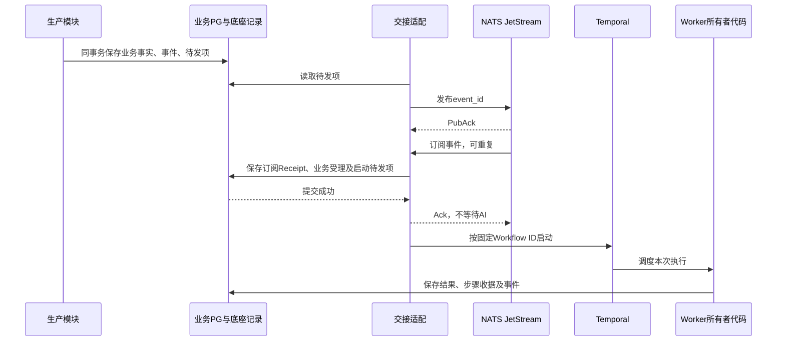
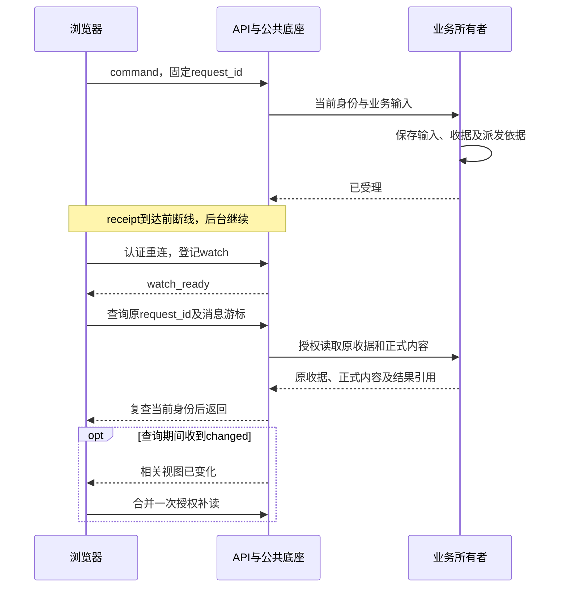

# M1 系统底座设计

> **版本**：v0.65<br>
> **状态**：能力按小增量接线；实际进度与待确认项见实施计划<br>
> **维护与评审**：Codex编写及自检，用户审阅<br>
> **写作规范**：[系统设计写作规范](../../../top/DeerMind_System_Design_Writing_Standard.md)<br>
> **更新日期**：2026-11-22<br>
> **修订说明**：v0.64 → v0.65，更新账号重建与读取验证链接<br>

本文设计接入、路由、派发、运行保障、全局事件和输出回传等共用机制，为业务模块、核心Space及AI底座提供基础接口。事件含义、业务先后关系和状态判断由调用方定义，本文件不建立中央教学或评价决策器；共同输入见[工程入口§2](README.md#2-设计输入与历史参考)。

已确认采用NATS JetStream投递业务事件，Temporal承接持久执行、等待和恢复，PostgreSQL保存业务记录及正式事件。公共运行底座维护授权、路由、事件与执行及回传关联，提供技术重复识别；业务重复由所属Space判断。Pydantic AI属于AI底座，供业务Operation调用；M1现有入口直接派发，不在公共路由另调模型。组件总览见[总体§6.1](System_Design.md#61-已定技术与待选方案)。

本批补共享Worker的入口登记与恢复接线；投递保留、恢复计时、认证及业务权限沿已定合同。底座不另建业务任务队列或替代Temporal的调度引擎。

**源码落点。** `server/src/deermind/foundation/system/`承载events、projections、executions、waits、delivery、realtime、files、authz及logging；事件语义与业务投影由所有者注册。公开合同、私有存储、投影及依赖规则见[源码组织§3—4](Source_Organization.md#3-后端源码)；HTTP按[OpenAPI合同](API_and_Message_Design.md#7-openapi与可执行合同)导出，本文继续维护业务行为。

跨层合同及源码位置统一见[源码组织§4](Source_Organization.md#4-模块依赖与装配)。消息承接与核对、工作派发与收尾、等待补查均由底座实现；技术适配通过抽象接口提供收发和执行控制。生命周期及等待Activity只转换SDK协议，底座服务内部开启原有短事务。文件登记及其投影归底座文件模块。维护版本和锁编号由Bootstrap注入，底座不导入数据库接线常量。

## 1. 共用合同与调用边界

### 1.1 结果身份与载荷归属

公共结果键为 `result_key = (scope_id, trigger_event_id, producer, result_kind)`。它回答“哪个空间的哪次事实，由谁产生哪类结果”；后台任务重试不能换一个键重新生效。

| 字段 | 类型／必填 | 含义与约束 |
| --- | --- | --- |
| `scope_id` | 非空标识／是 | 资源范围的全局唯一身份，资源类型由事件信封记录；必须与触发事件归属一致。Evaluation的个人评价限定为学习空间，教材导入等使用自身范围 |
| `trigger_event_id` | 非空标识／是 | 已提交原始事件的身份；重复通知和技术重试沿用同一事件 |
| `producer` | 注册名称／是 | 结果生产模块，例如`evaluation`、`domain`；不能由模型输出自行指定写入权限 |
| `result_kind` | 注册名称／是 | 由生产模块的处理合同声明；Evaluation使用`belief_result`、`goal_result`；Interaction的当题判题事件不属于Evaluation结果 |

每个键对应一次触发的一批结果，例如一轮作答涉及多个 Claim、方法或评价方面时，`belief_result` 返回这一批处理结果，不按每个 Claim 再建公共结果键。批内条目、跳过原因及覆盖进度由 [Evaluation §5](Evaluation_Space_Design.md#5-评价数据与公开接口)定义。

以下结果登记用于生产方自身的执行追溯和公开读取，不是等待者交给生产方的应答清单；有没有消费方等待不影响其业务处理和事件发布。生产方受理后登记该操作预期产生的结果键；受理前，触发事件可以已经存在。公开结果与技术执行记录分开保存：

| 记录与表定义 | 用途 |
| --- | --- |
| [预期结果登记](database/Business_Runtime.md#15-runtimeexpected_results) | 将结果键绑定到一次生产处理，区分未受理与已受理 |
| [结果处理尝试](database/Business_Runtime.md#16-runtimeresult_attempts) | 分别保留受理、执行和失败；新尝试不覆盖旧错误 |
| [已发布结果](database/Business_Runtime.md#17-runtimepublished_results) | 指向不可变批结果；每个结果键只能有一个成功发布结果 |

M1公共结果的生产者均有Execution：Domain入库接收与独立目标对照为handler，供题及证据解释为ai_operation；解释流程内部的目标结果沿原Execution发布。预期结果登记绑定execution_id，发布携带该执行的有效attempt_id；普通同步API收据不借用此表伪造Execution。跨尝试保持execution_id与结果键不变。

`attempt_id` 标识一次执行尝试，不是一次Activity重试、新题、新证据或新学习机会。生产方决定哪些条目形成了业务结果；底座只校验身份、权限、发布唯一性和读取可见性。`no_evidence`、`unchanged`及领域业务`rejected`均是处理完成后的业务结果，可以发布；生产操作的执行超时、服务不可用等技术失败只写尝试记录，不能占用成功结果位置。

### 1.2 公开操作

以下是内部操作合同；事件传输采用NATS JetStream，业务数据库采用PostgreSQL，底座内部合同及存储见§3—4；浏览器接线仍由客户端设计承接。下表运行调度操作接收程序建立的 `access_context`。事件读取另按§2接收经业务入口核定的条件；调用者不能通过参数声明自己拥有权限。所有操作的权限校验失败均返回 `forbidden`，不能借助重试跳过授权。

| 操作与调用方 | 输入 | 输出与失败 |
| --- | --- | --- |
| `read_result`：获授权的业务模块或 Space | `result_key` | `available` 返回不可变 `result_ref`、发布时间及生产方载荷；其余状态见下表。参数不合法返回 `invalid_request`；越权返回 `forbidden`；读取故障返回 `temporarily_unavailable` |
| `read_publication`：获授权的业务模块或 Space | `scope_id`、`publication_type`、可选 `publication_ref` | 本轮类型为 `learner_mastery_state`。指定引用读该份发布内容，省略引用读最新已发布内容；有结果返回 `available(publication_ref, payload)`，无发布返回 `not_found`。越权与读取故障分别返回 `forbidden`、`temporarily_unavailable` |
| `register_wait`：事件消费方 | §3.1的归属、条件、期限及命中／超时处理约定 | 底座保存并执行本方等待，按命中或到期唤醒对应入口；登记不启动或约束生产任务，不要求生产方先登记预期结果 |
| `cancel_wait`：等待记录所有者 | `wait_id` | 成功或重复取消返回 `cancelled`；接续已提交返回 `already_completed`，不回滚已发生的业务动作；不存在或越权分别返回 `not_found`、`forbidden` |
| `publish_result`：注册的结果生产方 | `result_key`、`attempt_id`、`execution_id`、拟发布的不可变结果引用及载荷 | 首次提交返回已发布 `result_ref`；同键同引用的重试返回原引用；同键不同引用返回 `result_conflict`。未受理、引用无效、越权或提交故障不得产生可见的半成品 |

`read_result` 只查询已经登记或发布的状态，不启动评价、不修补结果。返回状态按以下顺序确定：

| 状态 | 确切含义 |
| --- | --- |
| `available` | 已有成功发布结果；历史失败记录不再影响这个状态 |
| `pending` | 没有成功结果，生产方已受理但尚未开始首次尝试，或最新尝试处于已受理／执行中；Activity或模型单次报错但尚在自动重试时仍返回此状态 |
| `failed` | 没有成功结果，最近一次生产处理尝试已结束自动重试并失败，且尚未受理恢复尝试；返回该尝试与失败引用 |
| `not_found` | 没有成功结果，也没有生产方受理登记；触发事件仍可能已提交，不能据此判定学生没有表现或评价失败 |

`read_publication` 通过生产方注册的公开读取接口访问已发布快照。Evaluation 维护掌握状态的载荷、发布索引和“最新”的处理覆盖语义，底座不再计算或复制一份学生状态。指定引用与省略引用都不等待正在执行的评价；调用方依赖某次评价时，另用其结果键等待，再读取符合覆盖条件的快照。

下面是接口调用示意，标识均为样例；不是可执行代码或已选择的传输协议：

```text
read_result(
  scope_id = "LS-001", trigger_event_id = "EV-ROUND-003",
  producer = "evaluation", result_kind = "belief_result"
)
→ failed(attempt_id = "ATT-01", failure_ref = "FAIL-01")

同一键的新尝试 ATT-02 被受理后：
→ pending
该尝试成功发布后：
→ available(result_ref = "RESULT-003", payload = Evaluation定义的批结果)

read_publication("LS-001", "learner_mastery_state")
→ available(publication_ref = "MASTERY-003", payload = Evaluation定义的已发布快照)
```

失败记录 `FAIL-01` 仍可追溯；新尝试不得通过更换触发事件或伪造新学习机会避开原身份。样例中的快照是否已包含这次评价，由载荷的覆盖信息判断，不能由引用名称推断。

### 1.3 Operation、Step与OperationRun

Operation是一项AI业务能力；Step是能力内部需要保留结果、重试或等待的步骤；OperationRun记录一次AI业务执行。它们沿所属业务模块和Space组织，不另加Capability层。目录与普通入口分别见[工程入口§5](README.md#5-m1-operation总目录)。

| 对象或处理 | 责任与执行边界 |
| --- | --- |
| Operation | 预定义AI业务能力；组织上下文、模型／工具、业务步骤及校验，不由LLM临时注册 |
| Step | Operation内部步骤，可包含普通计算和存取；不逐个登记成Operation或独立Agent |
| OperationRun | 一次AI能力执行的固定输入、进度、产物及来源；按§3.3映射执行尝试；一个业务Run可有多次明确授权的恢复尝试 |
| 普通API／消息处理 | 查询、保存、活动控制及确定性派生；直接执行所属模块代码，不强制进入Agent或创建OperationRun |

两类处理都先核对授权和稳定请求／事件身份，再执行业务。普通短事务返回结果及提交收据；需异步执行的工作先可靠受理，再返回可追溯的受理信息。AI Operation使用OperationRun关联执行；普通后台工作保存必要处理记录，技术执行统一使用§3.3的Execution记录；普通工作不因此拥有Operation身份。

普通异步处理也可使用Temporal的恢复能力，但不因此成为Operation。鉴权、重复识别、已成功部分保留、事件交接及失败查询是共同要求，不能因移出Operation目录而删除。

例如`evaluation.reassess_target`直接按规则重新对照目标，是普通消息处理；`evaluate_submission`需要AI解释表现，其内部复用目标函数，不为该函数创建子OperationRun。读取已有公开结果可以直接返回；跨Space需要新加工仍通过事件交接。

### 1.4 共同字段和错误的使用

各操作中的`*_ref`表示带对象类型、稳定身份及必要依据修订的引用，由所属模块解析并校验授权。业务内容Schema沿用对应产品规格，不允许以任意JSON跳过字段和引用检查。对外列表查询使用`cursor`与`limit`，返回`items`及可空`next_cursor`；游标绑定范围、筛选和稳定排序，不能跨查询挪用，具体限额交接口接线设计确认。

模块声明的语义结果（如`needs_input`、`no_usable_task`）是操作的合法输出；服务失败、无效模型输出和提交失败是技术失败。两类结果分别留痕；不会因为操作执行完成，就把内容判为正确或学生判为达标。

### 1.5 接入路由、上下文与派发

用户确认M1现有入口直接派发，不在入口前另调LLM选择Operation。路由函数仍归公共运行，负责查登记和授权派发；学生表达的讲解、求助或检测含义归handle_input内部判断。教材纠错意图归教材助手。以后新增无法明确归属的通用入口，再设计语义路由，本期不留一个必须实现的空路由Agent。

入口登记由程序维护：`entry_code,transport,request_schema_ref,owner,admission_handler_ref,target_entry_ref,execution_kind,authorization_policy_ref`。target_entry_ref来自工程入口§5／7目录；客户端只发送已公开entry_code及业务参数，不能自填Operation名、模型或Worker队列。普通入口后续是否安排AI由所有者决定，不由前端猜测。

| M1入口 | 公共映射与所有者处理 |
| --- | --- |
| 学生自然输入 | Interaction校验空间、busy和请求身份，保存输入并登记handle_input；意图不清在该Operation内澄清 |
| 教材助手输入 | Product校验导入、来源与busy，保存输入并登记converse_material_assistant |
| 明确检测动作／接受检测建议 | Interaction核对必要参数及活动衔接，登记prepare_detection；聊天内转检测复用该准备流程，见Interaction§4.1 |
| Domain定义提取／归类命令 | 按对应管理入口及权限登记extract_template／classify_instance；正式保存仍经Domain校验 |
| 业务事件 | 依订阅登记进入普通处理、AI能力或等待适配；Evaluation先顺序扫描，不能按通知顺序直接启动评价 |
| 普通管理、查询、作答与控制 | 进入已登记普通处理器；需要后续AI时，由所有者保存其派发依据 |

1. 公共运行校验登录／内部身份、入口登记和请求Schema，拒绝未知入口，不猜测替代目标。
2. 调用所有者受理适配，核验资源、当前业务条件与防重。需要后台工作时，输入、占用、Execution、授权和待派发记录同事务保存；提交后才返回收据。
3. Relay按固定入口与执行身份派发，Worker运行所有者代码。已受理输入的后续取材、语义理解和提交仍由Operation负责。
4. 无权、busy、非法参数与技术故障分别返回；已明确的文字输入无需先完整理解才可受理。缺教学范围等语义信息时，由已受理Operation保存澄清消息并结束本次工作。

底座只按登记处理启动引用，不扫描聊天或生成业务摘要。路由不执行学习助手来“试选”另一个Operation，也不在每个业务步骤之间重新决策。接口接线见§5.3，AI边界见[AI底座§1.1](AI_Foundation_Design.md#11-路由调用与业务调用)。

### 1.6 Operation执行与输出回传

Operation的AI业务流程由所属模块编写，Worker在Temporal调度下执行其Workflow／Activity。Worker也可执行普通后台处理器；Worker任务、Temporal Workflow与Operation不是同一个分类。底座提供任务受理、等待恢复、授权和运行观测；不在每个业务步骤之间接管决策，也不把蓝图节点硬编码进中央路由器。执行映射见§3.3：一个执行尝试对应一个Workflow，业务Step按持久边界映射Activity或等待。M1的记忆摘要先作为所属Operation内部步骤，不因调用LLM或保存摘要另建一个调度Operation。

底座按[总体串行边界](System_Design.md#721-已确认的总体选择)保障同一学习空间的Interaction消息处理顺序：当前输入未结束，后续新输入由Interaction返回busy并保留客户端草稿，不建等待消息队列；依赖当前活动的路由事实在处理该消息时核对。满足当前等待的通知恢复原处理，不能排在后续学生消息之后。释放Worker资源不解除这一顺序约束；Evaluation、Domain及其他空间可并行，查询与回执不作为下一条学生输入阻塞。Interaction入口占用和停止提交检查见其§2.4、§3.6；底座只恢复已受理工作，与Temporal的映射见§3.3。

AI Operation或普通处理器把可公开的进度或已校验结果交回底座。底座按原请求、运行、用户和资源范围保存输出关联，并经NATS通知API侧回传适配；浏览器通过WebSocket接收变更通知，再授权读取正式结果，不直接连接NATS。回传按关联定位，不调用AI再次判断接收人。回复检查保存后整条展示；断线读取已存消息和收据，不重新执行。信封与补取见§5.3—5.5。

所属Space决定消息、活动和评价的事实及投影；底座统一追加事件，所属模块同步生成自己的查询数据。底座不因保管事件而获得各模块业务表的写权限。受理和恢复所需输入仍须持久保存，但它们不替代正式聊天历史；事件与查询投影沿用共同短事务提交保障。学生回复由Interaction检查保存后整条回传，候选token不公开。客户端显示另留回执，不驱动评价；业务上“正式提供”由所有者提交记录确定。

跨模块事件含义、生产方、使用方及关联事实统一登记在[工程入口§6](README.md#6-跨模块事件目录)。公共运行维护通用信封、存储、投递及授权查询；业务模块维护载荷含义。取证只读事件不必订阅触发，结果通知不等于可直接展示内容。

## 2. 全局事件的追加与查询

公共运行内的**事件管理子模块**统一承担追加、事实正文存取、顺序、按条件查询、订阅和投影进度。不另部署服务，不导入各Space的业务模型。生产模块登记事件Schema，业务模块维护投影器和读取授权；消费模块注册订阅及处理入口。

事件及不可变附件是业务历史唯一来源。模块表是查询投影、确定性索引或执行控制，具体分类见[数据库总册§3.1](Database_Design.md#31-事实投影与控制数据)。模型输出只证明模型当时给出该输出；正式采用另有事件，不能将候选当作已教学或已掌握。

| 内部端口 | 输入与输出 | 行为 |
| --- | --- | --- |
| append_events | access_context、transaction_context、已登记事件批、各范围expected_seq；返回event_id及scope_event_seq | 校验生产者、Schema、引用和序号；只追加，同键异文拒绝；不自行提交 |
| read_facts | 单个事件ID、scope种类和ID、指定记录或路径，可附类型、版本与请求关联号 | 先匹配全部条件，再按记录解包并校验附件；不自动追读来源 |
| query_metadata / scan_scope | 前者按范围筛选元数据；后者接收调用方连接、固定范围与上界、目标类型 | 前者返回分页位置；后者返回目标 StoredEvent、已检查序号及上界 |
| apply_projection | transaction_context、登记projector_id、generation、已核验事件 | 纯确定性转换，投影数据和应用收据共同提交；不发事件、调用模型或安排执行 |
| register_subscription | 登记订阅者、类型、归属策略、处理器及start_policy | 装配时登记；业务选择订阅范围，底座检查权限及兼容版本 |
| rebuild_projection | 受控维护授权、projector_id、新generation、固定范围及上界 | 只重建白名单查询投影；核对后切换，不处理历史业务命令 |

字段唯一合同见[事件消息](contracts/Event_Messages.md)及[正文与投影](contracts/Event_Facts.md)；表字段见[公共运行字典](database/Business_Runtime.md)。这些是普通内部能力，不增加AI Operation或管理页面。

### 2.1 订阅与处理入口

底座封装事件发布订阅。生产方定义并发布自己的事实事件，消费方声明关注哪些事件；需要等待时，由消费方登记匹配条件、期限以及事件命中和等待超时的处理入口。底座负责匹配、计时及唤醒，处理入口内的业务决定归消费方。订阅可指向普通处理器、AI Operation或原执行的恢复入口；事件驱动不意味着必须调用AI。生产方不读取或管理这些等待。

等待超时是消费方的等待到期，不是生产方的执行结果。即使生产方没有发出任何完成或失败事件，底座也按消费方期限唤醒其超时入口。生产方自身失败按其运行合同留痕；若发布相关事实，消费方可按自己的订阅处理，不能把未收到消息直接写成生产失败。回调登记见§2.4，竞争及恢复见§3.1—3.3。

事件记录顺序和实际发生时间分开，见§2.2—2.3。消费者不能按NATS投递顺序推导发生顺序，也不能按记录时间证明某项教学已经呈现。

<a id="22-空间事件顺序与有界读取"></a>
### 2.2 各范围事件顺序与有界读取

每个(scope_kind,scope_id)有独立的scope_event_seq。学习空间、教材导入、Domain、配置和执行范围均使用此顺序；不同范围不承诺全局先后，因果关系通过源事件引用表达。时间戳不是扫描游标。

生产处理器先取得既定业务锁；事件管理再按(scope_kind,scope_id)排序锁住序号头，校验expected_seq，分配已提交序号。事件、本地投影和待发安排同事务提交。取得事件序号锁后不得反向取得新的业务锁或等待外部服务；投影器只使用已保护对象及本次预分配身份。冲突重读事实／投影后重新校验，不让LLM直接跳过并发保护。

scan_scope在调用方事务内检查(after_seq, upper_seq]的下一页。查询保留该页所有序号；只为目标类型加载正文。首位、中间或末位缺号均使整页失败，没有目标事件的完整页仍推进到已检查的位置。

生产者同步投影写(projector_id,generation,event_id)应用收据，不以单条事件跳跃推进范围扫描游标。订阅者需要顺序时，从自己的已完成位置读取连续区间；投影变更、应用收据和扫描位置共同提交。并行投递或重复通知不能改变业务顺序。Evaluation保留同空间顺序评价及失败暂停的规则。

### 2.3 事件时间合同

用户已确认服务端时间为评价依据，统一存UTC，界面显示Asia/Shanghai。字段采用带时区的时间值，传输使用UTC ISO 8601；时长用秒。客户端时间保留来源，不作为可信发生时点。

时间字段逐项定义见[事件信封](contracts/Event_Messages.md#1-正式事件信封-v2)；本节保留可信时间的解释与取值规则。

业务接受作答、开始检测等由服务端执行的动作，可用确认时点作为occurred_at。呈现回执的接收时间只能证明“此时收到回执”，不证明内容就在该时刻首次显示；具体呈现仍保留未知。Evaluation使用明确的规则端点计算间隔，unknown不补0。底座不替消费方解释七天保持或帮助资格。

本批存储接线稿以业务PostgreSQL的取时能力提供服务端记录时点，不使用事务启动时间代替很久之后发生的动作；当前数据库与其他运行系统的时钟协调仍由基础设施§6落实。事件顺序使用scope_event_seq而非时钟排序。

### 2.4 事件信封与订阅登记

业务事件保存在runtime.events，以下字段在保存时固定。正文由事件的固定内容承载；大附件按hash保留。业务身份引用只用于定位，不能代替正文；模型候选不能自行登记事件。

正式事件信封和逐类型payload统一见[事件消息分册](contracts/Event_Messages.md)。本节维护保存、去重及消费机制，不再重复字段表。

event_id相同且事实内容相同返回原事件，内容不同返回identity_conflict。通知和重试不能新建第二个事件身份。版本不识别时保留失败及原始传输引用，不按最新版猜读；旧解码器与执行兼容按[基础设施§5.3](Infrastructure_and_Deployment_Design.md#53-schema迁移与版本兼容)接收，正式事件不改写。

订阅由消费模块提供，装配层登记，不向管理员开放流程编程。每项包含subscriber_id、start_policy、event_types、handler_ref、handler_revision、授权范围、受理适配器及成功／失败处理器。筛选是已登记类型和等值归属，不执行事件携带的函数或脚本。等待命中／超时入口单独按§3.1登记。

同一subscriber_id的副本共享一个JetStream持久消费者，不同订阅各收到所需事件；显式确认收到。NATS只送事件引用及通用信封，消费方通过底座核对正式事件，不能把任意外部消息当成事实。具体subject和消费者名称由装配配置派生，处理器不得自行订阅通配的学生正文。

### 2.5 查询与读取边界

内部query_metadata仅查指定范围内的元数据，可按类型、主体、关联号、起因事件和记录时间过滤。首查固定已提交上界；续页沿用相同范围、筛选及上界，传入next_after_seq。外部查询入口每页核验权限并组织可见摘要。

连续扫描使用§2.2的scan_scope。业务入口按来源限定记录与字段后，通过read_facts读取原始消息、作答或教材结果。附件只随点名的记录读取。

原文用途及调用方/记录/字段矩阵唯一维护于[事件正文§2.2](contracts/Event_Facts.md#22-原文读取用途与权限)。业务所有者限定范围，底座执行调用方给定的具体查询条件；purpose不授予权限。对外事件视图按字段裁剪，不能返回完整内部EventEnvelope再交浏览器隐藏。

### 2.6 历史补读、实时接续与重建

订阅登记明确start_policy=new_only|history_then_live。普通业务处理首次登记默认只处理启用后的新事件；重启沿既有收据和游标继续，不重设起点。学习评价不因新增订阅而重评旧作答；原已受理失败工作的恢复仍沿原身份接续。history_then_live仅允许登记的查询投影器，不允许指向AI Operation或有业务副作用的处理器。

1. M1首次登记或变更订阅在维护窗口暂停相关写入：启用持久订阅，在一致快照中登记已授权范围及上界H，再开放写入。new_only以H为启用边界，history_then_live从起点补至H；重启不重复初始化。历史读PG，不依赖NATS旧副本。
2. 在登记的generation中按范围顺序处理至H。期间实时消息可靠接住后可作为唤醒，实际补读仍从已完成游标扫描事件库。
3. 完成历史后继续从H之后扫描；重叠事件按应用收据跳过。首次出现的新范围在授权检查后建立游标，从该范围起点读取，不漏掉登记期间新增资源。
4. 查询投影失败只停该投影的进度；修复后从原游标继续。订阅Receipt只证明接住，projection_receipt／offset才证明加工完成，两者不能混用。
5. M1重建使用维护窗口暂停相关写入，在隔离的临时关系／generation中生成并核对行数、来源和最终状态；通过后按既定外键顺序事务替换查询数据，失败保留旧投影。generation是投影防重身份，不要求每张业务表加generation列。M1在线投影固定generation=1；维护重建使用大于1的独立代次。替换查询数据时，同事务把覆盖范围内已应用收据合并到在线代次，并把其扫描位置推进到固定上界；新代次标记completed后才恢复写入。失败不更换在线数据或进度，不增加另一张当前代次表。

重建只能调用无外部副作用的投影器。不能把历史事件重新投递到正常业务订阅，不再调用LLM、不重算新Evidence或概率、不发提醒。运行中的Execution、Wait、凭据及Temporal历史沿原备份／恢复合同处理；不从事件重建成可执行的新工作。

**E01-08补修。** 事件类型登记只含正文格式和所有者校验，不绑定投影器。底座不定义业务表、主键、转换、关联或替换规则；`projections/receipts.py`与`records.py`只维护防重、进度及维护结果，业务处理器在同一事务调用这些记录能力。

重建由所属业务维护入口组织：申请固定范围和上界，通过授权事件查询取得完整事实，调用本业务生成器写隔离副本，再由业务核对及替换。副本元数据只在维护记录中保存，由业务解释；底座不按表名生成SQL。账号的五表生成与重建见[Product§2.8](Product_Application_Design.md#28-账号业务投影与维护重建)。

操作人先停止相关写入，再取得与迁移共用的维护锁。NOWAIT仅检查取锁当时，后续应用写入受已定3秒锁等待上限保护。业务维护入口在同一事务中固定来源上界、生成隔离副本并核对。未采用的事件计入扫描覆盖，不创建投影应用收据。

每批指定能独立核对的范围，覆盖该范围的完整历史及必要依赖。核对通过后，同事务提交业务替换、应用收据、扫描位置和唯一成功记录。失败回滚本批生成与替换，已提交的其他批次仍有效。事务可用时记录明确失败；若中断或提交回执丢失，重连后按本批身份查询结果。确认未成功后，使用新身份和代次从头重做本批。凭据、文件登记和执行控制不参与替换。

新增迁移`0009_projection_ownership`保存多表副本映射，不改旧迁移或历史事实。旧维护记录可查询，旧完成记录只代表当时覆盖范围。新批次只在完成时写入维护代次的扫描位置。字段见[运行分册§20](database/Business_Runtime.md#20-runtimeprojection_rebuilds)，命令与验证见[按范围重建交付](../../../../src/m1/deploy/environments/local-wsl/E01-08-rebuild.md)。

### 2.7 生产者同步投影

生产处理器准备完整事件内容和稳定业务身份，先校验业务条件，再在共同短事务追加事件、调用本模块投影器、保存命令收据及待发安排。只有共同提交后才回应成功。原文先写业务表、再从表提取事件不是允许路径。对象身份预先分配，追加事件不要求其查询行已经存在。固定原文引用只可指向已提交事件或本批较早事件；底座校验引用、授权及附件完整性，不能反向依赖尚未生成的业务投影。

同一事实可以生成多张本模块查询表，投影器先按[逐事件记录矩阵](contracts/Event_Facts.md#32-事件携带记录与条件)核对类型、条数、主键及条件，再按登记Schema转换。每事件属于该投影器的所有记录与应用收据共同提交，不能处理第一条后就记成功。源码入口不得绕过事件直接更新消息、对象版本、Evidence或目标结果。生产者不需要订阅自己的事件再生成一次本地对象；重建与实时投影复用同一确定性转换，应用收据避免重复生效。

### 2.8 E01-05接线

底座通过程序登记的事件Schema及所有者校验器接收内联事实；调用方提供受信生产者、获准范围及来源事件集合。整批先校验，按范围排序锁定序号头，底座追加事件及待发安排并返回完整已校验事件；外层业务显式调用自己的生成器、保存处理与命令收据，再共同提交。底座不登记或调用业务生成器，也不单独提交。

Product先取得请求收据身份，同键同文复用结果，同键异文拒绝。所有者投影完成后写在线代次1的应用收据，最后完成请求收据。序号、事实、投影和两种收据共同提交；任一步失败全部回滚。规范化请求按固定UTF-8 JSON编码取SHA-256，并比较完整输入；不保存凭据。

首个登记是无业务订阅的TrialAccountSaved/bootstrap_admin子集，不创建待发安排。只接线server_recorded与新账号投影；附件补充见下段；查询与维护重建接线见§2.9及§2.6；其他事件和订阅接续按所属增量实现。字段仍归数据库分册，测试和部署见[交付记录](../../../../src/m1/deploy/environments/local-wsl/E01-05-facts.md)。

### 2.9 E01-06附件提交

`FactAttachments.prepare`在业务事务外校验完整DTO，按已确认阈值保存、回读和登记附件，返回本次准备结果；不能把任意file引用直接当成已校验正文。`EventStore.append`重新核对生产者范围、记录矩阵、固定正文、文件登记及产物身份，完整信封超过1MiB则回滚业务批次。事件保存file引用，并返回解码后的完整DTO；调用者在同一事务交给自己的业务生成器。临时副本或调用方篡改不能造成事件与投影异文。

FileReceived只证明文件准备完成，业务完成仍由业务事件证明；文件与业务分两次短事务，前者成功不等于后者成功。文件缺失/hash错误明确失败，不改写历史、补空内容或删除已登记文件。授权读取页面和事件查询不在本批实现。结果见[交付记录](../../../../src/m1/deploy/environments/local-wsl/E01-06-files.md)。


**读取接线。** 业务入口按[用途矩阵](contracts/Event_Facts.md#22-原文读取用途与权限)核对身份、资源和来源，并选择所需片段。底座不接收浏览器传入的用途或授权对象。内部列表只返回元数据和数值分页位置；对外游标由业务查询入口维护。

账号重建的生成与独立复核均传入同一个维护连接。事件与文件登记在该连接内查询，文件字节经存储端口校验长度、哈希、类型、归属及规范编码。未知目标格式或正文不完整使本批失败。默认每页50条、最多100条；定点读取及元数据响应最多4MiB，事实解包预算32MiB。见[读取整改与验证](../../../../src/m1/deploy/environments/local-wsl/E01-08-rebuild.md#3-验证与限制)。

## 3. 持久任务与执行资源

### 3.1 等待记录

等待属于消费方；生产方只发布自己的事实，不接收等待期限或调用方恢复指令。register_wait与业务恢复位置在同一短事务保存，提交后补查已有事实。不能把生产方已受理作为登记前提。

| Wait字段 | 类型／必填 | 约束 |
| --- | --- | --- |
| wait_id、owner_ref、execution_ref、step_key | ID／引用／是 | 固定消费方及恢复步骤；同一执行和等待用途重复登记返回原记录 |
| condition | 对象／是 | event_types、scope、关联事实等值条件；等待结果时带result_key，不能包含脚本、SQL或自然语言判断 |
| probe_ref、condition_hash | 登记读取器、摘要／是 | 读取器检查已保存事实或公开结果；不启动生产任务或改业务状态 |
| deadline_at | UTC时间／是 | 消费方决定；重试不重置。到期先查可用结果，仍无结果才处理超时 |
| resume_action_id、on_match、on_timeout | ID、登记处理器／是 | 都归消费方；不允许事件或LLM替换回调 |
| resolution、matched_event_ref、result_ref | 枚举及引用／是，引用可null | pending／matched／timed_out／cancelled；只能从pending决定一次 |
| handling_state、handling_ref | 枚举、引用／是，可null | awaiting／committed／failed／cancelled；等待已决定不等于业务接续已提交 |

匹配只判断事件身份和关联事实；例如belief_result已发布，即使其中没有合格Evidence，也算等待满足，业务含义由Interaction解释。多个结果用多个Wait表达；所属Operation决定何时全部必要结果齐备，底座不建立任意布尔表达式引擎。

### 3.2 释放资源与恢复责任

1. 保存Wait后，Workflow调用probe Activity补查已有事实；已可取则决定matched，否则等待Signal或持久Timer。挂起释放线程、连接及AI调用资源，不释放Interaction的业务输入占用。
2. 事件桥只提示某Wait“可能已有结果”；Signal处理器只记唤醒引用，不查数据库或调用LLM。Workflow收到提示后再次执行probe。Signal先到也保留，不能因尚未进入等待行而丢失。
3. Timer到期同样先probe。用户已确认：此时已有可用结果就继续，否则决定timed_out；不是用网络到达时刻判学生表现，也不是严格拒绝晚于deadline写入但超时尚未处理的结果。
4. probe在短事务内锁定Wait并登记唯一resolution及所读引用。普通匹配读取和到期读取使用相同函数，二者不会各提交一个结局。已有resolution直接返回；timed_out后结果到达仅保留结果，不改成matched。
5. 原Workflow调用消费方处理器，按resume_action_id提交后续业务和handling_state。恢复前重查业务状态及权限；原活动已变则结束接续，生产结果不删除。

probe需要调用所有者的只读数据库适配器时复用事务连接，只取必要记录，不等待AI或远程计算。业务提交遵循“业务所有者锁→Wait锁→底座事件锁”；probe只锁Wait，不反向取得业务写锁，避免锁序相反。

取消等待也锁定Wait。尚未提交接续时设handling_state=cancelled；resolution若仍为pending则改为cancelled，已有决定则保留。接续已提交返回already_completed。消费方在同一业务提交事务重查此状态，取消先完成便不能再推进活动。停止等待不取消生产工作。

通知早于等待、未成功送达或Timer与通知竞争，都由登记后的补查和到期补查兜住；不能只依赖一次Signal。Workflow未启动时信号待发记录保留；已结束的尝试不通过Signal-With-Start重新创建，恢复尝试按§3.3重新登记绑定。

### 3.3 OperationRun与步骤记录

用户已确认：原工作身份保持，自动重试在本次执行内进行；重试耗尽明确失败，获准恢复后另记执行尝试，复用已保存步骤。停止的工作不自动重启。

| 身份 | 与Temporal的映射 |
| --- | --- |
| Execution | 公共技术执行记录，kind=ai_operation／handler；owner、entry_ref、scope及固定input_ref创建后不变。AI工作对外称OperationRun，其ID就是execution_id，另持固定ai_config_ref；普通后台处理没有Operation身份或AI配置 |
| ExecutionAttempt | execution_id、attempt_id、ordinal、accepted_at、deadline_at、状态、失败及前次尝试引用；同一工作最多一个有效尝试。每次获准恢复追加一行并保存有限新期限，额度及消耗仍归原Execution |
| Workflow | 每个ExecutionAttempt对应一个Workflow ID：dm/{execution_id}/{attempt_id}；Temporal Run ID另记，不能拿它作为业务防重键 |
| Step | key=(execution_id,step_name,occurrence_key)；固定input_hash、output_ref及提交收据。跨恢复尝试保持key；真正的新候选使用新的occurrence_key |
| Activity／AI内部调用 | I/O和副作用放Activity；一个业务Step可调用多个Activity。Activity attempt与模型call_id分别留痕，不混用ExecutionAttempt.attempt_id |

Workflow只编排确定性步骤、Signal和Timer。数据库、文件、模型及工具调用不直接在可重放代码中执行。业务Workflow归各模块，公共底座登记入口及适配器；蓝图节点不自动变成Workflow，普通短查询／保存不创建Execution。

启动登记按entry_ref固定所属模块、输入Schema、Workflow类型、Task Queue配置引用和所有者提交／失败适配器；均来自程序注册，不接受模型给定名称。部署核对对应Worker已注册，未知入口拒绝。实现合同引用随首次受理固定，升级不得让旧输入静默执行另一份定义。

AI受理另调用AI底座配置适配器，在同一短事务保存本Execution所需用途的配置快照引用；无网络调用或密钥读取。用户确认配置改变只影响新受理工作，自动重试和新恢复尝试沿用原配置，服务故障不自动换模型。需要新模型调用而旧配置不可用时明确失败；已有候选仍可授权读取并按业务校验接收。密钥与当前授权仍取有效值。字段与用量账本见[AI底座§2.1](AI_Foundation_Design.md#21-配置对象与受理快照)及[§3.3](AI_Foundation_Design.md#33-执行预算与重试接线)。

Workflow输入仅带execution_ref、attempt_id、固定输入、实现合同及适用的ai_config_ref。每个副作用步骤先核对尝试仍有效，再检查稳定Step收据；已提交则返回原结果，未提交才执行业务。一次提交把业务结果、Step输出和必要事件共同保存。外部调用结果未留存前退出仍可能重复，不能承诺模型只收费一次。

复用Step须核对input_hash；同一key却输入不同返回冲突，不能覆盖旧输出。当前权限、对象有效性和业务位置仍由所有者在最终提交时重查，复用旧候选不等于允许按旧权限提交。

进程退出后的同一Temporal尝试按历史重放，已经完成的Activity读取历史结果。明确失败后获准恢复则启动新Workflow尝试：从逻辑入口重新进入，逐Step复用持久结果，只做尚未完成部分；不使用Temporal Reset回滚业务，也不依赖旧历史无限保留。AI内部恢复粒度见[AI底座§1.2](AI_Foundation_Design.md#12-与temporal的执行接线)。

| Execution状态 | 进入条件与退出 |
| --- | --- |
| ready | 输入、有效尝试及启动待发记录已保存；派发确认丢失不另建尝试 |
| running | 有效尝试进入执行；Activity正在自动重试仍属本次执行，错误单独记录 |
| waiting | 只等待跨模块事实，Timer／Signal仍由原Workflow维护；学生需要补充时按模块合同完成本次请求并返回needs_input，不占Run等下一条聊天 |
| completed | 所需结果、收据及所有者收尾已保存；无可用题／无Evidence等合法结果也可完成 |
| failed | 本次自动重试已结束或不可恢复；所有者按失败阶段释放入口、保留已提交结果。只有明确恢复指令可进入ready |
| cancelled | 所有者已废止后续提交；保留已完成结果。原请求重发不重启 |

公共接口为accept_operation、read_operation_run、retry_operation_run、cancel_operation_run及内部resume_operation；普通后台使用同一Execution仓储的accept_handler适配，不扩充AI Operation目录。受理输入含entry_ref、scope、input_ref、稳定request_id／trigger_event_id和授权来源；返回execution_ref、状态及已保存结果引用。同键异内容拒绝identity_conflict，重试不能借新请求重做原业务。

Temporal Client／Worker统一装配Pydantic AI序列化与已确认的PayloadCodec。模型、工具和材料Activity可能产生大载荷，按[基础设施§2.6](Infrastructure_and_Deployment_Design.md#26-temporal载荷外置)外置；业务Workflow仍只编排，不自行读写载荷文件。技术历史、业务Step和正式事件分开保存，Codec不承担业务幂等。

### 3.3.1 入口与Worker注册对应

用户确认M1共用一个应用Worker进程及一条Temporal逻辑队列。下表给出接线稿：建议业务Workflow类型名沿用entry_ref，类别由登记区分。实例仍使用§3.3的Workflow ID；学生、空间和模型配置不产生新的注册类型。

| entry_ref／建议Workflow类型名 | 执行内容与复用 |
| --- | --- |
| `product.converse_material_assistant` | 教材对话、解析和候选修正；一次消息一个已受理工作，整册内部拆批 |
| `domain.extract_template` | 从题目或解法提取定义候选，正式采用另走普通入口 |
| `domain.supply_task` | 统一查找、生成、检查及保存可用题，完成后发布供题结果 |
| `domain.classify_instance` | 归类并保存检查结论，不替代实例保存入口的校验 |
| `interaction.handle_input` | 学习交流及当题反馈；聊天内检测准备复用内部流程，仍属同一Execution |
| `interaction.prepare_detection` | 明确检测入口的题单准备；学生确认后才由普通控制入口开测 |
| `interaction.check_proactive_task` | 检查并保存任务建议，不自动开始活动 |
| `evaluation.evaluate_submission` | 解释作答、形成Evidence并执行确定性更新；先满足同空间评价顺序 |
| `evaluation.apply_learning_opportunity` | 核对教学机会并执行学习转移；沿同一评价顺序处理 |

上述9项是AI Operation。其他入口按以下方式接线，不能因为进入Worker就改成AI能力。

| 普通处理 | 接线 |
| --- | --- |
| `domain.receive_intake` | 普通handler Workflow，类型名建议同entry_ref；包括来源失效分支，结果与恢复沿Domain合同 |
| `evaluation.reassess_target` | 普通handler Workflow，类型名建议同entry_ref；只派生目标，不调用模型或更新概率 |
| `interaction.continue_after_result` | 唤醒既有Wait及原Workflow，由原Workflow调用消费方接续处理；不另建同源Workflow |
| 其余普通入口 | API直接执行所属模块处理；Worker内部复用同一所有者函数或Activity。入口后续需要AI时按既有合同另行受理，不能把所有查询／保存都包装成Workflow |

Evaluation只在所属模块允许开始后派发本次评价；不能用队列取出顺序替代其游标。同空间Interaction仍按输入占用处理，等待结果时不受理下一条消息。Workflow挂起不占正在执行的Activity槽位，也不长期持有数据库连接；缓存和持久记录仍占资源。

**注册与恢复。** 公共运行按既有entry登记装配Workflow类型、实现合同、输入Schema及队列配置引用；业务模块提供Workflow和所有者Activity，AI底座补模型／工具活动。API和Worker使用同一份发布登记，缺失或冲突时不开放相关入口，不交给模型补名称。新尝试沿原实现合同读取Step和候选，使用兼容登记；改变队列名不是恢复步骤。无法装载原合同则保留失败记录，不能调用同名但含义不同的实现。

Result通知按原Wait绑定的Workflow ID和attempt发Signal，不重新选Operation、不另发一份“接续任务”。原Workflow已关闭时沿既有迟到规则处理。NATS负责事实投递，Temporal负责执行调度，两者不共用业务队列或消息确认。

### 3.4 分层重试与全局协调

业务、调度和调用层各管自己的重试。传入预算包含本ExecutionAttempt的deadline_at及原Execution的额度、已用量引用。自动重试沿本次剩余时间；失败后获准恢复才建立新尝试、重新给有限时间，次数和用量不清零。新期限不恢复已超时／取消的Wait，也不恢复旧业务提交资格。预算字段与9项建议值见[AI底座§3.3—3.4](AI_Foundation_Design.md#33-执行预算与重试接线)。

| 层 | 重试对象 | 何时交回 |
| --- | --- | --- |
| 业务Operation | 合法但需修正的内容候选或不满足用途的题目 | 明确无结果／需补充时按业务结束；新的候选另留身份，不算传输重试 |
| Temporal Activity | 临时I/O故障、Worker中断 | 在所分配Schedule-to-Close等总预算内重试；耗尽或不可重试错误交Workflow处理 |
| AI／模型适配 | 结构修正、有限的模型请求重试 | 与上层共享剩余期限／用量；不叠加未受控SDK默认无限重试 |
| 交接适配 | 未确认的发布、启动、Signal | 只重送同一交接身份，不生成新业务请求；耗尽留下未交接记录 |

同一调用链满足下层总执行与间隔预算＋收尾余量≤上层剩余期限。跨Space消费方的Wait期限不是生产方预算，超时不取消生产方。Temporal Workflow不配置从头自动重试整次业务的策略；自动恢复以其历史和Activity重试为主，明确失败后的新尝试受上述授权控制。

权限拒绝、身份冲突、内容基准已失效不技术重试；可修正内容交所有者决定，不能伪装网络错误。资源不足沿既定M1规则返回错误，不按业务设优先级或私建等待队列；已经受理的工作保留原收据与失败依据。

模型调用成功但最终提交失败，先重试提交已存候选；Belief已提交而目标步骤失败，只恢复目标步骤。错误记录区分retrying与exhausted，read_result只在生产处理尝试最终失败后返回failed，单次调用报错仍有重试时返回pending。

### 3.5 M1的时间触发边界

保持检测在学生再次进入学习空间时检查，离线期间不运行后台保持检查或提醒。暂缓后的再次提示同样以重新进入空间为前提；拒绝后须有新依据。活动结束和评价完成是事件触发，不新增周期扫描。

执行超时、重试间隔及等待期限仍属于运行保障。上述简化不取消技术计时，也不限制已受理的教材解析、评价等后台工作继续执行。

<a id="35-首轮调用与连接参数建议"></a>

### 3.6 首轮调用与连接参数建议

用户已确认单次模型请求和Activity尝试上限；其余候选如下表标注。它们是接线起点，不是SLA或容量结论。各工作仍须配置有限总预算，本文不改变§3.4的分层责任。

| 项目／状态 | 值与边界 | 理由 |
| --- | --- | --- |
| 单次模型HTTP请求／已确认 | 总时长90秒，其中连接最多10秒；供应商SDK重试0次 | 延续教材试验90秒上限；防止底层隐式重试叠加 |
| 模型Activity／已确认 | 最多2次尝试（含首次）；StartToClose 120秒、ScheduleToClose 250秒 | 单次120秒包含请求和技术收尾；两次及间隔在250秒内，调度等待也占此上限 |
| 工作收尾上限／E01-13已确认 | 30秒 | 提交结果、失败记录及释放入口；预留不是无限等待锁 |
| 数据库短请求／E01-04已确认 | 统一见[基础设施§4.5 D01](Infrastructure_and_Deployment_Design.md#45-首轮入口与执行参数建议) | 锁等待计入语句预算；冲突失败沿原请求恢复，不持锁等待AI |
| 浏览器连接／待确认 | 统一见基础设施§4.5的S01–S07 | 断连只影响通知，HTTP补查正式结果；不作为后台工作超时 |

重试间隔仍建议2秒，待确认；不因尝试上限获准而默认所有参数都已确认。执行前按剩余工作期限收紧Activity预算；没有足够时间就停止新增I/O，不能为了用完2次尝试而越过上层期限。250秒包含调度时间，不能保证繁忙时一定完成两次尝试。这里的自动尝试不创建新ExecutionAttempt；获准恢复使用新期限、原累计额度和已保存步骤。

外部Domain供题、Evaluation结果的等待期限由消费方单独提出，不套用HTTP的90秒。教材多批处理和聊天内检测准备必须分别核算总期限；本批未批准这些业务数值。参数经确认后写入发布配置，未确认前不作为默认值。

### 3.7 工作时限与消费方等待

工作时限、消费方等待、模型请求和消息确认分别计时。E01-14已确认消费方每次等待最多300秒，业务可更短，并须给后续处理保留时间；恢复不延长原等待截止点，不要求生产方在同一期限内结束。限额唯一维护于基础设施§4.2。

| 场景 | 计时起点与到期处理 |
| --- | --- |
| 一次AI工作 | ExecutionAttempt受理即计时，启动交接及Temporal排队均占时间。Workflow启动晚了只拿剩余时间，不能从Worker开始再领整份期限 |
| 检测准备等Domain供题 | 从首组供题请求及Wait登记时计时，所有组共享本次准备的等待窗口；上限300秒，且不超过父工作剩余期限减后续处理及收尾预留 |
| 讲解确需等新掌握结果 | Interaction自行登记Wait，上限300秒；到期先查结果，再按活动规则结束等待，不能据此判学生不会 |
| 主动任务遇到评价尚未完成 | 保存待结果原因并结束本次检查；后续评价事件可重新检查，不占住一次AI执行无限等待 |
| Evaluation等前一来源 | 属于顺序进度等待，未受理下一项AI工作，不消耗其模型预算；前序最终失败按Evaluation§6.7暂停后续更新 |
| 题单确认、教材候选采用 | 当前工作先结束，用户以后确认是另一条请求；不保留长时Workflow等人工决定 |

供题Wait到期时，Interaction只使用已取得且满足条件的结果，按既定合同说明缺口；没有可用题则暂不能检测。Domain继续保存自己的结果，迟到结果不自动开测。900秒的聊天／准备建议时限至少要覆盖规划、300秒等待和结果保存；多组请求不能逐组再领取300秒。

开始等待前，Operation按所需剩余步骤预留时间；下层调用按当前余量收紧。到期补查也使用预留期限。生产方未完成、读取失败、没有合格内容分别记录，不能都写成“学生未达标”。具体规则沿§3.2及§4.2。

授权恢复先读取旧Wait的已决定状态：超时／取消则处理原结论，不能清空状态再等一轮；仍有效才绑定新尝试，原Wait截止时间不变。确需再次等待须由消费方发起新的业务请求，并保留原因。恢复运行期限不等于延长所有业务条件。

## 4. 可靠交接与提交控制

本节承接[三项恢复目标](System_Design.md#64-已确认的恢复目标)：已受理输入不丢、已完成结果不重复生效、未完成任务可恢复；无法继续则明确失败并保留已成功部分。底座提供共用保障，数据所有者决定业务提交边界及重复处理规则。请求ID或消息ID去重不能代替Evaluation的业务去重。[总体§6.5](System_Design.md#65-已确认的恢复保障方案)已确认先保存再确认受理、可靠交接、业务防重与补发、结果补取及失败处理；具体交接及恢复见§3—4，数值参数仍待确认。

可靠受理必须保留输入和后续处理依据；确认收到后即使尚未派发成功，也能恢复并补派发。§4.1—4.2承接结果与待发事件共同保存和补查；§4.4—4.5定义派发、停止和失败收尾。Product、Domain、Evaluation及事件的同库事务边界已确认，其余接线机制仍为本批待审稿。

### 4.1 发布边界

生产方完成业务校验后，先准备不可变批结果。生产方业务提交、对应业务事件、本次产生的公开快照、公共结果发布及通知待发记录必须在同一逻辑提交边界可靠保存：调用方读到 `available` 时，结果载荷及其依据已经可读，相关通知即使尚未送达也有持久重发依据。不能先发成功通知再补保存；未产生新快照的结果不需要额外制造一份快照。

`publish_result` 校验生产方身份、预期结果登记和执行尝试，按结果键检查是否已有成功发布。相同引用的重复提交返回原引用；不同引用不得覆盖。生产方在提交前固定不可变引用，响应丢失时沿用该引用重试或先读取结果；底座不通过重新运行模型比较两个结果是否“语义相同”。生产方负责批内计算和业务更新的幂等，底座的发布去重不能替代 Belief 更新去重。

成功发布后通知只携带 `result_key` 和 `result_ref`。通知表示结果可读，不携带“转入讲解”“出下一题”等教学命令，也不把生产方载荷复制成另一份事实来源。

### 4.1.1 同库事务适配

Product、Domain、Interaction、Evaluation和正式事件使用同一业务PostgreSQL数据库，按模块schema分开。用户已确认共同短事务：Domain入库按[§6.5](Domain_Space_Design.md#65-短事务与来源并发保护)保护教材来源；Evaluation按[§6.4](Evaluation_Space_Design.md#64-目标结果存储与原子提交)保护空间当前目标引用后提交结果。计算、AI和外部调用都在事务外，正式版本及历史记录不覆盖。

底座提供事务上下文及事件／结果登记能力，不实现教材有效性或领域校验。最外层业务处理器开始、提交或回滚；经装配层注入的所有者适配器使用同一连接，只访问本模块数据，不能自行提前提交。事务上下文不是HTTP接口、模型工具或权限凭证，不能交给LLM，也不能跨进程传递。API和Worker分别执行时各建立自己的短事务。

一次提交中，先由底座追加所有者准备的完整事实，业务所有者据该事件同步写查询投影，底座登记投影收据、公共结果及投递／接续待发依据；任一写入失败共同回滚。只有数据库提交成功才能返回正式保存成功。调用普通处理器不要求建OperationRun，命令收据、后台执行身份和业务结果之间保留引用。

Evaluation的Belief批次按[§6.6](Evaluation_Space_Design.md#66-evidence与belief的共同提交)提交Evidence、数值修订和空间快照，底座共同登记BeliefEvaluationCompleted、belief_result及待发通知。该事务不读取Product私表、不等待AI；目标对照在它提交后另行保存。底座核对执行尝试及结果键，来源去重与数值前序归Evaluation；顺序按其§6.7与本模块§2.2衔接，不能以事务锁代替顺序合同。

Interaction的输入受理、消息、活动／轮和事件按[§7.2](Interaction_Space_Design.md#72-短事务与恢复)共同提交；正式结果、释放入口及回传依据不能分别成功。停止由Interaction废止提交令牌，底座尽力取消执行；是否及时取消模型调用不决定候选能否提交。

底座在提交后发送NATS消息或安排Temporal接续；进程在发送前退出，持久待发依据仍可恢复。`publish_result`在此阶段表示登记结果与待发通知，不能在未提交的事务内先发送成功消息。NATS与Temporal不参加PostgreSQL事务，按§4.4的持久交接记录补发、确认和去重。

数据库适配按[基础设施§2.2](Infrastructure_and_Deployment_Design.md#22-数据库连接与短事务)使用已确认的SQLAlchemy 2＋psycopg 3；迁移由独立部署步骤执行，运行凭据不持有DDL权限。来源锁、对象版本和业务防重键分别由所有者合同定义，底座不另建一套领域锁或教材状态。跨库／跨服务原子事务不在M1实现范围。

### 4.2 登记等待与发布的交错

register_wait采用“先登记、提交后补查”：恢复位置与Wait同事务保存，Workflow随后probe，等待时接收Signal并使用Timer。它不与生产方共同锁定，也不要求生产方知道等待者。交错结果如下：

| 交错情况 | 必须得到的结果 |
| --- | --- |
| 结果先发布，随后登记等待 | 补查得到matched与原结果引用，不等待下一条通知 |
| 等待先登记，随后发布结果 | 发现并标记对应等待；至少保留一个可重试的接续投递依据 |
| 第一次查无结果后、等待保存前恰好发布 | 底座能匹配已保存事件与等待，或消费方能取得已发布结果；不能留下无人恢复的等待，生产方不查询等待者 |
| 发布已提交，进程在发通知前退出 | 根据已发布结果与未完成等待补查、重投；不重新计算业务结果 |
| 结果通知重复或旧通知迟到 | 按键和引用核对已发布结果；重复只唤醒原等待，已决定的超时／取消不改写 |
| 接续投递丢失或处理者退出 | 保留matched及未完成handling，重新投递同一动作身份；所有者幂等恢复 |

NATS JetStream负责持久投递，Temporal负责持久等待与恢复。公共运行订阅适配按事件进入普通处理器、启动AI Operation，或向已有持久执行发送Signal；调用方和生产方不直接同步调用彼此。Signal受理仅表示通知已接收，不等于业务结果已提交；恢复时仍须核对已保存结果和调用方当前状态。

PostgreSQL业务结果、已处理依据与待发事件共同保存，底座对未送达事件补发；NATS到Temporal的交接也须可重试、可去重。完成交接以接收方可靠承接为前提，内存收到或发出调用不算完成；传输确认仍不等于业务已完成。确认协议见§4.4；启动及Signal重复使用同一交接身份，不能靠组件默认行为保证业务只生效一次。业务事实、消息存储和工作流内部历史分别管理。

### 4.3 失败与空结果

浏览器回传失败只补取已保存结果，不重做已完成业务。可恢复任务按分层重试原则接续；无法继续或重试耗尽时记录并报告失败，保留已成功部分。消费方等待超时与生产任务失败分开，具体错误呈现及重试参数待设计。

| 情况 | 公共处理 | 调用方可观察结果 |
| --- | --- | --- |
| 无明确 Evidence、概率未变化 | 发布生产方定义的成功批结果及原因 | `available`；由业务解释其含义，不当作系统失败 |
| 单次模型或服务调用失败 | 追加调用错误及剩余重试状态 | 尚在自动重试为pending；尝试最终失败才为failed，同键获准恢复后回pending |
| 提交响应丢失 | 调用方按原键查询或重试发布 | 成功已生效则返回原引用，不重复发布 |
| 读取服务失败 | 返回 `temporarily_unavailable` | 不返回 `not_found`、零概率或未达标来掩盖故障 |
| 等待取消后结果才到 | 正常保留发布结果，忽略已取消的接续 | 后续授权读取仍可取得结果 |

失败收尾以[总体§6.5.1](System_Design.md#651-自动重试结束后的收尾责任)为共同合同。需交接事件在可靠承接前失败，由底座保留交接失败；可靠承接后的业务失败由所属业务处理器或Operation收尾。重试已经结束和仍有自动重试安排必须可区分，不能仅凭最近一次`failed`推断永久无法恢复；执行尝试和交接状态按§3.3、§4.4分别查询。仅供留痕的事件无订阅者不算投递失败。

授权恢复须核对原工作和已完成部分，不能用新触发绕过去重。失败处置、维护身份及必要记录的确认时点见[总体§7.2.3](System_Design.md#723-详细设计事项的责任与确认时点)；M1使用失败交接记录及授权重送，不新增死信业务平台；事件交接上限已在E01-12确认，执行与等待上限仍按对应增量接收。

恢复指令与失败收尾见§4.5；所有者的防重键仍由各模块定义。不得以技术重试改写已提交事实。

### 4.4 受理、投递与执行交接

用户已确认：消费适配可靠保存事件受理及后续执行安排后就确认收到，不等AI完成。确认前交接失败归底座；确认后执行失败归所有者。处理器不在NATS回调里运行整段AI流程。

1. **请求受理。** 所有者校验并保存固定输入／忙闲占用，底座同事务登记Execution、首个尝试和start待发项；普通短保存只保存业务收据和事件。提交成功才返回202／收据。
2. **发布事件。** 业务结果、正式事件和publish待发项共同提交，底座固定本次订阅登记及应接收方。Relay短租约取得待发项，事务外用稳定投递ID作Nats-Msg-Id发布，收到PubAck后保存stream和sequence；首次投递ID可取event_id。未知结果重发同一投递ID，正式事件身份始终不变，授权重投见§4.6。
3. **订阅受理。** 消费适配核验正式事件及登记订阅，短事务保存唯一(subscriber_id,event_id)的Receipt，并调用消费方受理适配器保存业务接收依据及普通处理、AI执行或恢复的派发依据；提交后Ack。崩溃未Ack可重投，原Receipt返回原承接引用，不再安排第二份业务。
4. **启动执行。** Relay按固定Workflow ID调用Temporal。启动响应丢失时查原ID，匹配原执行输入才标交接完成；并发重复启动只认已有执行，不换ID绕开。NATS不承载Workflow任务队列。
5. **事件唤醒。** 等待桥受理事件后保存与Wait关联的signal待发项，Ack后向其当前有效尝试发Signal；Signal确认丢失可重发。Signal本身不提交业务，真正结果仍由probe读取。

Evaluation的通知先派发普通顺序扫描处理，不按通知顺序启动evaluate_submission。扫描按空间进度选中来源后才受理对应AI Run；已有active时保留唤醒依据，不能启动下一来源。具体归[Evaluation§6.7](Evaluation_Space_Design.md#67-按空间顺序评价)。

Relay仅补发未完成交接，不扫描业务表决定下一道题或下一个评价；它可在Worker进程运行，不新增服务部署。待发记录是数据库与外部系统的交接凭据，不替代Temporal执行队列。技术补查／租约清理不属于离线保持检查。

订阅受理前的不可处理消息先保存rejected及原因，再终止该次投递；数据库不可写时不能先确认。JetStream投递耗尽也属于交接失败，底座沿consumer、event_id及原传输引用留痕；恢复只重送指定未承接事件，不默认重放全部历史。投递上限及失败通知的持久采集由部署配置落实。

图1：事件进入后台处理。交接中的业务受理由消费模块适配器执行；Ack只确认可靠承接，业务结果稍后保存。



### 4.5 失败收尾、停止与授权恢复

Workflow捕获已结束重试的错误后，调用所有者finalize_failure适配：核对当前尝试，保存失败阶段和已完成引用，按业务规则释放输入入口或暂停顺序处理，再登记公共failed。该短提交幂等；自身失败只重试收尾，不重做模型步骤。

异常退出、Workflow超时或程序错误可能绕过正常收尾。技术核对器检查未收尾Execution与Temporal执行状态；确认本尝试已经结束或停止后才调用相同收尾。查不到／服务不可用只标核对失败，不凭一段时间无日志把工作判死。E01-13确认每30秒核对、单次收尾最多30秒；业务工作期限仍由所属模块给定，不能依赖Temporal对程序错误无限重试而永久占用学生入口。

载荷解码失败可能发生在业务Workflow或Activity进入之前，不能指望Operation捕获后返回AI错误。SDK适配记录decode阶段、载荷引用和可取得的执行身份；技术核对器显示恢复故障，不把它当模型拒答。历史仍可修复时保留原尝试；原执行已终止、达到已配置执行期限或获准停止后，才走本节失败／取消收尾。文件暂不可读不证明业务未提交，不能直接释放入口并另起一份工作。

启动交接耗尽且已确认本尝试未启动时，同样调用所有者失败收尾，避免输入永久忙碌。启动结果不明则继续核对，不能一边放行新尝试、一边任由旧启动成功。学生停止仍先废止原提交令牌；即使旧启动随后成功，其业务提交也会被拒绝。

| 命令／情况 | 保存及执行 |
| --- | --- |
| 停止回复 | 所有者先在业务锁内废止提交令牌，保存已提交结果和停止收据；同事务登记cancel命令。再尽力取消Temporal／外部调用，迟到输出不能提交 |
| Workflow已完成但回应丢失 | 读取原收据；不新建尝试、不撤销已提交回复 |
| 授权重试failed | 所有者核对输入、业务位置及已完成部分，提出剩余步骤和有限时长；底座检查累计用量，锁定Execution追加带新deadline_at的attempt和启动命令。相同retry_request_id返回同一尝试及期限，不反复续时 |
| 旧尝试迟到 | 所有副作用核对active_attempt_id及所有者令牌；旧尝试可留技术结果，不写当前业务状态 |
| 输入需修改或已cancelled | 原请求不重试；说明原因。学生明确的新请求另受理，不伪装为技术恢复 |
| 发布／启动／Signal重试耗尽 | 保留交接exhausted和原执行引用，写可检索失败；维护人员获授权后重送原交接，不造新事实或绕开业务失败 |

Evaluation失败按既有合同暂停同空间后续更新，Interaction仍可处理不依赖它的交流；Interaction／教材助手失败则按各自原请求释放忙闲。底座只调用登记的所有者收尾，不擅自决定学生达标、取消课程或重做题目。

普通运维接口read_execution、retry_execution及read_handoffs／retry_handoff接受执行或交接引用、稳定命令ID和原因，按管理员／内部维护身份授权；学生只能经所属业务入口操作自己的请求。M1不增加运维页面。恢复责任人和错误保留期限在部署交付前确认。

### 4.6 投递保留、失败发现与重送

用户已确认：队列副本等所有应接收方可靠接住后清理；尚未接住的不按时间删除，容量满则拒绝新投递。正式事件、聊天及原件不随队列清理。JetStream的装配见基础设施§4.3，业务生产方不查询消费者进度。

1. 底座追加publish待发项时，按登记的事件类型和归属条件固定subscription_revision及expected_subscriber_ids。无订阅的纯留痕事件只保存PG，不制造投递失败。普通业务订阅变更不追补历史；显式登记的投影历史补读沿§2.6从PG进行，也不能让旧事件的未完成接收方凭空消失。
2. Relay发布前核对相应durable consumer已存在且过滤条件一致。暂停进程不删除消费者；部署缺项则保留待发记录并报配置错误，不先发给一个没有接收方的Interest stream。
3. 消费方保存Receipt及后续安排后才Ack。按既有拒绝合同，不可处理消息须先持久保存明确拒绝及原因，再终止投递。所有应接收方已有上述处置记录，才算投递处置完毕；拒绝仍须可查，不等于业务成功。PubAck只证明NATS接收，不证明消费方已接住。
4. 投递耗尽通知先持久采集，再按stream／sequence定位event_id及subscriber_id；保存delivery_failure。通知是线索，底座仍查Receipt。已接收但Ack丢失只补确认，不重做业务。
5. 技术核对器比较发布记录中的应接收方与Receipt。超出已配置交接窗口却缺收据，记“待核对”，再查NATS消费者和原消息；确认投递耗尽、消费者缺失或传输丢失才标相应故障。服务暂不可读仍记未知，不把未收到通知当作没有故障。
6. 获准重送指定事件时，保留event_id和原订阅快照，追加带授权原因的新投递记录及固定投递ID；本轮网络重试继续用该ID。收到旧事件却不在原应接收清单中的新订阅者仅确认忽略，不调用业务。已经接收的模块按(subscriber_id,event_id)返回原Receipt，不再启动业务。先保存新投递记录，不删除旧副本后再发送；必要时待全部应接收方已有持久处置记录后，维护命令才清理耗尽的旧副本。

不同投递ID只用于区分授权重送，避免原消息已耗尽时仍被传输去重拦住；它不是新的业务事件。重发不能绕过来源失效、权限收紧或原业务失败。AI处理已失败但事件早已接住时，仍走原Execution的恢复，不能用重投事件代替。

NATS临时故障不回滚已经保存的事实；待发及失败按原身份可查询。历史若缺少订阅快照或无法核实原传输状态，交维护人员核对，不猜测接收方或默认重放所有历史。

### 4.7 E01-12接线边界

- 生产者在同一事务内追加事实、投影、固定订阅快照和publish安排；无订阅时仅保留事实。交接留痕沿原提交的commit_id，不递归发布自身。
- Worker内运行发布、订阅承接、失败通知采集和30秒核对。发布短租约及次数保存到PG，网络请求在事务外；旧租约不能覆盖新尝试。代码与限额见基础设施§4.2—4.3。
- 承接按`subscriber_id＋event_id`加事务级锁，核对传输副本与正式事件后调用已登记的短事务适配器。适配器保存后续安排、返回引用；底座同事务保存收据后Ack。回调不能调用AI或远程服务。重复通知返回原收据；类型匹配但不在固定接收范围的通知只留ignored，不进入业务。
- 关键结论追加DeliveryStateChanged，记录handoff及本次收据/故障快照，原范围写入subject_refs；技术租约及轮询不逐次生成事件。按事件引用经原有授权读取核对。
- 重投耗尽、订阅缺失及无法确认的交接保存失败记录。无法关联的advisory保留在失败通知流并延期确认；不能猜事件身份或当作成功。核对以PG收据为准；失联只标待核对，不推断业务失败。
- `deermind-messaging redeliver`仅允许维护账号，必须指定原handoff、操作人和批准依据。只补未承接且已登记失败的订阅；同批准号复用安排。原事件不变，新投递身份另记，旧收据不删除。重送批准不等于故障已经解决。

当前生产登记不包含尚未实现的业务订阅；使用隔离测试适配器验证可靠承接。Temporal执行与恢复见§4.8，Wait接线见§4.9。交付及复核见[E01-12](../../../../src/m1/deploy/environments/local-wsl/E01-12-event-delivery.md)。

### 4.8 E01-13执行接线

`foundation/system/executions`保存工作、授权、尝试和Step，并负责派发及结束核对；`infrastructure/temporal`通过独立接口提供启动、取消和远程状态查询。模块登记提供业务锁、资格检查和收尾适配；先业务锁，再执行行锁，回调只使用传入的短事务。业务Workflow组织步骤，底座不替模块编排教学。

- 同一受理键返回原工作；启动回执丢失按同一Workflow ID和固定输入核对。交接次数、租约及期限保存在原记录中，不因进程重启清零。
- Step与业务结果、ExecutionStateChanged共同保存。跨恢复尝试复用稳定Step键，同键异输入拒绝；旧尝试、停止或过期后不能提交。
- 停止先保存取消状态并由所有者收尾，再发送取消命令。失败恢复追加新尝试，原工作身份、输入、实现及适用的AI配置不变；所有者按原工作检查剩余额度。
- 收尾与所有者状态同事务提交，失败一起回滚。只凭Temporal已结束或已确认未启动的耗尽交接收尾；失联不判业务失败。已停止工作不自动恢复。

限额统一见基础设施§4.2。E01-13不新增业务Operation、外部接口或页面；生产业务登记随对应增量接入。真实模型用量账本留E01-15，跨Space等待接线见§4.9。交付及验证见[E01-13](../../../../src/m1/deploy/environments/local-wsl/E01-13-execution.md)。

### 4.9 E01-14结果与等待接线

`waits/results.py`按ResultKey登记生产工作及尝试，发布结果与所有者事实、投影共同提交。结果只追加，重复同内容返回原结果，异内容拒绝；读取检查模块、资源范围及触发事实，不启动生产工作。业务登记结果Schema校验和可读模块。

`waits/service.py`保存固定条件、原截止点和接续身份。业务登记只读probe及接续函数，底座不理解评价或教学条件。接续先取得所有者业务锁，再锁Execution和Wait；业务写入、接续收据和控制事件共同提交。停止撤销未提交接续，已经落定的命中／超时决定保留；已提交接续不撤回。

消费订阅只保存`signal`交接安排，提交后才Ack。通知目标固定为当前attempt的Workflow，未知Workflow不能通过通知新建；重复通知只唤醒，不替代结果查询。早到通知由Workflow保存为提示，注册后仍先probe。消息遗漏时每30秒轮巡补查，每批100条；没有业务策略时不创建空订阅。

Workflow使用原生Signal／Timer挂起，不长期占Activity、模型调用或数据库连接。到期先查结果；查询恰好跨过截止点且返回空时，再查一次。查询故障保留原决定，不按空结果处理。已超时不被迟到结果复活；恢复沿原Wait和截止点，只有执行attempt更新。接续预算由业务显式传入，不默认占满整项工作时间。

迁移`0010_waits_results`接线数据库运行分册§13—17五张既定表。WaitStateChanged是运行控制留痕，不替代业务事件或业务投影；业务结果的事实仍归生产者。测试采用隔离所有者适配器，正式教学和评价流程随所属增量接线，见[E01-14交付](../../../../src/m1/deploy/environments/local-wsl/E01-14-waits.md)。

## 5. 授权执行与访问隔离

最小调用方与资源范围统一见[总体§6.6.1](System_Design.md#661-最小调用授权矩阵)。底座传递并检查已授予的身份和资源范围，内容所有者再次核对具体引用；事件列表可读不等于事件内部原文或私有材料可读。Evaluation原文读取须覆盖答题区提交，具体适配按[Interaction§2.3](Interaction_Space_Design.md#23-评价原文的授权读取边界)确认。

总体边界见[总体§6.6](System_Design.md#66-已确认的读取工具与越权边界)。产品业务及Space定义资源规则，Operation选择业务资料、工具和允许动作；公共运行底座按已授予身份检查接入、读取、派发、恢复及回传，不根据自然语言内容扩大权限。工具调用处由AI底座执行通用授权检查，业务是否合法仍由所属Operation判断。

公开结果读取同时核对调用模块、用户授权、资源范围和结果种类；个人评价必须匹配学习空间。按`result_ref`读取同样核对归属，不能凭一个引用绕过权限。生产操作身份只能由对应生产方提交，调用者不能发布另一个Space的结果。

已发布掌握状态是 Evaluation 的公开产物。底座通过其公开读取接口取数，不直接查询 Evaluation 私有表；Interaction 读取后也不能修改 Evidence、Belief 或目标结果。读取不触发计算，不能把查询接口当作隐式评价请求。

恢复投递及所有者提交动作时重新检查当前权限；登记等待时曾有权限，不代表恢复时仍然有权限。权限失效返回 `forbidden` 并停止该次投递，不删除已发布结果或错误记录；后续处置归等待所有者。

M1采用固定学生／管理员角色、预置账号和简单登录，本人空间隔离及后台受限执行。账号业务和必要确认归产品业务；底座按规则检查，不提供可配置角色或权限管理平台。浏览器关闭或登录连接失效不自动取消已经合法受理的后台工作，恢复时检查的是该工作的执行授权。读取、工具与拦截的总体职责已确认；认证和身份传递见本节及[Product§2.5—2.7](Product_Application_Design.md#25-密码与登录会话)，模型工具执行见AI底座§3。

权限拒绝返回明确原因并保留执行记录，不能改为成功、补授权限或自行启动另一业务流程。允许部分是否继续由Operation决定；拒绝一次工具调用不自动结束整场学习活动。学生消息、教材指令及模型输出均不能修改授权。

外发内容由Operation负责，模型服务限制和连接凭据保护由AI底座配合基础设施完成，见[总体§6.6](System_Design.md#66-已确认的读取工具与越权边界)。公共运行底座不另设材料标记或内容审查环节，既有身份、资源授权及回传检查保留。

M1允许短暂停机，底座在运行环境恢复后按既有受理与执行记录接续任务；不能因此丢弃已受理输入或重做已提交结果。基础设施负责备份与环境恢复，所属业务处理器或AI Operation仍决定接续与失败，见[总体§6.4](System_Design.md#64-已确认的恢复目标)。

### 5.1 授权上下文

access_context由API认证适配或后台执行适配创建，是程序内部参数，不从请求JSON、事件payload或模型输出反序列化为可信身份。

| 字段 | 来源与约束 |
| --- | --- |
| principal_kind、principal_id | user／service及其账号或注册模块；服务身份不能伪装管理员 |
| actor_ref、authorization_ref | 发起者及当前会话／执行授权引用；服务处理保留学生来源，但不以学生角色决定模块写权限 |
| entry_ref、resource_scope、allowed_actions | 由注册入口、资源所有者和当前权限求交集；scope是类型化资源，不是任意SQL或全空间通配 |
| request_id、execution_ref、attempt_id | 适用身份；查询可以无execution，后台必须匹配当前尝试 |
| trace_id | 程序生成的日志关联，不作为授权或业务防重依据 |

接入先验证登录，再按入口向Product查询空间所有权／使用条件，或向对应资源所有者核对后台权限。所有者在读取内容、提交及恢复时再次检查具体资源和动作；资源ID或角色名出现在参数中不授予权限。结果通知和正文读取分别鉴权。

### 5.2 后台执行授权

受理后台工作时保存ExecutionAuthorization：execution_id、注册owner／entry、initiator_ref、资源范围、允许动作、source_request_ref或trigger_event_ref及授权依据。它不是可传给浏览器的Bearer令牌，范围只能由程序缩小。Worker按执行ID读取，核对登记实现、当前尝试、资源有效性及所属模块权限。

| 场景 | 使用的权限 |
| --- | --- |
| 学生已受理的学习消息 | Interaction登记权限＋原学生的本人空间范围；登录过期不取消，账号／资源资格变化按所有者规则拒绝后续写入 |
| 管理员已受理的教材消息 | Product登记权限＋原导入范围；退出不取消解析，导入已删除则不能发布可采用候选 |
| Evaluation消费作答事件 | Evaluation注册服务身份＋已核验的事件范围；可以写自己的Evidence／Belief，不需要学生具有写概率权限 |
| 跨Space取原文 | 当前模块授权＋触发事实限定来源，调用read_facts或所有者的有界事件适配器；不能将服务身份提升为任意资料访问 |

浏览器Cookie、密码和csrf_token不得进入Workflow输入。子步骤和工具沿原Execution授权，不重新借用某个在线用户的会话；独立消费事件的模块由自己的订阅登记获得受限执行授权，不继承生产方全部权限。重新登录只恢复查看和操作资格，不自动恢复失败工作。

### 5.3 WebSocket连接与命令

浏览器连接同源`/ws`，生产使用WSS，协议名`deermind.v1`。握手校验Origin和Cookie；首帧为hello，携csrf_token及已知session_id，服务器核对身份未切换后返回ready(connection_id,server_time)。在ready之前不处理业务帧；认证失败关闭连接，协议不支持明确报错。

WebSocket信封逐字段定义见[运行协议](contracts/Runtime_Protocols.md#websocket-信封)。

每个command重新核验会话、CSRF绑定及资源权限。明确入口直接派发；聊天文字里的教学意图由Interaction处理，不能让前端指定“已结束检测”。HTTP既有业务端口与WS复用同一处理器，先将路径／action映射为同一owner和entry，再计算防重键；前端固定使用一种发送路径，断线不自动改走另一写接口。

六种动作及其HTTP映射见[运行协议动作表](contracts/Runtime_Protocols.md#动作与授权视图)。

信封与请求/回执示例只在运行协议维护。HTTP与WS共用error内层对象；相同动作按运行协议统一校验业务输入大小，不能用HTTP较大的通用正文限额绕过。

frame_id只对应一次网络请求；重连重试可换frame_id，但request_id、动作、资源和原正文保持。同键异内容拒绝。同一已受理请求即使正在busy也返回原收据；新输入的busy错误是未受理，客户端保留草稿，不进入服务端待发送队列。

### 5.4 通知、授权补读与收据查询

E01-11接线`GET /api/m1/requests/receipt`：API核对当前会话，底座按`(action, resource_kind)`登记委托Product公开读取器。当前只开放`product.record_usage_confirmation/account`；所有者复核本人身份并用原请求键查询，返回原事件中的确认结果。未知动作明确拒绝，故障不冒充not_found；查询不追加事件、不重做决定。不为未实现的业务注册占位读取器。

变更通知由数据所有者登记“事件类型→资源／视图”的映射，底座只向已授权watch发changed。Interaction消息及活动、Product教材及采用、Evaluation已发布目标分别由各自映射；通知不执行教学或计算。浏览器经所有者查询入口取正式展示；Evaluation通知不能直接变成学生回复。

API实例使用同一个NATS服务的实时订阅接收已提交事件的刷新提示，每实例各收一份，不使用竞争消费组。此订阅仅驱动页面失效提示，不执行持久业务；持久消费仍按§4.4的JetStream Receipt、Ack及Temporal交接。实时通知可能丢失或重复，依据[NATS发布订阅](https://docs.nats.io/learn/core-nats/publish-subscribe)设计为可丢的刷新提示，恢复依靠正式查询，不新建浏览器消息队列。

收到事件后按登记适配查询正式事件引用及资源，不能只相信传输载荷；回传前重新核验会话及资源授权。通知只含授权的资源与视图键，不能把内部事件全文广播给在线用户。连接记录在API内存，后台工作不依赖它，重连到另一个API也能恢复。

浏览器收据统一查询[运行协议R04](contracts/Runtime_Protocols.md#r04)，不另查Domain或Product收据路由。底座按登记入口委托所有者读取并返回原业务结果；业务收据与后台执行状态分别表达。作答已保存而反馈失败时，不得把答案显示为未提交。读取不重新派发，不扫描所有Space，也不要求客户端已知丢失的receipt_ref。

not_found只表示该时刻没有可读的持久收据，不能证明正在网络中的请求永远不会到。数据库故障返回temporarily_unavailable。用户重试原输入仍用原request_id；已取消／已完成的执行返回原收据和执行状态，不重新执行。按execution_ref查询进度同样检查当前权限，不向浏览器暴露Worker控制权。

### 5.5 重连与通知遗漏

1. 重新核验当前账号并建立WS；登录失效先登录，同账号继续补读，换账号则隔离旧请求和缓存。
2. 重新登记当前资源watch，收到watch_ready后查询正式当前视图、消息游标及未知请求收据。先订阅再读，查询期间的changed合并为一次待刷新标记，查询完成后补读，避免订阅空档。
3. 消息使用所有者message_seq／seq分页；取本次上界并逐页读完，再推进本地游标。空间事件另用scope_event_seq，不能互换。活动和目标按当前正式修订／依据读取，旧HTTP响应不能覆盖新结果。
4. 页面可见且有watch时，按有限同步周期补读当前视图；有未完成请求时同时补查其收据。恢复焦点、重连及resync_required立即补读。此周期只读，不产生再次进入空间或保持检测事件；频率及失败退避候选见基础设施§4.5，同资源只允许一次在途补读。

队列满或慢客户端不能让内存无限积压：合并同资源刷新提示，仍超限则关闭连接并提示重连。若receipt未送达，也由原request_id补查。NATS实时连接恢复时要求全部本地watch重新同步；无通知不代表结果未完成。

图2：受理回执丢失后的恢复。已有结果只查询，不重新生成。



连接、订阅和心跳不产生学习活动。用户实际进入学习空间仍单独调用Product.open_learning_space；刷新连接不重复触发进入或主动任务。客户端状态与丢包处理见[Client§5](Client_Design.md#5-网络异步结果与展示回执)。

## 6. 运维接口与执行观测

M1按[总体§6.7](System_Design.md#67-已确认的日志与事件记录)以日志和事件实现追溯。公共运行负责通用日志及关联能力，所属模块补充普通处理和AI Operation的业务过程及结果，AI底座补充模型与工具调用记录；不让公共底座猜测业务含义。

日志字段与记录点见§6.1；执行耗时、调用用量和超时记录不当作学生学习时长。M1在Pod中输出日志，集中采集与保留机制后置，见[基础设施§6.1](Infrastructure_and_Deployment_Design.md#61-日志事件及运行检查)。

公共运行负责定义事件时间语义、公共事件／执行合同的兼容要求，并向基础设施的检查流程提供交接和执行失败记录。时钟方案、保留策略、运维检查与责任人均按[总体§7.2.3](System_Design.md#723-详细设计事项的责任与确认时点)提出并确认；不新增监控页面或默认告警阈值。

### 6.1 必记日志与存储

事件、执行、交接、等待及文件登记的表定义统一见[Runtime数据字典](database/Business_Runtime.md)。本节维护日志内容与运行记录的使用边界。

日志记录：受理／拒绝、派发及确认、订阅承接、尝试开始／结束、步骤复用／提交、等待登记／决定／接续、取消、重试耗尽及人工恢复。以下格式与字段是M1应用日志的唯一维护位置，编程规范和部署文档只引用。

#### 6.1.1 统一格式与字段

API和Worker的应用日志使用UTF-8 JSON，每条日志一个对象、占一行，写入stdout／stderr；不得把JSON日志与堆栈裸文本拼成多行。E01-03采用标准库logging和JsonFormatter实现基础封装，已接入启动、停止、检查失败与部署探测；其他业务日志在所属增量接入。PostgreSQL、Temporal、NATS保留原生容器日志；部署脚本和测试命令的终端提示不强制改为此格式。

| 字段 | 类型／必填 | 定义 |
| :--- | :--- | :--- |
| `timestamp` | string／是 | 日志生成时的服务端UTC时间，RFC 3339，毫秒精度，如`2026-11-15T14:30:00.123Z`；不是被记录事件的发生时间 |
| `level` | string／是 | `DEBUG`调试、`INFO`正常过程、`WARNING`需关注但已处理的异常、`ERROR`当前操作失败、`CRITICAL`服务无法继续；正常业务拒绝不直接当系统错误 |
| `component` | string／是 | 负责本条日志的模块，沿源码模块命名；示例`interaction`、`evaluation`、`ai`、`runtime`，不填写学生姓名 |
| `action` | string／是 | 稳定的动作名，采用`snake_case`，如`reply_saved`、`model_call`；不能把业务ID拼进动作名 |
| `outcome` | string／是 | 当前记录动作的结果：`pending`进行中／等待、`success`成功、`rejected`业务拒绝、`failed`失败、`cancelled`停止；不代替业务对象状态 |
| `message` | string／是 | 简短可读说明，写清做了什么及结果；不只写错误码或堆栈 |
| `scope_id` | string／按关联填写 | 当前学习空间ID；无学习空间的教材任务不伪造此值 |
| `request_id` | string／按关联填写 | 发起请求的稳定标识，不在重试时另造 |
| `trace_id` | string／按关联填写 | 已有执行链的日志关联标识；不作为授权或防重依据 |
| `event_id` | string／按关联填写 | 本条动作直接关联的正式事件ID；日志本身不生成新的事实事件 |
| `execution_id` | string／按关联填写 | 已受理执行的标识 |
| `attempt_id` | string／按关联填写 | 本次执行尝试的标识，与执行身份区分 |
| `step_key` | string／按关联填写 | 所属执行步骤的稳定键 |
| `wait_id` | string／按关联填写 | 本条动作涉及的等待记录标识 |
| `handoff_id` | string／按关联填写 | 本条动作涉及的交接记录标识 |
| `subscriber_id` | string／按关联填写 | 本条交接涉及的程序登记订阅身份，不填学生名称 |
| `error_code` | string／失败或拒绝时必填 | 沿所属合同的稳定错误码；程序错误在负责处理的边界映射，不直接以异常文本作错误码 |
| `retry_state` | string／涉及重试时填写 | `scheduled`已安排重试、`exhausted`次数／预算耗尽、`not_retryable`不可重试；仅写实际已决定的结果，不由日志触发重试 |
| `duration_ms` | number／耗时记录填写 | 非负执行耗时，单位毫秒；使用单调计时，不作为学生学习时长 |
| `error_type` | string／有异常时填写 | 实际异常类型，不填敏感参数 |
| `error_message` | string／有异常时填写 | 经脱敏的异常原因；不能直接透传含凭据或学生正文的第三方错误 |
| `stack_trace` | string／排障需要时填写 | 经脱敏的异常堆栈及原因链；换行转义在JSON字符串内，由负责处理的边界记录，避免逐层重复 |

关联字段可取得时应填写，不适用时省略，不用空串、`null`或`unknown`占位。原有ID直接传递，不在日志层生成第二套业务身份。字段名和类型固定；新增公共字段在本节统一登记，不由模块另起同义字段。

#### 6.1.2 正常与异常示例

以下为便于阅读的缩进展示；实际输出序列化为单行。示例ID为占位，不代表真实记录。

正常：回复已保存，尚未声称学生浏览器已收到。

```json
{
  "timestamp": "2026-11-15T14:30:00.123Z",
  "level": "INFO",
  "component": "interaction",
  "action": "reply_saved",
  "outcome": "success",
  "message": "回复已保存，准备通知学生端",
  "scope_id": "space-001",
  "request_id": "req-001",
  "execution_id": "exec-001",
  "event_id": "evt-001"
}
```

异常：本次模型调用的重试已耗尽，不据此推断其他模块或整项业务已经失败。

```json
{
  "timestamp": "2026-11-15T14:31:30.123Z",
  "level": "ERROR",
  "component": "ai",
  "action": "model_call",
  "outcome": "failed",
  "message": "模型请求超时，本次调用重试次数已耗尽",
  "scope_id": "space-001",
  "execution_id": "exec-001",
  "error_code": "MODEL_TIMEOUT",
  "retry_state": "exhausted"
}
```

`MODEL_TIMEOUT`表示模型请求超时；失败结果如何交还Operation仍按AI底座合同，不因新增日志示例改变重试或业务状态规则。

说明应能直接读懂，例如“等待本轮评价已到期，未取得可用结果；原评价继续运行”，不能只写timeout堆栈。日志不默认复制聊天／题面全文、完整Prompt或凭据；沿引用授权查原文。正式空间事件、传输记录和日志分别保存，重发日志不新增学生事实。应用日志以结构化JSON写stdout／stderr，不增加日志文件表或日志采集任务。日志不可用不等于业务未发生，恢复仍查持久事件、收据与Step。

handoff租约只避免多Relay同时发送，不授予业务执行权；租约过期允许重送相同交接。读取命令状态不扫描所有Space私表；原始内容归所属模块。表结构迁移及整套恢复见[基础设施§5—6](Infrastructure_and_Deployment_Design.md#5-配置部署与启动)；保留期限待确认，不擅自清理被引用记录。

交接身份的组成见[handoffs数据定义](database/Business_Runtime.md#9-runtimehandoffs)。普通重试沿用原交接身份；恢复后向新尝试唤醒使用新目标绑定，旧Signal不启动已结束Workflow，新尝试仍先probe原Wait。

## 7. 存储合同与可靠性验证

### 7.1 本轮合同的测试案例

以下是实现与故障注入的接收用例，本轮只完成设计走查，未执行代码测试。

1. 同一触发形成多个 Claim／方法的结果时，每种 `result_kind` 只发布一批，其他种类仍可独立处于 `pending`。
2. `failed → pending → available` 保留同一业务键；旧失败可追溯，重复成功提交只返回原引用，冲突载荷被拒绝。
3. 先登记等待、先发布结果及两者交错，最终均能读到原结果并且只提交一次接续动作；覆盖通知丢失和进程中断。
4. 结果到达前后重复通知、重复注册及恢复回执丢失，不重复推进活动、不重复发送教学消息。
5. 取消等待后评价继续；结果迟到不会恢复已取消等待。取消与接续提交并发时，只出现一种已提交结论。
6. 业务 `no_evidence`／`unchanged` 返回 `available`，读取故障返回技术错误，未受理返回 `not_found`；三者不得混用。
7. 指定快照引用读取原内容；省略引用读取 Evaluation 最新已发布快照；两者均不触发新计算，也不读取未发布中间状态。
8. 跨空间引用、冒用生产方、恢复时权限已失效均拒绝；读取已有结果不创建执行任务。
9. 相同操作请求重发复用原Run；相同身份但不同输入拒绝；短查询不创建持久Run。
10. 生成与检查已完成、保存失败时只重试保存；真实新候选使用新`occurrence_key`，技术重试只更换`attempt_id`。
11. 评价的目标步骤失败时只恢复该步骤；不会因为内部复用目标函数再启动第二个同源OperationRun。
12. 生产方没有完成通知时，消费方按自己的期限进入超时处理；生产任务状态不被改为失败或取消。
13. 同一事实有两个消费方且期限不同，一方超时不影响另一方等待或生产方运行；没有等待者时仍正常保存并发布业务事实。
14. 输入已确认受理但尚未交给Temporal时进程退出，恢复后能查回原输入并补派发；NATS向Temporal交接中断后能重复交接而不产生重复业务效果。
15. Belief提交成功但报告或通知失败时，重试返回原结果并补发事件，不再次更新概率；浏览器重连读取原结果，不启动第二次评价。
16. 不能继续或重试耗尽时明确失败且已成功部分可读；目标与保障按[总体§6.4–6.5](System_Design.md#64-已确认的恢复目标)验收。
17. 学生学习Operation不能以其他空间引用扩大读取范围；管理员仍按后台授权读取。拒绝越权调用后，所属Operation可继续合法部分，底座不自行终止或改变学习活动。
18. 标签页换账号后，旧session_id请求、旧WS及旧代次响应均不能继续读写或展示；未获使用确认的学生不能借有效登录进入真实学习。
19. 退出或重置使旧登录失效，已合法受理的后台工作仍按执行授权继续；资源被撤销时停止相应写入，不复用浏览器Cookie。
20. 受理回执丢失、通知遗漏及API重启后，先watch再查原收据和分页消息；查询不启动新工作，原ID重试不重复提交。
21. 答案已保存而反馈失败时，答案仍显示已提交；后台失败、停止与当前登录状态分别展示。

### 7.2 尚待落实的技术设计

受理、执行映射、交接、等待、停止和日志已有本批详细稿；实现前先审阅，不将机制稿当成已验证结果。以下事项仍有明确后续责任。

| 事项 | 责任及确认时点 |
| --- | --- |
| 调用与重试限额 | AI底座提出用途预算；基础设施提出运行和交接参数；使用前确认有限次数、总期限和资源边界 |
| 身份及运维授权 | 登录及受限执行见§5；会话时限、限流和维护凭据的实际装配在认证实现前确认 |
| 入口接线 | §1.5固定映射与所有者受理；语义澄清沿业务消息，M1不另实现入口AI路由。对应入口实现时核对授权、幂等与busy |
| 输出与重连 | §5.3—5.5及Client§5维护协议；基础设施§4.5统一候选，§4.6检查组合，接线前确认 |
| SDK与部署 | AI底座固定Pydantic AI／Temporal版本及注册适配；基础设施定义实际队列、subject、迁移、保留、技术核对周期和备份；部署前确认 |

完整表定义见[Runtime数据字典](database/Business_Runtime.md)；Temporal内部表由其管理，业务模块不直接读取，NATS保留策略不决定正式事件能否删除。不增选型PoC，数据库、事件、执行及语义验证在实现阶段开展。

### 7.3 机制依据与补充接收

2026-11-15核对以下官方文档。它们支持组件机制，不证明DeerMind业务合同已实现：

- [Temporal消息与Signal](https://docs.temporal.io/develop/python/workflows/message-passing)：用于唤醒现存执行；Signal收据不等于业务提交。
- [Temporal错误与Activity重试](https://docs.temporal.io/develop/python/best-practices/error-handling)：Activity可能重复，业务提交仍需稳定键；Workflow程序错误与执行失败须分别收尾。
- [NATS显式确认及拉取消费](https://docs.nats.io/learn/jetstream/pull-consumers)和[去重标识](https://docs.nats.io/learn/jetstream/advanced-publishing)：投递去重有范围，不能代替持久Receipt和业务唯一约束。

实现接收须覆盖：PG提交后未启动即退出、PubAck／Ack丢失、重复启动、Ack后业务最终失败、无订阅者的纯留痕事件、通知早于Wait、到期补查、取消与接续竞争、恢复尝试遇到旧输出、Workflow异常未收尾、评价通知乱序。核对执行身份、业务写入次数和可查询失败，不只检查进程是否重启。新增检查：原期限已过后获准恢复可执行未完成步骤，累计消耗不重置；同一恢复命令重复提交不续期；旧Wait超时不重开；模型额度耗尽但候选已保存时只补提交。补充接收：消费者缺失禁止发布；进程暂停保留durable；队列满不淘汰未接住事件；耗尽通知丢失仍可发现缺收据；重送不重做已接收业务。数字参数未确认前不宣称恢复时限或运行成本达标。

## 修订记录

| 版本 | 日期 | 修改 |
| :--- | :--- | :--- |
| v0.2 | 2026-11-11 | 区分保留的技术耗时与后置的学习用时功能 |
| v0.3 | 2026-11-12 | 定义公共结果身份、授权结果／快照读取、不可变发布、失败重试和等待接续；补充交错与故障测试案例，其余章节保留待设计 |
| v0.4 | 2026-11-12 | 增加Operation、Step与OperationRun的定义、请求身份、步骤恢复和共同返回；扩展资源范围以承接教材及Domain工作 |
| v0.5 | 2026-11-12 | 同步判题与掌握状态职责，Evaluation结果去除当题反馈；明确关联事件的授权查询，不新增字段或技术选型 |
| v0.6 | 2026-11-12 | 固定Dapr＋Redis运行方向，区分业务关联与工作流恢复；撤除自建轮询恢复预设及选型验证前置，不新增字段 |
| v0.7 | 2026-11-13 | 改用Temporal、NATS JetStream和PostgreSQL；明确事件到执行的适配、消息确认与业务完成的区别，保留关联与幂等责任 |
| v0.8 | 2026-11-13 | 明确路由／派发／回传、订阅终态和分层重试；区分技术与业务去重，标明可靠交接等机制待讨论 |
| v0.9 | 2026-11-13 | 将可靠提交等机制保留为待讨论，当前先审端到端主流程，引用统一质量清单 |
| v0.10 | 2026-11-13 | 承接同空间Interaction消息串行；依赖通知恢复当前处理，释放资源不放行后续消息；具体排队机制与Temporal映射仍待讨论 |
| v0.11 | 2026-11-13 | 生产方发布与消费方等待解耦；匹配条件、期限及超时业务归消费方，底座支持计时唤醒；撤回结果键限定的完整等待合同表述 |
| v0.12 | 2026-11-13 | 启动材料准备与Operation业务上下文分开；记忆归业务，摘要作为内部步骤；不新增独立调度入口 |
| v0.13 | 2026-11-13 | 路由优先使用明确入口，确需语义判断才调用LLM，信息不足先询问；技术与权限错误单独处理，登记和澄清接续仍待设计 |
| v0.14 | 2026-11-13 | 承接输入不丢、结果不重复生效及未完成工作可恢复的目标；补恢复检查入口，未选定具体机制 |
| v0.15 | 2026-11-13 | 落实可靠受理、执行与事件交接、业务提交防重及结果补取，保留具体合同与参数待设计 |
| v0.16 | 2026-11-13 | 承接资源不足直接报错，不增加优先级调度，保留已受理记录与既有恢复保障 |
| v0.17 | 2026-11-13 | 承接读取、工具与越权边界，区分通用授权拒绝和Operation业务校验；保留身份与工具接线待设计 |
| v0.18 | 2026-11-13 | 对齐外发职责，公共运行不增加材料标记和内容审查；下一项讨论可用性与备份恢复 |
| v0.19 | 2026-11-13 | 承接允许短暂停机后的任务恢复，保留受理及业务防重保障；下一项讨论最小运行观测 |
| v0.20 | 2026-11-13 | 承接日志质量、事件字段及学习空间查询过滤要求，明确业务与底座的记录责任，详细方案待审 |
| v0.21 | 2026-11-13 | 明确底座保存事件与消息引用、所属模块保存正式正文；授权查询及恢复输入不混同聊天存储 |
| v0.22 | 2026-11-14 | 接入事件总目录，登记时间来源与时区待设计，统一总体引用 |
| v0.23 | 2026-11-14 | 明确可靠承接前后的失败责任、重试结束识别及授权原文读取，承接时间与兼容等未决项 |
| v0.24 | 2026-11-14 | 区分普通处理器与AI Operation，修正路由、执行记录及结果生产引用，保留共同交接与恢复要求 |
| v0.25 | 2026-11-14 | 落实同业务库、按模块schema及短事务参加方式；区分事务登记、提交和外部投递，不新建业务调度器 |
| v0.26 | 2026-11-15 | 将Evaluation纳入同库短事务，保持数据所有权和提交后通知；本批只修订文档，见MVP决定登记§74。 |
| v0.27 | 2026-11-15 | 衔接Belief提交、空间事件顺序和服务端时间；本批仅修订文档，见MVP决定登记§75。 |
| v0.28 | 2026-11-15 | 承接busy、停止、整条回复及Interaction同库提交。本批仅修订文档，见MVP决定登记§76。 |
| v0.29 | 2026-11-15 | 区分蓝图节点与持久步骤，承接后台建议和交互提交边界。仅修订文档，见MVP决定登记§77。 |
| v0.30 | 2026-11-15 | 细化事件、受理交接、执行尝试、等待、停止和失败收尾，补时序图。仅修订文档，见MVP决定登记§78。 |
| v0.31 | 2026-11-15 | 受理时固定AI配置，衔接调用预算和候选复用。仅修订文档，见MVP决定登记§79。 |
| v0.32 | 2026-11-15 | 细化授权上下文、WebSocket信封及断线补取。仅修订文档，见MVP决定登记§80。 |
| v0.33 | 2026-11-15 | 对齐数据库事务装配、文件技术登记、兼容和恢复边界。仅修订文档，见MVP决定登记§81。 |
| v0.34 | 2026-11-15 | 补转换器装配及业务进入前的解码故障收尾。仅修订文档，见MVP决定登记§82。 |
| v0.35 | 2026-11-15 | 补固定入口登记、受理顺序和公共结果生产身份。仅修订文档，见MVP决定登记§83。 |
| v0.36 | 2026-11-15 | 提出有限调用、重试及连接参数候选，保留总预算约束。仅修订文档，见MVP决定登记§84。 |
| v0.37 | 2026-11-15 | 确认单次调用与Activity尝试上限，其余参数分别标明待审。仅修订文档，见MVP决定登记§85。 |
| v0.38 | 2026-11-15 | 落实恢复新期限和原用量，补消费方等待口径及参数草案。仅修订文档，见MVP决定登记§86。 |
| v0.39 | 2026-11-15 | 补投递副本保留、接收记录核对及授权重送，不重复业务执行。仅修订文档，见MVP决定登记§87。 |
| v0.40 | 2026-11-15 | 落实日志仅写标准输出，恢复仍以持久事件、收据与Step为准。仅修订文档，见MVP决定登记§88。 |
| v0.41 | 2026-11-15 | 补9项AI能力、普通handler与既有接续的Worker注册映射。仅修订文档，见MVP决定登记§89。 |
| v0.42 | 2026-11-15 | 统一引用入口参数表，区分连接超时与后台执行期限。仅修订文档，见MVP决定登记§90。 |
| v0.43 | 2026-11-15 | 同步数据库总目录、完整字段及关系图；维护字段与处理合同的单一职责，物理设计待审阅。仅文档修订，见MVP决定登记§92。 |
| v0.44 | 2026-11-15 | 物理表定义集中到数据库分册；模块保留流程、接口和事务规则。保持同库schema划分，未改原型或编码。见MVP决定登记§93。 |
| v0.45 | 2026-11-15 | 集中API与消息传输合同，模块保留业务语义和处理规则；字段与入口待审，未编码。见[MVP决定登记§94](../../DECISIONS.md#94-api与消息设计分册及唯一维护位置)。 |
| v0.46 | 2026-11-15 | 浏览器收据统一入口，引用共同错误和跨通道限额合同。见MVP决定登记§95。 |
| v0.47 | 2026-11-15 | 统一事件事实源、正文来源及查询投影，承接同事务写入与按需订阅；见MVP决定登记§96。本轮仅修改文档。 |
| v0.48 | 2026-11-15 | 同步工程目录、职责依赖、Vue客户端及OpenAPI生成边界。仅文档修订，见MVP决定登记§97。 |
| v0.49 | 2026-11-15 | 补齐事件正文、记录映射、状态或读取边界；容量及保留候选仍待确认。仅文档修订，见MVP决定登记§98。 |
| v0.50 | 2026-11-15 | 统一应用JSON日志、字段及正常／异常示例；不改原生组件日志、不推进E01-03，见决定登记§108 |
| v0.51 | 2026-11-15 | 登记E01-03基础日志封装及已接入范围；日志字段合同不变，见决定登记§110 |
| v0.52 | 2026-11-16 | 同步E01-04数据库短请求参数确认及迁移边界 |
| v0.53 | 2026-11-16 | 登记E01-05内联事件、来源授权和生产者同步投影的实施边界 |
| v0.54 | 2026-11-16 | 补齐E01-06事务外准备、附件引用核验与事件大小检查 |
| v0.55 | 2026-11-16 | 落实E01-07授权读取、固定上界分页和附件校验 |
| v0.56 | 2026-11-16 | 落实E01-08固定范围、检查点、原子替换与维护结果 |
| v0.57 | 2026-11-16 | 接线公共收据读取及统一HTTP错误；不启动后台执行 |
| v0.58 | 2026-11-16 | 接线事件交接、承接去重、故障留痕及受控重送 |
| v0.59 | 2026-11-16 | 接线工作派发、步骤保存、停止与恢复；确认交接和收尾限额 |
| v0.60 | 2026-11-16 | 拆分事件保存与业务投影，底座仅保留通用投递和维护记录能力 |
| v0.61 | 2026-11-16 | 登记E01-14结果、等待、Signal与补查接线及已确认上限 |
| v0.62 | 2026-11-17 | 同步消息、执行、等待、文件与维护配置的跨层边界 |
| v0.63 | 2026-11-22 | 按指定范围一次完成重建，失败后从头重做 |
| v0.64 | 2026-11-22 | 业务用例授权，底座按条件取材并逐号回放 |
| v0.65 | 2026-11-22 | 更新账号重建与读取验证链接 |
