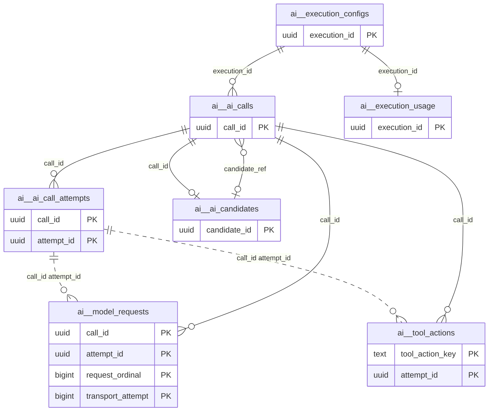

# deermind 数据库：AI调用数据字典

> **版本**：v0.3 
> **状态**：事件事实源修订稿待用户审阅；未编码、未修改原型 
> **维护与评审**：Codex 编写及自检，用户审阅 
> **更新日期**：2026-11-15 
> **修订说明**：v0.2 → v0.3，统一事件事实源、同步投影、正文读取及订阅合同；见MVP决定登记§96 

本分册是[数据库设计](../Database_Design.md)的字段附录，共 **7 张表、77 个列定义**。处理流程、接口和业务载荷由[AI_Foundation_Design.md](../AI_Foundation_Design.md) §2—4、§6.3维护；本文是物理表、字段、约束和索引的唯一维护位置。

## 表目录与关系

| 表 | 用途 |
| --- | --- |
| [execution_configs](#1-aiexecution_configs) | 工作受理时固定的模型配置 |
| [ai_calls](#2-aiai_calls) | 一项AI步骤的稳定调用 |
| [ai_call_attempts](#3-aiai_call_attempts) | AI调用的一次恢复尝试 |
| [execution_usage](#4-aiexecution_usage) | 跨尝试累计用量和预约 |
| [model_requests](#5-aimodel_requests) | 每次实际模型HTTP请求及用量 |
| [tool_actions](#6-aitool_actions) | 每次工具调用的参数与收据 |
| [ai_candidates](#7-aiai_candidates) | 通过结构校验的技术候选 |

图中实体前缀是schema；实线为列外键，虚线为复合键或受程序校验的固定引用。图按“可有多条引用”展示；一对一关系的UQ/PK以表下注明为准，不能忽略唯一约束。跨schema关系在总册集中列出。

## 1. `ai.execution_configs`

数据性质：事件生成的业务投影。正文类型及产生事件见[事件正文登记](../contracts/Event_Facts.md#3-事实正文与投影登记)；修改本行只能由已提交新事实的投影器执行，原始事件不可覆盖。

工作受理时固定的模型配置。

主键：`(execution_id)`。写入方式：只追加。

| 字段 | PostgreSQL 类型 | 可空 | 默认值 | 定义、约束与引用 |
| --- | --- | --- | --- | --- |
| `execution_id` | `uuid` | 否 | 无 | 工作；逻辑引用runtime.executions；主键组成字段 |
| `config_revision` | `text` | 否 | 无 | 装配配置版本 |
| `config_hash` | `text` | 否 | 无 | 固定配置SHA-256 |
| `config` | `jsonb` | 否 | 无 | AI底座§2.4/3.4：provider/model、协议、输出方式、thinking/temperature、调用和预算限制、credential_ref；不存密钥 |
| `created_at` | `timestamptz` | 否 | 无 | 服务端写入时间；UTC |
| `source_event_id` | `uuid` | 否 | 无 | 生成该行正文的事件；逻辑引用runtime.events.event_id。正文按record_type和本行主键定位；原文不依赖本行反查 |

约束与关系：进行中及恢复工作不自动换模型；凭据按当前有效引用取得。

查询索引：source_event_id；主键及上述唯一键；其他索引遵循总册§3。

## 2. `ai.ai_calls`

数据性质：事件生成的业务投影。正文类型及产生事件见[事件正文登记](../contracts/Event_Facts.md#3-事实正文与投影登记)；修改本行只能由已提交新事实的投影器执行，原始事件不可覆盖。

一项AI步骤的稳定调用。

主键：`(call_id)`。写入方式：固定输入；技术状态可更新。

| 字段 | PostgreSQL 类型 | 可空 | 默认值 | 定义、约束与引用 |
| --- | --- | --- | --- | --- |
| `call_id` | `uuid` | 否 | 无 | 调用身份；主键组成字段 |
| `execution_id` | `uuid` | 否 | 无 | 所属工作；FK → `ai.execution_configs.execution_id` |
| `step_key` | `text` | 否 | 无 | 所属稳定步骤 |
| `call_key` | `text` | 否 | 无 | 步骤内调用用途键 |
| `input_hash` | `text` | 否 | 无 | 模型输入清单与参数的固定hash |
| `purpose` | `text` | 否 | 无 | 业务提供的本次调用用途 |
| `schema_ref` | `jsonb` | 否 | 无 | 结构化输出Schema版本；Ref，见总册§3 |
| `input_ref` | `jsonb` | 否 | 无 | 固定材料包/文件；授权后才可读；Ref，见总册§3 |
| `state` | `text` | 否 | 无 | 枚举：pending、running、completed、failed、cancelled |
| `candidate_ref` | `uuid` | 是 | 无 | 成功候选；FK → `ai.ai_candidates.candidate_id` |
| `created_at` | `timestamptz` | 否 | 无 | 服务端写入时间；UTC |
| `source_event_id` | `uuid` | 否 | 无 | 生成该行正文的事件；逻辑引用runtime.events.event_id。正文按record_type和本行主键定位；原文不依赖本行反查 |

约束与关系：UQ(execution_id,step_key,call_key)；同键异输入拒绝；候选与调用循环提交时检查。

查询索引：source_event_id；主键及上述唯一键；其他索引遵循总册§3。

## 3. `ai.ai_call_attempts`

数据性质：事件生成的业务投影。正文类型及产生事件见[事件正文登记](../contracts/Event_Facts.md#3-事实正文与投影登记)；修改本行只能由已提交新事实的投影器执行，原始事件不可覆盖。

AI调用的一次恢复尝试。

主键：`(call_id,attempt_id)`。写入方式：开始登记；结果一次落定。

| 字段 | PostgreSQL 类型 | 可空 | 默认值 | 定义、约束与引用 |
| --- | --- | --- | --- | --- |
| `call_id` | `uuid` | 否 | 无 | AI调用；主键组成字段；FK → `ai.ai_calls.call_id` |
| `attempt_id` | `uuid` | 否 | 无 | 本次AI尝试身份；主键组成字段 |
| `execution_attempt_id` | `uuid` | 否 | 无 | 底座尝试；逻辑引用runtime.execution_attempts |
| `attempt_no` | `bigint` | 否 | 无 | 该调用恢复次数，从1起 |
| `started_at` | `timestamptz` | 否 | 无 | 服务端写入时间；UTC |
| `finished_at` | `timestamptz` | 是 | 无 | 未完成为空 |
| `outcome` | `text` | 否 | 无 | running、completed、failed、cancelled、unknown |
| `error` | `jsonb` | 是 | 无 | code、message、retryable；无错误为空 |
| `valid_candidate` | `boolean` | 否 | false | 是否取得通过结构校验的技术候选 |
| `source_event_id` | `uuid` | 否 | 无 | 生成该行正文的事件；逻辑引用runtime.events.event_id。正文按record_type和本行主键定位；原文不依赖本行反查 |

约束与关系：UQ(call_id,attempt_no)；不与每次HTTP传输次数混为一谈。

查询索引：source_event_id；主键及上述唯一键；其他索引遵循总册§3。

## 4. `ai.execution_usage`

跨尝试累计用量和预约。

主键：`(execution_id)`。写入方式：可更新汇总。

| 字段 | PostgreSQL 类型 | 可空 | 默认值 | 定义、约束与引用 |
| --- | --- | --- | --- | --- |
| `execution_id` | `uuid` | 否 | 无 | 固定工作；主键组成字段；FK → `ai.execution_configs.execution_id` |
| `request_count` | `bigint` | 否 | 0 | 所有尝试累计模型请求次数 |
| `tool_count` | `bigint` | 否 | 0 | 累计工具调用次数 |
| `repair_count` | `bigint` | 否 | 0 | 累计格式修正次数 |
| `known_input_tokens` | `bigint` | 否 | 0 | 已结算实际输入token之和 |
| `known_output_tokens` | `bigint` | 否 | 0 | 已结算实际输出token之和 |
| `reserved_input_tokens` | `bigint` | 否 | 0 | 尚未结算的输入预算 |
| `reserved_output_tokens` | `bigint` | 否 | 0 | 尚未结算的输出预算 |
| `unknown_request_count` | `bigint` | 否 | 0 | 供应商用量未知的请求数 |
| `updated_at` | `timestamptz` | 否 | 无 | 服务端写入时间；UTC |

约束与关系：所有计数非负；与请求记录同事务；未知不记0、恢复不清零；上限读固定execution_configs。

查询索引：主键及上述唯一键；其他索引遵循总册§3。

## 5. `ai.model_requests`

数据性质：事件生成的业务投影。正文类型及产生事件见[事件正文登记](../contracts/Event_Facts.md#3-事实正文与投影登记)；修改本行只能由已提交新事实的投影器执行，原始事件不可覆盖。

每次实际模型HTTP请求及用量。

主键：`(call_id,attempt_id,request_ordinal,transport_attempt)`。写入方式：预约先保存；结果一次结算。

| 字段 | PostgreSQL 类型 | 可空 | 默认值 | 定义、约束与引用 |
| --- | --- | --- | --- | --- |
| `call_id` | `uuid` | 否 | 无 | 调用；主键组成字段；FK → `ai.ai_calls.call_id` |
| `attempt_id` | `uuid` | 否 | 无 | AI调用尝试；主键组成字段 |
| `request_ordinal` | `bigint` | 否 | 无 | 调用中的第几轮模型请求，从1起；主键组成字段 |
| `transport_attempt` | `bigint` | 否 | 无 | 该轮传输重试序号，从1起；主键组成字段 |
| `model` | `text` | 否 | 无 | 实际型号，必须匹配冻结配置 |
| `request_ref` | `jsonb` | 否 | 无 | 实际请求材料与参数引用，不含认证头；Ref，见总册§3 |
| `reserved_input_tokens` | `bigint` | 否 | 无 | 本次预留输入预算 |
| `reserved_output_tokens` | `bigint` | 否 | 无 | 本次预留输出预算 |
| `actual_input_tokens` | `bigint` | 是 | 无 | 实际输入；未知为空 |
| `actual_output_tokens` | `bigint` | 是 | 无 | 实际输出；未知为空 |
| `usage_state` | `text` | 否 | 无 | reserved、known、unknown |
| `provider_request_id` | `text` | 是 | 无 | 供应商请求号；未取得为空 |
| `outcome` | `text` | 否 | 无 | pending、success、failed、unknown |
| `started_at` | `timestamptz` | 否 | 无 | 服务端写入时间；UTC |
| `finished_at` | `timestamptz` | 是 | 无 | 未确认结束为空 |
| `response_ref` | `jsonb` | 是 | 无 | 可授权读取的输出或错误引用；Ref，见总册§3 |
| `source_event_id` | `uuid` | 否 | 无 | 生成该行正文的事件；逻辑引用runtime.events.event_id。正文按record_type和本行主键定位；原文不依赖本行反查 |

约束与关系：FK(call_id,attempt_id)→ai_call_attempts；实际值非负；known必须有用量，unknown不得填0。

查询索引：source_event_id；主键及上述唯一键；其他索引遵循总册§3。

## 6. `ai.tool_actions`

数据性质：事件生成的业务投影。正文类型及产生事件见[事件正文登记](../contracts/Event_Facts.md#3-事实正文与投影登记)；修改本行只能由已提交新事实的投影器执行，原始事件不可覆盖。

每次工具调用的参数与收据。

主键：`(tool_action_key,attempt_id)`。写入方式：开始登记；结果一次落定。

| 字段 | PostgreSQL 类型 | 可空 | 默认值 | 定义、约束与引用 |
| --- | --- | --- | --- | --- |
| `tool_action_key` | `text` | 否 | 无 | 所属调用、工具及稳定发生键的规范化组合；主键组成字段 |
| `attempt_id` | `uuid` | 否 | 无 | AI调用尝试；主键组成字段 |
| `call_id` | `uuid` | 否 | 无 | AI调用；FK → `ai.ai_calls.call_id` |
| `tool_name` | `text` | 否 | 无 | 程序授予的工具名 |
| `parameters_ref` | `jsonb` | 否 | 无 | 固定参数及hash；Ref，见总册§3 |
| `result_ref` | `jsonb` | 是 | 无 | 工具返回；Ref，见总册§3 |
| `authorization_result` | `text` | 否 | 无 | allowed 或 denied |
| `work_key` | `text` | 是 | 无 | 写候选的幂等键；纯查询为空 |
| `owner_receipt_ref` | `jsonb` | 是 | 无 | 内容所有者的保存收据；Ref，见总册§3 |
| `outcome` | `text` | 否 | 无 | pending、completed、failed、denied |
| `started_at` | `timestamptz` | 否 | 无 | 服务端写入时间；UTC |
| `finished_at` | `timestamptz` | 是 | 无 | 尚未完成为空 |
| `source_event_id` | `uuid` | 否 | 无 | 生成该行正文的事件；逻辑引用runtime.events.event_id。正文按record_type和本行主键定位；原文不依赖本行反查 |

约束与关系：FK(call_id,attempt_id)→ai_call_attempts；底座不因模型要求而授予写概率权限。

查询索引：source_event_id；主键及上述唯一键；其他索引遵循总册§3。

## 7. `ai.ai_candidates`

数据性质：事件生成的业务投影。正文类型及产生事件见[事件正文登记](../contracts/Event_Facts.md#3-事实正文与投影登记)；修改本行只能由已提交新事实的投影器执行，原始事件不可覆盖。

通过结构校验的技术候选。

主键：`(candidate_id)`。写入方式：只追加。

| 字段 | PostgreSQL 类型 | 可空 | 默认值 | 定义、约束与引用 |
| --- | --- | --- | --- | --- |
| `candidate_id` | `uuid` | 否 | 无 | 技术候选身份；主键组成字段 |
| `call_id` | `uuid` | 否 | 无 | 生成调用；FK → `ai.ai_calls.call_id` |
| `schema_ref` | `jsonb` | 否 | 无 | 结果Schema精确版本；Ref，见总册§3 |
| `content` | `jsonb` | 否 | 无 | 匹配schema_ref的结果；超过载荷限制存runtime.file_objects引用，格式为ArtifactValue |
| `material_refs` | `jsonb` | 否 | '[]'::jsonb | 实际使用的材料及hash；Ref[]，固定版本；空数组表示没有，不表示未知 |
| `tool_refs` | `jsonb` | 否 | '[]'::jsonb | 实际工具取材来源；Ref[]，固定版本；空数组表示没有，不表示未知 |
| `content_hash` | `text` | 否 | 无 | 候选规范化内容SHA-256 |
| `created_at` | `timestamptz` | 否 | 无 | 服务端写入时间；UTC |
| `source_event_id` | `uuid` | 否 | 无 | 生成该行正文的事件；逻辑引用runtime.events.event_id。正文按record_type和本行主键定位；原文不依赖本行反查 |

约束与关系：UQ(call_id)；只是技术输出，业务模块核对后才形成教材候选或Evidence。

查询索引：source_event_id；主键及上述唯一键；其他索引遵循总册§3。

## 修订记录

| 版本 | 日期 | 修改 |
| :--- | :--- | :--- |
| v0.1 | 2026-11-15 | 逐表补齐列、键、空值、默认值、约束和关系；未执行建表或迁移 |
| v0.2 | 2026-11-15 | 物理表定义集中到数据库分册；模块保留流程、接口和事务规则。保持同库schema划分，未改原型或编码。见MVP决定登记§93。 |
| v0.3 | 2026-11-15 | 统一事件事实源、正文来源及查询投影，承接同事务写入与按需订阅；见MVP决定登记§96。本轮仅修改文档。 |
