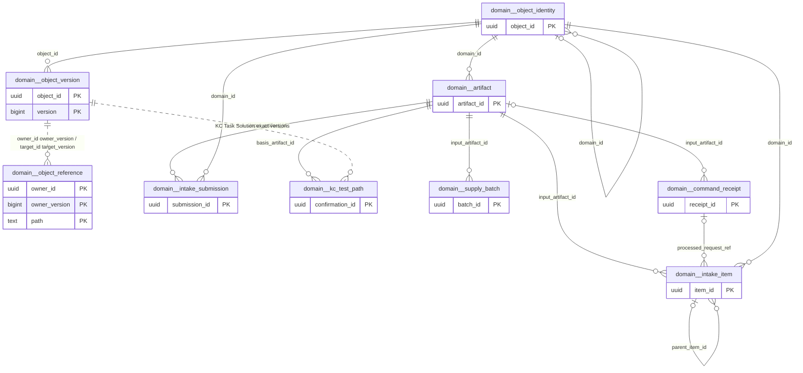

# deermind 数据库：领域空间数据字典

> **版本**：v0.3 
> **状态**：事件事实源修订稿待用户审阅；未编码、未修改原型 
> **维护与评审**：Codex 编写及自检，用户审阅 
> **更新日期**：2026-11-15 
> **修订说明**：v0.2 → v0.3，统一事件事实源、同步投影、正文读取及订阅合同；见MVP决定登记§96 

本分册是[数据库设计](../Database_Design.md)的字段附录，共 **9 张表、91 个列定义**。处理流程、接口和业务载荷由[Domain_Space_Design.md](../Domain_Space_Design.md) §1、§4.3、§6.2维护；本文是物理表、字段、约束和索引的唯一维护位置。

## 表目录与关系

| 表 | 用途 |
| --- | --- |
| [object_identity](#1-domainobject_identity) | 五类领域对象的稳定身份 |
| [object_version](#2-domainobject_version) | 完整领域对象版本，含删除标记 |
| [object_reference](#3-domainobject_reference) | 版本正文内引用的可查询投影 |
| [intake_submission](#4-domainintake_submission) | Domain接收教材来源的固定结论 |
| [intake_item](#5-domainintake_item) | 待入库条目及处理状态 |
| [artifact](#6-domainartifact) | 输入、定义候选及检查依据 |
| [kc_test_path](#7-domainkc_test_path) | 已确认的KC直接检验路径 |
| [supply_batch](#8-domainsupply_batch) | 一次用途明确的供题结果 |
| [command_receipt](#9-domaincommand_receipt) | 领域写命令的幂等收据 |

图中实体前缀是schema；实线为列外键，虚线为复合键或受程序校验的固定引用。图按“可有多条引用”展示；一对一关系的UQ/PK以表下注明为准，不能忽略唯一约束。跨schema关系在总册集中列出。

## 1. `domain.object_identity`

数据性质：确定性派生索引；来源和重建规则见[事件正文§3.1](../contracts/Event_Facts.md#31-派生索引与控制数据)。不保存独立历史事实。

五类领域对象的稳定身份。

主键：`(object_id)`。写入方式：仅头及目录修订可更新。

| 字段 | PostgreSQL 类型 | 可空 | 默认值 | 定义、约束与引用 |
| --- | --- | --- | --- | --- |
| `object_id` | `uuid` | 否 | 无 | Domain、Task、Solution、KC或TaskInstance身份；主键组成字段 |
| `kind` | `text` | 否 | 无 | Domain、Task、Solution、KC、TaskInstance |
| `domain_id` | `uuid` | 是 | 无 | 所属Domain；根对象为空；FK → `domain.object_identity.object_id` |
| `head_version` | `bigint` | 否 | 无 | 当前头版本；正整数 |
| `catalog_revision` | `bigint` | 是 | 无 | 领域目录运行计数；Domain必须有值，成员必须为空，不是内容版本 |

约束与关系：CHECK根Domain的domain_id为空且catalog_revision非空，成员反之；domain_id目标必须是Domain；FK(object_id,head_version)→object_version延迟到提交；类型归属不改。

查询索引：主键；(domain_id,kind,object_id)。

## 2. `domain.object_version`

数据性质：事件生成的业务投影。正文类型及产生事件见[事件正文登记](../contracts/Event_Facts.md#3-事实正文与投影登记)；修改本行只能由已提交新事实的投影器执行，原始事件不可覆盖。

完整领域对象版本，含删除标记。

主键：`(object_id,version)`。写入方式：只追加。

| 字段 | PostgreSQL 类型 | 可空 | 默认值 | 定义、约束与引用 |
| --- | --- | --- | --- | --- |
| `object_id` | `uuid` | 否 | 无 | 对象；主键组成字段；FK → `domain.object_identity.object_id` |
| `version` | `bigint` | 否 | 无 | 从1递增的内容版本；主键组成字段 |
| `content_schema_version` | `bigint` | 否 | 无 | 正文语法版本；正整数 |
| `content` | `jsonb` | 否 | 无 | Domain§1.2完整对象载荷；RichContent见§1.4；TaskInstance内保存参考解法 |
| `is_deleted` | `boolean` | 否 | false | 本版是否表示软删除；仍保存完整正文 |
| `created_at` | `timestamptz` | 否 | 无 | 服务端写入时间；UTC |
| `created_by` | `jsonb` | 否 | 无 | 创建者或服务授权身份；Ref，见总册§3 |
| `change_note` | `text` | 否 | 无 | 新建、修订或软删除原因，非空 |
| `source_event_id` | `uuid` | 否 | 无 | 生成该行正文的事件；逻辑引用runtime.events.event_id。正文按record_type和本行主键定位；原文不依赖本行反查 |

约束与关系：引用的旧版保持；M1没有物理删除；不能修改旧版JSON。

查询索引：source_event_id；主键及上述唯一键；其他索引遵循总册§3。

## 3. `domain.object_reference`

数据性质：确定性派生索引；来源和重建规则见[事件正文§3.1](../contracts/Event_Facts.md#31-派生索引与控制数据)。不保存独立历史事实。

版本正文内引用的可查询投影。

主键：`(owner_id,owner_version,path)`。写入方式：只追加。

| 字段 | PostgreSQL 类型 | 可空 | 默认值 | 定义、约束与引用 |
| --- | --- | --- | --- | --- |
| `owner_id` | `uuid` | 否 | 无 | 持有引用的对象；主键组成字段 |
| `owner_version` | `bigint` | 否 | 无 | 持有者精确版本；主键组成字段 |
| `path` | `text` | 否 | 无 | 正文内唯一JSON路径；主键组成字段 |
| `relation_kind` | `text` | 否 | 无 | task_method、task_prerequisite、prerequisite_method_scope、solution_kc、instance_task、reference_solution |
| `target_id` | `uuid` | 否 | 无 | 被引用对象 |
| `target_version` | `bigint` | 否 | 无 | 被引用精确版本 |

约束与关系：FK(owner_id,owner_version)及FK(target_id,target_version)→object_version；同提交从正文提取，path定位具体关系或题内参考；与正文一致，不可单独编辑；不额外发明子调用树。

查询索引：主键；(target_id,target_version,relation_kind)；(owner_id,owner_version,relation_kind)。

## 4. `domain.intake_submission`

数据性质：事件生成的业务投影。正文类型及产生事件见[事件正文登记](../contracts/Event_Facts.md#3-事实正文与投影登记)；修改本行只能由已提交新事实的投影器执行，原始事件不可覆盖。

Domain接收教材来源的固定结论。

主键：`(submission_id)`。写入方式：只追加。

| 字段 | PostgreSQL 类型 | 可空 | 默认值 | 定义、约束与引用 |
| --- | --- | --- | --- | --- |
| `submission_id` | `uuid` | 否 | 无 | 受理身份；主键组成字段 |
| `trigger_event_id` | `uuid` | 否 | 无 | 唯一触发事实；逻辑引用 runtime.events.event_id |
| `domain_id` | `uuid` | 否 | 无 | 目标领域；FK → `domain.object_identity.object_id` |
| `product_submission_ref` | `jsonb` | 否 | 无 | 产品提交包；Ref，见总册§3 |
| `input_artifact_id` | `uuid` | 否 | 无 | 受理输入；FK → `domain.artifact.artifact_id` |
| `outcome` | `text` | 否 | 无 | received 或 rejected |
| `item_refs` | `jsonb` | 否 | '[]'::jsonb | 产生的待入库内容；Ref[]，固定版本；空数组表示没有，不表示未知 |
| `issues` | `jsonb` | 否 | '[]'::jsonb | Issue[] |
| `decision_event_id` | `uuid` | 否 | 无 | 受理事实；逻辑引用runtime.events |
| `created_at` | `timestamptz` | 否 | 无 | 服务端写入时间；UTC |
| `source_event_id` | `uuid` | 否 | 无 | 生成该行正文的事件；逻辑引用runtime.events.event_id。正文按record_type和本行主键定位；原文不依赖本行反查 |

约束与关系：UQ(trigger_event_id)；rejected时item_refs为空且issues非空；received记录完整待办映射，同一待办可被多个提交引用。

查询索引：source_event_id；主键及上述唯一键；其他索引遵循总册§3。

## 5. `domain.intake_item`

数据性质：事件生成的业务投影。正文类型及产生事件见[事件正文登记](../contracts/Event_Facts.md#3-事实正文与投影登记)；修改本行只能由已提交新事实的投影器执行，原始事件不可覆盖。

待入库条目及处理状态。

主键：`(item_id)`。写入方式：来源固定；处理状态可更新。

| 字段 | PostgreSQL 类型 | 可空 | 默认值 | 定义、约束与引用 |
| --- | --- | --- | --- | --- |
| `item_id` | `uuid` | 否 | 无 | 待办身份；主键组成字段 |
| `domain_id` | `uuid` | 否 | 无 | 领域；FK → `domain.object_identity.object_id` |
| `candidate_key` | `text` | 否 | 无 | 由来源所有者、导入、候选ID/修订和采用依据生成；不使用名称或AI相似度 |
| `source_ref` | `jsonb` | 否 | 无 | Product已采用的内容及原页引用；Ref，见总册§3 |
| `input_artifact_id` | `uuid` | 否 | 无 | 固定输入；FK → `domain.artifact.artifact_id` |
| `kind` | `text` | 否 | 无 | kc、task_instance、reference |
| `group_id` | `uuid` | 否 | 无 | 同次提交分组身份 |
| `parent_item_id` | `uuid` | 是 | 无 | 同批参考解法对应的题目待办；FK → `domain.intake_item.item_id` |
| `parent_instance_ref` | `jsonb` | 是 | 无 | 已有题目精确版本；与parent_item二选一；Ref，见总册§3 |
| `state` | `text` | 否 | 无 | 枚举：pending、completed、removed |
| `revision` | `bigint` | 否 | 无 | 从1递增；写入时比较预期修订，不以时间代替 |
| `result_ref` | `jsonb` | 是 | 无 | 已加入KC、已关联题目或题内解法的结果；Ref，见总册§3 |
| `processed_request_ref` | `uuid` | 是 | 无 | 处理收据；FK → `domain.command_receipt.receipt_id` |
| `created_at` | `timestamptz` | 否 | 无 | 服务端写入时间；UTC |
| `source_event_id` | `uuid` | 否 | 无 | 生成该行正文的事件；逻辑引用runtime.events.event_id。正文按record_type和本行主键定位；原文不依赖本行反查 |

约束与关系：UQ(domain_id,candidate_key)；reference必须恰有一个父绑定，其他kind两者均空；删除待办不删领域对象。

查询索引：source_event_id；主键、唯一键；(domain_id,state,item_id)；parent_item_id。

## 6. `domain.artifact`

数据性质：事件生成的业务投影。正文类型及产生事件见[事件正文登记](../contracts/Event_Facts.md#3-事实正文与投影登记)；修改本行只能由已提交新事实的投影器执行，原始事件不可覆盖。

输入、定义候选及检查依据。

主键：`(artifact_id)`。写入方式：只追加。

| 字段 | PostgreSQL 类型 | 可空 | 默认值 | 定义、约束与引用 |
| --- | --- | --- | --- | --- |
| `artifact_id` | `uuid` | 否 | 无 | 固定材料身份；主键组成字段 |
| `domain_id` | `uuid` | 否 | 无 | 领域；FK → `domain.object_identity.object_id` |
| `kind` | `text` | 否 | 无 | input、definition_candidate、classification_check、use_check、readiness_check |
| `input_ref` | `jsonb` | 是 | 无 | 所检查的原输入；Ref，见总册§3 |
| `definition_refs` | `jsonb` | 否 | '[]'::jsonb | 检查采用的固定定义；Ref[]，固定版本；空数组表示没有，不表示未知 |
| `payload` | `jsonb` | 否 | 无 | Domain§2/§5.3对应kind合同：候选正文或逐项匹配结论、缺口、引用依据；不能将模型结论当保存授权 |
| `rule_ref` | `jsonb` | 是 | 无 | 所用检查规则版本；Ref，见总册§3 |
| `model_call_ref` | `jsonb` | 是 | 无 | 需要AI时的调用依据；Ref，见总册§3 |
| `command_ref` | `jsonb` | 是 | 无 | 触发命令；Ref，见总册§3 |
| `created_at` | `timestamptz` | 否 | 无 | 服务端写入时间；UTC |
| `source_event_id` | `uuid` | 否 | 无 | 生成该行正文的事件；逻辑引用runtime.events.event_id。正文按record_type和本行主键定位；原文不依赖本行反查 |

约束与关系：按字段引用及总册公共约束检查；无额外唯一键。

查询索引：source_event_id；主键；(domain_id,kind,artifact_id)。

## 7. `domain.kc_test_path`

数据性质：事件生成的业务投影。正文类型及产生事件见[事件正文登记](../contracts/Event_Facts.md#3-事实正文与投影登记)；修改本行只能由已提交新事实的投影器执行，原始事件不可覆盖。

已确认的KC直接检验路径。

主键：`(confirmation_id)`。写入方式：只追加。

| 字段 | PostgreSQL 类型 | 可空 | 默认值 | 定义、约束与引用 |
| --- | --- | --- | --- | --- |
| `confirmation_id` | `uuid` | 否 | 无 | 路径确认身份；主键组成字段 |
| `kc_id` | `uuid` | 否 | 无 | KC的稳定身份 |
| `kc_version` | `bigint` | 否 | 无 | KC的精确版本；正整数；与ID组成逻辑引用 domain.object_version |
| `task_id` | `uuid` | 否 | 无 | Task的稳定身份 |
| `task_version` | `bigint` | 否 | 无 | Task的精确版本；正整数；与ID组成逻辑引用 domain.object_version |
| `solution_id` | `uuid` | 否 | 无 | Solution的稳定身份 |
| `solution_version` | `bigint` | 否 | 无 | Solution的精确版本；正整数；与ID组成逻辑引用 domain.object_version |
| `basis_artifact_id` | `uuid` | 否 | 无 | 直接检验依据；FK → `domain.artifact.artifact_id` |
| `confirmed_by` | `jsonb` | 否 | 无 | 确认者；Ref，见总册§3 |
| `confirmed_at` | `timestamptz` | 否 | 无 | 服务端写入时间；UTC |
| `source_event_id` | `uuid` | 否 | 无 | 生成该行正文的事件；逻辑引用runtime.events.event_id。正文按record_type和本行主键定位；原文不依赖本行反查 |

约束与关系：三组ID/version均FKobject_version；核对Solution属于Task且直接引用KC；依据说明本Task如何直接检验KC，不仅是引用。

查询索引：source_event_id；主键及上述唯一键；其他索引遵循总册§3。

## 8. `domain.supply_batch`

数据性质：事件生成的业务投影。正文类型及产生事件见[事件正文登记](../contracts/Event_Facts.md#3-事实正文与投影登记)；修改本行只能由已提交新事实的投影器执行，原始事件不可覆盖。

一次用途明确的供题结果。

主键：`(batch_id)`。写入方式：只追加。

| 字段 | PostgreSQL 类型 | 可空 | 默认值 | 定义、约束与引用 |
| --- | --- | --- | --- | --- |
| `batch_id` | `uuid` | 否 | 无 | 供题批身份；主键组成字段 |
| `trigger_event_id` | `uuid` | 否 | 无 | 唯一触发事实；逻辑引用 runtime.events.event_id |
| `scope_id` | `uuid` | 否 | 无 | 学习空间身份；逻辑引用 product.learning_space.space_id |
| `input_artifact_id` | `uuid` | 否 | 无 | 供题条件；FK → `domain.artifact.artifact_id` |
| `items` | `jsonb` | 否 | 无 | 按需求项保存TaskInstance精确引用、用途检查引用、已有或生成来源；不保存学生答案 |
| `unfilled` | `jsonb` | 否 | 无 | 未满足的需求项、原因、可重试性；不足不伪造成空成功 |
| `completed_event_id` | `uuid` | 否 | 无 | 供题完成事件；逻辑引用runtime.events |
| `created_at` | `timestamptz` | 否 | 无 | 服务端写入时间；UTC |
| `source_event_id` | `uuid` | 否 | 无 | 生成该行正文的事件；逻辑引用runtime.events.event_id。正文按record_type和本行主键定位；原文不依赖本行反查 |

约束与关系：UQ(trigger_event_id)。

查询索引：source_event_id；主键、唯一键；(scope_id,batch_id)。

## 9. `domain.command_receipt`

领域写命令的幂等收据。

主键：`(receipt_id)`。写入方式：输入固定；处理状态可更新。

| 字段 | PostgreSQL 类型 | 可空 | 默认值 | 定义、约束与引用 |
| --- | --- | --- | --- | --- |
| `receipt_id` | `uuid` | 否 | 无 | 收据身份；主键组成字段 |
| `principal_id` | `text` | 否 | 无 | 调用者稳定身份 |
| `action` | `text` | 否 | 无 | 登记命令 |
| `scope_id` | `text` | 否 | 无 | 领域或资源键 |
| `request_id` | `text` | 否 | 无 | 请求重试键 |
| `normalized_input` | `jsonb` | 否 | 无 | 去秘密后的规范化输入 |
| `input_hash` | `text` | 否 | 无 | 规范化SHA-256 |
| `state` | `text` | 否 | 无 | 枚举：accepted、completed、failed |
| `input_artifact_id` | `uuid` | 是 | 无 | 固定输入；FK → `domain.artifact.artifact_id` |
| `runtime_ref` | `uuid` | 是 | 无 | 执行身份；逻辑引用runtime.executions |
| `result_ref` | `jsonb` | 是 | 无 | 保存结果；Ref，见总册§3 |
| `error` | `jsonb` | 是 | 无 | code、message、retryable；无错误为空 |
| `created_at` | `timestamptz` | 否 | 无 | 服务端写入时间；UTC |
| `updated_at` | `timestamptz` | 否 | 无 | 服务端写入时间；UTC |

约束与关系：UQ(principal_id,action,scope_id,request_id)。

查询索引：主键及上述唯一键；其他索引遵循总册§3。

## 修订记录

| 版本 | 日期 | 修改 |
| --- | --- | --- |
| v0.1 | 2026-11-15 | 逐表补齐列、键、空值、默认值、约束和关系；未执行建表或迁移 |

本轮修订（v0.2，2026-11-15）：物理表定义集中到数据库分册；模块保留流程、接口和事务规则。保持同库schema划分，未改原型或编码。见MVP决定登记§93。

本轮修订（v0.3，2026-11-15）：统一事件事实源、正文来源及查询投影，承接同事务写入与按需订阅；见MVP决定登记§96。本轮仅修改文档。
