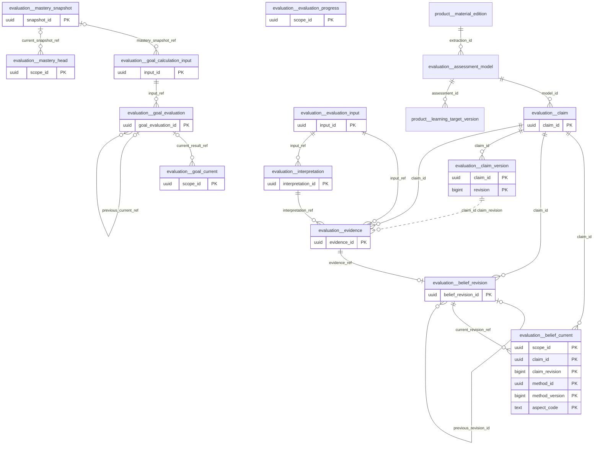

# deermind 数据库：评估空间数据字典

> **版本**：v0.6 
> **状态**：E05 迁移已在现有 K3s 接线，验收进度见实施计划 
> **维护与评审**：Codex 编写及自检，用户审阅 
> **更新日期**：2026-11-28 
> **修订说明**：新增评估套及套内任务 Claim 的唯一约束 

本分册是[数据库设计](../Database_Design.md)的字段附录，共 **14 张表、137 个列定义**。处理流程、接口和业务载荷由[Evaluation_Space_Design.md](../Evaluation_Space_Design.md) §1.5、§2.3—2.4、§3—6维护；本文是物理表、字段、约束和索引的唯一维护位置。

## 表目录与关系

| 表 | 用途 |
| --- | --- |
| [assessment_model](#assessment_model) | 基于教材提炼的整套评估标准 |
| [claim](#1-evaluationclaim) | Task评价定义身份 |
| [claim_version](#2-evaluationclaim_version) | 判据及四方面的完整定义 |
| [evaluation_input](#3-evaluationevaluation_input) | 本次评价的固定取材与规则 |
| [interpretation](#4-evaluationinterpretation) | AI对表现的解释候选 |
| [evidence](#5-evaluationevidence) | 可追溯的逐分项证据 |
| [belief_revision](#6-evaluationbelief_revision) | 一次正式数值处理的不可变记录 |
| [belief_current](#7-evaluationbelief_current) | 每个方法×方面的当前值索引 |
| [mastery_snapshot](#8-evaluationmastery_snapshot) | 授权发布的掌握状态快照 |
| [mastery_head](#9-evaluationmastery_head) | 当前掌握快照 |
| [goal_calculation_input](#10-evaluationgoal_calculation_input) | 目标结果的固定计算输入 |
| [goal_evaluation](#11-evaluationgoal_evaluation) | 一次目标计算的完整结果 |
| [goal_current](#12-evaluationgoal_current) | 空间当前目标结果指针 |
| [evaluation_progress](#13-evaluationevaluation_progress) | 单空间顺序评价的进度 |

图中实体前缀是schema；实线为列外键，虚线为复合键或受程序校验的固定引用。图按“可有多条引用”展示；一对一关系的UQ/PK以表下注明为准，不能忽略唯一约束。跨schema关系在总册集中列出。

## 1. `evaluation.claim`

数据性质：确定性派生索引；来源和重建规则见[事件正文§3.1](../contracts/Event_Facts.md#31-派生索引与控制数据)。不保存独立历史事实。

Task评价定义身份。

主键：`(claim_id)`。写入方式：头指针可更新。

| 字段 | PostgreSQL 类型 | 可空 | 默认值 | 定义、约束与引用 |
| --- | --- | --- | --- | --- |
| `claim_id` | `uuid` | 否 | 无 | Claim身份；主键组成字段 |
| `domain_id` | `uuid` | 否 | 无 | Domain；逻辑引用domain.object_identity |
| `task_id` | `uuid` | 否 | 无 | 被评价Task的稳定身份 |
| `task_version` | `bigint` | 否 | 无 | 被评价Task的精确版本；正整数；与ID组成逻辑引用 domain.object_version |
| `model_id` | `uuid` | 是 | 无 | 外键指向整套评估标准，套内每个任务版本唯一 |
| `head_revision` | `bigint` | 否 | 无 | 当前定义修订 |
| `created_at` | `timestamptz` | 否 | 无 | 服务端写入时间；UTC |

约束与关系：套内唯一 (model_id,task_id,task_version)，未绑定整套的定义另按 (task_id,task_version) 唯一；FK(claim_id,head_revision)→claim_version提交时检查；没有KC Claim。

查询索引：主键、Task精确版本唯一键；(domain_id,task_id,task_version)。

## 2. `evaluation.claim_version`

数据性质：事件生成的业务投影。正文类型及产生事件见[事件正文登记](../contracts/Event_Facts.md#3-事实正文与投影登记)；修改本行只能由已提交新事实的投影器执行，原始事件不可覆盖。

判据及四方面的完整定义。

主键：`(claim_id,revision)`。写入方式：只追加。

| 字段 | PostgreSQL 类型 | 可空 | 默认值 | 定义、约束与引用 |
| --- | --- | --- | --- | --- |
| `claim_id` | `uuid` | 否 | 无 | Claim；主键组成字段；FK → `evaluation.claim.claim_id` |
| `revision` | `bigint` | 否 | 无 | 从1递增；写入时比较预期修订，不以时间代替；主键组成字段 |
| `definition` | `jsonb` | 否 | 无 | Evaluation§1.3 ClaimDefinition：Task、全部方法、独立的本层执行判据及四方面规则；引用判据在本快照内解析 |
| `gaps` | `jsonb` | 否 | '[]'::jsonb | Issue[]，未齐全可草稿不可正式应用 |
| `request_ref` | `text` | 否 | 无 | 创建本修订的幂等请求引用 |
| `actor_ref` | `jsonb` | 否 | 无 | 实际管理员、学生或服务身份，不能用模型声称的身份；Ref，见总册§3 |
| `created_at` | `timestamptz` | 否 | 无 | 服务端写入时间；UTC |
| `source_event_id` | `uuid` | 否 | 无 | 生成该行正文的事件；逻辑引用runtime.events.event_id。正文按record_type和本行主键定位；原文不依赖本行反查 |

约束与关系：同一Claim修订不改；目标选哪些方法，Claim不勾选方法。

查询索引：source_event_id；主键及上述唯一键；其他索引遵循总册§3。

## 3. `evaluation.evaluation_input`

数据性质：事件生成的业务投影。正文类型及产生事件见[事件正文登记](../contracts/Event_Facts.md#3-事实正文与投影登记)；修改本行只能由已提交新事实的投影器执行，原始事件不可覆盖。

本次评价的固定取材与规则。

主键：`(input_id)`。写入方式：只追加。

| 字段 | PostgreSQL 类型 | 可空 | 默认值 | 定义、约束与引用 |
| --- | --- | --- | --- | --- |
| `input_id` | `uuid` | 否 | 无 | 评价输入身份；主键组成字段 |
| `scope_id` | `uuid` | 否 | 无 | 学习空间身份；逻辑引用 product.learning_space.space_id |
| `trigger_event_id` | `uuid` | 否 | 无 | 唯一触发事实；逻辑引用 runtime.events.event_id |
| `source_seq` | `bigint` | 否 | 无 | 触发事实在空间中的正式序号 |
| `source_kind` | `text` | 否 | 无 | answer 或 teaching |
| `source_id` | `uuid` | 否 | 无 | Submission或TeachingOpportunity身份 |
| `input` | `jsonb` | 否 | 无 | Evaluation§2.3 EvaluationInput：采用依据、task_use/活动/轮、候选Task边界、材料、历史资格、解释合同、算法及参数引用 |
| `created_at` | `timestamptz` | 否 | 无 | 服务端写入时间；UTC |
| `source_event_id` | `uuid` | 否 | 无 | 生成该行正文的事件；逻辑引用runtime.events.event_id。正文按record_type和本行主键定位；原文不依赖本行反查 |

约束与关系：UQ(scope_id,trigger_event_id)；原始来源变更不能在同一输入下覆盖。

查询索引：source_event_id；主键及上述唯一键；其他索引遵循总册§3。

## 4. `evaluation.interpretation`

数据性质：事件生成的业务投影。正文类型及产生事件见[事件正文登记](../contracts/Event_Facts.md#3-事实正文与投影登记)；修改本行只能由已提交新事实的投影器执行，原始事件不可覆盖。

AI对表现的解释候选。

主键：`(interpretation_id)`。写入方式：只追加。

| 字段 | PostgreSQL 类型 | 可空 | 默认值 | 定义、约束与引用 |
| --- | --- | --- | --- | --- |
| `interpretation_id` | `uuid` | 否 | 无 | 解释身份；主键组成字段 |
| `input_ref` | `uuid` | 否 | 无 | 固定输入；FK → `evaluation.evaluation_input.input_id` |
| `ai_call_ref` | `jsonb` | 否 | 无 | AI调用与候选；Ref，见总册§3 |
| `contract_ref` | `jsonb` | 否 | 无 | 解释输出Schema/提示合同版本；Ref，见总册§3 |
| `candidate` | `jsonb` | 否 | 无 | Evaluation§2.4：candidates[]、unattributed[]、covered_scopes[]；含固定候选编号、方法原文、判据结果和范围出处 |
| `validation` | `jsonb` | 否 | 无 | 来源、Schema、候选边界及冲突检查的逐项结果 |
| `created_at` | `timestamptz` | 否 | 无 | 服务端写入时间；UTC |
| `source_event_id` | `uuid` | 否 | 无 | 生成该行正文的事件；逻辑引用runtime.events.event_id。正文按record_type和本行主键定位；原文不依赖本行反查 |

约束与关系：模型不输出概率；未通过验证不得保存成功Evidence批。

查询索引：source_event_id；主键及上述唯一键；其他索引遵循总册§3。

## 5. `evaluation.evidence`

数据性质：事件生成的业务投影。正文类型及产生事件见[事件正文登记](../contracts/Event_Facts.md#3-事实正文与投影登记)；修改本行只能由已提交新事实的投影器执行，原始事件不可覆盖。

可追溯的逐分项证据。

主键：`(evidence_id)`。写入方式：只追加。

| 字段 | PostgreSQL 类型 | 可空 | 默认值 | 定义、约束与引用 |
| --- | --- | --- | --- | --- |
| `evidence_id` | `uuid` | 否 | 无 | 正式Evidence身份；主键组成字段 |
| `input_ref` | `uuid` | 否 | 无 | 固定取材；FK → `evaluation.evaluation_input.input_id` |
| `interpretation_ref` | `uuid` | 否 | 无 | AI解释；FK → `evaluation.interpretation.interpretation_id` |
| `scope_id` | `uuid` | 否 | 无 | 学习空间身份；逻辑引用 product.learning_space.space_id |
| `claim_id` | `uuid` | 否 | 无 | Claim身份；FK → `evaluation.claim.claim_id` |
| `claim_revision` | `bigint` | 否 | 无 | 采用的Claim修订 |
| `method_id` | `uuid` | 否 | 无 | Solution身份；逻辑引用domain.object_identity |
| `method_version` | `bigint` | 否 | 无 | Solution精确版本 |
| `aspect_code` | `text` | 否 | 无 | 标准code：independent、understanding、transfer、retention；引用Claim已定义code，新增方面不可自动套用算法 |
| `source_kind` | `text` | 否 | 无 | answer 或 teaching |
| `source_id` | `uuid` | 否 | 无 | 作答或稳定教学机会身份 |
| `execution_checks` | `jsonb` | 否 | 无 | Evaluation§2.4：criterion_id、met/not_met/unknown、source_spans、reason |
| `rule_ref` | `jsonb` | 否 | 无 | 本方面实际判据版本；Ref，见总册§3 |
| `condition_facts` | `jsonb` | 否 | 无 | Evaluation§2.4：condition、known/unknown/not_applicable、value、source_refs。方面条件按condition_schema校验；目标题目范围覆盖记录本次范围描述、结论及题面出处 |
| `source_spans` | `jsonb` | 否 | 无 | 授权原文的块/范围/图表元素引用 |
| `source_refs` | `jsonb` | 否 | '[]'::jsonb | 源事件和原文位置；Ref[]，固定版本；空数组表示没有，不表示未知 |
| `qualification` | `text` | 否 | 无 | eligible、ineligible、unknown |
| `verdict` | `text` | 是 | 无 | positive、negative；教学及未获资格为空 |
| `reason_codes` | `jsonb` | 否 | 无 | 原因代码列表 |
| `reason` | `text` | 否 | 无 | 解释结论的简短依据 |
| `limitations` | `jsonb` | 否 | 无 | 未确认事项列表 |
| `created_at` | `timestamptz` | 否 | 无 | 服务端写入时间；UTC |
| `source_event_id` | `uuid` | 否 | 无 | 生成该行正文的事件；逻辑引用runtime.events.event_id。正文按record_type和本行主键定位；原文不依赖本行反查 |

约束与关系：UQ(scope_id,claim_id,claim_revision,method_id,method_version,aspect_code,source_kind,source_id)；FK(claim_id,claim_revision)→claim_version；重复片段不重复更新。

查询索引：source_event_id；主键、来源分项唯一键；(scope_id,claim_id,claim_revision,method_id,method_version,aspect_code)；input_ref。

## 6. `evaluation.belief_revision`

数据性质：事件生成的业务投影。正文类型及产生事件见[事件正文登记](../contracts/Event_Facts.md#3-事实正文与投影登记)；修改本行只能由已提交新事实的投影器执行，原始事件不可覆盖。

一次正式数值处理的不可变记录。

主键：`(belief_revision_id)`。写入方式：只追加。

| 字段 | PostgreSQL 类型 | 可空 | 默认值 | 定义、约束与引用 |
| --- | --- | --- | --- | --- |
| `belief_revision_id` | `uuid` | 否 | 无 | 更新身份；主键组成字段 |
| `scope_id` | `uuid` | 否 | 无 | 学习空间身份；逻辑引用 product.learning_space.space_id |
| `claim_id` | `uuid` | 否 | 无 | Claim身份；FK → `evaluation.claim.claim_id` |
| `claim_revision` | `bigint` | 否 | 无 | 采用的Claim修订 |
| `method_id` | `uuid` | 否 | 无 | Solution身份；逻辑引用domain.object_identity |
| `method_version` | `bigint` | 否 | 无 | Solution精确版本 |
| `aspect_code` | `text` | 否 | 无 | 标准code：independent、understanding、transfer、retention；引用Claim已定义code，新增方面不可自动套用算法 |
| `previous_revision_id` | `uuid` | 是 | 无 | 此前本分项更新；首次为空；FK → `evaluation.belief_revision.belief_revision_id` |
| `evidence_ref` | `uuid` | 否 | 无 | 本次证据；FK → `evaluation.evidence.evidence_id` |
| `update_kind` | `text` | 否 | 无 | observation、learning_transition；仅真实数值更新形成修订 |
| `p_obs_before` | `double precision` | 是 | 无 | 更新前观测概率；尚无观测为空；有限数且0≤p≤1 |
| `p_current_before` | `double precision` | 否 | 无 | 更新前当前估计；有限数且0≤p≤1 |
| `p_obs_after` | `double precision` | 是 | 无 | 本次后观测概率；未有观测仍为空；有限数且0≤p≤1 |
| `p_current_after` | `double precision` | 否 | 无 | 本次后当前估计；有限数且0≤p≤1 |
| `last_observed_at` | `timestamptz` | 是 | 无 | 最近合格观测时间；没有为空 |
| `parameter_ref` | `text` | 否 | 无 | 固定参数集引用，如M1-BELIEF-PARAM-01 |
| `algorithm_ref` | `text` | 否 | 无 | 确定性数值函数版本 |
| `reason_codes` | `jsonb` | 否 | 无 | 此次数值更新原因；跳过原因留在Evidence和批结果 |
| `trigger_event_id` | `uuid` | 否 | 无 | 唯一触发事实；逻辑引用 runtime.events.event_id |
| `created_at` | `timestamptz` | 否 | 无 | 服务端写入时间；UTC |
| `source_event_id` | `uuid` | 否 | 无 | 生成该行正文的事件；逻辑引用runtime.events.event_id。正文按record_type和本行主键定位；原文不依赖本行反查 |

约束与关系：UQ(evidence_ref)；未决、不适用、重复来源和有效L=0不创建数值修订，由Evidence/批结果保留原因；数值前后及使用参数固定，不按LLM置信度代入。

查询索引：source_event_id；主键、evidence_ref唯一键；(scope_id,claim_id,claim_revision,method_id,method_version,aspect_code,created_at)；previous_revision_id。

## 7. `evaluation.belief_current`

数据性质：确定性派生索引；来源和重建规则见[事件正文§3.1](../contracts/Event_Facts.md#31-派生索引与控制数据)。不保存独立历史事实。

每个方法×方面的当前值索引。

主键：`(scope_id,claim_id,claim_revision,method_id,method_version,aspect_code)`。写入方式：可更新派生索引。

| 字段 | PostgreSQL 类型 | 可空 | 默认值 | 定义、约束与引用 |
| --- | --- | --- | --- | --- |
| `scope_id` | `uuid` | 否 | 无 | 学习空间身份；逻辑引用 product.learning_space.space_id；主键组成字段 |
| `claim_id` | `uuid` | 否 | 无 | Claim身份；主键组成字段；FK → `evaluation.claim.claim_id` |
| `claim_revision` | `bigint` | 否 | 无 | 采用的Claim修订；主键组成字段 |
| `method_id` | `uuid` | 否 | 无 | Solution身份；逻辑引用domain.object_identity；主键组成字段 |
| `method_version` | `bigint` | 否 | 无 | Solution精确版本；主键组成字段 |
| `aspect_code` | `text` | 否 | 无 | 标准code：independent、understanding、transfer、retention；引用Claim已定义code，新增方面不可自动套用算法；主键组成字段 |
| `current_revision_ref` | `uuid` | 否 | 无 | 当前更新；FK → `evaluation.belief_revision.belief_revision_id` |
| `p_obs` | `double precision` | 是 | 无 | 最新观测概率；从未合格观测为空；有限数且0≤p≤1 |
| `p_current` | `double precision` | 否 | 无 | 含获准学习转移的当前预测；有限数且0≤p≤1 |
| `last_observed_at` | `timestamptz` | 是 | 无 | 最近观测时间 |

约束与关系：FK(claim_id,claim_revision)→claim_version；不存一个覆盖全部方法的总概率；无行按固定先验读取，不伪造已观测。

查询索引：主键及上述唯一键；其他索引遵循总册§3。

## 8. `evaluation.mastery_snapshot`

数据性质：事件生成的业务投影。正文类型及产生事件见[事件正文登记](../contracts/Event_Facts.md#3-事实正文与投影登记)；修改本行只能由已提交新事实的投影器执行，原始事件不可覆盖。

授权发布的掌握状态快照。

主键：`(snapshot_id)`。写入方式：只追加。

| 字段 | PostgreSQL 类型 | 可空 | 默认值 | 定义、约束与引用 |
| --- | --- | --- | --- | --- |
| `snapshot_id` | `uuid` | 否 | 无 | 公开快照身份；主键组成字段 |
| `scope_id` | `uuid` | 否 | 无 | 学习空间身份；逻辑引用 product.learning_space.space_id |
| `publication_seq` | `bigint` | 否 | 无 | 空间内发布递增序号 |
| `items` | `jsonb` | 否 | 无 | Evaluation§5.1分项：SubitemKey、p_obs/p_current、observation_status、last_observed_at、evidence_coverage、unknown_reasons、source_refs及belief_revision_ref；不暴露私有上下文 |
| `coverage` | `jsonb` | 否 | 无 | 覆盖分项及未完成/未知分项 |
| `result_coverage` | `jsonb` | 否 | '[]'::jsonb | 本快照已纳入的触发及结果身份；Ref[]，固定版本；空数组表示没有，不表示未知 |
| `published_at` | `timestamptz` | 否 | 无 | 服务端写入时间；UTC |
| `source_event_id` | `uuid` | 否 | 无 | 生成该行正文的事件；逻辑引用runtime.events.event_id。正文按record_type和本行主键定位；原文不依赖本行反查 |

约束与关系：UQ(scope_id,publication_seq)；只读发布，不能由Interaction改写。

查询索引：source_event_id；主键；(scope_id,publication_seq)唯一键。

## 9. `evaluation.mastery_head`

数据性质：确定性派生索引；来源和重建规则见[事件正文§3.1](../contracts/Event_Facts.md#31-派生索引与控制数据)。不保存独立历史事实。

当前掌握快照。

主键：`(scope_id)`。写入方式：可更新指针。

| 字段 | PostgreSQL 类型 | 可空 | 默认值 | 定义、约束与引用 |
| --- | --- | --- | --- | --- |
| `scope_id` | `uuid` | 否 | 无 | 学习空间身份；逻辑引用 product.learning_space.space_id；主键组成字段 |
| `current_snapshot_ref` | `uuid` | 是 | 无 | 当前快照；尚无为空；FK → `evaluation.mastery_snapshot.snapshot_id` |
| `publication_seq` | `bigint` | 否 | 0 | 当前发布序号；无快照为0 |

约束与关系：按字段引用及总册公共约束检查；无额外唯一键。

查询索引：主键及上述唯一键；其他索引遵循总册§3。

## 10. `evaluation.goal_calculation_input`

数据性质：事件生成的业务投影。正文类型及产生事件见[事件正文登记](../contracts/Event_Facts.md#3-事实正文与投影登记)；修改本行只能由已提交新事实的投影器执行，原始事件不可覆盖。

目标结果的固定计算输入。

主键：`(input_id)`。写入方式：只追加。

| 字段 | PostgreSQL 类型 | 可空 | 默认值 | 定义、约束与引用 |
| --- | --- | --- | --- | --- |
| `input_id` | `uuid` | 否 | 无 | 计算输入身份；主键组成字段 |
| `scope_id` | `uuid` | 否 | 无 | 学习空间身份；逻辑引用 product.learning_space.space_id |
| `trigger_event_id` | `uuid` | 否 | 无 | 唯一触发事实；逻辑引用 runtime.events.event_id |
| `target_basis_ref` | `uuid` | 否 | 无 | Product的固定目标依据 |
| `adoption_ref` | `uuid` | 否 | 无 | Product的采用依据 |
| `mastery_snapshot_ref` | `uuid` | 是 | 无 | 采用掌握快照；无快照时为空；FK → `evaluation.mastery_snapshot.snapshot_id` |
| `mastery_publication_seq` | `bigint` | 否 | 0 | 快照序号；无快照为0 |
| `evidence_coverage` | `jsonb` | 否 | 无 | Evaluation§4：分项观测及目标条件所需依据；保持时间来自服务端 |
| `calculation_rule_ref` | `text` | 否 | 无 | 目标派生规则版本；M1全局阈值0.90 |
| `planned_result_id` | `uuid` | 否 | 无 | 预分配本次goal_evaluation身份 |
| `created_at` | `timestamptz` | 否 | 无 | 服务端写入时间；UTC |
| `source_event_id` | `uuid` | 否 | 无 | 生成该行正文的事件；逻辑引用runtime.events.event_id。正文按record_type和本行主键定位；原文不依赖本行反查 |

约束与关系：UQ(scope_id,trigger_event_id)；无快照不填先验当达标依据。

查询索引：source_event_id；主键及上述唯一键；其他索引遵循总册§3。

## 11. `evaluation.goal_evaluation`

数据性质：事件生成的业务投影。正文类型及产生事件见[事件正文登记](../contracts/Event_Facts.md#3-事实正文与投影登记)；修改本行只能由已提交新事实的投影器执行，原始事件不可覆盖。

一次目标计算的完整结果。

主键：`(goal_evaluation_id)`。写入方式：只追加。

| 字段 | PostgreSQL 类型 | 可空 | 默认值 | 定义、约束与引用 |
| --- | --- | --- | --- | --- |
| `goal_evaluation_id` | `uuid` | 否 | 无 | 目标结果身份；主键组成字段 |
| `scope_id` | `uuid` | 否 | 无 | 学习空间身份；逻辑引用 product.learning_space.space_id |
| `trigger_event_id` | `uuid` | 否 | 无 | 唯一触发事实；逻辑引用 runtime.events.event_id |
| `input_ref` | `uuid` | 否 | 无 | 固定计算输入；FK → `evaluation.goal_calculation_input.input_id` |
| `target_basis_ref` | `uuid` | 否 | 无 | 本次Product目标依据 |
| `result` | `jsonb` | 否 | 无 | Evaluation§4.4的逐目标项、方法/方面状态、总状态及依据正文；响应中的current_state_applied取同名列，不在JSON重复存一份 |
| `previous_current_ref` | `uuid` | 是 | 无 | 保存前可比的当前结果；FK → `evaluation.goal_evaluation.goal_evaluation_id` |
| `current_state_applied` | `boolean` | 否 | false | 此次提交是否实际推进当前结果；旧目标、旧快照或already_current均为false，随后变化不回改 |
| `created_at` | `timestamptz` | 否 | 无 | 服务端写入时间；UTC |
| `source_event_id` | `uuid` | 否 | 无 | 生成该行正文的事件；逻辑引用runtime.events.event_id。正文按record_type和本行主键定位；原文不依赖本行反查 |

约束与关系：UQ(scope_id,trigger_event_id)；目标变了只留历史，不覆盖新目标；目标结果不是LLM自由标签。

查询索引：source_event_id；主键及上述唯一键；其他索引遵循总册§3。

## 12. `evaluation.goal_current`

数据性质：确定性派生索引；来源和重建规则见[事件正文§3.1](../contracts/Event_Facts.md#31-派生索引与控制数据)。不保存独立历史事实。

空间当前目标结果指针。

主键：`(scope_id)`。写入方式：可更新派生索引。

| 字段 | PostgreSQL 类型 | 可空 | 默认值 | 定义、约束与引用 |
| --- | --- | --- | --- | --- |
| `scope_id` | `uuid` | 否 | 无 | 学习空间身份；逻辑引用 product.learning_space.space_id；主键组成字段 |
| `current_result_ref` | `uuid` | 是 | 无 | 当前结果；未计算可空；FK → `evaluation.goal_evaluation.goal_evaluation_id` |
| `target_basis_ref` | `uuid` | 否 | 无 | 对应Product当前目标依据 |
| `mastery_publication_seq` | `bigint` | 否 | 0 | 此结果所用掌握快照序号 |

约束与关系：保存时Product保护当前采用，Evaluation核对依据后写此指针；旧结果只追加。

查询索引：主键及上述唯一键；其他索引遵循总册§3。

## 13. `evaluation.evaluation_progress`

单空间顺序评价的进度。

主键：`(scope_id)`。写入方式：可更新游标。

| 字段 | PostgreSQL 类型 | 可空 | 默认值 | 定义、约束与引用 |
| --- | --- | --- | --- | --- |
| `scope_id` | `uuid` | 否 | 无 | 学习空间身份；逻辑引用 product.learning_space.space_id；主键组成字段 |
| `scanned_through_seq` | `bigint` | 否 | 0 | 已检查的空间事件序号 |
| `active_trigger_event_id` | `uuid` | 是 | 无 | 当前尚未完成的评价源事件；逻辑引用runtime.events |
| `active_source_seq` | `bigint` | 是 | 无 | 当前事件的空间序号；无正在处理时为空 |

约束与关系：active两字段同时空或非空；按原事件序处理，失败阻塞后续概率更新。

查询索引：主键及上述唯一键；其他索引遵循总册§3。

## 14. E05 迁移

| 迁移 | 表或索引 |
| :--- | :--- |
| `0038_evaluation_input` | 评价输入及空间内触发唯一键 |
| `0039_evaluation_interpretation` | 模型解释和程序核对结果，每份输入保存一次 |
| `0040_evaluation_mastery` | Evidence、Belief 修订与当前索引、掌握快照与当前引用 |
| `0041_evaluation_progress` | 空间顺序游标和当前来源。开发环境从迁移前最后一条事实开始接收后续评价 |

## assessment_model

| 字段 | 类型 | 约束与含义 |
| :--- | :--- | :--- |
| model_id | uuid | 主键，评估套身份 |
| extraction_id | uuid | 非空，外键指向 material_edition。创建时核对本教材的发布提炼 |
| name | text | 非空白，管理员指定的名称 |
| number | integer | 正整数，同一提炼内唯一的版本序号 |
| revision | integer | 正整数，每次草稿保存或发布递增 |
| status | text | draft 或 published |
| claims | jsonb | 数组，逐任务保存方法、正反例判据、证据不足及四方面要求 |
| created_at | timestamptz | 非空，首次创建时间 |
| source_event_id | uuid | 非空，指向本次完整快照的来源事件 |

`claim.model_id` 为评估套外键，套内按任务及版本唯一。不同套对同一任务分别生成 Claim。目标版本以提炼和套的组合外键约束归属。

## 修订记录

| 版本 | 日期 | 修改 |
| :--- | :--- | :--- |
| v0.1 | 2026-11-15 | 逐表补齐列、键、空值、默认值、约束和关系；未执行建表或迁移 |
| v0.2 | 2026-11-15 | 物理表定义集中到数据库分册；模块保留流程、接口和事务规则。保持同库schema划分，未改原型或编码。见MVP决定登记§93。 |
| v0.3 | 2026-11-15 | 统一事件事实源、正文来源及查询投影，承接同事务写入与按需订阅；见MVP决定登记§96。本轮仅修改文档。 |
| v0.4 | 2026-11-23 | 在条件事实登记题面覆盖依据 |
| v0.5 | 2026-11-23 | 登记 E05 实际迁移及解释字段 |
| v0.6 | 2026-11-28 | 登记评估套及套内 Claim 唯一键。 |
