# deermind 数据库：交互空间数据字典

> **版本**：v0.5 
> **状态**：事件合同评审修订稿；容量与保留候选待确认，未编码 
> **维护与评审**：Codex 编写及自检，用户审阅 
> **更新日期**：2026-11-15 
> **修订说明**：v0.4 → v0.5，补正文、投影矩阵、状态及读取授权；容量候选待审，见MVP决定登记§98 

本分册是[数据库设计](../Database_Design.md)的字段附录，共 **35 张表、306 个列定义**。处理流程、接口和业务载荷由[Interaction_Space_Design.md](../Interaction_Space_Design.md) §1.3、§2.4、§3.7—3.9、§4.3、§5.3、§6.3、§7.1维护；本文是物理表、字段、约束和索引的唯一维护位置。

## 表目录与关系

| 表 | 用途 |
| --- | --- |
| [inputs](#1-interactioninputs) | 学生消息或明确控制的固定输入 |
| [input_results](#2-interactioninput_results) | 输入的已提交处理结果 |
| [space_runtime](#3-interactionspace_runtime) | 学习空间当前交互入口和路径 |
| [messages](#4-interactionmessages) | 聊天正文，独立于空间事件 |
| [message_assignments](#5-interactionmessage_assignments) | 消息归属的活动 |
| [activities](#6-interactionactivities) | 活动森林中的稳定节点 |
| [activity_revisions](#7-interactionactivity_revisions) | 节点位置及活动运行状态历史 |
| [activity_heads](#8-interactionactivity_heads) | 每个活动当前修订 |
| [detection_plans](#9-interactiondetection_plans) | 检测准备的稳定计划身份 |
| [plan_revisions](#10-interactionplan_revisions) | 供学生确认的题单内容 |
| [plan_progress](#11-interactionplan_progress) | 题单确认和执行进度 |
| [detection_rounds](#12-interactiondetection_rounds) | 每一道检测题的一次轮身份 |
| [round_revisions](#13-interactionround_revisions) | 检测轮的状态历史 |
| [task_uses](#14-interactiontask_uses) | 题目在本次活动中的实际呈现 |
| [submissions](#15-interactionsubmissions) | 学生一次实际提交的原文 |
| [answer_feedback](#16-interactionanswer_feedback) | 本次答题反馈，不等于能力评价 |
| [help_facts](#17-interactionhelp_facts) | 求助处理和实质帮助提供事实 |
| [presentations](#18-interactionpresentations) | 浏览器显示回执，仅用于展示追溯 |
| [teaching_opportunities](#19-interactionteaching_opportunities) | 一次可识别的教学机会 |
| [opportunity_closures](#20-interactionopportunity_closures) | 教学机会完成或中止的固定事实 |
| [blueprint_revisions](#21-interactionblueprint_revisions) | 四类活动蓝图 |
| [rule_revisions](#22-interactionrule_revisions) | 必须遵守的教学规则 |
| [strategy_revisions](#23-interactionstrategy_revisions) | 推荐策略，不强制命中 |
| [binding_revisions](#24-interactionbinding_revisions) | 活动级和节点级绑定 |
| [resolved_configs](#25-interactionresolved_configs) | 活动固定采用的完整配置包 |
| [config_heads](#26-interactionconfig_heads) | 每类活动当前生效配置 |
| [decision_records](#27-interactiondecision_records) | LLM提议与程序采用结果 |
| [context_bundles](#28-interactioncontext_bundles) | 某次AI调用实际取材清单 |
| [memory_revisions](#29-interactionmemory_revisions) | 业务选择保存的记忆或摘要 |
| [memory_heads](#30-interactionmemory_heads) | 每活动各类当前记忆 |
| [proactive_checks](#31-interactionproactive_checks) | 安全时点的主动任务检查 |
| [proactive_tasks](#32-interactionproactive_tasks) | 一项有明确依据的建议 |
| [proactive_revisions](#33-interactionproactive_revisions) | 主动建议的状态历程 |
| [proactive_prompts](#34-interactionproactive_prompts) | 实际发出的主动提示 |
| [resume_actions](#35-interactionresume_actions) | 等待结果后的业务接续依据 |

图中实体前缀是schema；实线为列外键，虚线为复合键或受程序校验的固定引用。图按“可有多条引用”展示；一对一关系的UQ/PK以表下注明为准，不能忽略唯一约束。跨schema关系在总册集中列出。

```mermaid
erDiagram
    interaction__inputs {
        uuid input_id PK
    }
    interaction__input_results {
        uuid result_id PK
    }
    interaction__space_runtime {
        uuid scope_id PK
    }
    interaction__messages {
        uuid message_id PK
    }
    interaction__message_assignments {
        uuid message_id PK
    }
    interaction__activities {
        uuid activity_id PK
    }
    interaction__activity_revisions {
        uuid activity_id PK
        bigint revision PK
    }
    interaction__activity_heads {
        uuid activity_id PK
    }
    interaction__detection_plans {
        uuid plan_id PK
    }
    interaction__plan_revisions {
        uuid plan_id PK
        bigint revision PK
    }
    interaction__plan_progress {
        uuid plan_id PK
        bigint plan_revision PK
    }
    interaction__detection_rounds {
        uuid round_id PK
    }
    interaction__round_revisions {
        uuid round_id PK
        bigint revision PK
    }
    interaction__task_uses {
        uuid task_use_id PK
    }
    interaction__submissions {
        uuid submission_id PK
    }
    interaction__answer_feedback {
        uuid feedback_id PK
    }
    interaction__help_facts {
        uuid help_id PK
        text stage PK
    }
    interaction__presentations {
        uuid presentation_id PK
    }
    interaction__teaching_opportunities {
        uuid opportunity_id PK
    }
    interaction__opportunity_closures {
        uuid opportunity_id PK
    }
    interaction__blueprint_revisions {
        uuid blueprint_id PK
        bigint revision PK
    }
    interaction__rule_revisions {
        uuid rule_id PK
        bigint revision PK
    }
    interaction__strategy_revisions {
        uuid strategy_id PK
        bigint revision PK
    }
    interaction__binding_revisions {
        uuid binding_id PK
        bigint revision PK
    }
    interaction__resolved_configs {
        uuid config_id PK
    }
    interaction__config_heads {
        text activity_type PK
    }
    interaction__decision_records {
        uuid decision_id PK
    }
    interaction__context_bundles {
        uuid bundle_id PK
    }
    interaction__memory_revisions {
        uuid memory_id PK
        bigint revision PK
    }
    interaction__memory_heads {
        uuid scope_id PK
        uuid activity_id PK
        text kind PK
    }
    interaction__proactive_checks {
        uuid check_id PK
    }
    interaction__proactive_tasks {
        uuid task_id PK
    }
    interaction__proactive_revisions {
        uuid task_id PK
        bigint revision PK
    }
    interaction__proactive_prompts {
        uuid prompt_id PK
    }
    interaction__resume_actions {
        uuid resume_action_id PK
    }
    interaction__activities |o--o{ interaction__activities : "parent_id"
    interaction__activities |o--o{ interaction__proactive_revisions : "execution_activity_ref"
    interaction__activities |o--o{ interaction__space_runtime : "current_leaf_ref"
    interaction__activities ||--o{ interaction__activities : "root_id"
    interaction__activities ||--o{ interaction__activity_revisions : "activity_id"
    interaction__activities ||--o{ interaction__detection_plans : "activity_id"
    interaction__activities ||--o{ interaction__detection_rounds : "activity_id"
    interaction__activities ||--o{ interaction__help_facts : "activity_id"
    interaction__activities ||--o{ interaction__memory_heads : "activity_id"
    interaction__activities ||--o{ interaction__memory_revisions : "activity_id"
    interaction__activities ||--o{ interaction__message_assignments : "activity_id"
    interaction__activities ||--o{ interaction__resume_actions : "owner_activity_id"
    interaction__activities ||--o{ interaction__submissions : "activity_id"
    interaction__activities ||--o{ interaction__task_uses : "activity_id"
    interaction__activities ||--o{ interaction__teaching_opportunities : "activity_id"
    interaction__activities ||--o| interaction__activity_heads : "activity_id"
    interaction__activity_revisions ||..o{ interaction__activity_heads : "activity_id revision"
    interaction__binding_revisions ||..o{ interaction__resolved_configs : "binding_ref"
    interaction__blueprint_revisions ||..o{ interaction__resolved_configs : "blueprint_ref"
    interaction__context_bundles ||--o{ interaction__decision_records : "context_bundle_id"
    interaction__detection_plans ||--o{ interaction__detection_rounds : "plan_id"
    interaction__detection_plans ||--o{ interaction__plan_progress : "plan_id"
    interaction__detection_plans ||--o{ interaction__plan_revisions : "plan_id"
    interaction__detection_rounds |o--o{ interaction__plan_progress : "current_round_ref"
    interaction__detection_rounds |o--o{ interaction__task_uses : "round_id"
    interaction__detection_rounds |o--o| interaction__submissions : "round_id"
    interaction__detection_rounds ||--o{ interaction__round_revisions : "round_id"
    interaction__inputs |o--o{ interaction__activity_revisions : "source_input_ref"
    interaction__inputs |o--o{ interaction__decision_records : "input_ref"
    interaction__inputs |o--o{ interaction__message_assignments : "assigned_by_input_ref"
    interaction__inputs |o--o{ interaction__messages : "source_input_ref"
    interaction__inputs |o--o{ interaction__opportunity_closures : "source_input_ref"
    interaction__inputs |o--o{ interaction__plan_progress : "confirmed_by_input"
    interaction__inputs |o--o{ interaction__round_revisions : "source_input_ref"
    interaction__inputs |o--o{ interaction__space_runtime : "active_input_id"
    interaction__inputs |o--o{ interaction__teaching_opportunities : "opened_by_input"
    interaction__inputs ||--o{ interaction__help_facts : "source_input_ref"
    interaction__inputs ||--o{ interaction__input_results : "input_id"
    interaction__inputs ||--o{ interaction__resume_actions : "source_input_ref"
    interaction__inputs ||--o{ interaction__submissions : "source_input_ref"
    interaction__memory_revisions ||..o{ interaction__memory_heads : "memory_id revision"
    interaction__messages ||--o{ interaction__activities : "first_message_ref"
    interaction__messages ||--o{ interaction__proactive_prompts : "message_ref"
    interaction__messages ||--o{ interaction__task_uses : "provided_message_ref"
    interaction__messages ||--o| interaction__message_assignments : "message_id"
    interaction__plan_revisions ||..o{ interaction__plan_progress : "plan_id revision"
    interaction__proactive_checks ||--o{ interaction__proactive_tasks : "created_by_check"
    interaction__proactive_tasks ||--o{ interaction__proactive_prompts : "task_id"
    interaction__proactive_tasks ||--o{ interaction__proactive_revisions : "task_id"
    interaction__resolved_configs ||--o{ interaction__activities : "config_ref"
    interaction__resolved_configs ||--o{ interaction__config_heads : "config_id"
    interaction__resolved_configs ||--o{ interaction__context_bundles : "config_ref"
    interaction__rule_revisions ||..o{ interaction__resolved_configs : "rule_refs"
    interaction__strategy_revisions ||..o{ interaction__resolved_configs : "strategy_refs"
    interaction__submissions |o--o{ interaction__round_revisions : "submission_ref"
    interaction__submissions ||--o{ interaction__answer_feedback : "submission_id"
    interaction__task_uses |o--o{ interaction__help_facts : "task_use_id"
    interaction__task_uses ||--o{ interaction__detection_rounds : "task_use_ref"
    interaction__task_uses ||--o{ interaction__submissions : "task_use_ref"
    interaction__teaching_opportunities ||--o| interaction__opportunity_closures : "opportunity_id"
```

## 1. `interaction.inputs`

数据性质：事件生成的业务投影。正文类型及产生事件见[事件正文登记](../contracts/Event_Facts.md#3-事实正文与投影登记)；修改本行只能由已提交新事实的投影器执行，原始事件不可覆盖。

学生消息或明确控制的固定输入。

主键：`(input_id)`。写入方式：只追加。

| 字段 | PostgreSQL 类型 | 可空 | 默认值 | 定义、约束与引用 |
| --- | --- | --- | --- | --- |
| `input_id` | `uuid` | 否 | 无 | 受理身份；主键组成字段 |
| `scope_id` | `uuid` | 否 | 无 | 学习空间身份；逻辑引用 product.learning_space.space_id |
| `request_id` | `text` | 否 | 无 | 同次发送/重试键 |
| `kind` | `text` | 否 | 无 | message、answer、activity_control、stop；由已登记入口验证 |
| `input` | `jsonb` | 否 | 无 | Interaction§2.4：原文本、附件、task_use或控制参数；原提交不可改写 |
| `turn_epoch` | `bigint` | 否 | 无 | 本次取得入口时的递增令牌 |
| `accepted_at` | `timestamptz` | 否 | 无 | 服务端写入时间；UTC |
| `source_event_id` | `uuid` | 否 | 无 | 生成该行正文的事件；逻辑引用runtime.events.event_id。正文按record_type和本行主键定位；原文不依赖本行反查 |

约束与关系：UQ(scope_id,request_id)；忙时不生成Input。

查询索引：source_event_id；主键及上述唯一键；其他索引遵循总册§3。

## 2. `interaction.input_results`

数据性质：已接受决定的查询投影；稳定结果身份、确认和取消状态、资格结论需随事件保存，不能重建时重新裁决。见[事件正文登记](../contracts/Event_Facts.md#3-事实正文与投影登记)。

输入的已提交处理结果。

主键：`(result_id)`。写入方式：只追加。

| 字段 | PostgreSQL 类型 | 可空 | 默认值 | 定义、约束与引用 |
| --- | --- | --- | --- | --- |
| `result_id` | `uuid` | 否 | 无 | 结果身份；主键组成字段 |
| `input_id` | `uuid` | 否 | 无 | 受理输入；FK → `interaction.inputs.input_id` |
| `step_key` | `text` | 否 | 无 | 该输入中稳定结果步骤键 |
| `outcome` | `text` | 否 | 无 | completed、needs_input、blocked、failed、cancelled |
| `message_refs` | `jsonb` | 否 | '[]'::jsonb | 本次正式回复；Ref[]，固定版本；空数组表示没有，不表示未知 |
| `activity_revision_refs` | `jsonb` | 否 | '[]'::jsonb | 本次活动变化；Ref[]，固定版本；空数组表示没有，不表示未知 |
| `error_ref` | `jsonb` | 是 | 无 | 故障依据；Ref，见总册§3 |
| `created_at` | `timestamptz` | 否 | 无 | 服务端写入时间；UTC |
| `source_event_id` | `uuid` | 否 | 无 | 生成该行决定的事件；逻辑引用runtime.events.event_id；按record_type和主键定位完整正文 |

约束与关系：UQ(input_id,step_key)；失败后恢复新步骤记录，不覆盖旧失败。

查询索引：source_event_id；主键及上述唯一键；其他索引遵循总册§3。

## 3. `interaction.space_runtime`

学习空间当前交互入口和路径。

主键：`(scope_id)`。写入方式：可更新索引。

| 字段 | PostgreSQL 类型 | 可空 | 默认值 | 定义、约束与引用 |
| --- | --- | --- | --- | --- |
| `scope_id` | `uuid` | 否 | 无 | 学习空间身份；逻辑引用 product.learning_space.space_id；主键组成字段 |
| `current_leaf_ref` | `uuid` | 是 | 无 | 当前叶活动；尚无活动为空；FK → `interaction.activities.activity_id` |
| `active_input_id` | `uuid` | 是 | 无 | 当前占用输入；空闲为空；FK → `interaction.inputs.input_id` |
| `turn_epoch` | `bigint` | 否 | 0 | 每次受理/恢复递增；拒绝旧执行提交 |
| `last_message_seq` | `bigint` | 否 | 0 | 最后已分配的消息序号 |

约束与关系：只在短事务锁本空间行；序号与消息同提交。

查询索引：主键及上述唯一键；其他索引遵循总册§3。

## 4. `interaction.messages`

数据性质：事件生成的业务投影。正文类型及产生事件见[事件正文登记](../contracts/Event_Facts.md#3-事实正文与投影登记)；修改本行只能由已提交新事实的投影器执行，原始事件不可覆盖。

聊天正文，独立于空间事件。

主键：`(message_id)`。写入方式：只追加。

| 字段 | PostgreSQL 类型 | 可空 | 默认值 | 定义、约束与引用 |
| --- | --- | --- | --- | --- |
| `message_id` | `uuid` | 否 | 无 | 消息身份；主键组成字段 |
| `scope_id` | `uuid` | 否 | 无 | 学习空间身份；逻辑引用 product.learning_space.space_id |
| `message_seq` | `bigint` | 否 | 无 | 空间内递增序号 |
| `role` | `text` | 否 | 无 | student、assistant、system |
| `parts` | `jsonb` | 否 | 无 | 完整消息parts：part_id、type以及text/RichContent/附件引用/task_use/活动通知；事件DTO同形，不接受EventPartRef替代整个parts |
| `source_input_ref` | `uuid` | 是 | 无 | 源输入；与触发事件至少一个；FK → `interaction.inputs.input_id` |
| `source_trigger_ref` | `uuid` | 是 | 无 | 系统触发事件；逻辑引用runtime.events |
| `committed_at` | `timestamptz` | 否 | 无 | 服务端正式提供时间；不是浏览器显示回执 |
| `source_event_id` | `uuid` | 否 | 无 | 生成该行正文的事件；逻辑引用runtime.events.event_id。正文按record_type和本行主键定位；原文不依赖本行反查 |

约束与关系：UQ(scope_id,message_seq)；输入或系统事实来源不可同时缺失。

查询索引：source_event_id；主键、(scope_id,message_seq)唯一键；活动历史通过message_assignments关联后按message_seq排序。

## 5. `interaction.message_assignments`

数据性质：事件生成的业务投影。正文类型及产生事件见[事件正文登记](../contracts/Event_Facts.md#3-事实正文与投影登记)；修改本行只能由已提交新事实的投影器执行，原始事件不可覆盖。

消息归属的活动。

主键：`(message_id)`。写入方式：只追加。

| 字段 | PostgreSQL 类型 | 可空 | 默认值 | 定义、约束与引用 |
| --- | --- | --- | --- | --- |
| `message_id` | `uuid` | 否 | 无 | 被归属消息；主键组成字段；FK → `interaction.messages.message_id` |
| `activity_id` | `uuid` | 否 | 无 | 归属活动；FK → `interaction.activities.activity_id` |
| `assigned_by_input_ref` | `uuid` | 是 | 无 | 决定归属的输入；FK → `interaction.inputs.input_id` |
| `source_trigger_ref` | `uuid` | 是 | 无 | 系统归属的触发事件；与输入至少一项 |
| `created_at` | `timestamptz` | 否 | 无 | 服务端写入时间；UTC |
| `source_event_id` | `uuid` | 否 | 无 | 生成该行正文的事件；逻辑引用runtime.events.event_id。正文按record_type和本行主键定位；原文不依赖本行反查 |

约束与关系：消息至多一个活动；未判定可暂时没有此行；同空间校验。

查询索引：source_event_id；主键；(activity_id,message_id)；联查messages取得消息序号，不定义不存在于本表的message_seq索引。

## 6. `interaction.activities`

数据性质：事件生成的业务投影。正文类型及产生事件见[事件正文登记](../contracts/Event_Facts.md#3-事实正文与投影登记)；修改本行只能由已提交新事实的投影器执行，原始事件不可覆盖。

活动森林中的稳定节点。

主键：`(activity_id)`。写入方式：只追加。

| 字段 | PostgreSQL 类型 | 可空 | 默认值 | 定义、约束与引用 |
| --- | --- | --- | --- | --- |
| `activity_id` | `uuid` | 否 | 无 | 活动身份；主键组成字段 |
| `scope_id` | `uuid` | 否 | 无 | 学习空间身份；逻辑引用 product.learning_space.space_id |
| `root_id` | `uuid` | 否 | 无 | 根活动；根记录指向自己；FK → `interaction.activities.activity_id` |
| `parent_id` | `uuid` | 是 | 无 | 父活动；顶层为空；FK → `interaction.activities.activity_id` |
| `type` | `text` | 否 | 无 | explanation、qa、detection、free_chat；具体枚举按活动合同 |
| `name` | `text` | 否 | 无 | 按活动内容生成的可读名称 |
| `config_ref` | `uuid` | 否 | 无 | 固定活动配置；FK → `interaction.resolved_configs.config_id` |
| `adoption_ref` | `uuid` | 否 | 无 | 根采用的课程；逻辑引用product.space_adoption |
| `started_at` | `timestamptz` | 否 | 无 | 服务端写入时间；UTC |
| `first_message_ref` | `uuid` | 否 | 无 | 活动起点消息；FK → `interaction.messages.message_id` |
| `source_event_id` | `uuid` | 否 | 无 | 生成该行正文的事件；逻辑引用runtime.events.event_id。正文按record_type和本行主键定位；原文不依赖本行反查 |

约束与关系：父/根须同空间；无父子环；同根沿原采用；子活动固定自己类型的配置。

查询索引：source_event_id；主键；(scope_id,started_at,activity_id)；parent_id。

## 7. `interaction.activity_revisions`

数据性质：事件生成的业务投影。正文类型及产生事件见[事件正文登记](../contracts/Event_Facts.md#3-事实正文与投影登记)；修改本行只能由已提交新事实的投影器执行，原始事件不可覆盖。

节点位置及活动运行状态历史。

主键：`(activity_id,revision)`。写入方式：只追加。

| 字段 | PostgreSQL 类型 | 可空 | 默认值 | 定义、约束与引用 |
| --- | --- | --- | --- | --- |
| `activity_id` | `uuid` | 否 | 无 | 活动；主键组成字段；FK → `interaction.activities.activity_id` |
| `revision` | `bigint` | 否 | 无 | 从1递增；写入时比较预期修订，不以时间代替；主键组成字段 |
| `node_id` | `text` | 否 | 无 | 固定蓝图中的节点身份 |
| `run_state` | `text` | 否 | 无 | active、waiting_child、paused、completed、cancelled、blocked |
| `return_point` | `jsonb` | 是 | 无 | 父活动修订及返回节点；顶层为空 |
| `related_round_ref` | `jsonb` | 是 | 无 | 相关检测轮及修订；Ref，见总册§3 |
| `reason` | `text` | 否 | 无 | 迁移原因 |
| `source_input_ref` | `uuid` | 是 | 无 | 用户触发输入；FK → `interaction.inputs.input_id` |
| `source_trigger_ref` | `uuid` | 是 | 无 | 系统触发事件 |
| `created_at` | `timestamptz` | 否 | 无 | 服务端写入时间；UTC |
| `source_event_id` | `uuid` | 否 | 无 | 生成该行正文的事件；逻辑引用runtime.events.event_id。正文按record_type和本行主键定位；原文不依赖本行反查 |

约束与关系：来源至少一项；挂起保留前状态；结束后不能因迟到通知自动重启。

查询索引：source_event_id；主键及上述唯一键；其他索引遵循总册§3。

## 8. `interaction.activity_heads`

数据性质：确定性派生索引；来源和重建规则见[事件正文§3.1](../contracts/Event_Facts.md#31-派生索引与控制数据)。不保存独立历史事实。

每个活动当前修订。

主键：`(activity_id)`。写入方式：可更新指针。

| 字段 | PostgreSQL 类型 | 可空 | 默认值 | 定义、约束与引用 |
| --- | --- | --- | --- | --- |
| `activity_id` | `uuid` | 否 | 无 | 活动；主键组成字段；FK → `interaction.activities.activity_id` |
| `revision` | `bigint` | 否 | 无 | 当前修订 |

约束与关系：FK(activity_id,revision)→activity_revisions。

查询索引：主键及上述唯一键；其他索引遵循总册§3。

## 9. `interaction.detection_plans`

数据性质：事件生成的业务投影。正文类型及产生事件见[事件正文登记](../contracts/Event_Facts.md#3-事实正文与投影登记)；修改本行只能由已提交新事实的投影器执行，原始事件不可覆盖。

检测准备的稳定计划身份。

主键：`(plan_id)`。写入方式：只追加。

| 字段 | PostgreSQL 类型 | 可空 | 默认值 | 定义、约束与引用 |
| --- | --- | --- | --- | --- |
| `plan_id` | `uuid` | 否 | 无 | 题单身份；主键组成字段 |
| `activity_id` | `uuid` | 否 | 无 | 所属检测活动；FK → `interaction.activities.activity_id` |
| `scope_id` | `uuid` | 否 | 无 | 学习空间身份；逻辑引用 product.learning_space.space_id |
| `created_at` | `timestamptz` | 否 | 无 | 服务端写入时间；UTC |
| `source_event_id` | `uuid` | 否 | 无 | 生成该行正文的事件；逻辑引用runtime.events.event_id。正文按record_type和本行主键定位；原文不依赖本行反查 |

约束与关系：题单准备不等于学生确认。

查询索引：source_event_id；主键及上述唯一键；其他索引遵循总册§3。

## 10. `interaction.plan_revisions`

数据性质：事件生成的业务投影。正文类型及产生事件见[事件正文登记](../contracts/Event_Facts.md#3-事实正文与投影登记)；修改本行只能由已提交新事实的投影器执行，原始事件不可覆盖。

供学生确认的题单内容。

主键：`(plan_id,revision)`。写入方式：只追加。

| 字段 | PostgreSQL 类型 | 可空 | 默认值 | 定义、约束与引用 |
| --- | --- | --- | --- | --- |
| `plan_id` | `uuid` | 否 | 无 | 题单；主键组成字段；FK → `interaction.detection_plans.plan_id` |
| `revision` | `bigint` | 否 | 无 | 从1递增；写入时比较预期修订，不以时间代替；主键组成字段 |
| `adoption_ref` | `uuid` | 否 | 无 | 采用依据；逻辑引用product.space_adoption |
| `purpose` | `text` | 否 | 无 | 本次检测目的 |
| `items` | `jsonb` | 否 | 无 | Interaction§4.3：item_id、固定题目引用、方法条件、方面及供题检查；item_id在本版唯一 |
| `coverage` | `jsonb` | 否 | 无 | 覆盖的Task/方法/方面以及依据 |
| `gaps` | `jsonb` | 否 | '[]'::jsonb | Issue[]；准备不完整的原因 |
| `feedback_policy` | `jsonb` | 否 | 无 | 轮后反馈与帮助规则的固定依据 |
| `created_at` | `timestamptz` | 否 | 无 | 服务端写入时间；UTC |
| `source_event_id` | `uuid` | 否 | 无 | 生成该行正文的事件；逻辑引用runtime.events.event_id。正文按record_type和本行主键定位；原文不依赖本行反查 |

约束与关系：已确认版不修改；重排内容另建修订。

查询索引：source_event_id；主键及上述唯一键；其他索引遵循总册§3。

## 11. `interaction.plan_progress`

数据性质：已接受决定的查询投影；稳定结果身份、确认和取消状态、资格结论需随事件保存，不能重建时重新裁决。见[事件正文登记](../contracts/Event_Facts.md#3-事实正文与投影登记)。

题单确认和执行进度。

主键：`(plan_id,plan_revision)`。写入方式：可更新索引。

| 字段 | PostgreSQL 类型 | 可空 | 默认值 | 定义、约束与引用 |
| --- | --- | --- | --- | --- |
| `plan_id` | `uuid` | 否 | 无 | 题单；主键组成字段；FK → `interaction.detection_plans.plan_id` |
| `plan_revision` | `bigint` | 否 | 无 | 题单固定修订；主键组成字段 |
| `confirmed_by_input` | `uuid` | 是 | 无 | 学生确认输入；未确认为空；FK → `interaction.inputs.input_id` |
| `status` | `text` | 否 | 无 | prepared、confirmed、finished、cancelled、superseded |
| `cancelled_items` | `jsonb` | 否 | 无 | 已取消item_id、原因、来源引用列表 |
| `current_round_ref` | `uuid` | 是 | 无 | 当前轮；未开始或结束为空；FK → `interaction.detection_rounds.round_id` |
| `source_event_id` | `uuid` | 否 | 无 | 生成该行决定的事件；逻辑引用runtime.events.event_id；按record_type和主键定位完整正文 |

约束与关系：FK(plan_id,plan_revision)→plan_revisions；未确认不得建立首轮。

查询索引：source_event_id；主键及上述唯一键；其他索引遵循总册§3。

## 12. `interaction.detection_rounds`

数据性质：事件生成的业务投影。正文类型及产生事件见[事件正文登记](../contracts/Event_Facts.md#3-事实正文与投影登记)；修改本行只能由已提交新事实的投影器执行，原始事件不可覆盖。

每一道检测题的一次轮身份。

主键：`(round_id)`。写入方式：只追加。

| 字段 | PostgreSQL 类型 | 可空 | 默认值 | 定义、约束与引用 |
| --- | --- | --- | --- | --- |
| `round_id` | `uuid` | 否 | 无 | 检测轮身份；主键组成字段 |
| `activity_id` | `uuid` | 否 | 无 | 检测活动；FK → `interaction.activities.activity_id` |
| `plan_id` | `uuid` | 否 | 无 | 题单；FK → `interaction.detection_plans.plan_id` |
| `plan_revision` | `bigint` | 否 | 无 | 学生确认的版本 |
| `item_id` | `text` | 否 | 无 | 本版题单中的题目项 |
| `task_use_ref` | `uuid` | 否 | 无 | 该次题目使用；FK → `interaction.task_uses.task_use_id` |
| `opened_at` | `timestamptz` | 否 | 无 | 服务端写入时间；UTC |
| `source_event_id` | `uuid` | 否 | 无 | 生成该行正文的事件；逻辑引用runtime.events.event_id。正文按record_type和本行主键定位；原文不依赖本行反查 |

约束与关系：UQ(plan_id,plan_revision,item_id)；FK(plan_id,plan_revision)→plan_revisions；一题单最多一开放/暂停轮，由进度指针锁保证。

查询索引：source_event_id；主键及上述唯一键；其他索引遵循总册§3。

## 13. `interaction.round_revisions`

数据性质：事件生成的业务投影。正文类型及产生事件见[事件正文登记](../contracts/Event_Facts.md#3-事实正文与投影登记)；修改本行只能由已提交新事实的投影器执行，原始事件不可覆盖。

检测轮的状态历史。

主键：`(round_id,revision)`。写入方式：只追加。

| 字段 | PostgreSQL 类型 | 可空 | 默认值 | 定义、约束与引用 |
| --- | --- | --- | --- | --- |
| `round_id` | `uuid` | 否 | 无 | 轮；主键组成字段；FK → `interaction.detection_rounds.round_id` |
| `revision` | `bigint` | 否 | 无 | 从1递增；写入时比较预期修订，不以时间代替；主键组成字段 |
| `state` | `text` | 否 | 无 | 枚举：open、paused、closed |
| `reason` | `text` | 否 | 无 | 开始、提交、求助、结束或暂停原因 |
| `source_input_ref` | `uuid` | 是 | 无 | 引起变化的输入；FK → `interaction.inputs.input_id` |
| `source_trigger_ref` | `uuid` | 是 | 无 | 系统触发事实 |
| `submission_ref` | `uuid` | 是 | 无 | 本轮提交；未作答为空；FK → `interaction.submissions.submission_id` |
| `created_at` | `timestamptz` | 否 | 无 | 服务端写入时间；UTC |
| `source_event_id` | `uuid` | 否 | 无 | 生成该行正文的事件；逻辑引用runtime.events.event_id。正文按record_type和本行主键定位；原文不依赖本行反查 |

约束与关系：closed后不再开放；求助先提交closed事实再给实质帮助。

查询索引：source_event_id；主键及上述唯一键；其他索引遵循总册§3。

## 14. `interaction.task_uses`

数据性质：事件生成的业务投影。正文类型及产生事件见[事件正文登记](../contracts/Event_Facts.md#3-事实正文与投影登记)；修改本行只能由已提交新事实的投影器执行，原始事件不可覆盖。

题目在本次活动中的实际呈现。

主键：`(task_use_id)`。写入方式：只追加。

| 字段 | PostgreSQL 类型 | 可空 | 默认值 | 定义、约束与引用 |
| --- | --- | --- | --- | --- |
| `task_use_id` | `uuid` | 否 | 无 | 本次使用身份；不同活动用同题也不同；主键组成字段 |
| `scope_id` | `uuid` | 否 | 无 | 学习空间身份；逻辑引用 product.learning_space.space_id |
| `activity_id` | `uuid` | 否 | 无 | 活动；FK → `interaction.activities.activity_id` |
| `round_id` | `uuid` | 是 | 无 | 正式检测轮；讲解例题为空；FK → `interaction.detection_rounds.round_id` |
| `plan_item_ref` | `jsonb` | 是 | 无 | plan_id、revision、item_id；非题单为空；Ref，见总册§3 |
| `instance_ref` | `jsonb` | 是 | 无 | Domain题目精确版本；未映射学生题可空；Ref，见总册§3 |
| `statement` | `jsonb` | 否 | 无 | 实际给学生的RichContent；不含提前泄露的参考解法 |
| `adoption_ref` | `uuid` | 否 | 无 | 当时课程采用；逻辑引用product.space_adoption |
| `purpose` | `text` | 否 | 无 | example、practice、detection、student_question |
| `method_conditions` | `jsonb` | 否 | 无 | 本次要求的方法与题目条件；沿Domain及Claim公开定义 |
| `prepared_at` | `timestamptz` | 否 | 无 | 服务端写入时间；UTC |
| `provided_message_ref` | `uuid` | 否 | 无 | 已正式提供的消息；FK → `interaction.messages.message_id` |
| `source_event_id` | `uuid` | 否 | 无 | 生成该行正文的事件；逻辑引用runtime.events.event_id。正文按record_type和本行主键定位；原文不依赖本行反查 |

约束与关系：一题多次使用分别留痕；题内图表归题面；非检测不强建检测轮。

查询索引：source_event_id；主键及上述唯一键；其他索引遵循总册§3。

## 15. `interaction.submissions`

数据性质：事件生成的业务投影。正文类型及产生事件见[事件正文登记](../contracts/Event_Facts.md#3-事实正文与投影登记)；修改本行只能由已提交新事实的投影器执行，原始事件不可覆盖。

学生一次实际提交的原文。

主键：`(submission_id)`。写入方式：只追加。

| 字段 | PostgreSQL 类型 | 可空 | 默认值 | 定义、约束与引用 |
| --- | --- | --- | --- | --- |
| `submission_id` | `uuid` | 否 | 无 | 作答身份；主键组成字段 |
| `scope_id` | `uuid` | 否 | 无 | 学习空间身份；逻辑引用 product.learning_space.space_id |
| `source_input_ref` | `uuid` | 否 | 无 | 提交输入；FK → `interaction.inputs.input_id` |
| `task_use_ref` | `uuid` | 否 | 无 | 本次题目；FK → `interaction.task_uses.task_use_id` |
| `activity_id` | `uuid` | 否 | 无 | 活动；FK → `interaction.activities.activity_id` |
| `round_id` | `uuid` | 是 | 无 | 检测轮；非检测写SQL NULL，接口round_ref为null；空字符串非法；FK → `interaction.detection_rounds.round_id` |
| `answer` | `jsonb` | 否 | 无 | 本次完整提交parts；取自聊天片段时也复制实际内容并保留来源依据；图片为固定文件引用，不被AI转写覆盖 |
| `help_basis` | `jsonb` | 否 | 无 | 提交前已正式提供的帮助/题面事实、查询截止序号及完整性 |
| `adoption_ref` | `uuid` | 否 | 无 | 当时采用；逻辑引用product.space_adoption |
| `accepted_at` | `timestamptz` | 否 | 无 | 服务端写入时间；UTC |
| `event_ref` | `uuid` | 否 | 无 | AnswerSubmitted；逻辑引用runtime.events |
| `source_event_id` | `uuid` | 否 | 无 | 生成该行正文的事件；逻辑引用runtime.events.event_id。正文按record_type和本行主键定位；原文不依赖本行反查 |

约束与关系：UQ(source_input_ref,task_use_ref)；部分UQ(round_id) WHERE round_id IS NOT NULL；一次轮提交不反复覆盖。

查询索引：source_event_id；主键及上述唯一键；(scope_id,task_use_ref,accepted_at)。

## 16. `interaction.answer_feedback`

数据性质：事件生成的业务投影。正文类型及产生事件见[事件正文登记](../contracts/Event_Facts.md#3-事实正文与投影登记)；修改本行只能由已提交新事实的投影器执行，原始事件不可覆盖。

本次答题反馈，不等于能力评价。

主键：`(feedback_id)`。写入方式：只追加。

| 字段 | PostgreSQL 类型 | 可空 | 默认值 | 定义、约束与引用 |
| --- | --- | --- | --- | --- |
| `feedback_id` | `uuid` | 否 | 无 | 判题反馈身份；主键组成字段 |
| `submission_id` | `uuid` | 否 | 无 | 作答；FK → `interaction.submissions.submission_id` |
| `verdict` | `text` | 否 | 无 | correct、incorrect、partial、uncertain；含理由 |
| `basis_refs` | `jsonb` | 否 | '[]'::jsonb | 题面、学生原文及方法依据；Ref[]，固定版本；空数组表示没有，不表示未知 |
| `feedback` | `jsonb` | 否 | 无 | 反馈RichContent，不含直接写入Belief的字段 |
| `limitations` | `jsonb` | 否 | 无 | 尚不能判断事项的字符串列表 |
| `run_ref` | `uuid` | 否 | 无 | 执行身份；逻辑引用runtime.executions |
| `created_at` | `timestamptz` | 否 | 无 | 服务端写入时间；UTC |
| `source_event_id` | `uuid` | 否 | 无 | 生成该行正文的事件；逻辑引用runtime.events.event_id。正文按record_type和本行主键定位；原文不依赖本行反查 |

约束与关系：同一次反馈步骤沿底座Step幂等；Evaluation不将此结论当学生新表现。

查询索引：source_event_id；主键及上述唯一键；其他索引遵循总册§3。

## 17. `interaction.help_facts`

数据性质：事件生成的业务投影。正文类型及产生事件见[事件正文登记](../contracts/Event_Facts.md#3-事实正文与投影登记)；修改本行只能由已提交新事实的投影器执行，原始事件不可覆盖。

求助处理和实质帮助提供事实。

主键：`(help_id,stage)`。写入方式：只追加。

| 字段 | PostgreSQL 类型 | 可空 | 默认值 | 定义、约束与引用 |
| --- | --- | --- | --- | --- |
| `help_id` | `uuid` | 否 | 无 | 同一次求助身份；主键组成字段 |
| `stage` | `text` | 否 | 无 | handled 或 provided；主键组成字段 |
| `scope_id` | `uuid` | 否 | 无 | 学习空间身份；逻辑引用 product.learning_space.space_id |
| `source_input_ref` | `uuid` | 否 | 无 | 求助输入；FK → `interaction.inputs.input_id` |
| `activity_id` | `uuid` | 否 | 无 | 活动；FK → `interaction.activities.activity_id` |
| `task_use_id` | `uuid` | 是 | 无 | 相关题目；一般答疑可空；FK → `interaction.task_uses.task_use_id` |
| `classification` | `text` | 否 | 无 | neutral、substantive、uncertain |
| `reason` | `text` | 否 | 无 | 分类理由 |
| `round_closure_ref` | `jsonb` | 是 | 无 | 独立检测求助时先关轮的依据；Ref，见总册§3 |
| `provided_part_refs` | `jsonb` | 否 | '[]'::jsonb | provided阶段的正式消息片段；handled为空；Ref[]，固定版本；空数组表示没有，不表示未知 |
| `created_at` | `timestamptz` | 否 | 无 | 服务端写入时间；UTC |
| `source_event_id` | `uuid` | 否 | 无 | 生成该行正文的事件；逻辑引用runtime.events.event_id。正文按record_type和本行主键定位；原文不依赖本行反查 |

约束与关系：不同阶段只追加；provided实质帮助必须有正文来源。

查询索引：source_event_id；主键；(scope_id,activity_id,created_at)；(task_use_id,stage,created_at)。

## 18. `interaction.presentations`

数据性质：事件生成的业务投影。正文类型及产生事件见[事件正文登记](../contracts/Event_Facts.md#3-事实正文与投影登记)；修改本行只能由已提交新事实的投影器执行，原始事件不可覆盖。

浏览器显示回执，仅用于展示追溯。

主键：`(presentation_id)`。写入方式：只追加。

| 字段 | PostgreSQL 类型 | 可空 | 默认值 | 定义、约束与引用 |
| --- | --- | --- | --- | --- |
| `presentation_id` | `uuid` | 否 | 无 | 回执身份；主键组成字段 |
| `scope_id` | `uuid` | 否 | 无 | 学习空间身份；逻辑引用 product.learning_space.space_id |
| `surface` | `text` | 否 | 无 | chat、history、textbook |
| `resource_ref` | `jsonb` | 否 | 无 | 显示资源；Ref，见总册§3 |
| `part_refs` | `jsonb` | 否 | '[]'::jsonb | 已显示部分；Ref[]，固定版本；空数组表示没有，不表示未知 |
| `received_at` | `timestamptz` | 否 | 无 | 服务端写入时间；UTC |
| `client_reported_at` | `timestamptz` | 是 | 无 | 客户端报告时间，仅参考 |
| `source_event_id` | `uuid` | 否 | 无 | 生成该行正文的事件；逻辑引用runtime.events.event_id。正文按record_type和本行主键定位；原文不依赖本行反查 |

约束与关系：不决定教学机会、帮助或概率更新；重复ID同文返回原记录。

查询索引：source_event_id；主键；(scope_id,received_at)；按resource_ref等值查询由所有者验证范围。

## 19. `interaction.teaching_opportunities`

数据性质：事件生成的业务投影。正文类型及产生事件见[事件正文登记](../contracts/Event_Facts.md#3-事实正文与投影登记)；修改本行只能由已提交新事实的投影器执行，原始事件不可覆盖。

一次可识别的教学机会。

主键：`(opportunity_id)`。写入方式：只追加。

| 字段 | PostgreSQL 类型 | 可空 | 默认值 | 定义、约束与引用 |
| --- | --- | --- | --- | --- |
| `opportunity_id` | `uuid` | 否 | 无 | 稳定机会身份；暂停、拆消息和重试沿用；主键组成字段 |
| `scope_id` | `uuid` | 否 | 无 | 学习空间身份；逻辑引用 product.learning_space.space_id |
| `activity_id` | `uuid` | 否 | 无 | 所属活动；FK → `interaction.activities.activity_id` |
| `adoption_ref` | `uuid` | 否 | 无 | 采用依据；逻辑引用product.space_adoption |
| `purpose` | `text` | 否 | 无 | 本次具体教学责任 |
| `opened_by_input` | `uuid` | 是 | 无 | 引起教学的输入；FK → `interaction.inputs.input_id` |
| `source_trigger_ref` | `uuid` | 是 | 无 | 系统触发；与输入至少一项 |
| `created_at` | `timestamptz` | 否 | 无 | 服务端写入时间；UTC |
| `source_event_id` | `uuid` | 否 | 无 | 生成该行正文的事件；逻辑引用runtime.events.event_id。正文按record_type和本行主键定位；原文不依赖本行反查 |

约束与关系：按字段引用及总册公共约束检查；无额外唯一键。

查询索引：source_event_id；主键；(scope_id,activity_id,created_at)。

## 20. `interaction.opportunity_closures`

数据性质：事件生成的业务投影。正文类型及产生事件见[事件正文登记](../contracts/Event_Facts.md#3-事实正文与投影登记)；修改本行只能由已提交新事实的投影器执行，原始事件不可覆盖。

教学机会完成或中止的固定事实。

主键：`(opportunity_id)`。写入方式：只追加。

| 字段 | PostgreSQL 类型 | 可空 | 默认值 | 定义、约束与引用 |
| --- | --- | --- | --- | --- |
| `opportunity_id` | `uuid` | 否 | 无 | 被关闭机会；主键组成字段；FK → `interaction.teaching_opportunities.opportunity_id` |
| `provided_part_refs` | `jsonb` | 否 | '[]'::jsonb | 服务端已正式提供的内容；Ref[]，固定版本；空数组表示没有，不表示未知 |
| `purpose` | `text` | 否 | 无 | 实际完成的教学责任 |
| `close_reason` | `text` | 否 | 无 | completed、interrupted、cancelled、unable_to_continue |
| `closed_at` | `timestamptz` | 否 | 无 | 服务端写入时间；UTC |
| `source_input_ref` | `uuid` | 是 | 无 | 结束输入；FK → `interaction.inputs.input_id` |
| `source_trigger_ref` | `uuid` | 是 | 无 | 结束触发；与输入至少一项 |
| `event_ref` | `uuid` | 否 | 无 | TeachingOpportunityClosed；逻辑引用runtime.events |
| `source_event_id` | `uuid` | 否 | 无 | 生成该行正文的事件；逻辑引用runtime.events.event_id。正文按record_type和本行主键定位；原文不依赖本行反查 |

约束与关系：每机会最多一条；无浏览器回执不等于未教学。

查询索引：source_event_id；主键；event_ref；按机会关联teaching_opportunities取得空间和活动。

## 21. `interaction.blueprint_revisions`

数据性质：事件生成的业务投影。正文类型及产生事件见[事件正文登记](../contracts/Event_Facts.md#3-事实正文与投影登记)；修改本行只能由已提交新事实的投影器执行，原始事件不可覆盖。

四类活动蓝图。

主键：`(blueprint_id,revision)`。写入方式：只追加。

| 字段 | PostgreSQL 类型 | 可空 | 默认值 | 定义、约束与引用 |
| --- | --- | --- | --- | --- |
| `blueprint_id` | `uuid` | 否 | 无 | 配置对象身份；主键组成字段 |
| `revision` | `bigint` | 否 | 无 | 从1递增；写入时比较预期修订，不以时间代替；主键组成字段 |
| `activity_type` | `text` | 否 | 无 | explanation、qa、detection、free_chat |
| `definition` | `jsonb` | 否 | 无 | Interaction§1.3 BlueprintRevision：nodes、transitions；节点完整输入/动作/fallback，转移含顺序/条件/依据 |
| `actor_ref` | `jsonb` | 否 | 无 | 实际管理员、学生或服务身份，不能用模型声称的身份；Ref，见总册§3 |
| `created_at` | `timestamptz` | 否 | 无 | 服务端写入时间；UTC |
| `source_event_id` | `uuid` | 否 | 无 | 生成该行正文的事件；逻辑引用runtime.events.event_id。正文按record_type和本行主键定位；原文不依赖本行反查 |

约束与关系：同对象每次修改追加修订；配置不可跨活动混绑。

查询索引：source_event_id；主键及上述唯一键；其他索引遵循总册§3。

## 22. `interaction.rule_revisions`

数据性质：事件生成的业务投影。正文类型及产生事件见[事件正文登记](../contracts/Event_Facts.md#3-事实正文与投影登记)；修改本行只能由已提交新事实的投影器执行，原始事件不可覆盖。

必须遵守的教学规则。

主键：`(rule_id,revision)`。写入方式：只追加。

| 字段 | PostgreSQL 类型 | 可空 | 默认值 | 定义、约束与引用 |
| --- | --- | --- | --- | --- |
| `rule_id` | `uuid` | 否 | 无 | 配置对象身份；主键组成字段 |
| `revision` | `bigint` | 否 | 无 | 从1递增；写入时比较预期修订，不以时间代替；主键组成字段 |
| `activity_type` | `text` | 否 | 无 | explanation、qa、detection、free_chat |
| `definition` | `jsonb` | 否 | 无 | Interaction§1.3 RuleRevision：name、applies_when、requirement、basis、limitations、enabled |
| `actor_ref` | `jsonb` | 否 | 无 | 实际管理员、学生或服务身份，不能用模型声称的身份；Ref，见总册§3 |
| `created_at` | `timestamptz` | 否 | 无 | 服务端写入时间；UTC |
| `source_event_id` | `uuid` | 否 | 无 | 生成该行正文的事件；逻辑引用runtime.events.event_id。正文按record_type和本行主键定位；原文不依赖本行反查 |

约束与关系：同对象每次修改追加修订；配置不可跨活动混绑。

查询索引：source_event_id；主键及上述唯一键；其他索引遵循总册§3。

## 23. `interaction.strategy_revisions`

数据性质：事件生成的业务投影。正文类型及产生事件见[事件正文登记](../contracts/Event_Facts.md#3-事实正文与投影登记)；修改本行只能由已提交新事实的投影器执行，原始事件不可覆盖。

推荐策略，不强制命中。

主键：`(strategy_id,revision)`。写入方式：只追加。

| 字段 | PostgreSQL 类型 | 可空 | 默认值 | 定义、约束与引用 |
| --- | --- | --- | --- | --- |
| `strategy_id` | `uuid` | 否 | 无 | 配置对象身份；主键组成字段 |
| `revision` | `bigint` | 否 | 无 | 从1递增；写入时比较预期修订，不以时间代替；主键组成字段 |
| `activity_type` | `text` | 否 | 无 | explanation、qa、detection、free_chat |
| `definition` | `jsonb` | 否 | 无 | Interaction§1.3 StrategyRevision：name、purpose、applicability、materials、approach、adaptation、finish_conditions、enabled |
| `actor_ref` | `jsonb` | 否 | 无 | 实际管理员、学生或服务身份，不能用模型声称的身份；Ref，见总册§3 |
| `created_at` | `timestamptz` | 否 | 无 | 服务端写入时间；UTC |
| `source_event_id` | `uuid` | 否 | 无 | 生成该行正文的事件；逻辑引用runtime.events.event_id。正文按record_type和本行主键定位；原文不依赖本行反查 |

约束与关系：同对象每次修改追加修订；配置不可跨活动混绑。

查询索引：source_event_id；主键及上述唯一键；其他索引遵循总册§3。

## 24. `interaction.binding_revisions`

数据性质：事件生成的业务投影。正文类型及产生事件见[事件正文登记](../contracts/Event_Facts.md#3-事实正文与投影登记)；修改本行只能由已提交新事实的投影器执行，原始事件不可覆盖。

活动级和节点级绑定。

主键：`(binding_id,revision)`。写入方式：只追加。

| 字段 | PostgreSQL 类型 | 可空 | 默认值 | 定义、约束与引用 |
| --- | --- | --- | --- | --- |
| `binding_id` | `uuid` | 否 | 无 | 配置对象身份；主键组成字段 |
| `revision` | `bigint` | 否 | 无 | 从1递增；写入时比较预期修订，不以时间代替；主键组成字段 |
| `activity_type` | `text` | 否 | 无 | explanation、qa、detection、free_chat |
| `definition` | `jsonb` | 否 | 无 | Interaction§1.3 ActivityBindingRevision：活动规则/策略引用、节点本层引用；不复制继承内容 |
| `actor_ref` | `jsonb` | 否 | 无 | 实际管理员、学生或服务身份，不能用模型声称的身份；Ref，见总册§3 |
| `created_at` | `timestamptz` | 否 | 无 | 服务端写入时间；UTC |
| `source_event_id` | `uuid` | 否 | 无 | 生成该行正文的事件；逻辑引用runtime.events.event_id。正文按record_type和本行主键定位；原文不依赖本行反查 |

约束与关系：同对象每次修改追加修订；配置不可跨活动混绑。

查询索引：source_event_id；主键及上述唯一键；其他索引遵循总册§3。

## 25. `interaction.resolved_configs`

数据性质：事件生成的业务投影。正文类型及产生事件见[事件正文登记](../contracts/Event_Facts.md#3-事实正文与投影登记)；修改本行只能由已提交新事实的投影器执行，原始事件不可覆盖。

活动固定采用的完整配置包。

主键：`(config_id)`。写入方式：只追加。

| 字段 | PostgreSQL 类型 | 可空 | 默认值 | 定义、约束与引用 |
| --- | --- | --- | --- | --- |
| `config_id` | `uuid` | 否 | 无 | 配置包身份；主键组成字段 |
| `activity_type` | `text` | 否 | 无 | 四类活动之一 |
| `blueprint_ref` | `jsonb` | 否 | 无 | blueprint_revisions精确修订；Ref，见总册§3 |
| `binding_ref` | `jsonb` | 否 | 无 | binding_revisions精确修订；Ref，见总册§3 |
| `rule_refs` | `jsonb` | 否 | '[]'::jsonb | 解析后的精确规则及enabled值；Ref[]，固定版本；空数组表示没有，不表示未知 |
| `strategy_refs` | `jsonb` | 否 | '[]'::jsonb | 解析后的精确策略及enabled值；Ref[]，固定版本；空数组表示没有，不表示未知 |
| `created_at` | `timestamptz` | 否 | 无 | 服务端写入时间；UTC |
| `source_event_id` | `uuid` | 否 | 无 | 生成该行正文的事件；逻辑引用runtime.events.event_id。正文按record_type和本行主键定位；原文不依赖本行反查 |

约束与关系：保存时按同类型检查所有引用；运行只读此包，不逐步读最新版。

查询索引：source_event_id；主键及上述唯一键；其他索引遵循总册§3。

## 26. `interaction.config_heads`

数据性质：确定性派生索引；来源和重建规则见[事件正文§3.1](../contracts/Event_Facts.md#31-派生索引与控制数据)。不保存独立历史事实。

每类活动当前生效配置。

主键：`(activity_type)`。写入方式：可更新指针。

| 字段 | PostgreSQL 类型 | 可空 | 默认值 | 定义、约束与引用 |
| --- | --- | --- | --- | --- |
| `activity_type` | `text` | 否 | 无 | 四类活动之一；主键组成字段 |
| `config_id` | `uuid` | 否 | 无 | 当前配置；FK → `interaction.resolved_configs.config_id` |
| `revision` | `bigint` | 否 | 无 | 从1递增；写入时比较预期修订，不以时间代替 |

约束与关系：按字段引用及总册公共约束检查；无额外唯一键。

查询索引：主键及上述唯一键；其他索引遵循总册§3。

## 27. `interaction.decision_records`

数据性质：事件生成的业务投影。正文类型及产生事件见[事件正文登记](../contracts/Event_Facts.md#3-事实正文与投影登记)；修改本行只能由已提交新事实的投影器执行，原始事件不可覆盖。

LLM提议与程序采用结果。

主键：`(decision_id)`。写入方式：只追加。

| 字段 | PostgreSQL 类型 | 可空 | 默认值 | 定义、约束与引用 |
| --- | --- | --- | --- | --- |
| `decision_id` | `uuid` | 否 | 无 | 决策身份；主键组成字段 |
| `scope_id` | `uuid` | 否 | 无 | 学习空间身份；逻辑引用 product.learning_space.space_id |
| `input_ref` | `uuid` | 是 | 无 | 当前输入；FK → `interaction.inputs.input_id` |
| `source_trigger_ref` | `uuid` | 是 | 无 | 系统事实来源 |
| `activity_revision_ref` | `jsonb` | 否 | 无 | 处理前活动依据；Ref，见总册§3 |
| `context_bundle_id` | `uuid` | 否 | 无 | 使用的上下文；FK → `interaction.context_bundles.bundle_id` |
| `ai_candidate_ref` | `jsonb` | 是 | 无 | AI候选；规则确定的控制可空；Ref，见总册§3 |
| `proposal` | `jsonb` | 否 | 无 | Interaction§3.5：动作、节点转移、教学语义判断和原文依据 |
| `validation` | `jsonb` | 否 | 无 | 硬条件、权限、允许动作和引用检查：code、passed、basis |
| `accepted_action` | `jsonb` | 否 | 无 | 实际采用动作或clarify/blocked；不执行模型脚本 |
| `created_at` | `timestamptz` | 否 | 无 | 服务端写入时间；UTC |
| `source_event_id` | `uuid` | 否 | 无 | 生成该行正文的事件；逻辑引用runtime.events.event_id。正文按record_type和本行主键定位；原文不依赖本行反查 |

约束与关系：按字段引用及总册公共约束检查；无额外唯一键。

查询索引：source_event_id；主键及上述唯一键；其他索引遵循总册§3。

## 28. `interaction.context_bundles`

数据性质：事件生成的业务投影。正文类型及产生事件见[事件正文登记](../contracts/Event_Facts.md#3-事实正文与投影登记)；修改本行只能由已提交新事实的投影器执行，原始事件不可覆盖。

某次AI调用实际取材清单。

主键：`(bundle_id)`。写入方式：只追加。

| 字段 | PostgreSQL 类型 | 可空 | 默认值 | 定义、约束与引用 |
| --- | --- | --- | --- | --- |
| `bundle_id` | `uuid` | 否 | 无 | 固定上下文身份；主键组成字段 |
| `scope_id` | `uuid` | 否 | 无 | 学习空间身份；逻辑引用 product.learning_space.space_id |
| `run_ref` | `uuid` | 否 | 无 | 所属执行；逻辑引用runtime.executions |
| `source_ref` | `jsonb` | 否 | 无 | 输入或触发事件；Ref，见总册§3 |
| `purpose` | `text` | 否 | 无 | 本次步骤用途 |
| `activity_revision_ref` | `jsonb` | 是 | 无 | 当时活动修订；Ref，见总册§3 |
| `adoption_ref` | `uuid` | 否 | 无 | 课程采用；逻辑引用product.space_adoption |
| `config_ref` | `uuid` | 否 | 无 | 固定活动配置；FK → `interaction.resolved_configs.config_id` |
| `materials` | `jsonb` | 否 | 无 | Interaction§3.8：owner/ref、修订/hash、用途、required；不保存超授权材料 |
| `memory_refs` | `jsonb` | 否 | '[]'::jsonb | 实际采用的记忆修订；Ref[]，固定版本；空数组表示没有，不表示未知 |
| `publication_refs` | `jsonb` | 否 | '[]'::jsonb | 本次读取的公开掌握状态/目标快照；Ref[]，固定版本；空数组表示没有，不表示未知 |
| `omissions` | `jsonb` | 否 | 无 | 未取到或因预算省略的可选内容与原因；必要内容缺失必须失败 |
| `created_at` | `timestamptz` | 否 | 无 | 服务端写入时间；UTC |
| `source_event_id` | `uuid` | 否 | 无 | 生成该行正文的事件；逻辑引用runtime.events.event_id。正文按record_type和本行主键定位；原文不依赖本行反查 |

约束与关系：按字段引用及总册公共约束检查；无额外唯一键。

查询索引：source_event_id；主键及上述唯一键；其他索引遵循总册§3。

## 29. `interaction.memory_revisions`

数据性质：事件生成的业务投影。正文类型及产生事件见[事件正文登记](../contracts/Event_Facts.md#3-事实正文与投影登记)；修改本行只能由已提交新事实的投影器执行，原始事件不可覆盖。

业务选择保存的记忆或摘要。

主键：`(memory_id,revision)`。写入方式：只追加。

| 字段 | PostgreSQL 类型 | 可空 | 默认值 | 定义、约束与引用 |
| --- | --- | --- | --- | --- |
| `memory_id` | `uuid` | 否 | 无 | 记忆身份；主键组成字段 |
| `revision` | `bigint` | 否 | 无 | 从1递增；写入时比较预期修订，不以时间代替；主键组成字段 |
| `scope_id` | `uuid` | 否 | 无 | 学习空间身份；逻辑引用 product.learning_space.space_id |
| `activity_id` | `uuid` | 否 | 无 | 所服务活动；FK → `interaction.activities.activity_id` |
| `kind` | `text` | 否 | 无 | entries 或 summary |
| `basis_message_seq` | `bigint` | 否 | 无 | 摘要覆盖截止序号 |
| `content` | `jsonb` | 否 | 无 | Interaction§3.9：entries含type/text/source_refs/state/resolution_refs；summary含covered_refs/text/model_call_ref；不得代替原文评价 |
| `source_ref` | `jsonb` | 否 | 无 | 产生本版的输入或触发事实；Ref，见总册§3 |
| `previous_ref` | `jsonb` | 是 | 无 | 前一修订；Ref，见总册§3 |
| `created_at` | `timestamptz` | 否 | 无 | 服务端写入时间；UTC |
| `source_event_id` | `uuid` | 否 | 无 | 生成该行正文的事件；逻辑引用runtime.events.event_id。正文按record_type和本行主键定位；原文不依赖本行反查 |

约束与关系：来源与摘要同时保留；更新追加版本。

查询索引：source_event_id；主键及上述唯一键；其他索引遵循总册§3。

## 30. `interaction.memory_heads`

数据性质：确定性派生索引；来源和重建规则见[事件正文§3.1](../contracts/Event_Facts.md#31-派生索引与控制数据)。不保存独立历史事实。

每活动各类当前记忆。

主键：`(scope_id,activity_id,kind)`。写入方式：可更新指针。

| 字段 | PostgreSQL 类型 | 可空 | 默认值 | 定义、约束与引用 |
| --- | --- | --- | --- | --- |
| `scope_id` | `uuid` | 否 | 无 | 学习空间身份；逻辑引用 product.learning_space.space_id；主键组成字段 |
| `activity_id` | `uuid` | 否 | 无 | 活动；主键组成字段；FK → `interaction.activities.activity_id` |
| `kind` | `text` | 否 | 无 | entries 或 summary；主键组成字段 |
| `memory_id` | `uuid` | 否 | 无 | 记忆身份 |
| `revision` | `bigint` | 否 | 无 | 当前修订 |

约束与关系：FK(memory_id,revision)→memory_revisions。

查询索引：主键及上述唯一键；其他索引遵循总册§3。

## 31. `interaction.proactive_checks`

数据性质：事件生成的业务投影。正文类型及产生事件见[事件正文登记](../contracts/Event_Facts.md#3-事实正文与投影登记)；修改本行只能由已提交新事实的投影器执行，原始事件不可覆盖。

安全时点的主动任务检查。

主键：`(check_id)`。写入方式：只追加。

| 字段 | PostgreSQL 类型 | 可空 | 默认值 | 定义、约束与引用 |
| --- | --- | --- | --- | --- |
| `check_id` | `uuid` | 否 | 无 | 检查身份；主键组成字段 |
| `scope_id` | `uuid` | 否 | 无 | 学习空间身份；逻辑引用 product.learning_space.space_id |
| `trigger_ref` | `uuid` | 否 | 无 | 进入、活动结束或状态通知；逻辑引用runtime.events |
| `adoption_ref` | `uuid` | 否 | 无 | 当前采用；逻辑引用product.space_adoption |
| `publication_refs` | `jsonb` | 否 | '[]'::jsonb | 当时可用目标/掌握快照；不存在需注明；Ref[]，固定版本；空数组表示没有，不表示未知 |
| `related_refs` | `jsonb` | 否 | '[]'::jsonb | 作答、等待结果及原任务依据；Ref[]，固定版本；空数组表示没有，不表示未知 |
| `activity_revision_ref` | `jsonb` | 是 | 无 | 检查时活动位置；Ref，见总册§3 |
| `server_time` | `timestamptz` | 否 | 无 | 服务端写入时间；UTC |
| `outcome` | `text` | 否 | 无 | candidate、no_task、waiting |
| `task_refs` | `jsonb` | 否 | '[]'::jsonb | 生成或复用的建议；Ref[]，固定版本；空数组表示没有，不表示未知 |
| `source_event_id` | `uuid` | 否 | 无 | 生成该行正文的事件；逻辑引用runtime.events.event_id。正文按record_type和本行主键定位；原文不依赖本行反查 |

约束与关系：UQ(scope_id,trigger_ref)；不以失败强催重做。

查询索引：source_event_id；主键及上述唯一键；其他索引遵循总册§3。

## 32. `interaction.proactive_tasks`

数据性质：事件生成的业务投影。正文类型及产生事件见[事件正文登记](../contracts/Event_Facts.md#3-事实正文与投影登记)；修改本行只能由已提交新事实的投影器执行，原始事件不可覆盖。

一项有明确依据的建议。

主键：`(task_id)`。写入方式：只追加。

| 字段 | PostgreSQL 类型 | 可空 | 默认值 | 定义、约束与引用 |
| --- | --- | --- | --- | --- |
| `task_id` | `uuid` | 否 | 无 | 建议身份；主键组成字段 |
| `scope_id` | `uuid` | 否 | 无 | 学习空间身份；逻辑引用 product.learning_space.space_id |
| `purpose` | `text` | 否 | 无 | 建议目的 |
| `activity_type` | `text` | 否 | 无 | 拟开展活动类型 |
| `subject_refs` | `jsonb` | 否 | '[]'::jsonb | 目标Task、方法或目标项；Ref[]，固定版本；空数组表示没有，不表示未知 |
| `basis_key` | `text` | 否 | 无 | 规范化原因身份；同一依据不重复建待办 |
| `reason_kind` | `text` | 否 | 无 | 表现、目标变化或到期保持条件 |
| `reason_refs` | `jsonb` | 否 | '[]'::jsonb | 支撑原因的事实；Ref[]，固定版本；空数组表示没有，不表示未知 |
| `not_before` | `timestamptz` | 是 | 无 | 最早合理提示时刻；没有时间条件为空 |
| `created_by_check` | `uuid` | 否 | 无 | 首次检查；FK → `interaction.proactive_checks.check_id` |
| `created_at` | `timestamptz` | 否 | 无 | 服务端写入时间；UTC |
| `source_event_id` | `uuid` | 否 | 无 | 生成该行正文的事件；逻辑引用runtime.events.event_id。正文按record_type和本行主键定位；原文不依赖本行反查 |

约束与关系：UQ(scope_id,basis_key)；拒绝不降Belief。

查询索引：source_event_id；主键及上述唯一键；其他索引遵循总册§3。

## 33. `interaction.proactive_revisions`

数据性质：事件生成的业务投影。正文类型及产生事件见[事件正文登记](../contracts/Event_Facts.md#3-事实正文与投影登记)；修改本行只能由已提交新事实的投影器执行，原始事件不可覆盖。

主动建议的状态历程。

主键：`(task_id,revision)`。写入方式：只追加。

| 字段 | PostgreSQL 类型 | 可空 | 默认值 | 定义、约束与引用 |
| --- | --- | --- | --- | --- |
| `task_id` | `uuid` | 否 | 无 | 建议；主键组成字段；FK → `interaction.proactive_tasks.task_id` |
| `revision` | `bigint` | 否 | 无 | 从1递增；写入时比较预期修订，不以时间代替；主键组成字段 |
| `state` | `text` | 否 | 无 | 枚举：pending、deferred、rejected、accepted、running、waiting_result、finished、cancelled、execution_failed |
| `reason` | `text` | 否 | 无 | 本次变化原因 |
| `source_ref` | `jsonb` | 否 | 无 | 学生反应或系统事实；Ref，见总册§3 |
| `execution_activity_ref` | `uuid` | 是 | 无 | 接受后活动；其他状态可空；FK → `interaction.activities.activity_id` |
| `created_at` | `timestamptz` | 否 | 无 | 服务端写入时间；UTC |
| `source_event_id` | `uuid` | 否 | 无 | 生成该行正文的事件；逻辑引用runtime.events.event_id。正文按record_type和本行主键定位；原文不依赖本行反查 |

约束与关系：只追加；暂缓当天不再提示；拒绝后旧依据不重建。

查询索引：source_event_id；主键及上述唯一键；其他索引遵循总册§3。

## 34. `interaction.proactive_prompts`

数据性质：事件生成的业务投影。正文类型及产生事件见[事件正文登记](../contracts/Event_Facts.md#3-事实正文与投影登记)；修改本行只能由已提交新事实的投影器执行，原始事件不可覆盖。

实际发出的主动提示。

主键：`(prompt_id)`。写入方式：只追加。

| 字段 | PostgreSQL 类型 | 可空 | 默认值 | 定义、约束与引用 |
| --- | --- | --- | --- | --- |
| `prompt_id` | `uuid` | 否 | 无 | 提示身份；主键组成字段 |
| `task_id` | `uuid` | 否 | 无 | 建议；FK → `interaction.proactive_tasks.task_id` |
| `basis_key` | `text` | 否 | 无 | 本次提示依据 |
| `local_date` | `date` | 否 | 无 | Asia/Shanghai提示日期，由服务端时间换算 |
| `message_ref` | `uuid` | 否 | 无 | 提示聊天消息；FK → `interaction.messages.message_id` |
| `source_trigger_ref` | `uuid` | 否 | 无 | 安全时点事实；逻辑引用runtime.events |
| `created_at` | `timestamptz` | 否 | 无 | 服务端写入时间；UTC |
| `source_event_id` | `uuid` | 否 | 无 | 生成该行正文的事件；逻辑引用runtime.events.event_id。正文按record_type和本行主键定位；原文不依赖本行反查 |

约束与关系：UQ(task_id,basis_key,local_date)；等待中的检测轮不插入提示。

查询索引：source_event_id；主键及上述唯一键；其他索引遵循总册§3。

## 35. `interaction.resume_actions`

等待结果后的业务接续依据。

主键：`(resume_action_id)`。写入方式：依据固定；解决结果只写一次。

| 字段 | PostgreSQL 类型 | 可空 | 默认值 | 定义、约束与引用 |
| --- | --- | --- | --- | --- |
| `resume_action_id` | `uuid` | 否 | 无 | 接续身份；主键组成字段 |
| `scope_id` | `uuid` | 否 | 无 | 学习空间身份；逻辑引用 product.learning_space.space_id |
| `owner_activity_id` | `uuid` | 否 | 无 | 所属活动；FK → `interaction.activities.activity_id` |
| `operation_run_id` | `uuid` | 否 | 无 | 执行；逻辑引用runtime.executions |
| `waiting_step_key` | `text` | 否 | 无 | 原执行中稳定步骤键 |
| `expected_activity_revision` | `bigint` | 否 | 无 | 允许接续的活动修订 |
| `source_input_ref` | `uuid` | 否 | 无 | 持有入口的输入；FK → `interaction.inputs.input_id` |
| `turn_epoch` | `bigint` | 否 | 无 | 原入口令牌 |
| `required_results` | `jsonb` | 否 | '[]'::jsonb | 底座ResultKey列表；生产方不读取等待条件；Ref[]，固定版本；空数组表示没有，不表示未知 |
| `required_subjects` | `jsonb` | 否 | '[]'::jsonb | 必须覆盖的Task/方法/方面；Ref[]，固定版本；空数组表示没有，不表示未知 |
| `consumed_result_refs` | `jsonb` | 否 | '[]'::jsonb | 已采用结果及发布快照；Ref[]，固定版本；空数组表示没有，不表示未知 |
| `state` | `text` | 否 | 无 | 枚举：pending、resumed、timed_out、cancelled、stale |
| `created_at` | `timestamptz` | 否 | 无 | 服务端写入时间；UTC |
| `resolved_at` | `timestamptz` | 是 | 无 | 本次接续处理结束时间 |

约束与关系：恢复只在输入、epoch、活动依据仍有效时提交；超时释放原入口；迟到只留结果。

查询索引：主键及上述唯一键；其他索引遵循总册§3。

## 修订记录

| 版本 | 日期 | 修改 |
| :--- | :--- | :--- |
| v0.1 | 2026-11-15 | 逐表补齐列、键、空值、默认值、约束和关系；未执行建表或迁移 |
| v0.2 | 2026-11-15 | 物理表定义集中到数据库分册；模块保留流程、接口和事务规则。保持同库schema划分，未改原型或编码。见MVP决定登记§93。 |
| v0.3 | 2026-11-15 | 无检测轮的作答明确写SQL NULL，保留原部分唯一约束。见MVP决定登记§95。 |
| v0.4 | 2026-11-15 | 统一事件事实源、正文来源及查询投影，承接同事务写入与按需订阅；见MVP决定登记§96。本轮仅修改文档。 |
| v0.5 | 2026-11-15 | 补齐事件正文、记录映射、状态或读取边界；容量及保留候选仍待确认。仅文档修订，见MVP决定登记§98。 |
