# deermind 数据库：产品业务数据字典

> **版本**：v0.14 
> **状态**：设计合同；实际接线范围和进度见实施计划，不表示本册全部已实现 
> **维护与评审**：Codex 编写及自检，用户审阅 
> **更新日期**：2026-11-28 
> **修订说明**：v0.13 → v0.14，登记教学提炼正文的知识和任务集合 

本分册是[数据库设计](../Database_Design.md)的字段附录，共 **31 张表、275 个列定义**。处理流程、接口和业务载荷由[Product_Application_Design.md](../Product_Application_Design.md) §2.5、§3.7、§5.3维护；本文是物理表、字段、约束和索引的唯一维护位置。

## 表目录与关系

| 表 | 用途 |
| --- | --- |
| [material_edition](#30-productmaterial_edition) | 整本树与教学提炼版本 |
| [material_content_node](#31-productmaterial_content_node) | 版本内的逻辑节点与原页覆盖 |
| [accounts](#1-productaccounts) | 预置账号与固定角色 |
| [credentials](#2-productcredentials) | 密码验证资料 |
| [auth_sessions](#3-productauth_sessions) | 可撤销的浏览器登录会话 |
| [login_attempts](#29-productlogin_attempts) | 持久登录限流控制记录 |
| [guardian_records](#4-productguardian_records) | 最小监护人登记，不建立家长端账号 |
| [student_guardian_relations](#5-productstudent_guardian_relations) | 监护关系的历次登记 |
| [usage_confirmations](#6-productusage_confirmations) | 监护人同意及学生知情记录 |
| [usage_conditions](#7-productusage_conditions) | 学生当前可使用条件的索引 |
| [textbook](#8-producttextbook) | 教材基本信息 |
| [material_import](#9-productmaterial_import) | 一次教材助手工作区及忙状态 |
| [material_source](#10-productmaterial_source) | 不可变原件及页序依据 |
| [material_message](#11-productmaterial_message) | 教材助手的持续对话原文 |
| [material_turn](#12-productmaterial_turn) | 教材助手的一条受理消息 |
| [material_candidate_batch](#13-productmaterial_candidate_batch) | 一批待核对的修正提案 |
| [material_candidate](#14-productmaterial_candidate) | 结构化解析内容的不可变候选 |
| [material_content_current](#15-productmaterial_content_current) | 当前采用内容的查询索引 |
| [material_adoption](#16-productmaterial_adoption) | 采用或不采用的不可变决定 |
| [material_chapter](#17-productmaterial_chapter) | 教材当前目录索引 |
| [material_intake_submission](#18-productmaterial_intake_submission) | 提交Domain的教材内容包 |
| [chapter_association](#19-productchapter_association) | 章节采用的Task及方法 |
| [command_receipt](#20-productcommand_receipt) | 普通写命令的幂等收据 |
| [learning_target](#21-productlearning_target) | 学习目标身份及草稿头 |
| [learning_target_version](#22-productlearning_target_version) | 完整目标定义快照 |
| [application_check](#23-productapplication_check) | 应用课程前的固定检查结果 |
| [course_application](#24-productcourse_application) | 正式应用的课程快照 |
| [application_head](#25-productapplication_head) | 教材与目标组合的当前应用 |
| [target_basis](#26-producttarget_basis) | 规范化的目标评价依据 |
| [learning_space](#27-productlearning_space) | 一个学生的教材和目标组合 |
| [space_adoption](#28-productspace_adoption) | 空间的历次课程采用 |

login_attempts按账号标识和来源摘要计数，须覆盖未知账号，故不关联accounts外键。

图中实体前缀是schema；实线为列外键，虚线为复合键或受程序校验的固定引用。图按“可有多条引用”展示；一对一关系的UQ/PK以表下注明为准，不能忽略唯一约束。跨schema关系在总册集中列出。

```mermaid
erDiagram
    product__textbook ||--o{ product__material_edition : textbook_id
    product__material_edition ||--o{ product__material_edition : tree_id
    product__material_edition ||--o{ product__material_content_node : material_version_id
    product__material_edition ||--o{ product__learning_target_version : extraction_id
    product__accounts {
        uuid account_id PK
    }
    product__login_attempts {
        uuid attempt_id PK
    }
    product__credentials {
        uuid account_id PK
    }
    product__auth_sessions {
        uuid session_id PK
    }
    product__guardian_records {
        uuid guardian_id PK
    }
    product__student_guardian_relations {
        uuid relation_id PK
    }
    product__usage_confirmations {
        uuid confirmation_id PK
    }
    product__usage_conditions {
        uuid student_id PK
    }
    product__textbook {
        uuid textbook_id PK
    }
    product__material_import {
        uuid import_id PK
    }
    product__material_source {
        uuid source_id PK
    }
    product__material_message {
        uuid message_id PK
    }
    product__material_turn {
        uuid request_ref PK
    }
    product__material_candidate_batch {
        uuid batch_id PK
    }
    product__material_candidate {
        uuid candidate_id PK
        bigint candidate_revision PK
    }
    product__material_content_current {
        uuid import_id PK
        uuid candidate_id PK
    }
    product__material_adoption {
        uuid decision_id PK
    }
    product__material_chapter {
        uuid chapter_id PK
    }
    product__material_intake_submission {
        uuid submission_id PK
    }
    product__chapter_association {
        uuid association_id PK
    }
    product__command_receipt {
        uuid request_ref PK
    }
    product__learning_target {
        uuid target_id PK
    }
    product__learning_target_version {
        uuid target_id PK
        bigint revision PK
    }
    product__application_check {
        uuid check_id PK
    }
    product__course_application {
        uuid application_id PK
    }
    product__application_head {
        uuid textbook_id PK
        uuid target_id PK
    }
    product__target_basis {
        uuid basis_id PK
    }
    product__learning_space {
        uuid space_id PK
    }
    product__space_adoption {
        uuid adoption_id PK
    }
    product__accounts ||--o{ product__auth_sessions : "account_id"
    product__accounts ||--o{ product__learning_space : "student_id"
    product__accounts ||--o{ product__student_guardian_relations : "student_id"
    product__accounts ||--o{ product__usage_confirmations : "student_id"
    product__accounts ||--o| product__credentials : "account_id"
    product__accounts ||--o| product__usage_conditions : "student_id"
    product__application_check ||--o{ product__course_application : "check_ref"
    product__command_receipt ||--o{ product__application_check : "request_ref"
    product__command_receipt ||--o{ product__material_adoption : "request_ref"
    product__course_application |o--o{ product__course_application : "previous_application_id"
    product__course_application ||--o{ product__application_head : "current_application_ref"
    product__course_application ||--o{ product__learning_space : "application_ref"
    product__course_application ||--o{ product__space_adoption : "application_ref"
    product__guardian_records ||--o{ product__student_guardian_relations : "guardian_id"
    product__learning_space ||--o{ product__space_adoption : "space_id"
    product__learning_target ||--o{ product__application_head : "target_id"
    product__learning_target ||--o{ product__course_application : "target_id"
    product__learning_target ||--o{ product__learning_space : "target_id"
    product__learning_target ||--o{ product__learning_target_version : "target_id"
    product__learning_target ||--o{ product__target_basis : "target_id"
    product__learning_target_version ||..o{ product__learning_target : "head_revision"
    product__material_adoption ||--o{ product__material_content_current : "adoption_ref"
    product__material_candidate ||..o{ product__material_content_current : "candidate_id candidate_revision"
    product__material_candidate_batch ||--o{ product__material_adoption : "batch_id"
    product__material_candidate_batch ||--o{ product__material_candidate : "batch_id"
    product__material_chapter |o--o{ product__material_chapter : "parent_id"
    product__material_chapter ||--o{ product__chapter_association : "chapter_id"
    product__material_chapter ||--o{ product__material_content_current : "chapter_id"
    product__material_import ||--o{ product__material_candidate : "import_id"
    product__material_import ||--o{ product__material_content_current : "import_id"
    product__material_import ||--o{ product__material_intake_submission : "import_id"
    product__material_import ||--o{ product__material_message : "import_id"
    product__material_import ||--o{ product__material_source : "import_id"
    product__material_import ||--o{ product__material_turn : "import_id"
    product__material_import ||--o| product__textbook : "import_id"
    product__material_turn |o--o{ product__material_import : "active_request_ref"
    product__material_turn ||--o{ product__material_candidate_batch : "turn_ref"
    product__material_turn ||--o{ product__material_message : "turn_ref"
    product__space_adoption |o--o{ product__space_adoption : "previous_adoption_id"
    product__space_adoption ||--o{ product__learning_space : "current_adoption_ref"
    product__student_guardian_relations |o--o{ product__student_guardian_relations : "previous_relation_id"
    product__target_basis ||--o{ product__course_application : "target_basis_ref"
    product__target_basis ||--o{ product__space_adoption : "target_basis_ref"
    product__textbook ||--o{ product__application_head : "textbook_id"
    product__textbook ||--o{ product__chapter_association : "textbook_id"
    product__textbook ||--o{ product__course_application : "textbook_id"
    product__textbook ||--o{ product__learning_space : "textbook_id"
    product__textbook ||--o{ product__learning_target : "textbook_id"
    product__textbook ||--o{ product__material_chapter : "textbook_id"
    product__textbook ||--o{ product__target_basis : "textbook_id"
    product__textbook ||--o| product__material_import : "textbook_id"
```

E01-05仅接线初始账号的内联事实、生产者投影及收据；其余类型按所属增量实施。范围、验证和限制见[交付记录](../../../../../src/m1/deploy/environments/local-wsl/E01-05-facts.md)，进度以[实施计划](../Delivery_Plan.md)为准。

## 1. `product.accounts`

数据性质：事件生成的业务投影。正文类型及产生事件见[事件正文登记](../contracts/Event_Facts.md#3-事实正文与投影登记)；修改本行只能由已提交新事实的投影器执行，原始事件不可覆盖。

预置账号与固定角色。

主键：`(account_id)`。写入方式：当前记录可更新。

| 字段 | PostgreSQL 类型 | 可空 | 默认值 | 定义、约束与引用 |
| --- | --- | --- | --- | --- |
| `account_id` | `uuid` | 否 | 无 | 账号身份；主键组成字段 |
| `login_identifier` | `text` | 否 | 无 | 规范化登录名；唯一，不保存明文密码 |
| `display_name` | `text` | 否 | 无 | 显示名称 |
| `role` | `text` | 否 | 无 | student 或 admin |
| `status` | `text` | 否 | 无 | active 或 disabled |
| `revision` | `bigint` | 否 | 无 | 从1递增；写入时比较预期修订，不以时间代替 |
| `created_at` | `timestamptz` | 否 | 无 | 服务端写入时间；UTC |
| `source_event_id` | `uuid` | 否 | 无 | 生成该行正文的事件；逻辑引用runtime.events.event_id。正文按record_type和本行主键定位；原文不依赖本行反查 |

约束与关系：UQ(login_identifier)；角色与停用只由管理入口修改；固定角色，update_student不能授予管理员角色。

查询索引：source_event_id；主键及上述唯一键；其他索引遵循总册§3。

## 2. `product.credentials`

密码验证资料。

主键：`(account_id)`。写入方式：当前记录可更新。

| 字段 | PostgreSQL 类型 | 可空 | 默认值 | 定义、约束与引用 |
| --- | --- | --- | --- | --- |
| `account_id` | `uuid` | 否 | 无 | 对应账号；主键组成字段；FK → `product.accounts.account_id` |
| `password_hash` | `text` | 否 | 无 | 带算法和参数的密码散列；不返回客户端 |
| `credential_revision` | `bigint` | 否 | 无 | 正整数；改密递增，旧会话失效 |
| `changed_at` | `timestamptz` | 否 | 无 | 服务端写入时间；UTC |

约束与关系：按字段引用及总册公共约束检查；无额外唯一键。

查询索引：主键及上述唯一键；其他索引遵循总册§3。

## 3. `product.auth_sessions`

可撤销的浏览器登录会话。

主键：`(session_id)`。写入方式：仅可撤销；过期不自动物理删除。

| 字段 | PostgreSQL 类型 | 可空 | 默认值 | 定义、约束与引用 |
| --- | --- | --- | --- | --- |
| `session_id` | `uuid` | 否 | 无 | 服务端会话身份；仅用于诊断和绑定，不可代替Cookie登录；主键组成字段 |
| `account_id` | `uuid` | 否 | 无 | 登录账号；FK → `product.accounts.account_id` |
| `token_hash` | `text` | 否 | 无 | 随机登录令牌的散列；唯一；Cookie原令牌不入库 |
| `credential_revision` | `bigint` | 否 | 无 | 登录时密码修订 |
| `csrf_token` | `text` | 否 | 无 | 与本会话绑定的防跨站请求令牌；仅本会话读取 |
| `created_at` | `timestamptz` | 否 | 无 | 服务端写入时间；UTC |
| `expires_at` | `timestamptz` | 否 | 无 | 服务端写入时间；UTC |
| `revoked_at` | `timestamptz` | 是 | 无 | 撤销时间；未撤销为空 |

约束与关系：UQ(token_hash)；expires_at > created_at；credential_revision >= 1。token_hash为随机token的SHA-256；原token不落库。

查询索引：account_id, revoked_at；expires_at。

E01-10迁移0006_account_usage实现以下四表。应用角色仅可读/插入监护记录、关系和确认；usage_conditions允许更新派生列。accounts仅可更新登录标识、称谓、状态、修订及来源，不能改变身份和角色；credentials允许受控开户插入及重置散列/代次/时间。未授予物理删除或DDL权限。

## 4. `product.guardian_records`

数据性质：事件生成的业务投影。正文类型及产生事件见[事件正文登记](../contracts/Event_Facts.md#3-事实正文与投影登记)；修改本行只能由已提交新事实的投影器执行，原始事件不可覆盖。

最小监护人登记，不建立家长端账号。

主键：`(guardian_id)`。写入方式：只追加。

| 字段 | PostgreSQL 类型 | 可空 | 默认值 | 定义、约束与引用 |
| --- | --- | --- | --- | --- |
| `guardian_id` | `uuid` | 否 | 无 | 监护人登记身份；主键组成字段 |
| `verified_identity_ref` | `jsonb` | 否 | 无 | 经过产品确认的身份依据；不复制证件原文；Ref，见总册§3 |
| `display_name` | `text` | 否 | 无 | 登记称谓 |
| `created_at` | `timestamptz` | 否 | 无 | 服务端写入时间；UTC |
| `source_event_id` | `uuid` | 否 | 无 | 生成该行正文的事件；逻辑引用runtime.events.event_id。正文按record_type和本行主键定位；原文不依赖本行反查 |

约束与关系：UQ(verified_identity_ref)，同一核实依据复用；不得凭名称自动合并。

查询索引：source_event_id；主键及上述唯一键；其他索引遵循总册§3。

## 5. `product.student_guardian_relations`

数据性质：事件生成的业务投影。正文类型及产生事件见[事件正文登记](../contracts/Event_Facts.md#3-事实正文与投影登记)；修改本行只能由已提交新事实的投影器执行，原始事件不可覆盖。

监护关系的历次登记。

主键：`(relation_id)`。写入方式：只追加。

| 字段 | PostgreSQL 类型 | 可空 | 默认值 | 定义、约束与引用 |
| --- | --- | --- | --- | --- |
| `relation_id` | `uuid` | 否 | 无 | 关系记录身份；主键组成字段 |
| `student_id` | `uuid` | 否 | 无 | 学生账号；FK → `product.accounts.account_id` |
| `guardian_id` | `uuid` | 否 | 无 | 监护人；FK → `product.guardian_records.guardian_id` |
| `revision` | `bigint` | 否 | 无 | 从1递增；写入时比较预期修订，不以时间代替 |
| `verification_ref` | `jsonb` | 否 | 无 | 此次监护关系的核实依据；身份核实不等于使用同意；Ref，见总册§3 |
| `relation_state` | `text` | 否 | 无 | active 或 ended；变更追加记录 |
| `previous_relation_id` | `uuid` | 是 | 无 | 前一条关系记录；FK → `product.student_guardian_relations.relation_id` |
| `actor_ref` | `jsonb` | 否 | 无 | 实际管理员、学生或服务身份，不能用模型声称的身份；Ref，见总册§3 |
| `created_at` | `timestamptz` | 否 | 无 | 服务端写入时间；UTC |
| `source_event_id` | `uuid` | 否 | 无 | 生成该行正文的事件；逻辑引用runtime.events.event_id。正文按record_type和本行主键定位；原文不依赖本行反查 |

约束与关系：UQ(student_id,guardian_id,revision)；学生角色及有效关系由Product检查。

查询索引：source_event_id；主键及上述唯一键；其他索引遵循总册§3。

## 6. `product.usage_confirmations`

数据性质：事件生成的业务投影。正文类型及产生事件见[事件正文登记](../contracts/Event_Facts.md#3-事实正文与投影登记)；修改本行只能由已提交新事实的投影器执行，原始事件不可覆盖。

监护人同意及学生知情记录。

主键：`(confirmation_id)`。写入方式：只追加。

| 字段 | PostgreSQL 类型 | 可空 | 默认值 | 定义、约束与引用 |
| --- | --- | --- | --- | --- |
| `confirmation_id` | `uuid` | 否 | 无 | 确认记录身份；主键组成字段 |
| `student_id` | `uuid` | 否 | 无 | 被确认学生；FK → `product.accounts.account_id` |
| `kind` | `text` | 否 | 无 | guardian_consent 或 student_assent |
| `notice_ref` | `jsonb` | 否 | 无 | 当时告知文本的精确版本；Ref，见总册§3 |
| `decision` | `text` | 否 | 无 | accepted、declined、pending |
| `source_ref` | `jsonb` | 否 | 无 | 核实来源；Ref，见总册§3 |
| `actor_ref` | `jsonb` | 否 | 无 | 实际管理员、学生或服务身份，不能用模型声称的身份；Ref，见总册§3 |
| `occurred_at` | `timestamptz` | 是 | 无 | 确认发生时间；未知为空 |
| `created_at` | `timestamptz` | 否 | 无 | 服务端写入时间；UTC |
| `source_event_id` | `uuid` | 否 | 无 | 生成该行正文的事件；逻辑引用runtime.events.event_id。正文按record_type和本行主键定位；原文不依赖本行反查 |

约束与关系：按字段引用及总册公共约束检查；无额外唯一键。

查询索引：source_event_id；student_id, kind, created_at。

查询补充索引：usage_confirmations(student_id,kind,created_at)。

## 7. `product.usage_conditions`

数据性质：已接受决定的查询投影；稳定结果身份、确认和取消状态、资格结论需随事件保存，不能重建时重新裁决。见[事件正文登记](../contracts/Event_Facts.md#3-事实正文与投影登记)。

学生当前可使用条件的索引。

主键：`(student_id)`。写入方式：派生当前索引可更新。

| 字段 | PostgreSQL 类型 | 可空 | 默认值 | 定义、约束与引用 |
| --- | --- | --- | --- | --- |
| `student_id` | `uuid` | 否 | 无 | 学生；主键组成字段；FK → `product.accounts.account_id` |
| `revision` | `bigint` | 否 | 无 | 从1递增；写入时比较预期修订，不以时间代替 |
| `confirmation_refs` | `jsonb` | 否 | '[]'::jsonb | 支撑当前条件的usage_confirmations；Ref[]，固定版本；空数组表示没有，不表示未知 |
| `eligibility` | `text` | 否 | 无 | allowed、blocked、pending；由产品规则派生 |
| `reasons` | `jsonb` | 否 | '[]'::jsonb | Issue[]：code、path、message；不设置用时额度 |
| `updated_at` | `timestamptz` | 否 | 无 | 服务端写入时间；UTC |
| `source_event_id` | `uuid` | 否 | 无 | 生成该行决定的事件；逻辑引用runtime.events.event_id；按record_type和主键定位完整正文 |

约束与关系：按字段引用及总册公共约束检查；无额外唯一键。

查询索引：source_event_id；主键及上述唯一键；其他索引遵循总册§3。

## 8. `product.textbook`

数据性质：事件生成的业务投影。正文类型及产生事件见[事件正文登记](../contracts/Event_Facts.md#3-事实正文与投影登记)；修改本行只能由已提交新事实的投影器执行，原始事件不可覆盖。

教材基本信息。

主键：`(textbook_id)`。写入方式：元数据可修订。

| 字段 | PostgreSQL 类型 | 可空 | 默认值 | 定义、约束与引用 |
| --- | --- | --- | --- | --- |
| `textbook_id` | `uuid` | 否 | 无 | 教材身份；主键组成字段 |
| `domain_id` | `uuid` | 否 | 无 | 所属Domain；逻辑引用domain.object_identity |
| `import_id` | `uuid` | 否 | 无 | 唯一导入资源；FK → `product.material_import.import_id` |
| `metadata` | `jsonb` | 否 | 无 | Product§3：title、source、edition、copyright_page_ref；未知版次及未指定版权页为null |
| `metadata_revision` | `bigint` | 否 | 无 | 基本信息修订；正整数 |
| `created_at` | `timestamptz` | 否 | 无 | 服务端写入时间；UTC |
| `source_event_id` | `uuid` | 否 | 无 | 生成该行正文的事件；逻辑引用runtime.events.event_id。正文按record_type和本行主键定位；原文不依赖本行反查 |

约束与关系：UQ(import_id)；domain_id首次导入后不更换；import循环外键提交时检查。

查询索引：source_event_id；主键及上述唯一键；其他索引遵循总册§3。

## 9. `product.material_import`

数据性质：事件生成的业务投影。正文类型及产生事件见[事件正文登记](../contracts/Event_Facts.md#3-事实正文与投影登记)；修改本行只能由已提交新事实的投影器执行，原始事件不可覆盖。

一次教材助手工作区及忙状态。

主键：`(import_id)`。写入方式：当前索引可更新。

| 字段 | PostgreSQL 类型 | 可空 | 默认值 | 定义、约束与引用 |
| --- | --- | --- | --- | --- |
| `import_id` | `uuid` | 否 | 无 | 导入资源身份；主键组成字段 |
| `textbook_id` | `uuid` | 否 | 无 | 教材；FK → `product.textbook.textbook_id` |
| `status` | `text` | 否 | 无 | active 或 deleted |
| `revision` | `bigint` | 否 | 无 | 删除确认范围变化时递增，包括原件、候选、采用和执行归属变化 |
| `source_revision` | `bigint` | 否 | 0 | 仅原件追加时递增，起始0 |
| `content_revision` | `bigint` | 否 | 0 | 正式内容或目录采用时递增；整本变化游标，不作为局部采用的唯一锁 |
| `active_request_ref` | `uuid` | 是 | 无 | 占用助手入口的turn；空表示可受理；FK → `product.material_turn.request_ref` |
| `next_message_seq` | `bigint` | 否 | 1 | 下一消息序号；锁此行分配 |
| `created_at` | `timestamptz` | 否 | 无 | 服务端写入时间；UTC |
| `updated_at` | `timestamptz` | 否 | 无 | 服务端写入时间；UTC |
| `source_event_id` | `uuid` | 否 | 无 | 生成该行正文的事件；逻辑引用runtime.events.event_id。正文按record_type和本行主键定位；原文不依赖本行反查 |

约束与关系：UQ(textbook_id)；删除仅软删除；忙时不创建新turn。

查询索引：source_event_id；主键及上述唯一键；其他索引遵循总册§3。

## 10. `product.material_source`

数据性质：事件生成的业务投影。正文类型及产生事件见[事件正文登记](../contracts/Event_Facts.md#3-事实正文与投影登记)；修改本行只能由已提交新事实的投影器执行，原始事件不可覆盖。

不可变原件及页序依据。

主键：`(source_id)`。写入方式：只追加。

| 字段 | PostgreSQL 类型 | 可空 | 默认值 | 定义、约束与引用 |
| --- | --- | --- | --- | --- |
| `source_id` | `uuid` | 否 | 无 | 原件身份；主键组成字段 |
| `import_id` | `uuid` | 否 | 无 | 导入；FK → `product.material_import.import_id` |
| `file_id` | `uuid` | 否 | 无 | 已完成上传的文件；逻辑引用runtime.file_objects；接口FileReceipt由其固定媒体类型、大小和hash组装 |
| `original_name` | `text` | 否 | 无 | 上传时文件原名，仅显示，不作为存储路径 |
| `source_order` | `bigint` | 否 | 无 | 首次导入中文件顺序，从1起；后续页序修正保存在采用依据，不改原始顺序 |
| `pages` | `jsonb` | 否 | 无 | 页列表：page_id、file_page_index、printed_page_label可空、derived_file_ref可空；页序从1起 |
| `sha256` | `text` | 否 | 无 | 原文件SHA-256，小写64位十六进制 |
| `created_at` | `timestamptz` | 否 | 无 | 服务端写入时间；UTC |
| `source_event_id` | `uuid` | 否 | 无 | 生成该行正文的事件；逻辑引用runtime.events.event_id。正文按record_type和本行主键定位；原文不依赖本行反查 |

约束与关系：UQ(import_id,file_id)、UQ(import_id,source_order)；校正页码追加采用依据，不改原文件。

查询索引：source_event_id；主键及上述唯一键；其他索引遵循总册§3。

## 11. `product.material_message`

数据性质：事件生成的业务投影。正文类型及产生事件见[事件正文登记](../contracts/Event_Facts.md#3-事实正文与投影登记)；修改本行只能由已提交新事实的投影器执行，原始事件不可覆盖。

教材助手的持续对话原文。

主键：`(message_id)`。写入方式：只追加。

| 字段 | PostgreSQL 类型 | 可空 | 默认值 | 定义、约束与引用 |
| --- | --- | --- | --- | --- |
| `message_id` | `uuid` | 否 | 无 | 消息身份；主键组成字段 |
| `import_id` | `uuid` | 否 | 无 | 导入；FK → `product.material_import.import_id` |
| `seq` | `bigint` | 否 | 无 | 导入内递增消息序号 |
| `role` | `text` | 否 | 无 | user 或 assistant |
| `body` | `jsonb` | 否 | 无 | 消息parts：part_id、type(text/rich_content/attachment/candidate_notice)、对应文本或受控引用 |
| `explicit_refs` | `jsonb` | 否 | '[]'::jsonb | 管理员明确引用的书页、候选及内容；Ref[]，固定版本；空数组表示没有，不表示未知 |
| `turn_ref` | `uuid` | 否 | 无 | 对应受理轮；FK → `product.material_turn.request_ref` |
| `created_at` | `timestamptz` | 否 | 无 | 服务端写入时间；UTC |
| `source_event_id` | `uuid` | 否 | 无 | 生成该行正文的事件；逻辑引用runtime.events.event_id。正文按record_type和本行主键定位；原文不依赖本行反查 |

约束与关系：UQ(import_id,seq)。

查询索引：source_event_id；主键及上述唯一键；其他索引遵循总册§3。

## 12. `product.material_turn`

数据性质：事件生成的业务投影。正文类型及产生事件见[事件正文登记](../contracts/Event_Facts.md#3-事实正文与投影登记)；修改本行只能由已提交新事实的投影器执行，原始事件不可覆盖。

教材助手的一条受理消息。state记录已提交业务结果；运行状态和实时检查点由查询入口经runtime公开接口组合，重建不恢复历史执行为可运行任务。

主键：`(request_ref)`。写入方式：输入固定；执行状态可更新。

| 字段 | PostgreSQL 类型 | 可空 | 默认值 | 定义、约束与引用 |
| --- | --- | --- | --- | --- |
| `request_ref` | `uuid` | 否 | 无 | 受理工作身份；主键组成字段 |
| `import_id` | `uuid` | 否 | 无 | 导入；FK → `product.material_import.import_id` |
| `input_digest` | `text` | 否 | 无 | 规范化MaterialTurnInput的SHA-256 |
| `input` | `jsonb` | 否 | 无 | Product§3 MaterialTurnInput：文本、显式引用、范围、原件及内容依据 |
| `runtime_ref` | `uuid` | 是 | 无 | 执行身份；逻辑引用runtime.executions |
| `state` | `text` | 否 | 无 | 业务状态：accepted、completed、needs_input、failed、cancelled；running/waiting由运行视图组合，不写本列 |
| `work_state_ref` | `jsonb` | 是 | 无 | 受理或轮结束时确认的检查点；只随对应业务事件更新；运行中的新Step经runtime查询，不覆盖本列 |
| `result_ref` | `jsonb` | 是 | 无 | 完成结果或候选批次；Ref，见总册§3 |
| `error` | `jsonb` | 是 | 无 | 失败：code、message、retryable、source_ref；非失败为空 |
| `created_at` | `timestamptz` | 否 | 无 | 服务端写入时间；UTC |
| `updated_at` | `timestamptz` | 否 | 无 | 服务端写入时间；UTC |
| `source_event_id` | `uuid` | 否 | 无 | 生成该行正文的事件；逻辑引用runtime.events.event_id。正文按record_type和本行主键定位；原文不依赖本行反查 |

约束与关系：按字段引用及总册公共约束检查；无额外唯一键。

查询索引：source_event_id；主键及上述唯一键；其他索引遵循总册§3。

## 13. `product.material_candidate_batch`

数据性质：事件生成的业务投影。正文类型及产生事件见[事件正文登记](../contracts/Event_Facts.md#3-事实正文与投影登记)；修改本行只能由已提交新事实的投影器执行，原始事件不可覆盖。

一批待核对的修正提案。

主键：`(batch_id)`。写入方式：提案固定；决定状态可更新。

| 字段 | PostgreSQL 类型 | 可空 | 默认值 | 定义、约束与引用 |
| --- | --- | --- | --- | --- |
| `batch_id` | `uuid` | 否 | 无 | 候选批身份；主键组成字段 |
| `batch_revision` | `bigint` | 否 | 无 | 候选内容修订；正整数 |
| `turn_ref` | `uuid` | 否 | 无 | 生成轮；FK → `product.material_turn.request_ref` |
| `scope` | `jsonb` | 否 | 无 | 本次导入、章节及内容范围 |
| `read_set` | `jsonb` | 否 | 无 | 依赖条目：owner_ref、revision/hash；含题面等依赖 |
| `write_set` | `jsonb` | 否 | 无 | 本次拟替换、补充内容及基准引用 |
| `coverage` | `jsonb` | 否 | 无 | 已覆盖、缺失范围及问题；不以缺失当空白 |
| `diff_summary` | `jsonb` | 否 | 无 | 逐项变更说明及前后引用 |
| `decision_state` | `text` | 否 | 无 | pending由Prepared；adopted由Adopted；declined由Declined；superseded由替代批Prepared保存；完整映射见事件正文§3.2 |
| `decision_revision` | `bigint` | 否 | 无 | 决定并发令牌；正整数 |
| `created_at` | `timestamptz` | 否 | 无 | 服务端写入时间；UTC |
| `source_event_id` | `uuid` | 否 | 无 | 生成该行正文的事件；逻辑引用runtime.events.event_id。正文按record_type和本行主键定位；原文不依赖本行反查 |

约束与关系：按字段引用及总册公共约束检查；无额外唯一键。

查询索引：source_event_id；主键及上述唯一键；其他索引遵循总册§3。

## 14. `product.material_candidate`

数据性质：事件生成的业务投影。正文类型及产生事件见[事件正文登记](../contracts/Event_Facts.md#3-事实正文与投影登记)；修改本行只能由已提交新事实的投影器执行，原始事件不可覆盖。

结构化解析内容的不可变候选。

主键：`(candidate_id,candidate_revision)`。写入方式：只追加。

| 字段 | PostgreSQL 类型 | 可空 | 默认值 | 定义、约束与引用 |
| --- | --- | --- | --- | --- |
| `candidate_id` | `uuid` | 否 | 无 | 稳定内容身份；主键组成字段 |
| `candidate_revision` | `bigint` | 否 | 无 | 候选修订；正整数；主键组成字段 |
| `batch_id` | `uuid` | 否 | 无 | 所属提案；FK → `product.material_candidate_batch.batch_id` |
| `import_id` | `uuid` | 否 | 无 | 导入；FK → `product.material_import.import_id` |
| `local_key` | `text` | 否 | 无 | 本批内的唯一内容键 |
| `kind` | `text` | 否 | 无 | kc、task_instance、reference |
| `chapter_ref` | `jsonb` | 否 | 无 | 所属章节及修订；Ref，见总册§3 |
| `body` | `jsonb` | 否 | 无 | Product§3候选：KC定义、题面与参数、或参考解法；正文采用Domain RichContent |
| `parent_ref` | `jsonb` | 是 | 无 | reference必有其题目候选；其他类型为空；Ref，见总册§3 |
| `source_refs` | `jsonb` | 否 | '[]'::jsonb | 原页及内容出处；Ref[]，固定版本；空数组表示没有，不表示未知 |
| `basis_revision` | `bigint` | 否 | 无 | 解析依据的内容修订 |
| `created_at` | `timestamptz` | 否 | 无 | 服务端写入时间；UTC |
| `source_event_id` | `uuid` | 否 | 无 | 生成该行正文的事件；逻辑引用runtime.events.event_id。正文按record_type和本行主键定位；原文不依赖本行反查 |

约束与关系：UQ(batch_id,local_key)；reference的parent_ref须同导入；未采用内容不算正式来源。

查询索引：source_event_id；主键及上述唯一键；其他索引遵循总册§3。

## 15. `product.material_content_current`

数据性质：确定性派生索引；来源和重建规则见[事件正文§3.1](../contracts/Event_Facts.md#31-派生索引与控制数据)。不保存独立历史事实。

当前采用内容的查询索引。

主键：`(import_id,candidate_id)`。写入方式：派生索引可更新。

| 字段 | PostgreSQL 类型 | 可空 | 默认值 | 定义、约束与引用 |
| --- | --- | --- | --- | --- |
| `import_id` | `uuid` | 否 | 无 | 导入；主键组成字段；FK → `product.material_import.import_id` |
| `candidate_id` | `uuid` | 否 | 无 | 候选稳定身份；主键组成字段 |
| `candidate_revision` | `bigint` | 否 | 无 | 指向material_candidate精确修订 |
| `chapter_id` | `uuid` | 否 | 无 | 所在章节；FK → `product.material_chapter.chapter_id` |
| `validity` | `text` | 否 | 无 | current、requires_review、retired |
| `adoption_ref` | `uuid` | 否 | 无 | 采用决定；FK → `product.material_adoption.decision_id` |

约束与关系：FK(candidate_id,candidate_revision)→material_candidate；不覆盖候选正文。

查询索引：主键及上述唯一键；其他索引遵循总册§3。

## 16. `product.material_adoption`

数据性质：事件生成的业务投影。正文类型及产生事件见[事件正文登记](../contracts/Event_Facts.md#3-事实正文与投影登记)；修改本行只能由已提交新事实的投影器执行，原始事件不可覆盖。

采用或不采用的不可变决定。

主键：`(decision_id)`。写入方式：只追加。

| 字段 | PostgreSQL 类型 | 可空 | 默认值 | 定义、约束与引用 |
| --- | --- | --- | --- | --- |
| `decision_id` | `uuid` | 否 | 无 | 决定身份；主键组成字段 |
| `batch_id` | `uuid` | 否 | 无 | 被处理批；FK → `product.material_candidate_batch.batch_id` |
| `batch_revision` | `bigint` | 否 | 无 | 核对的批修订 |
| `decision` | `text` | 否 | 无 | adopt 或 decline |
| `actor_ref` | `jsonb` | 否 | 无 | 实际管理员、学生或服务身份，不能用模型声称的身份；Ref，见总册§3 |
| `before_refs` | `jsonb` | 否 | '[]'::jsonb | 修改前内容；Ref[]，固定版本；空数组表示没有，不表示未知 |
| `after_refs` | `jsonb` | 否 | '[]'::jsonb | 采用后的内容；Ref[]，固定版本；空数组表示没有，不表示未知 |
| `impact` | `jsonb` | 否 | 无 | 受影响章节、内容、待入库引用及需重核项 |
| `request_ref` | `uuid` | 否 | 无 | 幂等收据；FK → `product.command_receipt.request_ref` |
| `created_at` | `timestamptz` | 否 | 无 | 服务端写入时间；UTC |
| `source_event_id` | `uuid` | 否 | 无 | 生成该行正文的事件；逻辑引用runtime.events.event_id。正文按record_type和本行主键定位；原文不依赖本行反查 |

约束与关系：UQ(batch_id,batch_revision)；只检查本次读写集合及依赖，不因无关章变化拒绝。

查询索引：source_event_id；主键及上述唯一键；其他索引遵循总册§3。

## 17. `product.material_chapter`

数据性质：事件生成的业务投影。正文类型及产生事件见[事件正文登记](../contracts/Event_Facts.md#3-事实正文与投影登记)；修改本行只能由已提交新事实的投影器执行，原始事件不可覆盖。

教材当前目录索引。

主键：`(chapter_id)`。写入方式：派生索引可更新。

| 字段 | PostgreSQL 类型 | 可空 | 默认值 | 定义、约束与引用 |
| --- | --- | --- | --- | --- |
| `chapter_id` | `uuid` | 否 | 无 | 章节稳定身份；主键组成字段 |
| `textbook_id` | `uuid` | 否 | 无 | 教材；FK → `product.textbook.textbook_id` |
| `parent_id` | `uuid` | 是 | 无 | 父章节；顶层为空；FK → `product.material_chapter.chapter_id` |
| `title` | `text` | 否 | 无 | 章节名 |
| `sort_order` | `bigint` | 否 | 无 | 同父下顺序；非负 |
| `page_refs` | `jsonb` | 否 | '[]'::jsonb | 相关原页；不把图表丢成纯文本；Ref[]，固定版本；空数组表示没有，不表示未知 |
| `revision` | `bigint` | 否 | 无 | 从1递增；写入时比较预期修订，不以时间代替 |
| `catalog_basis_ref` | `jsonb` | 否 | 无 | 本次目录依据的采用记录或初始解析；Ref，见总册§3 |
| `updated_at` | `timestamptz` | 否 | 无 | 服务端写入时间；UTC |
| `source_event_id` | `uuid` | 否 | 无 | 生成该行正文的事件；逻辑引用runtime.events.event_id。正文按record_type和本行主键定位；原文不依赖本行反查 |

约束与关系：父子须同教材且无环；存在章节关联时不得静默移除该章；不物理删除；历史目录由采用快照恢复。

查询索引：source_event_id；主键及上述唯一键；其他索引遵循总册§3。

## 18. `product.material_intake_submission`

数据性质：事件生成的业务投影。正文类型及产生事件见[事件正文登记](../contracts/Event_Facts.md#3-事实正文与投影登记)；修改本行只能由已提交新事实的投影器执行，原始事件不可覆盖。

提交Domain的教材内容包。

主键：`(submission_id)`。写入方式：输入固定；受理和等待结果可更新。

| 字段 | PostgreSQL 类型 | 可空 | 默认值 | 定义、约束与引用 |
| --- | --- | --- | --- | --- |
| `submission_id` | `uuid` | 否 | 无 | 提交身份；主键组成字段 |
| `import_id` | `uuid` | 否 | 无 | 导入；FK → `product.material_import.import_id` |
| `candidate_refs` | `jsonb` | 否 | '[]'::jsonb | 已采用的精确候选。CandidateRef[]，固定候选、修订及原内容依据 |
| `parent_bindings` | `jsonb` | 否 | 无 | 解法绑定本批题目、已有题目待办或题目实例 |
| `trigger_event_id` | `uuid` | 否 | 无 | 唯一触发事实；逻辑引用 runtime.events.event_id |
| `status` | `text` | 否 | 无 | submitted、received、rejected |
| `domain_receipt_ref` | `jsonb` | 是 | 无 | Domain受理收据；Ref，见总册§3 |
| `wait_state` | `text` | 否 | 无 | waiting、timed_out、closed |
| `items` | `jsonb` | 否 | '[]'::jsonb | Domain受理返回的待办引用，保留固定修订 |
| `issues` | `jsonb` | 否 | '[]'::jsonb | 领域业务拒绝依据，含错误码、位置和说明 |
| `created_at` | `timestamptz` | 否 | 无 | 服务端写入时间；UTC |
| `source_event_id` | `uuid` | 否 | 无 | 生成该行正文的事件；逻辑引用runtime.events.event_id。正文按record_type和本行主键定位；原文不依赖本行反查 |

约束与关系：UQ(trigger_event_id)。接口从底座查询delivery_state，本表保存领域受理结果和wait_state。

查询索引：source_event_id；主键及上述唯一键；其他索引遵循总册§3。

## 19. `product.chapter_association`

数据性质：事件生成的业务投影。正文类型及产生事件见[事件正文登记](../contracts/Event_Facts.md#3-事实正文与投影登记)；修改本行只能由已提交新事实的投影器执行，原始事件不可覆盖。

章节采用的Task及方法。

主键：`(association_id)`。写入方式：当前关系可更新；历次事实与应用快照不改。

| 字段 | PostgreSQL 类型 | 可空 | 默认值 | 定义、约束与引用 |
| --- | --- | --- | --- | --- |
| `association_id` | `uuid` | 否 | 无 | 关联身份；主键组成字段 |
| `textbook_id` | `uuid` | 否 | 无 | 教材；FK → `product.textbook.textbook_id` |
| `chapter_id` | `uuid` | 否 | 无 | 章节；FK → `product.material_chapter.chapter_id` |
| `task_id` | `uuid` | 否 | 无 | Task的稳定身份 |
| `task_version` | `bigint` | 否 | 无 | Task的精确版本；正整数；与ID组成逻辑引用 domain.object_version |
| `method_refs` | `jsonb` | 否 | '[]'::jsonb | 该章实际选用的Solution；必须属于Task本版；Ref[]，固定版本；空数组表示没有，不表示未知 |
| `revision` | `bigint` | 否 | 无 | 从1递增；写入时比较预期修订，不以时间代替 |
| `active` | `boolean` | 否 | true | 是否仍作为当前章节关联 |
| `last_event_ref` | `uuid` | 否 | 无 | 变更事实；逻辑引用runtime.events |
| `updated_at` | `timestamptz` | 否 | 无 | 服务端写入时间；UTC |
| `source_event_id` | `uuid` | 否 | 无 | 生成该行正文的事件；逻辑引用runtime.events.event_id。正文按record_type和本行主键定位；原文不依赖本行反查 |

约束与关系：部分UQ(chapter_id,task_id) WHERE active；保留方法×章节适用关系；不直接关联KC。

查询索引：source_event_id；主键及上述唯一键；其他索引遵循总册§3。

## 20. `product.command_receipt`

普通写命令的幂等收据。

主键：`(request_ref)`。写入方式：身份输入固定；结果一次落定。

| 字段 | PostgreSQL 类型 | 可空 | 默认值 | 定义、约束与引用 |
| --- | --- | --- | --- | --- |
| `request_ref` | `uuid` | 否 | 无 | 收据身份；主键组成字段 |
| `principal_id` | `text` | 否 | 无 | 经认证的调用者稳定键 |
| `action` | `text` | 否 | 无 | 登记的普通命令 |
| `scope_id` | `text` | 否 | 无 | 资源或开户范围键 |
| `request_id` | `text` | 否 | 无 | 调用方重试键 |
| `input_digest` | `text` | 否 | 无 | 规范化请求SHA-256 |
| `normalized_input` | `jsonb` | 否 | 无 | 命令验证后的固定输入；不得保存密码、Cookie和模型密钥 |
| `state` | `text` | 否 | 无 | 枚举：accepted、completed、failed |
| `result_ref` | `jsonb` | 是 | 无 | 已保存结果；Ref，见总册§3 |
| `error` | `jsonb` | 是 | 无 | code、message、retryable；无失败为空 |
| `created_at` | `timestamptz` | 否 | 无 | 服务端写入时间；UTC |
| `updated_at` | `timestamptz` | 否 | 无 | 服务端写入时间；UTC |

约束与关系：UQ(principal_id,action,scope_id,request_id)；同键异文拒绝。

查询索引：主键及上述唯一键；其他索引遵循总册§3。

## 21. `product.learning_target`

数据性质：事件生成的业务投影。正文类型及产生事件见[事件正文登记](../contracts/Event_Facts.md#3-事实正文与投影登记)；修改本行只能由已提交新事实的投影器执行，原始事件不可覆盖。

学习目标身份及草稿头。

主键：`(target_id)`。写入方式：头指针可更新。

| 字段 | PostgreSQL 类型 | 可空 | 默认值 | 定义、约束与引用 |
| --- | --- | --- | --- | --- |
| `target_id` | `uuid` | 否 | 无 | 目标身份；主键组成字段 |
| `textbook_id` | `uuid` | 否 | 无 | 适用教材；FK → `product.textbook.textbook_id` |
| `head_revision` | `bigint` | 否 | 无 | 最新目标修订 |
| `created_at` | `timestamptz` | 否 | 无 | 服务端写入时间；UTC |
| `source_event_id` | `uuid` | 否 | 无 | 生成该行正文的事件；逻辑引用runtime.events.event_id。正文按record_type和本行主键定位；原文不依赖本行反查 |

约束与关系：FK(target_id,head_revision)→learning_target_version，提交时检查。

查询索引：source_event_id；主键及上述唯一键；其他索引遵循总册§3。

## 22. `product.learning_target_version`

数据性质：事件生成的业务投影。正文类型及产生事件见[事件正文登记](../contracts/Event_Facts.md#3-事实正文与投影登记)；修改本行只能由已提交新事实的投影器执行，原始事件不可覆盖。

完整目标定义快照。

主键：`(target_id,revision)`。写入方式：只追加。

| 字段 | PostgreSQL 类型 | 可空 | 默认值 | 定义、约束与引用 |
| --- | --- | --- | --- | --- |
| `target_id` | `uuid` | 否 | 无 | 目标；主键组成字段；FK → `product.learning_target.target_id` |
| `revision` | `bigint` | 否 | 无 | 从1递增；写入时比较预期修订，不以时间代替；主键组成字段 |
| `title` | `text` | 否 | 无 | 目标名称 |
| `items` | `jsonb` | 否 | 无 | Product§4.2.1 GoalItem[]：Claim、章节依据、Task条件、方法模式、方法及方面 |
| `assessment_id` | `uuid` | 是 | 无 | 新建或修订必选；与 extraction_id 共同引用同一评估套 |
| `extraction_id` | `uuid` | 是 | 无 | 新建或修订必选同教材已发布提炼，旧目标无此引用。外键指向 material_edition。 |
| `chapter_basis` | `jsonb` | 否 | '[]'::jsonb | 选用章节及关联修订；Ref[]，固定版本；空数组表示没有，不表示未知 |
| `gaps` | `jsonb` | 否 | '[]'::jsonb | Issue[]；草稿缺口，不等于可应用 |
| `actor_ref` | `jsonb` | 否 | 无 | 实际管理员、学生或服务身份，不能用模型声称的身份；Ref，见总册§3 |
| `created_at` | `timestamptz` | 否 | 无 | 服务端写入时间；UTC |
| `source_event_id` | `uuid` | 否 | 无 | 生成该行正文的事件；逻辑引用runtime.events.event_id。正文按record_type和本行主键定位；原文不依赖本行反查 |

约束与关系：同一修订不可覆盖；应用只能引用完整快照。

查询索引：source_event_id；主键及上述唯一键；其他索引遵循总册§3。

## 23. `product.application_check`

数据性质：事件生成的业务投影。正文类型及产生事件见[事件正文登记](../contracts/Event_Facts.md#3-事实正文与投影登记)；修改本行只能由已提交新事实的投影器执行，原始事件不可覆盖。

应用课程前的固定检查结果。

主键：`(check_id)`。写入方式：只追加。

| 字段 | PostgreSQL 类型 | 可空 | 默认值 | 定义、约束与引用 |
| --- | --- | --- | --- | --- |
| `check_id` | `uuid` | 否 | 无 | 检查身份；主键组成字段 |
| `request_ref` | `uuid` | 否 | 无 | 产品命令；FK → `product.command_receipt.request_ref` |
| `base_application_ref` | `jsonb` | 是 | 无 | 原应用；首次为空；Ref，见总册§3 |
| `input` | `jsonb` | 否 | 无 | 教材内容、章节采用、目标版本及其依赖的固定集合 |
| `proposed_application` | `jsonb` | 否 | 无 | 拟应用的内容与目标依据 |
| `purpose_checks` | `jsonb` | 否 | 无 | 各用途检查结果及Domain/Evaluation依据引用 |
| `blockers` | `jsonb` | 否 | '[]'::jsonb | Issue[]；非空不得应用 |
| `created_at` | `timestamptz` | 否 | 无 | 服务端写入时间；UTC |
| `source_event_id` | `uuid` | 否 | 无 | 生成该行正文的事件；逻辑引用runtime.events.event_id。正文按record_type和本行主键定位；原文不依赖本行反查 |

约束与关系：按字段引用及总册公共约束检查；无额外唯一键。

查询索引：source_event_id；主键及上述唯一键；其他索引遵循总册§3。

## 24. `product.course_application`

数据性质：事件生成的业务投影。正文类型及产生事件见[事件正文登记](../contracts/Event_Facts.md#3-事实正文与投影登记)；修改本行只能由已提交新事实的投影器执行，原始事件不可覆盖。

正式应用的课程快照。

主键：`(application_id)`。写入方式：只追加。

| 字段 | PostgreSQL 类型 | 可空 | 默认值 | 定义、约束与引用 |
| --- | --- | --- | --- | --- |
| `application_id` | `uuid` | 否 | 无 | 应用身份；主键组成字段 |
| `textbook_id` | `uuid` | 否 | 无 | 教材；FK → `product.textbook.textbook_id` |
| `target_id` | `uuid` | 否 | 无 | 目标；FK → `product.learning_target.target_id` |
| `previous_application_id` | `uuid` | 是 | 无 | 上一应用；FK → `product.course_application.application_id` |
| `revision` | `bigint` | 否 | 无 | 从1递增，由前一应用确定；CHECK > 0 |
| `check_ref` | `uuid` | 否 | 无 | 通过的固定检查；FK → `product.application_check.check_id` |
| `content_snapshot` | `jsonb` | 否 | 无 | 教材、章节、Task及方法适用来源的固定版本；不自动取最新 |
| `target_basis_ref` | `uuid` | 否 | 无 | 评价目标依据；FK → `product.target_basis.basis_id` |
| `actor_ref` | `jsonb` | 否 | 无 | 实际管理员、学生或服务身份，不能用模型声称的身份；Ref，见总册§3 |
| `created_at` | `timestamptz` | 否 | 无 | 服务端写入时间；UTC |
| `source_event_id` | `uuid` | 否 | 无 | 生成该行正文的事件；逻辑引用runtime.events.event_id。正文按record_type和本行主键定位；原文不依赖本行反查 |

约束与关系：UQ(textbook_id,target_id,revision)。同一请求重试返回原应用；发布版本只追加。

查询索引：source_event_id；主键及上述唯一键；其他索引遵循总册§3。

## 25. `product.application_head`

数据性质：确定性派生索引；来源和重建规则见[事件正文§3.1](../contracts/Event_Facts.md#31-派生索引与控制数据)。不保存独立历史事实。

教材与目标组合的当前应用。

主键：`(textbook_id,target_id)`。写入方式：可更新指针。

| 字段 | PostgreSQL 类型 | 可空 | 默认值 | 定义、约束与引用 |
| --- | --- | --- | --- | --- |
| `textbook_id` | `uuid` | 否 | 无 | 教材；主键组成字段；FK → `product.textbook.textbook_id` |
| `target_id` | `uuid` | 否 | 无 | 目标；主键组成字段；FK → `product.learning_target.target_id` |
| `current_application_ref` | `uuid` | 否 | 无 | 当前应用；FK → `product.course_application.application_id` |
| `revision` | `bigint` | 否 | 无 | 从1递增；写入时比较预期修订，不以时间代替 |

约束与关系：按字段引用及总册公共约束检查；无额外唯一键。

查询索引：主键及上述唯一键；其他索引遵循总册§3。

## 26. `product.target_basis`

数据性质：事件生成的业务投影。正文类型及产生事件见[事件正文登记](../contracts/Event_Facts.md#3-事实正文与投影登记)；修改本行只能由已提交新事实的投影器执行，原始事件不可覆盖。

规范化的目标评价依据。

主键：`(basis_id)`。写入方式：只追加。

| 字段 | PostgreSQL 类型 | 可空 | 默认值 | 定义、约束与引用 |
| --- | --- | --- | --- | --- |
| `basis_id` | `uuid` | 否 | 无 | 依据身份；主键组成字段 |
| `textbook_id` | `uuid` | 否 | 无 | 教材；FK → `product.textbook.textbook_id` |
| `target_id` | `uuid` | 否 | 无 | 目标；FK → `product.learning_target.target_id` |
| `normalized_basis` | `jsonb` | 否 | 无 | Product§5：目标项、Claim/方法精确引用、条件、采用规则；显示名称不参与评价依据 |
| `digest` | `text` | 否 | 无 | 规范化依据SHA-256；命中后仍比较实际正文 |
| `created_at` | `timestamptz` | 否 | 无 | 服务端写入时间；UTC |
| `source_event_id` | `uuid` | 否 | 无 | 生成该行正文的事件；逻辑引用runtime.events.event_id。正文按record_type和本行主键定位；原文不依赖本行反查 |

约束与关系：UQ(textbook_id,target_id,digest)；散列冲突不同正文拒绝，不错误复用。

查询索引：source_event_id；主键及上述唯一键；其他索引遵循总册§3。

## 27. `product.learning_space`

数据性质：事件生成的业务投影。正文类型及产生事件见[事件正文登记](../contracts/Event_Facts.md#3-事实正文与投影登记)；修改本行只能由已提交新事实的投影器执行，原始事件不可覆盖。

一个学生固定选用的课程版本。

主键：`(space_id)`。写入方式：首次写入固定课程及目标，成功进入更新最近进入时间。

| 字段 | PostgreSQL 类型 | 可空 | 默认值 | 定义、约束与引用 |
| --- | --- | --- | --- | --- |
| `space_id` | `uuid` | 否 | 无 | 学习空间身份；主键组成字段 |
| `student_id` | `uuid` | 否 | 无 | 学生；FK → `product.accounts.account_id` |
| `textbook_id` | `uuid` | 否 | 无 | 教材；FK → `product.textbook.textbook_id` |
| `target_id` | `uuid` | 否 | 无 | 稳定目标身份，创建空间后不换；修订由采用记录固定；FK → `product.learning_target.target_id` |
| `current_adoption_ref` | `uuid` | 否 | 无 | 固定采用；FK → `product.space_adoption.adoption_id` |
| `application_ref` | `uuid` | 否 | 无 | 从实际采用派生的固定应用；FK → `product.course_application.application_id` |
| `last_entered_at` | `timestamptz` | 是 | 无 | 从LearningSpaceEntered记录时间派生；尚未记录为null |
| `created_at` | `timestamptz` | 否 | 无 | 服务端写入时间；UTC |
| `source_event_id` | `uuid` | 否 | 无 | 生成该行正文的事件；逻辑引用runtime.events.event_id。正文按record_type和本行主键定位；原文不依赖本行反查 |

约束与关系：UQ(student_id,application_ref)；重复选用同一版本进入原空间。采用必须属于本空间并与应用一致。

查询索引：source_event_id、(student_id,last_entered_at DESC NULLS LAST,space_id)、主键和上述唯一键。

## 28. `product.space_adoption`

数据性质：事件生成的业务投影。正文类型及产生事件见[事件正文登记](../contracts/Event_Facts.md#3-事实正文与投影登记)；修改本行只能由已提交新事实的投影器执行，原始事件不可覆盖。

空间的历次课程采用。

主键：`(adoption_id)`。写入方式：只追加。

| 字段 | PostgreSQL 类型 | 可空 | 默认值 | 定义、约束与引用 |
| --- | --- | --- | --- | --- |
| `adoption_id` | `uuid` | 否 | 无 | 采用身份；主键组成字段 |
| `space_id` | `uuid` | 否 | 无 | 学习空间；FK → `product.learning_space.space_id` |
| `adoption_seq` | `bigint` | 否 | 无 | 空间内从1递增 |
| `application_ref` | `uuid` | 否 | 无 | 不可变课程应用；FK → `product.course_application.application_id` |
| `target_basis_ref` | `uuid` | 否 | 无 | 采用时目标依据；FK → `product.target_basis.basis_id` |
| `previous_adoption_id` | `uuid` | 是 | 无 | 前一采用；FK → `product.space_adoption.adoption_id` |
| `reason` | `text` | 否 | 无 | 首次选用原因；历史记录保留原应用调整原因 |
| `event_ref` | `uuid` | 否 | 无 | 采用事件；逻辑引用runtime.events |
| `created_at` | `timestamptz` | 否 | 无 | 服务端写入时间；UTC |
| `source_event_id` | `uuid` | 否 | 无 | 生成该行正文的事件；逻辑引用runtime.events.event_id。正文按record_type和本行主键定位；原文不依赖本行反查 |

约束与关系：UQ(space_id,adoption_seq)；Product在同一短事务内核对application_ref与target_basis_ref的textbook_id、target_id均等于所属空间；previous_adoption_id及current_adoption_ref只能引用本空间采用。发布不推进已有空间的采用。迁移固定切换前实际采用，原采用历史仍可查询。

查询索引：source_event_id；主键及上述唯一键；其他索引遵循总册§3。

## 29. `product.login_attempts`

数据性质：C类认证控制记录。用于跨重启限流，不生成业务正文投影、不从历史事件恢复登录，也不存原始账号、IP或密码。限额引用基础设施§4.5 A04。

主键：`(attempt_id)`。写入方式：受理校验时追加pending；校验完成后仅修改outcome。

| 字段 | PostgreSQL 类型 | 可空 | 默认值 | 定义、约束与引用 |
| --- | --- | --- | --- | --- |
| `attempt_id` | `uuid` | 否 | 无 | 服务端分配的单次登录尝试身份；主键 |
| `login_digest` | `text` | 否 | 无 | trim/casefold后登录标识的SHA-256；64位小写十六进制；不是不可逆匿名保证 |
| `source_digest` | `text` | 否 | 无 | 可信来源IP规范表示的SHA-256；64位小写十六进制 |
| `admitted_at` | `timestamptz` | 否 | 无 | 数据库确认受理时刻；UTC |
| `outcome` | `text` | 否 | 无 | pending/success/invalid/unavailable；校验中先占额度，服务故障不算密码错误 |

约束与关系：两个摘要符合`^[0-9a-f]{64}$`；outcome受CHECK约束。未知账号也登记，不设accounts外键。账号限额统计pending与invalid，IP限额统计已受理尝试；拒绝受理不继续追加记录。进程中断留下pending，最多影响当前15分钟窗口。当前不自动物理清理，后续保留方案另行确认。

查询索引：`(login_digest,admitted_at)`及`(source_digest,admitted_at)`。限额检查与追加在按稳定顺序取得的事务咨询锁内执行。应用仅SELECT/INSERT及UPDATE(outcome)，不可修改身份、时间或删除记录。

## 30. `product.material_edition`

| 字段 | PostgreSQL 类型 | 约束及用途 |
| :--- | :--- | :--- |
| edition_id | uuid | 主键 |
| textbook_id | uuid | 必填，引用所属教材 |
| kind | text | tree 或 extraction |
| number | integer | 正整数，同教材、同类型唯一 |
| tree_id | uuid | 提炼必填，引用本教材已发布树。树本身为空 |
| status | text | draft、published 或 discarded |
| revision | integer | 正整数，保存草稿时检查，发布后只读 |
| pages | jsonb | 有序原页数组，记录文件、页序与可见印刷页码 |
| teaching | jsonb | 新提炼正文含 knowledge 和 tasks 两个数组。对象以版本内稳定 key 关联。知识任务持 knowledge_key，方法持 dependencies。内容树为空。历史数组按原版读取。 |
| entries | jsonb | 教学提炼的章节、Task、方法与知识引用数组 |
| pending | jsonb | 草稿修正、待处理项、来源版本与关联任务快照 |
| created_at | timestamptz | 版本首次保存时间 |
| source_event_id | uuid | 最近一次 MaterialEditionSaved 事实 |

## 31. `product.material_content_node`

| 字段 | PostgreSQL 类型 | 约束及用途 |
| :--- | :--- | :--- |
| material_version_id | uuid | 与 node_id 组成主键，引用内容树版本 |
| node_id | uuid | 本树中的节点身份 |
| parent_id | uuid | 根节点为空，其余引用同一版中的父节点，提交时检查 |
| node_kind | text | 整本、章、节、标题、段落、题、解法或图表等，枚举见 OpenAPI ContentNode |
| sibling_order | integer | 正整数，同一版本同一父节点下唯一 |
| content | jsonb | 单个正文对象，纯结构节点可空 |
| covered_page_ids | uuid[] | 本节点覆盖的原页，元素不可空。程序检查属于本书，父节点覆盖其子节点 |

每版有一个根。按版本和父节点取有序子节点；按版本和原页查覆盖数组，使用 GIN 索引。

## 修订记录

| 版本 | 日期 | 修改 |
| :--- | :--- | :--- |
| v0.1 | 2026-11-15 | 逐表补齐列、键、空值、默认值、约束和关系；未执行建表或迁移 |
| v0.2 | 2026-11-15 | 物理表定义集中到数据库分册；模块保留流程、接口和事务规则。保持同库schema划分，未改原型或编码。见MVP决定登记§93。 |
| v0.3 | 2026-11-15 | 补齐空间稳定身份及采用引用一致性约束。见MVP决定登记§95。 |
| v0.4 | 2026-11-15 | 统一事件事实源、正文来源及查询投影，承接同事务写入与按需订阅；见MVP决定登记§96。本轮仅修改文档。 |
| v0.5 | 2026-11-15 | 补齐事件正文、记录映射、状态或读取边界；容量及保留候选仍待确认。仅文档修订，见MVP决定登记§98。 |
| v0.6 | 2026-11-16 | 同步E01-05接线范围；保留既定字段与记录矩阵 |
| v0.7 | 2026-11-16 | 增加已确认的登录尝试控制表，明确会话约束及限流索引 |
| v0.8 | 2026-11-16 | 落地监护与使用确认四表；补齐唯一键、索引及写入权限 |
| v0.9 | 2026-11-22 | 落实教材元数据、不可变原件及页序约束 |
| v0.10 | 2026-11-22 | 登记向 Domain 提交的精确来源、受理结果和查询方式 |
| v0.11 | 2026-11-24 | 维护课程发布版本、空间固定采用及最近进入索引字段 |
| v0.12 | 2026-11-27 | 登记整本教材版本、原文节点及目标固定提炼引用 |
| v0.13 | 2026-11-28 | 登记提炼草稿正文、目标版本引用评估套。 |
| v0.14 | 2026-11-28 | 登记教学提炼正文的知识和任务集合 |
