# deermind 数据库：公共运行及文件登记数据字典

> **版本**：v0.5 
> **状态**：设计合同；实际接线范围和进度见实施计划，不表示本册全部已实现 
> **维护与评审**：Codex 编写及自检，用户审阅 
> **更新日期**：2026-11-16 
> **修订说明**：v0.4 → v0.5，新增事实附件类别，登记E01-06文件表接线 

本分册是[数据库设计](../Database_Design.md)的字段附录，共 **19 张表、194 个列定义**。处理流程、接口和业务载荷由[System_Foundation_Design.md](../System_Foundation_Design.md) §2—6；文件由基础设施§2维护维护；本文是物理表、字段、约束和索引的唯一维护位置。

## 表目录与关系

| 表 | 用途 |
| --- | --- |
| [file_objects](#1-runtimefile_objects) | 文件隔离层的不可变文件登记 |
| [file_uploads](#2-runtimefile_uploads) | 一次受控上传及完成收据 |
| [events](#3-runtimeevents) | 所有正式业务事实的追加日志 |
| [scope_event_heads](#4-runtimescope_event_heads) | 各资源范围的事件提交序号 |
| [execution_authorizations](#5-runtimeexecution_authorizations) | 一次受理工作的授权依据 |
| [executions](#6-runtimeexecutions) | 稳定后台工作，不等于一次尝试 |
| [execution_attempts](#7-runtimeexecution_attempts) | 一次有限时长的运行或恢复 |
| [step_results](#8-runtimestep_results) | 可在新尝试复用的已完成步骤 |
| [handoffs](#9-runtimehandoffs) | 必须跨进程交接的可靠安排 |
| [handoff_attempts](#10-runtimehandoff_attempts) | 一次交接的技术尝试 |
| [delivery_failures](#11-runtimedelivery_failures) | 事件无人接住或明确拒绝的核对记录 |
| [subscription_receipts](#12-runtimesubscription_receipts) | 消费模块已经可靠接住事件的收据 |
| [waits](#13-runtimewaits) | 消费方定义的等待条件 |
| [wait_handling](#14-runtimewait_handling) | 等待决议已触发的业务收尾 |
| [expected_results](#15-runtimeexpected_results) | 生产方受理后登记的结果身份 |
| [result_attempts](#16-runtimeresult_attempts) | 生产工作各尝试的结果状态 |
| [published_results](#17-runtimepublished_results) | 生产方正式发布的不可变结果 |
| [projection_receipts](#18-runtimeprojection_receipts) | 同投影代次的事件应用收据 |
| [projection_offsets](#19-runtimeprojection_offsets) | 按范围连续补读及接续位置 |

图中实体前缀是schema；实线为列外键，虚线为复合键或受程序校验的固定引用。图按“可有多条引用”展示；一对一关系的UQ/PK以表下注明为准，不能忽略唯一约束。跨schema关系在总册集中列出。

```mermaid
erDiagram
    runtime__file_objects {
        uuid file_id PK
    }
    runtime__file_uploads {
        uuid upload_id PK
    }
    runtime__events {
        uuid event_id PK
    }
    runtime__scope_event_heads {
        text scope_kind PK
        uuid scope_id PK
    }
    runtime__execution_authorizations {
        uuid execution_id PK
    }
    runtime__executions {
        uuid execution_id PK
    }
    runtime__execution_attempts {
        uuid attempt_id PK
    }
    runtime__step_results {
        uuid execution_id PK
        text step_name PK
        text occurrence_key PK
    }
    runtime__handoffs {
        uuid handoff_id PK
    }
    runtime__handoff_attempts {
        uuid handoff_id PK
        bigint attempt_no PK
    }
    runtime__delivery_failures {
        uuid failure_id PK
    }
    runtime__subscription_receipts {
        text subscriber_id PK
        uuid event_id PK
    }
    runtime__waits {
        uuid wait_id PK
    }
    runtime__wait_handling {
        uuid wait_id PK
    }
    runtime__expected_results {
        uuid scope_id PK
        uuid trigger_event_id PK
        text producer PK
        text result_kind PK
    }
    runtime__result_attempts {
        uuid scope_id PK
        uuid trigger_event_id PK
        text producer PK
        text result_kind PK
        uuid attempt_id PK
    }
    runtime__published_results {
        uuid scope_id PK
        uuid trigger_event_id PK
        text producer PK
        text result_kind PK
    }
    runtime__projection_receipts {
        text projector_id PK
        bigint generation PK
        uuid event_id PK
    }
    runtime__projection_offsets {
        text projector_id PK
        bigint generation PK
        text scope_kind PK
        uuid scope_id PK
    }
    runtime__events ||--o{ runtime__projection_receipts : "event_id"
    runtime__events |o--o{ runtime__events : "causation_event_id"
    runtime__events |o--o{ runtime__waits : "matched_event_ref"
    runtime__events ||--o{ runtime__delivery_failures : "event_id"
    runtime__events ||--o{ runtime__expected_results : "trigger_event_id"
    runtime__events ||--o{ runtime__published_results : "event_id"
    runtime__events ||--o{ runtime__published_results : "trigger_event_id"
    runtime__events ||--o{ runtime__result_attempts : "trigger_event_id"
    runtime__events ||--o{ runtime__subscription_receipts : "event_id"
    runtime__execution_attempts |o--o{ runtime__execution_attempts : "previous_attempt_id"
    runtime__execution_attempts |o--o{ runtime__executions : "active_attempt_id"
    runtime__execution_attempts ||--o{ runtime__published_results : "attempt_id"
    runtime__execution_attempts ||--o{ runtime__result_attempts : "attempt_id"
    runtime__execution_attempts ||--o{ runtime__step_results : "completed_by_attempt"
    runtime__executions |o..o{ runtime__events : "trace_identity_only"
    runtime__executions ||--o{ runtime__execution_attempts : "execution_id"
    runtime__executions ||--o{ runtime__expected_results : "execution_id"
    runtime__executions ||--o{ runtime__published_results : "execution_id"
    runtime__executions ||--o{ runtime__step_results : "execution_id"
    runtime__executions ||--o{ runtime__waits : "execution_id"
    runtime__executions ||--o| runtime__execution_authorizations : "execution_id"
    runtime__expected_results ||..o{ runtime__published_results : "ResultKey"
    runtime__expected_results ||..o{ runtime__result_attempts : "ResultKey"
    runtime__file_objects |o--o{ runtime__file_uploads : "file_id"
    runtime__handoffs ||--o{ runtime__delivery_failures : "handoff_id"
    runtime__handoffs ||--o{ runtime__handoff_attempts : "handoff_id"
    runtime__waits ||--o| runtime__wait_handling : "wait_id"
```

E01-05接线初始账号事实、生产者投影及收据；E01-06接线file_objects和FileReceived，file_uploads尚未建立；其余类型按所属增量实施。既有事实保存见[E01-05](../../../../../src/m1/deploy/environments/local-wsl/E01-05-facts.md)，文件与附件见[E01-06](../../../../../src/m1/deploy/environments/local-wsl/E01-06-files.md)，进度以[实施计划](../Delivery_Plan.md)为准。

## 1. `runtime.file_objects`

文件隔离层的不可变文件登记。

主键：`(file_id)`。写入方式：只追加；infrastructure/files维护。

| 字段 | PostgreSQL 类型 | 可空 | 默认值 | 定义、约束与引用 |
| --- | --- | --- | --- | --- |
| `file_id` | `uuid` | 否 | 无 | 技术文件身份；主键组成字段 |
| `backend` | `text` | 否 | 无 | 受配置约束的local、pvc或object；初期pvc |
| `storage_key` | `text` | 否 | 无 | 后端相对键；非任意本机路径或公开URL |
| `media_type` | `text` | 否 | 无 | 经过校验的MIME类型 |
| `byte_size` | `bigint` | 否 | 无 | 完整文件字节数；非负 |
| `sha256` | `text` | 否 | 无 | 完整文件SHA-256；64位小写十六进制 |
| `category` | `text` | 否 | 无 | original、page、render、ai_material、ai_candidate、sdk_payload、fact；fact为完整事实DTO附件 |
| `artifact_key` | `text` | 是 | 无 | 派生写入的稳定产物键；原始上传可空 |
| `source_refs` | `jsonb` | 否 | '[]'::jsonb | 派生文件的原件/转换输入；原件可空；Ref[]，固定版本；空数组表示没有，不表示未知 |
| `transform_ref` | `jsonb` | 是 | 无 | 派生规则及版本；原件为空；Ref，见总册§3 |
| `created_at` | `timestamptz` | 否 | 无 | 服务端写入时间；UTC |

约束与关系：UQ(backend,storage_key)；部分UQ(artifact_key) WHERE artifact_key IS NOT NULL；同产物键校验来源、转换和hash，异内容拒绝；内容变更另存文件；hash相同不自动跨用户复用。

查询索引：主键及上述唯一键；其他索引遵循总册§3。

## 2. `runtime.file_uploads`

一次受控上传及完成收据。

主键：`(upload_id)`。写入方式：状态可更新；不删除已采用原件。

| 字段 | PostgreSQL 类型 | 可空 | 默认值 | 定义、约束与引用 |
| --- | --- | --- | --- | --- |
| `upload_id` | `uuid` | 否 | 无 | 上传身份；主键组成字段 |
| `principal_id` | `text` | 否 | 无 | 获准上传者 |
| `purpose` | `text` | 否 | 无 | 登记用途 |
| `resource_ref` | `jsonb` | 是 | 无 | 已有导入或受控资源；首次上传可空；Ref，见总册§3 |
| `request_id` | `text` | 否 | 无 | 上传重试键 |
| `declared_media_type` | `text` | 否 | 无 | 声明类型，仅作检查输入 |
| `declared_size` | `bigint` | 是 | 无 | 声明大小；未知为空 |
| `state` | `text` | 否 | 无 | 枚举：receiving、ready、failed |
| `write_attempt_id` | `uuid` | 否 | 无 | 当前写入尝试令牌 |
| `lease_until` | `timestamptz` | 否 | 无 | 服务端写入时间；UTC |
| `file_id` | `uuid` | 是 | 无 | 完整写入后的文件；FK → `runtime.file_objects.file_id` |
| `error` | `jsonb` | 是 | 无 | code、message；未失败为空 |
| `created_at` | `timestamptz` | 否 | 无 | 服务端写入时间；UTC |
| `updated_at` | `timestamptz` | 否 | 无 | 服务端写入时间；UTC |

约束与关系：UQ(principal_id,purpose,request_id)；ready必须有file_id；中断临时文件不算完成。

查询索引：主键及上述唯一键；其他索引遵循总册§3。

## 3. `runtime.events`

所有正式业务事实的追加日志。

主键：`(event_id)`。写入方式：只追加。

| 字段 | PostgreSQL 类型 | 可空 | 默认值 | 定义、约束与引用 |
| --- | --- | --- | --- | --- |
| `event_id` | `uuid` | 否 | 无 | 固定事实身份；重试不换ID；主键组成字段 |
| `commit_id` | `uuid` | 否 | 无 | 同一短事务事件批身份；重试沿用；便于按批重建及一次推进catalog_revision |
| `event_type` | `text` | 否 | 无 | README事件目录的登记名称 |
| `schema_version` | `bigint` | 否 | 无 | 信封/载荷解释版本；正整数 |
| `producer` | `text` | 否 | 无 | 实际生产模块 |
| `scope_kind` | `text` | 否 | 无 | learning_space、material_import、domain等已登记资源类型 |
| `scope_id` | `uuid` | 否 | 无 | 该资源稳定身份；不能将教材事件伪挂学习空间 |
| `owner_ref` | `jsonb` | 否 | 无 | 主对象；Ref，见总册§3 |
| `subject_refs` | `jsonb` | 否 | '[]'::jsonb | 关联对象定位索引；Ref[]，固定版本；空数组表示没有，不表示未知 |
| `actor_ref` | `jsonb` | 是 | 无 | 学生、管理员或服务身份；Ref，见总册§3 |
| `source_execution_ref` | `uuid` | 是 | 无 | 源执行身份；逻辑追踪，不是事件存在前提；原文不从执行表取得 |
| `source_request_id` | `text` | 是 | 无 | 直接请求身份；事件触发时可空 |
| `causation_event_id` | `uuid` | 是 | 无 | 直接前因；FK → `runtime.events.event_id` |
| `correlation_id` | `uuid` | 否 | 无 | 追溯链；不是防重键 |
| `scope_event_seq` | `bigint` | 否 | 无 | 本(scope_kind,scope_id)提交序号；正整数；所有范围必填 |
| `occurred_at` | `timestamptz` | 是 | 无 | 可信业务发生时间；未知为空 |
| `recorded_at` | `timestamptz` | 否 | 无 | 服务端正式记录时间 |
| `time_basis` | `text` | 否 | 无 | server_recorded、referenced_fact、unknown |
| `time_source_ref` | `jsonb` | 是 | 无 | 引用的可信时间事实；无外部依据为空；Ref，见总册§3 |
| `client_reported_at` | `timestamptz` | 是 | 无 | 客户端自报时间，仅参考 |
| `payload` | `jsonb` | 否 | 无 | 完整事实及records；按事件消息和正文Schema校验；大内容是固定事件附件，不是独立业务表引用 |

约束与关系：UQ(scope_kind,scope_id,scope_event_seq)；序号在scope_event_heads锁内分配；只追加不删改。

查询索引：commit_id；scope_kind,scope_id,scope_event_seq；scope_kind,scope_id,event_type,scope_event_seq；scope_kind,scope_id,recorded_at,event_id；event_type,recorded_at；source_execution_ref；correlation_id；causation_event_id；subject_refs按确有查询再建GIN。

## 4. `runtime.scope_event_heads`

各资源范围的事件提交序号。

主键：`(scope_kind,scope_id)`。写入方式：可更新提交索引；可从正式事件最大序号恢复。

| 字段 | PostgreSQL 类型 | 可空 | 默认值 | 定义、约束与引用 |
| --- | --- | --- | --- | --- |
| `scope_kind` | `text` | 否 | 无 | 登记资源种类；主键组成字段 |
| `scope_id` | `uuid` | 否 | 无 | 资源身份；learning_space时等于Product空间ID；主键组成字段 |
| `last_seq` | `bigint` | 否 | 0 | 最后正式分配序号 |

约束与关系：事件及此指针同事务；不能使用不受回滚控制的PG sequence当事实顺序。

查询索引：主键及上述唯一键；其他索引遵循总册§3。

## 5. `runtime.execution_authorizations`

一次受理工作的授权依据。

主键：`(execution_id)`。写入方式：只追加。

| 字段 | PostgreSQL 类型 | 可空 | 默认值 | 定义、约束与引用 |
| --- | --- | --- | --- | --- |
| `execution_id` | `uuid` | 否 | 无 | 执行；主键组成字段；FK → `runtime.executions.execution_id` |
| `initiator_ref` | `jsonb` | 否 | 无 | 原发起身份；Ref，见总册§3 |
| `owner` | `text` | 否 | 无 | 业务所有者 |
| `entry` | `text` | 否 | 无 | 获准入口 |
| `resource_scope` | `jsonb` | 否 | 无 | 经程序授予的资源和用途范围；不含任意通配 |
| `allowed_actions` | `jsonb` | 否 | 无 | 登记动作名列表 |
| `basis_refs` | `jsonb` | 否 | '[]'::jsonb | 账号资格、订阅或管理员授权依据；Ref[]，固定版本；空数组表示没有，不表示未知 |
| `created_at` | `timestamptz` | 否 | 无 | 服务端写入时间；UTC |

约束与关系：受理时固定；每次敏感访问仍检查当前资格；不保存Cookie、密码或模型密钥。

查询索引：主键及上述唯一键；其他索引遵循总册§3。

## 6. `runtime.executions`

稳定后台工作，不等于一次尝试。

主键：`(execution_id)`。写入方式：身份输入固定；执行投影可更新。

| 字段 | PostgreSQL 类型 | 可空 | 默认值 | 定义、约束与引用 |
| --- | --- | --- | --- | --- |
| `execution_id` | `uuid` | 否 | 无 | 跨恢复不变的工作身份；主键组成字段 |
| `kind` | `text` | 否 | 无 | ai_operation 或 handler |
| `owner` | `text` | 否 | 无 | 所有者模块 |
| `entry_ref` | `text` | 否 | 无 | 固定登记入口；不接受客户端或模型提供任意Workflow名 |
| `scope_kind` | `text` | 否 | 无 | 资源类型 |
| `implementation_ref` | `jsonb` | 否 | 无 | 本次受理锁定的实现合同：注册版本、输入Schema、Workflow类型和Task Queue配置引用；Ref，见总册§3 |
| `ai_config_ref` | `uuid` | 是 | 无 | AI工作固定配置；逻辑引用ai.execution_configs.execution_id；handler为空 |
| `scope_id` | `uuid` | 否 | 无 | 资源身份 |
| `acceptance_key` | `text` | 否 | 无 | 所属入口的稳定受理键 |
| `input_ref` | `jsonb` | 否 | 无 | 不可变业务输入或事件；Ref，见总册§3 |
| `active_attempt_id` | `uuid` | 是 | 无 | 当前执行尝试；FK → `runtime.execution_attempts.attempt_id` |
| `state` | `text` | 否 | 无 | 枚举：ready、running、waiting、completed、failed、cancelled；沿公共运行§3.3 |
| `result_ref` | `jsonb` | 是 | 无 | 最终业务收据；Ref，见总册§3 |
| `failure_ref` | `jsonb` | 是 | 无 | 最终失败依据；Ref，见总册§3 |
| `created_at` | `timestamptz` | 否 | 无 | 服务端写入时间；UTC |
| `updated_at` | `timestamptz` | 否 | 无 | 服务端写入时间；UTC |

约束与关系：UQ(owner,entry_ref,scope_id,acceptance_key)；输入不随恢复替换；kind=ai_operation必须有ai_config_ref，handler必须为空；同工作最多一个有效尝试。

查询索引：主键及受理唯一键；(state,updated_at)。

## 7. `runtime.execution_attempts`

一次有限时长的运行或恢复。

主键：`(attempt_id)`。写入方式：身份期限固定；状态可更新。

| 字段 | PostgreSQL 类型 | 可空 | 默认值 | 定义、约束与引用 |
| --- | --- | --- | --- | --- |
| `attempt_id` | `uuid` | 否 | 无 | 尝试身份；主键组成字段 |
| `execution_id` | `uuid` | 否 | 无 | 原工作；FK → `runtime.executions.execution_id` |
| `attempt_no` | `bigint` | 否 | 无 | 工作内从1递增 |
| `retry_request_id` | `text` | 是 | 无 | 明确获准恢复的重试键；初始为空 |
| `previous_attempt_id` | `uuid` | 是 | 无 | 此前尝试；FK → `runtime.execution_attempts.attempt_id` |
| `workflow_id` | `text` | 否 | 无 | dm/{execution_id}/{attempt_id}；稳定启动幂等键 |
| `temporal_run_id` | `text` | 是 | 无 | Temporal实际运行ID；尚未确认启动为空 |
| `accepted_at` | `timestamptz` | 否 | 无 | 服务端写入时间；UTC |
| `deadline_at` | `timestamptz` | 否 | 无 | 服务端写入时间；UTC |
| `state` | `text` | 否 | 无 | 枚举：ready、running、waiting、completed、failed、cancelled；受理后ready |
| `failure_ref` | `jsonb` | 是 | 无 | 失败依据；Ref，见总册§3 |
| `finished_at` | `timestamptz` | 是 | 无 | 结束时间；未结束为空 |

约束与关系：UQ(execution_id,attempt_no)；UQ(workflow_id)；部分UQ(execution_id,retry_request_id)；恢复给新有限期限但累计用量不清零。

查询索引：主键及上述唯一键；(state,finished_at)；execution_id。

## 8. `runtime.step_results`

可在新尝试复用的已完成步骤。

主键：`(execution_id,step_name,occurrence_key)`。写入方式：只追加。

| 字段 | PostgreSQL 类型 | 可空 | 默认值 | 定义、约束与引用 |
| --- | --- | --- | --- | --- |
| `execution_id` | `uuid` | 否 | 无 | 工作；主键组成字段；FK → `runtime.executions.execution_id` |
| `step_name` | `text` | 否 | 无 | 固定步骤名；主键组成字段 |
| `occurrence_key` | `text` | 否 | 无 | 本步骤业务发生身份，如题目项；不使用重试次数；主键组成字段 |
| `input_hash` | `text` | 否 | 无 | 规范化步骤输入SHA-256 |
| `output_ref` | `jsonb` | 否 | 无 | 不可变结果或文件；Ref，见总册§3 |
| `owner_receipt_ref` | `jsonb` | 是 | 无 | 业务保存的幂等收据；纯AI步骤可空；Ref，见总册§3 |
| `completed_by_attempt` | `uuid` | 否 | 无 | 实际完成尝试；FK → `runtime.execution_attempts.attempt_id` |
| `created_at` | `timestamptz` | 否 | 无 | 服务端写入时间；UTC |

约束与关系：同键异输入拒绝；只有已成功固定的结果才复用。

查询索引：主键及上述唯一键；其他索引遵循总册§3。

## 9. `runtime.handoffs`

必须跨进程交接的可靠安排。

主键：`(handoff_id)`。写入方式：安排固定；技术进度可更新。

| 字段 | PostgreSQL 类型 | 可空 | 默认值 | 定义、约束与引用 |
| --- | --- | --- | --- | --- |
| `handoff_id` | `uuid` | 否 | 无 | 交接身份；主键组成字段 |
| `kind` | `text` | 否 | 无 | publish、start、signal、cancel |
| `logical_key` | `text` | 否 | 无 | publish=(event_id,redelivery_ref)，start=attempt_id，signal=(wait_id,event_id,target_attempt_id)，cancel=(cancel_request_id,target_attempt_id)；初次redelivery_ref为空，获准重送取固定维护命令引用 |
| `source_ref` | `jsonb` | 否 | 无 | 事件、执行尝试、wait或cancel请求；Ref，见总册§3 |
| `payload` | `jsonb` | 否 | 无 | 已登记交接参数：publish事件引用；start尝试；signal等待/事件/目标尝试；cancel目标尝试 |
| `state` | `text` | 否 | 无 | 枚举：pending、leased、delivered、exhausted |
| `next_attempt_at` | `timestamptz` | 否 | 无 | 服务端写入时间；UTC |
| `lease_owner` | `text` | 是 | 无 | 短租约持有者；未租用为空 |
| `lease_until` | `timestamptz` | 是 | 无 | 租约截止；未租用为空 |
| `subscription_snapshot` | `jsonb` | 是 | 无 | publish固定订阅修订及应接收方列表；其他kind为空 |
| `delivery_id` | `uuid` | 是 | 无 | publish固定投递身份；其他kind为空 |
| `stream_name` | `text` | 是 | 无 | NATS流；未发布或非publish为空 |
| `stream_sequence` | `bigint` | 是 | 无 | NATS收到后的序号；不是业务事件序号 |
| `authorization_ref` | `jsonb` | 是 | 无 | 人工重送/取消授权；初始合法交接可空；Ref，见总册§3 |
| `last_failure_ref` | `jsonb` | 是 | 无 | 最近失败；Ref，见总册§3 |
| `created_at` | `timestamptz` | 否 | 无 | 服务端写入时间；UTC |

约束与关系：UQ(kind,logical_key)；PubAck仅表示队列接收；publish重送新投递身份但沿用event_id。

查询索引：state,next_attempt_at；kind,source_ref。

## 10. `runtime.handoff_attempts`

一次交接的技术尝试。

主键：`(handoff_id,attempt_no)`。写入方式：开始登记；完成一次落定。

| 字段 | PostgreSQL 类型 | 可空 | 默认值 | 定义、约束与引用 |
| --- | --- | --- | --- | --- |
| `handoff_id` | `uuid` | 否 | 无 | 交接；主键组成字段；FK → `runtime.handoffs.handoff_id` |
| `attempt_no` | `bigint` | 否 | 无 | 从1递增；主键组成字段 |
| `started_at` | `timestamptz` | 否 | 无 | 服务端写入时间；UTC |
| `finished_at` | `timestamptz` | 是 | 无 | 尚无确认可空 |
| `outcome` | `text` | 否 | 无 | delivered、failed、unknown |
| `error` | `jsonb` | 是 | 无 | code、message、transport_ref；无失败为空 |
| `transport_receipt` | `jsonb` | 是 | 无 | 队列、Temporal收据；无确认可空；Ref，见总册§3 |

约束与关系：尝试结论留痕，不改正式事件。

查询索引：主键及上述唯一键；其他索引遵循总册§3。

## 11. `runtime.delivery_failures`

事件无人接住或明确拒绝的核对记录。

主键：`(failure_id)`。写入方式：故障依据留存；核对状态可更新。

| 字段 | PostgreSQL 类型 | 可空 | 默认值 | 定义、约束与引用 |
| --- | --- | --- | --- | --- |
| `failure_id` | `uuid` | 否 | 无 | 故障身份；主键组成字段 |
| `handoff_id` | `uuid` | 否 | 无 | 发布安排；FK → `runtime.handoffs.handoff_id` |
| `event_id` | `uuid` | 否 | 无 | 原事件；FK → `runtime.events.event_id` |
| `subscriber_id` | `text` | 否 | 无 | 缺失或拒绝的接收方 |
| `failure_kind` | `text` | 否 | 无 | delivery_exhausted、consumer_missing、transport_lost、rejected、unknown |
| `state` | `text` | 否 | 无 | 枚举：needs_check、confirmed、resolved |
| `basis_refs` | `jsonb` | 否 | '[]'::jsonb | 传输通知及收据核对依据；Ref[]，固定版本；空数组表示没有，不表示未知 |
| `recovery_ref` | `jsonb` | 是 | 无 | 获准重送或明确处置；Ref，见总册§3 |
| `created_at` | `timestamptz` | 否 | 无 | 服务端写入时间；UTC |
| `updated_at` | `timestamptz` | 否 | 无 | 服务端写入时间；UTC |

约束与关系：UQ(handoff_id,subscriber_id,failure_kind)；未知不猜成丢失；业务执行失败另查Execution。

查询索引：主键及上述唯一键；(event_id,subscriber_id)；(state,updated_at)。

## 12. `runtime.subscription_receipts`

消费模块已经可靠接住事件的收据。

主键：`(subscriber_id,event_id)`。写入方式：只追加。

| 字段 | PostgreSQL 类型 | 可空 | 默认值 | 定义、约束与引用 |
| --- | --- | --- | --- | --- |
| `subscriber_id` | `text` | 否 | 无 | 消费方的登记订阅身份；主键组成字段 |
| `event_id` | `uuid` | 否 | 无 | 正式事件；主键组成字段；FK → `runtime.events.event_id` |
| `handler_revision` | `text` | 否 | 无 | 本次处理合同修订 |
| `disposition` | `text` | 否 | 无 | accepted、rejected、ignored |
| `arrangement_refs` | `jsonb` | 否 | '[]'::jsonb | 已持久保存的Execution或后续安排；Ref[]，固定版本；空数组表示没有，不表示未知 |
| `error` | `jsonb` | 是 | 无 | 拒绝原因；正常为空 |
| `created_at` | `timestamptz` | 否 | 无 | 服务端写入时间；UTC |

约束与关系：收据与后续安排同提交后才Ack；accepted不等于业务完成。

查询索引：主键及上述唯一键；其他索引遵循总册§3。

## 13. `runtime.waits`

消费方定义的等待条件。

主键：`(wait_id)`。写入方式：条件固定；决议只落定一次。

| 字段 | PostgreSQL 类型 | 可空 | 默认值 | 定义、约束与引用 |
| --- | --- | --- | --- | --- |
| `wait_id` | `uuid` | 否 | 无 | 等待身份；主键组成字段 |
| `owner_ref` | `jsonb` | 否 | 无 | 消费方业务对象；Ref，见总册§3 |
| `execution_id` | `uuid` | 否 | 无 | 等待工作；FK → `runtime.executions.execution_id` |
| `step_key` | `text` | 否 | 无 | 稳定等待步骤 |
| `condition` | `jsonb` | 否 | 无 | 公共运行§3.1：类型、scope、等值条件或ResultKey；不允许执行事件脚本 |
| `condition_hash` | `text` | 否 | 无 | 规范化条件SHA-256 |
| `probe_ref` | `jsonb` | 否 | 无 | 到期前最后查询的登记入口及输入；Ref，见总册§3 |
| `deadline_at` | `timestamptz` | 否 | 无 | 服务端写入时间；UTC |
| `resume_action_id` | `uuid` | 否 | 无 | 业务接续身份；逻辑引用所属模块 |
| `on_match` | `text` | 否 | 无 | 已登记命中处理器 |
| `on_timeout` | `text` | 否 | 无 | 已登记超时处理器 |
| `resolution` | `text` | 否 | 无 | pending、matched、timed_out、cancelled |
| `matched_event_ref` | `uuid` | 是 | 无 | 命中事实；FK → `runtime.events.event_id` |
| `result_ref` | `jsonb` | 是 | 无 | 取得的生产方结果；Ref，见总册§3 |
| `created_at` | `timestamptz` | 否 | 无 | 服务端写入时间；UTC |
| `resolved_at` | `timestamptz` | 是 | 无 | 等待决议时间 |

约束与关系：UQ(execution_id,step_key,condition_hash)；到期先查持久结果；超时不取消生产方。

查询索引：主键及等待唯一键；(resolution,deadline_at)；(execution_id,resolution)。

## 14. `runtime.wait_handling`

等待决议已触发的业务收尾。

主键：`(wait_id)`。写入方式：处理进度可更新。

| 字段 | PostgreSQL 类型 | 可空 | 默认值 | 定义、约束与引用 |
| --- | --- | --- | --- | --- |
| `wait_id` | `uuid` | 否 | 无 | 等待；主键组成字段；FK → `runtime.waits.wait_id` |
| `resume_action_id` | `uuid` | 否 | 无 | 与waits一致的业务接续键 |
| `state` | `text` | 否 | 无 | 枚举：awaiting、committed、failed、cancelled；对应Wait.handling_state |
| `handling_receipt_ref` | `jsonb` | 是 | 无 | 业务继续或超时收尾收据；Ref，见总册§3 |
| `failure_ref` | `jsonb` | 是 | 无 | 收尾失败；Ref，见总册§3 |
| `updated_at` | `timestamptz` | 否 | 无 | 服务端写入时间；UTC |

约束与关系：UQ(resume_action_id)；等待决议和业务处理结果分开；一次接续最多一次业务提交。

查询索引：主键及上述唯一键；其他索引遵循总册§3。

## 15. `runtime.expected_results`

生产方受理后登记的结果身份。

主键：`(scope_id,trigger_event_id,producer,result_kind)`。写入方式：只追加。

| 字段 | PostgreSQL 类型 | 可空 | 默认值 | 定义、约束与引用 |
| --- | --- | --- | --- | --- |
| `scope_id` | `uuid` | 否 | 无 | 生产资源身份；主键组成字段 |
| `trigger_event_id` | `uuid` | 否 | 无 | 原触发事实；主键组成字段；FK → `runtime.events.event_id` |
| `producer` | `text` | 否 | 无 | 登记生产方；主键组成字段 |
| `result_kind` | `text` | 否 | 无 | 登记结果类型；主键组成字段 |
| `execution_id` | `uuid` | 否 | 无 | 生产工作；FK → `runtime.executions.execution_id` |
| `accepted_at` | `timestamptz` | 否 | 无 | 服务端写入时间；UTC |

约束与关系：同结果键绑定同一稳定Execution；不包含消费方期限。

查询索引：主键及上述唯一键；其他索引遵循总册§3。

## 16. `runtime.result_attempts`

生产工作各尝试的结果状态。

主键：`(scope_id,trigger_event_id,producer,result_kind,attempt_id)`。写入方式：一次尝试结果可落定。

| 字段 | PostgreSQL 类型 | 可空 | 默认值 | 定义、约束与引用 |
| --- | --- | --- | --- | --- |
| `scope_id` | `uuid` | 否 | 无 | 生产资源身份；主键组成字段 |
| `trigger_event_id` | `uuid` | 否 | 无 | 原触发事实；主键组成字段；FK → `runtime.events.event_id` |
| `producer` | `text` | 否 | 无 | 登记生产方；主键组成字段 |
| `result_kind` | `text` | 否 | 无 | 登记结果类型；主键组成字段 |
| `attempt_id` | `uuid` | 否 | 无 | 执行尝试；主键组成字段；FK → `runtime.execution_attempts.attempt_id` |
| `outcome` | `text` | 否 | 无 | pending、completed、failed、cancelled |
| `failure_ref` | `jsonb` | 是 | 无 | 失败依据；Ref，见总册§3 |
| `created_at` | `timestamptz` | 否 | 无 | 服务端写入时间；UTC |
| `finished_at` | `timestamptz` | 是 | 无 | 未结束为空 |

约束与关系：复合FK(ResultKey)→expected_results；旧失败不得覆盖已成功发布结果。

查询索引：主键及上述唯一键；其他索引遵循总册§3。

## 17. `runtime.published_results`

生产方正式发布的不可变结果。

主键：`(scope_id,trigger_event_id,producer,result_kind)`。写入方式：只追加。

| 字段 | PostgreSQL 类型 | 可空 | 默认值 | 定义、约束与引用 |
| --- | --- | --- | --- | --- |
| `scope_id` | `uuid` | 否 | 无 | 生产资源身份；主键组成字段 |
| `trigger_event_id` | `uuid` | 否 | 无 | 原触发事实；主键组成字段；FK → `runtime.events.event_id` |
| `producer` | `text` | 否 | 无 | 登记生产方；主键组成字段 |
| `result_kind` | `text` | 否 | 无 | 登记结果类型；主键组成字段 |
| `execution_id` | `uuid` | 否 | 无 | 生产工作；FK → `runtime.executions.execution_id` |
| `attempt_id` | `uuid` | 否 | 无 | 完成尝试；FK → `runtime.execution_attempts.attempt_id` |
| `result_ref` | `jsonb` | 否 | 无 | 所有者的正式业务收据；不直接当浏览器展示；Ref，见总册§3 |
| `publication_refs` | `jsonb` | 否 | '[]'::jsonb | 授权可读的快照引用；Ref[]，固定版本；空数组表示没有，不表示未知 |
| `payload` | `jsonb` | 否 | 无 | 生产方固定批结果；Evaluation§5.2：covered_subjects[]、snapshot_ref、source_refs[]、empty_reason；Domain沿供题/入库输出Schema |
| `event_id` | `uuid` | 否 | 无 | 发布结果通知；FK → `runtime.events.event_id` |
| `published_at` | `timestamptz` | 否 | 无 | 服务端写入时间；UTC |

约束与关系：复合FK(ResultKey)→expected_results；发布先保存，通知只是提示读取；execution_id须等于expected_results绑定值，attempt_id属于此执行；result_ref定位此固定批，不指向可变当前头。

查询索引：主键及上述唯一键；其他索引遵循总册§3。

## 18. `runtime.projection_receipts`

一次事件对某投影代次已经完整应用的收据。

主键：`(projector_id,generation,event_id)`。写入方式：只追加；与该投影的数据变更同事务。

| 字段 | PostgreSQL 类型 | 可空 | 默认值 | 定义、约束与引用 |
| --- | --- | --- | --- | --- |
| `projector_id` | `text` | 否 | 无 | 程序登记投影器；主键组成字段 |
| `generation` | `bigint` | 否 | 无 | 在线固定1；受控重建使用>1的代次；主键组成字段 |
| `event_id` | `uuid` | 否 | 无 | FK → runtime.events.event_id；主键组成字段 |
| `applied_at` | `timestamptz` | 否 | 无 | 本代次完成投影的服务端时间；不是业务发生时间 |

约束与关系：重复应用返回原收据；失败事务不留成功收据。不能只写收据而未写投影，不能用其他投影器的收据跳过处理。

查询索引：主键；event_id。

## 19. `runtime.projection_offsets`

历史补读与实时接续的已检查位置；与对应投影/收据同事务推进。

主键：`(projector_id,generation,scope_kind,scope_id)`。写入方式：可更新；不是业务事实源。

| 字段 | PostgreSQL 类型 | 可空 | 默认值 | 定义、约束与引用 |
| --- | --- | --- | --- | --- |
| `projector_id` | `text` | 否 | 无 | 登记投影器；主键组成字段 |
| `generation` | `bigint` | 否 | 无 | 在线固定1；维护代次>1；主键组成字段 |
| `scope_kind` | `text` | 否 | 无 | 登记资源种类；主键组成字段 |
| `scope_id` | `uuid` | 否 | 无 | 资源身份；主键组成字段 |
| `scanned_through_seq` | `bigint` | 否 | 0 | 连续检查完成的位置，不是最后命中事件；不得跳过缺失或失败项 |
| `history_upper_seq` | `bigint` | 否 | 无 | 启动时固定的已提交上界；new_only从该位置开始；≥0 |
| `state` | `text` | 否 | 无 | catching_up、live、blocked、completed；completed用于受控单次重建 |
| `error` | `jsonb` | 是 | 无 | code、message、event_id；blocked必填，不含秘密 |
| `updated_at` | `timestamptz` | 否 | 无 | 服务端进度时间 |

约束与关系：同代次的Schema及投影实现固定；失败不推进scanned_through_seq。业务写入时的投影收据不直接推进扫描位置，防止越过其他事件。

查询索引：主键；projector_id,generation,state。

## 修订记录

| 版本 | 日期 | 修改 |
| :--- | :--- | :--- |
| v0.1 | 2026-11-15 | 逐表补齐列、键、空值、默认值、约束和关系；未执行建表或迁移 |
| v0.2 | 2026-11-15 | 物理表定义集中到数据库分册；模块保留流程、接口和事务规则。保持同库schema划分，未改原型或编码。见MVP决定登记§93。 |
| v0.3 | 2026-11-15 | 统一事件事实源、正文来源及查询投影，承接同事务写入与按需订阅；见MVP决定登记§96。本轮仅修改文档。 |
| v0.4 | 2026-11-16 | 同步E01-05接线范围；保留既定字段与记录矩阵 |
| v0.5 | 2026-11-16 | 新增事实附件类别，登记E01-06文件表接线 |
