# temporal 数据库：执行与历史数据字典

> **版本**：v0.1 
> **状态**：完整字段稿待审阅；未创建数据库或执行迁移 
> **维护与评审**：Codex 编写及自检，用户审阅 
> **更新日期**：2026-11-15

本册列出候选 **Temporal Server v1.32.2 / PostgreSQL Schema 1.19** 的 **39 张表、230 个列定义**。它是组件官方结构的查阅附录，不是DeerMind自行维护的DDL，也不表示本批批准或安装此版本。正式选定不同Server版本时，必须重新比对本册。

来源：[官方建表文件](https://github.com/temporalio/temporal/blob/v1.32.2/schema/postgresql/v12/temporal/schema.sql)、[Schema版本常量](https://github.com/temporalio/temporal/blob/v1.32.2/schema/postgresql/v12/version.go)、[两张Schema管理表](https://github.com/temporalio/temporal/blob/v1.32.2/common/persistence/sql/sqlplugin/postgresql/admin.go)。原始建表文件SHA-256：`2250d567eee8e11cba8cb8dab34d1ab14a43e7e1f79bd68a0b2886bb3213cad3`（UTF-8、LF）。

## 表目录与关系

| 表 | 用途 |
| --- | --- |
| [namespaces](#1-namespaces) | Temporal命名空间定义 |
| [namespace_metadata](#2-namespace_metadata) | 命名空间变更通知版本 |
| [shards](#3-shards) | History分片租约和元数据 |
| [executions](#4-executions) | 每次Workflow运行的可变执行状态 |
| [current_executions](#5-current_executions) | 同一Workflow当前运行的索引 |
| [current_chasm_executions](#6-current_chasm_executions) | CHASM业务执行当前索引；组件保留表 |
| [buffered_events](#7-buffered_events) | 尚待合并到历史的事件批 |
| [tasks](#8-tasks) | Matching待分派任务 |
| [task_queues](#9-task_queues) | Matching队列确认位置、租约等状态 |
| [tasks_v2](#10-tasks_v2) | 支持公平调度的Matching任务 |
| [task_queues_v2](#11-task_queues_v2) | 相应的Matching队列状态 |
| [task_queue_user_data](#12-task_queue_user_data) | 队列版本路由等用户数据 |
| [build_id_to_task_queue](#13-build_id_to_task_queue) | 构建版本到队列的映射 |
| [history_immediate_tasks](#14-history_immediate_tasks) | History立即处理任务 |
| [history_scheduled_tasks](#15-history_scheduled_tasks) | History按时处理任务 |
| [transfer_tasks](#16-transfer_tasks) | History转交任务 |
| [timer_tasks](#17-timer_tasks) | 定时器任务 |
| [replication_tasks](#18-replication_tasks) | 跨集群复制任务 |
| [replication_tasks_dlq](#19-replication_tasks_dlq) | 复制失败待处理记录 |
| [visibility_tasks](#20-visibility_tasks) | 同步到查询库的任务 |
| [activity_info_maps](#21-activity_info_maps) | 运行中Activity状态集合 |
| [timer_info_maps](#22-timer_info_maps) | 运行中Timer状态集合 |
| [child_execution_info_maps](#23-child_execution_info_maps) | 子Workflow启动及运行状态 |
| [request_cancel_info_maps](#24-request_cancel_info_maps) | 外部取消请求状态 |
| [signal_info_maps](#25-signal_info_maps) | 外部Signal状态 |
| [signals_requested_sets](#26-signals_requested_sets) | 已发起Signal的身份集合 |
| [chasm_node_maps](#27-chasm_node_maps) | CHASM节点元数据与载荷 |
| [history_node](#28-history_node) | 工作流事件历史分块 |
| [history_tree](#29-history_tree) | 历史分支元数据 |
| [queue](#30-queue) | 旧式内部消息队列 |
| [queue_metadata](#31-queue_metadata) | 旧式内部队列游标与版本 |
| [cluster_metadata_info](#32-cluster_metadata_info) | Temporal集群配置元数据 |
| [cluster_membership](#33-cluster_membership) | Temporal服务节点及心跳 |
| [queues](#34-queues) | 内部命名队列元数据 |
| [queue_messages](#35-queue_messages) | 内部命名队列消息 |
| [nexus_endpoints](#36-nexus_endpoints) | Nexus端点定义；M1不据此新增功能 |
| [nexus_endpoints_partition_status](#37-nexus_endpoints_partition_status) | Nexus端点表整体修订 |
| [schema_version](#38-schema_version) | 组件数据库当前Schema版本 |
| [schema_update_history](#39-schema_update_history) | 组件Schema升级记录 |

以下为逻辑关联，官方DDL未建立这些业务外键；不得补上自定义跨库外键。组件自己维护一致性。图中没有连线的表是独立元数据，不代表缺少结构。

```mermaid
erDiagram
    namespaces
    namespace_metadata
    shards
    executions
    current_executions
    current_chasm_executions
    buffered_events
    tasks
    task_queues
    tasks_v2
    task_queues_v2
    task_queue_user_data
    build_id_to_task_queue
    history_immediate_tasks
    history_scheduled_tasks
    transfer_tasks
    timer_tasks
    replication_tasks
    replication_tasks_dlq
    visibility_tasks
    activity_info_maps
    timer_info_maps
    child_execution_info_maps
    request_cancel_info_maps
    signal_info_maps
    signals_requested_sets
    chasm_node_maps
    history_node
    history_tree
    queue
    queue_metadata
    cluster_metadata_info
    cluster_membership
    queues
    queue_messages
    nexus_endpoints
    nexus_endpoints_partition_status
    schema_version
    schema_update_history
    namespaces ||..o{ executions : "namespace_id"
    shards ||..o{ executions : "shard_id"
    namespaces ||..o{ current_executions : "namespace_id"
    shards ||..o{ current_executions : "shard_id"
    namespaces ||..o{ current_chasm_executions : "namespace_id"
    shards ||..o{ current_chasm_executions : "shard_id"
    namespaces ||..o{ buffered_events : "namespace_id"
    shards ||..o{ buffered_events : "shard_id"
    executions ||..o{ buffered_events : "namespace workflow run"
    namespaces ||..o{ task_queue_user_data : "namespace_id"
    namespaces ||..o{ build_id_to_task_queue : "namespace_id"
    shards ||..o{ history_immediate_tasks : "shard_id"
    shards ||..o{ history_scheduled_tasks : "shard_id"
    shards ||..o{ transfer_tasks : "shard_id"
    shards ||..o{ timer_tasks : "shard_id"
    shards ||..o{ replication_tasks : "shard_id"
    shards ||..o{ replication_tasks_dlq : "shard_id"
    shards ||..o{ visibility_tasks : "shard_id"
    namespaces ||..o{ activity_info_maps : "namespace_id"
    shards ||..o{ activity_info_maps : "shard_id"
    executions ||..o{ activity_info_maps : "namespace workflow run"
    namespaces ||..o{ timer_info_maps : "namespace_id"
    shards ||..o{ timer_info_maps : "shard_id"
    executions ||..o{ timer_info_maps : "namespace workflow run"
    namespaces ||..o{ child_execution_info_maps : "namespace_id"
    shards ||..o{ child_execution_info_maps : "shard_id"
    executions ||..o{ child_execution_info_maps : "namespace workflow run"
    namespaces ||..o{ request_cancel_info_maps : "namespace_id"
    shards ||..o{ request_cancel_info_maps : "shard_id"
    executions ||..o{ request_cancel_info_maps : "namespace workflow run"
    namespaces ||..o{ signal_info_maps : "namespace_id"
    shards ||..o{ signal_info_maps : "shard_id"
    executions ||..o{ signal_info_maps : "namespace workflow run"
    namespaces ||..o{ signals_requested_sets : "namespace_id"
    shards ||..o{ signals_requested_sets : "shard_id"
    executions ||..o{ signals_requested_sets : "namespace workflow run"
    namespaces ||..o{ chasm_node_maps : "namespace_id"
    shards ||..o{ chasm_node_maps : "shard_id"
    executions ||..o{ chasm_node_maps : "namespace workflow run"
    shards ||..o{ history_node : "shard_id"
    shards ||..o{ history_tree : "shard_id"
    executions ||..o{ current_executions : "current run"
    task_queues ||..o{ tasks : "range_hash task_queue_id"
    task_queues_v2 ||..o{ tasks_v2 : "range_hash task_queue_id"
    task_queue_user_data ||..o{ build_id_to_task_queue : "namespace task_queue_name"
    history_tree ||..o{ history_node : "shard tree branch"
    queue_metadata ||..o{ queue : "queue_type"
    queues ||..o{ queue_messages : "queue_type queue_name"
```

历史树与执行的分支关联保存在执行载荷中，不伪造SQL列外键。Temporal内部队列不是NATS，也不是DeerMind的空间事件表。CHASM、Nexus及复制表随组件Schema保留，不表示M1启用相应功能。

## 1. `namespaces`

Temporal命名空间定义。

| 字段 | 官方PostgreSQL类型 | 可空 | 默认/生成方式 | 定义 |
| --- | --- | --- | --- | --- |
| `partition_id` | `INTEGER` | 否 | 无 | 组件固定分区键；不是DeerMind学习空间 |
| `id` | `BYTEA` | 否 | 无 | 本表对象的内部身份；类型和用途以所在表为准 |
| `name` | `VARCHAR(255)` | 否 | 无 | 命名空间名称，全表唯一 |
| `notification_version` | `BIGINT` | 否 | 无 | 命名空间通知/缓存失效版本 |
| `data` | `BYTEA` | 否 | 无 | Temporal命名空间定义的序列化载荷；按对应encoding解码。内部Protobuf结构由锁定Temporal版本定义，业务不读写。 |
| `data_encoding` | `VARCHAR(16)` | 否 | 无 | 对应二进制载荷的编码名称；与载荷成对解释，由Temporal管理，不自行假定为JSON。 |
| `is_global` | `BOOLEAN` | 否 | 无 | 是否跨集群全局命名空间 |

官方表约束：

- `PRIMARY KEY(partition_id, id)`
- `name VARCHAR(255) UNIQUE NOT NULL`

## 2. `namespace_metadata`

命名空间变更通知版本。

| 字段 | 官方PostgreSQL类型 | 可空 | 默认/生成方式 | 定义 |
| --- | --- | --- | --- | --- |
| `partition_id` | `INTEGER` | 否 | 无 | 组件固定分区键；不是DeerMind学习空间 |
| `notification_version` | `BIGINT` | 否 | 无 | 命名空间通知/缓存失效版本 |

官方表约束：

- `PRIMARY KEY(partition_id)`

## 3. `shards`

History分片租约和元数据。

| 字段 | 官方PostgreSQL类型 | 可空 | 默认/生成方式 | 定义 |
| --- | --- | --- | --- | --- |
| `shard_id` | `INTEGER` | 否 | 无 | History分片编号 |
| `range_id` | `BIGINT` | 否 | 无 | 队列或分片持有者的并发隔离版本 |
| `data` | `BYTEA` | 否 | 无 | History分片租约和元数据的序列化载荷；按对应encoding解码。内部Protobuf结构由锁定Temporal版本定义，业务不读写。 |
| `data_encoding` | `VARCHAR(16)` | 否 | 无 | 对应二进制载荷的编码名称；与载荷成对解释，由Temporal管理，不自行假定为JSON。 |

官方表约束：

- `PRIMARY KEY (shard_id)`

## 4. `executions`

每次Workflow运行的可变执行状态。

| 字段 | 官方PostgreSQL类型 | 可空 | 默认/生成方式 | 定义 |
| --- | --- | --- | --- | --- |
| `shard_id` | `INTEGER` | 否 | 无 | History分片编号 |
| `namespace_id` | `BYTEA` | 否 | 无 | Temporal命名空间身份；非DeerMind Domain |
| `workflow_id` | `VARCHAR(255)` | 否 | 无 | 工作流逻辑身份；DeerMind按执行/尝试映射 |
| `run_id` | `BYTEA` | 否 | 无 | 本次Workflow运行身份 |
| `next_event_id` | `BIGINT` | 否 | 无 | 下一历史事件序号 |
| `last_write_version` | `BIGINT` | 否 | 无 | 最近写入的复制/故障转移版本 |
| `data` | `BYTEA` | 否 | 无 | 每次Workflow运行的可变执行状态的序列化载荷；按对应encoding解码。内部Protobuf结构由锁定Temporal版本定义，业务不读写。 |
| `data_encoding` | `VARCHAR(16)` | 否 | 无 | 对应二进制载荷的编码名称；与载荷成对解释，由Temporal管理，不自行假定为JSON。 |
| `state` | `BYTEA` | 否 | 无 | 序列化的WorkflowExecutionState；按state_encoding解码，不是直接可比较的整数枚举。 |
| `state_encoding` | `VARCHAR(16)` | 否 | 无 | 对应二进制载荷的编码名称；与载荷成对解释，由Temporal管理，不自行假定为JSON。 |
| `db_record_version` | `BIGINT` | 否 | 0 | 执行行并发写版本 |

官方表约束：

- `PRIMARY KEY (shard_id, namespace_id, workflow_id, run_id)`

## 5. `current_executions`

同一Workflow当前运行的索引。

| 字段 | 官方PostgreSQL类型 | 可空 | 默认/生成方式 | 定义 |
| --- | --- | --- | --- | --- |
| `shard_id` | `INTEGER` | 否 | 无 | History分片编号 |
| `namespace_id` | `BYTEA` | 否 | 无 | Temporal命名空间身份；非DeerMind Domain |
| `workflow_id` | `VARCHAR(255)` | 否 | 无 | 工作流逻辑身份；DeerMind按执行/尝试映射 |
| `run_id` | `BYTEA` | 否 | 无 | 本次Workflow运行身份 |
| `create_request_id` | `VARCHAR(255)` | 否 | 无 | 创建当前执行的幂等请求身份 |
| `state` | `INTEGER` | 否 | 无 | Temporal内部执行状态；不是DeerMind活动运行状态 |
| `status` | `INTEGER` | 否 | 无 | Temporal WorkflowExecutionStatus；整数枚举由组件定义 |
| `start_version` | `BIGINT` | 否 | 0 | 执行开始版本 |
| `start_time` | `TIMESTAMP` | 是 | 无 | Workflow开始时间 |
| `last_write_version` | `BIGINT` | 否 | 无 | 最近写入的复制/故障转移版本 |
| `data` | `BYTEA` | 是 | 无 | 同一Workflow当前运行的索引的序列化载荷；按对应encoding解码。内部Protobuf结构由锁定Temporal版本定义，业务不读写。 |
| `data_encoding` | `VARCHAR(16)` | 否 | '' | 对应二进制载荷的编码名称；与载荷成对解释，由Temporal管理，不自行假定为JSON。 |

官方表约束：

- `PRIMARY KEY (shard_id, namespace_id, workflow_id)`

## 6. `current_chasm_executions`

CHASM业务执行当前索引；组件保留表。

| 字段 | 官方PostgreSQL类型 | 可空 | 默认/生成方式 | 定义 |
| --- | --- | --- | --- | --- |
| `shard_id` | `INTEGER` | 否 | 无 | History分片编号 |
| `namespace_id` | `BYTEA` | 否 | 无 | Temporal命名空间身份；非DeerMind Domain |
| `business_id` | `VARCHAR(255)` | 否 | 无 | CHASM业务身份 |
| `archetype_id` | `BIGINT` | 否 | 无 | CHASM原型类型身份 |
| `run_id` | `BYTEA` | 否 | 无 | 本次Workflow运行身份 |
| `create_request_id` | `VARCHAR(255)` | 否 | 无 | 创建当前执行的幂等请求身份 |
| `state` | `INTEGER` | 否 | 无 | Temporal内部执行状态；不是DeerMind活动运行状态 |
| `status` | `INTEGER` | 否 | 无 | Temporal WorkflowExecutionStatus；整数枚举由组件定义 |
| `start_version` | `BIGINT` | 否 | 0 | 执行开始版本 |
| `start_time` | `TIMESTAMP` | 是 | 无 | Workflow开始时间 |
| `last_write_version` | `BIGINT` | 否 | 无 | 最近写入的复制/故障转移版本 |
| `data` | `BYTEA` | 是 | 无 | CHASM业务执行当前索引；组件保留表的序列化载荷；按对应encoding解码。内部Protobuf结构由锁定Temporal版本定义，业务不读写。 |
| `data_encoding` | `VARCHAR(16)` | 否 | '' | 对应二进制载荷的编码名称；与载荷成对解释，由Temporal管理，不自行假定为JSON。 |

官方表约束：

- `PRIMARY KEY (shard_id, namespace_id, business_id, archetype_id)`

## 7. `buffered_events`

尚待合并到历史的事件批。

| 字段 | 官方PostgreSQL类型 | 可空 | 默认/生成方式 | 定义 |
| --- | --- | --- | --- | --- |
| `shard_id` | `INTEGER` | 否 | 无 | History分片编号 |
| `namespace_id` | `BYTEA` | 否 | 无 | Temporal命名空间身份；非DeerMind Domain |
| `workflow_id` | `VARCHAR(255)` | 否 | 无 | 工作流逻辑身份；DeerMind按执行/尝试映射 |
| `run_id` | `BYTEA` | 否 | 无 | 本次Workflow运行身份 |
| `id` | `BIGSERIAL` | 否 | 组件建表生成的序列nextval | 本表对象的内部身份；类型和用途以所在表为准 |
| `data` | `BYTEA` | 否 | 无 | 尚待合并到历史的事件批的序列化载荷；按对应encoding解码。内部Protobuf结构由锁定Temporal版本定义，业务不读写。 |
| `data_encoding` | `VARCHAR(16)` | 否 | 无 | 对应二进制载荷的编码名称；与载荷成对解释，由Temporal管理，不自行假定为JSON。 |

官方表约束：

- `PRIMARY KEY (shard_id, namespace_id, workflow_id, run_id, id)`
- `id BIGSERIAL NOT NULL UNIQUE`

## 8. `tasks`

Matching待分派任务。

| 字段 | 官方PostgreSQL类型 | 可空 | 默认/生成方式 | 定义 |
| --- | --- | --- | --- | --- |
| `range_hash` | `BIGINT` | 否 | 无 | 任务队列分区散列 |
| `task_queue_id` | `BYTEA` | 否 | 无 | 编码后的任务队列身份 |
| `task_id` | `BIGINT` | 否 | 无 | 队列内任务序号 |
| `data` | `BYTEA` | 否 | 无 | Matching待分派任务的序列化载荷；按对应encoding解码。内部Protobuf结构由锁定Temporal版本定义，业务不读写。 |
| `data_encoding` | `VARCHAR(16)` | 否 | 无 | 对应二进制载荷的编码名称；与载荷成对解释，由Temporal管理，不自行假定为JSON。 |

官方表约束：

- `PRIMARY KEY (range_hash, task_queue_id, task_id)`

## 9. `task_queues`

Matching队列确认位置、租约等状态。

| 字段 | 官方PostgreSQL类型 | 可空 | 默认/生成方式 | 定义 |
| --- | --- | --- | --- | --- |
| `range_hash` | `BIGINT` | 否 | 无 | 任务队列分区散列 |
| `task_queue_id` | `BYTEA` | 否 | 无 | 编码后的任务队列身份 |
| `range_id` | `BIGINT` | 否 | 无 | 队列或分片持有者的并发隔离版本 |
| `data` | `BYTEA` | 否 | 无 | Matching队列确认位置、租约等状态的序列化载荷；按对应encoding解码。内部Protobuf结构由锁定Temporal版本定义，业务不读写。 |
| `data_encoding` | `VARCHAR(16)` | 否 | 无 | 对应二进制载荷的编码名称；与载荷成对解释，由Temporal管理，不自行假定为JSON。 |

官方表约束：

- `PRIMARY KEY (range_hash, task_queue_id)`

## 10. `tasks_v2`

支持公平调度的Matching任务。

| 字段 | 官方PostgreSQL类型 | 可空 | 默认/生成方式 | 定义 |
| --- | --- | --- | --- | --- |
| `range_hash` | `BIGINT` | 否 | 无 | 任务队列分区散列 |
| `task_queue_id` | `BYTEA` | 否 | 无 | 编码后的任务队列身份 |
| `pass` | `BIGINT` | 否 | 无 | 公平调度stride的pass值，与task_id构成调度顺序 |
| `task_id` | `BIGINT` | 否 | 无 | 队列内任务序号 |
| `data` | `BYTEA` | 否 | 无 | 支持公平调度的Matching任务的序列化载荷；按对应encoding解码。内部Protobuf结构由锁定Temporal版本定义，业务不读写。 |
| `data_encoding` | `VARCHAR(16)` | 否 | 无 | 对应二进制载荷的编码名称；与载荷成对解释，由Temporal管理，不自行假定为JSON。 |

官方表约束：

- `PRIMARY KEY (range_hash, task_queue_id, pass, task_id)`

## 11. `task_queues_v2`

相应的Matching队列状态。

| 字段 | 官方PostgreSQL类型 | 可空 | 默认/生成方式 | 定义 |
| --- | --- | --- | --- | --- |
| `range_hash` | `BIGINT` | 否 | 无 | 任务队列分区散列 |
| `task_queue_id` | `BYTEA` | 否 | 无 | 编码后的任务队列身份 |
| `range_id` | `BIGINT` | 否 | 无 | 队列或分片持有者的并发隔离版本 |
| `data` | `BYTEA` | 否 | 无 | 相应的Matching队列状态的序列化载荷；按对应encoding解码。内部Protobuf结构由锁定Temporal版本定义，业务不读写。 |
| `data_encoding` | `VARCHAR(16)` | 否 | 无 | 对应二进制载荷的编码名称；与载荷成对解释，由Temporal管理，不自行假定为JSON。 |

官方表约束：

- `PRIMARY KEY (range_hash, task_queue_id)`

## 12. `task_queue_user_data`

队列版本路由等用户数据。

| 字段 | 官方PostgreSQL类型 | 可空 | 默认/生成方式 | 定义 |
| --- | --- | --- | --- | --- |
| `namespace_id` | `BYTEA` | 否 | 无 | Temporal命名空间身份；非DeerMind Domain |
| `task_queue_name` | `VARCHAR(255)` | 否 | 无 | 任务队列名称 |
| `data` | `BYTEA` | 否 | 无 | 队列版本路由等用户数据的序列化载荷；按对应encoding解码。内部Protobuf结构由锁定Temporal版本定义，业务不读写。 |
| `data_encoding` | `VARCHAR(16)` | 否 | 无 | 对应二进制载荷的编码名称；与载荷成对解释，由Temporal管理，不自行假定为JSON。 |
| `version` | `BIGINT` | 否 | 无 | 组件行乐观并发版本 |

官方表约束：

- `PRIMARY KEY (namespace_id, task_queue_name)`

## 13. `build_id_to_task_queue`

构建版本到队列的映射。

| 字段 | 官方PostgreSQL类型 | 可空 | 默认/生成方式 | 定义 |
| --- | --- | --- | --- | --- |
| `namespace_id` | `BYTEA` | 否 | 无 | Temporal命名空间身份；非DeerMind Domain |
| `build_id` | `VARCHAR(255)` | 否 | 无 | Worker构建版本标识 |
| `task_queue_name` | `VARCHAR(255)` | 否 | 无 | 任务队列名称 |

官方表约束：

- `PRIMARY KEY (namespace_id, build_id, task_queue_name)`

## 14. `history_immediate_tasks`

History立即处理任务。

| 字段 | 官方PostgreSQL类型 | 可空 | 默认/生成方式 | 定义 |
| --- | --- | --- | --- | --- |
| `shard_id` | `INTEGER` | 否 | 无 | History分片编号 |
| `category_id` | `INTEGER` | 否 | 无 | History任务种类编号 |
| `task_id` | `BIGINT` | 否 | 无 | 队列内任务序号 |
| `data` | `BYTEA` | 否 | 无 | History立即处理任务的序列化载荷；按对应encoding解码。内部Protobuf结构由锁定Temporal版本定义，业务不读写。 |
| `data_encoding` | `VARCHAR(16)` | 否 | 无 | 对应二进制载荷的编码名称；与载荷成对解释，由Temporal管理，不自行假定为JSON。 |

官方表约束：

- `PRIMARY KEY (shard_id, category_id, task_id)`

## 15. `history_scheduled_tasks`

History按时处理任务。

| 字段 | 官方PostgreSQL类型 | 可空 | 默认/生成方式 | 定义 |
| --- | --- | --- | --- | --- |
| `shard_id` | `INTEGER` | 否 | 无 | History分片编号 |
| `category_id` | `INTEGER` | 否 | 无 | History任务种类编号 |
| `visibility_timestamp` | `TIMESTAMP` | 否 | 无 | 任务到期/可处理时间；不是查询库状态 |
| `task_id` | `BIGINT` | 否 | 无 | 队列内任务序号 |
| `data` | `BYTEA` | 否 | 无 | History按时处理任务的序列化载荷；按对应encoding解码。内部Protobuf结构由锁定Temporal版本定义，业务不读写。 |
| `data_encoding` | `VARCHAR(16)` | 否 | 无 | 对应二进制载荷的编码名称；与载荷成对解释，由Temporal管理，不自行假定为JSON。 |

官方表约束：

- `PRIMARY KEY (shard_id, category_id, visibility_timestamp, task_id)`

## 16. `transfer_tasks`

History转交任务。

| 字段 | 官方PostgreSQL类型 | 可空 | 默认/生成方式 | 定义 |
| --- | --- | --- | --- | --- |
| `shard_id` | `INTEGER` | 否 | 无 | History分片编号 |
| `task_id` | `BIGINT` | 否 | 无 | 队列内任务序号 |
| `data` | `BYTEA` | 否 | 无 | History转交任务的序列化载荷；按对应encoding解码。内部Protobuf结构由锁定Temporal版本定义，业务不读写。 |
| `data_encoding` | `VARCHAR(16)` | 否 | 无 | 对应二进制载荷的编码名称；与载荷成对解释，由Temporal管理，不自行假定为JSON。 |

官方表约束：

- `PRIMARY KEY (shard_id, task_id)`

## 17. `timer_tasks`

定时器任务。

| 字段 | 官方PostgreSQL类型 | 可空 | 默认/生成方式 | 定义 |
| --- | --- | --- | --- | --- |
| `shard_id` | `INTEGER` | 否 | 无 | History分片编号 |
| `visibility_timestamp` | `TIMESTAMP` | 否 | 无 | 任务到期/可处理时间；不是查询库状态 |
| `task_id` | `BIGINT` | 否 | 无 | 队列内任务序号 |
| `data` | `BYTEA` | 否 | 无 | 定时器任务的序列化载荷；按对应encoding解码。内部Protobuf结构由锁定Temporal版本定义，业务不读写。 |
| `data_encoding` | `VARCHAR(16)` | 否 | 无 | 对应二进制载荷的编码名称；与载荷成对解释，由Temporal管理，不自行假定为JSON。 |

官方表约束：

- `PRIMARY KEY (shard_id, visibility_timestamp, task_id)`

## 18. `replication_tasks`

跨集群复制任务。

| 字段 | 官方PostgreSQL类型 | 可空 | 默认/生成方式 | 定义 |
| --- | --- | --- | --- | --- |
| `shard_id` | `INTEGER` | 否 | 无 | History分片编号 |
| `task_id` | `BIGINT` | 否 | 无 | 队列内任务序号 |
| `data` | `BYTEA` | 否 | 无 | 跨集群复制任务的序列化载荷；按对应encoding解码。内部Protobuf结构由锁定Temporal版本定义，业务不读写。 |
| `data_encoding` | `VARCHAR(16)` | 否 | 无 | 对应二进制载荷的编码名称；与载荷成对解释，由Temporal管理，不自行假定为JSON。 |

官方表约束：

- `PRIMARY KEY (shard_id, task_id)`

## 19. `replication_tasks_dlq`

复制失败待处理记录。

| 字段 | 官方PostgreSQL类型 | 可空 | 默认/生成方式 | 定义 |
| --- | --- | --- | --- | --- |
| `source_cluster_name` | `VARCHAR(255)` | 否 | 无 | 复制来源集群 |
| `shard_id` | `INTEGER` | 否 | 无 | History分片编号 |
| `task_id` | `BIGINT` | 否 | 无 | 队列内任务序号 |
| `data` | `BYTEA` | 否 | 无 | 复制失败待处理记录的序列化载荷；按对应encoding解码。内部Protobuf结构由锁定Temporal版本定义，业务不读写。 |
| `data_encoding` | `VARCHAR(16)` | 否 | 无 | 对应二进制载荷的编码名称；与载荷成对解释，由Temporal管理，不自行假定为JSON。 |

官方表约束：

- `PRIMARY KEY (source_cluster_name, shard_id, task_id)`

## 20. `visibility_tasks`

同步到查询库的任务。

| 字段 | 官方PostgreSQL类型 | 可空 | 默认/生成方式 | 定义 |
| --- | --- | --- | --- | --- |
| `shard_id` | `INTEGER` | 否 | 无 | History分片编号 |
| `task_id` | `BIGINT` | 否 | 无 | 队列内任务序号 |
| `data` | `BYTEA` | 否 | 无 | 同步到查询库的任务的序列化载荷；按对应encoding解码。内部Protobuf结构由锁定Temporal版本定义，业务不读写。 |
| `data_encoding` | `VARCHAR(16)` | 否 | 无 | 对应二进制载荷的编码名称；与载荷成对解释，由Temporal管理，不自行假定为JSON。 |

官方表约束：

- `PRIMARY KEY (shard_id, task_id)`

## 21. `activity_info_maps`

运行中Activity状态集合。

| 字段 | 官方PostgreSQL类型 | 可空 | 默认/生成方式 | 定义 |
| --- | --- | --- | --- | --- |
| `shard_id` | `INTEGER` | 否 | 无 | History分片编号 |
| `namespace_id` | `BYTEA` | 否 | 无 | Temporal命名空间身份；非DeerMind Domain |
| `workflow_id` | `VARCHAR(255)` | 否 | 无 | 工作流逻辑身份；DeerMind按执行/尝试映射 |
| `run_id` | `BYTEA` | 否 | 无 | 本次Workflow运行身份 |
| `schedule_id` | `BIGINT` | 否 | 无 | Activity调度事件序号 |
| `data` | `BYTEA` | 否 | 无 | 运行中Activity状态集合的序列化载荷；按对应encoding解码。内部Protobuf结构由锁定Temporal版本定义，业务不读写。 |
| `data_encoding` | `VARCHAR(16)` | 是 | 无 | 对应二进制载荷的编码名称；与载荷成对解释，由Temporal管理，不自行假定为JSON。 |

官方表约束：

- `PRIMARY KEY (shard_id, namespace_id, workflow_id, run_id, schedule_id)`

## 22. `timer_info_maps`

运行中Timer状态集合。

| 字段 | 官方PostgreSQL类型 | 可空 | 默认/生成方式 | 定义 |
| --- | --- | --- | --- | --- |
| `shard_id` | `INTEGER` | 否 | 无 | History分片编号 |
| `namespace_id` | `BYTEA` | 否 | 无 | Temporal命名空间身份；非DeerMind Domain |
| `workflow_id` | `VARCHAR(255)` | 否 | 无 | 工作流逻辑身份；DeerMind按执行/尝试映射 |
| `run_id` | `BYTEA` | 否 | 无 | 本次Workflow运行身份 |
| `timer_id` | `VARCHAR(255)` | 否 | 无 | 运行内Timer身份 |
| `data` | `BYTEA` | 否 | 无 | 运行中Timer状态集合的序列化载荷；按对应encoding解码。内部Protobuf结构由锁定Temporal版本定义，业务不读写。 |
| `data_encoding` | `VARCHAR(16)` | 是 | 无 | 对应二进制载荷的编码名称；与载荷成对解释，由Temporal管理，不自行假定为JSON。 |

官方表约束：

- `PRIMARY KEY (shard_id, namespace_id, workflow_id, run_id, timer_id)`

## 23. `child_execution_info_maps`

子Workflow启动及运行状态。

| 字段 | 官方PostgreSQL类型 | 可空 | 默认/生成方式 | 定义 |
| --- | --- | --- | --- | --- |
| `shard_id` | `INTEGER` | 否 | 无 | History分片编号 |
| `namespace_id` | `BYTEA` | 否 | 无 | Temporal命名空间身份；非DeerMind Domain |
| `workflow_id` | `VARCHAR(255)` | 否 | 无 | 工作流逻辑身份；DeerMind按执行/尝试映射 |
| `run_id` | `BYTEA` | 否 | 无 | 本次Workflow运行身份 |
| `initiated_id` | `BIGINT` | 否 | 无 | 发起子执行/取消/Signal的历史事件号 |
| `data` | `BYTEA` | 否 | 无 | 子Workflow启动及运行状态的序列化载荷；按对应encoding解码。内部Protobuf结构由锁定Temporal版本定义，业务不读写。 |
| `data_encoding` | `VARCHAR(16)` | 是 | 无 | 对应二进制载荷的编码名称；与载荷成对解释，由Temporal管理，不自行假定为JSON。 |

官方表约束：

- `PRIMARY KEY (shard_id, namespace_id, workflow_id, run_id, initiated_id)`

## 24. `request_cancel_info_maps`

外部取消请求状态。

| 字段 | 官方PostgreSQL类型 | 可空 | 默认/生成方式 | 定义 |
| --- | --- | --- | --- | --- |
| `shard_id` | `INTEGER` | 否 | 无 | History分片编号 |
| `namespace_id` | `BYTEA` | 否 | 无 | Temporal命名空间身份；非DeerMind Domain |
| `workflow_id` | `VARCHAR(255)` | 否 | 无 | 工作流逻辑身份；DeerMind按执行/尝试映射 |
| `run_id` | `BYTEA` | 否 | 无 | 本次Workflow运行身份 |
| `initiated_id` | `BIGINT` | 否 | 无 | 发起子执行/取消/Signal的历史事件号 |
| `data` | `BYTEA` | 否 | 无 | 外部取消请求状态的序列化载荷；按对应encoding解码。内部Protobuf结构由锁定Temporal版本定义，业务不读写。 |
| `data_encoding` | `VARCHAR(16)` | 是 | 无 | 对应二进制载荷的编码名称；与载荷成对解释，由Temporal管理，不自行假定为JSON。 |

官方表约束：

- `PRIMARY KEY (shard_id, namespace_id, workflow_id, run_id, initiated_id)`

## 25. `signal_info_maps`

外部Signal状态。

| 字段 | 官方PostgreSQL类型 | 可空 | 默认/生成方式 | 定义 |
| --- | --- | --- | --- | --- |
| `shard_id` | `INTEGER` | 否 | 无 | History分片编号 |
| `namespace_id` | `BYTEA` | 否 | 无 | Temporal命名空间身份；非DeerMind Domain |
| `workflow_id` | `VARCHAR(255)` | 否 | 无 | 工作流逻辑身份；DeerMind按执行/尝试映射 |
| `run_id` | `BYTEA` | 否 | 无 | 本次Workflow运行身份 |
| `initiated_id` | `BIGINT` | 否 | 无 | 发起子执行/取消/Signal的历史事件号 |
| `data` | `BYTEA` | 否 | 无 | 外部Signal状态的序列化载荷；按对应encoding解码。内部Protobuf结构由锁定Temporal版本定义，业务不读写。 |
| `data_encoding` | `VARCHAR(16)` | 是 | 无 | 对应二进制载荷的编码名称；与载荷成对解释，由Temporal管理，不自行假定为JSON。 |

官方表约束：

- `PRIMARY KEY (shard_id, namespace_id, workflow_id, run_id, initiated_id)`

## 26. `signals_requested_sets`

已发起Signal的身份集合。

| 字段 | 官方PostgreSQL类型 | 可空 | 默认/生成方式 | 定义 |
| --- | --- | --- | --- | --- |
| `shard_id` | `INTEGER` | 否 | 无 | History分片编号 |
| `namespace_id` | `BYTEA` | 否 | 无 | Temporal命名空间身份；非DeerMind Domain |
| `workflow_id` | `VARCHAR(255)` | 否 | 无 | 工作流逻辑身份；DeerMind按执行/尝试映射 |
| `run_id` | `BYTEA` | 否 | 无 | 本次Workflow运行身份 |
| `signal_id` | `VARCHAR(255)` | 否 | 无 | Signal去重身份 |

官方表约束：

- `PRIMARY KEY (shard_id, namespace_id, workflow_id, run_id, signal_id)`

## 27. `chasm_node_maps`

CHASM节点元数据与载荷。

| 字段 | 官方PostgreSQL类型 | 可空 | 默认/生成方式 | 定义 |
| --- | --- | --- | --- | --- |
| `shard_id` | `INTEGER` | 否 | 无 | History分片编号 |
| `namespace_id` | `BYTEA` | 否 | 无 | Temporal命名空间身份；非DeerMind Domain |
| `workflow_id` | `VARCHAR(255)` | 否 | 无 | 工作流逻辑身份；DeerMind按执行/尝试映射 |
| `run_id` | `BYTEA` | 否 | 无 | 本次Workflow运行身份 |
| `chasm_path` | `BYTEA` | 否 | 无 | CHASM节点路径的二进制编码 |
| `metadata` | `BYTEA` | 否 | 无 | CHASM节点元数据与载荷的序列化载荷；按对应encoding解码。内部Protobuf结构由锁定Temporal版本定义，业务不读写。 |
| `metadata_encoding` | `VARCHAR(16)` | 是 | 无 | 对应二进制载荷的编码名称；与载荷成对解释，由Temporal管理，不自行假定为JSON。 |
| `data` | `BYTEA` | 是 | 无 | CHASM节点元数据与载荷的序列化载荷；按对应encoding解码。内部Protobuf结构由锁定Temporal版本定义，业务不读写。 |
| `data_encoding` | `VARCHAR(16)` | 是 | 无 | 对应二进制载荷的编码名称；与载荷成对解释，由Temporal管理，不自行假定为JSON。 |

官方表约束：

- `PRIMARY KEY (shard_id, namespace_id, workflow_id, run_id, chasm_path)`

## 28. `history_node`

工作流事件历史分块。

| 字段 | 官方PostgreSQL类型 | 可空 | 默认/生成方式 | 定义 |
| --- | --- | --- | --- | --- |
| `shard_id` | `INTEGER` | 否 | 无 | History分片编号 |
| `tree_id` | `BYTEA` | 否 | 无 | 历史树身份 |
| `branch_id` | `BYTEA` | 否 | 无 | 历史分支身份 |
| `node_id` | `BIGINT` | 否 | 无 | 本历史块起始事件位置 |
| `txn_id` | `BIGINT` | 否 | 无 | 本次历史写事务身份 |
| `prev_txn_id` | `BIGINT` | 否 | 0 | 前序写事务身份 |
| `data` | `BYTEA` | 否 | 无 | 工作流事件历史分块的序列化载荷；按对应encoding解码。内部Protobuf结构由锁定Temporal版本定义，业务不读写。 |
| `data_encoding` | `VARCHAR(16)` | 否 | 无 | 对应二进制载荷的编码名称；与载荷成对解释，由Temporal管理，不自行假定为JSON。 |

官方表约束：

- `PRIMARY KEY (shard_id, tree_id, branch_id, node_id, txn_id)`

## 29. `history_tree`

历史分支元数据。

| 字段 | 官方PostgreSQL类型 | 可空 | 默认/生成方式 | 定义 |
| --- | --- | --- | --- | --- |
| `shard_id` | `INTEGER` | 否 | 无 | History分片编号 |
| `tree_id` | `BYTEA` | 否 | 无 | 历史树身份 |
| `branch_id` | `BYTEA` | 否 | 无 | 历史分支身份 |
| `data` | `BYTEA` | 否 | 无 | 历史分支元数据的序列化载荷；按对应encoding解码。内部Protobuf结构由锁定Temporal版本定义，业务不读写。 |
| `data_encoding` | `VARCHAR(16)` | 否 | 无 | 对应二进制载荷的编码名称；与载荷成对解释，由Temporal管理，不自行假定为JSON。 |

官方表约束：

- `PRIMARY KEY (shard_id, tree_id, branch_id)`

## 30. `queue`

旧式内部消息队列。

| 字段 | 官方PostgreSQL类型 | 可空 | 默认/生成方式 | 定义 |
| --- | --- | --- | --- | --- |
| `queue_type` | `INTEGER` | 否 | 无 | 组件内部队列类型枚举 |
| `message_id` | `BIGINT` | 否 | 无 | 内部队列消息序号 |
| `message_payload` | `BYTEA` | 否 | 无 | 旧式内部消息队列的序列化载荷；按对应encoding解码。内部Protobuf结构由锁定Temporal版本定义，业务不读写。 |
| `message_encoding` | `VARCHAR(16)` | 否 | 无 | 对应二进制载荷的编码名称；与载荷成对解释，由Temporal管理，不自行假定为JSON。 |

官方表约束：

- `PRIMARY KEY(queue_type, message_id)`

## 31. `queue_metadata`

旧式内部队列游标与版本。

| 字段 | 官方PostgreSQL类型 | 可空 | 默认/生成方式 | 定义 |
| --- | --- | --- | --- | --- |
| `queue_type` | `INTEGER` | 否 | 无 | 组件内部队列类型枚举 |
| `data` | `BYTEA` | 否 | 无 | 旧式内部队列游标与版本的序列化载荷；按对应encoding解码。内部Protobuf结构由锁定Temporal版本定义，业务不读写。 |
| `data_encoding` | `VARCHAR(16)` | 否 | 无 | 对应二进制载荷的编码名称；与载荷成对解释，由Temporal管理，不自行假定为JSON。 |
| `version` | `BIGINT` | 否 | 无 | 组件行乐观并发版本 |

官方表约束：

- `PRIMARY KEY(queue_type)`

## 32. `cluster_metadata_info`

Temporal集群配置元数据。

| 字段 | 官方PostgreSQL类型 | 可空 | 默认/生成方式 | 定义 |
| --- | --- | --- | --- | --- |
| `metadata_partition` | `INTEGER` | 否 | 无 | 集群元数据分区键 |
| `cluster_name` | `VARCHAR(255)` | 否 | 无 | Temporal集群名 |
| `data` | `BYTEA` | 否 | 无 | Temporal集群配置元数据的序列化载荷；按对应encoding解码。内部Protobuf结构由锁定Temporal版本定义，业务不读写。 |
| `data_encoding` | `VARCHAR(16)` | 否 | 无 | 对应二进制载荷的编码名称；与载荷成对解释，由Temporal管理，不自行假定为JSON。 |
| `version` | `BIGINT` | 否 | 无 | 组件行乐观并发版本 |

官方表约束：

- `PRIMARY KEY(metadata_partition, cluster_name)`

## 33. `cluster_membership`

Temporal服务节点及心跳。

| 字段 | 官方PostgreSQL类型 | 可空 | 默认/生成方式 | 定义 |
| --- | --- | --- | --- | --- |
| `membership_partition` | `INTEGER` | 否 | 无 | 成员登记分区键 |
| `host_id` | `BYTEA` | 否 | 无 | 服务实例身份 |
| `rpc_address` | `VARCHAR(128)` | 否 | 无 | 服务实例RPC地址 |
| `rpc_port` | `SMALLINT` | 否 | 无 | RPC端口 |
| `role` | `SMALLINT` | 否 | 无 | Temporal服务角色编号 |
| `session_start` | `TIMESTAMP` | 是 | '1970-01-01 00:00:01+00:00' | 服务实例会话开始时间 |
| `last_heartbeat` | `TIMESTAMP` | 是 | '1970-01-01 00:00:01+00:00' | 最近心跳时间 |
| `record_expiry` | `TIMESTAMP` | 是 | '1970-01-01 00:00:01+00:00' | 成员记录过期时间 |

官方表约束：

- `PRIMARY KEY (membership_partition, host_id)`

官方索引：

- `CREATE UNIQUE INDEX cm_idx_rolehost ON cluster_membership (role, host_id);`
- `CREATE INDEX cm_idx_rolelasthb ON cluster_membership (role, last_heartbeat);`
- `CREATE INDEX cm_idx_rpchost ON cluster_membership (rpc_address, role);`
- `CREATE INDEX cm_idx_lasthb ON cluster_membership (last_heartbeat);`
- `CREATE INDEX cm_idx_recordexpiry ON cluster_membership (record_expiry);`

## 34. `queues`

内部命名队列元数据。

| 字段 | 官方PostgreSQL类型 | 可空 | 默认/生成方式 | 定义 |
| --- | --- | --- | --- | --- |
| `queue_type` | `INT` | 否 | 无 | 组件内部队列类型枚举 |
| `queue_name` | `VARCHAR(255)` | 否 | 无 | 组件命名队列名 |
| `metadata_payload` | `BYTEA` | 否 | 无 | 内部命名队列元数据的序列化载荷；按对应encoding解码。内部Protobuf结构由锁定Temporal版本定义，业务不读写。 |
| `metadata_encoding` | `VARCHAR(16)` | 否 | 无 | 对应二进制载荷的编码名称；与载荷成对解释，由Temporal管理，不自行假定为JSON。 |

官方表约束：

- `PRIMARY KEY (queue_type, queue_name)`

## 35. `queue_messages`

内部命名队列消息。

| 字段 | 官方PostgreSQL类型 | 可空 | 默认/生成方式 | 定义 |
| --- | --- | --- | --- | --- |
| `queue_type` | `INT` | 否 | 无 | 组件内部队列类型枚举 |
| `queue_name` | `VARCHAR(255)` | 否 | 无 | 组件命名队列名 |
| `queue_partition` | `BIGINT` | 否 | 无 | 内部队列分区编号 |
| `message_id` | `BIGINT` | 否 | 无 | 内部队列消息序号 |
| `message_payload` | `BYTEA` | 否 | 无 | 内部命名队列消息的序列化载荷；按对应encoding解码。内部Protobuf结构由锁定Temporal版本定义，业务不读写。 |
| `message_encoding` | `VARCHAR(16)` | 否 | 无 | 对应二进制载荷的编码名称；与载荷成对解释，由Temporal管理，不自行假定为JSON。 |

官方表约束：

- `PRIMARY KEY ( queue_type, queue_name, queue_partition, message_id )`

## 36. `nexus_endpoints`

Nexus端点定义；M1不据此新增功能。

| 字段 | 官方PostgreSQL类型 | 可空 | 默认/生成方式 | 定义 |
| --- | --- | --- | --- | --- |
| `id` | `BYTEA` | 否 | 无 | 本表对象的内部身份；类型和用途以所在表为准 |
| `data` | `BYTEA` | 否 | 无 | Nexus端点定义；M1不据此新增功能的序列化载荷；按对应encoding解码。内部Protobuf结构由锁定Temporal版本定义，业务不读写。 |
| `data_encoding` | `VARCHAR(16)` | 否 | 无 | 对应二进制载荷的编码名称；与载荷成对解释，由Temporal管理，不自行假定为JSON。 |
| `version` | `BIGINT` | 否 | 无 | 组件行乐观并发版本 |

官方表约束：

- `PRIMARY KEY (id)`

## 37. `nexus_endpoints_partition_status`

Nexus端点表整体修订。

| 字段 | 官方PostgreSQL类型 | 可空 | 默认/生成方式 | 定义 |
| --- | --- | --- | --- | --- |
| `id` | `INT` | 否 | 0 | 本表对象的内部身份；类型和用途以所在表为准 |
| `version` | `BIGINT` | 否 | 无 | 组件行乐观并发版本 |

官方表约束：

- `CONSTRAINT only_one_row CHECK (id = 0)`
- `id INT NOT NULL PRIMARY KEY DEFAULT 0`

## 38. `schema_version`

组件数据库当前Schema版本。

| 字段 | 官方PostgreSQL类型 | 可空 | 默认/生成方式 | 定义 |
| --- | --- | --- | --- | --- |
| `version_partition` | `INT` | 否 | 无 | Schema管理固定分区键 |
| `db_name` | `VARCHAR(255)` | 否 | 无 | 此Schema记录对应的数据库名 |
| `creation_time` | `TIMESTAMP` | 是 | 无 | 首次Schema建立时间 |
| `curr_version` | `VARCHAR(64)` | 是 | 无 | 当前组件Schema版本 |
| `min_compatible_version` | `VARCHAR(64)` | 是 | 无 | 组件允许的最低兼容Schema版本 |

官方表约束：

- `PRIMARY KEY(version_partition, db_name)`

## 39. `schema_update_history`

组件Schema升级记录。

| 字段 | 官方PostgreSQL类型 | 可空 | 默认/生成方式 | 定义 |
| --- | --- | --- | --- | --- |
| `version_partition` | `INT` | 否 | 无 | Schema管理固定分区键 |
| `year` | `INT` | 否 | 无 | Schema变更记录年份分区 |
| `month` | `INT` | 否 | 无 | Schema变更记录月份分区 |
| `update_time` | `TIMESTAMP` | 否 | 无 | Schema升级时间 |
| `description` | `VARCHAR(255)` | 是 | 无 | Schema变更说明 |
| `manifest_md5` | `VARCHAR(64)` | 是 | 无 | 官方迁移manifest摘要 |
| `new_version` | `VARCHAR(64)` | 是 | 无 | 升级目标Schema版本 |
| `old_version` | `VARCHAR(64)` | 是 | 无 | 升级前Schema版本 |

官方表约束：

- `PRIMARY KEY(version_partition, year, month, update_time)`

## 维护边界

由Temporal专用账号和官方工具建表、升级、保留及清理；业务Alembic不接管。备份与业务库、NATS及文件按同批维护窗口执行。关闭执行的内部历史保留30天；业务事件、消息、结果与Step记录不因此删除。这里的组件执行状态不能代替业务所有者的提交收据。

## 修订记录

| 版本 | 日期 | 修改 |
| :--- | :--- | :--- |
| v0.1 | 2026-11-15 | 按官方候选版本列全表、列、约束及关系；未安装或修改组件 |
