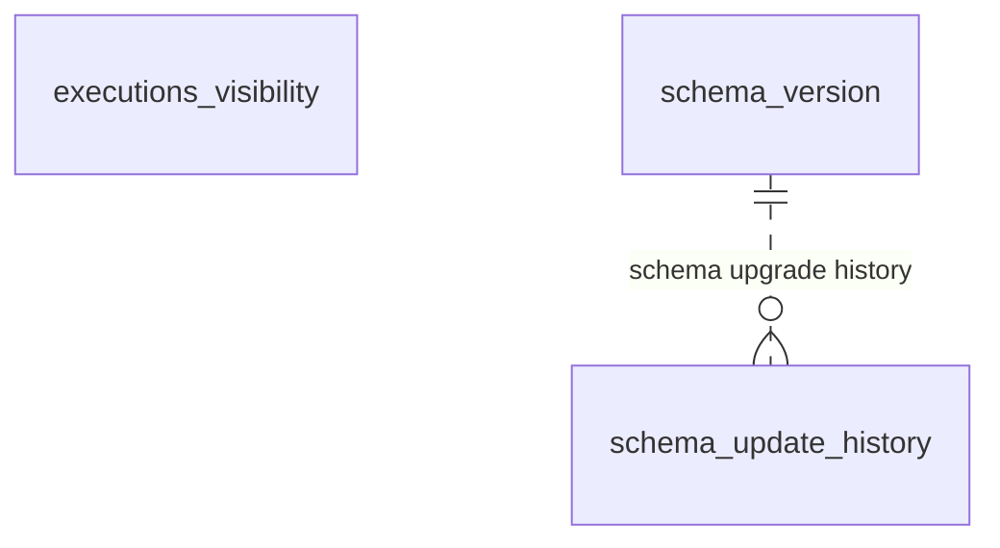

# temporal_visibility 数据库：检索数据字典

> **版本**：v0.1 
> **状态**：完整字段稿待审阅；未创建数据库或执行迁移 
> **维护与评审**：Codex 编写及自检，用户审阅 
> **更新日期**：2026-11-15

本册列出候选 **Temporal Server v1.32.2 / PostgreSQL Schema 1.14** 的 **3 张表、93 个列定义**。它是组件官方结构的查阅附录，不是DeerMind自行维护的DDL，也不表示本批批准或安装此版本。正式选定不同Server版本时，必须重新比对本册。

来源：[官方建表文件](https://github.com/temporalio/temporal/blob/v1.32.2/schema/postgresql/v12/visibility/schema.sql)、[Schema版本常量](https://github.com/temporalio/temporal/blob/v1.32.2/schema/postgresql/v12/version.go)、[两张Schema管理表](https://github.com/temporalio/temporal/blob/v1.32.2/common/persistence/sql/sqlplugin/postgresql/admin.go)。原始建表文件SHA-256：`de6dc9f06c556f58585b115fa0b9b11b7286b95b753b1aa46015c4fc8b9ae286`（UTF-8、LF）。

## 表目录与关系

| 表 | 用途 |
| --- | --- |
| [executions_visibility](#1-executions_visibility) | Workflow检索视图及搜索属性 |
| [schema_version](#2-schema_version) | 组件数据库当前Schema版本 |
| [schema_update_history](#3-schema_update_history) | 组件Schema升级记录 |

以下为逻辑关联，官方DDL未建立这些业务外键；不得补上自定义跨库外键。组件自己维护一致性。图中没有连线的表是独立元数据，不代表缺少结构。

`executions_visibility`通过namespace_id、workflow_id、run_id与执行库对应，属于异步维护的检索视图，不是业务完成的判据。跨库关联是逻辑关系，无SQL外键；两个Schema管理表不与执行行相连。

## 1. `executions_visibility`

Workflow检索视图及搜索属性。

| 字段 | 官方PostgreSQL类型 | 可空 | 默认/生成方式 | 定义 |
| --- | --- | --- | --- | --- |
| `namespace_id` | `CHAR(64)` | 否 | 无 | Temporal命名空间身份；非DeerMind Domain |
| `run_id` | `CHAR(64)` | 否 | 无 | 本次Workflow运行身份 |
| `_version` | `BIGINT` | 否 | 0 | 查询视图递增写版本，拒绝乱序覆盖 |
| `start_time` | `TIMESTAMP` | 否 | 无 | Workflow开始时间 |
| `execution_time` | `TIMESTAMP` | 否 | 无 | 执行实际计划开始时刻 |
| `workflow_id` | `VARCHAR(255)` | 否 | 无 | 工作流逻辑身份；DeerMind按执行/尝试映射 |
| `workflow_type_name` | `VARCHAR(255)` | 否 | 无 | Workflow类型名 |
| `status` | `INTEGER` | 否 | 无 | Temporal WorkflowExecutionStatus；整数枚举由组件定义 |
| `close_time` | `TIMESTAMP` | 是 | 无 | 终止时间；运行中为空 |
| `history_length` | `BIGINT` | 是 | 无 | 历史事件数；未结算可空 |
| `history_size_bytes` | `BIGINT` | 是 | 无 | 历史大小，字节 |
| `execution_duration` | `BIGINT` | 是 | 无 | 执行时长，Temporal内部纳秒计数；未结算可空 |
| `state_transition_count` | `BIGINT` | 是 | 无 | 执行状态转换计数 |
| `memo` | `BYTEA` | 是 | 无 | 检索可见的序列化Memo，不是学生聊天 |
| `encoding` | `VARCHAR(64)` | 否 | 无 | 对应二进制载荷的编码名称；与载荷成对解释，由Temporal管理，不自行假定为JSON。 |
| `task_queue` | `VARCHAR(255)` | 否 | '' | 执行采用的任务队列名 |
| `search_attributes` | `JSONB` | 是 | 无 | 组件搜索属性JSON；生成列从这里派生 |
| `parent_workflow_id` | `VARCHAR(255)` | 是 | 无 | 父Workflow身份；顶层可空 |
| `parent_run_id` | `VARCHAR(255)` | 是 | 无 | 父运行身份 |
| `root_workflow_id` | `VARCHAR(255)` | 否 | '' | 根Workflow身份；默认空字符串表示未提供 |
| `root_run_id` | `VARCHAR(255)` | 否 | '' | 根运行身份 |
| `TemporalChangeVersion` | `JSONB` | 是 | GENERATED ALWAYS / STORED | 只读生成列，从search_attributes的`TemporalChangeVersion`提取；缺该属性返回SQL NULL。生成表达式见本表附表；应用不得直接写。 |
| `BinaryChecksums` | `JSONB` | 是 | GENERATED ALWAYS / STORED | 只读生成列，从search_attributes的`BinaryChecksums`提取；缺该属性返回SQL NULL。生成表达式见本表附表；应用不得直接写。 |
| `BatcherUser` | `VARCHAR(255)` | 是 | GENERATED ALWAYS / STORED | 只读生成列，从search_attributes的`BatcherUser`提取；缺该属性返回SQL NULL。生成表达式见本表附表；应用不得直接写。 |
| `TemporalScheduledStartTime` | `TIMESTAMP` | 是 | GENERATED ALWAYS / STORED | 只读生成列，从search_attributes的`TemporalScheduledStartTime`提取；缺该属性返回SQL NULL。生成表达式见本表附表；应用不得直接写。 |
| `TemporalScheduledById` | `VARCHAR(255)` | 是 | GENERATED ALWAYS / STORED | 只读生成列，从search_attributes的`TemporalScheduledById`提取；缺该属性返回SQL NULL。生成表达式见本表附表；应用不得直接写。 |
| `TemporalSchedulePaused` | `BOOLEAN` | 是 | GENERATED ALWAYS / STORED | 只读生成列，从search_attributes的`TemporalSchedulePaused`提取；缺该属性返回SQL NULL。生成表达式见本表附表；应用不得直接写。 |
| `TemporalNamespaceDivision` | `VARCHAR(255)` | 是 | GENERATED ALWAYS / STORED | 只读生成列，从search_attributes的`TemporalNamespaceDivision`提取；缺该属性返回SQL NULL。生成表达式见本表附表；应用不得直接写。 |
| `BuildIds` | `JSONB` | 是 | GENERATED ALWAYS / STORED | 只读生成列，从search_attributes的`BuildIds`提取；缺该属性返回SQL NULL。生成表达式见本表附表；应用不得直接写。 |
| `TemporalPauseInfo` | `JSONB` | 是 | GENERATED ALWAYS / STORED | 只读生成列，从search_attributes的`TemporalPauseInfo`提取；缺该属性返回SQL NULL。生成表达式见本表附表；应用不得直接写。 |
| `TemporalReportedProblems` | `JSONB` | 是 | GENERATED ALWAYS / STORED | 只读生成列，从search_attributes的`TemporalReportedProblems`提取；缺该属性返回SQL NULL。生成表达式见本表附表；应用不得直接写。 |
| `TemporalWorkerDeploymentVersion` | `VARCHAR(255)` | 是 | GENERATED ALWAYS / STORED | 只读生成列，从search_attributes的`TemporalWorkerDeploymentVersion`提取；缺该属性返回SQL NULL。生成表达式见本表附表；应用不得直接写。 |
| `TemporalWorkflowVersioningBehavior` | `VARCHAR(255)` | 是 | GENERATED ALWAYS / STORED | 只读生成列，从search_attributes的`TemporalWorkflowVersioningBehavior`提取；缺该属性返回SQL NULL。生成表达式见本表附表；应用不得直接写。 |
| `TemporalWorkerDeployment` | `VARCHAR(255)` | 是 | GENERATED ALWAYS / STORED | 只读生成列，从search_attributes的`TemporalWorkerDeployment`提取；缺该属性返回SQL NULL。生成表达式见本表附表；应用不得直接写。 |
| `TemporalUsedWorkerDeploymentVersions` | `JSONB` | 是 | GENERATED ALWAYS / STORED | 只读生成列，从search_attributes的`TemporalUsedWorkerDeploymentVersions`提取；缺该属性返回SQL NULL。生成表达式见本表附表；应用不得直接写。 |
| `TemporalExternalPayloadSizeBytes` | `BIGINT` | 是 | GENERATED ALWAYS / STORED | 只读生成列，从search_attributes的`TemporalExternalPayloadSizeBytes`提取；缺该属性返回SQL NULL。生成表达式见本表附表；应用不得直接写。 |
| `TemporalExternalPayloadCount` | `BIGINT` | 是 | GENERATED ALWAYS / STORED | 只读生成列，从search_attributes的`TemporalExternalPayloadCount`提取；缺该属性返回SQL NULL。生成表达式见本表附表；应用不得直接写。 |
| `Bool01` | `BOOLEAN` | 是 | GENERATED ALWAYS / STORED | 只读生成列，从search_attributes的`Bool01`提取；缺该属性返回SQL NULL。生成表达式见本表附表；应用不得直接写。 |
| `Bool02` | `BOOLEAN` | 是 | GENERATED ALWAYS / STORED | 只读生成列，从search_attributes的`Bool02`提取；缺该属性返回SQL NULL。生成表达式见本表附表；应用不得直接写。 |
| `Bool03` | `BOOLEAN` | 是 | GENERATED ALWAYS / STORED | 只读生成列，从search_attributes的`Bool03`提取；缺该属性返回SQL NULL。生成表达式见本表附表；应用不得直接写。 |
| `Datetime01` | `TIMESTAMP` | 是 | GENERATED ALWAYS / STORED | 只读生成列，从search_attributes的`Datetime01`提取；缺该属性返回SQL NULL。生成表达式见本表附表；应用不得直接写。 |
| `Datetime02` | `TIMESTAMP` | 是 | GENERATED ALWAYS / STORED | 只读生成列，从search_attributes的`Datetime02`提取；缺该属性返回SQL NULL。生成表达式见本表附表；应用不得直接写。 |
| `Datetime03` | `TIMESTAMP` | 是 | GENERATED ALWAYS / STORED | 只读生成列，从search_attributes的`Datetime03`提取；缺该属性返回SQL NULL。生成表达式见本表附表；应用不得直接写。 |
| `Double01` | `DECIMAL(20, 5)` | 是 | GENERATED ALWAYS / STORED | 只读生成列，从search_attributes的`Double01`提取；缺该属性返回SQL NULL。生成表达式见本表附表；应用不得直接写。 |
| `Double02` | `DECIMAL(20, 5)` | 是 | GENERATED ALWAYS / STORED | 只读生成列，从search_attributes的`Double02`提取；缺该属性返回SQL NULL。生成表达式见本表附表；应用不得直接写。 |
| `Double03` | `DECIMAL(20, 5)` | 是 | GENERATED ALWAYS / STORED | 只读生成列，从search_attributes的`Double03`提取；缺该属性返回SQL NULL。生成表达式见本表附表；应用不得直接写。 |
| `Int01` | `BIGINT` | 是 | GENERATED ALWAYS / STORED | 只读生成列，从search_attributes的`Int01`提取；缺该属性返回SQL NULL。生成表达式见本表附表；应用不得直接写。 |
| `Int02` | `BIGINT` | 是 | GENERATED ALWAYS / STORED | 只读生成列，从search_attributes的`Int02`提取；缺该属性返回SQL NULL。生成表达式见本表附表；应用不得直接写。 |
| `Int03` | `BIGINT` | 是 | GENERATED ALWAYS / STORED | 只读生成列，从search_attributes的`Int03`提取；缺该属性返回SQL NULL。生成表达式见本表附表；应用不得直接写。 |
| `Keyword01` | `VARCHAR(255)` | 是 | GENERATED ALWAYS / STORED | 只读生成列，从search_attributes的`Keyword01`提取；缺该属性返回SQL NULL。生成表达式见本表附表；应用不得直接写。 |
| `Keyword02` | `VARCHAR(255)` | 是 | GENERATED ALWAYS / STORED | 只读生成列，从search_attributes的`Keyword02`提取；缺该属性返回SQL NULL。生成表达式见本表附表；应用不得直接写。 |
| `Keyword03` | `VARCHAR(255)` | 是 | GENERATED ALWAYS / STORED | 只读生成列，从search_attributes的`Keyword03`提取；缺该属性返回SQL NULL。生成表达式见本表附表；应用不得直接写。 |
| `Keyword04` | `VARCHAR(255)` | 是 | GENERATED ALWAYS / STORED | 只读生成列，从search_attributes的`Keyword04`提取；缺该属性返回SQL NULL。生成表达式见本表附表；应用不得直接写。 |
| `Keyword05` | `VARCHAR(255)` | 是 | GENERATED ALWAYS / STORED | 只读生成列，从search_attributes的`Keyword05`提取；缺该属性返回SQL NULL。生成表达式见本表附表；应用不得直接写。 |
| `Keyword06` | `VARCHAR(255)` | 是 | GENERATED ALWAYS / STORED | 只读生成列，从search_attributes的`Keyword06`提取；缺该属性返回SQL NULL。生成表达式见本表附表；应用不得直接写。 |
| `Keyword07` | `VARCHAR(255)` | 是 | GENERATED ALWAYS / STORED | 只读生成列，从search_attributes的`Keyword07`提取；缺该属性返回SQL NULL。生成表达式见本表附表；应用不得直接写。 |
| `Keyword08` | `VARCHAR(255)` | 是 | GENERATED ALWAYS / STORED | 只读生成列，从search_attributes的`Keyword08`提取；缺该属性返回SQL NULL。生成表达式见本表附表；应用不得直接写。 |
| `Keyword09` | `VARCHAR(255)` | 是 | GENERATED ALWAYS / STORED | 只读生成列，从search_attributes的`Keyword09`提取；缺该属性返回SQL NULL。生成表达式见本表附表；应用不得直接写。 |
| `Keyword10` | `VARCHAR(255)` | 是 | GENERATED ALWAYS / STORED | 只读生成列，从search_attributes的`Keyword10`提取；缺该属性返回SQL NULL。生成表达式见本表附表；应用不得直接写。 |
| `Text01` | `TSVECTOR` | 是 | GENERATED ALWAYS / STORED | 只读生成列，从search_attributes的`Text01`提取；缺该属性返回SQL NULL。生成表达式见本表附表；应用不得直接写。 |
| `Text02` | `TSVECTOR` | 是 | GENERATED ALWAYS / STORED | 只读生成列，从search_attributes的`Text02`提取；缺该属性返回SQL NULL。生成表达式见本表附表；应用不得直接写。 |
| `Text03` | `TSVECTOR` | 是 | GENERATED ALWAYS / STORED | 只读生成列，从search_attributes的`Text03`提取；缺该属性返回SQL NULL。生成表达式见本表附表；应用不得直接写。 |
| `KeywordList01` | `JSONB` | 是 | GENERATED ALWAYS / STORED | 只读生成列，从search_attributes的`KeywordList01`提取；缺该属性返回SQL NULL。生成表达式见本表附表；应用不得直接写。 |
| `KeywordList02` | `JSONB` | 是 | GENERATED ALWAYS / STORED | 只读生成列，从search_attributes的`KeywordList02`提取；缺该属性返回SQL NULL。生成表达式见本表附表；应用不得直接写。 |
| `KeywordList03` | `JSONB` | 是 | GENERATED ALWAYS / STORED | 只读生成列，从search_attributes的`KeywordList03`提取；缺该属性返回SQL NULL。生成表达式见本表附表；应用不得直接写。 |
| `TemporalBool01` | `BOOLEAN` | 是 | GENERATED ALWAYS / STORED | 只读生成列，从search_attributes的`TemporalBool01`提取；缺该属性返回SQL NULL。生成表达式见本表附表；应用不得直接写。 |
| `TemporalBool02` | `BOOLEAN` | 是 | GENERATED ALWAYS / STORED | 只读生成列，从search_attributes的`TemporalBool02`提取；缺该属性返回SQL NULL。生成表达式见本表附表；应用不得直接写。 |
| `TemporalDatetime01` | `TIMESTAMP` | 是 | GENERATED ALWAYS / STORED | 只读生成列，从search_attributes的`TemporalDatetime01`提取；缺该属性返回SQL NULL。生成表达式见本表附表；应用不得直接写。 |
| `TemporalDatetime02` | `TIMESTAMP` | 是 | GENERATED ALWAYS / STORED | 只读生成列，从search_attributes的`TemporalDatetime02`提取；缺该属性返回SQL NULL。生成表达式见本表附表；应用不得直接写。 |
| `TemporalDouble01` | `DECIMAL(20, 5)` | 是 | GENERATED ALWAYS / STORED | 只读生成列，从search_attributes的`TemporalDouble01`提取；缺该属性返回SQL NULL。生成表达式见本表附表；应用不得直接写。 |
| `TemporalDouble02` | `DECIMAL(20, 5)` | 是 | GENERATED ALWAYS / STORED | 只读生成列，从search_attributes的`TemporalDouble02`提取；缺该属性返回SQL NULL。生成表达式见本表附表；应用不得直接写。 |
| `TemporalInt01` | `BIGINT` | 是 | GENERATED ALWAYS / STORED | 只读生成列，从search_attributes的`TemporalInt01`提取；缺该属性返回SQL NULL。生成表达式见本表附表；应用不得直接写。 |
| `TemporalInt02` | `BIGINT` | 是 | GENERATED ALWAYS / STORED | 只读生成列，从search_attributes的`TemporalInt02`提取；缺该属性返回SQL NULL。生成表达式见本表附表；应用不得直接写。 |
| `TemporalKeyword01` | `VARCHAR(255)` | 是 | GENERATED ALWAYS / STORED | 只读生成列，从search_attributes的`TemporalKeyword01`提取；缺该属性返回SQL NULL。生成表达式见本表附表；应用不得直接写。 |
| `TemporalKeyword02` | `VARCHAR(255)` | 是 | GENERATED ALWAYS / STORED | 只读生成列，从search_attributes的`TemporalKeyword02`提取；缺该属性返回SQL NULL。生成表达式见本表附表；应用不得直接写。 |
| `TemporalKeyword03` | `VARCHAR(255)` | 是 | GENERATED ALWAYS / STORED | 只读生成列，从search_attributes的`TemporalKeyword03`提取；缺该属性返回SQL NULL。生成表达式见本表附表；应用不得直接写。 |
| `TemporalKeyword04` | `VARCHAR(255)` | 是 | GENERATED ALWAYS / STORED | 只读生成列，从search_attributes的`TemporalKeyword04`提取；缺该属性返回SQL NULL。生成表达式见本表附表；应用不得直接写。 |
| `TemporalLowCardinalityKeyword01` | `VARCHAR(255)` | 是 | GENERATED ALWAYS / STORED | 只读生成列，从search_attributes的`TemporalLowCardinalityKeyword01`提取；缺该属性返回SQL NULL。生成表达式见本表附表；应用不得直接写。 |
| `TemporalKeywordList01` | `JSONB` | 是 | GENERATED ALWAYS / STORED | 只读生成列，从search_attributes的`TemporalKeywordList01`提取；缺该属性返回SQL NULL。生成表达式见本表附表；应用不得直接写。 |
| `TemporalKeywordList02` | `JSONB` | 是 | GENERATED ALWAYS / STORED | 只读生成列，从search_attributes的`TemporalKeywordList02`提取；缺该属性返回SQL NULL。生成表达式见本表附表；应用不得直接写。 |

官方表约束：

- `PRIMARY KEY (namespace_id, run_id)`

官方索引：

- `CREATE INDEX default_idx ON executions_visibility (namespace_id, (COALESCE(close_time, '9999-12-31 23:59:59')) DESC, start_time DESC, run_id);`
- `CREATE INDEX by_execution_time ON executions_visibility (namespace_id, execution_time, (COALESCE(close_time, '9999-12-31 23:59:59')) DESC, start_time DESC, run_id);`
- `CREATE INDEX by_workflow_id ON executions_visibility (namespace_id, workflow_id, (COALESCE(close_time, '9999-12-31 23:59:59')) DESC, start_time DESC, run_id);`
- `CREATE INDEX by_workflow_type ON executions_visibility (namespace_id, workflow_type_name, (COALESCE(close_time, '9999-12-31 23:59:59')) DESC, start_time DESC, run_id);`
- `CREATE INDEX by_status ON executions_visibility (namespace_id, status, (COALESCE(close_time, '9999-12-31 23:59:59')) DESC, start_time DESC, run_id);`
- `CREATE INDEX by_history_length ON executions_visibility (namespace_id, history_length, (COALESCE(close_time, '9999-12-31 23:59:59')) DESC, start_time DESC, run_id);`
- `CREATE INDEX by_history_size_bytes ON executions_visibility (namespace_id, history_size_bytes, (COALESCE(close_time, '9999-12-31 23:59:59')) DESC, start_time DESC, run_id);`
- `CREATE INDEX by_execution_duration ON executions_visibility (namespace_id, execution_duration, (COALESCE(close_time, '9999-12-31 23:59:59')) DESC, start_time DESC, run_id);`
- `CREATE INDEX by_state_transition_count ON executions_visibility (namespace_id, state_transition_count, (COALESCE(close_time, '9999-12-31 23:59:59')) DESC, start_time DESC, run_id);`
- `CREATE INDEX by_task_queue ON executions_visibility (namespace_id, task_queue, (COALESCE(close_time, '9999-12-31 23:59:59')) DESC, start_time DESC, run_id);`
- `CREATE INDEX by_parent_workflow_id ON executions_visibility (namespace_id, parent_workflow_id, (COALESCE(close_time, '9999-12-31 23:59:59')) DESC, start_time DESC, run_id);`
- `CREATE INDEX by_parent_run_id ON executions_visibility (namespace_id, parent_run_id, (COALESCE(close_time, '9999-12-31 23:59:59')) DESC, start_time DESC, run_id);`
- `CREATE INDEX by_root_workflow_id ON executions_visibility (namespace_id, root_workflow_id, (COALESCE(close_time, '9999-12-31 23:59:59')) DESC, start_time DESC, run_id);`
- `CREATE INDEX by_root_run_id ON executions_visibility (namespace_id, root_run_id, (COALESCE(close_time, '9999-12-31 23:59:59')) DESC, start_time DESC, run_id);`
- `CREATE INDEX by_temporal_change_version ON executions_visibility USING GIN (namespace_id, TemporalChangeVersion jsonb_path_ops);`
- `CREATE INDEX by_binary_checksums ON executions_visibility USING GIN (namespace_id, BinaryChecksums jsonb_path_ops);`
- `CREATE INDEX by_build_ids ON executions_visibility USING GIN (namespace_id, BuildIds jsonb_path_ops);`
- `CREATE INDEX by_temporal_pause_info ON executions_visibility USING GIN (namespace_id, TemporalPauseInfo jsonb_path_ops);`
- `CREATE INDEX by_temporal_reported_problems ON executions_visibility USING GIN (namespace_id, TemporalReportedProblems jsonb_path_ops);`
- `CREATE INDEX by_temporal_worker_deployment_version ON executions_visibility (namespace_id, TemporalWorkerDeploymentVersion, (COALESCE(close_time, '9999-12-31 23:59:59')) DESC, start_time DESC, run_id);`
- `CREATE INDEX by_temporal_workflow_versioning_behavior ON executions_visibility (namespace_id, TemporalWorkflowVersioningBehavior, (COALESCE(close_time, '9999-12-31 23:59:59')) DESC, start_time DESC, run_id);`
- `CREATE INDEX by_temporal_worker_deployment ON executions_visibility (namespace_id, TemporalWorkerDeployment, (COALESCE(close_time, '9999-12-31 23:59:59')) DESC, start_time DESC, run_id);`
- `CREATE INDEX by_used_deployment_versions ON executions_visibility USING GIN (namespace_id, TemporalUsedWorkerDeploymentVersions jsonb_path_ops);`
- `CREATE INDEX by_batcher_user ON executions_visibility (namespace_id, BatcherUser, (COALESCE(close_time, '9999-12-31 23:59:59')) DESC, start_time DESC, run_id);`
- `CREATE INDEX by_temporal_scheduled_start_time ON executions_visibility (namespace_id, TemporalScheduledStartTime, (COALESCE(close_time, '9999-12-31 23:59:59')) DESC, start_time DESC, run_id);`
- `CREATE INDEX by_temporal_scheduled_by_id ON executions_visibility (namespace_id, TemporalScheduledById, (COALESCE(close_time, '9999-12-31 23:59:59')) DESC, start_time DESC, run_id);`
- `CREATE INDEX by_temporal_schedule_paused ON executions_visibility (namespace_id, TemporalSchedulePaused, (COALESCE(close_time, '9999-12-31 23:59:59')) DESC, start_time DESC, run_id);`
- `CREATE INDEX by_temporal_namespace_division ON executions_visibility (namespace_id, TemporalNamespaceDivision, (COALESCE(close_time, '9999-12-31 23:59:59')) DESC, start_time DESC, run_id);`
- `CREATE INDEX by_temporal_external_payload_size_bytes ON executions_visibility (namespace_id, TemporalExternalPayloadSizeBytes, (COALESCE(close_time, '9999-12-31 23:59:59')) DESC, start_time DESC, run_id);`
- `CREATE INDEX by_temporal_external_payload_count ON executions_visibility (namespace_id, TemporalExternalPayloadCount, (COALESCE(close_time, '9999-12-31 23:59:59')) DESC, start_time DESC, run_id);`
- `CREATE INDEX by_bool_01 ON executions_visibility (namespace_id, Bool01, (COALESCE(close_time, '9999-12-31 23:59:59')) DESC, start_time DESC, run_id);`
- `CREATE INDEX by_bool_02 ON executions_visibility (namespace_id, Bool02, (COALESCE(close_time, '9999-12-31 23:59:59')) DESC, start_time DESC, run_id);`
- `CREATE INDEX by_bool_03 ON executions_visibility (namespace_id, Bool03, (COALESCE(close_time, '9999-12-31 23:59:59')) DESC, start_time DESC, run_id);`
- `CREATE INDEX by_datetime_01 ON executions_visibility (namespace_id, Datetime01, (COALESCE(close_time, '9999-12-31 23:59:59')) DESC, start_time DESC, run_id);`
- `CREATE INDEX by_datetime_02 ON executions_visibility (namespace_id, Datetime02, (COALESCE(close_time, '9999-12-31 23:59:59')) DESC, start_time DESC, run_id);`
- `CREATE INDEX by_datetime_03 ON executions_visibility (namespace_id, Datetime03, (COALESCE(close_time, '9999-12-31 23:59:59')) DESC, start_time DESC, run_id);`
- `CREATE INDEX by_double_01 ON executions_visibility (namespace_id, Double01, (COALESCE(close_time, '9999-12-31 23:59:59')) DESC, start_time DESC, run_id);`
- `CREATE INDEX by_double_02 ON executions_visibility (namespace_id, Double02, (COALESCE(close_time, '9999-12-31 23:59:59')) DESC, start_time DESC, run_id);`
- `CREATE INDEX by_double_03 ON executions_visibility (namespace_id, Double03, (COALESCE(close_time, '9999-12-31 23:59:59')) DESC, start_time DESC, run_id);`
- `CREATE INDEX by_int_01 ON executions_visibility (namespace_id, Int01, (COALESCE(close_time, '9999-12-31 23:59:59')) DESC, start_time DESC, run_id);`
- `CREATE INDEX by_int_02 ON executions_visibility (namespace_id, Int02, (COALESCE(close_time, '9999-12-31 23:59:59')) DESC, start_time DESC, run_id);`
- `CREATE INDEX by_int_03 ON executions_visibility (namespace_id, Int03, (COALESCE(close_time, '9999-12-31 23:59:59')) DESC, start_time DESC, run_id);`
- `CREATE INDEX by_keyword_01 ON executions_visibility (namespace_id, Keyword01, (COALESCE(close_time, '9999-12-31 23:59:59')) DESC, start_time DESC, run_id);`
- `CREATE INDEX by_keyword_02 ON executions_visibility (namespace_id, Keyword02, (COALESCE(close_time, '9999-12-31 23:59:59')) DESC, start_time DESC, run_id);`
- `CREATE INDEX by_keyword_03 ON executions_visibility (namespace_id, Keyword03, (COALESCE(close_time, '9999-12-31 23:59:59')) DESC, start_time DESC, run_id);`
- `CREATE INDEX by_keyword_04 ON executions_visibility (namespace_id, Keyword04, (COALESCE(close_time, '9999-12-31 23:59:59')) DESC, start_time DESC, run_id);`
- `CREATE INDEX by_keyword_05 ON executions_visibility (namespace_id, Keyword05, (COALESCE(close_time, '9999-12-31 23:59:59')) DESC, start_time DESC, run_id);`
- `CREATE INDEX by_keyword_06 ON executions_visibility (namespace_id, Keyword06, (COALESCE(close_time, '9999-12-31 23:59:59')) DESC, start_time DESC, run_id);`
- `CREATE INDEX by_keyword_07 ON executions_visibility (namespace_id, Keyword07, (COALESCE(close_time, '9999-12-31 23:59:59')) DESC, start_time DESC, run_id);`
- `CREATE INDEX by_keyword_08 ON executions_visibility (namespace_id, Keyword08, (COALESCE(close_time, '9999-12-31 23:59:59')) DESC, start_time DESC, run_id);`
- `CREATE INDEX by_keyword_09 ON executions_visibility (namespace_id, Keyword09, (COALESCE(close_time, '9999-12-31 23:59:59')) DESC, start_time DESC, run_id);`
- `CREATE INDEX by_keyword_10 ON executions_visibility (namespace_id, Keyword10, (COALESCE(close_time, '9999-12-31 23:59:59')) DESC, start_time DESC, run_id);`
- `CREATE INDEX by_text_01 ON executions_visibility USING GIN (namespace_id, Text01);`
- `CREATE INDEX by_text_02 ON executions_visibility USING GIN (namespace_id, Text02);`
- `CREATE INDEX by_text_03 ON executions_visibility USING GIN (namespace_id, Text03);`
- `CREATE INDEX by_keyword_list_01 ON executions_visibility USING GIN (namespace_id, KeywordList01 jsonb_path_ops);`
- `CREATE INDEX by_keyword_list_02 ON executions_visibility USING GIN (namespace_id, KeywordList02 jsonb_path_ops);`
- `CREATE INDEX by_keyword_list_03 ON executions_visibility USING GIN (namespace_id, KeywordList03 jsonb_path_ops);`
- `CREATE INDEX by_temporal_bool_01 ON executions_visibility (namespace_id, TemporalBool01, (COALESCE(close_time, '9999-12-31 23:59:59')) DESC, start_time DESC, run_id);`
- `CREATE INDEX by_temporal_bool_02 ON executions_visibility (namespace_id, TemporalBool02, (COALESCE(close_time, '9999-12-31 23:59:59')) DESC, start_time DESC, run_id);`
- `CREATE INDEX by_temporal_datetime_01 ON executions_visibility (namespace_id, TemporalDatetime01, (COALESCE(close_time, '9999-12-31 23:59:59')) DESC, start_time DESC, run_id);`
- `CREATE INDEX by_temporal_datetime_02 ON executions_visibility (namespace_id, TemporalDatetime02, (COALESCE(close_time, '9999-12-31 23:59:59')) DESC, start_time DESC, run_id);`
- `CREATE INDEX by_temporal_double_01 ON executions_visibility (namespace_id, TemporalDouble01, (COALESCE(close_time, '9999-12-31 23:59:59')) DESC, start_time DESC, run_id);`
- `CREATE INDEX by_temporal_double_02 ON executions_visibility (namespace_id, TemporalDouble02, (COALESCE(close_time, '9999-12-31 23:59:59')) DESC, start_time DESC, run_id);`
- `CREATE INDEX by_temporal_int_01 ON executions_visibility (namespace_id, TemporalInt01, (COALESCE(close_time, '9999-12-31 23:59:59')) DESC, start_time DESC, run_id);`
- `CREATE INDEX by_temporal_int_02 ON executions_visibility (namespace_id, TemporalInt02, (COALESCE(close_time, '9999-12-31 23:59:59')) DESC, start_time DESC, run_id);`
- `CREATE INDEX by_temporal_keyword_01 ON executions_visibility (namespace_id, TemporalKeyword01, (COALESCE(close_time, '9999-12-31 23:59:59')) DESC, start_time DESC, run_id);`
- `CREATE INDEX by_temporal_keyword_02 ON executions_visibility (namespace_id, TemporalKeyword02, (COALESCE(close_time, '9999-12-31 23:59:59')) DESC, start_time DESC, run_id);`
- `CREATE INDEX by_temporal_keyword_03 ON executions_visibility (namespace_id, TemporalKeyword03, (COALESCE(close_time, '9999-12-31 23:59:59')) DESC, start_time DESC, run_id);`
- `CREATE INDEX by_temporal_keyword_04 ON executions_visibility (namespace_id, TemporalKeyword04, (COALESCE(close_time, '9999-12-31 23:59:59')) DESC, start_time DESC, run_id);`
- `CREATE INDEX by_temporal_low_cardinality_keyword_01 ON executions_visibility (namespace_id, TemporalLowCardinalityKeyword01, (COALESCE(close_time, '9999-12-31 23:59:59')) DESC, start_time DESC, run_id);`
- `CREATE INDEX by_temporal_keyword_list_01 ON executions_visibility USING GIN (namespace_id, TemporalKeywordList01 jsonb_path_ops);`
- `CREATE INDEX by_temporal_keyword_list_02 ON executions_visibility USING GIN (namespace_id, TemporalKeywordList02 jsonb_path_ops);`

生成表达式（字段名未加双引号，PostgreSQL实际目录中折叠为小写）：

| 字段 | 表达式 |
| --- | --- |
| `TemporalChangeVersion` | `GENERATED ALWAYS AS (search_attributes->'TemporalChangeVersion') STORED` |
| `BinaryChecksums` | `GENERATED ALWAYS AS (search_attributes->'BinaryChecksums') STORED` |
| `BatcherUser` | `GENERATED ALWAYS AS (search_attributes->>'BatcherUser') STORED` |
| `TemporalScheduledStartTime` | `GENERATED ALWAYS AS (convert_ts(search_attributes->>'TemporalScheduledStartTime')) STORED` |
| `TemporalScheduledById` | `GENERATED ALWAYS AS (search_attributes->>'TemporalScheduledById') STORED` |
| `TemporalSchedulePaused` | `GENERATED ALWAYS AS ((search_attributes->'TemporalSchedulePaused')::boolean) STORED` |
| `TemporalNamespaceDivision` | `GENERATED ALWAYS AS (search_attributes->>'TemporalNamespaceDivision') STORED` |
| `BuildIds` | `GENERATED ALWAYS AS (search_attributes->'BuildIds') STORED` |
| `TemporalPauseInfo` | `GENERATED ALWAYS AS (search_attributes->'TemporalPauseInfo') STORED` |
| `TemporalReportedProblems` | `GENERATED ALWAYS AS (search_attributes->'TemporalReportedProblems') STORED` |
| `TemporalWorkerDeploymentVersion` | `GENERATED ALWAYS AS (search_attributes->>'TemporalWorkerDeploymentVersion') STORED` |
| `TemporalWorkflowVersioningBehavior` | `GENERATED ALWAYS AS (search_attributes->>'TemporalWorkflowVersioningBehavior') STORED` |
| `TemporalWorkerDeployment` | `GENERATED ALWAYS AS (search_attributes->>'TemporalWorkerDeployment') STORED` |
| `TemporalUsedWorkerDeploymentVersions` | `GENERATED ALWAYS AS (search_attributes->'TemporalUsedWorkerDeploymentVersions') STORED` |
| `TemporalExternalPayloadSizeBytes` | `GENERATED ALWAYS AS ((search_attributes->'TemporalExternalPayloadSizeBytes')::bigint) STORED` |
| `TemporalExternalPayloadCount` | `GENERATED ALWAYS AS ((search_attributes->'TemporalExternalPayloadCount')::bigint) STORED` |
| `Bool01` | `GENERATED ALWAYS AS ((search_attributes->'Bool01')::boolean) STORED` |
| `Bool02` | `GENERATED ALWAYS AS ((search_attributes->'Bool02')::boolean) STORED` |
| `Bool03` | `GENERATED ALWAYS AS ((search_attributes->'Bool03')::boolean) STORED` |
| `Datetime01` | `GENERATED ALWAYS AS (convert_ts(search_attributes->>'Datetime01')) STORED` |
| `Datetime02` | `GENERATED ALWAYS AS (convert_ts(search_attributes->>'Datetime02')) STORED` |
| `Datetime03` | `GENERATED ALWAYS AS (convert_ts(search_attributes->>'Datetime03')) STORED` |
| `Double01` | `GENERATED ALWAYS AS ((search_attributes->'Double01')::decimal) STORED` |
| `Double02` | `GENERATED ALWAYS AS ((search_attributes->'Double02')::decimal) STORED` |
| `Double03` | `GENERATED ALWAYS AS ((search_attributes->'Double03')::decimal) STORED` |
| `Int01` | `GENERATED ALWAYS AS ((search_attributes->'Int01')::bigint) STORED` |
| `Int02` | `GENERATED ALWAYS AS ((search_attributes->'Int02')::bigint) STORED` |
| `Int03` | `GENERATED ALWAYS AS ((search_attributes->'Int03')::bigint) STORED` |
| `Keyword01` | `GENERATED ALWAYS AS (search_attributes->>'Keyword01') STORED` |
| `Keyword02` | `GENERATED ALWAYS AS (search_attributes->>'Keyword02') STORED` |
| `Keyword03` | `GENERATED ALWAYS AS (search_attributes->>'Keyword03') STORED` |
| `Keyword04` | `GENERATED ALWAYS AS (search_attributes->>'Keyword04') STORED` |
| `Keyword05` | `GENERATED ALWAYS AS (search_attributes->>'Keyword05') STORED` |
| `Keyword06` | `GENERATED ALWAYS AS (search_attributes->>'Keyword06') STORED` |
| `Keyword07` | `GENERATED ALWAYS AS (search_attributes->>'Keyword07') STORED` |
| `Keyword08` | `GENERATED ALWAYS AS (search_attributes->>'Keyword08') STORED` |
| `Keyword09` | `GENERATED ALWAYS AS (search_attributes->>'Keyword09') STORED` |
| `Keyword10` | `GENERATED ALWAYS AS (search_attributes->>'Keyword10') STORED` |
| `Text01` | `GENERATED ALWAYS AS ((search_attributes->>'Text01')::tsvector) STORED` |
| `Text02` | `GENERATED ALWAYS AS ((search_attributes->>'Text02')::tsvector) STORED` |
| `Text03` | `GENERATED ALWAYS AS ((search_attributes->>'Text03')::tsvector) STORED` |
| `KeywordList01` | `GENERATED ALWAYS AS (search_attributes->'KeywordList01') STORED` |
| `KeywordList02` | `GENERATED ALWAYS AS (search_attributes->'KeywordList02') STORED` |
| `KeywordList03` | `GENERATED ALWAYS AS (search_attributes->'KeywordList03') STORED` |
| `TemporalBool01` | `GENERATED ALWAYS AS ((search_attributes->'TemporalBool01')::boolean) STORED` |
| `TemporalBool02` | `GENERATED ALWAYS AS ((search_attributes->'TemporalBool02')::boolean) STORED` |
| `TemporalDatetime01` | `GENERATED ALWAYS AS (convert_ts(search_attributes->>'TemporalDatetime01')) STORED` |
| `TemporalDatetime02` | `GENERATED ALWAYS AS (convert_ts(search_attributes->>'TemporalDatetime02')) STORED` |
| `TemporalDouble01` | `GENERATED ALWAYS AS ((search_attributes->'TemporalDouble01')::decimal) STORED` |
| `TemporalDouble02` | `GENERATED ALWAYS AS ((search_attributes->'TemporalDouble02')::decimal) STORED` |
| `TemporalInt01` | `GENERATED ALWAYS AS ((search_attributes->'TemporalInt01')::bigint) STORED` |
| `TemporalInt02` | `GENERATED ALWAYS AS ((search_attributes->'TemporalInt02')::bigint) STORED` |
| `TemporalKeyword01` | `GENERATED ALWAYS AS (search_attributes->>'TemporalKeyword01') STORED` |
| `TemporalKeyword02` | `GENERATED ALWAYS AS (search_attributes->>'TemporalKeyword02') STORED` |
| `TemporalKeyword03` | `GENERATED ALWAYS AS (search_attributes->>'TemporalKeyword03') STORED` |
| `TemporalKeyword04` | `GENERATED ALWAYS AS (search_attributes->>'TemporalKeyword04') STORED` |
| `TemporalLowCardinalityKeyword01` | `GENERATED ALWAYS AS (search_attributes->>'TemporalLowCardinalityKeyword01') STORED` |
| `TemporalKeywordList01` | `GENERATED ALWAYS AS (search_attributes->'TemporalKeywordList01') STORED` |
| `TemporalKeywordList02` | `GENERATED ALWAYS AS (search_attributes->'TemporalKeywordList02') STORED` |

## 2. `schema_version`

组件数据库当前Schema版本。

| 字段 | 官方PostgreSQL类型 | 可空 | 默认/生成方式 | 定义 |
| --- | --- | --- | --- | --- |
| `version_partition` | `INT` | 否 | 无 | Schema管理固定分区键 |
| `db_name` | `VARCHAR(255)` | 否 | 无 | 此Schema记录对应的数据库名 |
| `creation_time` | `TIMESTAMP` | 是 | 无 | 首次Schema建立时间 |
| `curr_version` | `VARCHAR(64)` | 是 | 无 | 当前组件Schema版本 |
| `min_compatible_version` | `VARCHAR(64)` | 是 | 无 | 组件允许的最低兼容Schema版本 |

官方表约束：

- `PRIMARY KEY(version_partition, db_name)`

## 3. `schema_update_history`

组件Schema升级记录。

| 字段 | 官方PostgreSQL类型 | 可空 | 默认/生成方式 | 定义 |
| --- | --- | --- | --- | --- |
| `version_partition` | `INT` | 否 | 无 | Schema管理固定分区键 |
| `year` | `INT` | 否 | 无 | Schema变更记录年份分区 |
| `month` | `INT` | 否 | 无 | Schema变更记录月份分区 |
| `update_time` | `TIMESTAMP` | 否 | 无 | Schema升级时间 |
| `description` | `VARCHAR(255)` | 是 | 无 | Schema变更说明 |
| `manifest_md5` | `VARCHAR(64)` | 是 | 无 | 官方迁移manifest摘要 |
| `new_version` | `VARCHAR(64)` | 是 | 无 | 升级目标Schema版本 |
| `old_version` | `VARCHAR(64)` | 是 | 无 | 升级前Schema版本 |

官方表约束：

- `PRIMARY KEY(version_partition, year, month, update_time)`

## 组件附属对象

官方Schema启用`btree_gin`，定义`convert_ts`函数，将RFC3339时间转为UTC的timestamp without time zone。表中的生成列、函数和索引一起由官方迁移管理；不能用业务库的timestamptz规范改写组件DDL。

## 维护边界

由Temporal专用账号和官方工具建表、升级、保留及清理；业务Alembic不接管。备份与业务库、NATS及文件按同批维护窗口执行。关闭执行的内部历史保留30天；业务事件、消息、结果与Step记录不因此删除。这里的组件执行状态不能代替业务所有者的提交收据。

## 修订记录

| 版本 | 日期 | 修改 |
| --- | --- | --- |
| v0.1 | 2026-11-15 | 按官方候选版本列全表、列、约束及关系；未安装或修改组件 |
