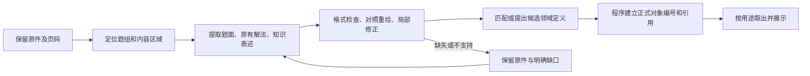

# M1 教材内容表达与提取验证

> **版本**：v0.2 
> **文档性质**：有限技术验证报告与下一步方案；不是正式产品规格 
> **状态**：首轮及第二轮四例复验已执行，作者内容与匹配核对完成；自动导入未通过，不代表整册验收 
> **上游依据与基线**：用户本轮同意先验证结构化表达与真实多模态提取；沿用用户指定教材和 Task → Solution → KC 约束；当前工作版本，未变更正式架构 
> **维护责任**：Codex 负责试验与记录；用户审阅方案及后续产品调整 
> **评审记录**：作者检查原图、原始输出及重建截图；没有独立专家复核，没有学生效果验证 
> **写作规范**：[设计文档规范 v1.1](../../../top/DeerMind_Design_Document_Standard_v1.1.md) 
> **更新日期**：2026-11-05 
> **修订说明**：v0.1 → v0.2：增加提取/核对/匹配分离的四例实测、程序编号与引用检查、人工修正记录及网络故障归因；首轮证据不改写。未修改管理员原型、PRD 或正式模型设计。

---

## 1. 本轮回答了什么

**两轮试验已确认：内容提取、作者核对、领域匹配、程序关联和重建展示可以分开组合运行；当前提取质量仍不足以支持无人核对的自动导入。** 第二轮四例中，一例所选内容无需修改，一例需要运算树规范化，两例需要较多修正。核对后的四例都完成了领域匹配与程序关联；这不等于模型原始提取四例全对。

第 2–7 章记录首轮输入、表达格式、结果和由此提出的方案；第 8 章记录第二轮实际执行，区分原始提取与修正后的结果。首轮失败没有被第二轮覆盖。

可浏览交付：

- [第二轮：原始提取、核对副本与领域匹配](http://127.0.0.1:5183/round2/)：四个固定样例，所有人工修改可展开查看。
- [作者参考与重建](http://127.0.0.1:5183/)：左侧原件，右侧从结构化数据生成内容；解法与题面分开。
- [真实模型结果与问题](http://127.0.0.1:5183/?trial=1)：保留原始回答，逐块预览能解析的内容，不替模型修引用、不补缺失项。
- [试验代码与数据](../../../../src/mvp_foundation/m1/content-representation/)：表达格式、输入规则、源图、运行记录和截图均独立保存。

这些页面是验证工具，不是新增的产品界面。原管理员端的 5182 服务与代码未因本轮改变。

## 2. 输入、范围与作者参考

原件来自[用户指定的北师大电子教材](https://www.100875.com.cn/show/eBookAndTeacher.html?resId=7965194976af40f5b9abc4b3f89522fe&bookId=120170718181616016000&firstNum=120170718181616016000&contributeId=9276)。本轮使用此前已保存的真实书页，按文件哈希固定；不据此确认“2026 版”。源包保存 8 页，其中第 92 页是备用素材，没有纳入本轮 8 个样例的验证范围。

作者先按原图整理出参考包：8 个样例、17 个内容元素、26 个候选领域定义摘要。它是语义整理参考，不是逐字 OCR 标准答案，更不是完整领域模型。部分题组被归到一个演示任务，部分解法被规范化；这些整理动作本身也要接受审阅。

| 样例 | 教材页 | 实际检查内容 | 明确没有覆盖的部分 |
| --- | --- | --- | --- |
| C01 | 50 | 三个分数算式，除号、分数线、括号与运算顺序说明 | 没有替练习生成答案 |
| C02 | 49–50 | 气象、摄影、航模人数的同一道题，两个教材解法，答句空格 | 约分笔迹未逐笔表达；第 49 页下方图示未覆盖 |
| C03 | 50 | 错误演算三行；错误结果也必须忠实保留 | 不把纠正答案写回原题；笔迹未逐笔表达 |
| C04 | 91 | 研究方案三格空表及左下人数表 | 右下年龄占比表、完整探究活动不在范围内 |
| C05 | 91、93 | 柱图、折线图、扇形图及人数到亿人的换算 | 不宣称完成整个调查单元 |
| C06 | 11 | 六类平面图形及标记点，布局与数学条件分开 | 不替代剪图、滚动、折叠等完整操作过程 |
| C07 | 67 | 三条定位条件和第三条的方向、距离示意 | 另外两幅示意和附页活动未覆盖 |
| C08 | 86 | 圆柱圆锥、上面与正面四个视图 | 不补侧面答案，不模拟下方手电实验 |

参考包中的模板是作者抽象，不能冒充教材已直接给出。教材里的规范化解法仍归教材来源，但这不表示原书逐行写过所有规范化中间式。后续正式格式必须单列“原样提取、规范化整理、推导新增”的加工记录，避免只用一个来源标签含混表达。

## 3. 试用表达格式

模型元素通过 `contentRefs` 引用内容块，每个内容元素记录归属、用途、来源及书页位置。内容块不是新建一套能力模型，而是 KC、TaskInstance、SolutionInstance 的内容表达。TaskTemplate 只关联 SolutionTemplate，KC 通过方法及子方法汇总。

| 内容 | 本轮结构化表达 | 展示与检查 |
| --- | --- | --- |
| 文本 | 文本块及所属对象、用途 | 按内容顺序组织；区分题面、解法、知识、教学辅助 |
| 公式 | 运算树与 LaTeX | 运算树渲染 MathML；分数线和除号分别表达；有理数运算检查 |
| 表格 | 表头、行列、单元格状态、值、单位 | HTML 表格；待填写、看不清、原文未提供分别标识 |
| 统计图 | 图名、图类、系列、数值、类别、单位、图例、轴与刻度 | SVG 重绘；检查系列长度、包含关系、比例及原始数据换算 |
| 平面图 | 对象、布局坐标、明确关系、关系依据 | SVG 重绘；绘图尺寸不当作题目条件 |
| 方向图 | 参照点、北轴、向东/西角度、距离、显示长度 | 根据这些参数重绘，不把屏幕长度当实际距离 |
| 立体与视图 | 有限的立体类别、姿态、观察方向、轮廓、中心点 | 以本轮支持的圆柱、圆锥类型重绘 |
| 错误演算 | 原样表达式序列及非正确解答标志 | 保留错误；不能通过自动计算把被辨析对象改正确 |

全部格式见 [schema.json](../../../../src/mvp_foundation/m1/content-representation/schema.json)。本轮实现的是有限表达集：方向图、立体等仍是专用类型，不是通用几何求解器；`scene.relations` 仍有自由文本，不等于数学关系已经完整形式化。LaTeX 与运算树的一致性尚未系统验证，正式实现应确定唯一主表示并从它生成展示，避免维护两个可冲突版本。

**因此 v0.1 可以作为具体讨论依据，还不能冻结为全册、全领域格式。** 至少约分标注、一般线段与角弧、复合几何关系、合并表格以及原样/规范化/推导的来源记录，仍需补齐或明确限制。结构表达不依赖特定 LLM，不意味着任意 LLM 都能按同样质量提取；切换模型仍需跑同一组案例。

## 4. 验证如何执行

第一步只检查参考包：Schema、对象引用、所属关系、文件哈希、部分数值和浏览器渲染。8 类负例包含题面引用解法、Task 直接关联 KC、重叠人群堆叠、空格被补答案、表格错列、图表系列错长、解法错属和来源区域越界。**结构检查及浏览器检查通过，只说明这些检查覆盖的机制有效。**

第二步调用已有配置的 DeepSeek Flash。其[官方图片输入说明](https://api-docs.deepseek.com/guides/vision/)提供了当前接口依据，实际请求也返回了模型回答。没有更换服务，也没有新增密钥。每个请求包含：

1. 通用提取规则与一个样例的文字范围。
2. 对应的完整原页图片、页 ID；没有裁切目标区域。
3. 输出 JSON Schema。
4. 26 个候选领域定义组成的小目录，用于尝试映射。

没有发送参考实例、内容数值、参考答案或预期检查项。**但提供的领域目录含作者解释，实测发生了把目录内容复制为教材原文的问题。** 这不是完全无先验的开放提取实验，不能用其结果估计陌生领域提取与分类能力。

| 参数 | 实际设置 |
| --- | --- |
| 模型与接口 | `deepseek-flash`，官方 `/chat/completions` |
| 图片 | 原图，`detail=high`；模型内部可能缩放，不能当作逐像素识别 |
| 输出模式 | `json_object`，本地 JSON Schema 校验；不是服务端强制完整 Schema |
| 推理/温度 | `thinking=disabled`，`temperature=0`；未比较其他推理设置 |
| 单次输出 | 最多 6,000 tokens |
| 并发/超时 | 首例探测后最多并发 2；HTTP 客户端超时设置 90 秒，不宣称是严格总墙钟截止 |
| 调用边界 | 原计划 8 次，无自动重试；两个连接失败另外各补跑 1 次，总计 10 次 HTTP 尝试，无提示词调优 |
| 运行证据 | 请求文字、参数、图像哈希、回答、用量、结束原因和本地检查结果；不保存密钥或推理字段 |

第一次客户端构造缺少 `socksio`，未发出 HTTP 请求，单列为本地环境问题；安装依赖后重新执行。首次批次中 C05、C06 的连接失败各补跑一次，均得到回答。它们不计为提取失败，也不被从运行记录抹去。

## 5. 实际结果与具体问题

10 次 HTTP 尝试中，8 次得到 HTTP 200 回答，2 次连接失败后补跑成功。按每例最终回答统计：5 例引用/用途关系错误，2 例 Schema 错误，1 例 JSON 解析失败；**0/8 完整输出可直接接受入库。** 这些类别按最先拦截的检查归类，同一例可能还有内容错误。不是“8 个例子全部看不懂”。

返回用量合计：47,991 输入 tokens、9,849 输出 tokens。8 个成功返回的请求记录耗时约 7.66–18.92 秒；没有收费账单，不报告推算的实际费用。作者已核对原图、输出和重建；尚未测量独立编辑者的修正时间，因此不能估算整本教材人工成本。

| 样例 | 已读出的内容 | 必须修正或补充的问题 |
| --- | --- | --- |
| C01 | 三个算式的运算与分数结构一致，没有补答案 | 主任务 ID 指向不存在对象；三小题拆分与本轮主任务协议不一致 |
| C02 | 三个条件及两个解法读出 | 超范围提取其他练习，额外公式格式错误；题面引用教材提示；重复新建已有模板 |
| C03 | 保留错误结果 7/32 | 原题第一行的“÷1/3”被写成“×1/3”，错误位置被改变；还存在非法公式参数数目 |
| C04 | 六个人数、表头、三格空白正确 | 数据表未接入题目引用，提示反而接入题面；主任务 ID 不一致 |
| C05 | 三图的数值、类别、图名、轴刻度及人群包含关系可重建 | ID 不一致，提示混入题面，重复新建模板；单位只有“亿”缺“人” |
| C06 | 六类图形被识别 | 中心点漏画；正方形给出长方形布局；六边形部分坐标出画布；把目录里的作者说明标成教材原文 |
| C07 | 方向角与距离的文字读出 | 图形只给点和文字，没有可重建的射线和角弧；owner 指向元素自身；范围外内容混入 |
| C08 | 返回文本中包含四个视图及圆锥中心点 | JSON 有语法错误，未作为合格数据渲染；立体对象结构遗漏；抽取了范围外实验及目录解释 |

两点也属于试验自身的不足，不能推给模型：

- 一次要求读图、拆题、引用编号、匹配/补建模板和渲染数据，任务过重；整页图片只用一句范围约束，无法确保模型只处理指定内容。三个独立计算小题也不应长期被试验的“一个主任务”规定束缚。
- 图形 Schema 允许自由布局，却没有检查“正方形实际画成长方形”“中心点文字提到但对象不存在”“图形超画布”等约束。它们说明格式和检查也需要补充，不能把只过 Schema 的图形交给学生使用。

## 6. 据此调整方案

首轮之后提出以下流程，并据此执行第二轮。实际结果见 §8；流程完成不表示内容错误已经消失。

1. **先提取，后映射。** 读书页时只给提取规则和内容格式，不给领域定义的解释文本。内容核对后，才向已有 Domain 中查找 TaskTemplate、SolutionTemplate、KC；匹配失败形成候选，不能把一本教材的措辞直接变成新的通用定义。
2. **让程序管编号与连接。** 模型输出按题/解法嵌套的内容与临时关联建议，程序生成正式 ID、检查引用。拆分出多个小题是合法结果，不必为满足一个样例壳而捏造主任务。
3. **分开来源事实与解释。** 原题已有图表属于原题；教材已有演算属于相应 SolutionInstance；知识表述可提出 KC 候选。辅助提示另存且不进入待检测题面，系统重新讲解所用策略仍来自 DeerMind 的教学模型。教材没给的答案、模型推导和目录定义不得标为原文。
4. **图形必须既有语义，也能正确画出。** 明确对象、标记、关系与出处，布局独立；补线段、角弧、中心点等类型及约束检查。文字说“正方形”但坐标画成长方形必须暴露，不能靠模型再写一句解释掩盖。
5. **保留无法表达的来源，不假装无损。** 原图是核对依据，不是产品最终展示的唯一方式。不支持的笔迹或关系明确标记；影响题意时不能直接供学生检测。标准化重绘不能悄悄改变条件。

据此把第二轮限定为 C02、C03、C05、C06 四例，检查跨页解法、错误演算、统计图和几何关系，并记录修正动作与时间；执行结果见 §8。不以“不断提高准确率”为无限延长本阶段的理由。全册导入还需要页面切分、章题归属、合并表格等覆盖检查，这四例不能代替这些工作。

## 7. 证据与复现

| 资产 | 位置 |
| --- | --- |
| 作者参考及来源哈希 | [reference.json](../../../../src/mvp_foundation/m1/content-representation/reference.json) |
| 结构检查及 8 类负例 | [verification.json](../../../../src/mvp_foundation/m1/content-representation/verification.json) |
| 请求计划与提取规则 | [trial-plan.json](../../../../src/mvp_foundation/m1/content-representation/trial-plan.json)、[extraction-rules.txt](../../../../src/mvp_foundation/m1/content-representation/extraction-rules.txt) |
| 首批 8 个请求与原始回答 | [20261104T233715Z](../../../../src/mvp_foundation/m1/content-representation/runs/20261104T233715Z/) |
| 两个网络失败样例的补跑 | [20261104T233824Z](../../../../src/mvp_foundation/m1/content-representation/runs/20261104T233824Z/) |
| 未发请求的本地环境错误 | [setup-error.json](../../../../src/mvp_foundation/m1/content-representation/runs/20261104T233456Z/setup-error.json) |
| 汇总与逐例核对 | [results.json](../../../../src/mvp_foundation/m1/content-representation/results.json) |
| 浏览检查与截图 | [review](../../../../src/mvp_foundation/m1/content-representation/review/) |

运行记录使用 UTC 命名，文档日期使用本地日期。`logicalPayloadSha256` 是逻辑请求内容的哈希，不声称与 HTTP 库的字节编码完全相同。

本地查看只需从仓库根目录运行 `.venv/Scripts/python.exe src/mvp_foundation/m1/content-representation/serve.py --port 5183`。检查参考数据运行同目录的 `verify.py`；浏览检查运行 `node src/mvp_foundation/m1/content-representation/review.mjs`。这些命令不调用模型。`run_trial.py` 会实际调用已有配置的模型，应按有边界的下一轮方案单独执行；不需要为查看页面再次调用。

## 8. 第二轮：内容提取与领域匹配分离

### 8.1 实际流程与合同变化

四个样例沿用首轮的原页和范围，不增加样本。程序从原页裁出 6 个区域，保存原图哈希、像素范围、裁剪图及哈希。作者核对裁剪没有截掉所选题意；这次区域定位由作者完成，不是自动版面分析能力的验证。

| 步骤 | 输入 | 输出与控制 |
| --- | --- | --- |
| 内容提取 | 裁剪图、区域序号、范围说明、各例所需内容 Schema | 嵌套的题目、教材原有解法、明确知识表述、教学辅助、缺口；不给领域目录，不让模型生成正式 ID |
| 作者核对 | 原图和原始输出 | 独立的 `reviewed-content.json` 及修改前后差异；原始输出不变；确认内容哈希后才可匹配 |
| 领域匹配 | 核对副本、26 项候选定义目录、匹配 Schema | 模型只选择目录 ID 并说明理由；没有合适定义可提出未匹配候选，不能修改教材内容 |
| 程序关联 | 核对副本与匹配结果 | 程序生成 TaskInstance、SolutionInstance 和内容 ID，维护来源和归属；检查目录类型、方法是否属于 Task、对象是否一一对应 |
| 展示与追溯 | 原始输出、核对副本、程序关联结果 | 可切换查看原始/修正内容；题面与方法、教学辅助分开；展示匹配及修正记录 |

方法模板允许存在而教材没有给出解法实例。例如 C03 是给学生辨错的题，能匹配到相应 TaskTemplate 和它允许的方法定义，但不能凭此生成一份“教材已有解法”。Task 仍不直接关联 KC，KC 依赖来自选中方法定义及其子方法；本轮没有改变能力评价模型。

表达也做了有限简化：公式仅输出运算树，不再要求模型同时维护 LaTeX；C06 用图形种类、识别依据及可见点组成 `shape_row`，程序负责示意排版，避免模型随意给坐标导致正方形变长方形。图形的显示尺寸、规则多边形布局和“看似居中”的点均不变成题目给定的数学条件。这个类型只验证图形序列，不能替代任意几何关系图。

本轮同时改变了裁剪、格式、分阶段请求与几何渲染方式，因此属于组合方案复验，不能声称某一个因素单独导致了改善。

### 8.2 四例结果

| 样例 | 模型原始提取 | 作者处理 | 匹配与程序关联 |
| --- | --- | --- | --- |
| C02 跨页两解法 | 条件读出，但两种解法合为一个；公式有非法三元乘法和“人”节点，答句归属不清 | 分开两个 Solution 内容；规范化运算树及单位；恢复待填答句，分离提示。约分笔迹仍未逐笔表达 | 匹配 `TT-CHAIN`；两个方法分别为 `ST-TWO`、`ST-COMBINE`；产生一个题目实例、两个解法实例 |
| C03 错误演算 | 除号、数值、三行及错误结果正确，未把错误演算改对；AST 使用右结合 | 将前两行改为原书从左到右的结合次序，数值与运算符未改变。约分标注仍有缺口 | 匹配 `TT-ERROR`；保留错误演算作为题面，不制造教材解法实例 |
| C05 统计图 | 提问和提示分开了，但三个图表全部遗漏；JSON 与 Schema 却通过 | 作者核对原图后补入三个图表，来源是经复核的首轮人工参考；这部分完全不计为本轮模型提取成功 | 核对副本匹配 `TT-CHART`，程序建立题目及内容引用；没有把提示当成解法或题面 |
| C06 几何图形 | 六种形状、顺序、六个可见点、剪图要求均表达；未抄入目录解释 | 无内容修改；记录附页未提供和点位置仅为视觉判断 | 匹配 `TT-SHAPE`；程序重绘六图和标记，正方形宽高一致，无图形超画布 |

原始输出的格式检查为 **3/4 通过**，但不能据此认定内容充分；C05 是直接反例。四例中 **1 例无需修改、1 例需要运算树规范化、2 例需要较多修正**。修正副本的 4 项 Task 匹配及 C02 的 2 项方法匹配经作者核对接受，程序建立 6 个实例，没有失效 ID 或错误归属。

C05 首轮能读出图表、第二轮反而漏掉，必须明确记录。分阶段降低了职责混杂，不能保证每次视觉提取都稳定，也不能用第二轮的关联成功掩盖内容退步。本轮不继续调提示词追求全部自动通过。

这四个裁剪范围没有提取出独立知识表述，匹配请求中的 `knowledge` 均为空。因此实际验证了 Task/方法匹配与已有 KC 依赖引用，**没有验证新 KC 的抽象、合并或补建，也没有验证未知 Task/Solution 模板的生成**。

### 8.3 请求、失败与修正记录

保持现有 `deepseek-flash`、温度 0、关闭推理、JSON 输出模式；单次最多 5,000 输出 tokens、并发最多 2。提取和匹配各有独立提示词与 Schema，提取后必须经过作者核对，禁止直接自动进入匹配。

- 共 8 个逻辑模型任务：4 次提取、4 次匹配。实际发起 14 次模型接口请求，其中 8 次返回 HTTP 200，6 次为连接失败；没有针对内容质量重复采样或重写提示词。
- 初始设置为连接失败最多自动重试一次。C02、C03 映射连续失败后，另保存恢复计划，各补跑一次仍失败。随后两次不带密钥的连接诊断发现：经本机代理出现 TLS 意外断开，直连同一官方地址正常返回 401。最后两次映射直连成功，TLS 校验保持开启，未修改全局代理，未超出 16 次模型请求总上限。
- 恢复请求与初始映射请求的逻辑内容哈希相同；原始失败和各轮请求分别保存，没有覆盖。两次无密钥 `/models` 连接诊断不属于模型推理调用。
- 8 个有效回答合计 18,004 输入 tokens、2,060 输出 tokens；没有账单，不报告实际费用。不能把输出少视为性能优势，C05 的低输出量对应严重遗漏。
- 记录的四例内容核对和修正窗口为 02:48:42–02:50:06 UTC，约 84.6 秒，包含作者分析和修正脚本编写，不含后续映射及浏览检查；不是独立管理员的操作时间，也不能外推为全册处理成本。

修正记录按 JSON 路径保留前后内容。C03 的两行结合次序变化涉及 13 个 JSON 路径，不表示用户需要点 13 次；C05 两处较大的替换包含了全部三幅图，同样不能用路径数低估其修正量。

### 8.4 检查、交付与阶段结论

8 项机制测试覆盖稳定编号、题面/辅助分离、错误方法、未知模板、缺项匹配、模型擅加定义、核对哈希失效和原始错误演算保护。实际数据另检查了来源哈希、引用、Task/方法匹配和网络恢复输入一致性。浏览走查同时查看原始与修正内容，不能把格式错误的原始公式悄悄画成“正常公式”。

| 交付 | 位置 |
| --- | --- |
| 第二轮目录与可复用代码 | [round2](../../../../src/mvp_foundation/m1/content-representation/round2/) |
| 输入、图像裁剪与参数 | [cases.json](../../../../src/mvp_foundation/m1/content-representation/round2/cases.json)、[inputs](../../../../src/mvp_foundation/m1/content-representation/round2/inputs/)、[plan.json](../../../../src/mvp_foundation/m1/content-representation/round2/plan.json) |
| 两阶段提示词 | [extract-rules.txt](../../../../src/mvp_foundation/m1/content-representation/round2/extract-rules.txt)、[map-rules.txt](../../../../src/mvp_foundation/m1/content-representation/round2/map-rules.txt) |
| 原始输出、核对差异、匹配与关联 | [运行目录](../../../../src/mvp_foundation/m1/content-representation/round2/runs/20261105T024756Z/)；每例含 `extract-*`、`content-review.json`、`reviewed-content.json`、`map-*`、`graph.json`、`mapping-review.json` |
| 初始代码/规则/格式快照 | [input-snapshot](../../../../src/mvp_foundation/m1/content-representation/round2/runs/20261105T024756Z/input-snapshot/) |
| 实际汇总 | [summary.json](../../../../src/mvp_foundation/m1/content-representation/round2/summary.json) |
| 浏览走查 | [review](../../../../src/mvp_foundation/m1/content-representation/round2/review/) |

**本次“拆分流程并复验四例”的工作已完成。** 可以保留“先提取、核对、后匹配，程序管理编号和引用”的分工，作为下一步管理员工作区的依据；当前只能按需要人工核对和修正的导入方式设计，不能承诺接入模型后自动无损导入。

下一步应把核对工作区的必要动作确定下来：发现遗漏内容、调整题目/解法归属、修正公式或图表、查看仍未表达的原件信息，再确认匹配结果。这些动作由本轮实际失败导出，不再先扩展样例或开启一轮没有停止条件的准确率优化。完整几何、约分标注、全册分段以及新领域对象建立，仍须在相应范围内单独确认。
