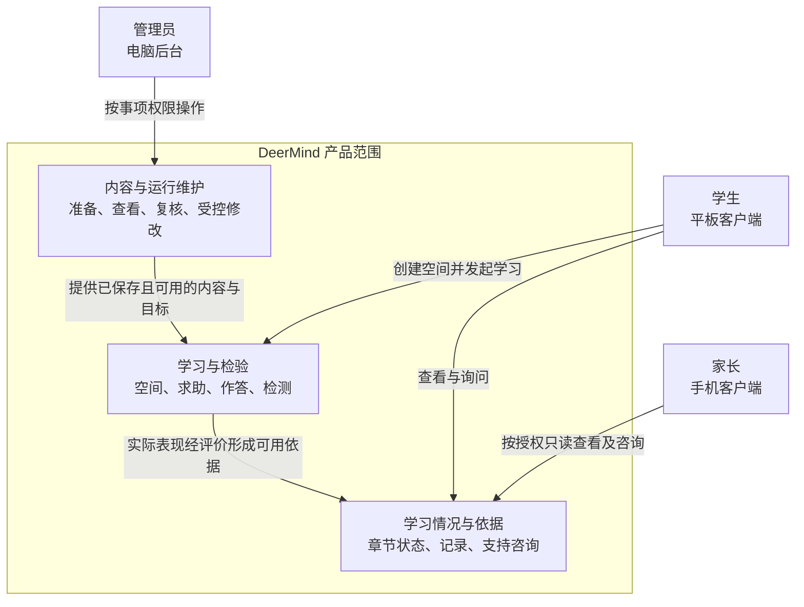
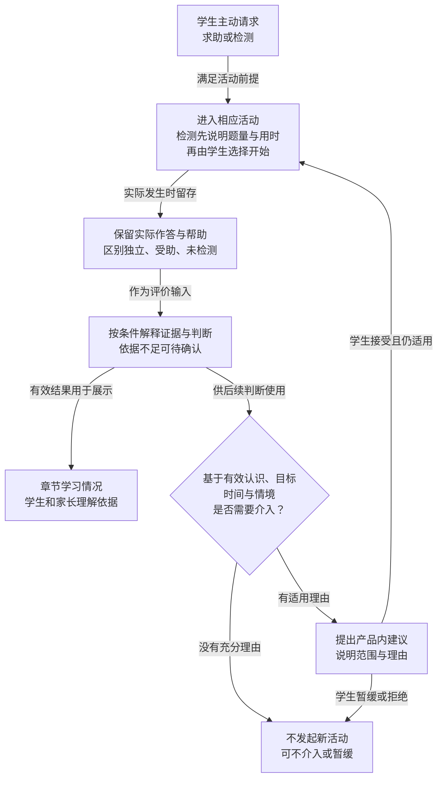

# MVP 产品定义

> **版本**：v0.5 
> **文档性质**：产品定义；Phase 3 — MVP Definition 
> **状态**：2026-10-15 用户阶段性审阅通过；G3 原基线 PASS，当前含 DEC-026 后续范围修订；Phase 4 进行中，不表示实现或学习效果通过 
> **上游依据与基线**：本轮批准内容及依赖已固定于 [G3-20261015-01](../MVP_Gate_Reviews.md#27-g3-阶段性审阅通过与-phase-4-交接)；快照包含批准前的实际工作区内容，不以旧 HEAD 代替。相关依据见正文。 
> **维护责任**：Codex 负责分析、起草与一致性核对；用户参与新的产品取舍与必要澄清 
> **评审记录**：用户原话“phase3 阶段性审阅通过，继续后面的工作”；批准边界与遗留责任见 [G3-20261015-01](../MVP_Gate_Reviews.md#27-g3-阶段性审阅通过与-phase-4-交接) 
> **写作规范**：[设计文档规范 v1.1](../../top/DeerMind_Design_Document_Standard_v1.1.md) 
> **更新日期**：2026-10-24 
> **修订说明**：同步本轮 Task Claim 的直接编辑范围及系统配置暂缓；总体价值、MVP 范围和成功标准不变。逐文件变更见 Governance §5.2。

---

本文回答为谁解决什么问题、完整 MVP 的价值与范围。行为细节在[需求规格](MVP_Requirements_and_Acceptance.md)，指标与测量办法在[验证方案](MVP_Validation_Plan.md)，决定和未决集中登记在[共同管理文件](../MVP_Governance.md)。本轮完成的分析不能替代实际产品质量或学习效果证据。

输入为需求来源、产品原则、环境约束和既有验证限制；输出为产品整体说明、按角色的需求选择、范围、价值假设、可行性前提与证据索引。Requirements 据此展开功能，Validation 据此制定判断方法，Phase 4 据此组织产品方案；能够解释需求选择及边界，才满足本文交接要求。详细业务过程不在两份文档重复维护。

## 1. 问题背景与依据

DeerMind 首个产品服务六年级数学学习，预期同时承接校内课程与校外辅导课程。项目发起人的原始观察是女儿成绩不稳定、校外内容较难且学习效果不理想；这是家长陈述，尚不能确定原因是概念理解、计算、审题、练习安排、内容难度或其他因素。没有孩子直接反馈或连续作答材料，不据此给她作能力诊断，也不把一个家庭的描述视为普遍市场需求已经验证。

产品目的已经明确：帮助解决当下学习困难，并通过理解、独立应用和后续表现形成更持久的能力。成绩改善是长期方向，不作为单次帮助的必然结果。首轮可以基于既有知识、经验和逻辑分析形成可检验的产品假设，后续用真实使用检验；不以补做个人访谈作为本阶段启动前提。

| 来源编号 | 类别与可定位出处 | 本轮采用的内容 | 证据限制 |
| --- | --- | --- | --- |
| SRC-001 | 上位产品原则：[Product Thesis v1.0](../../top/DeerMind_Product_Thesis_v1.0.md) §3–§4 | 能力与一次表现不同；外部帮助条件影响判断；关注自主学习与长期价值 | 属于项目立场，不是产品效果实验 |
| SRC-002 | 上位约束：[Product Constitution v1.0](../../top/DeerMind_Product_Constitution_v1.0.md) C1–C7 | 学习自主、认识诚实、有界权限、数据节制及安全边界 | 不代替首个场景的具体规则和适用条件核实 |
| SRC-003 | 阶段依据：[Development Roadmap](../../top/DeerMind_Development_Roadmap_v0.6.md) §4–§7 | G3 定义产品，G4 准备设计与实际领域资产，G5 交付真实软件，之后 Alpha 与 Pilot | 定义通过不代表功能或质量已通过 |
| SRC-004 | 已执行工程证据：[Build Report §9](../../system-design/build/DeerMind_Architecture_Validation_Build_Validation_Report_v0.3.md#9-build退出评审与能力分期决定) | 机制组合存在局部可行证据；评价误判、维护和成本仍需后续工程验证 | 原完整 R2 为 14/24 内容可用；G2 准入没有将失败改写为质量达标 |
| SRC-005 | 历史决定记录：[归档 Definition](../archive/DeerMind_MVP_Definition_v0.1.md) §2–§10、[归档需求规格](../archive/DeerMind_MVP_Requirements_and_Acceptance_v0.1.md) | 角色、课程空间、输入、内容管理、评价边界及历史指标 | 是历史承接来源；与较新对话冲突的表述不能继续生效，模糊确认不能补造原话 |
| SRC-006 | 当前对话，用户原话定位：“为我女儿开发一个学习软件”“今年上小学6年级”“加深学习知识的理解、提高学习效率” | 首个使用者、家长观察和价值方向 | 观察由家长提供，无已验证原因或普遍性结论 |
| SRC-007 | 当前对话中关于两空间完全隔离、扫描教材、三个角色、Android 客户端及手写和语音的明确选择；归档 Definition §4、§6–§8 可交叉核对 | 已有环境和产品约束 | 设备实测、实际教材和全部细节没有因此就绪 |
| SRC-008 | 当前对话，用户原话定位：“真实情况应该是问题求助”“这些都是错题来源”“本质上属于主动介入” | 求助不限错题；错题跨来源管理；后续介入不只是提醒复习 | 活动最终划分、触发算法和具体界面尚未确定 |
| SRC-009 | 当前对话，用户原话定位：“产品层面……尽量完整，但实施的时候可以分阶段、分步骤实施”“不要把当前选择的四个活动当成正确答案” | 完整需求先论证，实施可分步，活动划分开放 | “只做章节讲解”属于讨论过的候选，不是最新完整范围决定 |
| SRC-010 | 当前对话，用户原话定位：“不用太关注我女儿的具体困难”“基于当前知识、经验再加逻辑推演”及本轮主导授权 | 允许依据现有材料推进；未知须显式提出，新取舍需讨论 | 逻辑推演不能冒充用户研究或效果测量 |
| SRC-011 | 研究实践指南：[IES/WWC，Organizing Instruction and Study to Improve Student Learning](https://ies.ed.gov/ncee/wwc/PracticeGuide/1)，2007；2026-10-10 核对官方建议页 | 示例与练习结合、间隔安排、提取与解释性问题可作为教学方向依据 | 各项证据等级不同；不证明本系统、某种 Agent 或特定孩子必然有效 |
| SRC-012 | 数学领域指南：[IES/WWC，Developing Effective Fractions Instruction](https://ies.ed.gov/ncee/wwc/PracticeGuide/15)，2010；2026-10-10 核对官方建议页 | 分数教学应涉及运算为何成立及适当表征，为原理讲解提供领域依据 | 适用范围是分数教学，不能外推为整个数学产品的效果证明 |
| SRC-013 | 较新的界面与活动讨论；[归档 Foundation](../archive/foundation/DeerMind_MVP_Product_and_Domain_Foundation_v0.1.md) §9、§12 供历史核对 | 教材章节表达、量化信息、常驻输入、分段讲解、就地追问及保留进度 | 原型是讨论材料，实际流程与质量尚未验证 |
| SRC-014 | 当前对话，用户原话定位：“MVP阶段先解决能看到和能修改，自动化分析诊断能力后续再补充”“教材是管理员创建，用户可以导入已经存在的教材”；随后选择“学生端创建，家长端查看” | 后台提供查看、人工介入及受控修改；管理员准备教材，学生创建 Learning Space 并选用已有教材，家长按权限查看 | 已确认产品职责与自动化边界；具体页面、操作流程和实现尚未设计 |
| SRC-015 | 2026-10-11 当前对话，用户要求重新核查阶段与文档输入输出，并接受[整体评审](../MVP_Document_Architecture_Review.md)后继续 | 保留三阶段及十份主体文档，修订交接要求并展开 Phase 3 产品逻辑 | 是文档工作方式和交付要求的确认，不等于全部正文或 G3 通过 |
| SRC-016 | 2026-10-11 当前对话，目标权限问题答复：“接受：管理员维护标准，学生选择目标与范围” | 管理员维护并发布目标及达标标准，学生选择已发布目标与章节范围，家长端只查看 | 不授权学生自行改写标准，不取消目标定义、采用与个人状态的责任区分 |
| SRC-017 | 2026-10-11 当前对话，新版采用问题答复：“管理员检查后指定空间更新” | 教材或目标先发布新版，管理员检查影响后指定已有空间采用，保留历史且不改变学生选定章节范围 | 不自动升级全部空间，不以版本维护代替学生选择课程或目标 |
| SRC-018 | 2026-10-11 当前对话，章节统计问题答复：“接受这个方向，继续细化” | 按教材章节统计已发布学习要求的三类状态项数，展开具体要求与依据，近期作答正确率单列；管理员维护要求，不临时凑数或将达标项数比例当掌握百分比 | 确认产品方向；未确认默认查询时间、全部统计细节或具体教材要求清单，不构成 G3 通过 |
| SRC-019 | 2026-10-11 当前对话，近期统计问题答复：“接受这组统计口径” | 默认近 7 天，可切换近 30 天和全部；包含当天，使用原作答日期，未知日期只列全部；时间筛选不改变基于有效历史的当前学习状态 | 产品口径确认，不证明真实数据或统计实现正确 |
| SRC-020 | 2026-10-11 当前对话，必要旧知识回补问题答复：“允许必要的基础回补” | 当前章节讲解可简短回补必要旧知识，再回到当前问题，不扩展为整套低年级课程，不借用另一空间的个人记录 | 允许范围，不证明所有先修内容已就绪，也不放开真正进阶超纲要求 |
| SRC-021 | 2026-10-11 当前对话，主动介入问题答复：“接受，首版采用按需的产品内建议” | 系统依据有效历史和时间变化在产品内建议讲解或检测，学生选择是否开始；不提供固定周期测验、预约提醒或产品外推送 | 确认产品边界；提醒位置、判断算法与实际价值尚未验证 |
| SRC-022 | 2026-10-14 当前对话，用户原话定位：“模型的问题先放一放”“在真实的场景中，来发现模型的问题，然后再来做优化改进” | 暂缓模型普适性的抽象讨论，恢复 MVP 工作，将题目变化、课程适配及学习过程中的模型问题交给实际内容和运行检验 | 用户仍明确保留对模型的疑问；这不是模型有效性证据、整体范围批准或提前进入真实儿童试用的许可 |
| SRC-023 | 2026-10-15 当前对话，用户原话：“phase3 阶段性审阅通过，继续后面的工作” | 确认本轮 Phase 3 范围基线，进入 Phase 4 的产品、领域、权限与评测准备 | 不等于 G4/G5、质量或真实使用通过；既有模型疑问与 OPEN-002–004 继续带入 |
| SRC-024 | 2026-10-15 当前对话教材答复：校内为“北师大版六年级上册”，校外为内部教材、后续提供 | 在既有数学场景下记录校内书目；校外材料继续等待，不阻塞无关设计 | G3 批准后的事实补充；具体版次、原材料、答案与首批章节未确认，未变更产品范围 |
| SRC-025 | 2026-10-16 当前对话，用户提供[用户提供的电子教材](https://www.100875.com.cn/show/eBookAndTeacher.html?resId=7965194976af40f5b9abc4b3f89522fe&bookId=120170718181616017047&firstNum=120170718181616017047&contributeId=9276)并明确“优先试用分数的应用章节” | 首批校内准备第四单元；已访问目录及书页，核到本单元为书内 49–56 页；后记称本套教材为第五版、依据 2022 年版课标 | 属于 G3 后材料事实补充；具体出版年／印次、纸质用书一致性、全章参考及处理条件未核实，正式映射与发布未完成 |
| SRC-026 | 2026-10-17 当前对话，用户选择“接受：先作练习或迁移探针” | 非整除运次变式先作可选练习或迁移探针，不列为首批章节达标必测；由 DEC-019 承接 | 仅确认该变化的首批用途，不批准全部目标、内容发布、G4 或学生试用 |
| SRC-027 | 2026-10-21 用户确认后台简化方案并授权实施 | 去掉维护与发布和审核流程，各类对象在所属页面新增、修改和保存；同步文档、升版并 review | 范围调整的直接授权；不证明教学质量或正式服务已完成 |

研究只用于支持方法方向。SRC-011 将间隔学习及示例与练习结合列为中等证据，将解释性提问及用测验再次提取内容列为较强证据，而用测验帮助分配学习时间的相关建议证据较弱；这些区别不能被省略为“所有做法均已被科学证明”。SRC-012 对理解分数运算原理的建议有中等证据。我们据此提出理解、练习、检验与后续使用的需求假设，仍须验证具体的 AI 执行质量和实际收益。

本轮没有开展儿童访谈、竞品实测或新的 LLM 实验。原始对话按上述引文定位，消息的精确日期未另行推定；仓库文档按输入提交核对。后续取得的新观察进入本索引，不回填为本轮已知事实。

当前概念输入已更新为 [Domain Space](../../concept-design/DeerMind_Domain_Space_Design_v1.3.md) 与[Learning Space](../../concept-design/DeerMind_Learning_Space_Design_v1.3.md)：领域提供问题、方法和 KC，课程空间定义材料、范围与目标。此修订不增加产品功能、不改变已确认质量目标；具体教材与领域资产仍待后续交付，历史研究与 Build 证据的适用范围不扩大。

## 2. 用户、角色与使用情境

首个真实使用单元仍为一名六年级学习者及其家庭；产品问题按同类学习情境分析，但不因此宣称已验证适用于其他家庭。校内与校外辅导在不同课程空间中进行，首版证据、判断与推荐不跨空间使用。用户已确认校内教材为北师大版数学六年级上册，校外为后续提供的内部教材（SRC-024）。2026-10-16 补充了可读取的电子教材来源，并指定首批准备第四单元“分数的应用”（SRC-025）；出版年／印次、答案参考与正式可用内容仍待准备核对。

**图 DEF-01　三类角色如何共同使用 DeerMind**

本图先说明三端分工与信息交接，具体范围和限制由下表及 §3、§5 定义。产品框内是业务能力分组，不是预定页面或服务。

**图例：** 矩形是角色或业务能力，分组框是产品范围，箭头表示标注的信息或操作关系。

**读图边界：**

- 家长咨询不直接修改学生资料或学习判断。
- 管理员维护不等于替学生选择课程。
- 校内、校外空间的个人记录及推理上下文分别隔离。

> **关联规则：** 详细权限以需求规格 REQ-011–016、020–023 为准。

| 角色 | 要完成的事情 | 当前边界与价值判断 |
| --- | --- | --- |
| 学生 | 创建 Learning Space，选择已有教材、已保存且可用的目标及范围，从题目或章节疑问获得帮助，表达思路、独立尝试并了解学习情况 | 直接学习受益者；使用意愿未知。提供手写、拍照、文字和双向语音，不以多收证据强迫持续使用 |
| 家长 | 看懂有依据的学习情况，知道如何支持，并履行已确认的账号和首次数据授权责任 | 与学生分开的账号和 Android 客户端；学习资料查看与学生端修改分工保持，不把家长转述当作孩子已完成的表现 |
| 管理员 | 创建教材、准备领域内容与映射、维护目标和标准，查看模型及运行依据，人工复核并受控修改，维护账号与配置 | 电脑后台；初期一人直接维护并保存对象。学生创建个人学习空间并选择目标；管理员维护可追溯，不能直接改写能力结论 |

两类进入情境都重要：学生带着问题或检测意愿主动进入；系统根据有效学习历史及时间变化，在产品内提出具体的帮助或检测建议，学生选择是否参加。后者的触发理由可以是保持、迁移、旧结论需要更新或证据需要补充，但“缺少证据”本身不自动产生强制检测义务。DEC-016 明确首版不提供固定周期测验、预约提醒或产品外推送；时间可以成为重新判断的依据，不等于自动开测。提醒位置和计算调度由后续设计承担。

已有使用约束是孩子每天全部 DeerMind 活动合计不超过 30 分钟。管理员时间和项目预算按实际情况调整，并无本轮新增固定上限；仍需记录真实投入，不能把无限人工协助作为产品自动有效的证据。学生与家长设备实机能力、内容审核成本和运行时延均未测得。

学习能力按单模板多维 Task Claim 组织：一个任务的独立完成、理解与解释、迁移应用、延迟保持分别有判断与依据，允许有依据裁剪和扩展；具体定义见 [Evaluation §3.1](../../concept-design/DeerMind_Evaluation_Space_Design_v1.5.md#31-learner-state-model定义-deermind-可以相信什么)。课程要求可跨任务汇总，学生仍按章节与具体要求理解结果。这细化已有价值目标，不增加四套活动或改变每日使用负担；实际内容及状态实现仍须交付验证。

## 3. 需求分析与决策表

本章按学生、家长和管理员分别分析需求，先说明各角色要取得的结果，再比较承载方式。学生关注学习帮助和自身表现，家长关注理解孩子的情况与提供适当支持，管理员关注内容、模型和系统能否持续可信地运行。三类需求分别评估价值和范围，身份与数据使用等跨角色需求集中定义，并说明各角色的责任。

表中的“承载候选”是设计方向，既不是页面清单，也没有冻结活动数量。重要性依据目标关联、遗漏后果、已有明确要求和实现依赖判断；没有用户频率统计，不给出伪精确的需求评分。“承接”来自已确认方向；新的范围取舍仍由共同登记册区分已确认与待讨论。NEED 编号沿用原有追溯关系，不因角色分组重新编号；同一需求支撑多个角色时，通过引用说明，避免重复维护。

### 3.1 学生需求

学生需求围绕获得帮助、形成独立表现、管理学习记录、理解自身情况和控制学习过程展开。系统主动介入也归入这一组，因为它最终应服务学生的学习需要，并保留学生是否参加的选择。

| 编号与需求 | 为什么需要、依据 | 可比较的承载方式 | 本轮判断与范围建议 | 主要代价或待验证点 |
| --- | --- | --- | --- | --- |
| NEED-001 学生能解决具体题目的卡点 | 可能不会开始、做到一半、对结果存疑或确实做错；SRC-006、008 | 一次性给解法；先澄清卡点；按请求讲解或提示 | 核心需求，承接“问题求助”的修正。无需先证明做错才可求助；不默认每次先做诊断 | 正确识别问题、合适解释与时延；给出答案不等于学会 |
| NEED-002 学生能理解章节中的概念和理由 | 只解决某一道题可能没有回答概念疑问；SRC-006、012、020 | 阅读教材；章节关键问题讲解；结合实例和追问 | 核心需求，保留主动章节讲解，支持必要的阶段和结束检测；具体教学组织仍需验证 | 讲解深度与认知负担、内容来源、按 DEC-015 有界回补必要基础知识 |
| NEED-003 学生能在适当支持撤去后解释与应用 | 听懂或跟做不能直接证明独立应用；SRC-001、006、011 | 重做原题；解释关键理由；做有实质变化的适用题 | 核心价值检验，承接既有要求；与讲解结合，也可独立进行。按任务目标记录支持条件 | 迁移任务的有效性、帮助归因、评价误判；不能用换数字冒充所有迁移 |
| NEED-004 学生能检查选定范围，并知道没测到什么 | 主观“我会了”与实际表现可能不同；SRC-006、005 | 固定套卷；按教材选择范围后形成检测；针对疑点补充检查 | 核心需求，承接章节选范围、由目标决定题量的选择，不预设固定题数 | 代表性与覆盖、题量和 30 分钟约束、错误掌握判断 |
| NEED-005 保存并再次利用学习问题与真实表现 | 避免重复整理，使后续学习能引用过去；SRC-005、008 | 仅收藏图片；跨来源错题与作答记录；与后续帮助或检测关联 | 必要闭环支撑，统一管理外部和内部产生的错题；标明来源、性质、识别和确认状态 | 记录准确性、检索和维护负担；没有作答不能当作错误表现，上传不等于新证据 |
| NEED-006 在合适时机检验保持、迁移或补足判断依据 | 一次成功不足以说明之后仍能做到；SRC-001、008、011、021 | 学生自行安排；固定提醒；基于当前有效判断选择后续介入 | 完整 MVP 纳入按需的产品内建议，学生自主开始；按 DEC-016 后置固定周期测验、预约提醒和产品外推送。具体策略作为工程假设验证，不许诺优于简单安排 | 误判引发无效干预、打扰和额外耗时；有历史不自动意味着建议更好 |
| NEED-007 学生能理解自己的学习情况 | 需要知道自己已取得哪些表现、哪些结论有限，才好选择下一步；SRC-006、013、018 | 总分；按教材章节的有口径统计与相关依据；自然语言解释 | 必要闭环支撑，按 DEC-013 展示章节学习要求的三类状态项数并提供依据，近期作答统计另列；具体行为由 Requirements §3.9 维护 | 样本偏差与虚假精确度，不能把错题样本的正确率写成整章水平 |
| NEED-008 学生能方便表达、纠错、中断和继续 | 多模态输入与较长活动若不能控制，会损害实际使用；SRC-007、013 | 菜单选择；意图输入与上下文操作；手写或拍照提交 | 必要使用条件，保留常驻输入、提交或求助才分析、分段和继续控制 | 输入识别、设备兼容、语音与进度恢复；聊天入口不等于所有内容必须放在聊天记录中 |
| NEED-017 学生能建立空间并选择教材、目标与范围 | 学生需要按课程组织学习，内容和标准的准备与个人采用具有不同责任；SRC-007、014、016 | 管理员代建空间；学生创建后选择已保存且可用的教材与目标；学生自行上传或定义标准 | 已确认由学生端创建 Learning Space，选择获准教材、已保存且可用的目标与章节范围；家长端查看，不创建或改目标 | 教材、目标版本与采用关系须清楚；学生意愿不直接修改标准，选用不等于对应章节全部可评价 |

学生的身份、资料可见范围及删除影响同时受 NEED-012 约束，具体分工见 §3.4。

### 3.2 家长需求

家长需要看懂孩子的学习情况，并据此获得适当的支持建议。这与学生查看自身情况共享判断依据和统计口径，但服务的决策不同：学生决定如何继续学习，家长决定如何提供支持。家长端不由学生端简单复制而来，也不因家长关注学习情况而取得替代学生作答或修改学习资料的权限。

| 编号与需求 | 为什么需要、依据 | 可比较的承载方式 | 本轮判断与范围建议 | 主要代价或待验证点 |
| --- | --- | --- | --- | --- |
| NEED-009 家长能理解孩子的学习情况并获得支持建议 | 家长需要了解哪些表现已有依据、哪些判断仍有限，以及自己可以如何帮助；SRC-005、006、007、013 | 泛化报告；按章节查看概况与相关依据；围绕具体疑问独立咨询 | 首版家长需求，承接只读资料与独立咨询；沿用 NEED-007 的章节统计与结论边界，建议说明依据。学生资料更正仍走学生入口或既定复核流程 | 判断错误、建议泛化、过度确定或跨角色泄露；家长陈述不自动成为孩子正式表现，看报告不等于取得学习收益 |

家长的独立账号、亲子关联、首次数据用途确认和自身咨询管理属于 NEED-012 在家长角色下的要求，见 §3.4。首版不通过家长咨询派发学生任务或修改正式学习目标，具体可观察行为见[需求规格 §2](MVP_Requirements_and_Acceptance.md#2-角色目标业务行为与-ai-边界)的 REQ-012。

### 3.3 管理员需求

管理员需求覆盖内容准备、模型查看、人工核对、对象直接修改及日常运行。按 DEC-026，MVP 不设置独立维护中心，也不要求编辑后再审核、批准和发布；管理员在对象所属页面保存，系统自动保留版本与修改记录并检查必要约束。内容正确性仍须核对，后台自动分析诊断及自主优化后置。

| 编号与需求 | 为什么需要、依据 | 可比较的承载方式 | 本轮判断与范围建议 | 主要代价或待验证点 |
| --- | --- | --- | --- | --- |
| NEED-010 管理员能准备可供用户选用的教材、目标与领域基础 | 扫描教材需要内容核对、领域定义、映射和目标支撑，才能用于学习；SRC-005、007、014、016 | 手工逐项准备；AI 起草后人工核对；未审核即开放 | 首版必要条件：管理员创建教材、核对章节及参考，准备 Domain 定义与映射，维护对应目标和达标标准，保存后按实际可用条件供学生选择 | 实际材料、参考与映射质量、人工投入；教材已入库不等于已能讲解或评价，也不替学生创建个人空间 |
| NEED-013 管理员能查看模型定义、状态及实际运行依据 | 单看日志或对象数量无法解释错误判断，需要在模型和具体案例间追溯；SRC-004、014 | 按 Space／模型／对象浏览；从具体活动或异常结果追溯关联；只看汇总指标 | 首版核心后台需求：查看 Learning Space 及 Domain、Evaluation、Interaction、Evolution 的适用对象、版本和关系，关联原始输入、实际帮助、Observation、Evidence、Belief 与决策记录 | 记录缺失须可见；可疑、已确认错误、未决和已修复分开。访问受事项及权限限制，模型解释不替代实际依据 |
| NEED-011 管理员能复核并处理影响学习的问题 | 同一异常可能来自材料、识别、领域、评价、交互或运行故障，处理方向不同；SRC-004、005、014 | 管理员查看案例并分类处理；系统自动诊断；直接修改最终分数或结论 | 首版以人工复核为主：保存问题、预期与实际差异及处理依据，关联相关对象，按责任更正或保留未决，查看剩余影响 | 自动分析诊断后置；人工意见不直接成为事实，不覆盖原记录，也不手工指定 Belief；维护失败不能假称已修复 |
| NEED-014 管理员能新增和修订适用的模型内容 | 真实学习会暴露覆盖不足和定义错误；SRC-005、014、027 | 所属页面直接编辑；独立维护工作流；通用自动演化平台 | 首版在领域管理维护 TaskTemplate、SolutionTemplate、KC 及关系，在教材和目标页面维护相应对象；Task Claim 及其有限证据解释、推断字段直接编辑，其余语义规则通过定义包检查后保存 | 自动记录版本与来源；修改定义不改个人判断，不为每道新题另建模板；独立 Evolution 工作流后置 |
| NEED-015 管理员能核对修改及其使用影响 | 保存成功不足以说明教学质量或历史结果已修复；SRC-005、014、027 | 手工覆盖；自动留存版本并查引用；审核发布工作流 | 保存检查必要字段、引用、递归关系和版本冲突，旧版本与修改记录可查；不强制绑定案例或走审批。既有空间采用保持独立，简化操作由 OPEN-011 明确 | 语义正确性和实际使用另行验证；不自动全量重算，不通过人工改 Belief 修复 |
| NEED-016 管理员能维护运行配置并了解服务状态和投入 | 日常运行需要处理不可用连接、失败任务、等待和费用，不能靠猜测区分语义与服务故障；SRC-005、014 | 服务日志；可查询状态与任务记录、配置及恢复入口；自动运维诊断 | 首版支持服务连接配置及可用性检查、失败任务处理、查看延迟、模型用量与费用和维护投入；必要运行错误保留可核查记录 | 配置保存不等于服务可用，费用未知不记零，重试不能重复形成作答或教学；自动运维诊断后置。DEC-030 暂缓配置页设计，后续再定界面与部署工具分工 |

**账号管理。** 用户与亲子关系管理同样属于后台必备职责，身份核实、开户、权限关联与账号找回统一见 NEED-012。

- **教材与空间分工：** 教材由管理员创建和维护；学生端将已有教材导入自己创建的 Learning Space，家长端查看。
- **目标维护与选择：** NEED-010 同时承接教材对应的学习目标和达标标准维护，NEED-017 承接学生选择已保存且可用的目标与章节范围，依据 SRC-016、DEC-011。
- **版本与采用关系：** 教材源内容、目标定义与个人空间中的采用关系须可区分，版本变更的业务影响由需求规格定义，操作及技术细节在后续设计细化。

**后台查看方式。** 查看应既支持按 Space、模型和对象浏览，也支持从具体学习记录追溯跨空间依据。

- **Domain：** Domain 重点查看模板、方法、KC 及使用关系。
- **Evaluation：** Evaluation 查看判断条件、证据及变化。
- **Interaction：** Interaction 查看请求、决策与实际帮助。
- **修改记录：** 通过对象版本和活动核对记录查看变更；MVP 不设独立 Evolution 维护流程。
- **Learning Space：** Learning Space 查看材料、范围、目标及采用版本。

不以一棵对象树或一组汇总数替代这些查询，也不要求首版自动解释所有异常原因。

**人工主导的适用范围。** MVP 的人工主导边界针对后台系统问题的分析与诊断，不取消正常教学中的模型推理、语义校验或既有权限、版本和事务检查。

- **初始化与运行修订：** 首次建模直接在所属页面新增并保存，不伪造旧模型缺陷；运行发现的问题按对象归属处理。
- **目标权限：** 正式目标及达标标准由管理员受控维护，学生可选择已保存且可用的目标、范围并表达学习意愿，不能通过聊天直接改写标准；家长端只查看。

### 3.4 跨角色共用需求与责任

身份、数据用途和角色边界同时影响三类角色，统一由 NEED-012 定义。各端应让用户理解自己可以看到、操作和决定什么；同一自然人同时担任家长与管理员时，相应责任仍分别成立。

| 编号与需求 | 为什么需要、依据 | 可比较的承载方式 | 本轮判断与范围建议 | 主要代价或待验证点 |
| --- | --- | --- | --- | --- |
| NEED-012 身份、数据用途和角色边界可信可理解 | 三类角色、外部模型和长期记录需要明确责任；SRC-002、005、007 | 角色共用账号；分别授权和用途明确；为建模无边界保留 | 首版必要运行条件，承接角色隔离、首次授权和已定资料管理规则 | 实际服务目的地、保留用途与适用约束待核验；不以管理员身份代替家长授权 |

| 角色 | NEED-012 在该角色下要满足的需要 | 已确认的分工边界 |
| --- | --- | --- |
| 学生 | 使用自己的账号和学习档案，理解资料用途及可见范围，在学生入口管理、更正和删除自身学习资料 | 孩子端以简明说明确认愿意使用；校内与校外空间隔离。界面删除与内部保留的实际影响按既有规则告知 |
| 家长 | 使用独立账号查看有效亲子关联及获准资料，完成首次数据用途确认，管理自身独立咨询 | 学习资料只读；咨询与学生及其他家长隔离，不代替学生录入更正；自身咨询删除不改变孩子的学习事实 |
| 管理员 | 经核实后维护账号、亲子关联与找回记录，按具体事项访问必要资料并留下处理记录 | 人工核实后操作，不以管理员身份替代家长确认，不因管理身份访问无关资料；账号恢复保持原学习档案关联 |

本节说明角色分工，详细的告知、资料管理、异常与授权行为由需求规格统一维护；已后置的完整物理销毁和授权撤回功能不因本次分组重新纳入。

### 3.5 其他候选方向与整体取舍

同样比较其他候选方向，避免只为旧四活动寻找理由：

| 候选方向 | 潜在价值与局限 | 本轮处置及依据 |
| --- | --- | --- |
| 整套课程自动排课、按计划推动进度 | 可提供连续安排，但带来更大的内容覆盖和节奏控制责任，也可能与当前学校和辅导冲突 | 沿用已确认的后置范围；不是否定其长期价值 |
| 整张试卷导入与分析 | 可取得混合正确和错误表现，但增加拆题、识别、来源与整卷管理 | 用户已经明确移出 MVP；不重新纳入 |
| 单纯答案工具或单纯错题收藏 | 可以满足即时答案或资料查找的局部需要，难以单独检验独立理解和后续表现 | 不作为完整 MVP 主线；其中的解释、查找能力可被必要需求使用 |
| 把章节讲解单独作为完整 MVP | 能集中体验设计和早期实现，但不足以检验离开讲解之后的范围检测与历史介入价值 | 可作为工程增量候选；最新讨论要求完整产品需求先想清楚，不据此删除其他已要求需求 |
| 多学科扩展、社交排名、教师班级协同或通用聊天助理 | 可能服务其他使用目标，目前没有支撑其进入首轮范围的充分依据 | 不建议在本轮新增；若出现新的真实需求，再论证范围与代价 |

本轮主张是让学生围绕“获得帮助—自己尝试—理解当前情况—在需要时再学习或检验”取得学习价值，让家长能依据实际情况提供支持，让管理员能提供可靠内容并维持运行。不要求每次使用走完全部环节；需求项也不等于相同数量的活动、页面或 Agent，活动划分属于下一阶段的承载设计。

## 4. 价值主张与关键假设

产品希望提供的增量价值，是把合适的当下帮助、可检验的独立表现和后续有依据的行动结合起来。相比只处理当前输入的一次问答，持续记录可能提供更合适的后续选择；相比只保存题目，解释与检验可能更接近学习目标。这是对候选方案责任范围的比较，没有对某个实际竞品作实测优劣判断。

| 假设编号 | 当前假设与依据 | 后续需要看到的证据 | 可否定或明显削弱它的情况 |
| --- | --- | --- | --- |
| HYP-001 当下帮助具有可接受的学习价值 | NEED-001、002；解释与例题方向有研究参考 | 正确、相关、可理解的帮助；学生在合适条件下能解释或继续完成当前目标 | 关键解释错误、只会抄结果、负担大于获得的帮助 |
| HYP-002 系统能把支持条件与独立表现区别开 | NEED-003、004；这是模型价值的关键工程假设 | 与独立参考一致的证据解释，原题和适用变化任务的实际表现，帮助与未测范围可追溯 | 把受助成功当独立掌握，把未解释当不会；判断不随反证修正 |
| HYP-003 有效历史能改善后续介入选择 | NEED-005、006、007；可行性推导，尚无本项目收益证据 | 建议与目标及历史有关、用户可以理解与选择、后续检查取得有用信息；与简单安排比较收益和负担 | 固定提醒同样有效且更省成本，错误历史反复误导，额外干预没有价值 |
| HYP-004 整个过程能在实际家庭和运维条件下持续使用 | NEED-008–017；已有环境约束 | 孩子愿意使用、输入与等待可接受、在总时间约束内完成有意义目标、内容和维护真实可运行；人工维护投入单列 | 设备或内容长期阻断、管理员代替系统进行日常教学或学习评价、使用负担抵消收益；按已定范围进行人工维护本身不构成失败 |

基础理论、用户愿望与 Build 的机制证据都不足以单独证明以上假设。持久能力、广泛迁移和成绩改善需要时间及适当任务观察；不将局部样本结果宣传为已证明普遍效果。

## 5. 完整 MVP 范围与能力边界

本轮按既有明确决定承接两类学生主动请求：题目问题帮助与章节知识帮助；保留选定范围的主动检测、学习中的检查及后续检验能力。系统主动介入依据有效状态、目标和情境选择，不将“发现缺证据”简化为一律出题。错题和作答记录、教材与题目、学习情况表达是共性支撑，不预先绑成某一个活动的私有资料。

**图 DEF-02　主动学习与系统建议如何连接到后续行动**

本图表达产品希望形成的学习过程，并区分学生请求与系统建议两个起点。是否带来学习价值仍是 §4 的假设，不是已取得的效果。

**图例：** 矩形是业务步骤或依据，菱形是介入判断，箭头表示标注条件下的推进或依据传递。

**读图边界：**

- 任何一次使用都不必走完整图。
- 听完讲解不等于掌握，接受建议和实际开始也是不同结果。
- 进入活动的详细条件见需求规格 §3.2，依据过时和建议更新仍须遵守 REQ-008。

错题来自外部上传，也可来自讲解练习、自测和后续检测。未作答的求助题、识别存疑的题、存在争议的结果须保持各自状态，不能为归入错题集而制造错误事实。原题、变式、原生题及其实际使用记录按既有要求保留，历史题是否重测由有效认识与目标决定；具体选题算法在工程阶段设计。

“只允许外部错题输入”的旧表述，与用户较新提出“不会做也应求助”不兼容。本轮按较新明确指示承接问题求助，允许没有错误作答的具体题目进入；整份试卷仍不支持。该修正记录为 DEC-002，不借此扩大为任意批量资料处理。

**共性能力与运行支撑。** 课程空间、三个角色、设备输入、分段解释、量化章节信息、基础模型维护与有限演化继续承接已有要求。

- **三端职责：** 学生端创建 Learning Space 并选用管理员已准备的教材，家长端按权限查看；后台模型和运行查看、人工复核与受控修改按 §3.3 展开，自动分析诊断后置。
- **帮助与评价的就绪边界：** 实际帮助、能力判断和可复用内容的可用条件分别说明，不因模型尚未覆盖就把纲内新题常规拒绝，也不能在缺少有效依据时编造正式掌握判断。

课程支持上限遵守已确认的超纲拒绝与纲内新题帮助原则。DEC-015 允许在当前章节讲解中简短回补必要旧知识，例如因约分不足妨碍分数除法理解时先补足相关内容，再回到当前问题；不因此开设整套低年级课程，也不借用另一 Learning Space 的个人记录。具体内容可用条件和教材覆盖在实际材料准备时落实，正式判断仍需有效领域与评价依据。

用户可以请求仅提示、追问、更正、退出或稍后继续。系统不得将讲解阅读、播放结束、无回应或模型之间互相同意当作掌握证据；不得以收集证据为由强迫完成全部流程。涉及 AI 的具体允许行为、不确定反馈和必要人工处置在需求规格细化，并受 SRC-001、002 约束。

## 6. 成功判据与验证责任

定义阶段须形成可检验的目标。本轮[验证方案](MVP_Validation_Plan.md)已承接历史目标、分母与结论规则，具体材料和测量参数按阶段准备及校准。当前保留三类结果责任：Phase 5 取得真实实现与机制证据；Phase 6 以有效参考检查软件、语义与体验质量；获准的 Phase 7 观察真实使用价值和可接受负担。G3 不要求现在已经测到这些结果，也不能以“后面优化一定成功”为依据通过。

对学习价值，检查应关注正确且适用的解释、带支持条件的独立应用、适用变化任务及延迟表现，而不是只数讲解条数、收藏量、完成率或使用时长。产品展示的章节统计需区分抽样覆盖、独立与受助、未知与失败，其业务含义与分母由需求规格维护；用于验收质量和检验产品价值的 MET 及分母统一进入验证方案，两类指标不能混用。

归档中存在已记载的质量目标及首轮观察安排，包括四周、若干学习问题的立即与延迟表现，以及讲解、识别、判断、生成题和等待时间的分项要求。它们保留为历史约束 CON-010，不因本轮尚未填表而失效；对应已写入验证方案 MET-001–010，具体材料与运行参数按后续校准责任准备。该工作不能静默下调原目标，也不能把旧数值描述为研究确定的普遍标准。口径校准和目标变更分别处理，正式测量前固定。

## 7. 可行性前提、投入与后续核验

G3 要确认产品有明确边界，并有可检查的准备路径；它不要求在教材尚未取得、软件尚未实现时证明全部成本与效果。本节把可以带入下一阶段的假设及其验证节点写明。决定、约束与风险仍由[共同登记册](../MVP_Governance.md#3-决策与约束登记)维护；发现假设不成立时回到受影响范围，不通过默默减功能或降低指标维持原结论。

### 7.1 内容取得与首批可用范围

原定由用户提供两套教材扫描材料，管理员分章节准备并保存，答案可能缺失。SRC-025 已补充校内电子教材来源，并明确先准备“分数的应用”；八页已经读完，候选映射及逐题作者参考见[内容基础 §6](../phase-4-product-and-domain-foundation/MVP_Domain_and_Content_Foundation.md#6-首批领域与内容资产清单)。校外内部教材仍等待提供。作者参考不等于内容已核实或已正式可用；实际来源与使用条件继续核实，不自动推定可以向任何对象传播或提交给任意外部服务。

**首批内容的覆盖要求。** 首批内容不要求两本书一次全部建完，但必须用实际章节支撑已选范围内的帮助、练习、独立检测、学习情况及后续介入，并能演示内容维护后的实际变化。

- **两个空间都需有材料：** 两个课程空间均需有适用材料和隔离案例，不能以只完成校内材料宣称校外内容已就绪；具体章节由用户提供材料后结合当前课程确定，不在本阶段虚构数量。
- **可用范围：** 可用范围须明确尚未准备的部分。
- **分别检查可用条件：** 浏览、讲解、当题反馈和正式评价的就绪条件按 Requirements §3.4 分别检查。

**内容准备责任。** Phase 4 由 Codex 提出首批内容清单、映射、目标及参考，管理员核对来源、疑点和代表性样例；相关资产进入 Domain 和 Evaluation Assets 两份交付物。

- **G4 的必要条件：** 没有实际材料、无法形成可核查参考或核心路径只能靠临时猜测时，G4 不能通过。
- **范围变更：** 若需要换课程、改变两空间承诺或降低质量目标，先讨论范围变更。

> **未决事项：** 以上是 OPEN-002 的 G3 前提，材料交付责任尚未完成。

### 7.2 投入情景与估算边界

首版按一名学习者、两课程空间和一名管理员考虑运行；孩子每天全部使用不超过 30 分钟，成人时间和预算由用户按实际调整。不能把成人投入充足等同于成本为零，也不能把建设投入、普通学习调用、故障重算和人工补充教学混成一个“每题成本”。

**历史文本链参照。** 已有可核对的文本链参照来自 [Build Report §5](../../system-design/build/DeerMind_Architecture_Validation_Build_Validation_Report_v0.3.md#5-成本时延和存储)：R2 v2 的 24 轮及探针共 200 个逻辑请求，按当时计价的已确认 usage 估算为 2.377924 元，包含未知 usage 尝试预留为 3.222672 元。

**估算方法与限制。** 下面仅把整批资源摊到 24 个轮次作为历史参照，再比较假设使用量；摊入了探针和故障，既不是成功轮单位成本，也不是当前报价或 MVP 测量。

| 假设的每日处理轮次，不是题数或使用要求 | 按上述历史整批摊分的文本调用参照 | 若同等摊分持续 28 天 |
| --- | --- | --- |
| 4 轮 | 约 0.40–0.54 元／日 | 约 11–15 元 |
| 8 轮 | 约 0.79–1.07 元／日 | 约 22–30 元 |
| 12 轮 | 约 1.19–1.61 元／日 | 约 33–45 元 |

- **情景性质：** 4／8／12 轮是敏感性情景，不是已观察频率、最低样本量或预算承诺。
- **区间含义：** 区间两端是已知 usage 计价与附预留计价，并非统计置信区间或总费用上下界。
- **参照失效与额外费用：** MVP 的模型配置、上下文、审查次数或重试变化会使参照失效；实际图像、语音、教材建模、维护、存储和基础设施还需另计。

此表只支持“已有小规模文本链的直接调用费用没有显示出金额上的阻断”，不能据此断言整个 MVP 成本低或能够规模化。

同批 23 个普通轮次中位 29.36 秒、样本 P95 40.49 秒，不能证明 MET-006 的响应目标已满足。若上述轮次都近似按历史中位耗时且等待不可重叠，4／8／12 轮约占 2／4／6 分钟，已经会挤占 30 分钟的学习时间；这只是等待负担示例，不是预期时延或新门槛。现有证据提示先关注语义质量、串行等待与人工内容维护，不能只盯模型账单。

| 投入部分 | 当前能够确定的内容 | 尚缺依据及取得节点 |
| --- | --- | --- |
| 首次内容建设 | 两教材分批建设；工作含识别核对、目标、模板／方法／KC 与映射、参考和样例审核 | Phase 4 用首批真实章节记录各步投入与返工，再根据拟开放范围估算后续量；未知章节数和单位工时不填假数 |
| 日常学习运行 | 有上述历史文本参照；需另计输入识别、语音播放、存储及固定服务资源 | Phase 4 明确实际材料类别与候选处理路径；Phase 5 按确定配置测量完整请求，不把供应商单价当最终单次费用 |
| 问题维护与影响处理 | 初期由管理员人工调查和编辑，系统保留版本、引用及核对意见；不要求独立审核发布 | Phase 4 核对操作负担，Phase 5 验证实际读取新版及依赖处理；已有空间采用按 OPEN-011 收口，不省略未成功修复 |
| 软件建设与持续运行 | 完整需求包含两 APK、后台、领域及评价链和基础维护，不是只有聊天页面 | 具体增量、工时与部署费用由 Phase 5 方案基于 G4 资产估算；本阶段不承诺工程发布日期 |

**投入责任与未决。** Codex 负责提出设计、建设和测量方案，用户承担已确认的材料提供、管理员核对与重要范围决定。

当前没有证据给出可信的总人工工时，因此 OPEN-003 保留这项未知并指定上述取证节点；它不再因缺少尚不可能取得的精确数而单独阻塞产品定义。

- **需要重开方案的情况：** 若首批维护必须依靠持续人工替系统教学或判断、等待破坏核心学习过程，或实际投入不可接受，应提出具体缩减、替代方案或架构修订，不以预算可调整为由无限推进。

### 7.3 外部处理与真实使用条件

本阶段明确外部处理的产品用途，尚不锁定每种服务的供应商或部署位置。候选路径包括文本理解与生成、图文识别、语音转写和语音合成；这些可以由相同或不同的合格服务承担，不据此承诺必须采购四项服务。已有 DeepSeek 文本链记录只说明旧实验使用过某一配置，不证明该配置满足全部 MVP 输入、质量或数据条件。

| 处理用途 | 可以按任务需要提供的材料 | 需要保持的范围边界 |
| --- | --- | --- |
| 文本理解、解释与评价 | 当前请求、适用领域及目标、必要的本空间学习依据 | 不默认传送全部历史、另一空间记录、家长私人咨询或账号凭据；不同判断仍按既有 owner 合同提交 |
| 教材与学生输入的图文识别 | 本次识别需要的扫描页、题目或作答图像 | 教材建设与学生作答保持来源；是否可外发分别核实，不因上传成功就视作可公开或可训练使用 |
| 语音转写 | 用户主动录制的当前音频 | 发送前转写也属于外部处理时，同样需要事先满足处理条件；取消后不进入正式学习历史不等于未发生外部处理 |
| 语音合成 | 需要播放的已获准讲解文本 | 不因为需要播放而附送整份学习档案或无关原始资料 |

**外部服务核验责任。** Phase 4 的 Data 交付逐用途列出拟采用服务、处理位置、实际保留和再利用条件、授权说明及已核实依据，并检查与既有内部保留、界面删除及角色边界是否一致；Engineering 再绑定实际配置并验证。

- **配置变更：** 仅改变接入地址不能绕过这项检查，配置变化按已定处理范围重新核对。
- **适用条件的核查依据：** 有关适用法律或服务条款的判断须以届时可核查的依据作出，本文没有开展法律适用审查，不宣称任何候选已经合规。

- **合成材料：** 目前可以继续以合成且无个人资料的材料做产品设计。
- **真实材料与试用条件：** 真实教材用于外部处理前先核实来源及该用途，真实儿童学习资料处理前落实实际服务条件和必要确认，正式试用仍须满足 G6。
- **适用条件发生冲突：** 授权撤回自助功能与完整物理销毁的既定后置决定不在这里改写；若实际适用条件与该选择冲突，须提出具体依据和可选处理请用户决定，不能以一个“已告知”勾选默认冲突消失。

> **未决事项：** OPEN-004 因而保留为有明确节点的核验事项，不要求 G3 假造一个尚未选择的服务合规结论。

## 8. 文档完成条件

| 检查项 | 当前判断 | 依据与剩余工作 |
| --- | --- | --- |
| 问题来源、候选需求与价值假设可追溯 | 作者检查已完成，实际价值未验证 | §1–§4 区分来源、决定、候选比较及反证条件；SRC-021 承接主动介入决定，SRC-023 记录 G3 通过 |
| 完整范围、最低目标及可行性前提明确 | 已具备 G3 评审输入；实际可行性仍需后续证据 | §5–§7 明确完整需求、MET 责任、内容取得、历史费用情景及外部处理限制；不将未测工时或未知服务条件写成确定结果 |
| 关键历史决定承接，当前范围分歧有处置 | 用户已阶段性确认，后续依据变更规则维护 | REQ-001–023、AC-001–023 与归档关系保留；DEC-016 补定主动介入。OPEN-002–004 保留具体责任及重开条件，不伪装已交付 |

2026-10-11，Codex 已对本稿与 Requirements、Validation 的职责和关键边界完成作者审查，建议提交 G3 整体确认。准确评审输入、待确认结论与后续责任见[独立 Gate 文件](../MVP_Gate_Reviews.md)；本节不自行授予阶段通过。
