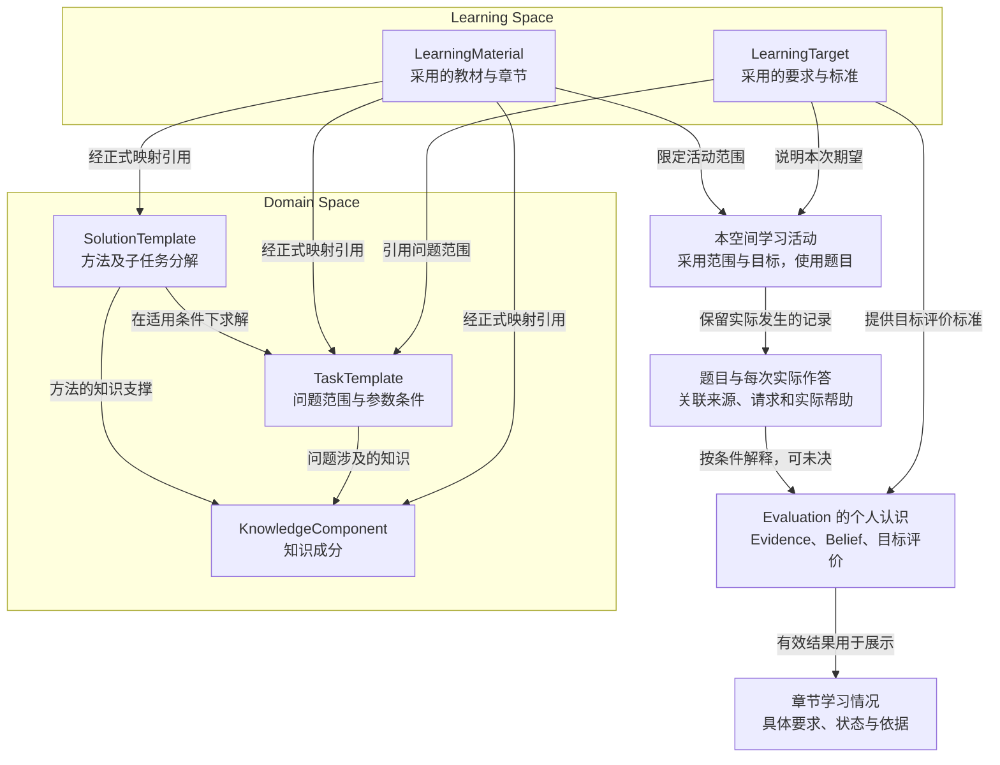
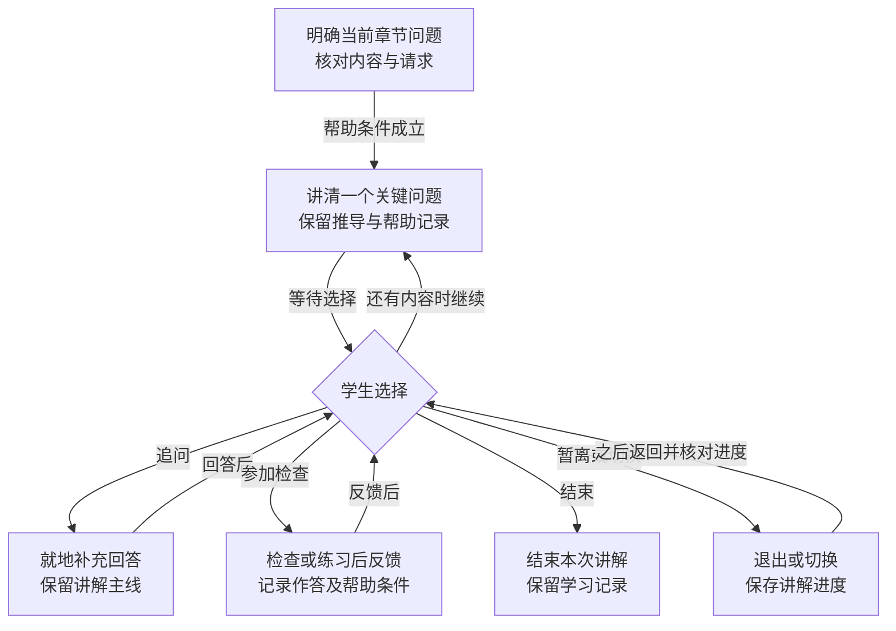
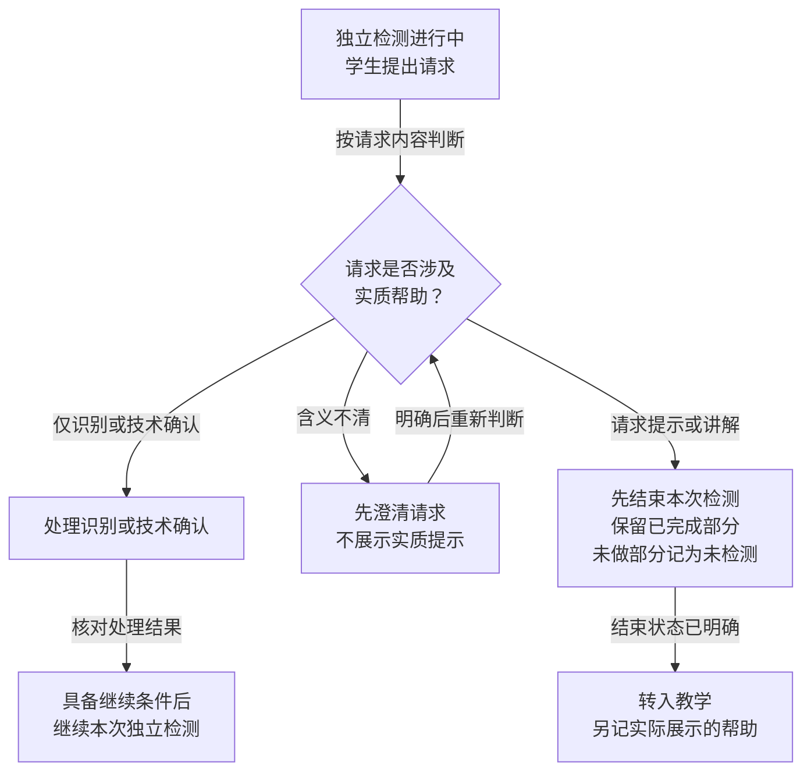
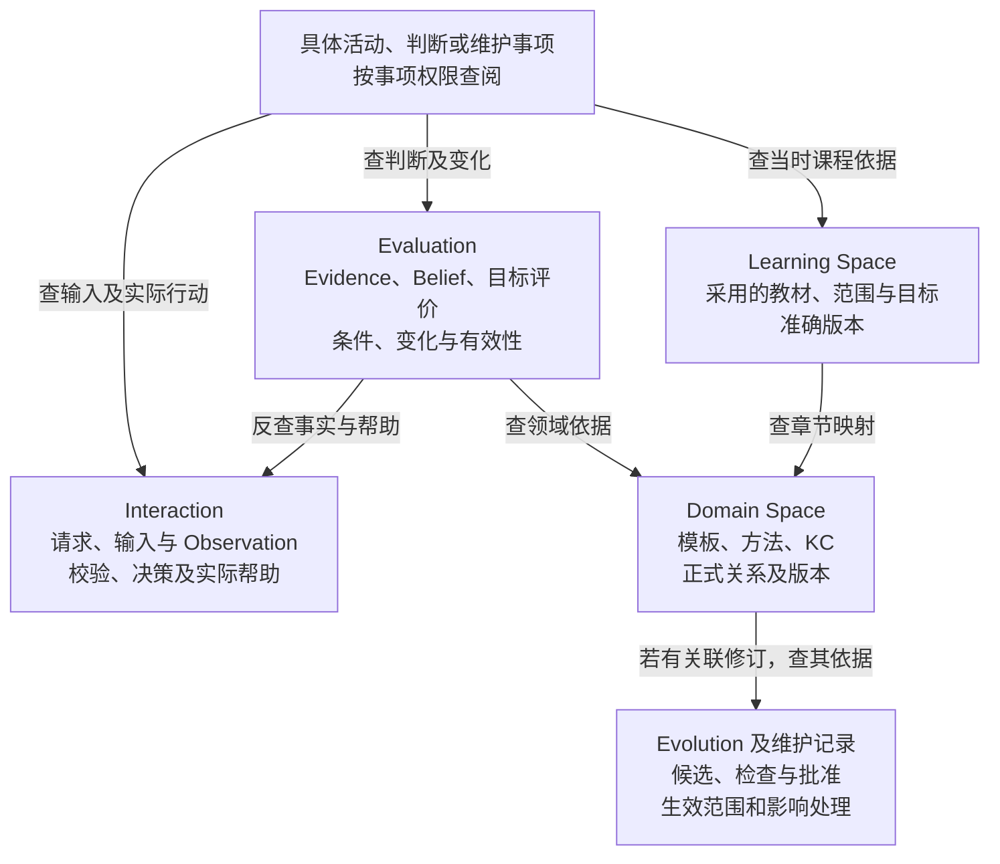
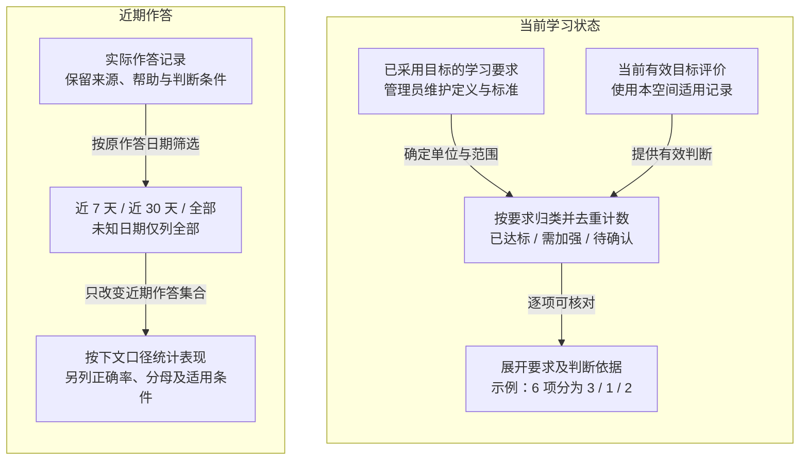
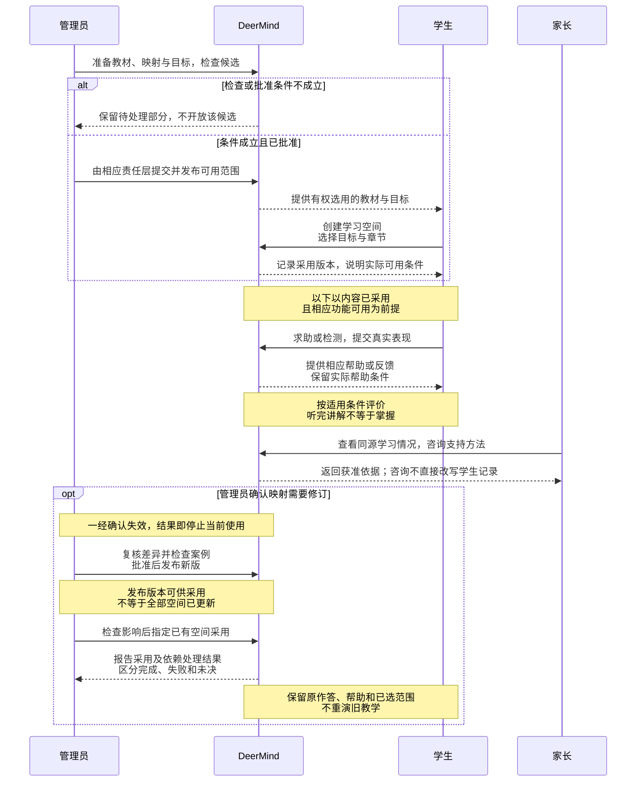

# MVP 需求与验收规格

> **版本**：v0.1 
> **文档性质**：产品需求与行为验收规格；Phase 3 — MVP Definition 
> **状态**：2026-10-15 用户阶段性审阅通过；G3 PASS，进入 Phase 4；不表示实现、模型质量或学习效果通过 
> **上游依据与基线**：本轮批准内容及依赖已固定于 [G3-20261015-01](../MVP_Gate_Reviews.md#27-g3-阶段性审阅通过与-phase-4-交接)；快照包含批准前的实际工作区内容，不以旧 HEAD 代替。相关依据见正文。 
> **维护责任**：Codex 负责需求条目、行为验收及追溯维护；用户参与新的产品取舍，未替用户批准未决项 
> **评审记录**：用户原话“phase3 阶段性审阅通过，继续后面的工作”；批准边界与遗留责任见 [G3-20261015-01](../MVP_Gate_Reviews.md#27-g3-阶段性审阅通过与-phase-4-交接) 
> **写作规范**：[设计文档规范 v1.1](../../top/DeerMind_Design_Document_Standard_v1.1.md) 
> **更新日期**：2026-10-19 
> **修订说明**：ProblemTemplate / ProblemScope 改为 TaskTemplate / TaskScope，统一任务术语；将单类状态落实为产品后台与学习统计规则；更新现行文档引用及导航。逐文件变更见[修订记录 §9](../../concept-design/DeerMind_Learning_Model_Reassessment.md#9-task-claim-单一能力状态的正式修订记录)。

---

上游依据：[产品定义](MVP_Definition.md)、[验证方案](MVP_Validation_Plan.md)及归档 SRC-005。跨阶段决定、待决、风险与编号见[共同管理文件](../MVP_Governance.md)，正式阶段判断见[Gate 记录](../MVP_Gate_Reviews.md)。

本文把已经明确的需求方向转为行为规格，承接范围和来源见产品定义及共同登记册。下游为产品、领域、数据权限与评测资产四项 Phase 4 交付；具体界面、模型调用、数据库和算法不在本文决定。当前 24 组验收场景组织关键行为，其中 AC-024 为 G3 之后按 DEC-021 追加；§7 将归档 R/P/M 及 A01–A78 对应到当前需求。映射完成不表示已经执行，也不替代 Phase 4 的实际案例与参考材料。

输入为产品定义中的需求选择、已确认约束和现行模型合同；输出为产品对象与关系、三端功能的业务过程及状态规则、AI 与权限边界、非功能承诺、AC 和唯一追溯主索引。Phase 4 据此设计操作及准备材料，工程据此验收；无需阅读原型即可说明核心工作的前提、过程、结果和关键例外，才满足本文交接条件。§2 是索引，§1、§3–§5 承担产品说明，不能以表格行数代替完整规格。

## 1. 范围、术语与需求组织

产品由三个分工清楚的使用端共同运行。管理员先准备可用的教材、领域关系和学习目标，并维护账号；学生建立自己的课程空间，在其中求助、尝试、检测和查看学习情况；家长依据获准资料了解情况并咨询支持方法。系统以实际作答和帮助记录更新对学习者的认识，再据此提出适当后续行动。任何一次使用都不要求走完整条学习流程。

范围覆盖学生、家长与管理员，并区分学生主动请求、系统主动介入及跨活动的资料与状态支撑。NEED 记录需求依据，REQ 记录可观察行为，AC 记录验收场景；对象详情在各自文档，统一关系见 §7。术语与编号规则沿用[共同规则 §7](../MVP_Governance.md#7-术语与编号规范)。

旧归档 R/A 编号保持历史含义，按“文件 + 编号”引用。本轮已经核对归档 R01–R24、P01–P02、M01–M06 与 A01–A78 的承接关系，见 §7。旧示例中的合成题面不成为首批教材承诺，旧活动名称不决定新的活动或页面划分。冲突由较新明确选择和共同变更规则处理，仍不清楚的内容登记后讨论。

**图 REQ-01　课程范围、领域定义与个人学习记录的关系**

本图帮助从课程入口理解后续数据的来源。它只画业务引用关系，不表示调用顺序、物理存储位置或完整领域模型；Learning Space 与 Domain Space 分开。

**图例：** 矩形是业务对象或相关记录的分组，分组框是两个 Space 的职责范围，箭头表示所标注的引用或使用关系，不声明一对一关系。

**读图边界：**

- 图中教材映射和目标引用仅示主要关系。
- 完整 Domain 关系由概念设计定义。
- 个人记录只在所属空间使用，引用同一领域定义不构成跨空间共享。
- 下表继续定义对象及操作边界，后台反向追溯见 §3.5。

下表定义产品逻辑对象及关系，不是数据库结构，也不替代正式 Space 模型。一个业务操作可以涉及多个语义对象；界面可以把它们组织在同一工作区，但历史事实、解释、判断和管理意见必须可区分。

| 产品对象 | 业务含义与主要关系 | 操作与状态边界 |
| --- | --- | --- |
| 账号与授权关系 | 学生、家长、管理员账号分开；亲子关联决定家长可访问哪些孩子与空间 | 开户、核实、恢复与关联由后台处理；关系失效不抹除原学习档案，也不保留旧访问权 |
| 教材及其已发布版本 | 管理员准备的源材料，内部包含章节、内容和映射；可被获准学生选用 | 上传、识别和映射候选与已审核可用内容分开；个人选用不修改源教材 |
| 个人 Learning Space | 学生创建的课程上下文，采用特定教材、范围及目标，关联本空间的学习活动与记录 | 校内与校外分别维护；共享源教材不共享个人证据、判断或推理上下文 |
| 课堂进度确认 | 学生报告学校正在教学的章／节，属于个人 Learning Space 的课程上下文；关联教材版本、来源、确认时间与修改历史 | 不等于 DeerMind 活动进度或个人掌握，不按章节顺序推断已学范围，不直接更新 Belief |
| 学习目标与采用关系 | LearningTarget 说明期望表现、条件和达标标准；采用关系说明当前空间/活动选择哪个已发布目标及范围 | 管理员维护标准，学生选择；聊天意愿不直接修改定义。目标变化不等于能力变化 |
| 题目与每次作答 | 题目有来源、内容及版本；同一道题可以有多次真实作答，每次关联请求、活动和实际帮助 | 外部与内部来源可统一管理；没有作答、判断争议、确认错误分别表达；订正保留原表现 |
| 学习活动及进度 | 围绕一个当前目的进行讲解、练习或检测，关联选用目标、题目、输入与反馈 | 讲解分段与恢复进度；独立检测的实质求助结束规则不同，不能共用一个含糊的“暂停”覆盖全部活动 |
| 学习判断与依据 | 当题反馈、Evidence、Belief 和目标判断承担不同责任，关联所用事实、帮助与模型版本 | 有效、失效、待重处理和证据不足须可辨；用户指出问题进入复核，不直接改写结论 |
| 后续行动建议 | 系统针对有效认识和目标提出的帮助或检测建议，关联理由、用户选择与实际后续结果 | 可接受、暂缓或拒绝，依据变化后可调整；拒绝不直接成为负面能力证据 |
| 维护事项、候选与发布记录 | 管理员记录问题、预期差异与处理依据；修订候选关联检查、批准、生效范围及历史影响 | 问题、候选、批准、生效和影响处理分别记录；初始建模不必伪造一个历史缺陷 |
| 家长咨询 | 家长在有效孩子/空间上下文中提出的问题、系统回复及自己的会话记录 | 对话不向学生或其他家长共享，线下转述不成为学生正式表现；与另行提交的维护事项分开 |

跨对象关系应支持两种阅读：从课程和活动向下查看题目、表现及反馈；从一个可疑判断向前追溯事实、实际帮助、模型及版本，再定位有权修改的对象。缺失、未决、无权访问及合法未产生某类结果分别说明。技术设计可以补充运行状态，但不能改变这里的业务含义。

## 2. 角色目标、业务行为与 AI 边界

| REQ 编号 | 行为 | 前提、响应与结果边界 | 约束及来源 |
| --- | --- | --- | --- |
| REQ-001 | 题目问题帮助 | 用户提交不会、卡住、存疑或错误的题目时，允许请求讲解或提示；仅有题面时先核实必要条件，不要求先生成一份错误作答。明确仅提示时不自动给完整解答。 | DEC-002、CON-008 |
| REQ-002 | 章节知识帮助 | 从教材章、节或具体知识疑问发起，按关键问题分段说明概念与理由，由学生决定继续或追问；支持讲解中的阶段检查和结束检查，保留实际结果，不把播完或点继续当掌握。允许按 DEC-015 简短回补必要旧知识后返回当前问题。 | DEC-015；CON-008、013 |
| REQ-003 | 解释、练习与独立应用 | 允许学生用语言、算式或图示解释，使用适合目标的任务检验表现；区别跟做、提示后完成、原题再做和条件变化后的独立完成，记录实际帮助与接触背景，不仅看最终答案。 | CON-011、016 |
| REQ-004 | 范围检测 | 主动自测从教材章、节选择范围；按目标与覆盖准备题单，说明范围、题量和预期用时，允许选择开始。正常检测不自动加题，完成或主动结束后统一反馈；未测部分和未决部分分别报告，过大范围可分次。 | CON-009、011 |
| REQ-005 | 检测中求助转教学 | 独立多题检测中请求实质提示或讲解，结束本次检测、保留已完成部分和帮助背景，将未做部分记为未检测后转入教学；识别确认或技术恢复本身不当作实质求助。 | SRC-005、CON-008 |
| REQ-006 | 跨来源问题与错题管理 | 保存外部题目及内部练习、检测等形成的题目与作答，区分来源、性质和确认状态。实际错误可统一管理；未作答、识别不清或有争议的结果不自动变成确认错题。订正保留原表现，重复打开不产生新表现。 | DEC-002、CON-011 |
| REQ-007 | 题目保存与适用复用 | 保留原题、完整生成候选、变式或原生题的来源、版本、适用目标、校验和实际使用。合格且适用才在本空间复用；原题重测可以被选用，但不能仅因进了错题集就固定重测。 | CON-002、011 |
| REQ-008 | 有依据的主动介入 | 根据有效认识、目标、时间变化及实际情境，在产品内提出后续检验或帮助，说明范围和原因，学生可以接受、暂缓或拒绝。未知不等于不会或必须立刻测验；不提供固定周期测验、预约提醒和产品外推送，时间变化不自动开测。 | DEC-003、016；CON-009 |
| REQ-009 | 可理解的学习情况 | 按教材章节统计已发布学习要求的已达标、需加强、待确认项数，展开具体要求及依据；管理员随目标维护要求，不临时凑数。近期作答正确率另列，不解释为章节掌握率；说明范围、条件与未知，允许询问下一步，展示不反向改写底层判断。具体口径见 §3.9。 | DEC-013、014；CON-014、016 |
| REQ-010 | 输入与学习控制 | 保留文字、手写、拍照和双向语音；提交或求助后分析。意图输入常驻可用，完整历史按需展开；追问与原段关联，切换后可继续旧讲解。取消、误识别和失败有可理解反馈；只保存输入不声称已理解。 | CON-003、008、014 |
| REQ-011 | 身份与空间隔离 | 学生、家长和管理员身份与权限分开；校内与校外教材、记录、判断和推理上下文隔离。设备变化不改变学习者身份；撤销角色关联后旧登录状态不能继续越权访问。 | CON-002、003、005 |
| REQ-012 | 家长查看与咨询 | 家长查看获准的学习情况及相关依据、咨询支持办法，不能借咨询直接修改学生录入资料。家长陈述保持来源，不作为已经核验的孩子作答；自身对话与学生、其他家长隔离；首版不通过家长咨询派发学生任务、修改正式目标或专门录入线下表现。 | CON-005 |
| REQ-013 | 教材、目标准备与可用条件 | 管理员在后台创建教材、导入扫描件、核对内容，准备领域基础及章节映射，维护教材对应的目标和达标标准，核对必要参考后分批发布供学生选择。没有答案时不虚构权威答案。浏览、讲解、当题反馈与掌握判断按各自真实就绪条件开放，不以“上传成功”代表全部可用。 | CON-002、012；DEC-009、011 |
| REQ-014 | 基础模型与目标维护 | 管理员发起初始建设或修订，维护 TaskTemplate、SolutionTemplate、KC 及关系和映射；教材目标按 DEC-011 维护。保留依据、候选、有限验证与批准记录，由对应 owner 提交后限定启用。AI 可辅助准备候选，不以自动诊断为前提；其他语义规则通过受控版本交付，不要求通用在线编辑器，允许不修改或保持未决。 | CON-004、012、016；DEC-008、011 |
| REQ-015 | 人工复核与可追溯纠错 | 管理员可从具体案例记录预期与实际差异，检查相关输入、帮助、解释、评价与版本，按原因和权限更正、转交维护或保持未决。错误结果停止当前使用，失败与剩余影响可见；不覆盖原事实、不直接手改掌握结论，不重复旧教学行动。后台自动分析诊断后置。 | CON-005、016；STG-03；DEC-008 |
| REQ-016 | 告知与数据使用边界 | 维持已确认的首次告知及必要确认、用途和实际外部服务范围检查；管理员身份不替代家长授权。外部服务及适用条件未核实时不假称可以处理真实学习资料。 | CON-006；OPEN-004 |
| REQ-017 | 资料界面删除 | 承接已确认的界面删除、内部有效且获准事实保留及角色依据查看规则；区分学习资料和家长自身咨询，说明实际影响，不冒称物理销毁，也不借新回复恢复应隐藏的内容。完整销毁和授权撤回功能仍后置。 | CON-007；SRC-005 的 R24 |
| REQ-018 | 中断恢复与总投入 | 中断保护输入，恢复核对原提交和实际展示，避免重复事实、评价或教学；学习者时间跨空间累计，自动与补记、未知和实际超时分别记录，按既有上限提醒并保存进度。模型费用、后台时间与人工投入另计。 | CON-009、016；STG-04 |
| REQ-019 | 课程支持边界 | 按实际所需知识和有效课程范围区分超纲、纲内新题和模型缺口；确认进阶超纲委婉拒绝，纲内新题提供必要校验的帮助并入库，正式判断不使用未经批准的模型关系。允许当前章节所需的基础回补，不扩展整套低年级课程或借用另一空间的个人记录。 | DEC-015；CON-013 |
| REQ-020 | 后台运行与配置 | 管理员可处理失败任务、配置模型服务连接并检查可用状态、查看延迟、调用用量、费用及人工维护投入；按具体事项读取必要材料和运行记录。配置保存不代替服务可用，未知费用不记零，重试不能重复提交学习事实或教学；不要求自动根因分析。 | SRC-005 的 R17、M02、M03、M05；CON-004、005；DEC-008 |
| REQ-021 | 模型与运行依据查看 | 管理员既能按 Space、模型及对象查看定义、关系、来源、版本和有效状态，也能从具体学习活动或判断追溯跨空间依据。覆盖 Learning Space 的材料与目标、Domain 定义、Evaluation 的证据与判断变化、Interaction 的决策与实际帮助、Evolution 的问题与修订记录；支持人工抽查普通记录，缺失和未决可见，访问遵守事项权限。 | DEC-008；CON-005、016 |
| REQ-022 | 修改验证、发布与影响处理 | 管理员可查看候选差异、检查案例并比较结果，再按范围批准启用、停用或恢复版本。教材/目标发布后由管理员检查影响并指定已有空间采用，保留历史和学生选定章节。能查看受影响对象、待执行／完成／失败状态及结果变化；重算不重演教学，回退不自动清除历史影响，不承诺自动选优。 | DEC-008、012；CON-004、012、016 |
| REQ-023 | 学生创建空间并选择教材与目标 | 学生创建自己的 Learning Space，选用已发布且获准使用的教材、目标与章节范围，查看实际可用条件；家长端按关联查看，不创建或修改目标。教材、目标版本与采用关系可追溯；学生可表达意愿，不能经选择或聊天改写源教材、Domain 定义或达标标准，不跨空间合并历史。 | DEC-009、011；CON-002、005 |
| REQ-024 | 课堂进度记录与更新 | 学生可确认学校正在学的章节，补充小节或说明，也可留空或改为未知；记录来源、时间和变更。首页醒目展示并可更新，学习情况单独标注，家长同源只读；不因课堂进度更新而修改掌握状态、学习范围或实际活动进度。 | DEC-021；CON-002、005、014 |

AI 可以根据请求和获准目标解释、提问、生成候选、判断适用证据或提出后续行动；这些能力均受范围、权限与质量条件约束。AI 不得自行批准模型变更、扩大课程范围、替代用户意愿或把不确定材料写成确定能力。无法提供可靠结果时明确失败或未决，必要时按已定维护路径处理；不承诺实时人工教师或所有问题即时解决。

## 3. 三端功能与业务流程

本章先按三端完整工作说明功能，再集中维护被多项功能引用的规则。这里的过程描述约束业务结果，不预定页面数量、按钮排列、Agent 划分或服务结构。

### 3.1 学生建立课程空间并选择学习范围

学生通过课程空间分别组织校内和校外学习，明确使用哪套教材、学习哪些章节以及按什么目标检查学习情况。创建前，学生账号及必要确认须有效，管理员须已发布学生有权使用的教材和目标。

**创建过程**

1. 学生在学生端发起创建，选用已发布教材、对应的学习目标和章节范围。
2. 系统说明所选教材与目标下实际可用的内容、可以开展的学习行为和尚未就绪的部分。
3. 创建完成后，空间保留教材与目标的版本、所选范围及可追溯的采用关系，供后续学习使用。

这里的教材选用是引用管理员已准备的材料，不是让学生上传整本扫描件重新建模。创建空间也不会改变教材源内容或共享的 Domain 定义。

**创建后能开展什么学习**

空间创建成功不代表全书都已具备讲解和评价条件。系统应分别说明内容可用范围和正式评价依据是否就绪，学生只能开展满足相应条件的行为。例如，某节教材已可浏览，但正式掌握判断的映射尚未补齐，就不能把该节显示为已具备完整评价能力。

缺少正式评价映射也不等于一律拒绝帮助。纲内新题仍按 REQ-019 提供适用的帮助，并明确正式判断的限制。

**使用与权限边界**

- 学生可以选择已发布目标、调整本次学习范围并用自然语言表达意愿；目标定义和达标标准由管理员维护，不能通过聊天自行降低标准或建立未经发布的正式目标。
- 家长端按权限查看空间及选择结果，不代替学生创建或修改。
- 同一学生的不同空间分别保留学习历史，切换空间不合并历史，也不借用另一空间的判断。

**教材和目标的后续更新**

管理员先发布教材或目标新版，再检查影响并指定已有空间采用；发布本身不会自动更新全部空间，也不要求学生逐个确认。采用新版时保留旧版本及学习记录，不改变学生选定的章节范围，管理员也不能借版本维护替学生另选课程或学习目标。

若达标标准发生变化，系统应区分“依据新标准重新判断是否达标”和“学生实际能力发生变化”，不能把标准修订直接记为学习进步或退步。

> **关联依据：** 依据 DEC-011、012；本功能对应 REQ-023、REQ-011、AC-023，目标维护由 §3.4 承接。

### 3.2 学生求助、检验与回看

**求助入口。** 学生可以带着一道不会做、做错或存疑的题目进入，也可以从教材章节提出知识疑问。

- **提交与澄清：** 提交前可以用文字、手写、图片或语音表达题目和思路；系统先确认足以处理的内容及请求边界，必要时只澄清有疑点的部分。
- **无作答与仅提示请求：** 只有题面时允许直接求助，不要求学生先提交错误答案；明确只要提示时保持提示边界。

> **规则与验收关联：** 输入方式和正式发送条件统一见 §3.8。对应 REQ-001、002、010、019，验收见 AC-001、002、010、019。

**讲解目的。** 讲解以帮助理解当前问题为目的，先给出简明、分步骤的解释，再按需要互动。

- **分段推进与追问：** 章节讲解每次推进一个关键问题，由学生选择继续或追问；追问与相关段关联，原推导保留。
- **检查与练习：** 讲解中的阶段检查、结束检查及练习用于取得实际表现，学生可以选择是否参加；未参加不写成不会或已经掌握。练习反馈可以逐题给出，结果记录实际帮助条件。
- **退出与恢复：** 退出或切换时保留讲解进度，回来可以继续；当前只呈现一项学习活动。

> **需求与验收：** 依据为 REQ-002、003、010 及 AC-002、003。

**图 REQ-02　分段讲解中的追问、检查与退出**

本图展开章节讲解的业务节奏，说明孩子怎样控制推进。各选择均为可用路径，不要求每次讲解都经历检查或基础回补。

**图例：** 矩形是业务步骤或结果，菱形是学生选择，箭头标签说明转换条件。

**读图边界：**

- 必要基础回补仍按下文规则返回原问题。
- 检查结果不因处在讲解中就算独立表现。
- 播放结束或沉默不会自动推进。
- 单独发起独立检测时另走图 REQ-03，不能把“讲解可恢复”套到已经结束的检测。

> **关联规则：** 对应 REQ-002、003、010、019 及相应 AC。

**必要基础回补。** 当前章节讲解遇到必要旧知识缺口时，可先简短回补，再回到原问题。

- **允许的回补范围：** 例如分数除法讲解中需要约分，可解释相关方法并取得学生实际表现；不因为本册未单列这一基础内容就一律拒绝，也不据此自动转入整套低年级课程或改写已选目标。
- **回补过程与隔离：** 回补仍按分段、追问、退出和帮助记录规则处理，不借用另一学习空间的个人记录。
- **评价条件：** 能够提供帮助不等于已具备正式掌握判断的全部依据；回补结束不自动把相关目标标成达标。
- **独立检测中的求助：** 独立检测中需要这种实质帮助时，仍先结束检测再转入教学。

> **关联依据：** 依据 DEC-015，对应 REQ-002、019、AC-002、019。

**检测范围。** 当学生想了解某个范围是否已经掌握时，主动章节自测从教材选择章、节；问题复测或接受疑点验证可直接以具体问题为范围。

- **题单与开始条件：** 系统根据目标、覆盖和有效历史准备题单，说明本次范围、题量与参考用时，再由学生决定开始；范围太大时提出分次方案并保留未测部分。
- **题目选择：** 题目既可选用合格历史题，也可形成经校验的变式或原生题，选择依据与接触背景保留。
- **检测过程与反馈：** 正常检测不自动加题，提交只确认收到，完成或主动结束后统一反馈。

> **需求与验收：** 对应 REQ-004、007 及 AC-004、007。

**独立检测中途求助。**

- **实质求助与技术确认：** 独立多题检测中，学生请求实质提示或讲解时，系统结束本次检测，保留已完成记录并标明尚未检测的范围，再进入教学；技术确认和识别核对不按实质求助处理。
- **请求与实际帮助：** 结束检测与真正展示帮助是不同事实：请求帮助不等于已经接受了帮助。
- **后续补测：** 检测结束后仍有证据不足时，可另提补测，由学生选择，不能回到原题单无提示加题。

> **规则与验收关联：** 对应 REQ-005、AC-005，题目与反馈的其他规则见 §3.8。

**图 REQ-03　独立检测何时继续，何时结束转入教学**

本图聚焦检测状态的关键分支，尤其区分“收到请求”“结束检测”和“实际展示帮助”。题单准备和范围过大时的分次处理按上文及 §3.8。

**图例：** 矩形是检测阶段或处理步骤，菱形是事件或请求分类，箭头标签是条件。

**读图边界：**

- 右侧转教学不会回到同一次独立检测。
- 需要补测时另提新检测并由学生选择。
- 图未展开网络恢复，须按 §4 核对原提交及实际展示，不能重启已结束检测。

> **关联规则：** 对应 REQ-004、005、018、AC-004、005、018。

**题目与作答回看。** 学生可以回看来自外部录入、讲解练习和检测的题目与作答，看到来源、当时请求、实际帮助和判断状态，再选择讲解、练习或复测。

- **错题归集：** 确认错误统一进入错题管理；未作答、识别争议及尚未判定保持相应性质。
- **订正与回看记录：** 订正形成新的记录，原始表现可追溯；打开旧题不产生新的表现。
- **历史题重测：** 重测的必要性由有效认识和目标决定。

**章节学习情况。** 学习情况以教材章节组织，说明实际覆盖、独立和受助表现、未知与需要关注的部分，并允许询问依据及下一步。

章节三类状态项数与近期作答统计分别展示，具体业务定义和查询口径见 §3.9。

> **关联依据：** DEC-013、DEC-014；REQ-006–009、AC-006–009。OPEN-008 的处理记录见[共同管理文件](../MVP_Governance.md)。

**主动介入的依据。** 系统也可以基于有效历史、目标、时间变化和当前情境，在产品内主动提出帮助或检测。

**介入示例。** 例如过去在提示下完成过某类题，系统可以说明希望了解撤去提示后的表现；距上次独立完成已有一段时间，可以依据适用规则提出再次检验。

- **示例的适用边界：** 两个例子说明介入目的，不规定统一间隔，也不把所有未知项都变成待办测验。
- **是否提出建议：** 没有充分理由时可以不介入，建议须让学生看懂针对什么、为什么现在提出以及可以做什么。

> **关联依据：** 依据 DEC-003、016，对应 REQ-008、AC-008。

**学生对建议的选择。**

- **接受建议：** 学生接受讲解建议后进入已有讲解流程，接受检测建议后先取得范围、题量和参考用时，再选择开测。
- **暂缓或拒绝：** 暂缓或拒绝不会自动安排补课、降低能力判断或强制切换当前活动；呈现建议本身不产生学习表现。
- **首版提醒范围：** 首版不提供固定周期测验、预约提醒或产品外推送，“暂缓”不等于预约某个时刻，也不承诺应用关闭时唤醒孩子。

> **后续设计责任：** 产品内的呈现位置、恰当呈现时机与更新操作由 Phase 4 设计，何时重新计算由 Phase 5 基于有效认识与目标实现。

**建议的有效性。** 建议仍须服从当前依据。

- **依据变化：** 新作答、更正或目标变化使原理由不成立时，更新或撤去尚未开始的建议；学生打开或接受旧建议时核对当前适用性，不能仅凭原有文字启动已不合适的检测。
- **判断正在修复：** 相关判断正在修复且尚无有效依据时，说明暂不能据此建议，不把失效结果继续包装成确定理由。
- **保留已经发生的活动：** 接受后形成的真实活动、作答与帮助独立留存，后续建议改变不删除它们。
- **投入与价值限制：** 实际学习投入仍受每日总时间约束，算法如何选择最有价值的介入属于后续设计和验证，不能仅因具备建议入口就声称已经改善保持或迁移。

### 3.3 家长查看与咨询

**家长查看与咨询。** 家长进入独立客户端，在有效关联的孩子与空间下查看学习情况和相关依据，询问为什么形成某个判断、可以如何支持。

- **查看内容与范围：** 系统应把结论、覆盖及限制表达清楚，提供与请求有关的题目和作答依据，不默认开放全部无关历史。
- **家长陈述与操作权限：** 家长咨询可以引用其转述作为咨询背景，但不能作为孩子已经实际完成的作答更新掌握判断，也不能派发任务或修改正式目标。
- **资料更正与复核：** 材料录入与更正留在学生入口；需要复核既有系统结果时进入获准的事项路径。

> **需求与验收：** 对应 REQ-009、012、016、017 及相关 AC。

**家长会话与资料管理。**

- **切换与会话隔离：** 家长切换孩子或空间时，当前对象与数据、推理上下文一起切换；不同家长的对话彼此隔离，也不向孩子展示。
- **咨询删除：** 家长可以按整段管理和删除自己的咨询，既有独立事项与孩子学习事实不随咨询删除。

**共性规则：** 可见依据、内部保留及隐藏规则统一见 §3.8，不能由咨询重新恢复应隐藏的内容。

### 3.4 管理员准备教材、领域与学习目标

**教材准备目的。** 管理员要为首批真实学习提供可使用的材料和判断基础。

- **导入与处理状态：** 后台接收多页 PDF 或成组扫描图片后，管理员能够查看处理状态、原材料、识别结果、章节结构及待核实部分；任务接受后可以离页，回来查看同一任务，不重新上传才取得结果。
- **候选维护与映射：** 管理员可以查看、修改并核对完整候选内容和引用，准备或导入 TaskTemplate、SolutionTemplate、KC 及其关系，并建立章节映射。
- **结果的不同阶段：** 处理完成、内容审核和正式开放是不同结果。

> **需求与验收：** 对应 REQ-013、014、018 及 AC-013、014、018。

**教材核查与发布规则。**

- **无答案材料：** 没有答案的教材可以导入；系统辅助形成的解法或参考需保留生成来源，不能冒充教材原答案，核验后才作为对应参考。
- **核查覆盖：** 核查应覆盖疑点及代表性的未标疑样例，不能整章批准后把所有未确认关系视为正确。
- **合法多解：** 同题可以有多种合法方法及不同知识支撑，参考解法不限制学生只能采用同一路径。
- **分批发布：** 教材按章节起草和审核，再按首批可用范围发布，不要求整本书全部完工才开放已有合格部分，也不把局部完成写成全书可用。

**教材对应目标的维护规则。**

- **目标定义：** 管理员同时维护教材对应的学习目标及达标标准，说明范围、期望表现和支持条件，按各自语义责任与教材、Domain 引用关联。
- **发布与历史：** 目标经检查、批准和发布后供学生选择；修改不覆盖旧标准或把旧结果重新标成当时已达标。
- **标准变化的影响：** 单纯目标标准变化先检查目标评价及相关后续行动，不直接提高或降低 Belief。
- **可查看信息：** 目标来源、版本与采用范围属于可查看信息，

> **关联依据：** 权限依据 DEC-011，验收并入 AC-013、014、023。

**内容缺口与可用边界。**

- **按行为说明就绪条件：** 浏览、讲解、当题反馈和正式掌握判断分别说明就绪条件。内容缺口影响哪类行为，必须让管理员可定位，也让学生知道当前可获得什么帮助。
- **纲内新题与模型缺口：** 确认纲内的新题仍应提供必要校验后的帮助并入库，不因模板缺失就一律等待人工；确需补充模型时转入基础维护，未经批准的新关系不直接支撑正式掌握结论。
- **初始建设：** 初始建设可以直接发起，不伪造一个运行缺陷。

### 3.5 管理员查看模型与实际运行

**后台查看目的。** 管理员需要在具体事实中判断系统是否按预期工作。

后台提供两种组织方式：

- **按定义浏览：** 按 Space、模型和对象查看定义与引用。
- **按案例追溯：** 按学习活动、某次判断或维护事项查看当时的运行及依赖。

两种方式能相互关联，不能仅给一棵对象目录，也不能仅给模型生成的摘要。个人材料访问继续受事项范围限制，抽查普通记录同样记录用途。

> **需求与验收：** 对应 REQ-021、AC-021。

**图 REQ-04　管理员从一条可疑记录追溯哪些依据**

本图表达后台的查阅关系，不表达模型的调用顺序，也不表示系统已自动诊断出原因。入口可以是普通抽查，不要求先出现错误标记。

**图例：** 矩形是一组可查看记录，箭头表示沿所述关系查阅。

**读图边界：**

- 合法未产生、未决、失败丢失和无权访问须分别呈现。
- 空白不能代表没有问题。
- 图中由领域定义进入维护记录只画一种关联入口，评价或交互规则的修订也可由各自记录追溯，不要求先找到领域缺陷。
- 对象查看还应显示身份、来源、版本及状态，下表规定具体字段含义。
- 维护操作见 §3.6。

> **关联规则：** 对应 REQ-015、021、022 及相关 AC。

| 查看范围 | 必须能够取得的信息 | 主要关联与核对问题 |
| --- | --- | --- |
| Learning Space | 已采用教材及章节范围、正式目标与达标条件、材料/目标版本、可用条件和相关采用记录 | 当前活动依据哪个范围和目标；来源更新是否已采用；与该学生其他空间是否分开 |
| Domain Space | TaskTemplate 的问题责任和参数条件、SolutionTemplate 的适用方法与子任务关系、KC 及支撑关系、教材映射、对象来源和版本 | 题目依据哪些正式对象解释；关系是否仍为候选；哪些材料或判断引用了该定义 |
| Interaction Space | 本次请求、活动与上下文、原始输入引用、Observation 及其校验结果、决策结果与依据、计划帮助和实际展示/播放状态、中断及结束记录 | 用户要求什么，系统理解了什么，为什么采取该行动，究竟展示了什么；请求、生成、展示不能混用 |
| Evaluation Space | Evidence 的来源、解释和条件，Belief 的适用范围及变化，相关目标评价、所用规则与版本、有效或待重处理状态 | 为什么作出该判断；缺证据与反证是否混淆；变化来自新表现、解释修正还是目标标准变化 |
| Evolution 及维护记录 | 问题依据、候选差异、有限检查、人工判断、批准和启用范围、相关失效及重处理记录 | 哪个修改为什么生效，检查了什么，哪些影响已处理、失败或仍未决；初始建设与运行修订可区分 |

**记录详情与完整性。**

- **对象信息：** 对象详情至少能够辨认稳定身份、准确版本、来源、当前适用状态及关联记录。
- **活动与判断追溯：** 查看一段活动时，能够从原始输入和实际帮助，追溯到解释、证据、判断、决策和实际展示；查看某个判断时能反向定位相应依据。
- **记录完整性：** 完整性按本次路径应有的记录判断：合法未形成 Evidence、运行失败丢失结果和无权访问分别表达，不能用空白详情混为一类。

**查看能力的边界。** 这些是可查看的数据含义及关联要求，不要求管理员读取模型内部思维链，也不承诺系统自动指出根因。

- **模型解释的依据：** 模型参与解释时，引用系统实际保留的输入、结构化结果和校验依据；无法取得的材料如实说明。
- **线索与错误状态：** 可疑线索、人工已确认错误、未决与已修复状态分别呈现，自动标记数不能称为已确认错误率。

> **后续设计责任：** 搜索、筛选、时间线和详情页怎样组合由 Phase 4 设计，数据获取接口和保留结构由 Phase 5 实现。

### 3.6 管理员复核、修改、发布与处理影响

**维护入口。** 管理员从具体学习结果、普通抽查或明确维护需要进入，记录预期与实际差异，关联必要材料后人工判断处理方向。

- **分析与处理方向：** 问题可能来自原材料、识别、领域定义、评价规则、交互规则或运行故障；可以确认已有模型足够、转入其他维护、明确需要修订，或保留未决。
- **线索的效力：** 用户陈述与自动可疑标记都是线索，不能直接作为已确认错误。

> **需求与验收：** 对应 REQ-015、022 及 AC-015、022。

**允许维护的对象与候选。**

- **领域与目标维护：** 领域维护支持新增、修订或停用模板、方法、KC、关系和材料映射，目标按 DEC-011 受控维护。
- **其他语义规则：** 评价、交互和推理等其他语义规则支持查看、追溯与受控版本交付，不新增通用在线编辑器。
- **候选与验证准备：** AI 可辅助候选准备，管理员能够查看候选与当前版本的差异、引用、适用范围及验证材料，再选择代表性案例检查并比较结果。
- **新增模板与批准边界：** 普通题目实例不自动要求创建模板，候选也不能自行批准。

**候选检查与启用。**

- **不启用的条件：** 校验失败、引用基础已变化、权限不成立或判断仍未决时，不启用候选；引用基础变化后须重新核对候选及检查依据。
- **批准与启用：** 合格候选经管理员记录审核依据与批准范围，由相应责任层提交并限定启用；同一管理员可以完成修改、审核和发布，步骤仍分别留痕。
- **修改必须可用：** 有效修改必须能被后续真实学习使用，不能只展示版本号变化。
- **检查结论的范围：** 检查通过说明选定案例得到支持，不代表普遍语义正确。

**修改影响处理。** 启用后应能定位受影响对象，区分待执行、已完成、失败和仍未解决的重处理及结果变化。

- **重处理范围：** 新增对象不默认全量重算；内容、规则或目标变化按实际依赖处理，原作答及历史帮助不被覆盖，无关记录不重置。
- **失效与修复方式：** 已知失效结果退出当前使用，修复不能通过管理员直接指定 Belief 完成。
- **停用或恢复版本：** 停用或恢复旧版本不自动消除已经发生的历史影响，重算不重新执行旧教学，实质更正的用户告知遵守 §4。

**后置范围：** 后台自动诊断、自主选优与通用演化平台后置。

**发布与采用分开。** 教材和目标的发布记录与已有空间的采用记录分别保留。

- **指定空间采用：** 管理员检查版本差异、相容性和影响后指定采用空间，能够核对哪些空间已经更新、哪些尚未更新或处理失败；该操作不改变学生选定章节范围。
- **失效与历史保护：** 已知失效结果不能因空间尚未完成更新而继续当作有效依据，历史评价也不能只因源版本发布就被覆盖。

> **关联依据：** 对应 DEC-012、AC-022、023。

### 3.7 管理员维护账号与日常运行

**日常运行职责。** 管理员承担开户、关系核实与维护、找回账号和日常运行。

- **身份与找回：** 首批身份与亲子关系在系统外人工核实后记录，核实未完成不绑定或重置；账号恢复保留原档案，家长身份不授予管理权。
- **运行查看：** 服务连接配置、可用性检查、失败任务与运行记录能够查看和处理；后台分别呈现延迟、调用用量、已知费用、未知费用及人工维护投入。
- **配置与重试：** 保存配置与服务真实可用分开，重试核对原任务及已产生结果，不重复提交事实或教学。

> **需求与验收：** 对应 REQ-011、018、020 及 AC-011、018、020。

### 3.8 共性输入、记录与权限规则

**记录的关联要求。** 题目来源、实际作答、请求、已经展示的帮助、判断及其模型版本分别可追溯。

- **每次表现单独记录：** 求助、讲解、自测、后续检查可使用同一题目，但每次真实表现单独记录，界面打开或聊天摘要不新增独立证据。
- **不同来源共同管理：** 系统内产生的错题与外部录入使用共同管理能力，来源和帮助条件保留。

**章节与模型关系。** 教材章节是用户熟悉的组织方式，不能据章节列表推断所有内部关系已经建好。

Learning Space 定义材料、范围与目标，Domain 定义 TaskTemplate、SolutionTemplate 与 KC；两者的版本、正式关系与待审候选保持区分。

> **定义与设计责任：** 产品逻辑对象及业务含义见 §1，本节维护跨功能共用规则；Phase 4 细化信息组织、内容质量和权限，Phase 5 定义物理数据结构、接口及运行状态，不把产品对象首次留到工程决定。

本节集中说明多项功能共用的输入、记录与权限规则。教材、领域和发布维护按 §3.4–§3.6 执行，此处不重复定义。

**输入与反馈。** 学生具体题目支持拍照、图片与 PDF，以及活动内手写和文字；公式、表格、必要几何图、手写过程和同题跨图关系属于需要处理的内容，具体格式与复杂度由 Phase 4 准备代表性材料。

- **题目归属确认：** 归属不明时局部确认，不能合并别题作答，也不把日常明确输入变为逐项审批。
- **反馈时机：** 练习逐题反馈；独立自测或复测在完成或主动结束后统一反馈，收件状态不提前泄露对错。
- **独立检测的求助提示：** 开测时及求助入口说明实质求助将结束本次检测；请求与实际帮助展示分别记录，尚未展示不写成已经受助。
- **课程进度边界：** 课程内尚未学到的章节也可求助，不按进度锁定；历史记录缺失不能证明没有学过。

**语音与活动控制。** 孩子主动录音，结束后可查看、修改转写、取消、重录或发送；预览可转写，但发送前不生成正式作答、评价或教学回复。

- **正式记录：** 已发送原录音、转写和实际发送内容关联保存，修改不覆盖原录音。
- **临时录音处理：** 取消或重录淘汰的临时录音不入历史，按工程规则清理。
- **首版范围：** 不要求持续监听或全双工对话。

**播放与活动推进。**

- **默认播放方式：** 语音提问默认播放并展示回复，文字或手写默认展示、可选择播放；检测反馈时机仍按本节“输入与反馈”的规则执行。
- **播放控制与记录：** 支持停止和重听，失败可转文字；生成、展示、播放完成与重听可区分，不推定听懂。

章节读完、播完或沉默不自动推进，不自动串播下一段；当前只呈现一项学习活动，切换后保留旧讲解进度。

**检测与题目。** 主动章节自测通过教材选择一章、多章、一节或多节；从具体错题复测或接受疑点验证可直接以问题为范围，不强制先选章节。

- **开测前说明：** 开测前按实际目标、覆盖与有效历史准备题单，说明题量和参考用时；参考用时不是强制倒计时，首版不要求运行中自适应换题或自动提前结束。
- **后续补测：** 完成后仍不足可另提补测，不在原检测中无提示加题。

**题目生成与适用条件。**

- **题目形式与生成：** 题目可以要求计算、解释、比较、判断或纠错，原生题不需母题且不承诺全网独创；获准模型内自动生成和校验不要求逐题人工批准。
- **合法方法与题目缺陷：** 允许多种正确解法；缺陷若使用后才发现，停止不合格复用并处理依赖，不计作学生能力不足。
- **候选保存：** 完整候选包括未选用及不合格的候选；未形成题目时只记生成失败。

**题目档案与复用。**

- **档案与变式信息：** 题目档案保存稳定标识与版本、题面图示、判定依据、来源、目标及正式模型关系、变式维度和每次使用；变式说明改变什么及任务责任是否变化，不把改数字新建为 KC 或伪造派生关系。
- **编码与去重：** 编码、语义与历史使用分开，去重不丢失生成与使用记录。
- **证据解释的边界：** 同模板不自动视作等价或独立证据，参考方法不冒充实际作答；章节映射和实际帮助共同约束可以作出的判断。

**账号、家长与后台。** 学生与家长分别交付 Android APK，后台为电脑 Web；首个管理员部署初始化，后台开户，三类账号分别用账号名和密码登录，无学生手机号或自助注册前置。App 保持有效登录，退出或失效后重认证。

- **关联与切换：** 亲子关系为多对多且逐段授权；各端可查看当前关联，家长切换孩子及空间时相应数据与上下文一起切换，解绑一段不影响其他有效关联。
- **核实与找回：** 首批身份、关系及用户找回由管理员在系统外核实并后台记录，核实未完成不绑定或重置；换设备、重装或重置仍关联原学习档案。
- **管理员与客户端权限：** 管理员恢复独立于家长身份，不要求第二位管理员。实际权限不能靠安装哪个客户端或隐藏菜单决定。
- **后台资料访问：** 管理员按事项读取相关原件、录音、识别、讲解、判断与版本，访问和修改用途留痕，无关资料不因管理身份开放。

语义模型受控交付与模型服务连接配置分别处理，配置变化不自动授权重算历史。

指定平板与手机系统信息沿用 CON-003，实际设备和笔、浏览器版本在后续明确；实机验证包含安装升级、连续书写与手掌误触、图表阅读、拍照语音，核心流程不依赖额外安装 Google Play 服务。

**告知、保存与删除。** 首次家长确认记录说明版本、用途、可见范围、保留和实际外部服务，孩子参与确认单独记录；登录、亲子关联与管理身份不能替代这些条件。以后重登不重复确认，处理范围改变按原授权检查。

**资料保留与删除。**

- **保留范围：** 已提交材料随档案保存，不按固定天数自动清除；临时未发送材料不适用此规则。
- **学生资料删除：** 学生资料删除无审批、无恢复入口，按独立录入的一题移除关联原图和原作答，各种入口及新回复不重现，其他独立资料与后续练习不连带删除。
- **家长与后台访问：** 家长仍可按有效权限只读查看相关学习依据，包括学生端已删材料；已删资料错误交后台处理，不恢复学生条目。

家长仅按整段删除自身咨询，不提供单条删除，不改变孩子资料或已提交独立事项；事项页、通知及新回复不得成为私人咨询恢复入口。

界面说明内部保留，不能声称物理销毁；完整销毁和数据授权撤回功能后置不等于取消关联撤权或活动退出。

**语义与工程责任。** 这些规则不要求逐条对应一个新服务或页面。

- **判断与行动：** 领域语义与学习判断由既有责任层承担；Policy 根据有效认识与目标选择行动，Evaluation 更新能力认识。
- **推理与确定性保护：** 后台自动诊断后置，不取消正常教学与评价中的模型推理及语义校验；确定性工程处理标识、权限、版本、事务和引用完整性，不用关键词代替语义判断。
- **运行顺序：** 同会话严格串行，异常和主动中断按既有合同处理，后台批量任务不能绕过责任顺序。

### 3.9 章节学习情况与统计口径

本节规定章节学习情况的三类状态、项数统计和近期作答口径：

- **章节状态：** 按学习要求统计“已达标、需加强、待确认”项数，并能展开具体要求及依据。
- **统计单位：** 学习要求由管理员随目标维护，不临时凑数，不把项数比例解释为掌握百分比。
- **近期表现：** 作答正确率另列，采用已确认的默认查询范围和日期口径。

> **关联依据与交接：** DEC-013、DEC-014；REQ-009、AC-009。具体教材内容、实际实现及 AC-009 执行仍未完成；页面布局、评价算法和数值判定阈值由后续阶段设计。OPEN-008 的产品口径决定见[共同管理文件](../MVP_Governance.md)。

学生查看学习情况，是为了知道哪些内容已有把握、哪里仍需帮助、哪些还没有弄清楚，再决定下一步做什么。家长需要从同一组依据了解当前情况、变化及可以提供的支持。建议先给出课程中的章节概况，再展开章内具体要求与依据，最后才查看原始作答；入口始终使用熟悉的教材名称和章节，不把 KC、Claim 或内部模型目录交给用户理解。

**图 REQ-05　学习情况的两组数字从哪里来**

本图把“当前判断”和“某段时间的作答”并列，防止把近期正确率或日期筛选误当掌握判断。两端读取同源结果，家长仍受只读和依据访问限制。

**图例：** 两个分组框是不同统计视角，箭头只表示各自的数据使用关系。

**读图边界：**

- 日期筛选没有通向当前状态的连线，因为它不删除评价所用的较早有效依据。
- 示例的 3/6 不称为“掌握 50%”。
- 映射缺口、处理失败和重处理状态按下文单独说明，不塞入孩子的负面表现。

> **关联规则：** 对应 REQ-009、AC-009。

以当前已发布目标中可单独评价的学习要求作为统计单位。例如“独立完成分数除法计算”和“解释这种计算为什么成立”分别对应可辨认的学习要求。要求须有明确范围、条件和达标标准，由管理员在目标维护时组织并发布，不由每次聊天任意生成。这是既有目标的产品表达，不新增能力对象，也不直接按题目、KC 或 TaskTemplate 数量计数。

**学习要求的粒度。** 粒度的核查依据是：一项要求能说明需要学习者承担什么责任、在哪个问题范围和帮助条件下成立，并能形成有意义的判断与后续帮助。

- **需要区分的责任：** 若“会计算”和“能解释理由”可能出现不同表现，就需要分别让用户看清，不能用一个笼统的“分数除法已掌握”掩盖差异。
- **不应新增要求的情况：** 换数字、改叙事情境或增加一道同要求题目，不自动增加学习要求；也不能将一次尝试的每个操作步骤都拆成一个达标项。
- **引用数量与统计数量：** 同一要求可以引用多个模板或 KC，一个题目也可能同时提供多项要求的依据，引用数量不决定统计数量。

**学习要求的准备与发布。**

- **目标维护信息：** 后台准备目标时，应能核对要求的通俗名称、所属章节点、问题范围、应承担的责任、允许的帮助、达标含义与引用依据。
- **候选与发布：** AI 可以辅助形成候选，管理员审核后随目标发布；学生实际采用的目标版本决定此次统计范围。

具体教材中如何划分、用什么表现判断达标，需要 Phase 4 的内容准备与正反例验证，不能凭这个示例直接冻结“分数除法六项标准”。这部分是已确认目标维护职责的细化，不要求管理员直接指定某个学生是否达标。

在当前有效目标和所选章节范围内，将每项要求归入以下一种展示状态。分类读取有效的目标评价结果，展示层只负责归类和计数，不另算一套掌握分数，也不反向修改 Belief。

| 展示状态 | 业务含义 | 必须能说明的依据或限制 |
| --- | --- | --- |
| 已达标 | 现有有效依据足以支持达到当前要求 | 按什么要求、在什么条件下成立；不暗示永远掌握或所有情境都能完成 |
| 需加强 | 现有有效依据支持尚未达到当前要求 | 哪部分表现未达到；没有证据不能单凭空白记录归入此类 |
| 待确认 | 当前不足以确定是否达到要求 | 区分尚未检测、只有不适用的受助表现、依据冲突或需要更新等原因；不解释为不会 |

**状态计数与合并规则。**

- **项数与总数：** 在有效评价结果已经形成的范围内，每个被统计的要求只计一次，三类项数之和等于该范围内要求总数。
- **三类状态的依据：** 已达标与需加强都需有相应判断依据；对尚不能形成确定判断的要求保留待确认及具体原因。
- **冲突与局部覆盖：** 单项要求内部仍有冲突或部分覆盖时，由目标评价保留这种限制，展示层不能凭多数子项通过或某一道题正确就自己升级为达标。
- **章节合并与去重：** 章与节的明细必须能核对总数，同一要求跨章节出现时保留引用关系，上层合并按同一要求去重；若条件或达标责任不同，则不能仅因名称相似就合并。

以下为虚构的业务示例，假设“分数除法”本章当前目标和映射已经完整准备。表中的状态是假定模型已按适用标准得出的结果，不表示凭所列一句描述或固定题数就能判定达标。

| 本章要求的通俗表达 | 示例状态 | 展开后应说明什么 |
| --- | --- | --- |
| 独立完成分数除法计算 | 已达标 | 支持当前计算要求的独立表现与适用范围 |
| 解释为什么除以一个分数可以乘它的倒数 | 需加强 | 算法会用，但解释中哪些环节仍未达到要求 |
| 从应用情境中建立相应的除法关系 | 已达标 | 哪些实际建模表现支持判断 |
| 独立解决需要连续两步处理的问题 | 待确认 | 目前只有受助后的完成记录，尚不足以判断独立表现 |
| 判断结果是否合理并说明理由 | 已达标 | 支持检验与解释要求的实际表现 |
| 在条件有实质变化的情境中应用所学 | 待确认 | 尚未取得满足该变化范围的表现依据 |

**示例的读法。** 章节概况因此显示“本章 6 项学习要求：3 项已达标、1 项需加强、2 项待确认”，点入后能够找到每一项的含义和判断依据。

- **项数的含义：** 这些数字表示要求数量，不表示三项占了全章难度、知识或能力的 50%。
- **展示范围：** 首版使用项数和总数，不将其包装为综合掌握百分比；本规格不据此增加跨章节排名。
- **章节间的差异：** 不同章节的要求数量和难度可不同，也不统一规定每章必须拆成六项。

**当前状态与近期表现分开。** 当前学习状态与时间段内发生的作答分开。

- **评价使用的历史：** 当前状态使用本空间在当前目标下仍然有效的依据，查询最近一周不意味着只用这一周的数据重新判断掌握；更早依据是否仍适用由评价机制处理，不能由日期筛选器删除。
- **近期没有作答：** 一周没有新记录时，近期表现显示没有新增作答，当前状态仍按有效结果表达；不能自动变成零分、退步或全部待确认。

**近期作答统计。** 近期实际表现说明所选期间内的真实作答情况。例如“已判定的独立作答 10 次，其中正确 7 次，正确率 70%”。

- **分子与分母：** 这里分母为已正式结束、条件明确且已有可用判定的独立作答次数，分子为其中按当次题目要求判定正确的次数；若题目还要求解释，不能仅凭数字结果正确计为整题正确。
- **无可计入作答：** 没有可计入作答时显示暂无可统计作答，不能显示正确率 0%。
- **多题检测计数：** 一次多题检测按各题的正式作答计数，不把整段检测或每次聊天都算一题。
- **未作答或无效记录：** 未作答不进入分母，已提交但无效或仍有争议的记录显示其原因，不能作为正确或错误悄悄计入。

**可计入作答与接触背景。**

- **独立性判断：** 独立性按实际帮助与接触背景判断，不因本次没有点击求助就自动认定独立。
- **受助与未决记录：** 受助记录另列，判定争议、帮助条件不明及题目缺陷不混入独立作答的已判定分母，排除数量与原因可以核对。
- **重做与技术重试：** 原题重做形成新的真实尝试，首次记录与重做分别可查；重传、重复打开或技术重试不增加次数。
- **次数与接触背景：** 十次作答不一定是十道不同题，系统内首次记录也不证明学习者从未在其他地方见过这道题。
- **正确率的解释范围：** 正确率只描述所列样本，不能因重复题、题目难度或选择性录入不同就推成章节掌握率。

**查询范围与日期口径。** 按 DEC-014，近期作答默认展示近 7 天，允许切换近 30 天和全部本空间记录；“近 N 天”按用户适用时区的自然日计算，包含当天，并展示实际起止日期。

- **筛选的作用：** 筛选只改变作答统计，不改变上方当前学习状态。
- **作答日期来源：** 系统内作答采用实际提交发生日期；外部资料采用可核实或学生确认的原作答日期，不能把上传日期冒充原作答日期。
- **未知日期：** 日期未知的外部记录仍保存，在全部记录中标明时间未知，暂不混入近 7 天或近 30 天统计。
- **补充日期与表现次数：** 之后在学生入口确认日期可以更新统计范围，不能伪造新一次学习表现。日期补充属于资料更正，保留来源与更正依据，不改变实际作答发生次数。

> **关联决定：** DEC-014 确认上述默认值、可选范围及原作答日期原则。

**统计的范围与有效性。** 统计应注明采用的目标和范围、有效结果的更新时点。

- **未准备范围与处理失败：** 材料映射或目标尚未完整准备时，只能说明已准备部分，不能用一个局部分母冒充全章；系统处理失败或正在重处理应单独说明，不把服务问题写成孩子的学习不足，也不继续展示已失效判断。
- **合并去重：** 章、节合并时按同一要求去重，不能将被多个章节引用的一项要求重复相加。
- **变化的解释：** 标准或范围变化时不能直接用前后项数表示学习进步；实际新表现、判断纠正及标准变化分别解释。近期没有使用不自动等于退步。

- **学生后续行动：** 学生可以由具体未达要求或疑问发起讲解，也可以自愿验证待确认部分；这些选择仍遵守既有范围、帮助和检测规则。
- **系统建议：** 系统是否建议某项行动由有效认识、目标与情境决定，不因某格是“待确认”就强制测验。
- **家长查看：** 家长读取同源判断和范围，侧重变化及支持方法，保持只读与咨询分工；两端不各自生成一套状态。
- **依据可见范围：** 查看依据继续遵守授权和已隐藏资料的限制，不借统计详情恢复应隐藏的原件。

这一方向的主要代价是需要把章节学习要求及其粒度整理清楚；计数不能补偿目标定义含糊。Phase 3 已明确业务与查询口径；Phase 4 用实际教材准备要求、映射和正反例，Phase 5 接入有效评价与作答记录。AC-009 已扩展相应验收场景，仍未执行。OPEN-008 关闭的是产品口径问题，不代替具体目标粒度、映射、判断质量或实现正确性的后续验证。

### 3.10 三端贯通业务示例

以下合成情景用于把已有功能放入同一条业务过程，核对角色、记录和状态能否衔接；不新增产品范围，不表示软件已经实现或实际案例已执行。例中采用“分数除法”仅为说明，首批真实教材仍待提供。

**图 REQ-06　三端如何衔接准备、学习和维护**

本图是本节合成情景的业务时序，省略每段活动的内部步骤。箭头表示交付或请求的先后，不规定 API、调用次数或工程并发方案。

**图例：** 参与者列是三个角色及系统，实线为请求或操作，虚线为业务反馈；alt 为条件分支，opt 为可能发生的后续过程。

**读图边界：**

- 发布版本、个人采用和影响处理分别可查。
- 未完成的影响不能因发布成功而视作修复。
- 示例不授予后台无关资料的访问权。

> **关联规则：** 完整规则见 §3.1–§3.9、§4，主要对应 REQ-013–015、021–023 及相应 AC。

**步骤 1：准备与采用。** 管理员先准备一段教材内容、领域映射和学习目标，核对参考及可用条件，完成审核并发布。学生随后在自己的客户端创建学习空间，选用这份已发布教材、目标和章节范围。系统说明哪些内容当前可以学习、哪些正式评价依据尚未具备；教材已发布、学生已采用和某项判断已具备条件分别可查。学生创建空间不修改源教材，家长可以查看获准的采用结果。

**步骤 2：讲解与检验。** 学生请求讲解分数除法，系统按关键问题分段说明；发现约分基础不足时可简短回补，再回到原问题。学生提交手写过程、照片或语音后，系统记录实际输入与已经发生的帮助，按条件解释表现。学生选择阶段检查、独立检测或退出时，沿各自活动规则处理；独立检测中请求实质提示则先结束检测，再进入教学，已完成记录保留，未做部分保持未检测。讲解结束或播放完成本身不产生已掌握结论。

**步骤 3：查看与咨询。** 学习情况使用当前有效评价汇总本章要求，近期作答则按原作答日期及已确认查询口径统计。如果独立计算已有依据、解释原理仍存在明确不足，两项要求可以呈现不同状态；只在提示后完成的另项要求保持其帮助条件和判断限制。家长查看同源结果及获准依据，可以咨询支持方法，但不能通过咨询修改孩子作答或直接指定达标。双方看到的统计日期范围可以不同，不能因此生成两套互相矛盾的当前学习判断。

**步骤 4：修订与影响处理。** 若管理员在核对中发现教材章节误关联了模板，可以从章节映射定位定义、版本及受影响的活动和判断，准备修订候选、检查差异与代表性案例，经审核后发布，再按既定权限指定空间采用。已知失效判断退出当前使用，受影响结果按实际依赖重处理，后台显示完成、失败和仍待处理的部分。原作答和实际帮助不覆盖，无关记录不重置；对曾展示结果的实质更正按 §4 告知当前有权查看的用户，不重新播放历史教学。这条维护路径提供修改依据和实际影响，不要求系统自动发现全部根因。

本例的交接检查点是每一步能否找到准确的前提、行为结果及后续使用者：准备引用 §3.4，个人采用引用 §3.1，教学与检测引用 §3.2，家长引用 §3.3，后台追溯和修订引用 §3.5–§3.7，统计引用 §3.9。Phase 4 将其转为可走查操作及实际材料，Phase 5 验证运行链；本例的逻辑衔接不代替这两阶段的产物。

### 3.11 首页内容与活动统计

2026-10-17 用户确认先明确首页内容与统计口径，再区分首页和学习情况并调整原型。本节是 REQ-005–009 的产品表达细化；章节评价仍由 §3.9 负责，不增加综合能力评分，不改写已通过 G3 时的历史记录。以下计数与呈现规则由作者据已确认方向展开，接受本轮原型复审。

**页面职责。** 首页先说明当前课程和学生确认的学校课堂进度，再呈现 DeerMind 近期关注，提供继续活动、必要事项和少量建议，最后提供近期投入与错题概况；学习情况负责完整章节查询、学习要求状态、近期表现和判断依据。学习记录负责历史活动与题目查找，教材负责内容与范围选择。首页摘要引用同一对象和结果，不维护第二套个人评价。

**首页信息合同。**

| 内容 | 展示条件与含义 | 进一步操作 |
| --- | --- | --- |
| 当前课程、近期主题与停留位置 | 课程与范围明确；近期主题来自实际活动，停留位置属于该活动。无记录不推断没学过，不把访问到的最远章节当课程进度 | 切换空间、继续原活动 |
| 学校课堂进度 | 在首页主要位置显示学生确认的当前章节及上次确认日期，与 DeerMind 活动进度和掌握判断分开；未填写或未知时明确说明，不虚构当前位置 | 直接设置或更新；与学习情况共用同一记录 |
| 一条重要学习反馈 | 使用当前有效评价，说明具体表现及未知；有可比较依据才说明变化，不能从活动次数推断进步 | 进入所属章节及依据 |
| 继续活动或相关建议 | 最近活动优先；建议说明理由与负担，保留自主选择 | 继续、回看、自愿开始或暂不安排 |
| 需要本人处理的事项 | 有实际未决事项才出现，说明对象与状态；不把全部未知要求转为待办 | 核对输入、查看已就绪的结果；保留具体上下文 |
| 今日用时 | 当天全部空间实际使用累计，沿用每日 30 分钟边界；无真实计时显示尚未统计 | 安排或收束当前学习，不奖励增加时长 |
| 近期活动 | 当前空间，默认近 7 天，可切换近 30 天；显示起止日期和资料来源 | 展开对应活动和计入理由 |
| 当前错题概况 | 当前空间可见的已确认错题库存，不跟随近期活动日期筛选变化 | 查找题目；有有效建议时另行指出建议回看的题目 |

**统计口径。** 所有日期使用用户适用时区的自然日，包含当天；展示明确起止日期。首批以 Asia/Shanghai 解释示例时间。未知时间不以上传、打开或更新日期替代，列明未计入原因。首页筛选不改变当前有效学习评价。

| 标识与指标 | 计数单位与发生时点 | 重复、缺失和状态边界 |
| --- | --- | --- |
| HOME-STAT-01 学习天数 | 所选空间在区间内出现实际教学内容展示、检测题正式展示或正式提交作答的不同日期数 | 仅登录、打开首页、浏览目录和编辑未提交草稿不计；同一天多个行为只计一天。描述使用参与，不证明学习收益 |
| HOME-STAT-02 开展讲解 | 首次实际展示教学内容的不同讲解活动数，按首次展示时间计入 | 同活动跨天继续可增加学习天数，但不新增讲解次数；刷新、重传、重播、同活动追问不另计。仅创建空活动不计；次数不表示已讲完或已掌握 |
| HOME-STAT-03 已结束检测 | 区间内正式结束、且至少提交一道作答的不同检测活动数，按结束时间计入 | 尚在进行、无作答即退出、技术重试不计；部分完成后求助可计一次已结束检测，另说明部分完成，不称完整完成或独立达标 |
| HOME-STAT-04 当前错题 | 当前可见的不同题目标识中，存在有效确认错误的历史作答的题目数 | 同题多次错误只计一题；变式作为不同题目。未作答、识别争议和待判定不计。订正不删除历史错误身份，不推断仍然不会；用户已隐藏资料不通过首页数量重新暴露 |
| HOME-STAT-05 今日用时 | 当天全部空间使用时间，重叠时间不重复累计 | 不把 App 后台挂起当作学习投入；暂停、空闲及多设备去重的实现由 Phase 5 明确并验证。未接计时不填 0 或估计值 |

登录次数、模型调用次数、消息总数不进入学生首页。错题总量不作为待完成任务数量，也不做“清零”目标；建议回看几题是另一项模型决策，不能用错题总量减去该数量推断其余题已掌握。讲解、检测与错题的数量均可追溯明细；没有可计入事件时，在记录覆盖充分的条件下显示 0，数据未接入、范围不完整或处理失败时说明未知或缺口。

**空间与参考隔离。** 校内、校外各自展示评价、活动和错题，今日总时长是既有跨空间例外。真实记录、预写交互参考和规模占位不得合并成同一统计结果。原型允许以单独标注的事件样本检查计数、筛选和明细；样本的题目与活动只在示例明细中解释，不链接成另一批历史记录或写入正式学习状态。

**补充验收。** 对照检查同一活动跨天继续、同一天多个行为、重复事件、空活动、检测中断与部分提交、未知日期、同题多次错误、订正后保留历史、隐藏资料、空间切换以及刷新恢复。首页到学习情况、记录和活动必须指向对应对象；章节目录仍能处理大量条目，首页不复制完整目录。

### 3.12 课堂进度与学习状态的区分

**目的与情境。** 学生希望 DeerMind 理解学校正在教什么，从而提供与当前课程相关的帮助。课堂进度是学生对外部教学情况的报告，不是系统观察到的课堂事实；它与在 DeerMind 的活动进度、Evaluation 对个人掌握的判断分别维护。

**录入与更新过程。**

1. 学生选用教材时，可以从教材目录选择学校正在学的章节；允许跳过，不把填写进度设为学习和求助的前提。
2. 在首页或学习情况中随时更新，可以选择正在教学的章节、补充具体小节或说明。课程可能穿插教学，允许明确选择多个章节，不用一个最远章节推算其余范围。
3. 学生确认保存后，系统记录学习者、Learning Space、教材身份与版本、所选章节位置、可选说明、确认主体、来源及时间。更新追加历史，不覆盖先前确认；取消不产生记录。
4. 暂不清楚时可以明确改为未知，取消当前章节标记并保留旧报告。之后仍可再次确认，不据旧记录继续断言学校当前教学位置。

| 信息 | 含义及来源 | 不可替代的内容 |
| --- | --- | --- |
| 课堂进度 | 学生确认学校目前在教哪些章节，必要时补充小节 | 不等于学生学会，也不自动证明此前章节已经讲过或讲完 |
| DeerMind 活动进度 | 实际讲解、作答、检测发生到哪里，由活动记录产生 | 复习旧章或预习新章都不改变学校进度 |
| 掌握情况 | 依据有效表现形成的个人评价 | 不因教师讲过、学生选择章节或更改进度而直接改变 |

**AI 与使用边界。**

- 学生说“学校开始学比了”等自然语言时，由语义规则与 LLM 解释为待确认的教材位置，歧义先澄清，明确确认后才能更新。常驻输入中的自由文字不靠关键词直接改写进度。
- 作业、问题求助和教材浏览只能成为询问线索；一道新章题可能来自预习、复习或辅导，不能自动推进课堂进度。
- Interaction 可将已确认的课堂进度作为选择建议的上下文，但仍结合目标、有效认识与学生请求。学校尚未讲到不等于知识超纲，不能因此拒绝范围内的预习或基础回补。
- 报告具有时间和来源限制。需要决定当前建议且原报告可能不再适用时，先作轻量确认；不默认永久有效，不增加每日打卡或固定周期催问。具体时效判断留给后续策略验证，不在本需求设置任意天数阈值。

**权限、未知与映射。** 学生在自己的入口确认和修正；家长按有效关联查看，不直接编辑。记录限于该学习者、空间及所采用教材版本，不借校内报告填充校外，也不跨孩子复用。教材章节缺失时允许暂不确定；教材新版采用后，不按同名章节直接搬移进度，需核对映射及适用性，未解决时保留旧版本记录并说明当前未知。只更改课堂进度不修改目标、Domain 定义、学习证据或正式评价。

**展示要求。** 首页在主要位置醒目显示学校正在学的章节与更新入口，不要求学生先进入学习情况查找。未填写时直接提供设置入口；已填写时显示上次确认日期，便于学生判断是否需要修正，不仅凭时间把报告判为过期。学习情况保留轻量上下文和更新入口，在明确选择的章节旁标“课堂正在学”；两页引用同一记录，保存后同步。课堂位置与 DeerMind 活动进度、掌握状态分开呈现，未知不显示进度百分比、已学章数或假定学习成果。详细时间、来源和历史放在展开层；不得以本功能重新把教材收录／全册覆盖说明放回学习情况正文。

> **关联与成熟度：** 用户于 2026-10-17 明确同意补充本需求及交互，见 DEC-021；对应 REQ-024、AC-024。本次是 G3 基线之后的工作修订，不改写历史 Gate。手动确认流程可通过原型检查；自然语言候选、实际推荐使用及服务端权限仍须后续工程交付。

**能力判断的共同规则。** 管理后台的 Evaluation 查看与维护只针对 Task Claim 的个人 Belief；详情说明任务范围、完成责任、可用方法与覆盖要求、实际帮助、证据依据及未知。Domain 的 KC 仍可查看、追溯、修订并用于教学解释，个人详情不新增 KC 掌握率。方法任选、指定与分别覆盖不能混用；改目标或方法要求不等于学生能力变化。章节数字仍是学习要求项数，不替换为 Claim 或 KC 数量；既有行为验收须据此核对，具体内容迁移见 OPEN-010。

## 4. 异常、中断与恢复要求

- **识别不清或材料缺失：** 识别不清先指出需要核实的部分；材料缺失不直接成为学习者反证。
- **失败与证据不足：** 运行失败与合法的证据不足分开表达，不能用“不了解孩子”遮盖服务故障。
- **中断恢复：** 中断后先核对已经接受的输入、正式结果和实际展示，不擅自重复原教学行动；已经结束的活动不因后台恢复自行重新开始。

**更正入口与效力。** 用户指出错误是复核线索，不自动成为正确结论；可确认的资料错误沿既定入口处理，涉及模型或评价的正式更正保持责任边界。

> **后续设计责任：** 权限及数据异常由 Data 细化，交互反馈由 Product 设计，工程实现恢复机制，均不得下游静默覆盖本规格。

- **告知触发与内容：** 实质更正曾展示的讲解、判题或掌握结论时，在产品内主动告知受影响且当前有权查看的用户，区分已修复和待处理部分；未展示候选及无实质影响的排版调整不引起无意义通知。
- **接收者与隐私：** 通知不广播所有家长、不披露另一家长交流、不向撤权账号发送，也不恢复学生已删原件。
- **生成与实际呈现：** 更正通知生成不等于实际呈现，不自动重播历史教学。
- **后台任务恢复与离线边界：** 教材后台任务被接收后可离页，返回核对原任务并查看结果，任务完成仍需内容审核；首版不承诺完整离线教学。

## 5. 质量与运行约束

数学与解释正确、满足请求边界、判断有依据、角色及空间隔离、可恢复、实际设备可用都是必要维度。量化目标、分母与测量安排统一见[验证方案 §2](MVP_Validation_Plan.md#2-指标与判定规则)，包括历史目标的保留与待校准部分。

孩子每天总使用时间约束与响应时间分别处理，后台独自运算不占孩子时间，但需要孩子等待的部分计入实际负担。核心流程用真实实现验收，作者或管理员代替系统完成的部分单列；同一人可维护和审核不等于模型结果已被独立证实。

| 必须提供的保证 | 产品与验收依据 | 准备及检查责任 |
| --- | --- | --- |
| 支持已约定设备及输入方式，核心学习不依赖额外安装 Google Play 服务 | REQ-010、011；AC-010、011；§3.8 | Phase 4 用实际材料设计适配，Phase 5 检查指定设备上的安装、书写、图示、拍照及语音，Phase 6 综合质量评估 |
| 请求结果在可接受时间内取得，运行失败与语义未决可辨 | REQ-018、020；AC-018、020；MET-006 | 测量边界与比例以 Validation 为准，后台批量教材任务不冒充普通单题测量 |
| 断网或确认丢失后保留输入、核对原提交，不重复产生一次作答或重播历史教学 | REQ-018；AC-018；§4 | 工程用可复现故障检查；不以“支持离线”替代这一保证，也不据此承诺完整离线教学 |
| 身份、空间、授权及已隐藏资料不经检索、上下文或恢复绕过边界 | REQ-011、012、016、017；AC-011、012、016、017 | Phase 4 形成权限与生命周期对照，Phase 5 验证各入口和恢复路径，语义质量比例不能抵消确定性越权 |
| 判断、版本、维护及剩余影响可追溯，费用和时间未知不伪报为零 | REQ-015、018、020–022；对应 AC | Phase 5 验证查询、维护、恢复和实际记录，Phase 6 评估维护负担；不要求自动根因分析 |
| 有限使用时间和成人投入如实记录 | REQ-018；CON-009；MET-007 | 按 Validation 计时与分阶段检查，不新增强制锁屏、固定管理员工时或金额上限 |

上述是已确认保证的可检查组织，不新增未经决定的容量、可用率或恢复时间数值。工程设计说明如何满足并提供证据；真正需要新增产品目标时提出依据和取舍。产品学习情况的统计口径统一见 §3.9，不与本章的产品验收指标混用。数据用途与处理路径的范围前提见 [Definition §7.3](MVP_Definition.md#73-外部处理与真实使用条件)，不以本文件的功能承诺代替实际服务条件核验。

## 6. 行为验收场景

以下 23 组场景定义验收要求，均未执行。每组分别列出前置情境或对照和预期结果；复合场景的实际 CASE 仍由 Phase 4 准备。

### 6.1 学习活动与学习情况

**AC-001　题目问题帮助**

**前置情境或对照：** 只有题面、还未作答的求助，与有明确错误作答的求助对照

**预期结果：**

- 两者都可进入帮助。
- 前者不被记录为已经答错。
- 仅提示请求保持提示边界。

**AC-002　章节知识帮助**

**前置情境或对照：** 章节讲解后追问、选择继续、退出，以及愿意或不愿意参加检查

**预期结果：**

- 原推导可追溯，推进由学生控制。
- 检查有真实结果，未检查不写成不会或已掌握。

**AC-003　解释、练习与独立应用**

**前置情境或对照：** 同类任务分别独立完成、受助完成、仅给答案和给出错误理由

**预期结果：**

- 判断引用对应表现与支持条件。
- 缺少说明与明确错误说明分开，正确答案不自动覆盖错误理由。

**AC-004　范围检测**

**前置情境或对照：** 章节选择、错题复测、疑点验证，及超出一次可接受投入的检测请求

**预期结果：**

- 说明覆盖及题单，必要时分次。
- 不强制问题检测先选章节，不自动加题，结束后统一反馈。
- 未作部分不作能力反证，完成少量题不宣传整章全面掌握。

**AC-005　检测中求助转教学**

**前置情境或对照：** 独立检测中途求讲解，与单纯确认识别对照

**预期结果：**

- 实质求助结束本次检测后转教学。
- 保留已有表现和未测范围，技术确认不被误判为教学帮助。

**AC-006　跨来源问题与错题管理**

**前置情境或对照：** 外部错误、内部练习错误、未作答求助和识别争议分别保存并回看

**预期结果：**

- 来源、原作答和状态可辨。
- 无作答和有争议结果不伪装成确认错题，订正不覆盖历史。

**AC-007　题目保存与适用复用**

**前置情境或对照：** 原题、变式、原生题以及未核验候选被选择或拒绝复用

**预期结果：**

- 准确版本、目的和实际使用可查。
- 不合格候选不得展示成可用题，历史题再次出现不隐去接触背景。

**AC-008　有依据的主动介入**

**前置情境或对照：** 有效历史或时间变化提示需再检查、仅缺少历史、接受／暂缓／拒绝、接受前依据已变

**预期结果：**

- 在产品内给出具体理由及选择，无足够理由可不介入。
- 接受后进入既有讲解或检测准备，暂缓和拒绝不自动开测或构成能力反证。
- 过时建议更新或撤去，不产生固定日程或产品外推送。

**AC-009　可理解的学习情况**

**前置情境或对照：** 六项要求的三类结果、缺证据与反证、重复和受助作答、未准备范围、失效判断及标准变更

**预期结果：**

- 章节显示的三类项数与要求详情一致。
- 近期作答统计独立呈现，不将项数比例或选择性样本正确率当作全章掌握率。
- 依据、范围及限制可查，失效结果不继续冒充当前有效。
- 具体对照见本章补充。

**AC-010　输入与学习控制**

**前置情境或对照：** 跨图题目、手写、图表、语音预览修改／取消／发送，及停止重听、失败切换

**预期结果：**

- 内容与来源对应、局部确认。
- 预览不作正式学习输入，原录音与修改可查，未发临时录音按规则清理。
- 默认播放与反馈时机符合 §3，停止重听不重评。

### 6.2 身份关系与家长咨询

**AC-011　身份与空间隔离**

**前置情境或对照：** 三端独立认证、开户恢复、多孩子／多家长关系，以及关联失效后的直接访问、检索与上下文请求

**预期结果：**

- 核实后维护，恢复保留原档案。
- 多对多逐段授权和解除，家长对话隔离。
- 数据及上下文不串用，旧会话不保留失效权限，不以家长身份恢复管理权。

**AC-012　家长查看与咨询**

**前置情境或对照：** 家长看相关依据、描述线下表现、提出资料更正诉求

**预期结果：**

- 查看受授权约束，陈述不转为孩子正式表现。
- 咨询不派任务或改目标。
- 学生资料更正在学生入口或既有复核流程，不由咨询直接改写。

### 6.3 内容准备与模型维护

**AC-013　教材、目标准备与可用条件**

**前置情境或对照：** 有答案和无答案教材、同题多解、未标疑样例、局部映射不足及待核验解法、目标草案与已发布目标

**预期结果：**

- 区分原书与生成参考，核对未标疑样例。
- 分别说明可浏览、可讲解或可评价的条件，不将局部不足一律当成整章不可用。
- 管理员维护目标和标准，未发布目标不供正式选择，上传完成不等于教材和目标已可用。

**AC-014　基础模型与目标维护**

**前置情境或对照：** 初始建设、必要新增、局部修正、无需修改、基础版本冲突、未授权发布、仅目标标准变化及其他模型交付

**预期结果：**

- 有限成功案例必须真实生效并被后续使用。
- 非成功有依据。
- 未授权候选不生效，初始建设不造 Issue，仅目标标准变化不自动改 Belief，其他模型可受控交付。

**AC-015　人工复核与可追溯纠错**

**前置情境或对照：** 管理员人工核实材料或识别错误、评价或交互规则疑点、仍未决问题、已删资料错误、实质更正告知及回退后的影响

**预期结果：**

- 各类问题可按依据进入相应维护或保留未决。
- 无自动诊断仍能完成处理。
- 失效退出使用，无关记录保留。
- 实质通知按影响与当前权限，无直接改写 Belief 或重演教学，剩余影响如实显示。

### 6.4 授权、资料管理与运行边界

**AC-016　告知与数据使用边界**

**前置情境或对照：** 家长未确认、孩子未愿意、重登、服务范围改变及已满足条件的合法请求

**预期结果：**

- 各项确认单独记录。
- 缺失前提不处理真实资料，重登不重复确认，超出原范围先取得相应确认。
- 管理员登录不扩大权限。

**AC-017　资料界面删除**

**前置情境或对照：** 跨学期资料、学生单题多图删除、家长整段咨询删除及独立事项，之后经搜索、引用、重装、家长依据和后台维护访问

**预期结果：**

- 不按固定天数清除已提交历史。
- 删除范围不连带独立材料，学生端不恢复。
- 家长相关依据与后台事项按权限仍可用，私人咨询不重现，不冒称物理销毁。

**AC-018　中断恢复与总投入**

**前置情境或对照：** 提交前断网、确认丢失、展示状态未知、教材离页返回、接近时间上限

**预期结果：**

- 本地输入保留，联网核对原提交及展示，不重复作答评价或自动重播。
- 教材返回取得原任务但不自动发布。
- 计时如实保留未知与超时。

**AC-019　课程支持边界**

**前置情境或对照：** 真正进阶超纲、纲内新题、存在纲内解法的题、当前章节所需旧知识回补

**预期结果：**

- 拒绝依据来自实际支持范围，不因无原题或无映射一律拒绝。
- 允许简短回补必要旧知识后返回原问题，不扩大为整套低年级课程、不借用另一空间个人记录。
- 正式判断和检测求助边界保持。

**AC-020　后台运行与配置**

**前置情境或对照：** 唯一管理员配置不可用连接、查看费用未知及失败任务，修正后检查服务，尝试读取无关资料

**预期结果：**

- 配置、实际可用与历史重算分开。
- 失败与恢复有证据，未知不记零。
- 相关诊断按事项留痕，无关读取被拒绝。

### 6.5 后台追溯、版本采用与空间创建

**AC-021　模型与运行依据查看**

**前置情境或对照：** 管理员浏览一个领域对象及引用记录，抽查一段普通学习活动，从疑似错误掌握判断追溯证据，遇到缺失记录或越权资料

**预期结果：**

- 能定位准确对象和版本、原始输入、实际帮助、Observation、Evidence、Belief 及相关决策，查看变化与适用限制。
- 缺失可见，越权拒绝，自动生成说明不冒充完整依据。

**AC-022　修改验证、发布与影响处理**

**前置情境或对照：** 新增模板、修改规则、验证失败不发布、限定启用、教材/目标新版指定空间采用、部分重处理失败和恢复旧版本

**预期结果：**

- 差异、检查、批准及生效范围可查。
- 合格修改可实际使用。
- 发布与空间采用分开，采用保留版本、历史及学生选定章节。
- 受影响记录可追踪，不默认全量重算，不因回退隐藏影响或重演教学。

**AC-023　学生创建空间并选择教材与目标**

**前置情境或对照：** 管理员发布教材和目标后学生创建空间并选择；尝试使用未获准内容或经聊天降低达标标准；家长查看并尝试创建或修改目标

**预期结果：**

- 学生可完成获准教材、目标及范围的选择，版本及可用条件可辨。
- 意愿不改写正式标准，不串用其他空间历史。
- 家长只读，未获准内容或操作被拒绝。

**AC-024　课堂进度记录与独立展示**

**前置情境或对照：** 未填写时正常求助；选择第四章后更新为第六章；同时选择两章；取消、刷新、改为未知；不同孩子和空间；上传新章题或请求基础回补；目录缺项与教材版本变化。

**预期结果：**

- 仅明确确认的章被标注，前面的章不自动标为已学；章、节信息不变成掌握结论，原评价、实际活动和草稿不被修改。
- 首次打开首页即可看到当前课堂位置或未填写／未知提示，并可直接更新；首页与学习情况引用同一记录，两页更新相互可见，不另存一份首页进度。
- 保存后当前记录和来源、时间可查；取消不变，刷新恢复，改为未知清除当前标记并保留历史。
- 学生可更新；家长同源只读；不同孩子、课程和教材版本不混用。未知和缺失不阻止正常求助。
- 自然语言由语义判断形成候选，用户确认前不生效；作业、浏览和单题求助不静默推进课堂进度。原报告不适用时明确说明或确认，不自动伪造新的当前位置。

以上均未执行。CASE 级材料、明确参考、正反例和实际评判方法由 Phase 4 准备，可执行机制检查由 Phase 5 实现；同一案例可以同时需要确定性检查和语义判断，不能只核对最终标签。尚无实际对象的下游栏目只注明责任阶段。

### 6.6 关键规则的补充对照

AC-008 的补充对照用于核对主动介入的业务边界，具体时间规则须有后续模型依据；以下场景不是已执行结果：

| 前提与操作 | 应取得的结果 |
| --- | --- |
| 同类表现分别已有必要支持条件、只有历史空缺、经过一段时间且适用判断规则支持再检查 | 只依据实际可用认识提出合适建议或不介入；不能把“没有记录”“时间到了”一律转成不会或必须检测 |
| 学生分别接受讲解建议、检测建议、暂缓或拒绝 | 讲解遵守分段与继续规则；检测先说明范围和题单再由学生开测；暂缓和拒绝不安排强制任务，不生成学习证据 |
| 建议产生后，新作答已经解决原疑点，或所依赖判断被更正／失效 | 尚未开始的建议核对当前依据后更新或撤去，不能照旧开测；已有活动和实际表现不被删除 |
| 学生未打开产品或选择暂缓 | 不发送产品外推送，不生成预约或固定周期测验；再次查看时按当前依据处理，不把缺席写成能力反证 |

AC-009 的补充对照用于检查产品展示是否忠实于有效输入，不代替 Evaluation 的语义质量验证，也不构成实际测试通过：

| 前提与操作 | 应取得的结果 |
| --- | --- |
| 当前范围有六项已发布要求，给定有效评价为三项达标、一项低于要求、两项证据不足 | 显示 3／1／2，共六项；展开可逐项对应，不称为掌握 50% |
| 一项缺乏独立表现，另一项有有效反证 | 前者显示待确认及原因，后者按有效评价显示需加强；不把二者统一记为不会 |
| 同一次提交发生技术重试，之后又发生一次真实的原题重做 | 技术重试不新增作答；真实重做另有记录与接触背景，不增加章节要求总数 |
| 仅有受助作答、争议判定或错误题目，或当前范围没有可统计作答 | 不伪报独立正确率，能够解释范围及未计入原因，不将无样本显示为 0% |
| 目标或映射只准备部分，或已有结果被判定失效 | 标明可用范围或处理状态；不冒充整章已完整评价，不继续使用失效标签 |
| 达标项数变化分别来自新作答、判断纠正或管理员修改标准 | 变化可追溯到对应原因，不能一律称作学习进步或退步；两端按相同有效结果呈现 |
| 用户在近 7 天、近 30 天与全部之间切换，较早的学习依据仍有效 | 只改变所选期间的作答统计，不因此重置当前三类状态；无新增作答不显示学习状态为零 |
| 以 2026-10-11 为查询当天，本月 11 日上传 9 月 20 日的外部作答，另有一份作答日期未知 | 近 7 天显示 10 月 5–11 日；前者不按上传日计入，未知日期只在全部中标明；近 30 天按 9 月 12–10 月 11 日计算 |
| 学生补充确认原先未知的作答日期 | 按更正后的日期及有效判定更新相应统计，保留来源与更正记录，不新增一次学习表现 |

AC-002、019 另以“讲解分数除法时发现约分基础不足”为范围对照：可以简短回补后返回原讲解，实际帮助保留；不能因此启动完整低年级课程、借用另一空间的个人记录，或将讲解完成写成已经掌握。在独立检测中提出同样的实质求助，仍按 AC-005 结束检测再教学。本对照是需求定义，尚未生成或执行实际 CASE。

为使复合场景可拆解，后台查看和目标权限至少采用以下对照。它们是现有 AC 的展开，尚不是已准备的 CASE 或已执行证据。

| 关联 AC | 前提与操作 | 可核查结果 |
| --- | --- | --- |
| AC-021：追溯一次受助作答 | 管理员有相关事项权限，从该次掌握判断打开依据 | 可定位题目和作答版本、实际帮助、解释、Evidence、Belief 及决策；请求帮助、生成帮助与实际展示不混淆 |
| AC-021：空缺记录的区别 | 分别查看合法未形成证据的活动、运行失败缺失记录、无权访问的关联 | 三者有可辨的原因和状态，不以空白或生成摘要伪装成完整成功链 |
| AC-022：版本恢复 | 新规则已生效且部分相关记录重处理失败，管理员恢复适用旧版本 | 未来生效版本和剩余历史影响分别可查，失败记录不消失，不重演教学或覆盖原作答 |
| AC-023：目标意愿与权限 | 学生选择已发布目标后要求把达标标准改低，家长另尝试修改 | 可表达或解释意愿，但正式定义不变；仅管理员可通过受控维护修订，选择目标不产生定义修改权限 |
| AC-022、023：已有空间采用新版 | 教材或目标已有新版，管理员检查影响后指定部分空间采用；另有空间未更新或处理失败 | 发布、批准采用与实际完成可辨，不能把全部空间写成已更新；无需学生逐个确认，选定章节和旧记录保留，已知失效结果不继续使用 |

## 7. 统一追溯主索引与交接

这是需求关系的唯一主索引，按 REQ 连接需求依据、约束和 AC。ACT/FLOW/UI、CASE、实现版本和 RES 将在实际形成后补充引用；各文档维护对象详情，不再复制另一份可独立修改的覆盖总表。

REQ-001–023 已随 G3-20261015-01 阶段性通过；REQ-024 为其后按 DEC-021 明确确认的课堂进度补充，不倒写历史批准；下游设计和 CASE 按实际形成情况在本节追加，引用不表示 G4 或运行通过。通用业务规则见 §3–§5，表末列出本轮特别展开的正文位置。

| REQ 编号 | NEED 依据 | 决定／约束或来源 | AC 关联 | 归档需求／流程及 A 示例 | 正文补充定位 |
| --- | --- | --- | --- | --- | --- |
| REQ-001 | NEED-001 | DEC-002、CON-008 | AC-001 | R01、R03；A02、A10、A42、A76 | §3–§5 |
| REQ-002 | NEED-002 | DEC-015；CON-008、013 | AC-002 | R03、R07；A06、A07、A09 | §3–§5 |
| REQ-003 | NEED-003 | CON-011、016 | AC-003 | R04、R05、R11；A01、A03、A06、A17、A34、A40 | §3–§5 |
| REQ-004 | NEED-004 | CON-009、011 | AC-004 | R04；A28、A35、A36、A37、A38、A40 | §3–§5、021、022、023、035 |
| REQ-005 | NEED-003、004 | SRC-005、CON-008 | AC-005 | R04、R09；A08、A35、A36、A55 | §3–§5、022 |
| REQ-006 | NEED-005 | DEC-002、CON-011 | AC-006 | R01、R23；A02、A42、A44、A45、A64、A77 | §3–§5、022、031、032 |
| REQ-007 | NEED-003、005、010 | CON-002、011 | AC-007 | R22、R23；A17、A29、A30、A31、A32、A33、A34、A39、A77 | §3–§5 |
| REQ-008 | NEED-006 | DEC-003、016；CON-009 | AC-008 | R05、R14；A03、A39、A40、A41 | §3.2 明确按需产品内建议、023 |
| REQ-009 | NEED-007、009 | DEC-013、014；CON-014、016 | AC-009 | R04、R11、R15；P01；A03、A11、A40 | §3–§5 |
| REQ-010 | NEED-008 | CON-003、008、014 | AC-010 | R08、R09、R10；A01、A02、A07、A42、A44、A45、A54、A55、A56、A57、A58、A59 | §3–§5、028、029、030 |
| REQ-011 | NEED-012 | CON-002、003、005 | AC-011 | R06、R18；M01；A04、A14、A46、A47、A48、A49、A50、A51、A52、A53、A70 | §3–§5、026、031 |
| REQ-012 | NEED-009 | CON-005 | AC-012 | R15；P01、P02；A11、A13、A51、A52、A59、A63、A64、A70、A72 | §3–§5、026 |
| REQ-013 | NEED-010 | CON-002、012；DEC-009、011 | AC-013 | R07、R19；M01、M04；A09、A12、A16、A17、A23、A26、A27、A44、A45、A69 | §3.4 的教材及目标准备、020、024、025、035 |
| REQ-014 | NEED-010、014 | CON-004、012、016；DEC-008、011 | AC-014 | R19、R20、R21；M04、M06；A18、A19、A20、A21、A22、A23、A25、A26、A31、A78 | §3.4、§3.6 |
| REQ-015 | NEED-011 | CON-005、016；STG-03；DEC-008 | AC-015 | R11、R12、R21；M02、M05；A05、A13、A18、A20、A21、A24、A25、A30、A33、A43、A62、A64、A71、A73、A74 | §3–§5、032、034 |
| REQ-016 | NEED-012 | CON-006；OPEN-004 | AC-016 | R18；A48、A71 | §3–§5、027 |
| REQ-017 | NEED-005、012 | CON-007；SRC-005 的 R24 | AC-017 | R24；A47、A58、A59、A60、A61、A62、A63、A64、A70、A74 | §3–§5、033 |
| REQ-018 | NEED-008、011 | CON-009、016；STG-04 | AC-018 | R13、R16；A05、A12、A32、A36、A47、A56、A57、A65、A66、A67、A68、A69 | §3–§5、022、024、029 |
| REQ-019 | NEED-001、002、010 | DEC-015；CON-013 | AC-019 | R03、R19；A75、A76、A77、A78 | §3–§5 |
| REQ-020 | NEED-011、016 | SRC-005 的 R17、M02、M03、M05；CON-004、005；DEC-008 | AC-020 | R17；M02、M03、M05；A12、A14、A15、A50、A69、A71 | §3–§5 |
| REQ-021 | NEED-013 | SRC-014；DEC-008；CON-005、016 | AC-021 | 本轮展开后台模型与跨空间运行查看；不替代旧依据的权限限制 | §3–§5、033、034 |
| REQ-022 | NEED-014、015 | SRC-014、017；DEC-008、012；CON-004、012、016 | AC-022 | 受控修改、发布、空间采用及影响处理；历史样例不当作已执行结果 | §3.6、025、034、035 |
| REQ-023 | NEED-017 | SRC-014、016、017；DEC-009、011、012；CON-002、005 | AC-023 | 教材准备、目标维护、学生创建选择及新版采用分工 | §3.1、§3.4、020、025、035 |
| REQ-024 | NEED-006、007、009 | DEC-021；CON-002、005、014 | AC-024 | 2026-10-17 用户确认新增课程上下文，未对应旧版已执行案例 | §3.12；Product §2.3、UI-003、UI-004；Data §2–3；原型 ClassroomProgress |

后续关系按“REQ、关系类型、对象编号与权威位置、版本或基线”追加分行记录，无需无限增加列。本轮核对已覆盖归档全部 A01–A78 及仍有效 R/P/M 对象。旧 A 的含义按原文件限定，不与新 AC 混用；上表既用于追溯，也供 Phase 4 分解实际 CASE 时检查遗漏。

承接有三项显式调整：R02 继续停用；R01、R08 及 A02、A42、A44、A45、A61、A64、A76、A77 等涉及外部输入或资料管理时，由“仅错题”改为“具体题目问题”，无作答不形成错误事实；R05、R14 及 A03、A41 承接为可服务多种理由的主动介入。原有拒绝不作反证、权限、显示及来源边界不变。以上分别依据 DEC-002、DEC-003、CON-015；不把旧活动名自动作为新活动设计。

管理员需求复核又明确两项调整：DEC-008 将后台问题分析与诊断的自动化后置，旧 A 示例中的此类自动处理要求由人工复核、受控修改和实际影响处理承接；正常教学的语义校验与确定性保护不取消。DEC-009 明确学生创建空间、管理员创建教材、家长查看。REQ-021–023 与 AC-021–023 补充这些要求，历史结果及样例不被改写为新范围的已执行证据。

DEC-010 的文档交接修订已落实到 §1、§3–§5 和相关阶段文档；DEC-011 将目标定义维护与学生选择分开，承接于 REQ-013、014、023 及 AC-013、014、023。新增的正文详情沿用既有编号，不把一项旧需求另立为多个重复需求；所有实际案例与结果仍待所属阶段形成。

DEC-012 明确由管理员检查后指定已有空间采用教材或目标新版，承接于 REQ-022、023 与 AC-022、023；OPEN-007 的产品选择关闭，操作与实现仍按 Phase 4/5 交付。

DEC-013、014 已明确章节统计及查询日期口径，承接于 REQ-009、§3.9 和 AC-009；DEC-015 明确必要基础回补，承接于 REQ-002、019、§3.2 和 AC-002、019。OPEN-008、001 的产品问题已关闭，实际资产和执行证据仍由后续阶段交付。

DEC-016 明确首版主动介入为按需的产品内建议，关闭旧讨论中“定时测验”含义不明的范围问题；REQ-008、§3.2 与 AC-008 承接，固定周期测验、预约提醒和产品外推送不作为 MVP 交付。它不取消时间作为重新判断的依据，也不取消已有实质更正的产品内告知。

### 7.1 Phase 4 已形成的下游引用

以下为 2026-10-15 起追加、2026-10-16 更新的设计与实际材料引用，不改变 G3 业务规则。设计对象均为工作稿；CASE 属于合成开发走查，不能视为完整覆盖或正式验收通过。未建立案例以“—”表示。

| REQ | 设计对象及权威位置 | 已编制的交互 CASE |
| --- | --- | --- |
| REQ-001 | [ACT-002；UI-001](../phase-4-product-and-domain-foundation/MVP_Product_and_Interaction_Design.md#3-活动与共性能力模型) | CASE-009、010 |
| REQ-002 | [ACT-001；FLOW-001；UI-001](../phase-4-product-and-domain-foundation/MVP_Product_and_Interaction_Design.md#3-活动与共性能力模型) | CASE-001、002、008、036 |
| REQ-003 | [ACT-001、003；UI-001](../phase-4-product-and-domain-foundation/MVP_Product_and_Interaction_Design.md#3-活动与共性能力模型) | CASE-003 |
| REQ-004 | [ACT-003；FLOW-005；UI-002、007](../phase-4-product-and-domain-foundation/MVP_Product_and_Interaction_Design.md#4-关键交互与信息呈现) | CASE-004、021、022、023、035 |
| REQ-005 | [ACT-003；FLOW-001；UI-002](../phase-4-product-and-domain-foundation/MVP_Product_and_Interaction_Design.md#3-活动与共性能力模型) | CASE-005、019、022、045–047 |
| REQ-006 | [学生记录工作区](../phase-4-product-and-domain-foundation/MVP_Product_and_Interaction_Design.md#2-角色旅程与整体结构) | CASE-009、011、022、031、032、037、047 |
| REQ-007 | [CONTENT-001](../phase-4-product-and-domain-foundation/MVP_Domain_and_Content_Foundation.md#7-验收依赖与后续扩展) | — |
| REQ-008 | [ACT-004；FLOW-005](../phase-4-product-and-domain-foundation/MVP_Product_and_Interaction_Design.md#3-活动与共性能力模型) | CASE-023 |
| REQ-009 | [UI-003、004](../phase-4-product-and-domain-foundation/MVP_Product_and_Interaction_Design.md#4-关键交互与信息呈现) | CASE-003、012–014、037、042 |
| REQ-010 | [UI-001；中断与恢复](../phase-4-product-and-domain-foundation/MVP_Product_and_Interaction_Design.md#5-中断恢复与异常流程) | CASE-001、002、006、008、010、015、019、028、029、030、036、038、041、045、046、048 |
| REQ-011 | [AUTH-001](../phase-4-product-and-domain-foundation/MVP_Data_and_Authority_Design.md#3-权限与责任映射) | CASE-014、026、031、037 |
| REQ-012 | [UI-004；AUTH-001](../phase-4-product-and-domain-foundation/MVP_Product_and_Interaction_Design.md#4-关键交互与信息呈现) | CASE-007、011、015、026、042–044、047、048 |
| REQ-013 | [UI-006；CONTENT-001](../phase-4-product-and-domain-foundation/MVP_Product_and_Interaction_Design.md#4-关键交互与信息呈现) | CASE-020、024、025、035 |
| REQ-014 | [UI-006；CONTENT-001](../phase-4-product-and-domain-foundation/MVP_Domain_and_Content_Foundation.md#7-验收依赖与后续扩展) | CASE-016 |
| REQ-015 | [UI-005、006](../phase-4-product-and-domain-foundation/MVP_Product_and_Interaction_Design.md#4-关键交互与信息呈现) | CASE-017、032、034 |
| REQ-016 | [AUTH-001；外部处理条件](../phase-4-product-and-domain-foundation/MVP_Data_and_Authority_Design.md#3-权限与责任映射) | CASE-027 |
| REQ-017 | [资料生命周期](../phase-4-product-and-domain-foundation/MVP_Data_and_Authority_Design.md#5-数据生命周期与用户操作) | CASE-011、033、044 |
| REQ-018 | [中断与恢复](../phase-4-product-and-domain-foundation/MVP_Product_and_Interaction_Design.md#5-中断恢复与异常流程) | CASE-002、004、010、013、022、024、029、040、045 |
| REQ-019 | [CONTENT-001；缺口反馈](../phase-4-product-and-domain-foundation/MVP_Domain_and_Content_Foundation.md#7-验收依赖与后续扩展) | — |
| REQ-020 | [FLOW-012；UI-012](../phase-4-product-and-domain-foundation/MVP_Product_and_Interaction_Design.md#4-关键交互与信息呈现) | CASE-039、040、041 |
| REQ-021 | [UI-005](../phase-4-product-and-domain-foundation/MVP_Product_and_Interaction_Design.md#4-关键交互与信息呈现) | CASE-007、033、034、047 |
| REQ-022 | [UI-006；CONTENT-001](../phase-4-product-and-domain-foundation/MVP_Product_and_Interaction_Design.md#4-关键交互与信息呈现) | CASE-016–018、025、034、035 |
| REQ-023 | [FLOW-006；UI-007；AUTH-001](../phase-4-product-and-domain-foundation/MVP_Product_and_Interaction_Design.md#2-角色旅程与整体结构) | CASE-018、020、025、035 |

CASE 的实际内容与版本见[评测资产 §6](../phase-4-product-and-domain-foundation/MVP_Evaluation_Assets_Specification.md#6-实际资产清单与准备状态)。Phase 5 实现和正式运行 RES 尚未产生。

## 8. 文档完成条件

| 检查项 | 当前判断 | 证据及待完成 |
| --- | --- | --- |
| 产品对象、三端核心功能与业务结果明确 | 作者已核对主路径与跨角色衔接；用户已阶段性确认 | §1、§3 已定义产品关系、三端工作、后台数据及贯通例；DEC-011–016 对齐目标、统计、基础回补与主动介入 |
| 核心角色与 AI 行为边界明确 | 本轮已识别的范围问题已处理，具体数据条件按阶段核验 | REQ-001–024、§3–§4；OPEN-001、007–009 已收口，OPEN-004 仍需实际服务证据 |
| 正常与关键异常有验收定义 | 已有 24 组完整产品验收场景，未完成正式验收 | AC-001–024；旧 78 项示例已映射，不是全部统计样本或已执行验收集 |
| 非功能承诺可检查，产品统计与验证指标分开 | 已列出承诺与阶段责任；产品统计口径已明确，实际质量尚未验证 | §3.9 按 DEC-013、014 展开，§5 引用 REQ/AC 与 MET；OPEN-008 已关闭，未新增 SLA |
| 本阶段追溯与后续责任可查 | 作者已检查需求、AC、历史来源和交接责任 | §7；2026-10-11 作者审查不代替用户整体范围确认，后续资产与实现不能预填通过 |
