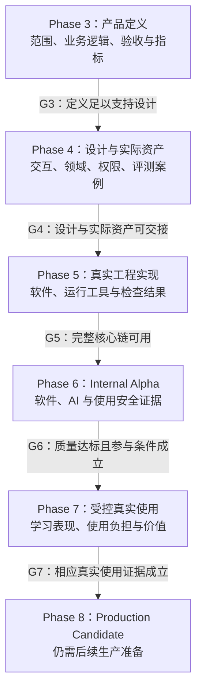

# MVP 验证方案

> **文档性质**：质量与价值验证方案；Phase 3 — MVP Definition 
> **版本**：工作稿；修订由 Git 追溯，尚无本轮批准基线 
> **状态**：用户审阅中的 G3 工作稿；G3 暂不通过，Phase 4 暂不启动；图文表达经作者补充检查不代表行为或质量验证完成 
> **上游依据与基线**：仓库提交 `eb7800b10da58bf3ee3ed4cbb27a3d484ebc1b94`、本轮较新对话与所列归档来源；本稿工作修订由 Git 追溯；该提交仅标识初始输入，当前稿还含后续工作修订，尚未冻结，关联文档见下文。 
> **写作规范**：[设计文档规范 v1.0（维护修订）](../../top/DeerMind_Design_Document_Standard_v1.0.md)；[MVP 共同规则](../MVP_Governance.md) 
> **维护责任**：Codex 负责指标承接、验证责任与结果解释；用户参与新的产品取舍，未替用户批准未决项 
> **评审记录**：既有内容审查与本次图文检查分别见 [G3 记录](../MVP_Gate_Reviews.md#2-g3--mvp-definition)；用户尚未批准本轮整体范围 
> **更新日期**：2026-10-11 
> **修订说明**：分开指标目标表与测量细则，整理证据分类、失败处置及阶段责任；保留 MET-001–010 的全部目标、口径和准入条件，没有新增运行或通过结论。

---

上游依据：[产品定义](MVP_Definition.md)、[需求规格](MVP_Requirements_and_Acceptance.md)、[归档验证方案](../archive/DeerMind_MVP_Validation_Plan_v0.1.md) §3–§5。跨阶段决定、待决、风险与编号见[共同管理文件](../MVP_Governance.md)，正式阶段判断见[Gate 记录](../MVP_Gate_Reviews.md)。

本文开始承接既有质量目标与观察安排，并将其对应到本轮需求和假设。当前没有新运行、模型调用、用户试用或达标声明。Phase 4 提供实际评测材料，Phase 5 的实施计划安排运行，交付文档汇总实际工程结果；Phase 6 正式质量报告与 Phase 7 真实使用报告分别形成。

输入为价值假设、功能与非功能承诺、历史质量目标及证据限制；输出为指标、参考与分母、适用 Gate、材料和校准责任、有限执行及结论规则。评测资产、工程检查和后续 Alpha/Pilot 据此准备与执行；运行前知道测什么、何时判断、失败影响什么，才满足交接。产品页面统计的含义由 Requirements 维护，本文验证其实现与质量，不另行定义一套产品统计。

## 1. 验证问题与阶段责任

**图 VAL-01　不同阶段的产物能支持什么结论**

本图是后续证据责任图，说明为什么定义、实际资产、可运行软件、质量达标与学习价值不能互相替代；不表示任何 Gate 已经通过。

**图例：** 矩形是阶段及其主要产物，各条箭头均以对应 Gate 通过为前提，标签是进入下一阶段所需的判断，不能解释为自动推进。

**读图边界：**

- 任一阶段证据不足时，按问题所属责任修复或重开相关决定，再评审。
- 本图省略这些回退路径。
- 当前 G3 暂不通过、用户仍在审阅，状态以独立 Gate 记录为准。
- MET 数值与各阶段具体责任只在 §2 维护。

| 要验证的问题 | 依据 | 材料与执行责任 | 结果进入何处 |
| --- | --- | --- | --- |
| 行为与机制是否符合约定 | REQ/AC，角色、权限、状态和故障合同 | Phase 4 准备流程与材料，Phase 5 实现检查和真实组合 | Phase 5 交付与运行交接；Phase 6 系统评估 |
| 帮助、识别与能力判断是否可靠 | HYP-001、002；本节以下各项指标；Build STG-01、02 | 领域与评测资产提供可信参考，工程改进后按版本测量 | 分开报告工程局部结果与 Phase 6 正式质量结论 |
| 历史和后续介入是否有价值 | HYP-003；NEED-005–007；DEC-016 | 工程先检查按需产品内建议的依据、接受及过时处理，获准 Pilot 后观察有用性、采用和负担 | Phase 7 使用报告，不由推荐数量替代；不要求固定日程或外部推送 |
| 设备、时间、维护和费用是否支持使用 | HYP-004；STG-03、04 | 实际设备检查、限定维护路径、资源与人工投入记录 | Phase 5/6 结果及后续使用观察 |
| 后台能否查看、人工修正并验证影响，学生能否建立空间并选择教材和目标 | DEC-008、009、011、012；REQ-013–015、020–023 及对应 AC | Phase 4 准备问题定位、版本对照与目标权限案例，Phase 5 验证实际查看、维护、生效、指定空间采用新版、影响处理和学生创建选择 | Phase 5 交付与 Phase 6 系统评估；人工操作及耗时单列，自动分析诊断不作为 MVP 通过前提 |
| 是否可进入下一阶段 | Roadmap Gate 条件 | 各文档提供准确版本与证据 | 独立 Gate 记录，不能把文档齐全当成产品有效 |

**运行证据与人工参与的口径。**

- **真实运行证据：** 真实 Evaluation、正式维护和基础领域扩展必须有真实模型与运行路径证据；固定响应可以用于机制故障检查，不能替代语义能力。
- **人工投入单列：** 管理员实际修改候选或补充教学的部分与系统独立完成分开记录。
- **允许的维护方式：** 按 DEC-008，后台人工复核和受控修改是本次允许的运行方式，验证其能否完成必要维护及实际投入；不得把人工处理报告为自动诊断，也不因没有自动诊断而单独判定 MVP 失败。
- **教学质量要求：** 正常教学中的推理与语义校验仍按既有质量要求测量。

## 2. 指标与判定规则

下列数值来自归档已记载的决定，不是本轮新造指标、研究给出的普遍阈值或已测能力。它们仍需在当前范围下准备参考及测量材料；未经明确变更，不因样本少或当前系统达不到而降低。

### 2.1 指标目标

| MET 编号与对象 | 承接的目标 |
| --- | --- |
| MET-001 讲解质量 | 实际交付样例关键数学错误为 0，合格率至少 90% |
| MET-002 图文识别 | 清晰且在支持范围内的材料，整题关键内容至少 95% 正确 |
| MET-003 当题判断 | 至少 90% 符合预定参考 |
| MET-004 掌握判断 | 至少 90% 符合预定参考 |
| MET-005 生成题 | 实际交付验收样例严重缺陷为 0 |
| MET-006 普通单题响应 | 至少 90% 在原始提交后 30 秒内取得可用讲解 |
| MET-007 每日投入 | 孩子全部 DeerMind 使用每天最多 30 分钟 |
| MET-008 即时独立解释与应用 | 首轮预先纳入 8 个学习问题，至少 6 个达到约定标准 |
| MET-009 初步保持 | 同一批问题约一周后至少 5 个保持已达到的独立表现 |
| MET-010 后续介入价值 | 保留有依据的质性观察，不新增未经讨论的百分比门槛 |

### 2.2 测量口径与准备

目标统一列于上表。以下逐项说明如何测量、哪些结果不能计入，以及运行前还需准备什么；不能只看目标数值而忽略这些条件。

**MET-001 讲解质量**

**口径与限制：**

- 数学、关键原理、适用方法与表达均符合请求。
- 数字正确不抵消原理错误，提示请求按提示边界评判。

**后续准备：** Phase 4 准备独立参考及适用项，Phase 5/6 测量

**MET-002 图文识别**

**口径与限制：**

- 核对初次自动识别的数字、公式、必要图示条件和题目作答对应。
- 人工改正不得回填为自动成功。

**后续准备：** 提前标定清晰度与类别，按照片、扫描、手写等分项报告；语音不直接套此比例

**MET-003 当题判断**

**口径与限制：**

- 检查当次表现、理由、来源及合法不同解法。
- 确应未决时允许未决，有依据却回避不计合格。

**后续准备：** Phase 4 形成参考；与掌握判断分开计算

**MET-004 掌握判断**

**口径与限制：**

- 按目标、历史与帮助条件检查结论和范围。
- 缺证据与反证分开，不用简单判题样例掩盖失败。

**后续准备：** 正反例及跨题帮助归因纳入；需要能核查的评价依据

**MET-005 生成题**

**口径与限制：**

- 覆盖变式与原生题，区分候选、拦截、未决与交付。
- 全部拒绝或没有产出不算通过。

**后续准备：** 在运行前固定最低有效数量及覆盖，参考不得只来自生成模型自评

**MET-006 普通单题响应**

**口径与限制：**

- 分母为预定普通单题请求，包含识别、校验、传输和重试。
- 仅加载、未展示或不可用内容不算成功。
- 不重置计时。

**后续准备：** Phase 4 明确普通请求分类，Phase 5 实测。教材批量处理另计，不将目标当自动取消时限

**MET-007 每日投入**

**口径与限制：**

- 跨空间累计，含正常学习、验证、录入、纠错、需要孩子等待及相应纸上活动。
- 后台与成人投入另计。

**后续准备：** 自动记录与补记、未知和超时分开，重叠不重复计，不增加强制锁屏或凑样本加时

**MET-008 即时独立解释与应用**

**口径与限制：**

- 8 是学习问题数，题量由目标决定。
- 采用语言、算式或图示表达依据，检查有实质变化的适用任务。

**后续准备：** 具体目标、参考、纳入规则在获准试用前固定

**MET-009 初步保持**

**口径与限制：**

- 配对报告，不能替换为另一组成功问题。
- 缺测不算成功也不当能力反证，不推出长期普遍有效。

**后续准备：** 四周观察窗口中安排延迟检查，时间偏差与完整性在开始前固定

**MET-010 后续介入价值**

**口径与限制：**

- 检查建议依据、理解、采用或拒绝、取得的信息和额外负担。
- MET-008/009 达标不自动证明历史有增量价值。

**后续准备：** 按本节的支持／反向／不足证据规则报告；没有比较依据不声称优于简单安排

### 2.3 后续介入价值的证据解释

**机制与价值分别判断。** MET-010 先区分机制符合要求与使用价值：Phase 5 要能按有效依据提出、更新或不提出介入，属于 REQ-008 的真实行为验收；真实有用性在 Pilot 观察，不以演示成功代替。

**记录内容。** 每个实际介入保留当时依据、建议目的、用户选择、后续表现及耗时。

- **支持性观察：** 若理由得到材料支持、行动与目的相符，且实际帮助解决了问题或消除了有意义的不确定，可记录一项支持性观察。
- **反向证据：** 若错误依据造成错误安排，或无必要反复检测挤占正常学习，则记录反向证据。
- **证据不足：** 没有发生、被拒绝、缺少后续结果或无法判断收益时记录证据不足，不自动算成功或能力反证。

**介入价值的结论边界。** 对整个 Pilot 如实汇总三类记录及负担，不新增一个未经论证的及格比例。

- **即时表现与保持达标但介入证据不足：** MET-008/009 达标而 MET-010 资料不足时，只能说明当前帮助与局部保持获得支持，尚未验证基于历史的后续安排价值；没有可比安排时不能声称改善来自个性化策略。
- **增加比较要求：** 若要把“优于简单安排”升级为准入硬条件，须另行讨论可行比较与成本，不在本轮暗中新增。

上述规则完成结果解释的定义，是否进入下一范围仍按对应 Gate 的全部证据判断，不能单项自动放行。

### 2.4 参数校准与决定责任

**目标与测量参数。** 最低可接受目标、当前能力基线与测量参数分开。

- **待校准事项：** 上表目标不因基线未知而失效；样本数、参考评分细节、请求分类和设备等标为待材料或待工程校准，实际承担者与确认记录在开始相关工作前明确。
- **决定与冻结时机：** Codex 负责提出依据和方案，涉及改变产品目标须用户决定；不能在正式测量结果出现后改标准来取得通过。

依赖材料的事项在 Phase 4 准备并于 G4 核对到期责任；必须依赖真实实现的测量参数在 Phase 5 的有限开发测量后固定，先于对应正式独立判断且不晚于 G5 交接。保留开发与正式材料的独立性，实际版本和确认记录进入共同登记及最终报告。

### 2.5 各 Gate 的证据责任

各项指标按下表承接到 Gate。这里明确证据责任，不更改上表已确认数值，也不把局部样本达标说成普遍可靠。G4 核查实际材料及可核查参考；G5 核查真实功能、有效测量路径和局部结果；G6 使用正式材料判断内部质量；G7 判断受控真实使用的局部价值。

| MET | G4 必须准备 | G5 必须提交的证据 | 正式判定与后续使用 |
| --- | --- | --- | --- |
| MET-001 讲解 | 不同请求及帮助边界、经复核的数学和解释参考 | 真实讲解与展示路径、按同一口径记录的局部质量结果，关键错误及处置可查 | G6 按上表目标判定，G7 保留实际使用中的错误与反馈 |
| MET-002 图文识别 | 清晰度、输入类别、题目/作答对应及参考 | 真实设备和输入链、初次自动结果与人工更正分开、分项测量 | G6 判定支持范围内识别质量，G7 记录真实输入限制 |
| MET-003 当题判断 | 不同解法、正确与错误理由、缺失和支持条件案例 | 真实判定、未决及失败路径，输出结论和依据的局部结果 | G6 判定当题质量，不以掌握样例替代 |
| MET-004 掌握判断 | 目标、历史、帮助归因、正反例和结论范围参考 | 真实 Evidence/Belief 与目标判断链、版本和变化依据，局部测量 | G6 判定掌握判断质量；G7 的实际效果另行观察 |
| MET-005 生成题 | 变式与原生题、缺陷及使用条件，最低有效数量与覆盖准备依据 | 实际候选、拦截及合格交付，严重缺陷处置及后续使用；全拒绝不算功能完成 | G6 按冻结材料与目标判定质量，G7 保留实际题目与使用历史 |
| MET-006 响应 | 普通单题分类、支持设备与测量起止 | 全链时间、失败、重试及可用展示数据，报告与目标的差距 | G6 正式判定响应目标，G7 记录实际等待负担 |
| MET-007 每日投入 | 跨空间累计、等待与纸上活动的测量办法，补记和未知处理 | 自动记录、补记和汇总可用的检查证据；不虚构孩子真实使用天数 | G6 检查方案及记录可执行性；真实使用每天遵守既有上限，G7 报告未知与超时 |
| MET-008 即时表现 | 独立解释与适用任务的参考结构、纳入规则和记录材料 | 能安排检查、保留实际表现及帮助，记录工具可用；不要求当前已取得儿童效果数据 | G6 核对 Pilot 所需目标、参考和参与前提；G7 按既定观察目标判定 |
| MET-009 初步保持 | 与原问题配对的方法、延迟窗口、缺测与偏差记录规则 | 延迟检查、关联历史和结果记录功能可用，不以合成数据声称真实保持 | G6 核对正式使用准备，G7 按同一批问题的既定目标判定 |
| MET-010 介入价值 | 有依据/无依据、接受/拒绝、支持/反向/不足的参考及记录结构 | 有效历史驱动的提出、更新或不介入路径，理由与行动及结果可追溯 | G6 检查机制与判断质量；G7 形成有边界的价值结论，不新增百分比门槛 |

**G5 的判断边界。** G5 不能用接口存在、固定响应或所有请求都未决代替功能完成。

- **真实功能与实现缺陷：** 对照已定 REQ/AC，关键功能需要真实且可核查的成功和必要失败路径；影响本阶段交付的实现缺陷及时修复，已发现的严重错误不能在报告中隐去。
- **局部语义质量差距：** 局部语义测量未达后续质量目标时，报告差距、影响及后续责任，由 G5 按真实核心可用性和进入内部验证的条件判断；不因此宣称质量达标，也不默认所有语义失败都能后置。
- **正式质量准入：** G6 的正式目标保持，未满足不能自动进入 Pilot。

具体样本量和覆盖在材料准备后按已有校准规则提出；MET-005 的最低有效数量在对应运行前固定，其他依赖实现的参数先用允许的开发材料校准，不晚于 G5 交接且先于正式独立测量。Phase 4、5 的承担者由相应资产和实施计划登记，Codex 负责提出方案与依据；修改产品最低目标仍须用户决定。

## 3. 样本、参考与评审方法

**样本准备状态。** 实际教材和首批领域材料未到位，本轮不虚构 CASE 或冻结一个样本总数。

- **必须覆盖的对照：** Phase 4 必须准备两空间实际支持内容、各角色正常和关键失败、独立与受助表现、正确与错误及缺失材料、新题与真超纲、无答案材料和模型覆盖不足等对照。
- **外部求助题范围：** 外部求助题可以无作答；这是本轮相对“只收外部错题”旧口径的明确更新，不扩展整卷验收。

**参考与判定要求。**

- **参考来源：** 参考应来自可核查的题意、解法、领域关系和适当复核；确定性运算可以辅助核查数学结果，不代替学习意义判断。
- **独立性限制：** 生成模型自评或多个模型同意不能充当独立真值。
- **领域模型对照：** 依据 DEC-007，实际案例需覆盖同模板的责任差异、多方法、受助与独立表现、未映射输入以及只变目标不改 Belief；这细化既有验证边界，不在本轮新增实验或调整指标门槛。
- **检查对象：** 检查结论、理由、来源、范围和实际帮助，不仅检查最终标签。

材料分组、版本和预定有效数量在运行前固定，开发样例与留出评测分开。用不同配置各自成功的结果拼成一批无效；样本量与覆盖不足不能仅凭高比例宣布达到能力门槛。对应 REQ/AC/CASE 关系统一维护在需求追溯主索引。

基础领域演化沿用归档 §2.1 的有限验收责任：真实必要新增、局部修正、正确不修改、验证失败与未决、授权提交边界、生效后使用与恢复。成功扩展和非成功路径都要有证据；空流程或全部拒绝不足以证明扩展可用，不要求每个候选成功，更不新增独立 Evolution Spike。

## 4. 验证执行与预算边界

每轮先明确问题、配置、样本和参考、允许修复与重试、有限调用或时间边界，再执行并给出结论。项目预算可调整不等于无限增加实验轮次。本轮未启动新的模型实验。

**失败与修复的处理规则。**

- **传输失败：** 纯传输失败按预定规则重试，费用、时延和原失败保留，不算语义误判；同时报告全部请求可用性。
- **返回内容失败：** 取得响应后的格式错误、无效内容及实质语义失败不能事后剔除。
- **实现缺陷：** 影响验证的实现问题及时修复并定向复验，不把修复前的缺陷当架构结论。
- **语义优化：** 语义优化采取有上限方案，结果不足时解释能力限制或提出设计取舍。

机制、语义、真实展示和体验分别核查。失效结果、权限或空间旁路、重复历史教学等不能以“LLM 还不够准”概括。已关闭 Spike/Build 结果保持，后续质量工作按新的范围与账本执行。

## 5. 真实使用与价值观察

**真实使用前提。** 沿用归档的首轮一名孩子、四周观察及每天总使用限制，尚未开始；只有满足 G6 Pilot Readiness 和必要参与条件后才执行。

- **观察安排：** 前三周结合自然学习问题逐步纳入，按约一周进行复查，第四周收束。
- **到期收束：** 到期报告实际证据，不自动延长或事后挑选成功问题。

**观察记录。** 记录起点困难、帮助、即时与延迟表现、当前办法基线（若可取得）和投入；学校、辅导、家庭补充及额外练习是解释背景。

- **因果解释边界：** 缺少对照时只给局部观察，不归因全部变化于 DeerMind；无基线不承诺节省比例。
- **空间覆盖：** 两空间分别报告实际覆盖，总数达标不说明两个课程全面有效。

**参与、缺测与成人投入。**

- **参与与调整：** 独立检查由孩子接受，暂停或调整由用户持续反馈决定，不新增专门的试用暂停平台。
- **失败与缺测：** 失败、缺测、退出和无法判断不消失，也不变成孩子不会的证据。
- **成人投入：** 成人时间及人工补充教学单列，不以充足人工证明系统可自动或规模化运行。

教学方向参考[IES 学习实践指南](https://ies.ed.gov/ncee/wwc/PracticeGuide/1)与[分数教学指南](https://ies.ed.gov/ncee/wwc/PracticeGuide/15)，具体证据限制见产品定义 SRC-011、012。四周、6/8、5/8 和工程比例是本项目历史决定，并非这些研究给出的通用数字。

## 6. 结果记录与问题处置

**结果记录。** 每项报告计划数量、实际尝试、可判定交互、合格、错误、未决、失败、重试、人工介入、时间和费用，并说明范围和版本。

- **失败分类：** 纯传输失败与已经返回的无效内容分开计。
- **生成题结果：** 生成题还分别记录候选、拦截和实际交付，不能用全部拒绝换取“零错误”。

问题按可修复实现缺陷、有限语义质量问题、产品取舍或核心设计冲突归类，分别处理，不把所有失败都推给 LLM 或一概重开架构。跨阶段决定与风险使用共同登记册；实际运行日志由执行阶段保存，方案不维护另一份结果账本。

## 7. 报告结构与阶段交接

**报告内容。** 结果报告包含实际对象和版本、执行方法与材料、参考及分母、全部结果、与预定方案的偏差、剩余风险、责任和支持的判断。

- **工程结果：** Phase 5 给出实现及局部质量证据，
- **正式质量：** Phase 6 给出是否满足内部质量门槛的结论，
- **真实使用价值：** Phase 7 给出真实使用的局部价值证据，彼此不替代。

**尚待交付的材料。**

- **Phase 4：** Phase 4 尚需交付实际内容、CASE、参考与审核。
- **Phase 5：** Phase 5 尚需固定每轮配置及有限执行参数。
- **Pilot：** Pilot 尚需实际日期、参与意愿、问题纳入和复查偏差安排。

方案与 Gate 记录只引用这些责任，不假装材料或结果已经产生。

## 8. 文档完成条件

| 检查项 | 当前判断 | 依据及待完成 |
| --- | --- | --- |
| 验证问题与责任明确 | 作者已核对当前需求与阶段交接 | §1 对应本轮假设与行为，含 STG-01–04 及 DEC-016；尚未执行 |
| 最低目标与校准细节区分 | 历史目标、分母及校准责任已承接 | §2；MET-010 已明确三类证据的解释；材料和实际运行参数按阶段准备，不因尚无基线下调目标 |
| 指标与阶段证据责任可对应 | MET-001–010 已逐项明确 G4/G5 准备及 G6/G7 判断责任 | §2；未修改数值目标，尚无实际资产或执行结果，不据此声称任何 Gate 通过 |
| 有限执行和结果解释可用 | 作者检查完成，具体执行计划未启动 | §3–§7；2026-10-11 作者审查，用户整体范围确认及 G3 结论见 Gate 记录；没有新增真实使用数据 |
