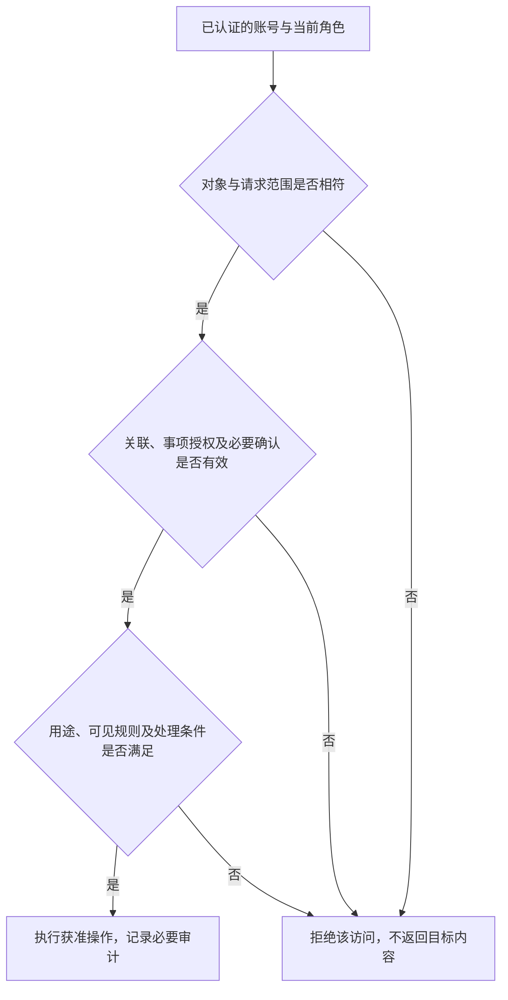

# MVP 数据与权限设计

> **版本**：v0.1 
> **文档性质**：数据与权限设计；Phase 4 — Product & Domain Foundation 
> **状态**：角色与数据合同首稿；实际外部服务待核实，G4 未通过 
> **上游依据与基线**：[G3-20261015-01](../MVP_Gate_Reviews.md#27-g3-阶段性审阅通过与-phase-4-交接) 
> **维护责任**：Codex 维护方案；管理员核实关系与事项；用户确认新的用途或关键取舍 
> **评审记录**：作者依据需求形成首稿；外部处理条件未审定，见 OPEN-004 
> **写作规范**：[设计文档规范 v1.1](../../top/DeerMind_Design_Document_Standard_v1.1.md) 
> **更新日期**：2026-10-19 
> **修订说明**：传导 Task Claim 单一状态合同；更新现行文档引用及导航。逐文件变更见[修订记录 §9](../../concept-design/DeerMind_Learning_Model_Reassessment.md#9-task-claim-单一能力状态的正式修订记录)。

---

本文接收 [Requirements](../phase-3-definition/MVP_Requirements_and_Acceptance.md) 的角色和可见行为，交付授权条件、权限矩阵、数据流及失效处理，供 [Product](MVP_Product_and_Interaction_Design.md)、评测和工程使用。本文不作未知服务的合规结论，不选择鉴权协议或数据库。

## 1. 参与者、身份与关系

账号主体、当前操作角色、学习者和课程空间分别标识。同一现实成年人可以有家长账号与管理员账号，但两种身份分别登录、分别记录操作，不因家长关联获得管理权限。学生和家长分别使用 Android 客户端，服务端仍逐次核验实际主体与权限。

管理员在系统外核实身份和亲子关系，在后台登记核实结果、范围和操作者，再建立关联或找回账号。亲子关联为多对多，每一段关系单独有效、失效；更换设备或重置凭据关联原档案。找回管理员身份不依赖另一位管理员或家长身份，具体恢复凭据机制由工程设计给出。

**图 AUTH-01　一次访问须满足的条件**

矩形为操作，菱形为判定。此图表达授权语义，不要求所有本地界面动作触发远程调用；提交和读取实际数据时不能只依赖先前页面曾可见。

## 2. 数据清单与使用目的

| 数据 | 来源与用途 | 必须保留的关联 | 处理边界 |
| --- | --- | --- | --- |
| 账号与关系 | 后台核实；认证、访问和找回 | 账号、角色、关联范围、核实及变更记录 | 无学生手机号和证件上传前置，不向教学模型发送凭据 |
| 首次说明与确认 | 家长、孩子分别确认；限定用途与参与条件 | 说明版本、实际服务范围、确认主体及时间 | 登录或亲子关联不替代必要确认 |
| 教材、目标与领域定义 | 管理员准备、引用或候选生成；教学与评价依据 | 来源、版本、发布范围、采用及映射 | 共用定义不夹带孩子的个人表现 |
| 课堂进度报告 | 学生明确确认；为当前课程帮助与建议提供外部教学上下文 | 学习者、空间、教材及版本、章节、小节说明、报告来源、确认时间和修改历史 | 不是表现 Evidence 或掌握结论，不推定前序章节已学；未知和旧版本报告不冒充当前已知事实 |
| 原题、图片、笔迹与录音 | 学生提交；理解问题和实际作答 | 原材料、原转写、实际发送内容、课程及当次活动 | 无关图像背景和其他个人记录不默认发送外部模型 |
| Observation、Evidence、Belief 与目标判断 | 各责任层产生；解释表现与支持学习 | 来源、帮助条件、规则版本、有效性和变化原因 | 不跨两个课程空间借用个人依据，后台不直接设定 Belief |
| 帮助、决策和实际展示 | 系统运行；核对发生过什么和支持条件 | 请求、候选、实际内容、展示／播放及中断 | 计划与发生分别保留，不推定听懂或使用过 |
| 家长私人咨询 | 家长输入与回复；解释学习情况及支持方法 | 家长、孩子、空间、咨询段和相关引用 | 不向学生或其他家长开放，不作为学生亲自作答 |
| 维护事项与访问记录 | 反馈、抽查或建设；限定检查与修复 | 事项目的、相关对象、操作角色、版本和处理结果 | 管理身份不开放无关个人资料 |
| 用时、调用与运行记录 | 工程及用户补记；质量、费用与负担核对 | 请求、重试、未知费用、时间及人工投入 | 日志不保存密钥，不能因日志用途扩大原材料使用 |

外部处理至少区分图文理解、文本推理、语音转写和语音合成。每条实际路径须登记服务主体、模型或服务标识、发送字段、处理位置、保留与再使用条件、用途和凭据责任。OPEN-004 尚未关闭；具体服务及适用依据没有取得前，不能把“接入了 API”当作允许处理真实材料。若需要适用规则判断，应依据实际处理情况核验，本文不预判合法性。

## 3. 权限与责任映射

以下是 AUTH-001 权限合同。每项允许还须满足账号有效、对象范围、必要确认及当前版本等适用条件。权限以行为和对象为单位，不以页面或客户端名称授予。

| 对象或行为 | 学生 | 关联家长 | 管理员 | 主要范围条件 |
| --- | --- | --- | --- | --- |
| 创建、选择个人 Learning Space | 自己的空间可创建与选择 | 查看 | 查看采用及维护影响，不替选课程或目标 | 已发布且有权使用的材料与目标 |
| 课堂进度确认与更新 | 在自己的空间确认、修正或设为未知 | 有效关联下同源只读 | 按具体事项查看，不冒充学生确认课堂事实 | 教材版本与空间隔离；自然语言候选经明确确认才生效，保存历史，不直接写 Belief |
| 题目、原始作答的录入与更正 | 学生入口提交、更正自己的材料 | 只读相关依据 | 按复核事项处理系统或已隐藏资料错误 | 保留原始事实与更正关系 |
| 正常学习、求助、开测及退出 | 自主发起与退出 | 不代发作答、不派任务 | 不冒充学生执行教学活动 | 已定范围与活动规则 |
| 章节状态与相关依据 | 读取自己的可见结果 | 有效关联下读取同源结果 | 按事项查看 | 不能读取另一个空间的个人依据 |
| 学生原资料删除 | 按独立录入一题隐藏，无审批和恢复入口 | 不操作学生资料 | 按事项查留存依据，不恢复学生条目 | 关联原图、原作答及显示副本同步限制 |
| 学生已隐藏资料 | 不再从历史、搜索或新回复取得内容 | 有效关联下仍可只读相关依据 | 事项范围内读取与复核 | 两端可见规则不同，不能统一成全局物理删除 |
| 家长私人咨询 | 无权读取 | 自己的咨询可读取和整段删除 | 仅限明确事项需要的获准材料 | 不因家长提报事项而开放全部私人历史 |
| 教材、目标、Domain 候选 | 选用发布内容，不修改源定义 | 查看获准内容 | 准备、修订、核对 | 候选不得当作已发布依据 |
| 候选审核、发布、停用 | 无 | 无 | 单人可分步骤完成 | 检查、批准及限定生效分别留痕 |
| 已有空间采用新版 | 查看结果 | 查看结果 | 检查后指定空间更新 | 保留历史，不改变学生选择的章节与目标意图 |
| 其他语义模型版本交付 | 无 | 无 | 查看与受控交付 | 没有通用在线编辑和任意历史重算授权 |
| 账号、关系与恢复 | 查看自己的关联 | 查看自己的关联 | 核实后开户、绑定、解绑、找回 | 关系逐段生效，不自动串联授权 |
| 服务配置与密钥 | 无 | 无 | 维护配置、检查连接 | 密钥不出现在浏览、日志或教学输入 |

管理员查看普通样本也需明确工作事项和用途；可以创建“检查本次讲解结果”的事项，不要求先确认存在缺陷。读取范围应围绕该事项所需的活动及依赖，不能自动扩大为学习者所有历史。细粒度技术授权表达由工程设计承接，产品行为保持。

## 4. 告知、授权与产品流程

首次处理真实学习资料前，系统分别检查家长对说明版本及实际用途、服务范围的确认，以及孩子愿意使用的确认。未满足时允许了解产品及完成必要设置，不处理真实学习资料。之后正常重登不重复确认。

处理用途或实际服务范围发生变化时，先检查原确认是否覆盖；若不覆盖，在取得必要确认前不执行新增处理。语音预览虽然尚未提交作答，但外部转写已经是材料处理，须先满足对应条件。

MVP 不新增数据授权撤回界面和完整物理销毁能力，仍保留关联解除、活动退出及规定的资料隐藏。由此产生的保留和处理条件须按 OPEN-004 核实；发现与具体条件冲突时提出产品决定，不通过修改文案掩盖。

## 5. 数据生命周期与用户操作

| 阶段或操作 | 原始事实与派生状态 | 用户可见效果 |
| --- | --- | --- |
| 未发送草稿、临时录音 | 不形成正式作答与评价；取消、重录淘汰的临时录音按工程规则清理 | 可编辑或取消，不在已提交历史出现 |
| 正式提交 | 保存原件、发送内容及来源关联 | 显示收件状态；学习判断须经相应处理 |
| 更正资料 | 追加更正及版本，保留原记录；受影响结果按责任失效和重处理 | 解释变化原因，不把识别纠错当孩子进步 |
| 学生隐藏原资料 | 内部保留事实和获准推理依据，不凭隐藏动作改写能力状态 | 学生端关联原图、原作答及其历史副本不可恢复；独立后续练习保留 |
| 家长删除整段咨询 | 私人咨询不再向家长恢复，已经独立提交的事项继续存在 | 事项通知可说明进度，不能复制被删私人咨询形成恢复入口 |
| 关系失效 | 原事实保留，撤去该段关系授予的后续读取范围 | 当前页面、历史链接和聊天检索重新校验，不继续返回旧范围内容 |
| 模型或目标修订 | 保留旧标准和当时结果，已失效结论退出当前使用 | 显示结果待处理或更正，重算不重演旧教学 |

已提交学习材料沿用档案保留规则，不按任意天数自动删除；内部保留不授予无限用途。缓存、索引、附件链接和聊天检索都应遵守同一可见规则。物理存储周期、备份恢复和外部服务保留的实际配置需在工程及具体服务核验中明确，不能用界面隐藏证明已经物理销毁。

## 6. 异常、审计与恢复

授权判定失败不返回受限内容；失效关联不能通过旧分享地址、旧对话或服务端缓存继续读取。若后台事项权限过宽，应收窄范围并记录，不要求用户取消已有有效学习记录。

审核记录至少保留实际主体、角色、对象及版本、事项或用途、动作、结果和时间；不要求保存模型隐藏思维链。重试核对原操作及已产生效果，不能重复发布、重算或新增表现。错误关系更正不影响其他有效关系，账户恢复不另造学生档案。

## 7. 评审与实现交接

AUTH-001 由 Product 组织对应界面、Evaluation Assets 编制允许／拒绝／撤权对照，Engineering 落实认证、上下文隔离、数据访问及审计。权限判断使用正式依据，前端禁用按钮只是提示，不能作为安全证明。

局部原型已有学生资料隐藏后不恢复、家长只读相关依据、家长输入不进入学生视图和校外空状态不借用校内判断的走查，见 CASE-011、014、015。候选检查、人工批准及发布采用分离见 CASE-016–018。它们只核对可见行为，角色切换不是身份认证，本地保存不是服务端授权、撤权或数据隔离实现。

新增 FLOW-007／UI-008 与 CASE-026、027 覆盖人工核实后操作、原账号找回、单条关联失效及家长与孩子分别确认。本地原型能阻止失效家长从当前入口读取学生资料，但不实现身份认证、服务端授权、跨标签实时撤权或按用途版本保存的同意凭据。演示确认只针对合成材料，不能作为真实学习资料的授权记录。

本轮 CASE-028–035 继续核对原件、识别、发送版本、更正与新尝试的区别；隐藏外部原资料后，学生入口不恢复关联更正与输入，后台按本次用途打开仍保留内部事实。原型用途门槛只是界面流程，没有形成真实事项授权；同意、角色和数据规则不得由这一个文本框替代。课程指定采用仅更新所选空间的本地引用，旧检测版本与所选章节点保持。

新增 CASE-036–041 对照首页、同名空间、输入草稿和任务处理。原型按空间标识保存求助与材料草稿，按记录所属空间查询；这不代表正式后端隔离。后台只保存演示服务别名和模型标记，没有读取或存储密钥；合成连接结果不构成服务条件核验。

FLOW-013／CASE-042–044 增加家长独立空间选择、实际记录只读及私人咨询。咨询按家长、孩子、空间关联，草稿及历史随查看主体切换；整段删除后不从该端恢复，学生资料与另一家长咨询不变。本轮只有一名合成孩子，跨孩子流程及实际访问控制仍未验证。首次说明沿用此前合成状态，未实现每名实际家长的授权凭据。

FLOW-014／CASE-045–047 区分输入核对与正式作答。核对前内容、确认后文字及用户说明可供获准学生、家长与后台按原记录追溯；私人咨询不会混入这条学习记录链。输入核对的用户声明未经过真实语义分类，不能据此认证独立作答。

实际外部服务表目前没有可核实条目，OPEN-004 保持开放。后续须取得真实配置与条件，并在送出真实材料前完成相应核验；不因采用合成原型而宣称真实处理已就绪。

[CASE-061–072](../../../src/mvp_foundation/evaluation/authority-cases.json)已将上述合同形成首批允许／拒绝对照：同名空间和跨孩子、逐段解除、同一孩子的家长私人咨询、学生入口更正、同一现实成年人的角色分离、事项限定、学生隐藏与家长咨询删除、必要确认、候选生效、指定采用和外部输入。合成主体与关系明确列出，每例独立重建；编制结果不表示权限已经执行或审查通过。

工程接收时应将每条拒绝分支对应到实际访问路径，同时执行合法对照。需要核查服务端输出、写入副作用、检索与模型上下文，不能只检查按钮是否隐藏。案例中的服务与确认均是假设，不能拿来关闭 OPEN-004，也不引入第二位管理员或新的审批步骤。

Task Claim 修订沿用已有数据权限分工。个人能力记录须带 learner、Learning Space、Claim 语义版本与证据来源；共享 TaskTemplate / KC 不使不同空间的个人记录合并。旧 KC Belief 只按原版本及授权用于历史审计，不能进入当前个人能力查询或由诊断缓存持续维护。重新解释必须从适用原始表现产生新 Evidence，不能直接修改原始事实或把旧 KC 状态改标签。

## 8. 文档完成条件

| 检查项 | 当前状态 | 缺口 |
| --- | --- | --- |
| 身份、数据目的与授权矩阵 | 首稿已形成 | 与全量产品流程逐项走查 |
| 删除、撤权、纠错与恢复含义 | 依 G3 承接 | 服务端实现与异常验证尚未执行 |
| 实际外部处理路径与条件 | 未完成 | OPEN-004；具体服务、目的地及适用依据 |
| 工程及评测交接 | AUTH-001 已关联局部原型及 CASE-061–072 合同材料 | 合同案例审阅、实际接口和工程运行证据尚待交付 |

G4 尚未通过，不能以矩阵存在代替实际处理条件核实。
