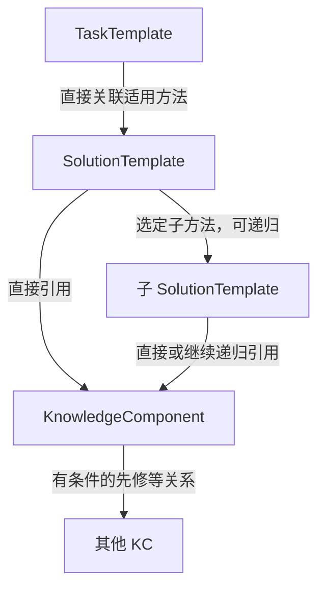
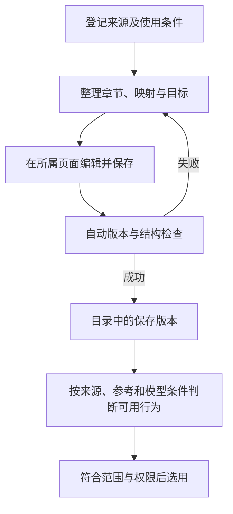
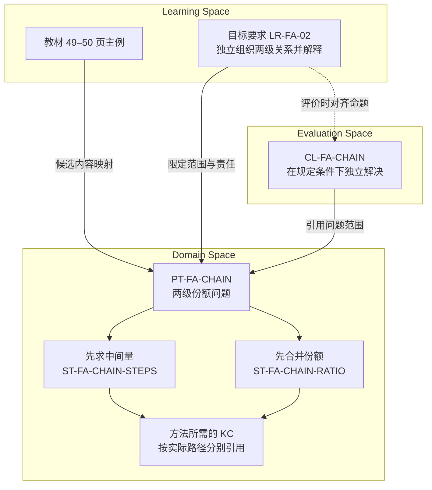

# MVP 领域与内容基础

> **版本**：v0.5 
> **文档性质**：领域与内容交付规格；Phase 4 — Product & Domain Foundation 
> **状态**：已有首批实际章节的结构化候选及开发参考；内容质量核对、正式使用和完整联合交付未完成，G4 未通过 
> **上游依据与基线**：[G3-20261015-01](../MVP_Gate_Reviews.md#27-g3-阶段性审阅通过与-phase-4-交接)；现行 Domain、Learning、Evaluation 设计 
> **维护责任**：用户提供实际材料；Codex 辅助准备，管理员核对内容及适用范围并保存 
> **评审记录**：已逐页阅读校内所选单元并完成候选引用与数值检查；尚未完成管理员内容核对和独立参考复核 
> **写作规范**：[设计文档规范 v1.1](../../top/DeerMind_Design_Document_Standard_v1.1.md) 
> **更新日期**：2026-10-24 
> **修订说明**：补齐 MVP Task／Solution／KC 关系、模板字段、实例保存检查及 Claim／教材／目标关联；明确 mock、旧教材包和上位关系待同步的区别。见 Governance §5.2。

---

本文把首批课程准备成工程可以接收的内容。输入为已确认范围、[需求](../phase-3-definition/MVP_Requirements_and_Acceptance.md)、实际材料及现行模型合同；输出为实际内容、版本化映射、教学与判断依据、核对记录和交换材料。产品设计接收每类行为的可用条件，评测资产接收可信参考，工程实现导入与运行。目标属于 Learning Space，个人认识与解释依据按 Evaluation 负责，不因统一交付转归 Domain。

## 1. 领域范围与覆盖要求

完整 MVP 仍需两个相互隔离的课程空间，支持校内、校外各自获准的内容。教材按章、节分批准备和保存，不要求一次建完整学科；用户已确认校内使用北师大版数学六年级上册，校外为后续提供的内部教材（SRC-024）；SRC-025 已明确校内首批为第四单元“分数的应用”，在线来源及 49–56 页边界已核到。出版年／印次、全章内容准备、参考和使用条件仍属 OPEN-002。合成三角形例子继续用于交互走查，不视为该教材内容。

| 可用行为 | 必需材料与判断依据 | 缺少时怎样表达 |
| --- | --- | --- |
| 浏览教材 | 已核对的来源、章节结构和可见内容 | 相应内容未准备，不把整本列成已可用 |
| 章节讲解 | 明确关键问题、可核查原理、适用例子与帮助范围 | 只开放已具备依据的部分；纲内新题帮助按 REQ-019 独立处理 |
| 当题反馈 | 题意、要求、合法方法、结果与理由参考、输入条件 | 保留识别或判断未决，不计为学生错误 |
| 正式掌握判断 | 已保存且可用的目标要求、适用 Domain 引用及评价解释依据 | 明确缺口，不由讲解完成推断掌握 |
| 选题与复测 | 题目要求、变化维度、目标覆盖、使用及帮助背景 | 不声称题单已覆盖尚未建好的范围 |

## 2. 核心概念与领域规则

Domain 定义共享的 TaskTemplate、SolutionTemplate 和 KnowledgeComponent；Learning Space 选择教材、范围和目标；Evaluation 定义 Task Claim 并维护个人 Belief。目标不改变领域定义，题目与参考方法也不是个人能力状态。

本节是本轮确认的 **MVP 对象关系与内容准备要求**（DEC-027、028）。[Domain v1.3](../../concept-design/DeerMind_Domain_Space_Design_v1.3.md) 的图 D-01 及正文仍允许 Task 直接关联 KC；本轮 MVP 已明确不采用这条直接关系。以下规则用于当前 MVP 交互和后续资产准备，上位概念图及相关引用尚待同步，见 OPEN-012。不能把旧图当作当前 Task 表单另设 KC 字段的依据。

### 2.1 Task、Solution 与 KC

**图 CONTENT-03　MVP 的任务、方法和知识关系**

箭头表示定义之间的引用，不表示学生已经掌握。图只展开一层子方法，递归可以继续；不在 Task 层平铺全部子方法，也不增加 Task → KC 的直接引用。

- Task 可以关联多种 Solution，方法说明各自适用条件；用哪种方法、是否要求多种方法分别覆盖，由课程与 Claim 条件明确。
- Solution 直接关联必要 KC；复杂方法还要说明子任务、子方法、输入输出和结果如何组合。不能只列一串步骤名称，却无法看出各步解决什么。
- Task 的 KC 集合等于其直接方法及递归子方法的 KC 并集。按 KC 身份去重，保留所有来源方法；若只选部分方法，则只对该子集汇总。
- KC 间的先修、构成或解释关系继续保留，但不把整张先修图自动展开为 Task 的必需 KC。具体方法需要哪些知识，须在方法中表达。
- 没有方法就没有可汇总的 KC。可编辑的未完成 Task 可以暂缺方法；用于完整教学或评价的 Task 至少有一个可用 Solution，其直接或递归知识依据应完整。缺失引用、未选子方法和循环必须显示缺口，不能把部分结果称为完整汇总。
- 知识并集表示这些方法覆盖哪些知识，不表示一次成功证明所有 KC 已掌握，也不建立个人 KC Claim／Belief。

通用递归设计中的子任务及方法选择仍需明确；当前 mock 直接保存选定的子方法引用，供查看和汇总使用。它不提前确定正式递归执行器或数据库结构。

### 2.2 任务模板的结构化表达

本轮采用相同字段表达分数应用、几何面积和递归综合任务。语义描述必须明确，必要时附公式；不要求先实现一套通用数学语言，也不将自然语言字段包装成已经可执行的程序。

| 内容组 | 管理员填写什么 | 用途 |
| --- | --- | --- |
| 基本定义 | 名称、简述、完成目标、学习者责任、期望输出 | 区分要算出结果、解释关系或检查方案等任务责任 |
| 对象与参数 | 符号、名称、类型、已知／中间／输出角色、单位及取值条件 | 正向绑定数值或对象，反向识别题目中的量和角色 |
| 条件与关系 | 关系含义、可用表达式、给定与待推导条件 | 区分相同文字下不同的数量关系和求解目标 |
| 允许的变化 | 数值、情境、表述或表示方式的合法变化 | 明确哪些变式仍属于该模板 |
| 适用边界 | 不适用条件、排除情况、缺条件时的处理 | 避免只因关键词或公式相似就强行归类 |
| 方法关联 | 直接适用的 Solution 及适用条件 | 提供求解、讲解和 KC 汇总的路径 |

Solution 写清适用条件、参数及输入输出、推导步骤、分解与组合关系、子方法和知识依据。KC 写清认知内容、解释、适用边界及相关知识关系；只写一个名称不足以支持教学。

以下为当前交互用的三种例子，不代替 §6 的实际教材候选：

| 例子 | 任务的核心关系 | 方法及知识怎样体现 |
| --- | --- | --- |
| 分数应用 | 已知基准量与增加的分率，求增加后的量；分清基准与比较对象 | 分步求增加量再相加，或先求倍数再乘；各方法分别关联分率意义及所用运算知识 |
| 三角形面积 | 已知一组对应底和高，求面积；底高必须对应，单位条件明确 | 先确认底高对应，再代入面积关系；知识关联包括底高对应和面积公式，不能将任意边长当高 |
| 综合场地任务 | 长方形花园中的三角形花坛按比例扩建，求剩余草坪面积 | 主方法选定求增加后底长、求三角形面积等子方法，再组合面积结果；逐层汇总 KC，缺方法就显示依据缺口 |

### 2.3 实例生成与保存检查

具体题目在“实例”页管理，表格保留题目、参数、参考答案及解释、来源和当前模板关联。生成、导入、编辑共用保存检查：

1. 正向生成根据模板条件选择参数与情境，形成题目、参数绑定及参考解答；题目是否成立与答案是否正确分别检查。
2. 反向归类核对题目的已知、未知、关系、完成责任和边界，不只匹配词语、外观或一个相似算式。
3. 条件不成立、答案未通过检查、归类失败或仍不确定时，不能保存为该模板的已归类实例；保留输入和原因供修改。
4. 原始资料与正式实例分开：学生上传的纲内新题、未识别材料和待映射题可以先保留。不得因暂时没有匹配模板就删除资料或一律拒绝帮助（REQ-019）。

当前页面用固定样例生成，导入为文本，检查结果由 mock 情境控制；没有真实生成、OCR 或语义反向归类引擎。自动生成、正式入库和正确分类仍需后续工程及语义验证，当前 UI 不能作为其通过证据。

### 2.4 Task Claim、教材与目标

[Evaluation §3.1](../../concept-design/DeerMind_Evaluation_Space_Design_v1.5.md#31-learner-state-model定义-deermind-可以相信什么) 定义 Task Claim：一个 Claim 绑定唯一 TaskTemplate 版本，描述适用范围、责任、帮助、方法及质量条件。独立完成、理解与解释、迁移、延迟保持是默认内部方面，有依据才裁剪或扩展，未测不是裁剪理由。KC 继续用于解释和教学，不产生个人 KC 状态。

后台在 Claim 内直接维护方面标准、证据要求、支持／反对／未决的解释规则及推断说明。个人 Belief 由实际表现及评价机制更新，不由管理员填写；修改 Claim 定义不覆盖已有个人判断。使用一种方法成功不能自动支持未使用方法，任选、指定和分别覆盖必须区分。

| 关联 | 应表达的含义 |
| --- | --- |
| 教材章节 → Task／Solution | 本章涉及哪些任务、允许其中哪些直接方法；KC 由这些方法递归汇总，映射保留教材来源 |
| LearningTarget → Claim／学习要求 | 在所选章节，要求哪些 Claim 的哪些方面达到什么标准，方法与支持条件是什么 |
| 个人 Learning Space → 教材／目标版本 | 学生选择的范围及实际采用版本；源内容更新不自动换成新要求 |
| 个人 Belief → Claim 版本／方面 | 对该学生在该空间中的能力判断、证据与限制；与目标是否达成分别展示 |

章节方法不足以支持 Claim 条件时，保留准备缺口，不能悄悄降低标准。章、节统计按管理员维护的学习要求项计数，不用模板数、Claim 数、KC 数或四方面总数替换分母。

## 3. 内容来源与组织映射

管理员接收 PDF 或成组扫描图片，登记书名、版本、来源、内部页码与文件页序对应，以及实际使用条件。答案和解析分别标明“原材料附带”“人工核验形成”“模型候选”“待核实”；没有原答案不拒绝整本导入，但不能将生成答案伪装成原书答案。

章、节结构属于 LearningMaterial 内部结构。每项映射说明章节位置、Task 引用及版本、选定的直接 Solution、适用条件和检查依据；该映射的 KC 由所选方法递归汇总。来源须能定位书内页码与文件页序或原材料位置；标题相似不构成正式映射。题目原图、识别文本与修订记录保持关联，无法确定的局部保留未决，不能整体复制一个高置信分数代替核对。

书目信息和核查状态集中记录在 [material-intake.json](../../../src/mvp_foundation/materials/material-intake.json)。2026-10-16 已通过[用户提供的电子教材](https://www.100875.com.cn/show/eBookAndTeacher.html?resId=7965194976af40f5b9abc4b3f89522fe&bookId=120170718181616017047&firstNum=120170718181616017047&contributeId=9276)读取目录、书名页、后记及所选单元边界，不再停留于书目已知、内容未取得的状态。

| 核查项 | 已取得的信息 | 尚未确认的部分 |
| --- | --- | --- |
| 书目与版本依据 | 书名页为数学六年级上册，北京师范大学组织编写；后记说明本套教材为第五版、依据 2022 年版课程方案和课标 | 本册具体出版年、印次、ISBN 及与孩子纸质用书的一致性；不能把课标年份当出版年 |
| 首批范围 | 用户指定第四单元“分数的应用”；书内页码 49–56，对应电子图片序号 052–059；八页已逐页阅读，整理为 21 个内容定位组 | 各原题逐小问的完整参考与精确图示复核 |
| 答案与参考 | 两节例题含推导；已编制八道原创题和对应方法、十二个评价开发案例 | 未取得独立答案册；作者候选仍需管理员及独立参考复核 |
| 访问方式 | 无登录浏览器可以加载目录和书页；链接直接进入该单元首页 | 网页可读不等于扫描导入、OCR、内容可用或外部处理已经可用 |

本次依据实际单元形成 §6.1 的内容候选。已读完整八页不等于所有原题参考和图示均已独立审核；尤其不能把作者推导标成教材附带答案。三角形合成活动继续承担交互走查，新章节候选通过后台只读区供审阅，尚未作为正式学生课程接入。

内容来源与使用条件属于 OPEN-002，外部处理属于 OPEN-004；在对应条件满足前，只能开展获准的本地或合成材料工作。

## 4. 建设、导入与维护流程

**图 CONTENT-01　从原材料到可用内容**

箭头为内容准备步骤。管理员核对题意、答案、关系和代表性未标疑样例，是确保内容正确的工作；不再另设审核、批准和发布状态。必要条件不足的行为明确不可用，不能从保存成功推断全部内容质量达标。

已有空间保留原采用版本，简化采用操作由 OPEN-011 明确；新内容不触发全量重算。版本、内容参考和原始材料留存，已知失效结果退出当前使用，实际修复由工程链验证。历史 CASE-024、025 的审批路径保留为旧流程记录，当前路径采用 Product FLOW-004／006 及新后台走查。

实际多模态准备仍须覆盖公式、图表、笔迹及语音的识别与核对，不能用自编文字替代；取消工作流不表示扫描 OCR、内容准确性或使用条件已经具备。

## 5. 质量标准与参考材料

核查对象包括题意完整性、数学正确性、合法多解、图文条件、参数限制、方法与知识关系、目标粒度、评价边界和可追溯来源。运算检查可辅助验证数值，不能替代教学或评价意义判断。

实际参考需能独立于待测系统核查。模型自评或多个模型一致不作为真值；必要人工意见与分歧保留。内容核查通过仅说明当前内容和选定案例可用，不声明普遍覆盖；未映射输入与模型缺口也要作为评测材料，不能只保留容易成功的题。

## 6. 首批领域与内容资产清单

| 资产 | 位置及来源 | 当前状态与适用边界 |
| --- | --- | --- |
| 当前后台关系 mock | [domain-mock.ts](../../../src/mvp_prototype_next/admin/src/workbench/domain-mock.ts)、[task-editor-mock.ts](../../../src/mvp_prototype_next/admin/src/workbench/task-editor-mock.ts)、[evaluation-mock.ts](../../../src/mvp_prototype_next/admin/src/workbench/evaluation-mock.ts)、[教材](../../../src/mvp_prototype_next/admin/src/workbench/textbook-mock.ts)、[目标](../../../src/mvp_prototype_next/admin/src/workbench/target-mock.ts)、[学习空间](../../../src/mvp_prototype_next/admin/src/workbench/learning-space-mock.ts) | 支持本轮 UI 关系走查，内存数据，不是实际教材包的新版本，也未验证真实分类或推断 |
| G3 批准内容与依赖 | [基线清单](../../../src/mvp_foundation/baselines/G3-20261015-01/manifest.json) | 已固定，作为输入，不是领域包 |
| 章节交互合成材料 DEMO-LESSON-AREA-001 v1 | [chapter-lesson.json](../../../src/mvp_foundation/examples/chapter-lesson.json)；Codex 自编三角形面积示例 | 有实际文字、图示说明和参考；仅用于交互，未映射真实教材、未发布为 Domain 内容 |
| 产品流程合成输入 DEMO-PRODUCT-FLOW-001 v1 | [product-flow-fixtures.json](../../../src/mvp_foundation/examples/product-flow-fixtures.json)；自编求助题、状态、作答与模板引用样例 | 只用于展示统计与维护流程，不是正式目标、Domain 定义、教材映射或质量参考 |
| 课程准备合成输入 DEMO-COURSE-SETUP-001 v1 | [course-setup-fixture.json](../../../src/mvp_foundation/examples/course-setup-fixture.json)；两页自编原文／识别文本、三道题、章节覆盖及目标样例 | 用于核对未标疑页、无原书答案、部分就绪及发布采用衔接；不含真实扫描件或 OCR 输出 |
| 合成多模态输入 DEMO-INPUT-001 v1 | [input-fixture.json](../../../src/mvp_foundation/examples/input-fixture.json)；同题两页自编文字、几何 SVG 所用数据及语音原话脚本 | 页面可对照识别差异，不含真实图片、PDF、录音、表格复杂材料；不足以验证实际识别质量 |
| 校内教材及首批章节 | SRC-025 的北师大版数学六年级上册电子教材；用户指定第四单元“分数的应用”；见 material-intake.json v3 | 八页已读，逐题作者参考已形成；管理员内容核对和正式使用尚未完成，具体出版年／印次待核 |
| 校外教材及首批章节 | 用户确认是内部教材，后续提供 | 具体书目、版次、原材料、答案与首批章节待提供；与校内个人历史隔离 |
| 实际单元候选 CONTENT-BNU-6A-U4-001 v1 | [package.json](../../../src/mvp_foundation/content/fractions-application/package.json) | 旧结构的五个 ProblemTemplate、九个 SolutionTemplate、九个 KC，六项候选要求、七个 Claim（含一个 KCClaim）、八道原创题及讲解提纲；尚未审核或激活，未符合 DEC-022 的新合同 |
| 教材解答参考 REFERENCE-BNU-6A-U4-001 v1 | [source-references.json](../../../src/mvp_foundation/content/fractions-application/source-references.json) | 51 条定位参考覆盖已登记的 21 组内容，含 8 幅关系图数据；逐页核对及数值自检完成，未独立复核，不是出版社答案册 |
| 语义开发参考 CASE-049–060 | [fractions-content-cases.json](../../../src/mvp_foundation/evaluation/fractions-content-cases.json) | 十二例，开发可见，未独立审核、未运行真实模型，不是正式留出集 |
| 内容静态检查 | [verify.py](../../../src/mvp_foundation/content/fractions-application/verify.py) | 检查引用、来源页覆盖、数值及参数约束，不检查自然语言全部语义或教学效果 |

### 6.1 首批单元怎样建模

以下对应关系是这份实际材料的候选划分，不新增通用模型对象，也不宣称五类问题足以覆盖未来所有课程。完整字段与版本以候选包为准。

| 问题范围 | 模板 | 方法与知识的关键区别 | 主要材料位置 |
| --- | --- | --- | --- |
| 分数计算、说明规则、辨析步骤 | PT-FA-EXPR | 按顺序计算或按合法运算律改写；任务模式单列，不把算对等同于会解释 | 50、51、53、54、56 页 |
| 已知两级份额，求末级数量 | PT-FA-CHAIN | 先求中间量或先合并份额；第二比例的基准是中间量 | 49–51 页 |
| 相对指定基准求增减分数 | PT-FA-COMPARE | 差额除以基准，或整体倍数与 1 比较；换向须重选基准 | 52–55 页 |
| 同基准份额的和差、新量或余量 | PT-FA-COMBINE | 分别求各部分再合并，或先合并系数；不同基准不能直接相加 | 53–56 页 |
| 两种运力求最少次数 | PT-FA-TRIPS | 总量除单次容量后检查整数约束；有情境责任，不能只有算商 | 51 页第 5 题 |

每个模板维护参数、限制、责任、变化维度和适用方法；每个方法维护条件、结果、子任务绑定及知识依据。材料中的直接引述、作者归纳和原创题分别标识。21 个定位组覆盖八页的教学、练习和总结块，不等于 21 道独立测量题，也不表示各组内部所有小问已经完成独立核对。

**图 CONTENT-02　逐级份额内容的候选关联**

框内是各自拥有的定义；实线表示引用或方法关系，虚线表示评价时的对齐。图中没有个人 Belief，也没有从教材或目标直接产生学习者状态的箭头。方法分别引用 KC，不将全部方法的知识并集当成每次解题必需条件。

例如原创题 ITEM-FA-01 将 `a=40、r=3/5、s=1/4` 绑定到两级份额模板。分步法先得 24，再得 6；合并法先得 3/20，再得 6。若学生只提交 6，可以核对结果；若系统已经给了关系式，就不能据后续计算宣布学生独立完成建模。实际运行仍由 Interaction 记录展示与作答，Evaluation 对条件明确的 Claim 解释证据。

### 6.2 学习要求与教学、检测参考

现有 v1 候选目标包含六项可读要求：表达基准与关系、组织两级份额、判断比较方向、求同基准组合、计算并说明规则、回到情境检查。它们是 LearningTarget 要求，不是六个 KC 状态。资产的七个旧命题中，六个为 TaskProficiencyClaim，一个为基准知识的 KCClaim；这是尚未迁移的旧资产事实，不是本版允许的状态结构。

按 DEC-022、024、025，新包每个 Claim 绑定唯一 TaskTemplate 及评价条件，默认四维是其内部方面，不能把同模板的四方面分成四个顶层 Claim，也不能用一个 Claim 覆盖多个模板。旧基准 KCClaim 须停用或从实际任务表现重新组织理解方面，不能只换标签。现有六项要求与七个旧命题数量保留为历史资产事实，不预先规定新 Claim 数量；目标可跨任务汇总，统计不按方面数机械倍增。

本轮交付的参考分为四类：

- **教学内容：** 三段活动提纲分别对应两节内容与整理复习；沿用分段推进、就地追问和可暂停规则。提纲提供选择依据，不要求一次讲完八页或所有原题。
- **原创题与方法：** 八道题覆盖主要关系及典型错误，有参数、方法、理由和使用背景。用于讲解后须记录暴露；本身不是正式未见检测题单。
- **教材逐题参考：** 51 条记录分别保留页码、小题位置、条件摘要、要求、候选映射、解答和推导依据。相同题中的画图、计算和说理分别核对；总结与百分数探索有解释参考，但不因此增加本包正式达标项。
- **评价边界案例：** 十二例区分正确结果与解释、提示替代责任、反向比较、图示缺失、同基准与不同基准、非法运算律、整数约束、非法生成参数、重复与库外合法方法、版本效力。

六项要求的粒度和支持条件是待管理员核对的候选，尚不替换学生端统计分母。具体稳定性、抽样和达标判定须按既有验证责任校准，不在此另设做对几题即掌握的规则，也不把本次立即表现当持久能力。

DEC-019 已确认非整除运次变化先作可选练习或迁移探针，不列为首批达标必测，学习者不需要通过该变化才能达到本章目标。Domain 仍表达这个变化；实际表现仍可在适用的范围、责任和帮助条件下保留与解释，但不能仅因未参加或未通过该探针就判本章未达标。题目用途确认与内容核对分开，ITEM-FA-07 尚未正式发布。

逐题参考不复制全套题干或整章图片，使用出版社页内位置与原始页图 SHA-256 追溯读到的材料。每条区分原书已展示推导与作者另行解答；数值使用精确分数检查，未取得独立答案册。51 是定位记录数，不是独立题目或测量样本数。

八幅重绘用于说明答案依据，保留给定量、推导量和所求量的区别。例如 51 页第 1（2）题中，足球是排球的 2/3，来自三等分刻度与终点对齐，并不是题干直接写出的比例；参考图额外写出足球 24、篮球 18，必须标明是推导结果。图示的比例、单位、等分与说明可在后台逐题检查，允许等价画法，不按像素一致评定学生的图。

这些重绘含答案，只供后台核对。正式图文识别需要另备原图区域及其实际输入版本；不能给待测模型含答案参考图，再声称测量了无提示理解能力。

新包须准备下列覆盖记录，当前 v1 尚未完成该交付。以下是语义交换要求，不预定存储字段或宣称案例已生成。

| 覆盖记录 | 必须能核对的内容 |
| --- | --- |
| 任务与目标范围 | 每个 Claim 的唯一模板版本、内部 TaskScope、方法与支持条件；目标引用相关 Claim／方面，跨任务在目标层组织 |
| 方面定义 | Claim 内稳定方面键、采用情况、责任、质量与证据要求；默认四维，语言／图示／辨析等理解表现及允许帮助明确 |
| 迁移与保持 | 参照经历及具体变化；保持的责任、先前表现、间隔、期间练习／帮助及可比条件；无证据时如何表达 |
| 裁剪与扩展 | 领域或目标依据、适用边界、可宣称能力的影响、责任人、核对与版本；不能以未测或实现未完为理由 |
| 证据与保存 | 正反及不足参考、同源关联、联合探针归因限制；定义缺口与待取证分开，定义包检查后保存，可用性按对应内容条件判断 |

DEC-019 对非整除运次变式的“可选探针”决定继续有效。默认迁移维度不把这道题升级为必测；应在批准的知识与目标范围内另行明确迁移责任及任务，或给出有依据的范围裁剪。

### 6.3 尚未完成的核查与接收条件

目前没有发现这八页内容迫使新增 Domain 核心对象；这是有限静态表达检查，只说明当前候选可以表达这些主要责任。模板粒度是否能指导真实讲解、诊断和选题，仍需工程运行及后续测量。

- 51 页运次原题恰好整除；非整除变化的首批用途已由 DEC-019 确认为可选练习或迁移探针，其题目内容和评价参考仍须核对，不列入首批必测。
- 55 页包含百分数探索问题。本包保留该位置和待扩展状态，未把其静默纳入本单元正式检测；不因当前候选未覆盖就把该问题判成超纲。
- 逐题条件与八幅关系图已由作者整理，仍须对照原图独立核对。关系重绘不代替正式原图输入、裁切位置和识别测量。
- 尚缺独立内容复核、正式语义留出集及校外材料。出版年／印次、使用条件和真实处理路径仍按 OPEN-002／004 核验。

旧参考原型的“内容与维护”可展开这份只读草案，按章节、要求、问题与方法、KC、原创题、教材题与图示、评价案例检查。教材参考按页码与小题选择，解答按需展开；切题后收起答案。实际候选不进入既有三角形合成发布按钮；当前直接保存遵循 DEC-026；实际质量核对和已有空间采用仍分别承担，不能用合成操作代替。

## 7. 验收、依赖与后续扩展

以下是 CONTENT-001 逻辑交换合同，规定材料必须表达的含义，不冻结数据库或通用运行时 Schema。

| 记录类别 | 必备信息 |
| --- | --- |
| 交付清单 | 包标识、修订、源文件与校验信息、责任人、核对状态、适用范围、相容依赖与已知缺口 |
| 材料及章节引用 | 材料标识与版本、章/节内部位置、页码/图片区域、原文与修订来源、允许使用条件 |
| 领域对象 | 对象类型、稳定标识与版本、上述语义定义、适用条件、关系及所依赖的准确版本 |
| 映射 | 来源位置、目标引用、关系含义、适用条件、候选或已核查状态、依据及核对记录 |
| 目标与判断依据 | 语义所属层、目标／要求、唯一 TaskTemplate 版本及 Claim 版本／方面引用、表现与支持边界、正反例及 Evidence 方面归属、不能作出的结论、版本 |
| 问题与参考 | 原题、参数或来源、要求、图示、合法解法与判据、实际核对结果；候选生成及使用历史分别保留 |

当前 v1 候选仍是旧结构的 UTF-8 JSON 交换样例；以下字段和数量只说明已有资产，不表示新合同已接入。`asset_id/version/status/activation` 表达交付身份和效力；`source/material.inventory` 表达来源与位置；三个领域数组分别承载问题、方法和 KC；`target/claims/evidence_reference` 保留不同 owner；`original_problems/lesson_outline` 承载题目参考和讲解输入。全部内部正式引用带 `@版本`，本包均为 v1；定位 key、目标内部 requirement ID 不冒充新的 Domain 对象。

`verify.py` 检查 ID 唯一性、引用类型、版本存在、问题与方法双向适用、目标与 Claim 范围、来源页覆盖及案例引用，并用精确分数计算检查原创题、两路径等价和运次约束。逐题参考另检查 58 项数值、11 项图示比例关系、51 条定位对 21 组材料的覆盖及本地原页哈希；没有本地页图时报告未执行哈希对照，不声称重新读取了原图。字段存在与数值成立不证明语义分类正确，须结合 §6.3 的内容复核。G4 前据实际接收完善格式约束，Phase 5 再实现导入与运行，保留来源、版本与未知状态；本 JSON 不提前冻结数据库或 LLM 输出 Schema。

下一版资产交付须完成以下检查：

- 模板类型、范围、方法适用关系及映射按 TaskTemplate 合同逐项迁移；移除 Task 直接 KC 引用，补齐各方法和已选子方法的知识来源，再计算并核对汇总。保留旧身份关系，不假定字符串替换即兼容。
- 每个 Claim 绑定唯一模板并在内部定义方面；同一评价条件不按四维复制声明。逐项核对旧分维／多模板命题与新 Claim／方面的映射，移除独立 KC Claim，保留领域知识用途。
- 核对目标采用的 Claim／方面、裁剪／扩展依据、迁移与保持条件；Evidence 参考精确指向方面，给出局部未知、同源依赖、方法覆盖和跨任务边界。不将旧分数拼接冒充迁移，缺少定义与缺少证据分开报告。
- 重写受影响的 Evidence 参考、目标关联及验收案例；新包在版本、内容条件和授权未满足前不得正式使用。旧包与 G3 快照继续按原版本保留。
- 校验脚本与工程接入识别新状态类型及历史边界；现有 verify.py 的通过仅针对旧资产合同，不能用来宣布 Task-only 迁移通过。

这些是 OPEN-010 的待办接收条件。本轮归并当前 mock 的对象合同，未修改旧资产 JSON、脚本或其历史状态；OPEN-012 另跟踪上位概念文档中的直接 Task–KC 关系同步。工程不得把旧包的脚本通过当作当前合同验收通过。

## 8. 文档完成条件

| 检查项 | 当前状态 | 待完成 |
| --- | --- | --- |
| 范围与可用条件 | 已明确准备方式；校内首批单元与在线来源已核到 | 校内全章准备与条件核查；校外实际材料及首批范围 |
| 具体定义、映射、目标和评价参考 | 校内单元候选、逐题参考及关系重绘已交付 | 管理员与独立参考复核、正式原图输入及校外内容 |
| 质量、维护和交换含义 | JSON 样例及引用、数值检查已形成 | 正式接收约束、直接维护及实际使用记录 |
| 内容投入与可持续性 | 未测量 | 记录实际整理、审核与维护投入 |

OPEN-002 影响实际领域交付，不阻塞其余交互与权限设计；未取得实际内容不能通过 G4。
