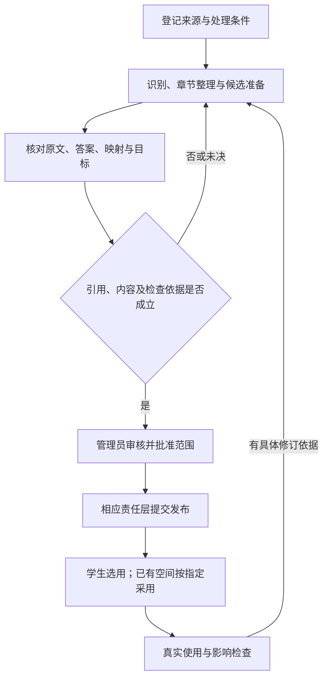
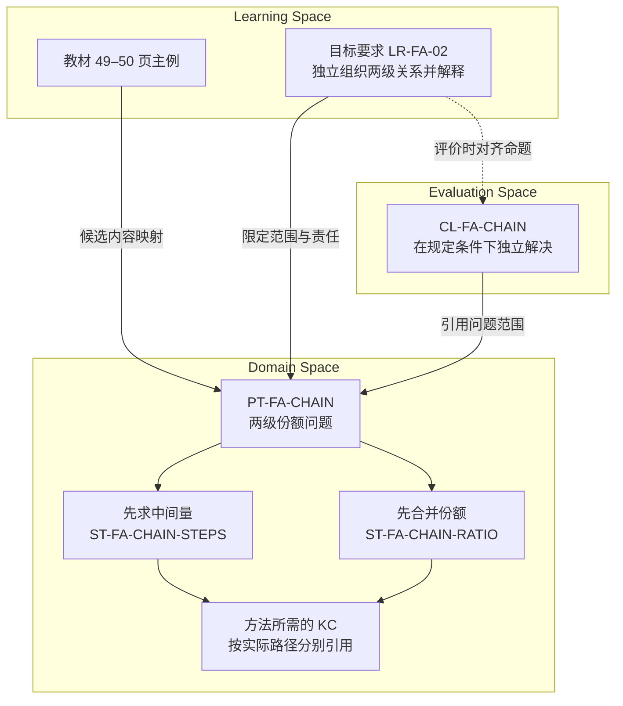

# MVP 领域与内容基础

> **版本**：v0.1 
> **文档性质**：领域与内容交付规格；Phase 4 — Product & Domain Foundation 
> **状态**：已有首批实际章节的结构化候选及开发参考；正式内容审核、发布和完整联合交付未完成，G4 未通过 
> **上游依据与基线**：[G3-20261015-01](../MVP_Gate_Reviews.md#27-g3-阶段性审阅通过与-phase-4-交接)；现行 Domain、Learning、Evaluation 设计 
> **维护责任**：用户提供实际材料；Codex 辅助准备，管理员核对内容、范围和发布 
> **评审记录**：已逐页阅读校内所选单元并完成候选引用与数值检查；尚未完成管理员内容审核和独立参考复核 
> **写作规范**：[设计文档规范 v1.1](../../top/DeerMind_Design_Document_Standard_v1.1.md) 
> **更新日期**：2026-10-19 
> **修订说明**：区分 Task Claim 新合同与含 KCClaim 的旧 v1 内容资产，明确后续迁移及接收条件。逐文件变更见[修订记录 §9](../../concept-design/DeerMind_Learning_Model_Reassessment.md#9-task-claim-单一能力状态的正式修订记录)。

---

本文把首批课程准备成工程可以接收的内容。输入为已确认范围、[需求](../phase-3-definition/MVP_Requirements_and_Acceptance.md)、实际材料及现行模型合同；输出为实际内容、版本化映射、教学与判断依据、审核记录和交换材料。产品设计接收每类行为的可用条件，评测资产接收可信参考，工程实现导入与运行。目标属于 Learning Space，个人认识与解释依据按 Evaluation 负责，不因统一交付转归 Domain。

## 1. 领域范围与覆盖要求

完整 MVP 仍需两个相互隔离的课程空间，支持校内、校外各自获准的内容。教材按章、节准备并分批发布，不要求一次建完整学科；用户已确认校内使用北师大版数学六年级上册，校外为后续提供的内部教材（SRC-024）；SRC-025 已明确校内首批为第四单元“分数的应用”，在线来源及 49–56 页边界已核到。出版年／印次、全章内容准备、参考和使用条件仍属 OPEN-002。合成三角形例子继续用于交互走查，不视为该教材内容。

| 可用行为 | 必需材料与判断依据 | 缺少时怎样表达 |
| --- | --- | --- |
| 浏览教材 | 已核对的来源、章节结构和可见内容 | 相应内容未准备，不把整本列成已可用 |
| 章节讲解 | 明确关键问题、可核查原理、适用例子与帮助范围 | 只开放已具备依据的部分；纲内新题帮助按 REQ-019 独立处理 |
| 当题反馈 | 题意、要求、合法方法、结果与理由参考、输入条件 | 保留识别或判断未决，不计为学生错误 |
| 正式掌握判断 | 已发布目标要求、适用 Domain 引用及评价解释依据 | 明确缺口，不由讲解完成推断掌握 |
| 选题与复测 | 题目要求、变化维度、目标覆盖、使用及帮助背景 | 不声称题单已覆盖尚未建好的范围 |

## 2. 核心概念与领域规则

沿用 [Domain Space](../../concept-design/DeerMind_Domain_Space_Design_v1.1.md)、[Learning Space](../../concept-design/DeerMind_Learning_Space_Design_v1.1.md) 与 [Evaluation](../../concept-design/DeerMind_Evaluation_Space_Design_v1.3.md)，当前不新增能力本体。

实际准备时，每个对象必须有足够内容支撑业务：

- TaskTemplate 写清要求完成什么、已知与未知、参数及限制、必须由学习者承担的工作，以及哪些表面或条件变化仍适用。
- SolutionTemplate 写清适用条件、输入输出、处理与子任务关系、所需知识；同题可有多种方法，不能把所有方法的 KC 合成每次必需条件。
- KnowledgeComponent 写清认知内容、适用边界和相关支持关系，不仅给一个名称。
- LearningTarget 的要求说明范围、期望表现、帮助条件及质量标准，关联已发布内容；章、节统计使用明确维护的要求项，不由运行模型临时凑数。
- 评价依据说明哪些实际表现可支持、反对或无法判定相关结论，保留近期帮助、重复题和覆盖限制；不得由参考解法冒充学生实际执行。

具体粒度与映射由首批实际材料检验。符合现有对象含义的补充作为内容维护；无法表达关键区别时按 RISK-008 携具体反例讨论，不在这里提前展开所有未来题型。

Task Claim 的唯一类型与必要语义由 Evaluation §3.1 规定，分数案例见其 §6.8。课程明确任务参数范围、可用方法及任选／指定／分别覆盖规则；解释、求解和选法的责任分开。KC 提供方法依据与教学关联，不生成个人 KC 掌握状态。章节统计继续按 LearningTarget 的要求项计数，不用模板、Claim 或 KC 数量替换分母。

## 3. 内容来源与组织映射

管理员接收 PDF 或成组扫描图片，登记书名、版本、来源、内部页码与文件页序对应，以及实际使用条件。答案和解析分别标明“原材料附带”“人工核验形成”“模型候选”“待核实”；没有原答案不拒绝整本导入，但不能将生成答案伪装成原书答案。

章、节结构属于 LearningMaterial 内部结构。每项映射说明章节位置、引用对象及版本、映射含义、适用条件和检查依据；标题相似不构成正式映射。题目原图、识别文本与修订记录保持关联，无法确定的局部保留未决，不能整体复制一个高置信分数代替核对。

书目信息和核查状态集中记录在 [material-intake.json](../../../src/mvp_foundation/materials/material-intake.json)。2026-10-16 已通过[用户提供的电子教材](https://www.100875.com.cn/show/eBookAndTeacher.html?resId=7965194976af40f5b9abc4b3f89522fe&bookId=120170718181616017047&firstNum=120170718181616017047&contributeId=9276)读取目录、书名页、后记及所选单元边界，不再停留于书目已知、内容未取得的状态。

| 核查项 | 已取得的信息 | 尚未确认的部分 |
| --- | --- | --- |
| 书目与版本依据 | 书名页为数学六年级上册，北京师范大学组织编写；后记说明本套教材为第五版、依据 2022 年版课程方案和课标 | 本册具体出版年、印次、ISBN 及与孩子纸质用书的一致性；不能把课标年份当出版年 |
| 首批范围 | 用户指定第四单元“分数的应用”；书内页码 49–56，对应电子图片序号 052–059；八页已逐页阅读，整理为 21 个内容定位组 | 各原题逐小问的完整参考与精确图示复核 |
| 答案与参考 | 两节例题含推导；已编制八道原创题和对应方法、十二个评价开发案例 | 未取得独立答案册；作者候选仍需管理员及独立参考复核 |
| 访问方式 | 无登录浏览器可以加载目录和书页；链接直接进入该单元首页 | 网页可读不等于扫描导入、OCR、内容发布或外部处理已经可用 |

本次依据实际单元形成 §6.1 的内容候选。已读完整八页不等于所有原题参考和图示均已独立审核；尤其不能把作者推导标成教材附带答案。三角形合成活动继续承担交互走查，新章节候选通过后台只读区供审阅，尚未作为正式学生课程接入。

内容来源与使用条件属于 OPEN-002，外部处理属于 OPEN-004；在对应条件满足前，只能开展获准的本地或合成材料工作。

## 4. 建设、导入与维护流程

**图 CONTENT-01　从原材料到可用内容**

矩形是工作步骤，菱形为准入判定；回到候选不覆盖已发布旧版。初始建设可以直接开始，不伪造运行缺陷；发布与已有空间采用分别记录。

内容核查同时查看系统标疑处和代表性的未标疑处。管理员可独自完成修改、审核、发布，仍分别记录依据。维护须有修改前后差异和受影响引用；新内容不默认全量重算，已失效结论退出当前使用，修订后的实际使用与恢复在工程阶段核验。

本轮教材界面按 Product FLOW-006 演示同一任务返回、原文对照、代表性未标疑页核对、参考来源、目标映射与审核发布。CASE-024、025 检查这些操作；真实内容是否正确、实际版次及适用权利仍需取得原材料后核实。

本轮进一步连接教材目录发布与所选个人空间采用，保留历史题单版本及范围；正式判断失效和重处理尚未执行。实际多模态材料准备还需包含公式、表格、跨图归属、笔迹与语音的正反例，不能用自编两页文字替代。

## 5. 质量标准与参考材料

核查对象包括题意完整性、数学正确性、合法多解、图文条件、参数限制、方法与知识关系、目标粒度、评价边界和可追溯来源。运算检查可辅助验证数值，不能替代教学或评价意义判断。

实际参考需能独立于待测系统核查。模型自评或多个模型一致不作为真值；必要人工意见与分歧保留。审核通过仅说明当前内容和选定案例可用，不声明普遍覆盖；未映射输入与模型缺口也要作为评测材料，不能只保留容易成功的题。

## 6. 首批领域与内容资产清单

| 资产 | 位置及来源 | 当前状态与适用边界 |
| --- | --- | --- |
| G3 批准内容与依赖 | [基线清单](../../../src/mvp_foundation/baselines/G3-20261015-01/manifest.json) | 已固定，作为输入，不是领域包 |
| 章节交互合成材料 DEMO-LESSON-AREA-001 v1 | [chapter-lesson.json](../../../src/mvp_foundation/examples/chapter-lesson.json)；Codex 自编三角形面积示例 | 有实际文字、图示说明和参考；仅用于交互，未映射真实教材、未发布为 Domain 内容 |
| 产品流程合成输入 DEMO-PRODUCT-FLOW-001 v1 | [product-flow-fixtures.json](../../../src/mvp_foundation/examples/product-flow-fixtures.json)；自编求助题、状态、作答与模板引用样例 | 只用于展示统计与维护流程，不是正式目标、Domain 定义、教材映射或质量参考 |
| 课程准备合成输入 DEMO-COURSE-SETUP-001 v1 | [course-setup-fixture.json](../../../src/mvp_foundation/examples/course-setup-fixture.json)；两页自编原文／识别文本、三道题、章节覆盖及目标样例 | 用于核对未标疑页、无原书答案、部分就绪及发布采用衔接；不含真实扫描件或 OCR 输出 |
| 合成多模态输入 DEMO-INPUT-001 v1 | [input-fixture.json](../../../src/mvp_foundation/examples/input-fixture.json)；同题两页自编文字、几何 SVG 所用数据及语音原话脚本 | 页面可对照识别差异，不含真实图片、PDF、录音、表格复杂材料；不足以验证实际识别质量 |
| 校内教材及首批章节 | SRC-025 的北师大版数学六年级上册电子教材；用户指定第四单元“分数的应用”；见 material-intake.json v3 | 八页已读，逐题作者参考已形成；管理员审核和发布尚未完成，具体出版年／印次待核 |
| 校外教材及首批章节 | 用户确认是内部教材，后续提供 | 具体书目、版次、原材料、答案与首批章节待提供；与校内个人历史隔离 |
| 实际单元候选 CONTENT-BNU-6A-U4-001 v1 | [package.json](../../../src/mvp_foundation/content/fractions-application/package.json) | 旧结构的五个 ProblemTemplate、九个 SolutionTemplate、九个 KC，六项候选要求、七个 Claim（含一个 KCClaim）、八道原创题及讲解提纲；尚未审核或激活，未符合 DEC-022 的新合同 |
| 教材解答参考 REFERENCE-BNU-6A-U4-001 v1 | [source-references.json](../../../src/mvp_foundation/content/fractions-application/source-references.json) | 51 条定位参考覆盖已登记的 21 组内容，含 8 幅关系图数据；逐页核对及数值自检完成，未独立复核，不是出版社答案册 |
| 语义开发参考 CASE-049–060 | [fractions-content-cases.json](../../../src/mvp_foundation/evaluation/fractions-content-cases.json) | 十二例，开发可见，未独立审核、未运行真实模型，不是正式留出集 |
| 内容静态检查 | [verify.py](../../../src/mvp_foundation/content/fractions-application/verify.py) | 检查引用、来源页覆盖、数值及参数约束，不检查自然语言全部语义或教学效果 |

### 6.1 首批单元怎样建模

以下对应关系是这份实际材料的候选划分，不新增通用模型对象，也不宣称五类问题足以覆盖未来所有课程。完整字段与版本以候选包为准。

| 问题范围 | 模板 | 方法与知识的关键区别 | 主要材料位置 |
| --- | --- | --- | --- |
| 分数计算、说明规则、辨析步骤 | PT-FA-EXPR | 按顺序计算或按合法运算律改写；任务模式单列，不把算对等同于会解释 | 50、51、53、54、56 页 |
| 已知两级份额，求末级数量 | PT-FA-CHAIN | 先求中间量或先合并份额；第二比例的基准是中间量 | 49–51 页 |
| 相对指定基准求增减分数 | PT-FA-COMPARE | 差额除以基准，或整体倍数与 1 比较；换向须重选基准 | 52–55 页 |
| 同基准份额的和差、新量或余量 | PT-FA-COMBINE | 分别求各部分再合并，或先合并系数；不同基准不能直接相加 | 53–56 页 |
| 两种运力求最少次数 | PT-FA-TRIPS | 总量除单次容量后检查整数约束；有情境责任，不能只有算商 | 51 页第 5 题 |

每个模板维护参数、限制、责任、变化维度和适用方法；每个方法维护条件、结果、子任务绑定及知识依据。材料中的直接引述、作者归纳和原创题分别标识。21 个定位组覆盖八页的教学、练习和总结块，不等于 21 道独立测量题，也不表示各组内部所有小问已经完成独立审核。

**图 CONTENT-02　逐级份额内容的候选关联**

框内是各自拥有的定义；实线表示引用或方法关系，虚线表示评价时的对齐。图中没有个人 Belief，也没有从教材或目标直接产生学习者状态的箭头。方法分别引用 KC，不将全部方法的知识并集当成每次解题必需条件。

例如原创题 ITEM-FA-01 将 `a=40、r=3/5、s=1/4` 绑定到两级份额模板。分步法先得 24，再得 6；合并法先得 3/20，再得 6。若学生只提交 6，可以核对结果；若系统已经给了关系式，就不能据后续计算宣布学生独立完成建模。实际运行仍由 Interaction 记录展示与作答，Evaluation 对条件明确的 Claim 解释证据。

### 6.2 学习要求与教学、检测参考

现有 v1 候选目标包含六项可读要求：表达基准与关系、组织两级份额、判断比较方向、求同基准组合、计算并说明规则、回到情境检查。它们是 LearningTarget 要求，不是六个 KC 状态。资产的七个旧命题中，六个为 TaskProficiencyClaim，一个为基准知识的 KCClaim；这是尚未迁移的旧资产事实，不是本版允许的状态结构。

按 DEC-022，新包只能提供条件明确的 Task Claim。基准理解应由本类任务中的关系说明、判断与反例表现支持；核对现有 CL-FA-BASE 的责任后，迁移或重建相关 Evidence 参考，停用 CL-FA-KC-BASE，不把旧 KC Claim 换个名字保留。六项用户要求不等于必须保留六个 Claim，拆合须依据责任、证据和教学用途审查；当前不虚构新的已审核数量。

本轮交付的参考分为四类：

- **教学内容：** 三段活动提纲分别对应两节内容与整理复习；沿用分段推进、就地追问和可暂停规则。提纲提供选择依据，不要求一次讲完八页或所有原题。
- **原创题与方法：** 八道题覆盖主要关系及典型错误，有参数、方法、理由和使用背景。用于讲解后须记录暴露；本身不是正式未见检测题单。
- **教材逐题参考：** 51 条记录分别保留页码、小题位置、条件摘要、要求、候选映射、解答和推导依据。相同题中的画图、计算和说理分别核对；总结与百分数探索有解释参考，但不因此增加本包正式达标项。
- **评价边界案例：** 十二例区分正确结果与解释、提示替代责任、反向比较、图示缺失、同基准与不同基准、非法运算律、整数约束、非法生成参数、重复与库外合法方法、版本效力。

六项要求的粒度和支持条件是待管理员审核的候选，尚不替换学生端统计分母。具体稳定性、抽样和达标判定须按既有验证责任校准，不在此另设做对几题即掌握的规则，也不把本次立即表现当持久能力。

DEC-019 已确认非整除运次变化先作可选练习或迁移探针，不列为首批达标必测，学习者不需要通过该变化才能达到本章目标。Domain 仍表达这个变化；实际表现仍可在适用的范围、责任和帮助条件下保留与解释，但不能仅因未参加或未通过该探针就判本章未达标。题目用途确认与内容审核分开，ITEM-FA-07 尚未正式发布。

逐题参考不复制全套题干或整章图片，使用出版社页内位置与原始页图 SHA-256 追溯读到的材料。每条区分原书已展示推导与作者另行解答；数值使用精确分数检查，未取得独立答案册。51 是定位记录数，不是独立题目或测量样本数。

八幅重绘用于说明答案依据，保留给定量、推导量和所求量的区别。例如 51 页第 1（2）题中，足球是排球的 2/3，来自三等分刻度与终点对齐，并不是题干直接写出的比例；参考图额外写出足球 24、篮球 18，必须标明是推导结果。图示的比例、单位、等分与说明可在后台逐题检查，允许等价画法，不按像素一致评定学生的图。

这些重绘含答案，只供后台核对。正式图文识别需要另备原图区域及其实际输入版本；不能给待测模型含答案参考图，再声称测量了无提示理解能力。

### 6.3 尚未完成的核查与接收条件

目前没有发现这八页内容迫使新增 Domain 核心对象；这是有限静态表达检查，只说明当前候选可以表达这些主要责任。模板粒度是否能指导真实讲解、诊断和选题，仍需工程运行及后续测量。

- 51 页运次原题恰好整除；非整除变化的首批用途已由 DEC-019 确认为可选练习或迁移探针，其题目内容和评价参考仍须审核，不列入首批必测。
- 55 页包含百分数探索问题。本包保留该位置和待扩展状态，未把其静默纳入本单元正式检测；不因当前候选未覆盖就把该问题判成超纲。
- 逐题条件与八幅关系图已由作者整理，仍须对照原图独立核对。关系重绘不代替正式原图输入、裁切位置和识别测量。
- 尚缺独立内容复核、正式语义留出集及校外材料。出版年／印次、使用条件和真实处理路径仍按 OPEN-002／004 核验。

后台“内容与维护”可展开这份只读草案，按章节、要求、问题与方法、KC、原创题、教材题与图示、评价案例检查。教材参考按页码与小题选择，解答按需展开；切题后收起答案。实际候选不进入既有三角形合成发布按钮；正式审核、发布和指定采用由后续对应 owner 路径执行。

## 7. 验收、依赖与后续扩展

以下是 CONTENT-001 逻辑交换合同，规定材料必须表达的含义，不冻结数据库或通用运行时 Schema。

| 记录类别 | 必备信息 |
| --- | --- |
| 交付清单 | 包标识、修订、源文件与校验信息、责任人、审查状态、批准范围、相容依赖与已知缺口 |
| 材料及章节引用 | 材料标识与版本、章/节内部位置、页码/图片区域、原文与修订来源、允许使用条件 |
| 领域对象 | 对象类型、稳定标识与版本、上述语义定义、适用条件、关系及所依赖的准确版本 |
| 映射 | 来源位置、目标引用、关系含义、适用条件、候选或已核查状态、依据及审核记录 |
| 目标与判断依据 | 语义所属层、目标/要求或 Claim 引用、表现与支持边界、正反例、不能作出的结论、版本 |
| 问题与参考 | 原题、参数或来源、要求、图示、合法解法与判据、实际审核结果；候选生成及使用历史分别保留 |

当前 v1 候选仍是旧结构的 UTF-8 JSON 交换样例；以下字段和数量只说明已有资产，不表示新合同已接入。`asset_id/version/status/activation` 表达交付身份和效力；`source/material.inventory` 表达来源与位置；三个领域数组分别承载问题、方法和 KC；`target/claims/evidence_reference` 保留不同 owner；`original_problems/lesson_outline` 承载题目参考和讲解输入。全部内部正式引用带 `@版本`，本包均为 v1；定位 key、目标内部 requirement ID 不冒充新的 Domain 对象。

`verify.py` 检查 ID 唯一性、引用类型、版本存在、问题与方法双向适用、目标与 Claim 范围、来源页覆盖及案例引用，并用精确分数计算检查原创题、两路径等价和运次约束。逐题参考另检查 58 项数值、11 项图示比例关系、51 条定位对 21 组材料的覆盖及本地原页哈希；没有本地页图时报告未执行哈希对照，不声称重新读取了原图。字段存在与数值成立不证明语义分类正确，须结合 §6.3 的内容复核。G4 前据实际接收完善格式约束，Phase 5 再实现导入与运行，保留来源、版本与未知状态；本 JSON 不提前冻结数据库或 LLM 输出 Schema。

下一版资产交付须完成四项检查：

- 模板类型、范围、方法适用关系及映射按 TaskTemplate 合同逐项迁移；保留旧身份关系，不假定字符串替换即兼容。
- 每个 Claim 明确责任、方法要求、支持和质量边界；移除独立 KC Claim，保留 KC 定义、关系、解释和教学引用。
- 重写受影响的 Evidence 参考、目标关联及验收案例；新包在版本、审核和授权完成前不得激活。旧包与 G3 快照继续按原版本保留。
- 校验脚本与工程接入识别新状态类型及历史边界；现有 verify.py 的通过仅针对旧资产合同，不能用来宣布 Task-only 迁移通过。

这些是 OPEN-010 的待办接收条件，本轮未修改资产 JSON、脚本或发布状态。

## 8. 文档完成条件

| 检查项 | 当前状态 | 待完成 |
| --- | --- | --- |
| 范围与可用条件 | 已明确准备方式；校内首批单元与在线来源已核到 | 校内全章准备与条件核查；校外实际材料及首批范围 |
| 具体定义、映射、目标和评价参考 | 校内单元候选、逐题参考及关系重绘已交付 | 管理员与独立参考复核、正式原图输入及校外内容 |
| 质量、维护和交换含义 | JSON 样例及引用、数值检查已形成 | 正式接收约束、实际发布维护与审核记录 |
| 内容投入与可持续性 | 未测量 | 记录实际整理、审核与维护投入 |

OPEN-002 影响实际领域交付，不阻塞其余交互与权限设计；未取得实际内容不能通过 G4。
