# MVP 产品与交互设计

> **文档性质**：产品与交互设计；Phase 4 — Product & Domain Foundation 
> **版本**：工作稿，2026-10-17；修订由 Git 追溯 
> **状态**：三端结构稿可操作；学生端连续对话已接真实模型供成人试用，具体交互待用户复审，完整流程待补，G4 未通过 
> **上游依据与基线**：[G3-20261015-01](../MVP_Gate_Reviews.md#27-g3-阶段性审阅通过与-phase-4-交接)；具体产品规则引用 Phase 3 
> **写作规范**：[设计文档规范](../../top/DeerMind_Design_Document_Standard_v1.0.md)；[共同规则](../MVP_Governance.md) 
> **维护责任**：Codex 提出并维护设计，用户参与重要产品取舍及原型审阅 
> **评审记录**：用户基本认可结构方向，确认以对话为学习主线、交互内容嵌入同一工作区，授权继续原型；具体实现仍待复审，见 §7–§8 
> **更新日期**：2026-10-17 
> **修订说明**：承接 DEC-021，增加首页醒目的课堂进度与直接更新入口，学习情况保留轻量上下文及章名标记，家长只读；精简学习情况，移除教材收录与覆盖的常驻说明，仅在查找和受影响判断处保留必要信息；按已确认方向区分首页与学习情况：新增首页内容、统计口径引用及可核对示例，学习情况直接承载章节目录与详情；保留连续学习对话、目录规模验证与原有活动。细节仍待用户审阅，不改变 G4 状态。

---

本文将已确认的产品行为变成用户可操作的过程。输入为[需求与验收规格](../phase-3-definition/MVP_Requirements_and_Acceptance.md)、[验证方案](../phase-3-definition/MVP_Validation_Plan.md)和同阶段内容、权限条件；输出为活动合同、流程、界面状态及原型。工程接收操作与反馈合同，评测资产接收可走查场景。页面数量、导航与布局属于本层工作方案，仍须实际走查；业务责任、权限及验收承诺依据 G3 及共同登记册中明确批准的后续变更。

## 1. 设计目标与需求映射

学生应能迅速表达当前学习需要，在一个连续工作区获得解释、追问、作答和反馈，并能看懂本次取得了什么、还不能判断什么。家长应能看到同源学习情况及依据，管理员应能从实际案例定位到定义与运行记录，再受控修正。具体映射统一维护于 [Requirements §7](../phase-3-definition/MVP_Requirements_and_Acceptance.md#7-统一追溯主索引与交接)。

本轮采用以下组织原则：

- 常驻输入承接自然语言意图，教材、题目记录和学习情况仍提供直接操作入口；用户不必先猜出请求属于哪个功能。
- 每次学习聚焦一个当前活动。当前活动的对话直接构成正文，承载讲解、图示、追问、作答和反馈；更早活动的历史按需查阅。首页和其他页面仍不因发送输入自动展开完整历史。
- 让用户看懂当前任务、已有结果和下一步，不把 Space、Claim、Belief 等内部名词当学生导航。
- 学习情况按教材章、节组织。三类学习要求项数与近期作答统计分开，解释各自含义；不制作一个综合“能力分”。
- 用户控制继续、检查和结束；系统建议须说明目的和依据，不抢占正在作答的界面。

这些原则是交互设计依据，不是已证明的易用性结论。原型先检查是否找得到入口、是否理解帮助和检测的区别、能否顺畅返回；正式质量与学习价值仍按 Validation 检验。

本轮重新检查设计方法：局部流程能够执行，不足以证明用户面对长期记录时仍能定位对象、理解结果并完成工作。以下资料作为方法依据，具体方案仍需用 DeerMind 的任务检验，不能借用来源的权威声称本产品已经易用。

| 方法依据 | 本设计的具体应用 | 不能据此推断的结论 |
| --- | --- | --- |
| [NN/g 可用性原则](https://www.nngroup.com/articles/ten-usability-heuristics/)：熟悉的语言、状态可见、用户控制与一致性 | 以教材、活动、孩子、工作事项组织操作；明确当前对象、处理状态及返回位置 | 使用常见控件不等于用户一定理解 |
| [NN/g 渐进披露](https://www.nngroup.com/articles/progressive-disclosure/)：优先呈现常用信息，按需深入 | 章节概览进入要求与依据；后台列表进入对象详情，再查看相关记录 | 不能把完成任务必需的信息全部藏进折叠区 |
| [IBM Carbon 数据表格](https://www.carbondesignsystem.com/building-blocks/core/components/data-table/guidelines)：检索、筛选、排序与分页 | 后台目录具有稳定查询范围，操作区分列表与具体对象；长记录按需加载 | 不要求照搬视觉风格，也不自动纳入批量修改能力 |
| [Microsoft 人机 AI 交互指南](https://www.microsoft.com/en-us/research/project/guidelines-for-human-ai-interaction/)：覆盖初次使用、常态、出错和长期变化 | 意图输入显示当前语境，执行与澄清可见，结果可追溯并有纠错路径 | 有聊天框不等于已经完成 AI 交互设计 |

上述来源于 2026-10-17 核查。学生平板、家长手机、管理员桌面共享业务含义与品牌；布局密度、操作方式与首屏重点分别设计。

## 2. 角色旅程与整体结构

### 2.1 从任务推导产品结构

本节是新的产品结构评审稿，取代此前围绕演示案例组织的导航方案；首条跨角色过程和目录结构已落实到独立低保真稿，覆盖范围见 §6。先确定用户完成什么工作，再确定去哪里、看到什么以及如何返回；某一章或某一道题只作为内容进入结构，不能决定导航本身。

三端各有一个组织中心：学生先了解自己的学习情况，再选择并开展学习活动；家长围绕孩子的学习情况和支持需要，管理员围绕工作事项与业务对象。下表的频率是设计假设，用于排列入口，不是已有用户研究结论。

| 角色与情境 | 要完成的任务 | 可辨认的完成结果 | 入口安排与频率假设 |
| --- | --- | --- | --- |
| 学生有疑问或想继续学习 | 表达需要、带题求助、继续旧活动 | 进入正确空间的活动，看到解释或必要澄清 | 学习首页、常驻输入；高频 |
| 学生知道想学的范围 | 浏览教材并选择讲解或检测 | 确认章节；进入讲解或检测准备 | 教材目录与章节详情；经常 |
| 学生想了解掌握情况 | 查看章节要求、依据及可做的下一步 | 理解已达标、需加强和待确认的具体含义 | 学习情况；经常 |
| 学生要找回旧题或学习过程 | 定位记录，回看、订正、求助或复测 | 找到原题及对应尝试，保留来源和帮助背景 | 学习记录；经常，不靠记住对话日期 |
| 学生建立课程 | 创建空间，选择已发布教材、目标和范围 | 得到独立课程上下文，知道哪些内容可用 | 空间切换器中的管理入口；低频 |
| 家长想知道孩子当前情况 | 看章节状态、实际覆盖和需关注的依据 | 知道目前可判断什么、还有什么不确定 | 概况；主要入口 |
| 家长想理解或支持孩子 | 就相关结果咨询，必要时明确提交复核 | 得到有来源的说明或可追踪的复核事项 | 详情常驻输入、私人咨询；按需 |
| 管理员准备课程 | 导入教材、核对内容，建立目标和领域映射 | 合格范围已发布，可供学生选用 | 教材与目标；启动期集中、后续按需 |
| 管理员核对模型与运行 | 从普通抽查或反馈追溯具体依据 | 形成有证据的人工结论，或明确保留未决 | 用户与学习、模型目录、工作事项；经常 |
| 管理员修订并使修改生效 | 比较候选、检查、批准、发布和处理采用影响 | 修改在指定范围实际生效，剩余影响可查 | 维护与发布；按需 |
| 管理员保障正常使用 | 开户、维护关联、找回账号、处理运行故障 | 原账号或任务恢复到明确状态，保留记录 | 用户与学习、运行；按需 |

任务对应的产品规则仍由 [Requirements §3](../phase-3-definition/MVP_Requirements_and_Acceptance.md#3-三端功能与业务流程) 维护；本节不另设需求编号或替代唯一追溯主索引。§3 的 ACT/FLOW 描述活动内部行为，§4 的 UI 合同落实本节页面职责。

### 2.2 所有页面共用的组织规则

页面分为入口、目录、详情和活动工作区。入口负责决定做什么，目录负责找到对象，详情负责理解与操作该对象，活动工作区负责完成当前工作。它们不是四套独立的数据：从不同入口打开同一对象，应到达同一详情并保留各自返回位置。

- **范围先于数据。** 学生始终知道当前学习空间；家长知道当前孩子和空间；后台显示当前查询范围，进入个人内容时显示事项和访问用途。切换上下文同时切换数据、草稿与 AI 依据，不能只换标题。
- **对象有稳定身份。** 名称可读，标识用于区分同名用户、同名教材及不同版本。后台引用同时保留对象和当时版本；当前版本与历史版本不互相覆盖。
- **从结果到依据。** 概览提供当前结果、范围、更新时间及可做动作，详情才展开原因、原记录和版本。异常与未知不能只隐藏在详情中。
- **返回保持位置。** 从筛选结果进入详情，返回保留筛选、排序和位置；沿关联记录深入时保留来源路径。深链接重新检查权限与有效状态，失效时给出明确结果，不能显示缓存的受限资料。
- **同一对象只有一套操作。** 工作台上的待处理摘要、教材中的发布入口、案例中的维护入口都引用对应事项；不各自创建一个“发布”或“复核”流程。
- **学习时间不被导航拆散。** 跨空间累计的当天投入可查看，接近既定上限时提醒并保护进度；不让课程切换清零，也不把参考用时变成强制答题倒计时。完整口径引用 REQ-018 与 Validation MET-007。

意图输入是进入和控制工作的一种方式，与按钮操作共用状态、权限和结果。学生、家长常驻输入直接可用；发送后在当前内容中呈现回复、处理反馈或必要澄清，聊天历史按需展开。请求明确时直接进入相应工作；涉及范围歧义时局部确认，涉及正式改变时遵守既有操作条件。首版无需新增一个覆盖全后台的自主操作 Agent，管理员的 AI 辅助在候选准备等获准上下文中提供。

### 2.3 学生端：首页、学习情况与连续活动

学生主导航为“首页、学习情况、教材、学习记录”，默认进入首页。首页让学生理解最近在学什么、找到下一步行动，并查看少量有明确口径的活动统计；学习情况专门承载教材章节的评价查询。空间选择与账号是全局入口。这个分工已由用户确认，具体内容与统计细节是本轮可审阅设计，不代表真实学生使用已经验证。

**图 UX-10：学生稳定入口及连续学习工作区。**

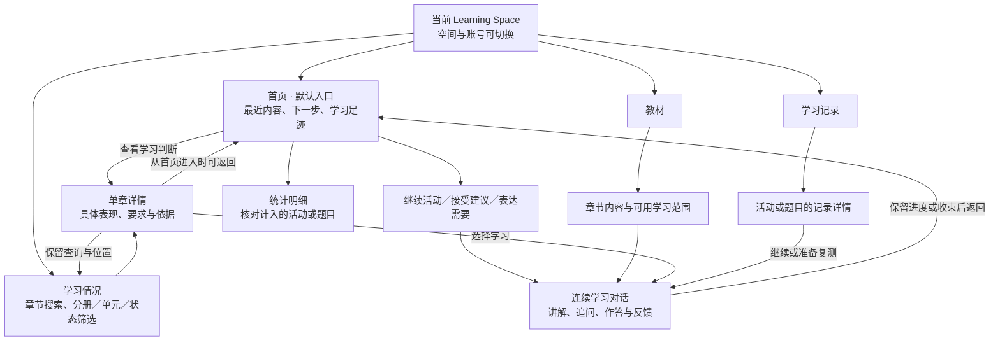

图中实线表示明确操作可到达的页面或内容，不表示每次都经过全部节点。未结束的独立检测仍须按原规则收束，不能通过首页或空间切换绕过；页面跳转、活动次数及原型反馈均不直接更新学习评价。

| 页面 | 主要内容 | 信息边界 |
| --- | --- | --- |
| 首页 | 当前课程、醒目的学校课堂进度及更新入口、DeerMind 最近关注内容与活动位置；一项主要续学或建议；近期学习足迹、当前错题存量、今日时间及常驻输入 | 只展开当前最相关的一个主题，不平铺所有章节；最近打开的章节不等于学校教学进度；活动统计不等于掌握程度 |
| 学习情况 | 教材章节目录、名称／路径搜索、分册／单元／状态筛选；单章具体表现、变化、要求与依据 | 每页最多 12 章；不重复首页活动仪表板。目录状态的单位是学习要求项数，不能转换成掌握百分比 |
| 教材 | 已采用的教材结构、章节内容、可开展学习的范围 | 用于选择内容，不代替评价查询；空间创建仍由空间管理承接 |
| 学习记录 | 学习活动与题目作答两个视图，来源、章节、时间和确认错题等筛选 | 用于查找事实及历次尝试，不由浏览或计数产生新的能力判断 |
| 当前活动 | 整页连续对话、图示、作答、检测与反馈；保留常驻输入 | 教学中必要内容原位展开；已结束检测不能再提交，返回和恢复保留原上下文 |

**首页内容与取舍。** 首屏的重点是认出当前课程、学校正在学的章节和 DeerMind 最近的学习起点，并能直接更新课堂进度或继续学习；有实际可处理事项时明确说明。学习状态只保留一项与当前主题有关的反馈及详情入口，不把详细章节统计复制一遍。近期活动数字在其后辅助回顾，避免累计量压过当前学习任务。

| 内容 | 学生能回答的问题 | 展示和计量边界 |
| --- | --- | --- |
| 学校正在学什么 | 学校目前教到哪里，上次确认后是否有变化 | 首页课程标题下方独立显示章节和更新按钮，已填写时显示确认日期；未知有明确提示，两页共用同一进度，不与掌握评价合并 |
| 最近在学什么 | 上次在处理哪个问题，停在哪里 | 按最近实际活动选择主题；恢复原对话与草稿。无活动时仅呈现有依据的建议或自主选择入口，不虚构课程进度 |
| 一项学习反馈 | 最近哪些表现已有依据，还有什么不清楚 | 用学生能理解的话表达，链接到单章学习情况。新活动尚未形成正式评价时明确说明，不用活动量更新预写反馈 |
| 继续或建议 | 现在可以做什么 | 一个主要动作。优先续学或查看最近结果，再考虑有效建议；建议依据可展开，允许暂不安排。较早未结束活动最多先展开 3 项，完整列表在记录页 |
| 学习足迹 | 最近实际参与了多少学习 | 默认近 7 天，可切换 30 天；学习天数、开展讲解、已结束检测各有不同计量单位和事件条件，完整业务口径唯一维护于 [Requirements §3.11](../phase-3-definition/MVP_Requirements_and_Acceptance.md#311-首页内容与活动统计) |
| 当前错题 | 现在保存了多少道曾确认出错的题 | 独立标为累计存量，不随近期时段切换；按不同题目去重。订正后仍可有错误历史，不把存量标成“尚不会”或待办数 |
| 今日时间 | 今天还能安排多少学习 | 跨空间累计，沿用每日总使用时间上限。未接计时显示未知；评审样例与真实计时分开，不锁屏 |
| 直接表达需要 | 想问新问题或带一道题，在哪里开始 | 底部随时输入或附图；发送后正文保留处理反馈，完整聊天历史按需展开。登录次数、消息数、API 次数不放学生首页 |

“全局”表示产品入口与重要信息的聚合，不表示把校内和校外的个人状态合并。除既有的每日总投入外，统计、建议、评价和记录均限定当前空间。没有可靠数据时显示未知；只有覆盖范围和记录完整性足以支持时才显示 0。

**原型的资料来源。** 本稿没有用本地活动对象的创建次数代替正式统计。现有会话缺少首次讲解展示、检测收束等完整事件，因此活动数字采用单独保存的可核对参考事件：以 2026-10-17 为截止日，近 7 天为 4 个学习日、3 次新讲解、2 次有提交的已结束检测；近 30 天为 5 个学习日、4 次新讲解、2 次检测。当前错题为 6 道不同题目，包含订正答对后保留历史的情境。页面明确标为统计示例，点击数字展开本组对应明细；不跳到另一组千条合成记录冒充统计依据。本轮真实对话单独保留，不混入示例数字。

章节反馈与建议继续使用预写参考，不因页面拆分而宣称接通正式 Evaluation。无评价时不显示进步、正确率或针对性建议；参考关闭后不抹掉本轮真实活动。目录默认只有 3 个参考章，并提供 30／300 章的合成占位供规模走查，不代表全册覆盖。新增学习要求提案仍待讨论，没有用原型替代正式目标发布。

**信息取舍。** 学习情况不常驻显示教材收录章数、全册覆盖或内容准备进度；这些属于教材内容信息。评价不足只在受影响章节及判断依据处说明，不用全局说明挤占学习状态。没有查询条件且无需分页时不另列章节总数；搜索、筛选和分页时保留结果数量，用于确认查找范围。原型规模说明留在评审工具，示例性质仍由评审栏和相应状态标注。

**课堂进度。** 按 [Requirements §3.12](../phase-3-definition/MVP_Requirements_and_Acceptance.md#312-课堂进度与学习状态的区分) 以首页作为主要查看与更新入口：在课程标题下方用独立浅色区域显示“学校正在学”、章节名称和“更新进度”按钮，确认日期作为辅助信息。未填写时显示“学校现在学到哪里？”和“设置进度”；明确未知时显示“暂不确定”，不以旧章名冒充当前位置。学习情况保留一行轻量上下文及更新入口，章名旁加“课堂正在学”标签。首页与学习情况共用同一记录和更新弹窗，标签不使用达标图标，也不进入三类掌握项数。详细时间、来源和更新历史放在弹窗。窄屏按课堂进度、继续或建议、近期学习摘要的顺序呈现，避免新增内容把主要学习动作挤出首屏。

更新弹窗提供当前章节选择和可选小节说明，可明确选择多章；长目录可搜索名称、分册、单元并分批显示，每页最多 8 项。保存前可以核对已选内容，也可以选择暂不确定。保存追加报告，取消或 Escape 不改变当前进度；关闭回到原入口，原列表筛选和滚动不变。已有选择不在当前目录时不悄悄丢弃，要求重新核对或设为未知。家长在自身的孩子／空间上下文中查看同源信息和历史，没有更新控件。

**图 UX-13　课堂进度更新与掌握评价分别维护**

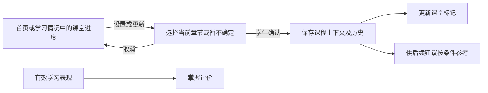

图中课堂进度没有通往掌握评价的直接连线。原型手动选择与本地保存已接入；没有实际学校进度输入时保持未填写。自然语言候选、初次创建空间时的询问及正式推荐使用仍须按需求接入完整流程；不以示例语句或关键词伪装为语义理解。当前教材标识是原型参考版本，不能当成正式出版版本。

**查找与返回。** 学习情况默认展示目录，章节反馈在单章详情阅读。单册不增加分册选项，多册可先选册再选单元；重名章节展示完整路径。筛选重置页码，返回保留查询、页码、滚动位置和焦点；从首页直接打开章节也有返回首页的路径。详情刷新后仍能凭 URL 返回目录条件。长名称正常换行，窄屏将行内状态移到名称下方。正文与输入区分别占位，不相互覆盖。

### 2.4 家长端：先理解情况，再查依据与咨询

家长主导航采用“概况、咨询”，账号与关系作为辅助入口。“概况”以当前孩子和空间为范围，首先呈现章节状态、覆盖与重要限制；孩子近期做了什么是依据入口之一，不让“本次活动”代替整体认识。只有一个有效关联时直接进入该孩子，多关联时在同一位置切换，不合并孩子或课程的判断。

**图 UX-11　家长查看、询问与提报复核**

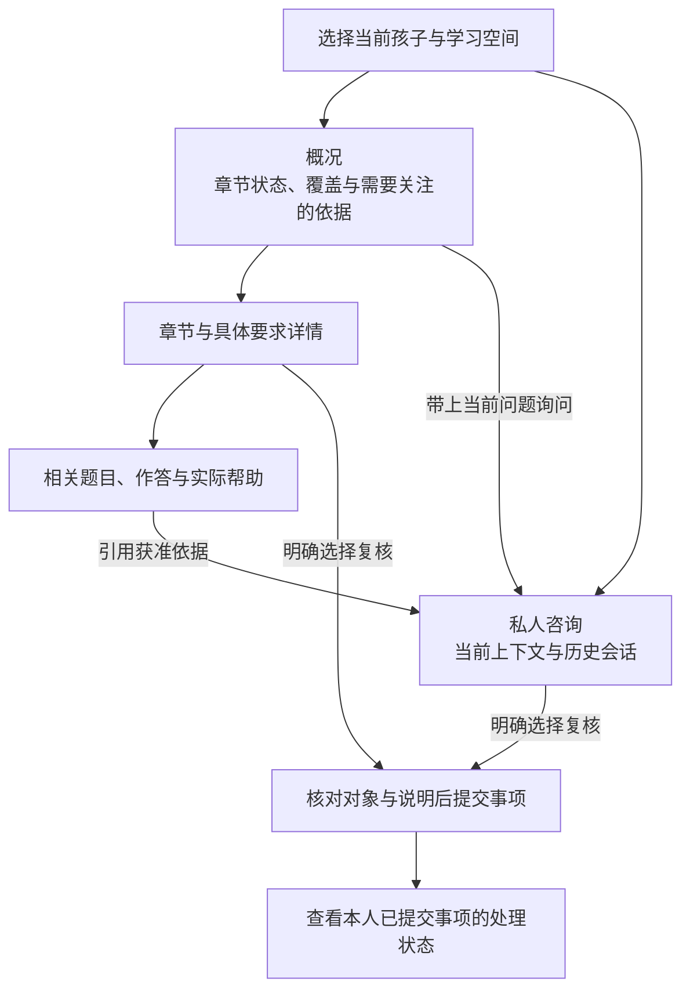

箭头表示操作或授权范围内的引用。咨询不是自动提交的复核，也不是学生作答；查看题目后没有替学生订正或派题入口。复核入口及处理状态从相关结果或咨询内进入，不新增面向孩子的任务管理功能。

概况沿用三类章节项数，近期作答统计另列，不新增“综合能力分”或没有依据的进步趋势。家长可从概况快速判断哪里值得进一步了解，详情说明是缺少证据、已有需加强表现还是结果正在修复。学生和家长读取相同有效依据，但首屏重点和操作不同，不能仅把学生按钮禁用后当成家长版。

咨询历史按当前孩子和空间组织，列表给出可辨认的主题、最近时间与相关对象；选中后继续该段，完整消息按需加载。切换上下文保留各自草稿，不携带另一孩子的内容；私人咨询删除、学生资料只读及关联失效遵守 FLOW-013 和 AUTH-001。

### 2.5 管理端：工作事项与对象目录相互贯通

后台采用六个主区：“工作台、用户与学习、教材与目标、模型、维护与发布、运行”。工作台提供待办摘要和返回入口；其余主区有可检索目录及稳定详情。“章节案例”退出主导航，具体案例成为活动或维护事项详情中的数据。

**图 UX-12　后台六个主区与内部对象**

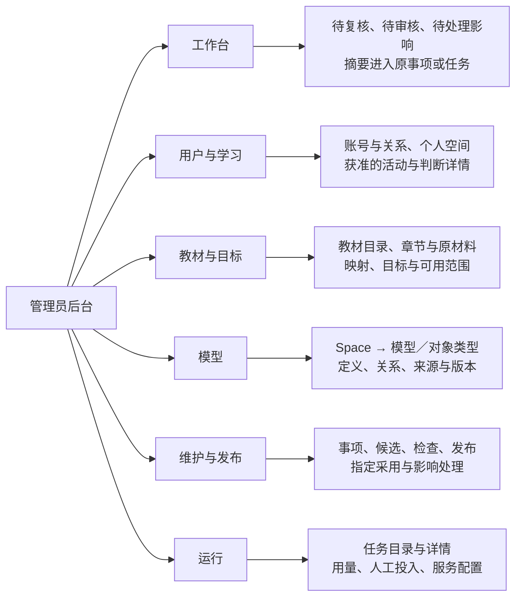

矩形表示工作区域，实线表示导航层级，不表示服务调用顺序。跨主区关联按下表和 §2.6 的路径进入同一对象详情，不在本图堆叠全部引用连线。进入个人资料的任何路径均受事项和用途约束，包括从模型反查引用、从运行任务打开原输入；目录可检索不等于全部内容无条件可读。

| 主区 | 目录和默认组织 | 详情与操作 |
| --- | --- | --- |
| 工作台 | 待复核、待审核、采用及重处理异常分组；显示真实数量、状态和时间 | 进入来源事项继续处理；已处理从原目录查询，不复制第二份事项状态 |
| 用户与学习 | 学生／家长账号目录，按姓名、标识和角色定位；个人空间、活动按获准范围查询 | 账号详情下维护关联与恢复；学习空间下查采用目标、活动及判断。核实依据随具体修改记录 |
| 教材与目标 | 教材目录；教材详情内有章节结构、来源、处理任务、映射、目标及发布范围 | 从原页到章节和目标要求核查；目标有独立身份及版本，通过关联呈现，不改变其语义归属 |
| 模型 | 按 Space → 模型／对象类型 → 对象组织，支持标识、名称、版本和有效状态查询 | 查看定义、关系、来源、版本差异及引用；Domain 对象可发起候选维护，其他规则走受控版本交付 |
| 维护与发布 | 事项、候选、检查、发布与影响处理分视图，按类型、状态、对象和时间定位 | 查看差异与案例、记录审核、限定发布、指定空间采用及处理剩余影响；允许人工保留未决 |
| 运行 | 当前任务按状态、类型、服务和时间查询；用量与人工投入为独立视图 | 任务详情核对原结果和每次尝试；服务配置单独进入，配置保存与连接检查分开 |

模型目录包含 Learning、Domain、Interaction、Evaluation、Evolution 的获准定义及引用；个人 Learning Space 的采用实例和个人 Evidence／Belief 从“用户与学习”的具体上下文进入。Space 是后台可用的专业查阅维度，不成为学生或家长理解产品的前置条件。

活动详情固定保留学生、空间、活动、请求、时间、状态和采用版本。在同一上下文中切换“概览、交互过程、评价依据、关联内容与版本、处理记录”，不要求管理员重新按名字搜索。

- **交互过程**按实际时间查看输入引用、Observation 与校验、Policy 结果、计划帮助、实际展示／播放以及中断；选中事件后看结构化详情。事实多时按时间或事件类型缩小范围，不能一次展开全部原文。
- **评价依据**先定位具体 Claim 或目标要求，再看 Evidence 来源、Belief 变化、支持条件与有效性；沿引用返回当时作答和实际帮助。不把一条解释摘要当完整证据，也不提供手工设置掌握值的按钮。
- **关联内容与版本**显示该活动实际使用的教材、目标、模板、方法和 KC；当前最新版另列。候选与正式关系、对象与具体版本可区分。
- **处理记录**展示相关复核、候选、发布和影响任务；缺少、未决、无权查看及合法未产生分别呈现。管理员作出判断，不预设系统已经自动诊断根因。

账号目录与学习查询共用稳定身份，但职责任务分开：开户或找回不需要先阅读孩子作答；抽查学习也不能顺带修改账号。初始内容建设直接从教材或模型发起，不制造虚假的“故障事项”。

### 2.6 典型操作路径与三端交接

以下路径用于检验结构是否能支持真实任务，不限制内容必须是某个示例，也不规定所有学习都要产生复核。

| 任务 | 起点到完成的路径 | 关键检查 |
| --- | --- | --- |
| 学生讲解并检验理解 | 教材目录 → 章节详情 → 分段讲解／追问 → 自愿检查 → 本次结果 → 相关要求及记录 | 请求讲解不先强迫检测；看完不算掌握；检查记录帮助条件 |
| 学生找回旧题 | 学习记录 → 题目与作答 → 按章、来源、时间或错题状态定位 → 题目及某次尝试 → 求助或复测准备 | 同题多次作答可分辨；返回保留筛选；复测必要性仍由有效认识与目标决定 |
| 家长质疑一次判断 | 概况 → 章节要求 → 相关依据 → 咨询解释；仍有疑问时明确提交复核 | 咨询不自动成事项；家长不能修改原输入；没有依据时不编造确定解释 |
| 管理员核查并修正 | 复核事项或普通抽查 → 具体判断／活动 → 交互事实与评价依据 → 对应定义版本 → 候选及有限检查 → 批准发布 → 指定采用与影响结果 | 不预设一定是 Domain 错误；允许不改或未决；不直接手改 Belief |
| 管理员准备另一教材 | 教材目录新增 → 上传与处理 → 核对章节／参考 → 建立目标与领域映射 → 按可用范围检查发布 | 处理完成不等于可供全部功能使用；同一领域可被不同教材引用 |
| 管理员恢复未知结果的任务 | 运行目录筛选 → 原任务详情 → 核对提交和已有结果 → 恢复原结果或确认条件后重试 | 使用同一任务身份；结果未知不直接重发；必要访问受事项授权约束 |

**图 UX-01　三端如何完成一次学习及必要维护**

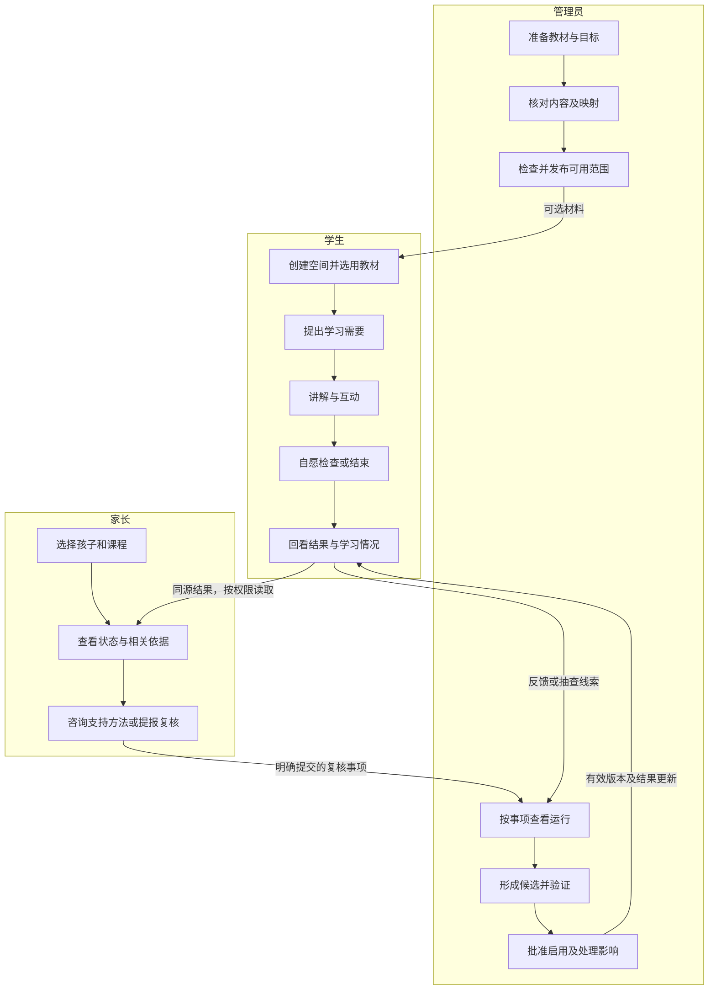

矩形表示业务步骤，分组表示角色，连线表示交接。图省略登录、授权和失败分支；家长咨询不会自动写成学生表现，管理员查看也不获得无关资料权限。处理结果只在相关对象和获准范围内呈现，不新增产品外推送。

### 2.7 长期记录与大量对象的组织

学生和家长不需要面对全站用户，复杂度主要来自自己长期使用的记录；后台同时面对用户数量、每人记录和内容版本增长。前者按空间和章节目次缩小范围，后者依靠可查询目录、对象详情与事项队列，不能统一做成长卡片列表。

| 数据集合 | 默认范围与查找方式 | 数据增加后的展开方式 |
| --- | --- | --- |
| 学生学习记录 | 当前空间；活动与题目分视图，按章节、时间、来源或状态筛选，题目文字可检索 | 先显示摘要，再按需载入更多；详情内逐次查阅作答，保留原列表位置 |
| 家长状态与依据 | 当前孩子和空间，按教材章、节进入具体要求 | 只展开相关记录；私人咨询另按主题文字、时间查询，不把所有历史铺在概况页 |
| 后台账号与学习活动 | 名称或标识定位账号；学习记录另限获准学生、空间、活动类型、状态与时间 | 列表分页及排序；同名结果附稳定标识；个人原文进入受控详情读取 |
| 教材与模型对象 | 教材、章节、对象类型、版本、有效状态、名称或标识 | 目录可检索，关系摘要进入引用列表；不渲染一张包含全部对象的关系图 |
| 运行与维护事项 | 状态、对象、任务类型、时间；待处理视图与历史视图分开 | 明确结果数量和查询范围，分批展开时间线及原始输入输出 |

检索不到、筛选后为空、没有相关记录、加载失败和无权查看分别反馈。列表计数只表示当前获准查询范围内的记录数量，不冒充全站总量。正文搜索不跨越角色和用途权限，不能通过命中片段泄漏受限内容。

这里的检索用于找记录；按名称、标识等明确字段检索不承担学习语义判断。意图识别、题意理解和证据解释仍遵循既有语义规则与模型合同，不通过关键词匹配替代。

分页大小、加载方式和默认时间窗口在低保真与数据密集场景中校准；章节近期作答统计的近 7 天／近 30 天／全部仍严格沿用 DEC-014。本节没有承诺全站即时全文检索、批量改写或自动诊断，也不预设后台容量已经验证。

## 3. 活动与共性能力模型

活动表示一段有目标、过程与退出结果的产品工作，不是新增 Space 模型，也不固定工程 Agent 或服务数量。

| 活动 | 进入条件与用户动作 | 系统响应及结束结果 | 切换与恢复 |
| --- | --- | --- | --- |
| ACT-001 章节讲解 | 选择章节或直接说明章节疑问；教材与帮助条件可用 | 明确本次关键问题，分段解释、就地追问；可做阶段练习或结束检查，留下帮助及表现记录 | 暂离保留进度、草稿和追问；返回继续，明确结束后保留回看 |
| ACT-002 问题求助 | 输入具体题目，可无作答，可只请求提示 | 必要时局部澄清题意，按请求提供提示或解释，允许追问与练习 | 保留题目及来源；不因无作答归为错题，不因为同题重开而抹去帮助背景 |
| ACT-003 检测 | 从教材范围、问题复测或有效建议准备；用户看到范围、题量和用时后开始 | 固定本次题单，提交只回收件状态；结束统一反馈，列出已测与未测 | 实质求助先结束，再讲解；技术核对不结束；不得恢复已结束检测继续凑完整结果 |
| ACT-004 按需后续学习 | 系统在有效历史与目标下提出理由，学生选择接受 | 接受讲解进入 ACT-001/002；接受检测先进入 ACT-003 准备；也可暂不参加 | 开始前重核建议有效性，失效则撤去或更新；拒绝不作为能力反证 |

ACT-004 是已有活动的发起与选择流程，不建立“复习页面”或另一套教学引擎。记录、错题管理、教材浏览、学习情况、常驻输入和时间记录是跨活动能力。

**FLOW-001：章节讲解的具体过程**

1. 学生从章、节或意图输入进入。系统保留当前课程和目标；意图明确时直接呈现第一个关键问题，只有影响帮助的歧义才询问。
2. 工作区顶部简短说明“这次弄清什么”，正文以当前活动的对话呈现解释、图示和公式。系统依学习目标、有效记录和本次表现调整内容及次序，不固定为所有人相同的三段教程。实际操作随阶段提供；继续或追问的节奏仍由学生控制。
3. 输入追问与回应直接进入当前对话，保留相关原推导，可回到原问题。学生回看前文时，新消息只提示可查看，不强行滚动到底部；更早活动另行查阅。
4. 阶段练习在讲解区内提供题目、笔迹或其他作答入口，学生点击提交才分析；结果注明实际帮助。未提交或拒绝参加不会变成错误或掌握证据。
5. 希望做结束检查时，在对话内展开检测范围、题量和用时；确认后进入 ACT-003 的行为状态，题目与提交控件仍嵌入原工作区。收起当前教学提示并保留此前帮助背景；检查的表现是否支持独立判断由评价依据决定，不能因收起内容就宣布独立。求助先结束，再在原工作区展示帮助。
6. 学生结束时在原工作区看到本次讲过什么、实际做了什么、判断及限制、可选下一步，不强制跳到结果页。没有作答或尚未评价时明确说明，不显示“已掌握”；主动查看记录或暂离才离开当前工作区。

本次以同一道比较标准题推演两条教学路径。理解较快的参考表达已能说明反向比较，可跳过重复讲解并准备检查；基础回补路径先解释三张占九张的分数意义，再对照十二张并返回原问题。两条路径检验同一界面是否能承载不同教学安排，不是对实际孩子的分类，也不固定所有活动的题量。

**图 UX-02　教学与检测的切换**

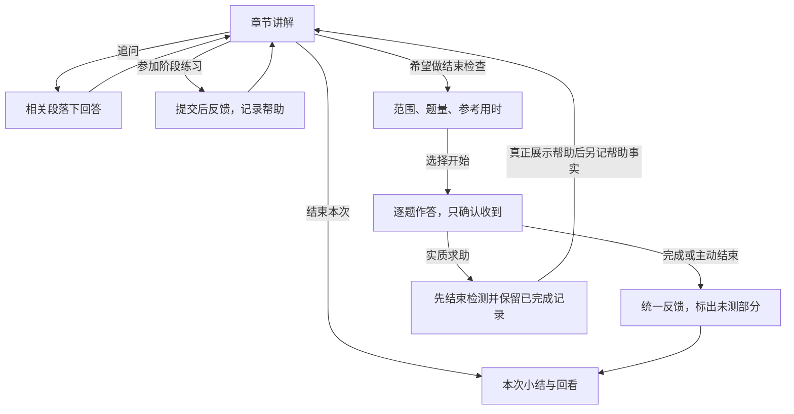

矩形是工作阶段，箭头标明触发。阶段练习与检测是不同反馈条件，不能只换按钮名称。图省略技术澄清、失败和暂离，详见 §5。

**FLOW-002：从具体问题求助到记录回看**

1. 学生输入题目，已有作答为可选信息。默认提供讲解，也可明确选择“只给提示”；常驻意图输入取得的明确请求与直接操作进入同一业务流程。
2. 提交后显示当前题面、当时请求与处理状态。存在识别疑点时只澄清必要局部；没有原作答时标为未作答，已有作答但未判断时标为尚未判定。
3. 仅提示请求先呈现适用提示，不同时展开最终答案。学生后来明确要求完整讲解时，再展示讲解并记录帮助变化，不改写当时请求。明确讲解请求按已有默认方式先解释、按需互动。
4. 学生回到题目记录时，看到来源、原作答、请求和实际帮助，可以继续相应学习；打开记录本身不构成新的作答。确认错题是筛选视图，不把所有求助或未判定条目放入其中。
5. 删除独立录入的原资料前，说明学生端不可恢复、内部保留及关联家长的只读规则。执行后学生端题面、作答与相关求助副本均不能再由历史或聊天恢复，内部依据和其他独立练习保持。

本轮原型只实现文本求助、明确选择的合成帮助、求助记录与隐藏的局部流程。拍照、书写、语音、识别纠错、真实题意理解、判分和进一步练习尚未接入。自由题目仅保存并明确未处理；修改预写题面后不会套用原示例解答。

**FLOW-003：由章节概况查到具体依据**

1. 学生或家长选择课程空间，先看到教材章节点及当前有效结果的更新时间。缺少目标或内容时说明未准备范围，不从另一空间填充。
2. 每章显示已达标、需加强、待确认项数和总数；展开后逐项呈现学习要求，点选某项再看条件、判断原因及相关作答。家长使用同源数据，并保持只读。
3. 近期作答单独显示，默认近 7 个自然日，包含当天。切换近 30 天或全部只改变这组记录；同时显示实际日期范围、独立已判定分母、正确次数及比例。原型比例四舍五入为整数，分子分母始终可核对。
4. 展开统计依据可核对来源、原作答日期、帮助条件与排除原因。未知日期仅进入全部；未结束检测、受助或帮助不明的记录不会进入独立已判定分母，统计规则沿用 Requirements §3.9。
5. 读取失败与判断失效采用单独反馈，暂停展示相应旧项数；不把系统故障放进孩子的待确认数量。近期作答记录可在自身仍有效时独立展示。
6. 常驻输入作用于当前孩子和空间，发送后就地提示，历史按需展开。换空间或角色时不能沿用旧对象的输入。家长咨询不写入学生表现或学生视图。

本轮使用固定截至 2026-10-15 的合成状态：三项要求分别为 1 项已达标、1 项需加强、1 项待确认；近 7 天为 2/3、近 30 天为 3/4、全部为 3/5 的独立作答正确次数。不同范围另列受助、未决和未结束记录。这些是假定评价已完成的展示输入，独立于原型刚提交的未判定作答；不是对真实学习者的结论。校外只演示内容未准备的空状态。

**FLOW-004：从领域候选到指定空间采用**

1. 管理员从内容或维护事项进入具体对象，确认当前定义、版本及引用。候选区并排展示原值与新值；没有实际差异时不生成无意义的新发布。
2. 对候选分别执行结构与引用检查，以及有参考的案例核对。必填字段和引用存在检查不能替代语义检查；模型或人工结论必须说明所依据的案例及限制。
3. 人工结果区分支持、不通过与未决。只有所需检查有效、审核依据完整且结论允许时才能批准；同一人可完成操作，但检查、批准、发布分别留痕。
4. 候选内容、审核依据或引用基础发生变化后，旧检查或旧批准不得继续使用。批准应绑定被审核的准确候选及依赖；需要的部分重新核对后再发布。
5. 发布成功后先显示“目录已有新版，现有空间仍采用旧版”。管理员查看影响后勾选具体空间，另行指定采用；该操作不改变学生选定的章节和目标意图。
6. 采用结果、未采用范围及影响处理分别显示。真实系统应定位失效结果和待执行、失败、未决的重处理；不得由管理员直接改 Belief，也不能重演历史教学。

**图 UX-03　发布与空间采用是两个步骤**

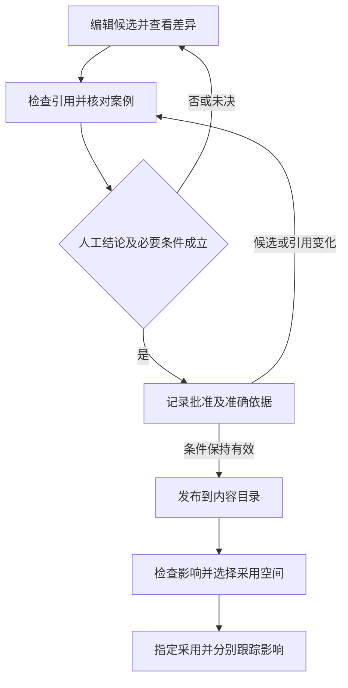

矩形为操作，菱形为准入判定。发布不自动更新全部空间；图不代替责任层提交、权限检查及实际失效处理。本轮实现的是本地合成工作流，没有真实模型发布、服务端授权或重处理执行。

**FLOW-005：教材范围选测与主动建议。** 学生在自己创建的空间内选章、节；当前目标决定需要覆盖的要求，系统据此准备题单。题量不是固定配额，准备结果也不是已经开始检测。

1. 先展示采用的教材与目标版本、所选范围、可覆盖要求、题量和参考用时。缺少正式依据的部分单列；仅准备了部分范围时，开始按钮明确“检测已准备部分”，结果不能概括未测章节。
2. 学生明确开始后固定本次题单。逐题提交只确认收到，暂离后恢复同一题单、已提交内容和当前草稿；未结束时不绕入其他教学。
3. 完成、主动结束或实质求助分别记录结束原因。求助先结束，再对当前求助题提供帮助；未答部分仍未检测，自由作答未判定时不显示分数。
4. 另开检测保留前次记录及采用版本；不同空间分别查看历史。开始过或看过同一题的背景在真实评价时仍须使用，不能把重新开测自动当作首次独立表现。
5. 主动建议另说明当前有效依据、目的和投入。接受检测建议先进入同一准备流程，仍需明确开测；暂缓不预约提醒，拒绝不改变学习判断。开始前依据失效时禁止沿旧理由执行，不撤销已经真实发生的活动。

**图 UX-04　自主选测与建议共用检测流程**

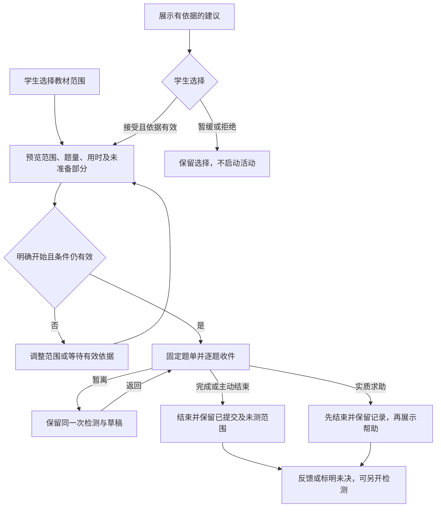

矩形表示业务状态或动作，菱形表示选择及准入。主流程强调建议不自动开测、暂离不结束、求助先结束。技术恢复、目标失效与权限异常沿用 §5；不同题量的选择机制与参考用时计算在工程阶段实现。本轮仅用三道自编题和预设覆盖关系演示 1、2、3 题的差别，没有执行通用选题或语义评价算法。

**FLOW-006：教材准备后供学生创建空间。** 管理员处理材料与发布内容，学生选用发布结果；两个角色不替代对方的操作。

1. 接收材料后建立稳定处理任务，离开或刷新后仍能回到同一任务。原材料、识别文本及修订对照；标疑页必须核对，未标疑页也纳入代表性抽查。
2. 原书未附答案不阻止接收。后补参考单列来源，核对理由与结果，不写成原书权威答案。教材内部章节点、目标和 Domain 引用需分别核查。
3. 明确每个部分已经具备的浏览、讲解及评价条件，再记录审核依据和批准。识别修订或标准改变后，对应核对状态失效；批准绑定准确候选，编辑后须重新批准。
4. 发布只改变可选目录。学生选择有权使用的教材、已发布目标及章节点，建立自己的空间和版本采用关系；家长不代建。已有空间保留原版，后续指定采用由 FLOW-004 承接。
5. 创建空间不改变源教材、领域对象和标准，也不证明全书就绪。不能使用的部分说明缺少什么，不能用另一课程的个人记录补齐。

当前以两页自编文本和预写识别结果走查，不处理真实 PDF、图片或 OCR。预置 v1 表示一个假定已发布的合成包，本次核对后可发布本地 v2。教材维护可以在检查影响后指定本页学生实际创建的合成空间采用新版，旧检测保留原版；Domain 候选维护仍使用独立的定义采用示例。二者没有真实评价影响处理。北师大版首批单元已在独立只读区准备候选，尚未接入本流程发布；校外内部教材仍待提供。

**FLOW-007：身份、关系与首次说明。** 独立账号、亲子关联和使用确认是不同事实，不能用其中一项替代另外两项。

- **管理员操作：** 创建档案、建立或解除具体关联、找回原账号前，记录系统外核实及本次依据。一次核实后不默认批准后续所有动作；找回保留原档案与学习历史。
- **关系影响：** 每条亲子关联独立维护。失效后，该家长的当前页面与旧链接均不得继续读取相应学生资料；其他有效关联不随之删除。关联管理不改写学习表现。
- **首次说明：** 家长确认数据使用范围，孩子确认愿意使用，两个入口分别完成。实际服务条件未核实、必要确认未完成时不能处理真实材料；已确认且范围未变时不重复打扰。
- **原型边界：** 本轮只有固定演示主体和本地状态，不收集密码、真实授权或证件。默认双方已确认可供其他流程走查；评审工具可重置演示确认，这不是新增授权撤回功能。真实按主体、关系、用途及服务版本保存的确认凭据仍需工程实现。

**FLOW-008：多模态输入、局部核对与明确提交。** 输入过程先保留用户表达，再处理识别不确定；不能让预览转写变成一次正式作答。

1. 学生选择文字、同题图片／PDF、手写或语音。图片归属存在疑点时核对是否属于同一题；整卷录入仍不纳入范围。几何图、表格及跨图关系需保留原材料，识别文本不能替代原件。
2. 手写过程中不判断；提交或请求帮助后才分析。语音由孩子主动开始和结束，允许预览、修改转写、取消或重录；取消的临时输入不进入学习历史。
3. 识别有疑点时，对照原件局部核对，不把核对题意当成解题帮助。本轮例子将高“4”识别为“1”；确认的是原题文字，不能据此改写学生原作答的对错。
4. 确认后的内容进入当前求助或作答草稿，用户仍明确提交。原件、原识别、核对后的文本与最终发送版本分别可查；再次编辑准备发送的内容，不覆盖原材料。
5. 提交后按当前活动规则反馈：练习可逐题反馈，独立检测只确认收到，直到结束。语音提问应展示并播放回复，停止与重听不推进讲解，播放失败可以继续看文字。

本轮原型在问题求助入口演示同题两页材料和语音转写，材料为自编文字与 SVG；没有真实文件上传、PDF 解析、拍照、收音、转写或播放。手写板保存浏览器实际笔迹，但不执行识别，也不证明 Android 手写体验。取消、核对、转入草稿、提交和原输入关联已有操作；检测内文本核对已由 FLOW-014 补充；实际识别、表格复杂材料与播放控制仍需相应交互和材料验证。

**FLOW-009：跨来源记录、更正与订正。** 记录以题目和当次表现为单位组织，错题是已确认错误的筛选结果，不是所有求助的总称。

- **找记录：** 先确定空间，再按外部录入、讲解练习或检测筛选。每条显示题面、原作答、版本、请求与已记录帮助；按空间查看，不把不同空间的数据汇成个人综合掌握结论。
- **看性质：** 未作答、尚未判定、识别争议和确认错误分别处理。当前原型实际提交均未正式判定；预写评价参考使用独立数据入口，不能混进本轮实际操作或冒充模型输出。
- **更正资料：** 学生指出录入／识别不符时，追加更正内容与理由，保留原提交，不计为一次新答题。更正需要核对，对已有判断的影响由正式复核及责任链处理，不能直接覆盖旧结论。
- **重新作答：** 订正形成新的尝试并保留帮助说明，原表现仍可查。正确与否仍待正式判断；页面不能仅因保存订正就把错题移成已掌握。
- **回看与复测：** 回看不生成新的表现，不因进入错题筛选就自动复测。复测是否合适继续由有效认识、目标和接触背景决定。
- **删除外部资料：** 同题多页按整份原资料隐藏，学生不能从原输入、更正或订正副本恢复。内部事实及获准家长／后台读取仍遵守已有规则；不扩展内部检测记录的删除权限。

**图 UX-05　资料更正与重新作答保留不同含义**

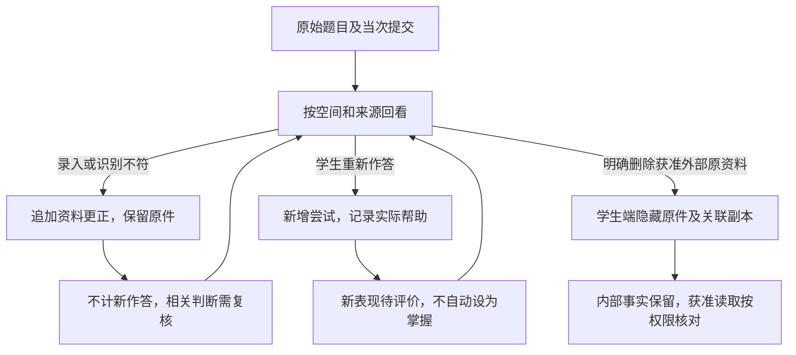

矩形表示资料处理与可见结果，箭头注明触发。更正和评价的正式生效仍由相应责任层完成；图不表示保存一段用户说明就已经重算 Belief。隐藏的学生资料不沿回看路径恢复，完整权限规则见 Data §5。

**FLOW-010：按记录追溯，再形成可检查的维护事项。** 管理员可以抽查普通记录，不必先由系统标记异常。

1. 先选定具体记录并说明本次事项或用途，再打开原输入、实际作答、帮助记录及采用版本。界面按同一记录展示，不只给一个模型生成的摘要。
2. 按 Learning Space、Domain、Interaction、Evaluation 和 Evolution 查看相应引用与结果。原型未运行的 Observation、校验、Policy、Evidence 和 Belief 明确显示“未执行”；这不同于校验通过、合法不干预、缺少学习者证据或处理失败。
3. 人工记录预期、实际差异和依据，并选择资料／识别、领域、评价、交互、运行或未确定方向。尚不清楚可保留未决，也可记录当前不修改；不自动判根因。
4. 明确指向领域定义或映射的事项可进入 FLOW-004 候选维护。候选绑定来源事项，批准和发布关联准确版本；其他方向不借此编辑器随意修改 Domain。
5. 发布后追加版本及检查依据，不把事项自动关闭。已失效结果、待执行、失败、未决和恢复后的剩余影响在正式链中分别跟踪；原型没有真实重处理，不能以发布成功代替修复完成。

本轮可按实际提交读取原输入、笔迹、更正、订正和已记录帮助，并建立事项、关联领域候选与本地发布。定义目录仅有合成 Domain 样例；其存在不表示自由输入已经正式匹配。其余模型定义目录、完整运行时间线、事项权限执行和重处理仍未实现。

**FLOW-011：从首页进入活动。** 首页先交代最近学习内容、活动位置与一项相关反馈，再提供继续学习、接受建议和提出新需要的入口。打开产品和阅读首页本身不算开始讲解；只有学生进入活动后，才记录实际展示。

1. 首页按 §2.3 呈现当前课程、最近内容、继续学习或建议、学习足迹及常驻输入；主导航为首页、学习情况、教材和学习记录，账号与空间管理独立可达。检测从章节、题目或建议进入准备，不是教材目录的一部分。
2. 学生可以继续原活动、带问题求助，或查看章节状态再决定下一步。讲解与求助进入当前活动工作区，不增加一套并行聊天面板。
3. 切换空间时，未发送文字、输入材料和求助草稿保留在所属空间。不同空间即使同名，也不合并记录、判断或草稿。
4. 返回首页不结束讲解；下次继续恢复最近实际参与的原活动、段落和未发送内容。结束活动回到首页后显示实际结果，不能继续已结束检测。未结束的检测仍按 FLOW-005 收束，不能借首页或链接绕入教学。

原型首页自由输入仅保存，明确提示尚未理解或执行，不用关键词把请求路由成活动。意图理解及行动执行是工程接入项。合成章节只在原演示空间提供，学生创建的课程不复用该章节的个人进度。新空间暂无正式评价时说明原因，不借预写状态填充，也不显示为零分。

**图 UX-06 学习入口、活动与空间上下文**
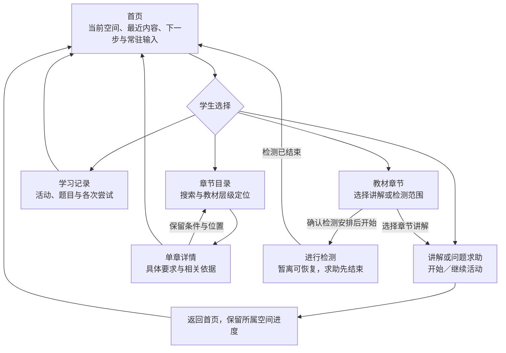
图中实线表示明确操作产生的页面迁移；从检测返回首页的前提是该检测已经结束。页面变化不直接产生掌握判断，空间上下文随记录保留。自然语言输入的识别和执行不在此图伪装为已实现。

**FLOW-012：运行任务核对与处理。** 管理员先查看任务状态，再依据原提交结果和服务条件选择处理，不把所有异常统一做成“重试”。

| 状态或操作 | 呈现与可做动作 | 禁止混淆 |
| --- | --- | --- |
| 配置编辑、保存 | 展示当前配置与检查对象；修改后旧检查不覆盖新配置 | 保存不代表服务可用 |
| 配置检查 | 区分可用、不可用、未检查，绑定实际检查的配置 | 原型的预写结果不是实际连通性 |
| 处理中／结果未知 | 查询原任务和提交结果；未知时继续核对 | 不直接重试，不要求孩子重新答题 |
| 原结果已存在 | 恢复原结果状态，核对实际提交与展示 | 不重新制造作答、评价或教学展示 |
| 确认未提交且失败 | 服务条件满足后，对原任务重试并记录尝试 | 不建立第二份学生表现 |
| 语义未决 | 查看输入、规则、输出及缺失条件，再决定补充或人工维护 | 网络返回不等于形成有效判断，不能用传输重试冒充通过 |
| 用量未取得 | 延迟、调用量、费用分别标未知；已知合计注明缺失数量 | 未知不记零，不把样例费用当实际预算 |

**图 UX-07 原任务核对与重试边界**
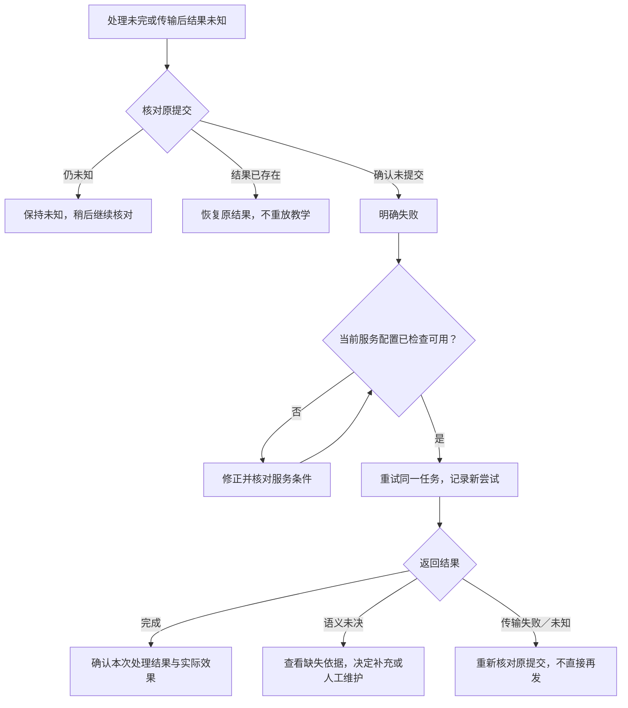
图中“明确失败”须确认没有提交，不能只从超时推断。图描述用户可理解的状态与动作；后端去重、原提交核对和实际执行确认由工程实现。正式任务从“运行”的目录与详情查看，服务配置为单独入口；现有原型把独立合成任务与本浏览器事项放在同页，只作为状态处理示例，待按 §2.5 重构。

**FLOW-013：家长查看具体空间并咨询。** 家长首先确认当前孩子和空间，再查看同源学习情况及必要依据。家长的选择不改变孩子当前正在学习的空间。

1. 在有效关联内选择空间。尚未形成评价的空间说明当前限制，不能套用另一个空间或预写样例的达标数。
2. 按需展开题目来源、原提交、实际帮助、提交前的输入核对及后来的更正／订正。学生端已删资料按现行授权仍可只读查看；家长没有修改或代交入口。
3. 在常驻输入中提出问题，发送后显示处理状态，历史按需展开。咨询归属于实际家长、孩子和空间；切换时保留各自未发送草稿，不把旧空间的文本带入新上下文。
4. 可以继续或另开一段咨询，删除按整段确认。删除后该家长入口不再恢复原咨询，孩子的事实和已独立提交的维护事项不随之删除。
5. 关联失效时停止读取该孩子的受限上下文；另一个家长的有效关系与私人咨询保持独立。

原型使用同一演示孩子、多个实际创建的合成课程和两名合成家长。家长切换只在走查工具提供，不是正式登录。咨询保存在当前浏览器，未接模型、不产生回复、不派任务，也不把家长陈述记为孩子表现。多孩子切换、实际认证、服务端授权及跨设备保存仍需工程和相应材料验证。

**图 UX-08 学习依据共享与家长咨询隔离**
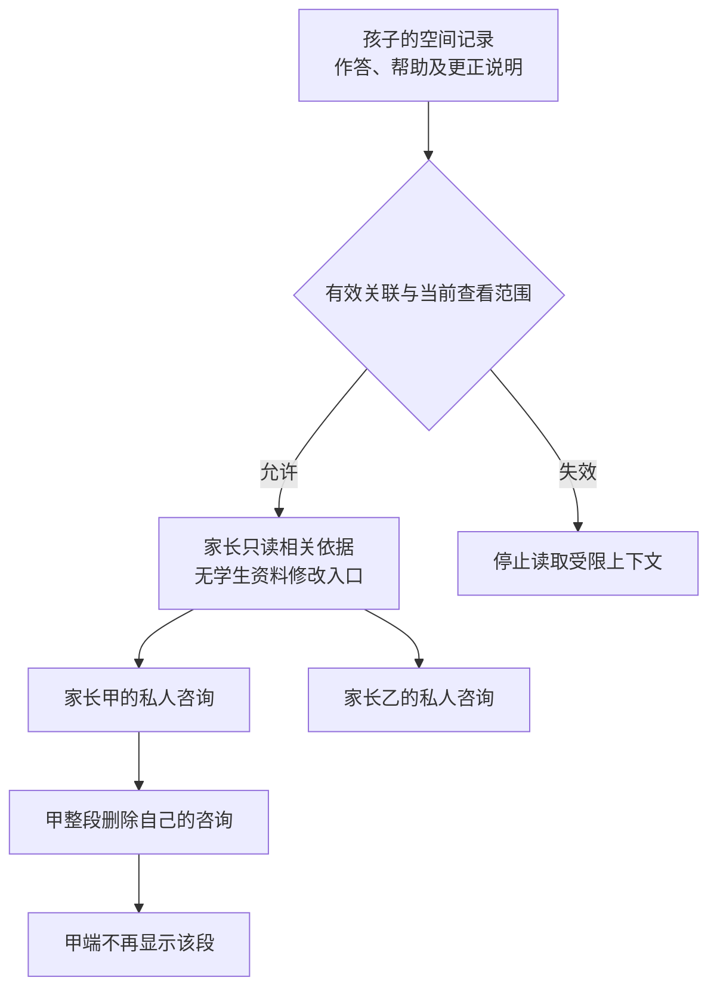
连线表示获准的读取或操作。两段咨询彼此不连通，也不反向写成孩子作答；删除甲的咨询不影响乙的咨询或孩子的原记录。图省略身份核实，授权条件仍按 AUTH-001。

**FLOW-014：检测内核对输入。** 孩子需要确认数字、符号或转写是否符合原意时，应能在当前题内处理，不被迫退出检测或接受解题帮助。

| 操作阶段 | 界面行为 | 对检测与记录的影响 |
| --- | --- | --- |
| 打开核对 | 保留当前题及核对前输入，展示待确认文字 | 仍是同一次检测、同一道题；不生成第二次表现 |
| 核对中 | 只处理输入差异，不显示解法、对错或提示；确认前不能提交该题 | 原作答草稿与待确认更改分开保存，刷新可恢复 |
| 取消核对 | 回到原草稿，撤销未确认更改 | 不新增作答或更正记录 |
| 确认核对 | 保存前后内容与用户说明，回到未提交草稿 | 仍需明确提交；未自动评分或认证独立性 |
| 明确求助 | 按已有规则结束检测，再进入教学 | 保留已提交部分，未做部分仍为未检测；请求与实际展示分开 |
| 请求含义不清 | 先澄清，暂不提供实质教学 | 不能仅因用户点击“核对”就保证更改没有语义影响 |

**图 UX-09 输入核对与解题帮助的不同出口**
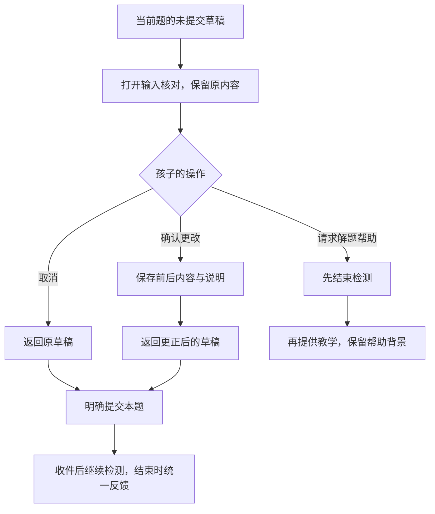
图只描述明确操作，含糊请求仍先澄清。核对按钮和用户声明不是语义判断依据的替代品；正式系统须保留原材料、实际帮助与解释依据。本轮原型只对真实录入的文本进行前后核对，不模拟已经运行 OCR 或已经确认独立性。

## 4. 关键交互与信息呈现

**UI-001：学生学习工作区。** 主区上方保留课程、章节和本次目的，当前活动采用连续对话。题面、图示、推导、练习表单与反馈作为可交互内容直接嵌入，追问与原内容可对照；讲解、检查安排和结果不要求切换页面。较长过程应允许回查和定位，不能只依赖记住聊天日期。

主要教学和作答默认内嵌；需要集中核对材料或确认关键操作时可以短暂弹出面板，关闭后回到原位置、保留草稿。弹出形式不用于承载整段教学，也不需要给每个动作加确认。原型使用受控的 Vue／HTML／CSS 组件，不执行任意输入中的 HTML；正式内容如何生成及渲染留待工程设计，动态内容不意味着控件行为和权限随意变化。

常驻输入支持文字、材料与主动录音入口，手写进入可提交的作答区域。软件键盘出现时输入区随可视区域移动，正文仍可滚动，不遮挡提交或结束操作。本轮原型只落实文字及图示，不能据此确认真实手写与语音体验。

输入框显示当前作用对象，例如“正在讨论：三角形面积／第 1 段”。普通发送就地反馈，不自动展开历史；历史通过独立按钮打开，打开、关闭不丢失草稿。要开始另一题或章节时明确显示新对象，旧讲解保留。意图不明确时先澄清，不按关键词直接执行删除、开测或发布。

语音的实际行为沿用 Requirements §3.8：主动录音、转写预览、修改或发送；语音提问默认播放并展示回复，其他输入默认展示并可播放；停止和重听不推进讲解。原型必须标明模拟语音，不能用浏览器朗读假称完整语音服务。

**UI-002：检测工作区。** 在连续学习工作区内显示题目、当前进度、作答区和“提交”“求助”“结束”，明确当前已进入检测状态。开始前及求助入口说明实质帮助将结束检测，检测期间收起此前教学内容及含教学信息的对话。提交后仅显示收到及下一题，不显示对错、解法或章节状态变化；完成或结束后在原工作区展开反馈。求助状态明确时无需再问学生是否真的要帮助；先反馈检测已结束，再展示帮助。含糊请求先澄清。

**UI-003：章节学习情况。** 课堂进度按 §2.3 以独立上下文及章名旁标记呈现，更新不改变评价。 目录提供可搜索、可按教材层级缩小范围的章节索引；单章详情展示已有表现、具体困难和仍不了解的部分，并说明变化、实际表现及下一步。完整学习要求及三类项数按需展开，继续向下查阅相关依据。数量必须有明确对象和口径，不由原始项数推断整章掌握；已有表现和实际覆盖分别说明。近期作答独立放置，近 7 天／近 30 天／全部筛选只控制作答统计，显示实际日期范围、可计分母和排除原因。加载失败或判断失效单独显示，不假装成孩子待确认。

**UI-004：家长概况与咨询。** 家长按当前孩子和空间只读查看课堂进度及来源，不提供代替孩子更新的入口。 依 §2.4 分设概况与私人咨询入口。概况先呈现当前孩子和空间的章节状态、覆盖及限制，再进入具体要求与相关依据；本次活动是详情对象，不是家长首要导航。切换时连同数据、草稿所属对象与咨询上下文一起切换，避免向另一孩子发送旧问题。提供咨询及明确提交的结果复核入口，私人咨询不出现在学生端。家长没有学生资料编辑入口；已隐藏材料的错误按既有复核事项提交后台。

**UI-005：后台定义与案例查看。** 管理员可以从定义目录进入，也可以从具体活动进入，二者通过有权限的引用互查。目录不是个人资料全览：进入具体学生记录前选定工作事项和用途，内容范围依 [Data §3](MVP_Data_and_Authority_Design.md#3-权限与责任映射) 校验。

| 查看区域 | 组织方式与主要信息 | 进一步操作 |
| --- | --- | --- |
| 定义目录 | 按 Learning / Domain / Interaction / Evaluation / Evolution 及模型、对象类型、版本和状态定位；个人实例从获准学习上下文进入 | 查看定义、来源、引用与版本差异；需要维护时建立候选，不在详情直接改当前事实 |
| 活动概览 | 学习者、空间、请求、活动状态、有效依据版本和记录完整性 | 进入时间线或判断详情，定位本次应有但缺失的记录 |
| Interaction 时间线 | 按实际先后排列输入、Observation 与校验、Policy 结果、计划动作、实际展示或播放、中断 | 同屏对照原输入、结构化结果和可读依据；区分候选、正式提交、执行不确定 |
| Evaluation 详情 | 按 Claim 范围查看 Evidence、Belief 前后变化、支持条件、目标评价和有效性 | 反查实际作答与帮助、采用的规则版本、变更原因，不提供“直接设为掌握” |
| 维护事项 | 线索、人工结论、候选差异、案例比较、批准、启用及影响任务 | 查看实际失败、未决和处理进度；跳转受影响对象及复测材料 |

“合法未产生”“尚在处理”“处理失败”“无权查看”“记录缺失”使用不同文案和状态；不可都显示空白。后台展示可检查的输入输出与理由，不要求显示模型隐藏思维链，不假装有自动根因诊断。

**UI-006：内容与维护工作区。** 教材目录进入材料详情，模型目录进入对象详情，二者可沿映射互查；候选与发布统一进入关联维护事项。详情对照来源和候选，显示版本、引用及可用行为，章节目录用于当前教材内定位，不把教材和模型目录合成一个长页面。扫描任务接受后可离页返回。发布前集中显示检查结果和适用范围；单人可依次完成修改、审核与发布，各动作分别留痕。发布后另行选择适用空间并检查采用影响，不能把发布按钮同时当作全量升级。

**UI-007：教材目录与检测准备。** 教材目录按章、节提供浏览与学习入口，从章节详情选择讲解或检测范围；选择检测后才进入安排。空间创建从空间管理入口选择教材、目标与课程范围，不与普通选测混为一个表单。检测前说明题量、用时和覆盖缺口；开始后只保留本次题目、提交、暂离和结束相关操作。问题复测和产品内建议也进入同一检测准备过程，不强制绕回章节目录。

**UI-008：账号与关系。** 学生、家长各自查看首次说明和本人的确认；管理员从“用户与学习”的可检索账号目录进入档案详情，选择具体关系维护或原账号找回。核实依据在该次操作中记录，不放在所有账号之上的通用核实表单；新增关系按姓名或标识查找候选并核对身份，不把全站账号塞入下拉框。解除关联前显示受影响的两端主体，之后旧访问入口返回关系失效状态。正式页面不出现原型的角色切换或演示确认重置工具。

**UI-009：输入核对面板。** 在当前求助／作答上下文展开材料入口，不另建一段聊天。原件与局部识别疑点对照；取消、重录、保留笔迹与转入草稿分别可操作。进入草稿后仍明确提交，发送前不生成正式学习结果。用户已经看过的来源说明可折叠，当前要核对的输入和提交按钮保持可找到。

**UI-010：学习记录与跨来源题目。** “学习活动”视图用于找回旧讲解或检测结果，“题目与作答”视图用于找原题及某次尝试；两者相互关联。空间、章节、时间、来源与确认错题是不同查询维度。选中记录后进入稳定详情，按次对照原提交、实际帮助和后续变化，返回恢复查询位置；更正资料与新增订正使用不同操作选项。后台的同记录入口沿 UI-005 展开，隐藏于学生端不意味着内部事实不存在。

**UI-011：学生首页。** 当前课程、最近学习位置和可理解的简短反馈先于活动统计。主要行动按 §2.3 提供续学、查看结果或建议，不随章节和历史数量无限增长。学习足迹采用三个时段指标，当前错题是另列的存量指标；数字可查明细，切换时段不能改变错题存量或学习状态。完整章节查询进入 UI-003，事实查找进入 UI-010。输入区独立占位，发送反馈留在正文；切换空间不借另一个空间的记录填充空白。真实时间与事件统计未接入时明确未知，原型的示例来源就近标注。

**UI-012：后台运行与处理。** 运行主区按任务目录、用量与人工投入、服务配置分视图，不把配置表单放在任务处理首屏。任务列表支持状态、类型、时间等筛选，详情保留原标识、尝试次数和处理记录；不同状态只开放相应动作，返回保持列表位置。费用与延迟明确单位及未知值，实际运行数据未接入时不展示产品成功率或成本结论。跨区待处理摘要引用原任务和事项，不复制状态。

## 5. 中断、恢复与异常流程

| 情境 | 用户看见什么、可以做什么 | 必须保留的业务区别 |
| --- | --- | --- |
| 处理较慢 | 原请求保持待处理，可取消或离页后返回查看 | 取消意图与结果是否已发生需核对；重试不新增学习表现 |
| 传输失败或结果状态未知 | 告知仍在核对原提交，核对后恢复结果或提供重试 | 不提示孩子重答以掩盖服务失败，不重复展示已确认发生的教学 |
| 暂离讲解 | 返回时出现“继续上次”，恢复段落、追问和未发送草稿 | 暂离不是讲解完成，也不把阅读位置作为掌握结果 |
| 暂离检测 | 返回同一未结束检测，核对已提交与当前草稿 | 不承诺恢复已结束检测；不会把技术重试变成第二次作答 |
| 题意或识别不清 | 高亮有疑点的局部，保留原件和确认输入 | 不要求重传全部材料，不把疑点算作学生错误 |
| 纲内但模型映射不足 | 区分能提供的帮助与暂不能形成的正式判断，保留维护线索 | 没有模板不自动等于超纲，不编造正式映射 |
| 明确超纲 | 简短说明当前支持范围，保留用户选择返回的入口 | 不用难度高或没有见过作为超纲结论 |
| 版本已失效或关系撤销 | 停止相应访问或依赖使用，说明结果正在修复或当前无权查看 | 隐藏页面不是权限实施；不能用失效旧结论继续推荐 |
| 删除资料 | 说明本端不可恢复及内部保留，确认具体对象后执行 | 其他独立练习不连带删除；历史、搜索和新回复不能恢复应隐藏内容 |

这些是产品反馈合同。请求去重、事务恢复及版本一致性的实现留到 Phase 5，按真实情况验证。

## 6. 关键页面、原型与走查

**当前结构低保真稿（2026-10-17）。** 新入口为 [structure.html](../../../src/mvp_prototype/structure.html)，源码为 [structure](../../../src/mvp_prototype/src/structure/)，启动和检查见[原型说明](../../../src/mvp_prototype/README.md#当前入口三端结构低保真稿)。学生、家长、后台使用 §2 的稳定导航；角色切换只放在独立走查栏。用不同章节、孩子和账号替换内容，不按案例生成新的顶层入口。

本轮已经可以操作的过程包括：

- 学生从教材开始分段讲解，保留进度，完成一题结束检查；求助先结束检查。实际提交与未提交草稿分别处理。
- 家长从概况查到本浏览器实际产生的记录，只读作答与帮助；明确提交复核后，后台工作台收到同一事项。私人咨询不会自动全部转交。
- 管理员从工作事项或账号目录进入案例，登记用途后查看交互、评价、关联版本与处理记录。人工意见返回原复核事项，不直接改变学习事实或 Belief。
- 学生查找长期记录，后台查找账号、教材、模型目录和任务；查询条件进入地址，详情返回保留原筛选与分页。输入草稿按角色、孩子、空间和活动保存。
- 学生默认进入首页，围绕一个最近主题提供简短反馈、继续学习／结果回看／可查的建议，以及可展开明细的学习足迹；学习情况直接提供章节目录和单章详情，解释反馈、要求及项数。可暂不安排建议、查看其参考依据、直接提交文字或图片，并在正文看到保存结果；旧首页链接兼容，旧活动和草稿继续保留。

原型中的章节状态与历史判定仍是明确标注的预写资料；新提交只保存原输入，不产生 Evaluation 结果。模型目录只有元信息，案例没有采用正式模板、KC 或评价规则时明确显示缺项。查看用途是界面流程，不是正式授权实现。完整问题录入与求助、动态教学与评分、完整选测与主动建议处理、空间与账号维护、内容编辑发布、完整事件链及真实多模态处理尚未迁入此稿。首页图片仅作本地收集，建议是预写参考；实际计时未接入，26／30 分钟情境只用于审阅。产品范围不因此缩减，没有真实用户任务测量或生产性能结论。

作者检查：类型检查、生产构建及新版 9 项浏览器检查通过；原工具 6 项回归检查通过。检查覆盖实际跨角色提交、父母视角的只读与输入隔离、检查期间的活动切换、结束后不可重开、列表查询与返回、常驻输入及三种屏宽。实际查看七个截图状态，发现家长与后台缺题面后已修正并复验；脚本、结果与限制见原型说明。未修改本稿 Mermaid，既有图的检查记录保持。

同日学生首页优化另通过类型检查、生产构建及受影响的浏览器检查：已有结构 9 项通过，首页最终 7 项通过。截图覆盖 10 个状态与屏幕条件，未发现浏览器异常、横向溢出或正文与输入区重叠；实际查看首次、继续、结束、依据展开、临近时限及窄屏等页面。来源、复验过程与限制集中见原型说明；本轮不新增模型或真实学生效果证据。

同日连续对话增量使用 [ConversationLesson.vue](../../../src/mvp_prototype/src/structure/ConversationLesson.vue) 与 [CardGroups.vue](../../../src/mvp_prototype/src/structure/CardGroups.vue)。分数示例包含理解较快与基础回补两条明确标注的预写路径；当前对话直接显示实际输入，练习、检测安排、题目和小结均内嵌，刷新保留旧进度。真实练习与检查分别保存，跨端只读；预写学生表达不作为真实表现。自由输入尚无模型回应，手写／语音、长对话分段折叠和正式动态教学待后续落实。

类型检查和生产构建通过。22 项定向浏览器检查初轮通过 21 项，另一项因检测题在顶部与作答区重复出现而定位不唯一；删除重复呈现后，相关 7 项复验全部通过。最终 10 个截图状态没有页面异常、横向溢出或正文与输入区重叠，已实际查看讲解、两条路径、练习、检测、结果及窄屏。脚本与详细记录见原型说明；这些是交互检查，不是模型或教学效果验证。

**原局部流程工具。** 以下检查记录和 `phase4.html` 保留，证明此前局部操作的结果；原工具仍包含案例导航、合成数据切换和预写结果控件，不作为新导航规范。新结构的首轮交付不表示原工具的全部功能已经完成迁移。

原型已贯通章节讲解、阶段练习、结束检测、问题文本求助与记录，增加学生和家长同源章节状态，以及领域候选至指定采用的局部维护链。学生增加教材与检测、账号入口；家长增加账号与首次说明；管理员增加教材准备、账号与关系。本轮增加学习首页，整合活动入口、当前空间与记录；家长独立选择空间及私人咨询已补入；完整意图执行、多孩子切换及跨设备行为仍待完善。

新增源码为 [ProblemHelpReview.vue](../../../src/mvp_prototype/src/components/ProblemHelpReview.vue)、[LearningStatusReview.vue](../../../src/mvp_prototype/src/components/LearningStatusReview.vue)、[MaintenanceReview.vue](../../../src/mvp_prototype/src/components/MaintenanceReview.vue)，共同使用 [product-flow-fixtures.json](../../../src/mvp_foundation/examples/product-flow-fixtures.json)。当前只覆盖三端规则的一部分；范围选测、主动建议、教材核对发布及身份关系已有局部走查；输入核对、跨来源记录与订正、按案例追溯已有本轮局部实现；真实多模态处理、完整模型目录与运行追溯、真实维护影响仍待落实。

资产使用 [现有 Vue 原型工程](../../../src/mvp_prototype/README.md)。旧页面保留历史参考，新 Phase 4 入口与其区分；固定示例不能模拟成自由意图理解。合成章节必须明确标注，不代表已经取得真实教材、建立正式 Domain 包或通过判断质量检查。实际入口为 [phase4.html](../../../src/mvp_prototype/phase4.html)，交互源码为 [FoundationReview.vue](../../../src/mvp_prototype/src/components/FoundationReview.vue)，使用 [chapter-lesson.json](../../../src/mvp_foundation/examples/chapter-lesson.json) 合成材料；具体启动与限制见原型说明。

走查重点是：无需先选功能能否发起求助；追问后是否仍找得到原推导；未作答和受助作答是否被误解为掌握；暂离后能否继续；家长与管理员能否沿同一案例看到不同权限下的依据。原型操作、作者走查、用户反馈和真实系统测量分别记录。

2026-10-15 作者检查：类型检查、生产构建及新旧章节相关的 13 项检查通过。视觉检查发现常驻输入遮挡正文后，调整为正文独立滚动、输入区保留布局空间，再运行新原型 6 项检查全部通过。1280、834、390 像素宽度检查没有横向溢出；查看了 1280 与 390 的截图。该记录不包含用户走查、真实语义模型、原生 APK 或完整权限验证。

同日第二增量检查：构建与类型检查通过，章节 6 项及新增流程 8 项共 14 项通过。检查了求助边界、隐藏可见性、状态统计及故障、空间及家长输入隔离、候选检查与批准、发布与采用，以及检测暂停后的导航。手机初版说明占据过多首屏后，折叠详细来源并精简标题；复验 1280／834／390 像素布局，项数与常驻输入可同时出现在首屏。CASE-009–019 与脚本、具体操作入口见[原型说明](../../../src/mvp_prototype/README.md)。

第三增量新增 [CourseReview.vue](../../../src/mvp_prototype/src/components/CourseReview.vue)、[MaterialSetupReview.vue](../../../src/mvp_prototype/src/components/MaterialSetupReview.vue)、[AccountReview.vue](../../../src/mvp_prototype/src/components/AccountReview.vue)，共用 [course-setup-fixture.json](../../../src/mvp_foundation/examples/course-setup-fixture.json)。构建、类型检查与 21 项定向浏览器检查通过，新增检查覆盖范围变化、未覆盖部分、建议失效、教材批准失效、版本采用、身份关联及分别确认。具体复验与限制见[原型说明](../../../src/mvp_prototype/README.md#本轮检查)。

第四增量新增 [InputCaptureReview.vue](../../../src/mvp_prototype/src/components/InputCaptureReview.vue)、[RecordsReview.vue](../../../src/mvp_prototype/src/components/RecordsReview.vue) 与 [CaseTraceReview.vue](../../../src/mvp_prototype/src/components/CaseTraceReview.vue)，采用 [input-fixture.json](../../../src/mvp_foundation/examples/input-fixture.json) 及本轮实际页面提交。教材 v2 可指定给已创建课程，准备中的旧版本题单需重新预览；历史检测采用版本和原章节保留。构建、类型检查及四个脚本共 29 项浏览器检查通过，具体复验记录见原型说明；没有真实模型、OCR 或音频测量。

第五增量增加 [LearningHomeReview.vue](../../../src/mvp_prototype/src/components/LearningHomeReview.vue) 与 [OperationsReview.vue](../../../src/mvp_prototype/src/components/OperationsReview.vue)。首页与求助草稿按稳定空间标识保存，学习情况不把预写判断赋给新课程；后台以独立合成任务走查配置保存、检查、未知核对及同任务重试。检查脚本与实际结果见[原型说明](../../../src/mvp_prototype/README.md#本轮检查)。本轮仍是作者流程检查，不是正式运行或用户体验通过。

第六增量以 [ParentConsultationReview.vue](../../../src/mvp_prototype/src/components/ParentConsultationReview.vue) 和 [CheckInputReview.vue](../../../src/mvp_prototype/src/components/CheckInputReview.vue) 补齐家长私人咨询、跨空间实际记录与检测内核对。学生记录、家长只读依据和后台事项均可追溯已确认的输入前后内容。检查与限制见[原型说明](../../../src/mvp_prototype/README.md#本轮检查)。

2026-10-17 增加 [ContentPackageReview.vue](../../../src/mvp_prototype/src/components/ContentPackageReview.vue)。从管理员“内容与维护”展开“分数的应用”草案，先看章节覆盖与缺口，再按学习要求、问题与解法、知识定义、原创题及评价案例查询；选择问题模板后连同方法、知识依据和原材料位置一起展示。所有数据直接读取同一份候选资产，不另维护页面副本。该区域只读，无批准、发布或采用操作，也不写入浏览器学习状态。既有三角形维护例仍明确标为合成，不能将其发布动作作用到实际内容候选。作者构建与相关九项浏览器检查通过，实际内容审核和用户交互审阅仍未完成。

同日补充 [SourceReferenceReview.vue](../../../src/mvp_prototype/src/components/SourceReferenceReview.vue)：在“教材题与图示”按页码和小题定位，先读条件与需核对的表现，再展开作者解答及适用的关系图。换题收起答案；图中给定量、推导量和所求量带文字标识，不只靠颜色区分。小屏图形可在自身区域横向查看，解释文字正常换行。所有图都是含答案的审核参考，未作为学生检测输入；正式原图识别、内容批准和跨端权限不由此证明。

**真实模型交互试用（2026-10-17）。** 用户授权先接通真实模型，通过实际对话打磨教学界面。本增量服务于 Phase 4 的交互判断：选择“分数的应用”及必要基础回补，以文字为输入，模型生成解释、公式、简单条形图和题目，前端用限定组件呈现。原预写路径保持独立，不把其个人状态、参考作答或反馈混入真实会话。

- 普通章节讲解和首页学习入口直接进入真实对话；页面只保留简短标题、连续正文和常驻输入区，课程导航在返回首页后呈现，不另设“真实对话”入口。预写情境退至评审工具。旧活动及草稿保留，普通入口继续旧讲解时建立真实活动的对应关系，不传入预写个人表现。
- 一次只处理一轮，可停止生成；未知送达使用同一请求编号确认。网络失败、超时及不可用格式明确提示并保留输入，由用户重试；格式修复最多一次。
- 随堂练习提交后反馈。即时检查先展示一题安排，点击开始后收起前文；题目仍在对话中，答案和理由使用同一底部输入区。提交即结束该题，求助也先结束再讲解。结束后的检查不重新开启；继续交流可另开新题。
- 当前仅为成人本机试用。模型反馈不进入正式 Evidence／Belief 或章节状态。语义质量、独立验证、真实多模态、完整活动评价及跨端运行追溯仍待工程实现与验证。

实际入口、配置、保存方式、作者检查及已发现的输出限制统一见[原型说明的真实模式](../../../src/mvp_prototype/README.md#真实模型对话现在可以使用)。本增量不冻结正式技术方案，不将其他活动从 MVP 范围移除。

## 7. 交互评审与工程交接

工程交接需包含每项 ACT/FLOW/UI 的输入、可见状态、可用操作、结束结果、失败反馈及数据权限引用。上述标识是本层设计对象，关系追加到 Requirements §7；不另建完整需求矩阵。

### 7.1 本轮交付与未验证事项

本轮交付 §2 的任务与结构，以及 §6 所列首条跨角色过程和目录低保真稿；其余关键路径仍需在新结构下展开。范围依据仍为 G3-20261015-01，既有 REQ、ACT、FLOW、UI 标识保持。原型用于发现组织和操作问题，不能作为完整工程规格或已通过可用性测试的依据。

用户已基本认可结构方向，要求逐步打磨内容与交互；本轮首页更新仍待具体审阅。当前需要检验的设计假设包括：首页能否帮助学生理解现状并选择下一步，学生三个主导航入口是否容易区分，活动与题目两个记录视图是否便于找回，家长概况到依据的层次是否自然，后台六区是否能减少重复查找。它们属于待走查的交互方案，不是新增产品承诺；若验证发现改变权限、业务行为或范围才可成立，应回到对应决定讨论。

新低保真稿已补入跨页面草稿保存和两名孩子切换；完整运行追溯仍待实现，原工具的已知限制没有因此消失。校内实际章节候选尚未正式审核；真实对话只引用其中的知识、问题与解法定义作范围参考，未执行正式 Domain 发布或评价。校外教材仍缺。正式 APK 的书写、拍照、录音及设备表现须在工程阶段验证，网页不能代替。

### 7.2 结构检查与大量记录走查

下表保留合成数据规格，并区分已落实部分与未完成工作。数量用于暴露长列表、同名对象和历史定位问题，不是首批用户目标、后端容量承诺或新的质量阈值。实际生成见 [data.ts](../../../src/mvp_prototype/src/structure/data.ts)。

| 情境 | 数据规格与本轮落实 | 已查与待查 |
| --- | --- | --- |
| 新学生 | 已有校外无内容状态，新增已选课程但无历史参考／无评价的首页情境；无空间、创建空间尚未迁入 | 首页与完整状态页保持未知口径；已有活动不会因切换情境被删除；完整首次进入与创建过程待补 |
| 多章课程 | 默认 3 章，另有 30／300 章目录情境，包含重复章名和长名称；新增条目无评价、无教学内容 | 首页数量有界、分册／单元定位、搜索筛选、单章详情及返回可操作；合成规模不证明真实课程覆盖或服务端容量 |
| 长期学习 | 校内 1,000 条参考记录，活动视图取其中 200 条，含重复题和未知日期；新增实际提交单列 | 筛选、分页、详情返回可操作；多次订正与题目聚合历史尚未完整准备 |
| 家长查看 | 已有 2 名孩子、各 2 个空间；校外均无内容，私人咨询按上下文保存 | 可查切换隔离、实际记录与复核；100 段咨询历史尚未准备 |
| 后台目录 | 已生成 1,000 名学生、1,500 名家长、20 本材料、5,000 个模型版本元信息条目 | 目录搜索、筛选、分页与返回可操作；完整定义、版本家族和引用关系尚未附齐 |
| 后台连续工作 | 已生成 10,000 条活动索引、200 条不同状态的运行任务；复核使用本轮实际提交 | 可从学生档案定位活动，查看用途后进入案例；全局活动查询、完整事件筛选、编辑发布与影响处理待补 |

按 §2.6 的六条任务执行有限走查，除正常完成外，选择与任务相关的无结果、失效、失败及无权状态；不把所有维度做成无限组合。开始前固定任务描述与目标对象，只给用户目标，不告知按钮路径。记录是否独立完成、耗时、误入位置、需要提示的地方及对状态的解释；现有浏览器脚本只补查状态和回归，不能代替人使用。

作者先做认知走查和图文一致性检查；用户参与的审阅分别记录扮演的角色。用户以家长和管理员身份审阅可提供相关证据，不能代替真实学生的易用性结论。没有真实儿童输入时使用合成资料，保留待后续验证的限制，不要求本轮开展新的儿童测试。

关键任务没有可达路径、丢失当前对象、出现权限越界或会误读关键状态时，修正设计后复查受影响路径。耗时和主观反馈先作为改进证据，不在本稿新设 G4 百分比门槛；正式指标仍由 Validation 维护。

### 7.3 学生学习情况的作者复审（2026-10-17）

本节记录首页拆分之前的复审；当前页面职责以 §2.3 为准。前轮复审从查找与理解任务出发，不把页面能加载作为设计完成。评审采用“概览是否有用、任意章节能否找到、状态是否会误读、操作能否恢复”四组问题；参考 [Nielsen 可用性启发式](https://www.nngroup.com/articles/ten-usability-heuristics/)、[渐进呈现](https://www.nngroup.com/articles/progressive-disclosure/)、[识别优于回忆](https://www.nngroup.com/articles/recognition-and-recall/)以及 [WCAG 焦点不被遮挡](https://www.w3.org/WAI/WCAG22/Understanding/focus-not-obscured-minimum)。这些是评审依据，不代表遵循原则就已经证明对学生有效。

| 复审问题 | 发现与处理 | 检查任务 |
| --- | --- | --- |
| 数百章是否仍能快速定位 | 原先每章完整摘要平铺，规模增长会失控；改为概览、目录、详情，首页最多 3 个近期章节，目录每页最多 12 行 | 3／30／300 章；指定分册、单元下的重名章节；只知道名称片段的查找 |
| 是否把近期和缺少证据误作掌握程度 | 近期只按实际使用排序；未配置内容与无评价明确说明，不产生差的表现或达标结论 | 无评价、首次使用、合成章节、已有未评价活动与空间切换 |
| 是否在深入后丢失位置 | 保留查询与页码，返回恢复所选章节和滚动位置；修正筛选后焦点回到页首的问题 | 第 2 页打开详情后返回、浏览器返回、刷新详情再返回、键盘 Enter 打开 |
| 是否在次级区域重现无限列表 | “其他未结束活动”也限制为 3 项，完整内容转到活动目录 | 20 项旧活动，近期去重与最近活动继续 |
| 是否只检查桌面和短标题 | 长名称正常换行，窄屏行内信息纵向排列；截图发现页头与说明挤占目录首屏后，压缩学生端窄屏页头，将重复说明移到列表后，删除面包屑对长标题的重复 | 1280×900、834×1112、390×844、1024×600；正文与输入区分别占位 |
| 是否能找到解释和下一步 | 单章详情统一提供已有表现、需加强、未知、变化、作答与下一步；学习要求折叠可查 | 分数章节、要求项数、依据缺口、继续旧活动与原草稿 |

作者走查及脚本结果记录在[原型说明](../../../src/mvp_prototype/README.md)和[本地截图与检查目录](../../../.tmp/status-ia-review/)。本次属于作者自审和确定性浏览器检查，不是独立专家审计或学生可用性实测。实际课程更多层级、屏幕键盘、Android 手写、真实评价可理解性及教学效果仍须后续验证。三个参考章的完整评价依据尚缺，不能因目录改进而宣称这部分已完成。

### 7.4 首页与学习情况分工的作者复审（2026-10-17）

本轮先在 Requirements §3.11 明确信息职责和事件口径，再修改原型。作者按实际进入、续学、查判断、查数字来源和切换空间五类任务复审；不把既定页面当成正确答案，也不以浏览器测试代替内容与信息层次判断。

| 审查点 | 发现、取舍与修正 | 已取得的证据 |
| --- | --- | --- |
| 首页是否与学习情况重复 | 首轮首页仍复制较长的章节表现，削弱了概览；压缩为当前主题、一句关键反馈和单章入口，完整查询留在学习情况，删除重复的目录入口 | 对照首页与单章详情，完整主导航仍可直接进入目录；默认地址为 `/home`，`/status` 为目录 |
| 数字是否有明确含义 | 旧活动对象没有完整事件，不能用创建次数或千条规模样例直接算使用成效；新增隔离的统计示例和匹配明细，真实对话另存。错题存量与时段活动分开 | 同日去重、跨天继续、空检测、部分提交、重复事件、日期边界、未知日期、订正和隐藏资料的检查通过 |
| 重要行动是否被说明挤掉 | 首轮截图发现窄屏主要按钮位于首屏外，且旧样式造成重复面板；减少说明与重复层次，压缩建议中的重复主题，保留点击目标尺寸 | 最终 834×1112、390×844、1024×600 的主要行动完整位于正文首屏，1280×900 同样可见；没有正文与输入重叠 |
| 是否可核对并返回 | 统计数字展开对应明细，收起后焦点回到触发按钮；首页进入的章节可直接返回首页，目录进入的章节返回原查询位置 | 明细条数匹配数字；恢复焦点、旧章节链接、目录页码／筛选／滚动、原活动和草稿检查通过 |
| 数据多和数据少是否都成立 | 首页只保留一个相关主题，较早活动最多先列三项；目录仍支持 3／30／300 章；无可靠数据不用 0，校外不挪用校内记录 | 20 项未结束活动、合成目录、无评价、首次使用、校外材料未就绪情境可操作；原有家长和后台回归通过 |

类型检查与生产构建通过；初轮 41 项跨角色与学生路径检查通过，压缩首页并补焦点处理后 22 项受影响检查通过，最终首屏调整后 16 项首页检查通过（含新增 3 项首屏断言）。测试使用隔离浏览器和模型替身，没有额外真实模型调用，也没有清理用户原有活动。四种窗口尺寸均留存截图和布局检查；最终查看平板、窄屏、无参考及错题明细等实际截图，未观察到页面异常或横向溢出。资产见[本地复审目录](../../../.tmp/home-status-separation-review/)，操作与测试入口见[原型说明](../../../src/mvp_prototype/README.md)。

**复审结论与限制。** 当前分工足以进入下一轮内容和操作讨论：学生能区分“近期做了什么”与“按章节学得怎样”，计数可以核对，原有连续对话和记录恢复保留。统计、判断与建议仍明确区分示例和真实结果；实际统计事件、正式 Evaluation、目标依据和真实计时尚未接入。本次属于作者自审及确定性检查，不是独立专家审计、真实学生可用性研究、Android 设备验证或 G4 通过。用户尚未审阅本轮细节。

**课堂进度增量复审（2026-10-17）。** 初版只在学习情况中提供轻量入口，用户审阅指出发现性不足；调整为首页显著呈现并直接更新，学习情况保留轻量上下文和章名标记。首页显示确认日期，详细时间、说明及历史在弹窗查看；标记不借用掌握状态的颜色或达标图标。 首页增量检查发现横向短屏的主要学习按钮被挤出首屏，改为宽屏下课堂进度与学习操作并排、窄屏下依次排列；四种尺寸的截图复查及相关回归检查通过。按未知、明确确认、改为未知、取消、刷新、多个章节及家长查看复查，另用 300 章确认查找有界。作者检查发现无教学内容的章节详情会遗漏课堂标记，已使标记独立于教学内容和评价是否就绪。脚本、截图及运行结果见[原型说明的课堂进度部分](../../../src/mvp_prototype/README.md#课堂进度学生确认家长只读)；真实模型、跨设备保存和正式权限仍未在此实现。

### 7.5 后续工作与接收条件

| 顺序 | 下一步实际产物 | 可以继续的条件 |
| --- | --- | --- |
| 1 | 在当前低保真稿审阅三端导航和首条跨角色过程 | 核对能否理解位置、下一步与返回；重要分歧已明确，不先决定颜色和像素 |
| 2 | 按新结构承接问题求助、检测、建议、账号／空间与内容维护等其余关键任务 | 复用对象与状态，原工具只提供局部规则参考；不以链接旧工具代替迁移完成 |
| 3 | 补齐 §7.2 尚缺的数据密集状态及完整追溯详情 | 各任务能够从目录定位到内容并返回，失败与权限边界可检查 |
| 4 | 完善三种设备布局及交互，执行实际任务走查 | 记录完成、误入、提示和误读；与内容、权限、评测资产共同形成 G4 输入 |

内容准备、语义参考和权限合同中不依赖布局的工作可以继续；本轮暂停在旧导航上堆加新的演示页面。上述工作仍属于 P4-01，不新增 Roadmap 阶段，也不把后续真实工程工作提前混入本次结构评审。

## 8. 文档完成条件

| 检查项 | 2026-10-17 状态 | 尚缺证据 |
| --- | --- | --- |
| 三端任务、结构与关键切换明确 | §2 方案及首条跨角色低保真过程已形成；整体方向获基本认可，学生首页已作本轮优化 | 首页及三端细节审阅、其余关键任务迁移及真实任务走查 |
| 长期记录与大量对象可查找 | 已生成 §7.2 所列部分数据，目录与返回可操作 | 完整关系和修订历史、实际用户查找结果；不含后端容量验证 |
| AI 反馈、权限与用户控制符合需求 | 预写界面检查输入隔离、家长只读与查看用途；独立真实模式执行模型调用及单会话串行，未接正式评价或账号授权 | 完整正常／失败路径及后续真实工程验证 |
| 输入、输出、状态可交接 | FLOW-001–014 已细化并有局部原型 | 真实识别与含糊请求澄清、音频与复杂材料、完整后台与维护影响、实际设备状态 |
| 对象与需求可追溯 | 按已形成对象补入主索引 | 后续新增界面和 CASE 持续补入 |

本稿不授予 G4 通过。联合条件仍需领域、权限、评测材料及真实资产共同满足。
