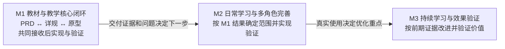

# DeerMind Development Roadmap v0.11
> **版本**：v0.11<br>
> **中文名称**：DeerMind 开发总路线图<br>
> **文档性质**：项目级全生命周期开发路线图 / Development Roadmap<br>
> **状态**：本轮领域模型、原型及关联合同已修订，待用户审阅；真实服务与效果未验证<br>
> **上位基线**：`DeerMind_Product_Thesis_v1.0.md`、`DeerMind_Product_Constitution_v1.0.md`、`DeerMind_Concept_Architecture_v1.6.md`、Domain Space v1.3、Learning Space v1.3 与 Evaluation / Interaction / Evolution v1.5、`DeerMind_AI_Native_Architecture_Principles_v0.7.md`<br>
> **专项路线图**：`DeerMind_System_Design_Roadmap_v0.11.md`<br>
> **维护责任**：Codex 维护与核对；用户决定重要模型与范围变更<br>
> **评审记录**：用户批准模型变更及完整实施；作者检查见MVP决定登记§68，不代表真实效果验收通过<br>
> **写作规范**：[设计文档规范 v1.1](DeerMind_Design_Document_Standard_v1.1.md)<br>
> **更新日期**：2026-11-14<br>
> **修订说明**：v0.10 → v0.11，同步Task／Solution新定义、多KC方法、Task先导、题内参考及相关Task独立取证；保持既定数值规则和工程边界；逐文件记录见MVP决定登记§68<br>

---

## 1. 文档定位：从“系统应该是什么”走到“可以承担生产责任”

DeerMind 已经完成 Concept Architecture、Domain / Evaluation / Interaction / Evolution 四份 Space Design，并建立 AI-Native Architecture Principles。当前项目已经能够较清晰地回答：系统需要维护哪些语义责任、哪些认识可以开放、哪些权力必须受控、系统如何允许自己的认识被现实证据修正。

但从架构基线到第一个正式上线版本，中间并不是简单的“System Design → 写代码 → 发布”。DeerMind Core 是面向真实学习过程的一般 AI 原生学习系统，而第一个 Product Context 是小学学习。项目因此必须同时解决通用架构可实现性、产品价值、领域初始化、AI 行为质量与长期可观测性，并在进入首发产品阶段后进一步落实未成年人保护、guardian authority、学校现实、安全隐私和生产运营责任。市场进入边界不能反向成为 Core Architecture boundary；任何一层没有建立最低可信度，都不应该通过扩大用户规模来替代验证。

因此本文档把项目最终目标定义为：

> **交付 DeerMind 第一个能够面向明确目标用户提供完整核心价值，并能够对真实用户、真实儿童数据、AI 行为和持续运行承担生产责任的 Production Release。**

“Production Release”不等于系统可以启动，也不等于 MVP 功能开发完成。它至少意味着：目标用户与核心价值明确；真实学习闭环能够完成；AI 行为达到已定义的最低质量门槛；儿童数据、安全与隐私边界可执行；系统能够被监控、停止、降级、回滚和恢复；上线前已获得有限真实用户证据，并且已知重大风险具有明确处置路径。

### 1.1 Development Roadmap 与 System Design Roadmap 的关系

`DeerMind_System_Design_Roadmap_v0.11.md` 只负责项目生命周期中的 **System Design 阶段**。它回答如何把已经冻结的 Architecture Semantics 转化为 Architecture-Executable Specification，并进一步规定 System Design 内部的 Work Package、Phase、Focused Design Closure、横切覆盖、Consolidated Architecture Spike、Evidence Review 与 Gate E / Gate F。

本文档位于更高一层，覆盖：

```text
Architecture Baseline
        ↓
System Design
        ↓
Architecture Validation Build
        ↓
MVP Definition
        ↓
Product & Domain Foundation
        ↓
MVP Engineering
        ↓
Internal Alpha & Evaluation
        ↓
Controlled Pilot
        ↓
Production Candidate
        ↓
Productionization & Launch
        ↓
Post-Launch Stabilization
```

上述纵向顺序表示交接与证据责任。MVP Definition与Product & Domain Foundation的工作同步展开：PRD、详细规格及原型可以反复修订，G3／G4分别检查相应责任，不要求等前一份文档写完才启动后一类设计；当前业务分包见§4及M1工作计划。

System Design Roadmap 是本路线图的专项子路线，不被本文档替代。Development Roadmap 只定义“System Design 完成后项目可以进入什么阶段”，System Design Roadmap 则定义“System Design 本身如何形成、验证和冻结”。

两份 Roadmap 共同保持一个重要边界：

> **Core System Design 冻结 Product Context / Context Constitution 的接入与 enforcement 能力；具体小学 Product Context 的 guardian authority、consent、child-data、家长可见性、学校现实与 retention 规则，由后续 MVP Definition / Product & Domain Foundation 阶段实例化。**

后续 Product、Pilot、Production 等阶段如果复杂度足够，也可以形成各自的专项计划。

### 1.2 Roadmap 不是 Schedule

本文档冻结的是阶段、依赖、产物、证据门槛和 Reopen Condition，而不是具体月份、Sprint 数量或发布日期。

当前阶段仍存在大量必须通过 Architecture Validation 和真实用户 Pilot 才能得到答案的不确定性。现在给出精确日期会把尚未验证的假设伪装成确定计划。因此：

> **Roadmap 决定下一步为什么可以开始；Delivery Plan 才决定下一步何时完成。**

真正的交付排期应在 Architecture Validation Build 与 MVP Definition 后，基于已经知道的产品范围、工程复杂度、团队配置和外部约束形成。

---

## 2. 总体开发模型：每一阶段都用证据换取下一阶段承诺

DeerMind 不采用单向的 `Design → Coding → Testing → Launch` 模型。项目本身应遵循与 DeerMind Evolution 一致的证据驱动方式：先形成当前最好判断，再通过最低成本但足够有力的验证取得证据，然后决定是否扩大下一阶段投入。

统一开发循环是：

\[
Design
\rightarrow
Validation
\rightarrow
Evidence
\rightarrow
Decision
\rightarrow
NextCommitment
\]

这里的 `NextCommitment` 不仅是代码提交，而是项目对更高成本、更大用户暴露和更高运营责任的承诺。

### 2.1 四类证据不能互相替代

整个 Development Roadmap 至少使用四种不同证据：

| 证据类型 | 主要回答的问题 | 典型方式 |
|---|---|---|
| Conceptual Evidence | 理论和语义边界是否自洽 | 逻辑推导、反例、Architecture Review、Failure Analysis |
| Engineering Evidence | 架构机制是否可实现、可组合 | Architecture Spike、Reference Build、Benchmark、Failure Injection |
| Empirical Evidence | 教育与产品假设在真实用户中是否成立 | Controlled Pilot、真实学习行为、延迟评估、访谈、观察 |
| Operational Evidence | 系统是否可以承担生产运行责任 | Load / Resilience / Security Test、Monitoring、Rollback Drill、Incident Readiness |

代码不能证明教育理论成立，Pilot 也不能替代架构一致性；四种证据对应不同问题。

### 2.2 Gate 是证据门槛，不是日历节点

每个阶段都有 Exit Gate。Gate 的作用不是宣布“阶段结束了”，而是回答：

> **我们现在是否拥有足够证据，使下一阶段更高成本、更高风险的投入成为合理决定？**

如果答案是否定的，正确行为是停留、修改或回到上游阶段，而不是通过赶进度把未知带到生产环境。

### 2.3 Reopen 是正常机制，不是设计失败

任何阶段的新证据都可能重新打开前一阶段的决定。例如 Architecture Validation Build 可能证明某个 System Design 机制组合后不可行；Controlled Pilot 可能证明 KC 粒度、Observation semantics 或 Interaction Policy 在真实学习中不成立。

因此：

> **Frozen 表示“没有新证据时按当前版本执行”，不表示“以后禁止被现实否定”。**

Reopen 必须发生在对应责任层级。产品问题不应通过偷偷修改 Concept Architecture 解决；架构问题也不应通过 UX workaround 掩盖。

---

## 3. Phase 0–2：从架构基线到经过组合验证的可运行系统

前三个阶段解决的是“DeerMind 应该是什么系统”“如何实现这个系统”以及“这些机制组合在一起是否真的成立”。它们仍然不是产品市场验证。

### 3.1 Phase 0 — Architecture Baseline

**目标**：冻结 DeerMind 当前最合理的顶层语义、认识论、责任边界和 AI-native execution doctrine，使后续实现有明确的不可绕过约束。

当前主要产物包括：

- `DeerMind_Concept_Architecture_v1.6.md`；
- `DeerMind_Domain_Space_Design_v1.6.md`；
- `DeerMind_Learning_Space_Design_v1.4.md`；
- `DeerMind_Evaluation_Space_Design_v1.10.md`；
- `DeerMind_Interaction_Space_Design_v1.6.md`；
- `DeerMind_Evolution_Space_Design_v1.6.md`；
- `DeerMind_AI_Native_Architecture_Principles_v0.7.md`；
- `DeerMind_Design_Document_Standard_v1.1.md`。

**Architecture Baseline Gate**：四个 Space 的 semantic ownership、全局 Event contract、Product Constitution、Governance、Evolution Contract 和 AI-native Invariants 之间不存在已知一级矛盾；后续问题已经可以进入 System Design 而不需要重新发明顶层语义责任。 Target Definition / Binding / Assessment、Context Authority、Authority Directive 与 typed invalidation 已完成跨文档 Freeze Gate，不再留给实现阶段重新决定 owner。

**Reopen Condition**：后续 System Design、Architecture Validation 或真实用户证据证明现有 Architecture Invariant 无法表达重要现实、产生不可接受自相矛盾，或必须依赖长期违规 workaround 才能实现。

当前状态：**已完成并冻结，作为后续阶段的上位基线。**

### 3.2 Phase 1 — System Design

**目标**：把 Architecture Semantics 转化为 Architecture-Executable Specification，使工程实现者不需要在编码阶段重新决定 Event、Observation、Evidence、Belief、Policy、Candidate、Commit、Version、Replay、Authority 等核心语义如何工作。

该阶段由 `DeerMind_System_Design_Roadmap_v0.11.md` 专门规划。它不是“一份 System Design 文档写完就结束”，而是一个包含总体设计、六个核心 Focused Work Package、横切覆盖与统一架构验证的阶段。当前正式执行顺序为：

```text
MVCL Design
    ↓
P0 Runtime Mechanism + Cross-Cutting Semantic Closure
    ↓
Integrated Pre-Validation System Design Candidate (v0.x)
    ↓
§3.2–§3.7 Focused Design Closure
    +
§3.8 Cross-Cutting Coverage
    ↓
Consolidated Architecture Spike
    ↓
Architecture Evidence Review
    ↓
Design Revision / ADR / Architecture Reopen if required
    ↓
Gate E
    ↓
Gate F
    ↓
System Design Baseline v1.0
```

其中六个 Focused Work Package 是 System Design **必须完成的设计责任**。`Complexity Must Earn Its Keep` 只决定专项是否值得独立成文，不决定该责任是否可以跳过。若独立成文，则 Pre-Validation 阶段使用 `v0.x`，吸收验证证据并满足冻结条件后再形成相应 `v1.0`。

§3.8 的 Privacy / Data Authority、Observability / Audit、Security / Trust Boundary、Lifecycle / Recovery 属于横切责任，默认由总体设计和各 Focused Design 共同承载，不新增第七个对称 Runtime。Core System Design 必须冻结 Product Context integration contract 与 Observability Minimum Contract，但不实例化首个小学 Product Context 的具体 guardian / consent / child-data 规则。

核心产物包括：

- `DeerMind_System_Design_v0.x.md` → `DeerMind_System_Design_v1.4.md`；
- 必要的 Focused System Design `v0.x` → `v1.0`；
- Architecture Assumption / System Invariant Registry；
- ADR；
- Consolidated Architecture Spike 代码与 Validation Evidence；
- Architecture Validation Report / Evidence Review 结果。

具体独立文档数量由设计复杂度决定，不以文档数量作为完成标准；**Work Package Closure、Document Packaging 与 Capability Staging 是三个不同维度。**

**System Design Exit Gate**：满足 System Design Roadmap Gate F。至少意味着：总体 System Design 与必要 Focused Design 已达到 Architecture-Executable Specification；六个核心专项责任和横切责任不存在需要实现者临时发明的核心语义；Consolidated Architecture Spike 已对高风险 Architecture Assumption 提供真实工程证据；Evidence 已被吸收到设计、ADR 或受治理的 Reopen；Gate E 与 Gate F 均通过。此时才能进入 Architecture Validation Build。

**Reopen Condition**：Architecture Validation Build 证明 Consolidated Spike 中成立的局部假设在真实组合运行中失败，或后续产品 / 真实用户场景暴露 System Design 无法表达的核心 runtime requirement。若问题来自更上层 semantic ownership / invariant，则继续回到 Space Design / Concept Architecture，而不是在实现中长期打补丁。

当前状态：**Phase 1 System Design 已完成；Gate E/F 与项目 G1 满足，准入 Phase 2 Architecture Validation Build。** 原 Spike 的 A2 否定、E1/X5 未决保留，正式处置及当前范围见 §8.2。

### 3.3 Phase 2 — Architecture Validation Build

System Design v1.0 完成后不直接进入产品 MVP。首先构建一个极薄但真实端到端运行的 **Architecture Validation Build**。

它的目标不是证明产品有人喜欢，而是验证：

> **前面分别设计的机制在一个真实 AI-native learning system 中组合运行时仍然成立。**

Validation Build 可以只有一个 learner、一个数学 Task Family、少量 KC、一个 Solve 场景、极少 Action 类型、简化 Policy 和非常粗糙的界面，但必须真实经过：

```text
Event History
→ Context Package
→ Reasoning Protocol
→ Candidate
→ Validation / Commit
→ Observation / Decision / ActionOccurrence
→ Evidence / Learner Belief
→ Dependency / Invalidation
→ Historical Reconstruction
```

它重点验证 Consolidated Architecture Spike 仍无法充分证明的 composition / operability risk，例如：Context 与 Policy 组合后是否过重、reasoning latency 是否破坏交互、dependency fan-out 是否失控、current view 是否长期 stale、Version Context 是否难以操作、Exposure Lineage 是否真实可维护、Reasoning Execution Record 是否造成不可接受复杂度。

**主要产物**：Reference implementation、Architecture Validation Report、必要的 ADR / design revision、已知 capability staging 清单。

**Architecture Validation Gate** 至少要求：

- 一条完整纵向闭环在真实代码中按设计运行；
- Architecture Invariant 没有通过隐藏 bypass 才得以“实现”；
- 核心失败、stale、correction 和 replay 路径至少被实际触发验证；
- P0 组合风险不存在已知阻断，或已有明确可接受设计修订；
- latency、complexity、observability、recompute 与 reasoning behavior 已获得第一批实际测量；
- 团队已经知道当前架构真实能提供什么能力、哪些能力成本过高或必须 staged。

**Reopen Condition**：发现组合层 architecture failure。问题应回到 System Design；若证据说明责任划分本身错误，则继续上溯到 Space Design / Concept Architecture，而不是在 Validation Build 中长期打补丁。

通过该 Gate 后，项目第一次具备在真实能力约束下定义产品 MVP 的条件。

---

## 4. MVP 的三个产品阶段与 Phase 3–4 的职责

Architecture Validation Build 已给出有限的机制组合证据。接下来应尽快交付可实际使用、可继续演进的学习系统。2026-11-02 起，MVP 按 **M1、M2、M3 三个产品阶段**推进；每个阶段都完成自己的范围定义、必要设计、工程实现和验证，不再等完整 MVP 的全部产品细节设计完毕才开始实现。

M1–M3 表示产品逐步具备的能力，原 Phase 3–7 表示每轮工作及证据责任，两者不能混用编号。文档已按用户要求重新组织为 `doc/mvp/m1/`、`m2/`、`m3/`；旧MVP目录整体归档。当前以`m1/PRD.md`为产品规格主入口，与design专题详规及原型按业务包同步推进、交叉引用并返回修正；工程和验证文档按实际工作建立，M2/M3仅保留方向。每次只细化当前产品阶段，并在Gate中标明阶段、范围和版本。例如 M1/G4 只评价 M1 的设计及实际资产，不要求 M2、M3 的页面先完成，也不授予后续阶段自动开工或试用资格。

| 产品阶段 | 必须形成的结果 | 当前设计深度及完成边界 |
| --- | --- | --- |
| M1 教材与教学核心闭环 | 管理员导入北师大版 2026 年六年级上册数学教材，核对并完成整册建模；学生选用后可讲解、提问、测验；系统依据目标和个人状态主动生成、安排学习任务；真实评价、历史和人工维护连接成闭环 | 当前重点；已有完成条件保留在归档Definition §5.3与Validation §1.1，逐项承接至[M1 PRD](../mvp/m1/PRD.md)；正文草案已有，详细规格与原型尚未联合审阅。各能力用真实服务与持久化实现，不能由 mock 或人工替后台写数据代替 |
| M2 日常学习与多角色完善 | 基于 M1 真实使用补齐外部题目求助、题目与错题管理、多模态输入、学习情况、家长查看咨询、第二课程及必要管理工具 | 先保留方向和依赖，进入 M2 时再决定具体范围；完成本轮确认的日常使用路径和角色隔离验证 |
| M3 持续学习与效果验证 | 在前两阶段基础上改进长期任务安排、保持与迁移训练、跨次学习连续性、内容维护效率和持续运营，取得真实使用价值证据 | 不提前建设通用自动演化或大规模运营平台；按预先确定的观察计划报告收益、无效与负担，不以功能数量代替学习效果 |

各阶段都包含管理员与系统职责，不能只按学生页面切片。M1 的主动任务与延迟条件记录已经必做；M3 提升其长期策略与效果，不是到 M3 才首次有主动介入。M2/M3 的范围可依实际证据重新取舍，既有整体需求不会因后置自动删除。



图中箭头表示产品范围的推进，不表示质量或真实儿童使用自动获准。每阶段完成真实工程与内部检查；需要真实儿童参与时，仍须满足相应范围的 G6 和参与条件。M1 可在这些条件满足后开展小范围试用，不必等待 M2/M3；是否扩大用户或进入 Production 仍按后续 Gate 判断。

### 4.1 Phase 3 — MVP Definition

定义当前产品阶段的用户结果、必做能力、简化方式、后置事项、完成条件及关键假设。当前只要求 M1 的产品逻辑足以指导实现；M2/M3 不再提前展开全部 PRD 和交互细节。

产品定义仍须说清前提、输入、操作、输出、权限和必要失败结果，不能把核心决定留给编码者。M1 的教材导入及建模、讲解、提问、测验、主动任务均为必做；家长完整客户端与统计首页等不作为 M1 的开工条件。完整需求目录保留，用阶段适用范围管理承接，不用删除需求伪装简化。

**产物与 G3：** M1 PRD主文档维护产品范围、完整业务规则与行为验收，详细规格和原型同步展开并检验这些定义；验证计划规定测量方法。G3检查产品定义责任，G4检查设计与实际资产责任，两类工作可以重叠并返回修正，不要求整份PRD完成后才能开始原型。历史 G3 保留原义；本次分期授权不是当前阶段全部详细需求再次通过的证明。

**重开条件：** 当前主流程缺少必要能力、实际材料不能支持教学，或使用证据否定核心假设时，定位具体范围调整，不重开无界限的全部模型讨论。

### 4.2 Phase 4 — Product & Domain Foundation

为当前阶段准备可实现的业务流程、必要交互、内容与模型资产、权限及评测参考。复用V2基本布局和对话原型，以逻辑一致的mock呈现必要操作、状态和反馈；按业务包同步修订PRD、详规、原型和截图。外围视觉优化后置，核心交互属于产品设计共同完成条件。

M1 的内容准备从实际扫描件开始：保留原页和图表，整理章、节及内容来源，形成 Domain 中的 Task、Solution、KC，连接 Evaluation 的 Task Claim 和 Learning Space 的教材、目标及要求，再准备可检验的题目与参考。AI 辅助、管理员核对并修正，直接保存并应用；不恢复维护审批发布工作流。用户已明确 M1 完成整册建模（DEC-040）。批量导入能力和整册建模结果分别验收：全册内容整理、领域及章节映射、Claim／目标、教学与检测参考齐备，不能以一章样例或全书上传代替。可按章实施和应用，M1 完成时覆盖整册；整册范围已由旧DEC-040确认；历史详细口径见[归档Definition §5](../mvp/archive/2026-11-02-before-m1-prd/phase-3-definition/MVP_Definition.md#mvp-stages)，新业务规格由[M1 PRD](../mvp/m1/PRD.md)承接，当前草案与原型尚未共同完成。

**产物与 G4：** 当前阶段的操作方案、真实材料样本、模型关系与交换合同、数据权限和验收参考足以交给工程。不能以截图、旧模型包或预写对话代替实际资产；也不要求软件尚未实现时就完成全书自动识别。当前导入链所需的输入样本和预期结果必须先可核查，实际工具在 Phase 5 实现。

**重开条件：** 实际材料、核心交互、模型关系或权限存在影响当前链路的矛盾。后续阶段的界面未打磨不构成当前阶段阻塞。

## 5. Phase 5–6：逐阶段实现并验证

### 5.1 Phase 5 — MVP Engineering

每次实现当前产品阶段的闭环，不重建一次性演示，也不一次做全未来架构。M1 必须真实连接以下责任：

- **内容与课程：** 扫描件导入和核对、领域及 Claim 定义、教材映射、目标、学生采用及后续修订。
- **教学与评价：** 真实模型理解、受教学规范约束的动作选择、作答与实际帮助记录、Evidence 与多维 Belief 更新、目标判断、主动任务安排和执行。
- **必要底座：** 身份与空间隔离、持久化、版本引用、同一交流串行处理、失败与重试、模型配置、运行追溯、启动与恢复。

上述责任可以在一个可维护的部署中实现，不要求一个 Space 对应一个服务，也不提前选微服务、通用工作流引擎或开放工具平台。Evolution 在 M1 由管理员依据真实问题直接修订模型及教学定义、留存版本、验证后续使用承接；自动发现、实验编排和自主改模后置。

**G5：** 当前阶段全部必做能力使用真实服务完成端到端路径，交付安装运行、复测及已知限制。只有局部页面、固定回答或全部返回未决不算完成。后置需求不冒充已交付，也不作为本阶段失败项。

### 5.2 Phase 6 — Internal Alpha & Evaluation

对本次实际交付范围检查机制、语义质量、可用性和使用条件。实现缺陷及时修复，网络失败与语义失败分开，LLM 改进按有限计划执行，不反复扩大同一轮标准。最低质量与问题分类由 Validation 维护；本次分期不默认降低已确认的质量目标。

**G6：** 本范围的核心路径稳定可诊断，实际教材及解释、判题和评价满足预先确定的适用质量门槛，必要告知、权限、人工查看与问题处置可执行，没有已知的严重越权或明显不当教学风险，才允许相应范围的真实儿童试用。M1 的真实服务测试不等于已证明持久能力或成绩提升。

内部验证后给出通过、限定范围或暂不试用的明确结论。后续产品阶段使用前阶段证据定范围；公开发布仍须后续受控使用与生产准备，不由一次阶段通过直接授权。

---

## 6. Phase 7–9：让现实审查产品，再承担 Production 责任

从 Controlled Pilot 开始，项目面对的是前面所有理论、设计和内部测试都无法替代的现实证据。此后每一次阶段推进都意味着更大的真实用户暴露和运营责任。

### 6.1 Phase 7 — Controlled Pilot

Controlled Pilot 不是“小流量正式上线”，而是**实验性真实运行**。首轮可以只有极少 learner、有限数学内容和有限周期，并保留较强人工观察。

Pilot 要验证的不是系统是否能启动，而是关键教育与产品假设是否真实成立，包括：

- learner 的真实过程是否足够可观察；
- Observation 在真实学习中是否有可接受可靠性；
- Assistance Exposure 是否足以解释 Evidence contamination；
- Learner Belief 是否表现出校准价值，而不是漂亮但无效的模型状态；
- Task / KC granularity 是否能被真实行为区分；
- learner 是否愿意提供系统需要的过程信号；
- Active Assessment 是否造成不可接受负担；
- Interaction Policy 是否过度干预或过早替代认知工作；
- parent 是否理解并信任 DeerMind 的独立教育判断；
- removable scaffold / fade-out 是否至少在早期迹象上成立；
- 哪些此前未知的 failure mode 会在家庭真实环境中出现。

**主要产物**：Pilot Plan、Pilot Dataset / Evidence、Pilot Findings、Product / Architecture / Domain Change Proposals，以及需要重新验证的假设清单。

**Pilot Exit Gate** 不是“用户反馈不错”，而是至少满足：核心产品价值出现可信正向证据；没有不可接受的儿童安全或系统性负面行为；主要失败模式已知且可治理；可观测性足以支持后续判断；现有目标用户 / 场景仍值得继续投入；需要修改的架构、领域和产品问题已经显式进入 Revision Plan。

如果关键假设失败，正确结果可以是回到 MVP Definition、Product Foundation、System Design，甚至更上层架构，而不是宣布 Pilot “成功”。

### 6.2 Phase 8 — Production Candidate

Pilot 后不能直接上线。真实证据通常会触发产品、Policy、Domain Model、Protocol、Evaluation 和运行机制的修订。因此需要一个独立的 **Production Candidate** 阶段，把 Pilot 学到的东西真正吸收进系统。

该阶段主要完成：

```text
Pilot Evidence
→ Change Assessment
→ Architecture / Product / Domain Revision
→ Regression / Revalidation
→ Release Candidate
```

如果 Pilot 触发 System Design 后续版本、Protocol 新版本、KC / Task model 更新或重要 UX 变化，应完成相应版本化、migration / reinterpretation 与 regression，而不是在 Productionization 阶段继续改变核心产品行为。

**Release Candidate Gate**：目标产品 scope 已基本稳定；Pilot 阻断问题已关闭或明确不进入首版；核心 architecture / AI / product regression 全部通过；domain 与 protocol 版本已确定；Productionization 不再需要大范围修改产品语义和用户价值闭环。

**Reopen Condition**：修订后 regression 失败、Pilot 结论无法被修订版本保持，或 Productionization 发现必须改变核心产品语义才能达到运行要求。

### 6.3 Phase 9 — Productionization & Launch

Productionization 不是 MVP 开发末尾的一份 checklist，而是把“可用产品”转换成“可承担持续运行责任的生产系统”。

至少包含三类责任。

**系统运行责任**：部署与 release pipeline、capacity / scaling、backup、disaster recovery、migration、monitoring、alerting、tracing、incident response、feature flag、rollback、data integrity、operational ownership。

**AI 运行责任**：model outage / fallback、protocol rollback、semantic version rollback、reasoning drift、quality monitoring、cost anomaly、provider dependency、unsafe behavior containment、AI-specific incident classification。

**儿童产品责任**：consent、privacy、retention / deletion、access control、purpose limitation、content safety、abuse / misuse、human escalation、audit、地区上线所需的合规与运营流程。

具体合规要求取决于首发地区、产品形态和数据路径，应在 MVP Definition 后根据真实上线范围进行专项确认；本文档不提前假设某个司法辖区的最终要求。

**Launch Readiness Gate** 至少从五个维度审查：

| Gate 维度 | 必须回答的问题 |
|---|---|
| Architecture | Production implementation 是否仍遵守 Architecture Invariants，是否存在隐藏 bypass |
| Product | 目标用户是否能够完整获得第一版承诺价值，关键 UX 是否稳定 |
| AI Quality | reasoning / grounding / decision / safety 是否达到上线门槛，模型失败是否可控 |
| Child Safety & Privacy | 儿童数据、consent、retention、authority、安全处置是否达到首发范围要求 |
| Operations | 故障能否被发现、停止、降级、回滚、恢复，并具有明确 on-call / incident ownership |

只有五类 Gate 同时通过，才进入 **V1 Production Release**。

### 6.4 Post-Launch Stabilization

第一个正式 Release 不是项目终点，而是 DeerMind 第一次进入持续真实运行。上线初期应设置明确 Stabilization window，优先观察 reasoning drift、unexpected learner behavior、false belief、policy failure、latency、cost、incident、parent feedback 与数据质量。

生产数据开始进入 Evolution，但不应因为“系统可以演化”而绕过正式 change / validation / governance path。首版上线后的第一目标是建立可控运行基线，而不是立即扩大增长。

当 Production behavior 稳定、关键指标具有可解释趋势、P0/P1 incident rate 与 AI quality 在目标范围内，并且 Evolution / Release loop 实际可运行时，项目才正式从“首版交付”进入长期 Evidence-Driven Evolution。

---

## 7. 跨阶段 Gate、Reopen 与产物关系

### 7.1 项目级 Gate 总览

| Gate | 允许进入的下一阶段 | 核心证据 |
|---|---|---|
| G0 Architecture Baseline | System Design | Conceptual consistency / semantic closure |
| G1 System Design Exit | Architecture Validation Build | Architecture-Executable Specification + Focused Design Closure + Consolidated Architecture Spike evidence |
| G2 Architecture Validation | MVP Definition | End-to-end engineering / composition evidence |
| G3 MVP Definition | 当前 M 阶段的 Product & Domain Foundation | 本阶段范围、业务逻辑、验收与假设明确 |
| G4 Product & Domain Foundation | 当前 M 阶段的 MVP Engineering | 本阶段必要设计、实际资产和接收合同可用 |
| G5 MVP Feature Complete | 当前 M 阶段的 Internal Alpha | 本阶段全部必做路径的真实实现与工程证据 |
| G6 Pilot Readiness | 当前获准范围的 Controlled Pilot | 相应软件、AI 质量、使用条件与安全证据 |
| G7 Pilot Exit | 下一产品阶段的范围决定，或经明确批准进入 Production Candidate | 相应范围真实使用证据；M1/M2 局部试用不表示完整产品可上线 |
| G8 Release Candidate | Productionization | Revised product + full regression |
| G9 Launch Readiness | V1 Production Release | Operational / AI / privacy / safety readiness |

G3–G7 的评审须标明 M1／M2／M3 和所审范围；原 Phase 编号是重复使用的工作责任，不是只准走一次的整块 MVP 瀑布流程。进入 M2/M3 须先总结当前阶段的实现及验证结果，但不以取得普遍学习效果证明为条件。

任何 Gate 都不允许用“开发过程中再解决”代替未知。可以 staged 的能力必须证明其缺失不会破坏 Architecture Invariant、产品核心价值或当前阶段安全边界。

### 7.2 Reopen 路径必须指向真正的问题来源

项目默认允许以下回流：

```text
Architecture Validation Failure
    → System Design / Space Design / Concept Architecture

Product Foundation Failure
    → MVP Definition / System Design

Internal Alpha Failure
    → MVP Engineering / Product Foundation / System Design

Pilot Evidence Failure
    → Product Definition / Domain Model / Policy / Evaluation / System Design

Production Readiness Failure
    → Production Candidate / Engineering / System Design
```

如果现实证据只是否定某个 Implementation Capability，不应轻易重新打开 Architecture Invariant；反之，如果只能靠不断特殊处理才能维持上位设计，也不能因为文档已经“冻结”而拒绝 architecture reopen。

### 7.3 文档与软件产物的角色不同

整个生命周期大致会形成四类正式产物：

- **Architecture / System Design**：说明系统为什么这样构成、关键机制怎样工作；
- **ADR / Validation Report / Pilot Report**：记录关键决定和支持它的证据；
- **Product / Domain Specification**：定义目标用户价值、用户旅程、内容与领域范围；
- **Reference / MVP / Production Software**：验证并承载已经被确认的能力。

代码不是文档的替代品，文档也不是运行证据。重要项目结论必须能够追溯到它所依赖的设计与证据。

---

## 8. 执行纪律与当前项目位置

2026-10-11 模型复核结论已获授权纳入正式设计：Domain Space 替代旧架构 Learning Space 的领域责任，Learning Space 拥有材料与目标。当前设计输入见[概念入口](../concept-design/README.md)和[系统入口](../system-design/README.md)。这不是阶段重排，也不自动迁移旧实现或扩展旧 G1/G2 证据。当前继续 Phase 3；具体领域和产品资产、工程交付仍分别属于 Phase 4、Phase 5。

### 8.1 项目级执行纪律

1. **先证明下一阶段值得做，再扩大投入。** Gate 是投资与风险扩大的前提。
2. **Architecture Invariant 与 Implementation Capability 分离。** 能力可以 staged，核心边界不能为了赶版本临时关闭。
3. **理论、代码和真实用户证据各自回答不同问题。** 不用 Prototype 证明教育理论，也不用用户反馈替代架构纪律。
4. **先 Validation Build，后 MVP Definition。** 第一产品范围建立在已验证的真实系统能力上，而不是未经验证的工程假设上。
5. **MVP 与 Production Release 分离。** 能给少量用户用，不等于能够承担公开生产责任。
6. **Controlled Pilot 是实验，不是小流量增长。** 首要目标是验证教育、可观测性和产品假设。
7. **Pilot 后必须形成 Production Candidate。** 真实证据必须被吸收和 regression 后才能 Productionization。
8. **Child Safety / Privacy / Authority 从设计期开始存在，但 Core 与 Product Context 分层。** Core System Design 冻结可执行的 Authority / Data Authority / Privacy / Safety 接入与 enforcement；首个小学场景的 guardian / consent / child-data 具体规则由后续 Product Context 实例化，不能作为上线前附加检查，也不能反向改写 Core。
9. **Reopen 是受治理的正常机制。** 新证据有权挑战旧判断，但必须回到正确责任层级。
10. **Roadmap 不伪装成 Schedule。** 在证据不足时不承诺虚假的确定日期。

### 8.2 当前项目位置

**2026-11-02，用户授权改为 M1–M3 三个产品阶段，当前按已确认M1范围重写PRD并重新组织文档；尚未开始本轮工程，也未通过 M1/G4 或 M1/G5。** 2026-10-15 的 Phase 3 阶段性通过保留历史意义。 批准基线和准确输入见 [G3-20261015-01](../mvp/archive/2026-11-02-before-m1-prd/MVP_Gate_Reviews.md#27-g3-阶段性审阅通过与-phase-4-交接)，当前交付及缺口见 [MVP 文档入口](../mvp/README.md)。旧文档和Phase 4资产作为参考；2026-11-03用户确认PRD、详细规格与原型同步推进，当前按[M1六个业务包](../mvp/m1/README.md#2-六个产品设计工作包)共同设计，并准备相应内容、权限及评测；M1/G4、G5 尚未通过。实际模型适用性依 DEC-017 在具体材料及运行中检验，不重开无界限的抽象模型讨论。

历史上，2026-10-09 的 G3 PASS 记录见[归档产品定义 §11](../mvp/archive/2026-11-02-before-m1-prd/archive/DeerMind_MVP_Definition_v0.2.md#11-g3-评审与阶段完成条件)，当时的[需求规格](../mvp/archive/2026-11-02-before-m1-prd/archive/DeerMind_MVP_Requirements_and_Acceptance_v0.2.md)和[验证方案](../mvp/archive/2026-11-02-before-m1-prd/archive/DeerMind_MVP_Validation_Plan_v0.2.md)共同构成交付。该记录保留；本轮新范围及其依赖需重新核对，不能把旧版冻结状态直接赋给新文档。历史 G3 不表示 MVP 已实现、质量达标或获准 Pilot。

Phase 0 Architecture Baseline、System Design 内部 Phase 6 和项目 G1 保持原结论。2026-10-08 Build 退出的 G2 PASS 是此前进入 Definition 的依据：真实机制组合与最低纠错路径已有局部证据，语义质量和完整维护仍待工程验收。原 R2 的 14/24、EVAL-02/04 未满足及原条件 HOLD，R3/R4 失败全部保留。依据与限制见[Build Validation Report §9](../system-design/build/DeerMind_Architecture_Validation_Build_Validation_Report_v0.3.md#9-build退出评审与能力分期决定)。

历史准入采用总体及六项专项 v1.0；当前系统设计合同为 v1.4，包含单模板多维 Claim、方面 Evidence 与多维 Belief，尚未完成相关资产和运行实现迁移。A2 原否定、E1/X5 原未决和旧 9/17 保留；当时G1准入依据撤回错误保证、明确能力分期和完整合同，详见[Phase 6 证据评审](../system-design/DeerMind_System_Design_Evidence_Review_v1.0.md)。该文件同时给出下一阶段工作和停止条件；[统一 Spike Validation Report](../system-design/spike/DeerMind_Architecture_Validation_Report_v0.1.md)继续保存原实验结果。

当前只落实 M1 的教材建模、教学与评价、主动任务及必要运行底座；同步核对范围、资产和工程接收条件，停止对后置页面继续打磨。按本阶段 G3/G4/G5 和实际试用前 G6 取得对应证据；旧原型和合成样例不代替北师大版 2026 年目标教材或正式运行。Build 的 R5 未启动，STG-01–04 的历史质量与维护责任继续承接，不保证后续必定达标。

归档基线的 D09 已记录基础领域演化能力的选择，[归档产品与领域基础草案](../mvp/archive/2026-11-02-before-m1-prd/archive/foundation/DeerMind_MVP_Product_and_Domain_Foundation_v0.2.md)保存相关流程、三端设计与未决问题。这些决定不因归档自动撤销，但原草案不直接充当本轮完整且已确认的交付。此前 G4 尚未通过；当前按 DEC-039 分期承接既有决定；历史审批发布方案已由 DEC-026 取消，不作为 M1 前提，也不回到已关闭的 Spike 或 Build 追加实验。

### 8.3 当前明确不提前冻结的事项

归档 Definition 保存此前的用户、学习空间、客户端、活动与观察安排。其中用户明确确认的约束不会因文件移动自动失效，但活动划分及新文档的范围须在框架确认后依需求重新梳理；旧文档不是本轮全部内容已经冻结的依据。需要改变既有明确决定时，说明理由并讨论，不能由大纲默默覆盖。以下事项仍需对应阶段的约束与证据：

- 北师大版 2026 年六年级上册数学教材的实际文件、版次及全册目录；M1 整册建模范围已确认；校外教材属于 M2 准备，不阻塞 M1；
- M1 所需学生和管理员流程、必要家长告知与授权及实机环境；M2/M3 的完整三端细节后置；
- PostgreSQL / MySQL / 图数据库 / 向量数据库等具体技术；
- Kafka / RabbitMQ / workflow engine；
- 单体 / 微服务 / Kubernetes；
- Go / Python / Java 的最终职责边界；
- 具体 LLM 供应商、模型与 Agent framework；
- 首轮 Pilot 的实际日期、问题纳入和参考材料，以及后续扩大用户或地域的安排；
- 正式 Production Release 日期；
- 商业增长与规模化策略。

这些决定应在本 Roadmap 对应阶段由真实约束和证据逐步收敛，而不是反过来改变上位架构。

---

## 附录 A：DeerMind 从架构到生产上线的全生命周期视图

```text
Phase 0  Architecture Baseline
    Concept Architecture v1.5
    + Domain v1.3 + Evaluation / Interaction / Evolution v1.5
    + Learning Space v1.3
    + AI-Native Principles v0.2
        │
        ▼ G0
Phase 1  System Design
    MVCL
    → P0 / Cross-Cutting Semantic Closure
    → Integrated Pre-Validation System Design v0.x
    → Focused Design Closure §3.2–§3.7
    + Cross-Cutting Coverage §3.8
    → Consolidated Architecture Spike
    → Evidence Review / Design Revision
    → Gate E + Gate F
    → System Design Baseline v1.0
        │
        ▼ G1
Phase 2  Architecture Validation Build
    Thin End-to-End Reference System
        │
        ▼ G2
M1 / M2 / M3 分别执行以下工作，按证据决定下轮范围：
Phase 3  MVP Definition（当前产品阶段范围）
    Target User / Scenario / Value / Scope / Success Criteria
    + First Product Context Definition
        ↕ 与详细规格、原型同步迭代；G3检查产品定义责任
Phase 4  Product & Domain Foundation
    UX / Journey
    + Context Constitution / Guardian / Consent Mapping
    + Task / Solution / KC Bootstrap
        │
        ▼ G4
Phase 5  MVP Engineering
    Product + Core Platform + AI Runtime
        │
        ▼ G5
Phase 6  Internal Alpha & Evaluation
    Software / AI / Product / Safety Validation
        │
        ▼ G6
Phase 7  Controlled Pilot
    Real Learner / Family Evidence（当前获准范围）
    M1/M2：结果返回下一产品阶段的 Phase 3
    M3：明确评审后才考虑生产候选
        │
        ▼ G7
Phase 8  Production Candidate
    Evidence-driven Revision + Regression + RC
        │
        ▼ G8
Phase 9  Productionization & Launch
    Operations + AI Reliability + Child Safety / Privacy
        │
        ▼ G9
    V1 Production Release
        │
        ▼
Post-Launch Stabilization
        │
        ▼
Evidence-Driven Evolution
```

## 附录 B：阶段边界的三个关键非等价关系

为避免后续项目管理重新混淆，以下三个关系作为本 Roadmap 的长期边界：

\[
ArchitectureValidationBuild \neq MVP
\]

Architecture Validation Build 验证架构组合是否成立；MVP 验证第一个真实用户价值闭环。

\[
MVPFeatureComplete \neq PilotReady
\]

MVP 功能做完以后，仍然需要 Internal Alpha、AI quality、failure / safety 与 Pilot monitoring 准备。

\[
ControlledPilot \neq ProductionLaunch
\]

Pilot 是受控真实实验；Production Launch 意味着系统开始承担持续的用户、数据、安全和运营责任。

这三个边界不因项目进度压力而改变。

本轮修订（v0.11，2026-11-14）：同步Task／Solution新定义、多KC方法、Task先导、题内参考及相关Task独立取证；保持既定数值规则和工程边界。完整范围和检查见MVP决定登记§68。
