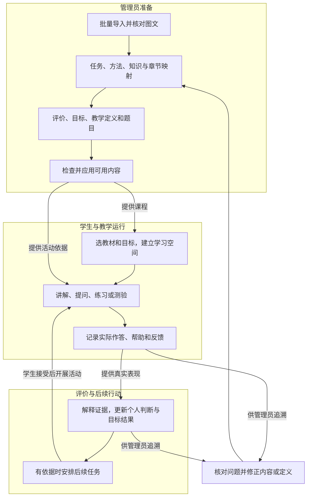
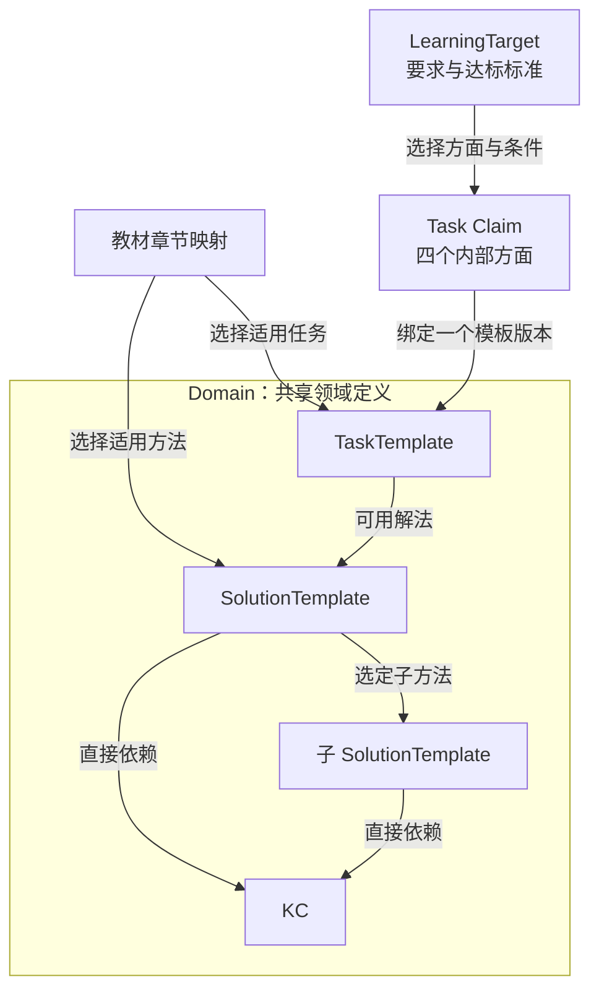
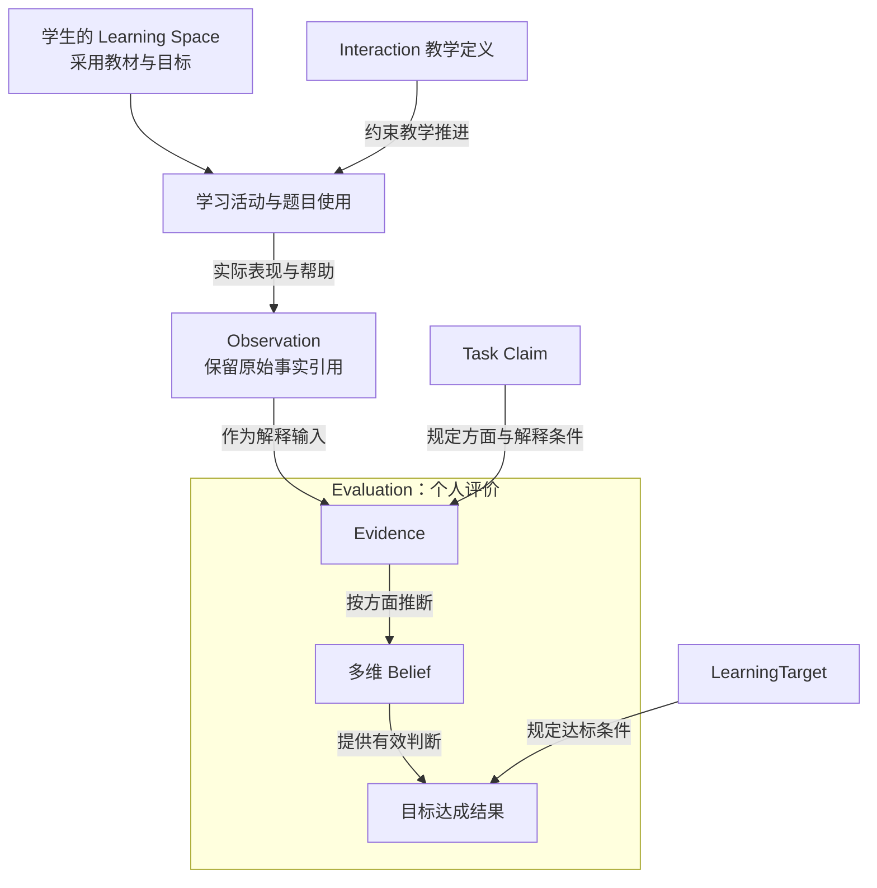
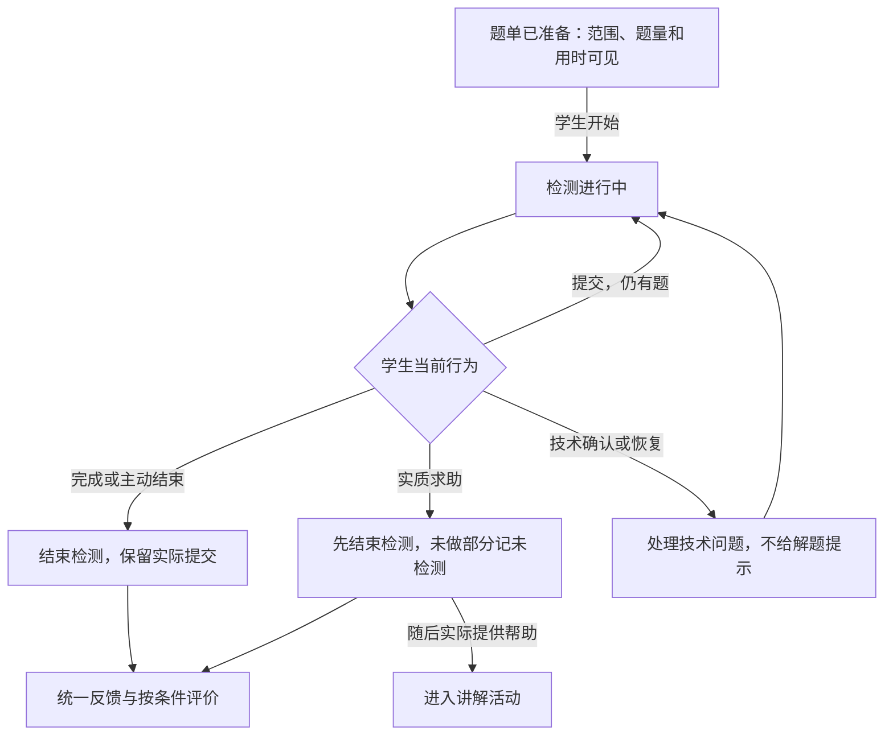

# M1 产品需求文档

> **版本**：v0.8 
> **文档性质**：M1 产品需求主文档（PRD） 
> **状态**：主流程方向获总体认可；细节待审，必要设计推进中，尚不作为工程冻结基线 
> **上游依据与基线**：[Development Roadmap v0.10](../../top/DeerMind_Development_Roadmap_v0.10.md)、[决定承接登记](../DECISIONS.md)及用户本轮重写授权；旧成果经取舍引用，不整体继承旧页面或工作流 
> **维护责任**：Codex 编写与自检；用户决定关键产品取舍并审阅 
> **评审记录**：本轮为作者流程走查、引用及图示检查；不代表用户已批准正文、软件已实现或质量已通过 
> **写作规范**：[设计文档规范 v1.1](../../top/DeerMind_Design_Document_Standard_v1.1.md) 
> **更新日期**：2026-11-03 
> **修订说明**：v0.7 → v0.8：明确M1独立原型及按包迁入，业务范围和验收要求不变；见[本轮记录](../DECISIONS.md#13-m1独立原型的建立与迁入范围)。 

---

本文是M1产品规格的主文档，说明第一版是什么、管理员与学生如何使用、系统应产生什么结果。主流程和核心规则在本文完整表达，详细操作与具体内容通过明确引用展开；本文与详细设计及原型同步修订，共同形成工程输入。

相关操作、状态和对应截图见[主流程交互设计](design/Interaction_Design.md)，教材、对象、题目和具体标准见[内容与模型规格](design/Content_and_Model_Reference.md)。按[六个业务工作包](README.md#2-六个产品设计工作包)交替核对规则、实际内容与原型，发现遗漏可以返回修改。保留V2基本布局和持续对话；必要页面调整按方案确认后执行，外围视觉优化后置。本文业务图不替代界面截图，旧mock不表示新需求已实现。 当前原型代码独立维护于[prototype](prototype/README.md)，按工作包迁入所需部分，不整体继承旧原型范围；已迁入与尚未迁入以M1工作表为准。

## 1. 产品目标、用户与范围

### 1.1 第一版要解决的问题

学生面对一本实际在学的数学教材，可以请 DeerMind 讲解、追问、练习和测验。DeerMind 根据实际表现调整帮助，说明本次已经得到哪些判断、哪些仍不知道，并在有依据时安排下一项学习任务。管理员能够从原始扫描件准备完整课程，并在发现问题后查明依据、修正内容和模型。

第一版的核心价值假设是：**把可靠的教学内容、适应当前学生的教学过程和有依据的评价连接起来，能够比单纯查答案或自由聊天更有效地帮助学习。** 这是假设，需要真实使用检验；目录、原型、模型定义和一次答对都不能证明它。

| 使用者 | 具体需要 | M1 提供的能力 |
| --- | --- | --- |
| 学生 | 看不懂当前教材内容，或想知道自己是否会用 | 选用课程，阅读教材，在同一空间中讲解、提问、练习、测验，看到具体反馈和下一步 |
| 管理员 | 把教材变成可教学、可检测、可维护的内容 | 批量导入与整理，维护领域、评价、目标和教学定义，准备题目，应用内容，查看运行依据并纠错 |
| 家长／监护人 | 知道真实使用条件并控制孩子投入 | 必要的首次告知与确认、用时信息；完整家长客户端、报告和咨询后置 |

首个学生是用户的六年级孩子。具体困难成因尚无可靠观察，不能预设为基础差、粗心或缺乏迁移。M1 既处理学生明确提出的困难，也允许在证据不足时暂不判断。

### 1.2 必做、简化与后置

| 能力 | M1 必做结果 | 简化方式与后置范围 |
| --- | --- | --- |
| 教材与建模 | 用户指定的北师大版六年级上册数学电子教材，整册可导入、整理、建模并用于教学 | 按章推进，AI 辅助、管理员核对；不承诺任意教材全自动建模 |
| 学生学习 | 讲解、提问、阶段及结束检查、主动测验 | 先支持文字、算式、公式和教材图表；语音、自由手写识别、外部拍题导入后置 |
| 个人评价 | 保存真实作答和帮助，形成 Task Claim 各方面的判断及目标结果 | 少量明确规则与真实模型判断；保留未知，不构建复杂全量统计首页 |
| 主动任务 | 系统依据目标、表现和时间安排补讲或检测，学生可以选择执行 | 产品内呈现；无固定周课表、预约、外部推送或最优调度平台 |
| 内容维护 | 管理员直接编辑保存，明确应用后供学生使用；可查活动与定义版本 | 无独立审核发布中心、自动诊断或自主改模 |
| 运行底座 | 真实模型与识别服务、身份隔离、持久化、失败恢复、必要配置和调用记录 | 简单可维护部署；不先建通用 Agent、工具或记忆配置平台 |

完整错题管理、独立题目记录中心、完整学习情况统计、课堂进度、家长产品和校外第二课程属于 M2 方向。长期策略、持续效果及运营效率主要在 M3 完善。后置的是这些产品能力的完整形态，M1 的作答记录、当前评价、主动任务和必要追溯仍须真实存在。

学生端仍以已确认的 Android 平板客户端为交付方向，管理员使用电脑网页。技术框架、具体模型和识别供应商由工程设计确定；不得把浏览器 mock 当成完成 Android 交付。

### 1.3 教材基线与完成边界

采用用户提供的电子教材链接为工作来源，版权页后补。已有[来源核验](../../../src/mvp_foundation/materials/bnu-math-6a-source-verification.json)区分了出版社、年级和册次与尚未确认的出版／印刷年份；本文不把“2026 年使用”写成已经核准的出版版次。

继承[全册目录与逐章建模清单](../../../src/mvp_foundation/materials/bnu-math-6a-whole-book-plan.json)，作为核查起点。清单中的候选任务、检查例和模型状态须重新核对，不能因文件存在就视为建模完成。

M1 完成时须满足：

- **内容完整。** 全册教学章节、活动、复习及必要附页都能定位原页；文字、公式、图表和跨页关系没有未经说明的遗漏。
- **模型可用。** 教学内容有适用的任务、方法、知识、评价定义与目标；必要基础回补有依据；当前教学和检测所需题目及参考已核对。
- **主流程真实。** 管理员在产品内完成准备和应用，学生可以学习、提问、测验、取得反馈，系统可以基于真实结果安排任务。
- **可追溯、可修正。** 管理员可说明一次教学或评价用了什么事实、定义和版本，并修正后续使用。
- **有验证结论。** 分别报告工程完成、内部质量、试用条件和仍未证明的效果；不能用一章样例或全书上传成功代替整册建模。

整册准备完成不要求孩子在 M1 验收前学完整册，更不表示她已经掌握整册。可以按章开发联调，但阶段交付范围仍是整册。

## 2. 产品整体与端到端流程

### 2.1 一条贯穿实例

以下题目是作者为说明产品逻辑编写的例子，不冒称教材原题或已核准检测题：**一根绳原长 40 米，增加原长的四分之一后，共长多少米？**

| 环节 | 人或系统做什么 | 形成的结果及下一步用途 |
| --- | --- | --- |
| 准备教材 | 管理员核对“分数的应用”相关原页、图和数量关系 | 可引用的教材内容与来源，供建模和讲解使用 |
| 建立任务与方法 | 定义“已知原量及增加比例，求新量”；可选先求增加量再相加、直接求原量的倍数 | 一个 TaskTemplate、两种适用 SolutionTemplate；方法分别引用 KC |
| 定义评价与目标 | Claim 定义独立完成、理解与解释、迁移、保持；目标说明本章采用的要求、方法和标准 | 定义“判断什么”和“达到什么算满足当前要求”，没有任何学生状态 |
| 准备题目并应用 | 核对例题及另一道未展示答案的检测题，检查映射与参考；应用课程 | 学生可以选用该教材和目标，活动采用明确版本 |
| 学生求助 | 学生说“增加四分之一到底是加多少？” | 开始讲解活动，先解释增加的是原量的四分之一，必要时引用图示 |
| 学生练习 | 学生在提示后写出 `40×1/4=10，40+10=50` | 保留作答和已给出的提示；可说明本次在帮助下做对，不直接宣布独立掌握 |
| 检测与反馈 | 学生同意后，完成另一个已准备问题，并按要求说明比例的参照量 | 产生新的表现记录；Evaluation 分别解释其对独立求解和理解的意义 |
| 安排下一步 | 系统依据有效结果判断是否还需补讲、补测或延迟检查 | 有必要才形成任务；迁移或保持未取得相应证据时仍为未知 |

“求解方法”是怎样解题，“教学策略”是怎样帮助学生学会，二者不是同一个对象。Domain 提供前者，Interaction 组织后者，Evaluation 判断实际表现支持什么。

### 2.2 主流程

**图 M1-01：从课程准备到下一次学习。** 矩形表示业务阶段，分组框表示主要责任；箭头标签说明交付或触发关系。

学生可以只提一个问题后退出，不必走完整图。系统也可以不创建下一项任务。图中的循环不允许无限追问、自动强制开测或用管理员意见直接改写能力。

### 2.3 核心对象怎样连接

**图 M1-02A：领域、课程和评价定义。** 箭头表示所标注的引用；KC 经方法递归汇总，不增加 Task 到 KC 的直接关联。

**图 M1-02B：定义如何支撑个人判断。** 主线表示活动事实到评价结果；侧边说明定义的作用，不表示这些定义由活动临时生成。

教材可以选用领域定义的一个子集及其适用方法，不改变整个领域的定义。同一个 Claim 可被不同课程采用，但个人 Belief 按学生、学习空间和 Claim 版本隔离。教材内容块、图表、章节是教材内部结构；本图不把每种结构都扩展为新的核心模型。

## 3. 管理员准备与维护

各项需求以稳定编号 `M1-Rxx` 标识，验收见 §7。页面可以合并或拆分这些操作，但功能的输入、结果和权限不能省略。

### 3.1 初次启动与试用账号（M1-R01）

**使用场景。** 管理员要确认真实服务可用，并让指定孩子用自己的身份开始学习。

1. 部署者提供首个管理员账号和受保护的模型、图文识别服务连接。管理员可通过必要页面或检查命令确认配置存在、连接成功或失败；连接成功不等于教学质量合格。
2. 管理员在系统外核实本人和亲子关系，在后台记录结果，为学生建立独立账号，并保留监护关系及必要首次确认。
3. 向家长说明实际数据用途、可见范围、保留方式和外部服务；学生获得简明说明并确认愿意使用。使用条件未成立时，可以准备合成案例，不处理孩子真实学习输入。
4. 学生账号找回恢复原身份与已有空间，不通过另建学生身份丢失历史。管理员和学生即便由同一个成人代为操作，角色和操作记录仍须区分。

输出为可登录账号、关系及确认记录、服务可用状态。M1 不建设完整家长应用或自动身份认证；初始化命令和账号凭据交付方式由工程设计落实。

### 3.2 批量导入教材（M1-R02）

**使用场景。** 管理员已经有一本教材的扫描 PDF 或多张书页图片，希望一次建立导入任务，而不是逐页创建教材。

| 输入／参数 | 产品含义与规则 |
| --- | --- |
| 扫描文件 | 一份或多份扫描 PDF，或多选 JPG／PNG 书页；保留原文件与页序。文件数量和大小限额须在选文件时说明，实际值由工程测量后确定 |
| 教材信息 | 书名、学科、年级／册次、来源及已知版次；未知出版信息可留待补，不由 AI 猜填 |
| 页序与印刷页码 | 输入文件位置与书上的页码分别保存；封面、目录、插页不能强行并入印刷页码 |
| 导入范围 | 可以先导入部分原页，后续补齐；系统据原页及目录表示缺口，不因文件很多就判为整本齐全 |

管理员选择整批文件、检查顺序和预览后提交。系统建立一个可返回的导入任务，显示已接收、整理中、需处理失败或结果可核对；内部逐页处理不要求用户逐页重新提交。离开页面后可回到原任务，重试失败部分不能复制整本教材或重复页。

上传成功只说明原件已接收。扫描件、识别候选和可教学教材是三个不同结果。尚未应用的导入可删除，需确认删除对象；不能借这个入口删除已被活动引用的教材及历史。

### 3.3 整理图文、目录与疑点（M1-R03）

**使用场景。** 管理员要把原书页整理为系统能引用的教学内容，且可以核对识别有没有丢图、看错表格或拆散一道题。

输出不是一段 OCR 文字，而是**原页、内容块、图表资源及它们的关系**：

- **原页与来源。** 任一内容块能返回书页及相应区域；保留印刷页码、文件页位置。
- **文字与公式。** 正文、题干、条件、公式、要求、答案分别有可读内容；识别不清的地方保留疑点。
- **图和表。** 保留原图／裁片、标题、坐标或图例、表头和单元格关系；必要的文字解释用于理解，不能替换丢失原图。
- **跨页和内部关系。** 目录归属、题干与配图、共用条件、分问、表与图、跨页续题有明确关联。

核对过程是：选择章节或疑点，查看原页和对应整理结果，修正文字／公式／页码，调整内容块范围及关联，补齐遗漏，确认这一项实际解决。疑点须说明“哪里不确定、影响什么、需要核对哪个原页”，不能只给一串没有处理对象的警告。

管理员可按章保存进度、稍后继续。缺图影响题意或答案时，该题不能作为可用检测题；不影响其他已核对内容继续整理。一个内容块被确认不代表其整页、整章或整个模型都已核对。

代表性核查沿用此前的真实教材材料：第 49—50 页检查图文与问题组织，第 91—93 页检查表格、统计图和跨页关系。页码按采用来源核对，这些例子不替代全册覆盖检查。

> **D01操作与内容：** 批量输入、图文核对、继续及删除的当前画面见[交互规格§1.1—1.2](design/Interaction_Design.md#11-批量导入与开始整理)；五页整理样例及交给建模的信息见[内容规格§3.4](design/Content_and_Model_Reference.md#34-d01整理样例与交给建模的内容)。原件预览与补页、目录与遗漏内容维护、逐页处理状态的具体补齐方案仍待确认，不因已有截图就认定M1-R02／R03已完整交付。

### 3.4 建立领域、任务、方法与知识映射（M1-R04）

**使用场景。** 管理员要说明教材教什么、题目要求做什么、可以怎样完成，供教学选法、选题和评价引用。

管理员先创建或选用“数学”领域，在领域内维护三个对象组。AI 可以从已核对内容提出候选；管理员可以复用已有对象、修改或新增，保留候选依据和最终保存结果。

| 对象 | 必须能表达的信息 | 示例及关系 |
| --- | --- | --- |
| TaskTemplate | 任务目的、给定信息、完成责任、参数及约束、允许变化、适用边界、结果质量 | 已知原量 `V` 和增加比例 `r`，求新量；数值、单位、条件及课程适用性明确 |
| SolutionTemplate | 适用任务和条件、求解思路、步骤或递归子任务、选定子方法、直接 KC 引用 | 先算 `V×r` 再加 `V`；或直接算 `V×(1+r)` |
| KnowledgeComponent | 知识的含义、适用条件、表示／例子、必要先修关系 | 分率的参照整体、分数乘法、总量与增量关系；按实际方法关联 |

**关系规则。** Task 直接关联适用 Solution；Solution 可以直接引用 KC，也可引用完成子任务的选定 Solution。Task 的 KC 由这些方法递归汇总并去重，不另填一份 Task–KC 清单。多个方法涉及的 KC 并集表示模型覆盖，不表示学生只做成一种方法就掌握全部知识。

Task 中只列直接方法；需要了解内部步骤时进入该方法。递归必须能走到有明确责任和依据的叶子，循环引用或缺失子方法不能冒充完整可用方法。没有方法时，Task 的 KC 汇总为空，显示准备缺口。

已就绪 KC 应能反查使用它的方法及任务。要直接检测某项基础知识时，可以有“解释分率参照量”等小任务及对应方法；不机械地为每个 KC 复制一个 Claim，也不要求所有检测都通过复杂应用题。

教材章节选择适用 Task 和 Solution，KC 随所选方法汇总。六年级课程可以排除需要初中知识的方法，但不删除领域中的该方法。保存草稿允许不完整，作为教学或评价依据使用前必须补齐实际依赖。

### 3.5 定义 Task Claim、目标与学习要求（M1-R05）

**使用场景。** 管理员要把“学会这一章”具体化为可判断的要求，避免系统临时决定什么叫掌握。

Task Claim 绑定一个 TaskTemplate 版本，按默认四方面组织评价。管理员维护每个方面的责任、条件、可接受表现、反证、证据不足情况，以及方法和帮助边界。定义没有学生姓名，也不保存某个人的掌握程度。

LearningTarget 选择教材章节、Claim 及方面，设置通俗学习要求和达标条件：

| 要填写的内容 | 必须说明什么 |
| --- | --- |
| 要求名称与范围 | 学生能看懂的要求；对应章节和 Claim 的任务范围，不用“掌握 KC-17”作为用户说明 |
| 采用的方面 | 独立完成、理解与解释、迁移应用、延迟保持；裁剪或扩展有依据，未测不能改称不适用 |
| 方法条件 | 允许任选一种、指定一种，或分别掌握多种；区分“这些方法可用”和“必须证明会用这些方法” |
| 帮助及质量条件 | 允许的工具和帮助、必须自行承担的部分、结果与解释要求 |
| 达标依据 | 需要什么表现及覆盖，什么是反证、冲突或不足；不能只写任意一个总分门槛 |
| 迁移与保持条件 | 相对哪些已学情境发生何种变化；保持哪项表现、采用什么延迟窗口及练习背景 |

例如，上述比例增加任务可要求“自己选取原量并算出新量”“解释四分之一以什么为整体”。两种解法若允许任选，使用其中一种成功即可提供相应证据；只有目标确实要求两种方法时才分别核对。普通改数字题不自动成为迁移证据。

目标可以含尚待延迟观察的要求，不因此禁止当天讲解；目标定义缺失则不能伪装成学生未达标。逐章具体标准、题目与证据覆盖在内容准备中填写并核对，不由本文的作者示例直接冻结。

首个具体样例见[准备参考§4.6–4.10](design/Content_and_Model_Reference.md#46-本次到底教什么评什么)：同一比例增加Task Claim下，本次目标仅取“增加1/4”的子范围，分别规定可接受表现及证据覆盖。该局部范围的达标不能改写成整个Claim范围或整章都已掌握；没有必要为每个参数值新增Claim。题量和延迟门槛的确认状态在该样例及M1-OPEN-03中记录，不在本文重复维护数值。

### 3.6 管理教学方法（M1-R06）

**使用场景。** 管理员希望系统按有依据的教学方法工作，既不照教材逐段机械讲，也不让模型任意发挥。

M1 维护一套可运行的教学蓝图、少量策略与共同规则：

- **蓝图。** 描述开始、理解当前需要、开展帮助、取得表现、反馈与收束等阶段；每个阶段有目的、输入、输出、策略引用和有条件的转移。阶段可以跳过、返回或停止。
- **策略。** 说明适用与不适用情形、教学动作、预期观察、调整／退出条件、理论或经验依据及示例。例如图示解释数量关系、对比例子辨析、逐步撤去提示。
- **共同规则。** 请求只给提示时遵守边界；分段后等待学生；实质求助先结束独立测验；退出随时有效；教学结束不能代替能力评价。

管理员直接编辑、保存、启停；系统保留引用、版本和修改记录。程序检查结构完整、引用有效、转移目标存在及必要条件已定义；教学允许返回前一阶段补讲或再次取得表现，不能笼统要求蓝图没有循环。策略是否适合当前学生需要规则和 LLM 判断；自动转移不能在没有新输入或状态变化时无限重复。管理员不能通过停用某条策略取消权限、退出权或评价边界。

**选择、切换与无法继续的处理。** 这里沿用学生控制、合法输入和版本保留的既有约束，明确如下：

| 情况 | M1处理方式 | 记录和边界 |
| --- | --- | --- |
| 普通修订教学定义 | 新活动采用当前已采用且可用的版本；进行中活动保留原依据。草稿保存不改变进行中的教学 | 保留活动实际版本；若旧定义已被确认不可靠，停止继续使用并按当前可用条件重新准备 |
| 学生停止、只要提示，或检测中求助 | 先满足退出和帮助边界；策略不能强迫继续或越过用户限定。检测实质求助先结束本次检测再讲解 | 学生选择和实际帮助按发生事实记录；不是依靠策略优先级绕开规则 |
| 两种或多种策略都适用 | 属于正常选择，规则和LLM根据请求、当前目标、有效表现及负担选择一种；有新表现时可切换 | 记录所选策略和简要依据；不因多个候选存在而中止，也不要求固定全局排名 |
| 对学生认识不足，但请求与内容清楚 | 有效的未知允许采用适用的基础讲解策略，必要时澄清一个关键点；不强制先做完整诊断 | 未知不等于失败或基础差；基础策略也须来自可用教学定义，不能隐藏转成无约束自由聊天 |
| 缺少必需内容、所需定义无效、规则要求互相矛盾，或没有合法可用策略 | 不执行受影响教学动作，保留输入与进度，说明这部分暂不能继续；可以结束或选择其他已准备内容，修正后再重新准备 | 管理员能查缺口；不伪装成学生不会、策略已成功执行或主动选择了不干预；不自动无限重试 |

合法性与策略优劣分两步处理：符合共同规则和当前授权条件的候选，才进入教学选择。模型服务失败按§6处理，不能偷偷套一条未经定义的教学动作继续输出。M1不建设通用规则优先级编辑器；真实策略质量在工程中用有限情境测量，不能以三段预写对话代替。

### 3.7 准备题目和参考（M1-R07）

**使用场景。** 系统需要讲解例子、练习和检测题。题目来源、答案、适用范围和使用经历必须能够说清。

第一版可以先以管理员核对的小型题库运行。教材题目、人工补充题及 AI 辅助准备的候选共用下列信息：

| 信息 | 业务要求 |
| --- | --- |
| 题面与来源 | 完整条件、问题、公式及必要图表；原题来源或作者生成标识，不能把作者参考称为教材标准答案 |
| 任务归类 | 所属 TaskTemplate 版本、参数值、条件符合情况；归类未通过时只能保留原始资料或候选，不能保存成该模板的可用实例 |
| 方法与答案 | 已核对的可用方法、参考结果／评分要点、允许的其他解法；开放解释题不能只用字符串答案判断 |
| 用途与条件 | 例题、练习、检测的可用性；对应章节、要求、方法和检查方面；是否真能检验某种变化或延迟条件 |
| 版本与使用 | 题目修订、每次展示和作答、是否给过提示或答案分别记录；改题不能覆盖过去实际见到的题面 |

管理员从任务或章节准备题目，查看参考并核对后保存。没有附答案的教材不妨碍准备，但 AI 解答只是待核对参考。疑似题意缺失、答案冲突或映射错误的候选不能进入检测。

题库需要覆盖当前学习要求，并区分已用于讲解的例题和可检测的新表现；不规定每章统一题量。系统选题时按目标、方法、学生接触历史及可用题目选择，不能把“还剩几道题”当成能力覆盖。没有合适题目时说明尚不能检测该要求，管理员补齐；不能重复已展示答案的题并宣称获得新独立证据。

自动生成广泛变式、原生题和复杂组卷优化不作为 M1 前置条件。将来启用教学中自动出题时，已确认的规则仍有效：候选通过题意、答案、范围和归类检查后保存并使用，无须管理员逐题批准；检查失败不交付学生。M1 不另建大型题库运营产品。

### 3.8 检查、应用与更新（M1-R08）

**使用场景。** 管理员已整理一章，要让学生实际使用；后来修正内容，还要知道何时影响学生。

1. 保存保留当前编辑及版本。检查结果逐项列出：原页／图文、章节映射、可用方法、Claim／目标、教学定义、题目参考是否满足对应行为的条件。
2. 管理员选择要应用的教材内容及目标，查看可用行为和阻塞缺口，确认应用。不恢复审核人、审批单和发布中心。
3. 系统记录所采用的内容和定义版本，使所有试用学生可以选择已准备内容；已使用同一课程的空间更新当前引用，不要求学生手动维护。
4. 正在进行或已结束的活动保留实际采用依据。普通保存不能无声改写旧活动；后续活动使用适用的新版本。活动中遇到已知错误时按 §6 处理，不能继续使用已明确失效内容。

浏览、讲解、当题反馈和正式评价的准备条件分开表达。例如原页已整理但 Claim 未准备好，可以浏览，不能显示“学生待确认”来掩盖课程缺少评价定义。M1 最终验收时，不能将这种局部可用当作整册建模完成。

管理员应用更新不授权替学生换教材或换学习目标，也不把目标标准降低解释为学生能力上升。

### 3.9 查看一次运行并纠错（M1-R09）

**使用场景。** 管理员发现“孩子明明接受了提示，系统却说独立完成”，要找到具体错误发生在哪。

从学生及学习空间进入一项活动，再看轮次和处理步骤；定义管理另有入口。最低可查看内容如下：

| 查看层次 | 必须能看到的依据 |
| --- | --- |
| 活动 | 学生、空间、目标、范围、活动类型、开始／结束原因、采用版本、关联主动任务 |
| 一轮交流 | 原始输入与上下文引用、理解结果、教学选择及理由、计划输出和实际展示、提交作答、帮助记录 |
| 评价 | 当题反馈、Evidence 对应的 Claim 方面、多维 Belief 前后变化、目标结果及其依据；未产生或失败明确显示 |
| 运行状态 | 执行成功／失败／取消、调用时间与用量、重试；审查意见和学习评价分别显示 |
| 后续处理 | 可疑记录、管理员核对意见、相关定义修订与应用、新活动使用结果 |

管理员记录“预期是什么、实际是什么”，进入对应内容或模型定义修正。不得直接将某个学生的 Belief 改成通过；已知不可靠的结论停止当前使用，并保留原记录及待处理状态。M1 不承诺批量补算所有历史；待映射题补齐定义后也不追补旧作答评价，新表现按新依据处理。

Evolution 在本阶段通过这种有记录的人工修正提供基础作用，不另建自动诊断或演化工作流。系统能追溯并纠错，不等于已经能自动找出根因。

## 4. 学生学习与系统主动任务

### 4.1 选用课程与阅读教材（M1-R10）

学生登录后，选择管理员已准备的教材及可用目标，创建自己的 Learning Space。选择保存的是课程采用关系，不是复制一份由学生维护的教材。M1 不设置长期章节范围，每次学习或检测选择章、节或当前题目。

学生可浏览目录和原页，阅读整理内容、公式及图表，从具体内容发起“讲讲这里”或输入自己的问题。操作须保留实际所指内容；只浏览另一页不自动切换当前教学目的。原页无法读取、章节尚未准备或暂不能评价时，说明影响当前操作的原因。

每个学习空间有一条持续对话。学生不需要命名或新建会话；活动边界由实际学习行为形成。当前消息、活动、草稿和判断属于该空间，共用教材定义不表示共用个人历史。

### 4.2 讲解、提问与策略调整（M1-R11）

**使用场景。** 学生明确说“讲一下这一节”或问“为什么增加四分之一不是直接加四分之一”。系统要直接回应问题，并根据实际反应继续。

开始时采用当前教材、目标、已知表现和请求。已有信息足够时直接给简明解释；缺少决定当前帮助内容的关键信息时，只澄清该问题，不强迫每次先做完整诊断或整章预测。

| 学生情况 | 可以采用的起点 | 观察后怎样调整 |
| --- | --- | --- |
| 不清楚四分之一指谁 | 用一条线段或教材图说明原量与增加量，先讲清参照整体 | 仍混淆时换一个更简单的对应例；能说明后回到原问题，不持续重复原话 |
| 算得出结果，但解释成“加 1/4 米” | 对比原量不同、增加比例相同的情况，请学生说明差异 | 能辨认关系后撤去提示再练习；复述仍不一致则继续澄清，不能因计算正确跳过问题 |
| 已有可靠的求解和解释表现 | 简短回答当前疑问，可按请求进入练习或准备检测 | 新表现支持时不强制重新讲全部内容；出现冲突则回到具体卡点 |

这些是同一蓝图的不同起点，不是按三种固定标签给学生分类。实际策略选择需要证据；“没测过”不等于第一类学生。

讲解分段进行，每段围绕一个关键问题。学生可以追问、要求更详细、只要提示、继续或停止。追问与对应内容关联，主线和进度保留；不因模型已经生成下一段就认定学生看过或理解。

当当前内容依赖旧知识时，可以简短回补，再回到本题，不另开整套低年级课程。发现真正进阶超纲请求时说明范围并委婉拒绝；教材内新问法或缺映射不直接等于超纲。范围不清先澄清，不能靠关键词决定。

### 4.3 讲解中的练习与结束检查（M1-R12）

系统可在有教学目的时请学生解释一步、比较两个答案或尝试一道题，并说明要检查什么。学生提交后才分析；未提交草稿、阅读结束、“懂了”或沉默不作为完成任务的证据。

练习允许提示、示范和及时反馈，帮助的具体内容及呈现时间须记录。学生接受帮助后做对可以说明“在这个提示下完成了”，也能作为适用条件下的证据；不能直接支持无帮助独立完成。

需要检查当前是否会独立运用时，先说明检查范围与帮助条件，经学生同意进入检测。听完讲解不强制检测；学生选择不测时可结束教学并明确“尚未检查”。结束检查也不是每次全面检测四方面，未涉及的方面保持原判断或未知。

讲解可以因当前问题得到回应、学生选择结束、暂时无法继续或转去其他活动而收束。结束小结说明本次讲了什么、实际做了什么、反馈和评价边界以及可选下一步；不使用“已经学会”作为统一结束语。

### 4.4 学生主动测验与求助（M1-R13）

学生从教材选择本次章／节，可选择多个。系统依据对应要求、适用方法、有效历史和可用题目准备题单，说明覆盖、题量、参考用时及未覆盖部分，学生决定是否开始。题量取决于目标和范围，不设置全章统一的固定数；过大范围提出分次方案。

开始后题单不无声扩充。正常独立检测中，提交先确认收到，结束后统一反馈；不提前给出会影响后题的答案或讲解。技术确认和识别核对可以处理，不能借此给实质提示。

**图 M1-03：检测的主要状态与帮助分支。** 矩形表示业务状态，菱形表示学生行为分类；断网恢复另见 §6。

请求实质帮助时结束**本次多题检测**，不只是结束当前一题；之后如需补测，准备新的检测并由学生选择。已提交部分仍可按当时条件评价，没做部分不是答错。“求助请求已收到”与“实质帮助已展示”分别留存。

同一道题可以重测，但接触、提示和见过答案的经历不会因另开活动消失。系统不得仅凭新活动编号就标为全新独立样本。

### 4.5 反馈、个人判断和目标结果（M1-R14）

学生首先看到具体反馈：题目及自己的作答、哪里正确或需要检查、相关解释及本次帮助情况。其次看到与当前学习有关的评价，用通俗语言说明条件和依据；无需显示原始 KC 编号或一串模型概率。

| 层次 | 示例 | 不可混淆的含义 |
| --- | --- | --- |
| 当题反馈 | 这次新长度算对了；“四分之一”的参照量解释仍不清楚 | 一次表现的判断，不代表同类题全部会做 |
| Belief 的方面判断 | 当前证据支持在所测范围自行求解；解释还有冲突；迁移与保持尚未得到相应证据 | 学生在本空间的有条件认识，不强行平均为掌握百分比 |
| 目标结果 | “解释增加比例的参照量”仍需加强；“延迟后仍能完成”待确认 | 与当前目标标准比较的结果，不是新的能力状态 |
| 后续行动 | 可再看一个对比例子，或之后检验不加提示的表现 | 建议和任务，不是已发生的学习 |

“已达标”需要有效依据支持当前要求；“需加强”需要有适用的不足依据；证据不足、冲突或时点未到可以“待确认”并说明原因。内容定义没准备好、服务失败与学生证据不足须分别表达。

当题反馈可用但评价失败时，可以展示已有合法反馈，同时明确评价暂未完成。没有新的有效 Belief 不显示假进步，也不能拿过时状态充当本轮评价；依赖该评价的后续任务暂不安排。

M1 在活动结果和必要详情中提供上述信息，不要求先实现完整学习情况仪表盘。学生仍可追问“为什么这样判断”，回复须引用获准事实和适用要求。

### 4.6 系统主动安排任务（M1-R15）

**使用场景。** 学生刚在帮助下完成任务，或已有表现到了适用的延迟检查时间。系统应能主动提出合适下一步，不要求学生自己意识到每个证据缺口。

触发检查的时机包括进入学习空间、活动结束和已有任务到期。判断输入是当前目标、有效 Evidence／Belief、已发生帮助、时间条件、已有任务和当前活动。时间触发本身不等于应该补课；未知不等于不会。

一个任务至少包含：所属空间、任务目的、章节和要求、关联 Claim、讲解或检测类型、理由及依据、可开始的条件／时间、当前状态和关联执行活动。这是运行任务，不是 Domain 中的 TaskTemplate。

| 学生操作或依据变化 | 业务结果 |
| --- | --- |
| 接受 | 核对任务仍适用；讲解进入活动，检测先展示题单并确认开始；不抢占另一个进行中的活动 |
| 暂缓 | 本次不启动，当天不再催；次日进入该学习空间时重新检查必要性，仍有必要则当天最多再提示一次；不是预约或自动开测 |
| 拒绝 | 保留拒绝结果，同一依据不再提醒；只有新的表现、目标或延迟检测条件带来新理由时才重新考虑，不降低 Belief，不将拒绝记成答错 |
| 活动结束或转教学 | 记录实际完成、部分完成或求助结果；依据新的有效表现决定后续，不把任务完成按钮等同达标 |
| 新事实或目标使理由失效 | 未开始任务取消或更新原因；历史执行记录保留，不继续以旧理由启动 |

进入页面或重试不能重复创建同一依据的待办。再次提示沿用原任务，不新建一份同义待办；次日未进入该空间时不在产品外催促，之后再次进入时仍先检查必要性，不能补发多条错过的提醒。跨过午夜或换个说法不构成拒绝后重新提醒的“新理由”。

没有合适题目、评价无效或理由不充分时，可以不创建任务；必要时记录待处理原因供管理员查看。再次提醒按M1-DEC-003执行；具体延迟评价窗口仍由逐章标准确定，见 §8 的M1-OPEN-03。这里的次日提示是尊重暂缓选择的提醒规则，不是固定复习周期，也不表示必须再测。

### 4.7 切换、暂停与继续（M1-R16）

每个学习空间当前只推进一项学习活动。明确改学另一内容时保留旧讲解进度；恢复时沿用活动身份和真实历史，不重复计算一次讲解。普通浏览不等于切换活动。

独立检测中切换内容需要说明将结束本次检测，确认后结束；实质求助按 §4.4 直接结束并转教学。已结束检测不能因“接着聊”重新开放原答案提交；回看可转入答疑或另开检测。

M1 需要恢复最近活动、回看相关交流和来源，完整历史多条件搜索后置。恢复前核对原提交和实际展示结果；旧活动的定义已被判为不可靠时，说明不能继续沿用，并按当前可用条件重新准备，不能复制旧进度冒充同一条有效教学链。

## 5. 模型、数据与权限的产品含义

### 5.1 谁定义、谁产生、谁可以修改（M1-R17）

| 数据或模型 | 产生与维护责任 | 使用与修改边界 |
| --- | --- | --- |
| 原教材、内容块与映射 | 管理员导入，AI 生成候选，管理员核对保存 | 学生引用；原页不被识别结果覆盖；来源和修订可定位 |
| Domain、Task、Solution、KC | Domain 的定义维护；管理员在后台操作 | 按领域组织、按课程选择；不含个人掌握状态 |
| Claim 及证据解释／推断定义 | Evaluation 规范，管理员有限编辑 | 版本受控；运行 LLM 不能为让学生达标临时改定义 |
| LearningTarget 与采用关系 | 管理员维护目标，学生选择课程；管理员应用修订 | 学生聊天不能降低达标标准，课程更新不修改历史表现 |
| 教学蓝图、策略与规则 | Interaction 的规范定义，管理员维护 | 约束教学；不直接产生或手填 Belief |
| 学生输入、作答、实际展示和帮助 | 真实交互产生，按事件留存 | 草稿、候选和已经发生的事实分开；更正保留原记录及来源 |
| Observation、Evidence、Belief | Interaction 解释观察；Evaluation 解释证据并形成个人判断 | 只使用有效且获准依据；Evidence 精确指向 Claim 方面，不能更新所有方面 |
| 目标达成与主动任务 | Evaluation 按目标派生达成结果；Interaction 决定后续活动 | 目标改变不自动上调能力，任务不直接写入个人判断 |
| 运行和修改记录 | 系统记录调用、状态、版本、管理员操作 | 供追溯；真实记录、作者预期、mock 和人工核对意见不混用 |

Belief 不是可任意加减的分数。对于同一学生、空间、Claim 版本，维护一份多维判断；实际输出形式和校准方法由工程设计承接，但必须保留各方面的支持、限制和依据。不新增 KCClaim、KCBelief 或 Solution Belief。

### 5.2 方法与四方面评价

| 方面 | 需要定义并实际取得的表现 | 不能据此偷换的结论 |
| --- | --- | --- |
| 独立完成 | 在允许工具和帮助边界内，自行完成关键求解责任 | 有提示后正确不自动证明无帮助完成 |
| 理解与解释 | 说明关系、理由或适用边界，可通过语言、图、辨析等方式表现 | 复述一句原话、算对或没要求解释，都不能代替这一判断 |
| 迁移应用 | 相对学习经历，发生了定义中有意义的变化，并完成相应责任 | 换数字不自动等于迁移，一种变化不证明任意泛化 |
| 延迟保持 | 在定义的间隔及可比条件下再次表现；期间练习与帮助背景可查 | 到了时间不证明保持，系统模拟时间不证明孩子真实保持 |

独立性也可限制解释、迁移和保持，不是四个互不相关的平均分。同一表现只能更新它实际支持的方面；没有表现的方面保留未知或原有适用判断。课程可在有依据时裁剪／扩展框架，不能因为实现麻烦或学生不会就裁剪。

### 5.3 权限与历史

- **学生。** 查看自己的教材采用、对话、作答、相关反馈及评价，提交学习输入；不修改领域定义、他人记录或评价标准。
- **管理员。** 准备内容、管理试用账号和必要关系，按事项查看运行依据，修正内容或定义；不能替学生制造表现或把核对意见写成学生原始作答。
- **家长。** M1 保留必要监护关系和确认，不因此向学生公开家长沟通，也不默认已有完整家长查看产品。
- **系统。** 只把当前请求必要、获准且有效的材料发给实际外部服务；密钥不进入客户端、普通日志或教学文本。长期对话不表示每轮发送全部历史。

共享领域和教材不共享个人证据。定义保存、应用、活动采用、实际展示、作答和判断版本可串起来查；目标改版可以改变达成结果，但必须说明标准变化，不能称为孩子进步。

M1 不引入新的资料删除或授权撤回界面。既有“界面删除不等于物理销毁”的后续产品决定保留，不能借本次简化宣称无限期保存或扩大用途。实际外部服务、保留及处理条件在真实数据接入前核实。

## 6. AI责任、运行规则与必要异常

### 6.1 AI、程序和人工分别做什么（M1-R18）

| 工作 | 规则与 LLM 承担的部分 | 程序或人工承担的部分 |
| --- | --- | --- |
| 教材整理和建模 | 理解图文、提出内容结构与映射候选，说明不确定处 | 程序保留原件和关联；管理员核对关键语义、修改并应用 |
| 理解与教学 | 识别意图，按教学定义选择起点、内容、方法与下一步 | 程序保证权限、活动状态、串行和真实展示记录；管理员维护规范 |
| 当题反馈和评价 | 按答案／方法参考、Claim 和实际帮助解释表现与更新依据 | 程序检查结构、引用、版本和提交资格；错误或未决不能假装成功 |
| 主动任务 | 判断需要补讲、检测或等待，给出对应依据 | 程序核对时间、重复、状态和用户选择，不自动强制开始 |
| 纠错 | 可辅助分析具体记录和提出修订 | 管理员决定内容改动，系统保留记录；不建设自主改模 |

语义判断使用明确规则与 LLM，不能用关键词命中替代意图、超纲、题目归类或理解判断。确定性的权限、时间、版本和提交检查由程序完成。生成结果与语义校验仍可能出错，因此必须有失败、未决和人工纠错路径。

### 6.2 必须处理的主流程异常

| 情况 | 学生或管理员应得到的结果 | 对记录和评价的影响 |
| --- | --- | --- |
| 上传／识别失败 | 指明失败部分，保留已接收原件和已整理结果，可返回重试 | 不标为整本整理完成，不制造重复页 |
| 图片、条件或映射不足 | 定位缺口；可用部分继续准备，相关功能说明暂不可用 | 缺内容不能算学生不会，也不能伪造 KC 或 Claim |
| 模型超时或返回格式错误 | 明确本次处理未完成，保留输入；可重试或停止 | 不写假 Observation／Evidence／Belief；重试核对原提交 |
| 必要教学定义冲突或无合法策略 | 按§3.6说明受影响部分暂不能继续，保留进度；可结束或选择已准备内容 | 不执行越界动作，不把配置问题或服务失败记为学生能力不足 |
| 提交后断网或重复点击 | 返回同一次提交的处理状态，必要时恢复 | 不增加第二次作答、评价或重复教学展示 |
| 学生主动停止 | 保留已发生内容及未提交输入，停止当前后续输出 | 不将后台已生成但未展示的提示当作已经接受 |
| 评价暂未形成有效结果 | 区分当前可用的当题反馈与尚未完成的评价 | 不读失效旧判断伪装新结果，相关主动任务暂缓 |
| 发现已展示的错误内容或判断 | 管理员可定位并处理，用户获知影响其学习的实质更正 | 旧事实保留；不可靠判断退出当前使用，不依赖其继续推断 |
| 纲内问题尚未映射 | 可以按已有可靠内容帮助并保留原记录，说明正式评价限制 | 管理员后续补齐；M1 不补算这类旧作答 |

同一交流严格串行处理。模型理解未完成时不能把依赖它的策略决定当成正式结果；异常与主动中断另行收束。后台导入可以独立处理，但不改变学习活动的顺序和责任。

新版本的兼容性、事务、重试次数和上下文截取等由工程落实。不得为覆盖少见情况先建复杂迁移平台；也不能用“以后处理”掩盖重复提交、丢失作答和已知错误继续使用这些主流程问题。

### 6.3 用时提醒与运行质量（M1-R19）

用户已确认：孩子每天全部 DeerMind 使用不超过 30 分钟，**系统只提醒，由家长控制结束，不强制暂停或锁定**。

计时跨学习空间累计当天使用负担，学生需要等待的时间计入，纯后台运算另计。自动可测、用户补记和未知部分分别表示；不能宣称精确知道所有离开设备后的时间。具体空闲判断与补记操作须在设计／工程接入时明确，不默默把未知记为零。

学生能查看累计用时；达到 30 分钟时明确提醒，若继续使用则继续如实记录超时，不显示“系统已保证未超时”，也不扣减能力判断。管理员可从实际记录核对投入。家长完整端后置不等于取消该约束。

工程需提供简单启动／停止及配置检查方式，记录调用延迟、用量、错误及可知费用；未知费用不写零。普通单题响应与整本导入耗时分开验收，不能用很快的“收到”替代可用讲解。

## 7. 验收与需求追溯

### 7.1 按主流程验收

以下是产品验收场景，尚未执行。每项需同时检查正常结果和表中拒绝／失败分支；详细输入、参考、样本与环境在验证计划固定。可运行、语义质量合格和学习有效分开判定。

| 编号／需求 | 前提与动作 | 可观察结果及关键反例 |
| --- | --- | --- |
| M1-A01／R01 | 配置真实服务，开立学生账号并完成必要确认；另测缺失确认 | 可按原身份登录并保留关系，连接错误可见；缺条件不处理真实学习输入 |
| M1-A02／R02 | 批量上传多页 PDF 或图片，部分失败后继续，离页返回 | 保留同一导入任务、顺序和失败部分；不要求逐页重建，不重复原页；未应用导入可删 |
| M1-A03／R03 | 核对有图、表、公式及跨页关联的真实书页，修正疑点 | 整理内容可定位原页和区域，改动及未决可查；不得只剩纯文字 |
| M1-A04／R04 | 为同任务配置两种方法及递归子方法，选择六年级适用方法 | Task 的 KC 汇总与所选方法一致且去重；缺方法／循环保留缺口，不直接填 Task–KC |
| M1-A05／R05 | 定义四方面 Claim 和章节目标，分别设置任选、指定和多法覆盖 | 条件可查且判断不同；未测不裁剪，改标准不改历史能力事实 |
| M1-A06／R06、R11 | 配置蓝图和策略，走三种学生情境；另核对多策略可用、有效未知、必要规则冲突及版本修订 | 能选择不同起点、切换、退出；多策略可用不误报冲突，未知不等于失败；无合法策略明确停止受影响动作；普通修订与已知失效分别处理，实际定义可追溯 |
| M1-A07／R07 | 准备核对题、缺图题、错误归类题和已展示答案的题 | 可用题有参考和使用条件；不合格不能供检测，不把接触史清空 |
| M1-A08／R08 | 保存一章，再明确应用；随后修订并再次应用 | 学生可选用相应可用内容，普通保存不改当前引用；旧活动依据仍可查 |
| M1-A09／R09 | 查看一条“帮助后答对却被判独立”的异常运行并修正定义 | 可查实际帮助、Evidence 和 Belief 变化；不能手填学生达标，也不覆盖原始事实 |
| M1-A10／R10 | 学生选择教材和目标，浏览章节并发起内容求助 | 建立个人空间与来源上下文；无长期章节范围，不借别的学生／空间记录 |
| M1-A11／R11、R12 | 学生讲解中追问、只要提示、回补基础或拒绝检查 | 请求得到对应帮助，实际帮助可查；不强制固定顺序或把“懂了”当掌握 |
| M1-A12／R13 | 多章准备检测，提交部分后求助，另测技术确认 | 先说明覆盖题量；正常结束统一反馈；实质求助结束整次检测，未做不是错题 |
| M1-A13／R14 | 独立正确、帮助后正确、解释冲突、迁移／保持未测分别反馈 | 当题、Belief 方面和目标结果区分；没测的方面不自动通过，评价失败不写假进步 |
| M1-A14／R15 | 活动结束或到期产生任务；接受、暂缓、拒绝、依据过时；暂缓后当天及次日重复进入，拒绝后分别无新依据／有新依据 | 真正依据模型结果安排任务，执行可回查；暂缓当天不再催，次日仍必要才最多提示一次；拒绝后无新理由不再提醒，出现新理由须重新判断；不重复创建、不强制开始、不将拒绝当反证 |
| M1-A15／R16、R18 | 讲解切换与恢复、检测结束后续聊、断网重复提交 | 活动和事实不重复，旧检测不复活，未提交内容与已接收输入可区分 |
| M1-A16／R17 | 多角色、两个空间使用相同教材，查看及引用个人记录 | 定义可共享，个人依据不串用；管理员修改意见不冒充学生表现 |
| M1-A17／R18 | 模型超时、格式失败、评价失败、未映射问题 | 失败、未决、内容缺口分别可见；保留合法结果，后续不依赖失效判断 |
| M1-A18／R19 | 当天多次使用累计到 30 分钟并继续 | 显示提醒和实际累计，不锁定；超时如实记录，不声称自动符合上限 |
| M1-A19／R02–R08 | 对全册目录逐项核对，抽取各章及主要内容类型开展真实教学 | 结构与内容覆盖全量可查，真实语义案例分布可查；一章成功或全书文件上传不能代表整册完成 |

M1-A05／A07／A11–A14可以先用[四分之一具体样例](design/Content_and_Model_Reference.md#46-本次到底教什么评什么)展开：同一题算对但理由错、只给答案、受助成功、表征变化、未到延迟时点应得到不同结果。采用前核对样例的门槛确认状态；数学参考和作者走查不算真实模型质量通过，也不能代替全册覆盖。

### 7.2 质量目标与证据责任

沿用[旧验证方案 §2](../archive/2026-11-02-before-m1-prd/phase-3-definition/MVP_Validation_Plan.md#2-指标与判定规则)中已经记载的目标和测量边界，未经讨论不降低。它们是产品目标，不是已经测到的性能或普遍科学常数。

| 质量对象 | 继承的目标及 M1 解释 |
| --- | --- |
| 讲解 | MET-001：交付验收样例关键数学错误为 0、合格率至少 90%；按请求、范围及帮助条件复核 |
| 图文识别 | MET-002：支持范围内清晰材料的整题关键内容至少 95% 正确；M1 测教材输入，初次自动结果与人工修正后结果分开 |
| 当题／掌握判断 | MET-003／004：分别至少 90% 符合预定参考；评价样本包括帮助、未知、冲突及四方面限制，不能全输出未知规避错误 |
| 生成题 | MET-005：实际交付验收样例严重缺陷为 0；仅在本批启用生成时测量，不用来声称后置的广泛生成已实现 |
| 响应 | MET-006：普通单题至少 90% 在原始提交后 30 秒内取得可用讲解；完整处理和重试纳入，教材批处理另报 |
| 时间与效果 | MET-007：全部使用每天不超过 30 分钟是实际使用约束，系统提供提醒和记录；MET-008–010 的即时、保持及介入价值观察不因重写取消，也不作为目录或工程实现完成的伪证据 |

语义质量需要真实服务与独立于输出的参考；事务、权限和版本检查不由模型评分代替。验收前固定案例、分母、版本和允许复验范围；网络故障单列，实施缺陷及时修复，不在同一轮无限增加优化目标。

整册内容和关系覆盖全量核对，真实语义测量用覆盖各章、主要任务／方法与内容类型的有限案例，不要求孩子逐题做完整本书。管理员人工时间和修正量如实记录；人工核对本身不能变成模型自动正确率。

### 7.3 复用的边界

[决定登记 §5](../DECISIONS.md#5-旧成果的承接与取舍)对旧 REQ-001–025、确认决定和资产逐类记录承接、简化、后置及仅供参考。旧编号保留历史含义，新需求按本章追溯，不给旧需求换编号后冒称已经执行。

既有原型用于观察交互表达，真实书页用于核对输入，旧领域包用于暴露例子和关系问题，Spike／Build 用于理解已知机制限制。它们都不能直接当成 M1 正式教材模型、当前质量结论或已完成产品。

## 8. 待决事项与审阅条件

### 8.1 当前需要讨论或准备的事项

| 事项 | 已知边界与下一步 | 最迟确定节点 |
| --- | --- | --- |
| 逐章目标与证据标准（M1-OPEN-03） | 四分之一样例的范围、判据、题面和试用门槛已明确，用户以M1-DEC-004确认门槛；正式内容采用与其他章节标准仍需准备，不能机械套用样例 | 对应内容准备及正式评价接入前 |
| 上位关系及旧资产迁移（M1-OPEN-04） | 当前按已确认 Task→Solution→KC 和 Task-only Claim 承接；上位文档仍有旧关系，旧包也未全迁移。按授权关系同步，不重新讨论已确认方向 | 新模型合同冻结、资产正式使用前 |
| 外部服务与来源条件（M1-OPEN-05） | 电子教材工作源已定，版权页后补；完整原页、实际服务、数据处理与真实使用条件仍须核对 | 相关外部处理和真实学生接入前，不阻塞当前 PRD |
| 具体测量与输入上限（M1-OPEN-08） | 既有质量目标保留；输入大小、用时识别、样本分母、参考核对和停止条件按实际条件准备，不能先跑再改门槛 | 必要设计／工程对应节点，真实验证运行前 |

上述候选不是本稿偷偷固定的产品决定。用时提醒已记为M1-DEC-002；任务暂缓及拒绝后的再次提醒已由M1-DEC-003确认，M1-OPEN-07关闭，具体规则见§4.6，不再留给工程猜测。

M1-OPEN-02已按既有版本、学生控制及失败约束在§3.6收束为产品处理规则。本例试用门槛经M1-DEC-004确认，细则见准备参考§4.10，未将M1-OPEN-03整册准备责任一并关闭。本轮是规格补齐，不是宣布真实策略选择质量或工程实现已经通过。

### 8.2 本稿完成到哪里

本轮完成了主流程草案、角色与对象责任、输入输出、必要分支和验收的对应，并继承可用资料。尚未完成正文用户审阅、全册模型及参考、实际页面逐节点对应、工程设计或真实验证。PRD文本形成、详细规格形成和原型对应分别记录；对应业务包的产品设计完成须三者共同核对，不能只按正文是否写完判断。

工程接收前需确认：

- 管理员到学生的每项必要输入都有生产入口；输出有明确使用者，状态与权限无矛盾。
- 教学、检测、反馈与评价边界可按具体案例解释；重要待决行为已处理，工程不负责猜产品含义。
- 实际教材、目标和题目准备要求可执行；复用旧资产前完成当前模型核对。
- 关键操作及失败反馈有相应交互表达；如修改原型，文字、截图和操作同步，不把本稿中的业务图当成页面验收。
- 验证计划具备可执行的参考、分母及停止条件，原有指标和未完成事项没有因重写丢失。

下一轮按[M1工作计划](README.md#3-现有成果缺口与当前进度)从D01教材导入与整理开始，同步核对本文、详细规格和原型。每包先完成业务与必要状态，局部方案确认后同步文图；工程接收按已审阅范围及依赖记录，未决部分继续设计。首页统计和页面装饰不作为当前主线。
