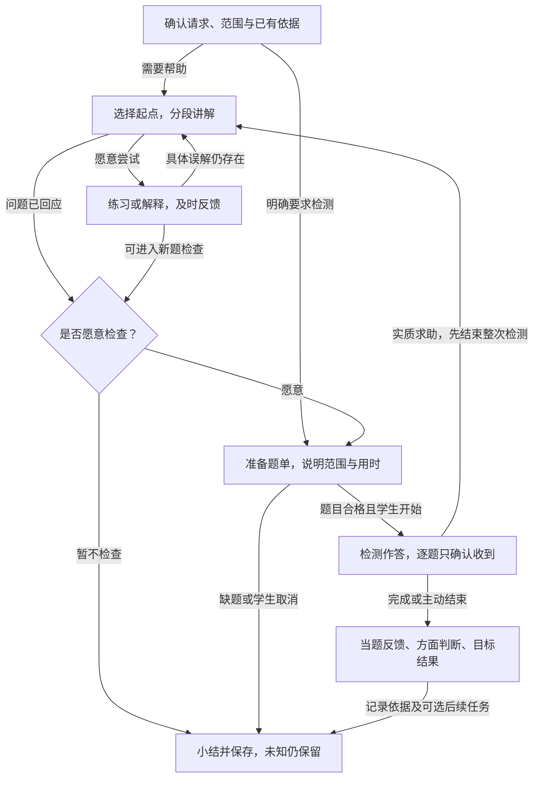

# M1 内容与模型规格及示例

> **版本**：v0.7 
> **文档性质**：M1产品规格的内容与模型专题；包含规定、设计草案和说明示例 
> **状态**：准备参考与四分之一教学评价样例；试用达标门槛已确认，正式内容采用和模型验证尚未完成 
> **上游依据与基线**：[M1 PRD v0.8](../PRD.md)；主流程方向已获用户总体认可，细节待审；来源及样例版本见本文 §2 
> **维护责任**：Codex 整理与自检；实际内容核对由管理员完成；重要范围及评价条件仍需讨论 
> **评审记录**：用户以M1-DEC-004确认本例试用门槛；作者核对教学、题目及评价边界，未调用模型或进行正式内容验收 
> **写作规范**：[设计文档规范 v1.1](../../../top/DeerMind_Design_Document_Standard_v1.1.md) 
> **更新日期**：2026-11-03 
> **修订说明**：v0.6 → v0.7：对齐独立原型的D01交接边界，其余内容及标准不变；见[本轮记录](../../DECISIONS.md#13-m1独立原型的建立与迁入范围)。 

---

本文与PRD、交互规格和原型共同定义M1产品，把教材导入、建模、教学与评价展开为实际内容和可核对结果。交互表达会检验这些内容能否查看和维护，具体例子也会暴露业务缺口；修改按[M1工作包](../README.md#2-六个产品设计工作包)返回相应文档，不单向等待PRD结束。文件路径保留以保持引用稳定，标题明确其包含详细规格的责任。

**内容的效力。** 来自已确认决定的规定按原决定生效，例如§4.10的M1-DEC-004；其余产品细则是待审设计草案。题面、教学话术、字段示例和走查结果是说明材料，不因此成为已入库内容或真实证据。理论依据和试用标准不混同；效力以各节具体标注和决定记录为准，不因文件名称带Reference就将规定视为可选，也不将整份草稿视为已批准。

本轮沿用旧书页与开发参考，不继续手写扩大模型包，不要求管理员在系统开发前手工建完整册。先用代表内容说明正确产物，工程实现真实工具后，再在产品内逐章完成整册建模。

## 1. 准备对象与可用条件

一份教材扫描件需要形成四类可追溯内容，而不是只形成 OCR 文本：

| 产物 | 最少包含什么 | 使用者 |
| --- | --- | --- |
| 原件及来源 | 文件、顺序、原页、印刷页码与文件页位置，取用区域和来源说明 | 管理员核对；学生阅读；教学引用原图 |
| 整理后的教学内容 | 章节、正文、公式、题干、图表、解法、答案、待填区域及跨页关系 | 教学选择与呈现；题目准备 |
| 规范定义与课程采用 | 领域、Task／Solution／KC、章节映射、Task Claim、目标要求和教学定义 | 教学选法、检测选题、评价解释和后续任务 |
| 题目与参考 | 完整题面、任务归类、参数、解法和参考、可用条件及用途 | 练习、检测、当题反馈；实际使用另产生个人记录 |

这四类产物必须能互相定位，但不要求储存在一个文件或一次模型调用中。学生表现、Evidence、Belief 和任务执行结果由实际运行产生，不能预先作为教材建模产物写入。

**准备阶段与可用行为分开。** 原页可以阅读，不等于该章可以可靠讲解；已能讲解，不等于已经具备正式评价条件。应核对某个行为实际需要的依赖，不能仅凭“已上传”“已整理”统一开放全部功能。具体权限及使用规则由 PRD 规定，本表不另设审批流程。

## 2. 本轮采用哪些已有材料

| 输入 | 当前用途 | 不作为何种证明 |
| --- | --- | --- |
| [出版社来源核验 v1](../../../../src/mvp_foundation/materials/bnu-math-6a-source-verification.json) | 电子教材身份、来源及已核查的原页线索 | 版权页和2026年实体用书版次尚未最终核准 |
| [全册准备清单 v2](../../../../src/mvp_foundation/materials/bnu-math-6a-whole-book-plan.json) | 13个目录项及附页的覆盖检查；包括9个单元、2项综合实践、数学好玩和总复习 | 其中候选模板及检查例不是已完成模型，不等于全册原页已经核对 |
| [教材整理的旧流程与截图](../../archive/2026-11-02-before-m1-prd/phase-4-product-and-domain-foundation/MVP_Product_and_Interaction_Design.md#31-flow-006从教材扫描件到学生可选用的内容) | 批量导入、原页对照、图表及跨页整理的操作参考 | 识别进度和结果为mock，不证明真实OCR、后台任务或整册可用 |
| [比例增加参考包 v1](../../../../src/mvp_foundation/m1/increase-reference/package.json)及[案例](../../../../src/mvp_foundation/m1/increase-reference/cases.json) | 已有对象、关系和正反例，用于检查课程、方法与评价是否接得起来 | 状态为作者参考、未启用；不是正式达标政策、独立评测或完整章节 |
| [旧分数应用内容包](../../../../src/mvp_foundation/content/fractions-application/) | 书页引用、数值参考、问题类型线索 | 旧模型类型与关系须按现行合同重新核对，不能整体导入当作当前模型 |

这里按材料版本引用，没有改动原始资产。需要修正时应修改其权威来源并记录影响，不能在本文另维护一份不同的答案或目录。

## 3. 从一批扫描页到可用课程

| 步骤 | 输入与操作 | 应得到的结果 | 核对重点与不能跳过的依赖 |
| --- | --- | --- | --- |
| 1 接收原件 | 管理员批量选择扫描PDF／图片，检查顺序与教材信息 | 一个可继续的导入任务、原件及页清单 | 文件位置与印刷页码分开；失败部分可定位；上传不产生模型 |
| 2 整理内容 | AI提出结构，管理员对照原页修正 | 章节和内容块；题干、图表、解法及跨页引用 | 图表不是一句描述；共用条件与续题不能丢；缺页不能补写成确定内容 |
| 3 核对内容 | 逐项处理疑点，检查本课结果 | 有记录的核对结果及仍缺内容 | “确认一课”不自动确认整章或所有模型；后续改动需检查相关内容 |
| 4 关联领域 | 从明确任务责任出发，复用或新增任务、方法和知识 | 章节到Task与所选Solution的映射；经方法汇总的KC | 题干相似不等于同一任务；方法必须适用，递归路径完整 |
| 5 定义评价与目标 | 明确Claim各方面及本章要求 | Claim版本、目标要求、方法和帮助条件、可接受表现及未知边界 | “允许两法”不等于“需要两法”；样例一题正确不自动足以达标 |
| 6 准备教学及题目 | 选择已保存教学定义，核对例题、检测题及参考 | 可用于当前范围的教学依据与题目集合 | 讲解例题和新检测表现区分；图文、答案、方法及归类均可核对 |
| 7 检查并应用 | 按预期行为检查依赖，再由管理员明确应用 | 学生可选用的内容和目标版本，已用课程的当前引用更新 | 保存不等于应用；旧活动依据保留；缺评价定义不写成学生待确认 |

这里没有引入新审核角色。管理员可一人完成编辑、核对和应用；系统执行的是字段、引用、适用条件与必要质量检查，不能把审批流程换名重新加入。

### 3.1 图文整理至少核对的内容

- **图。** 原图与取用区域、图中文字和单位、图例、图中条件及其对应题目。辅助解释用于理解，不代替原图。
- **表。** 表头、行列关系、单位、已给数据与学生待填项。空白待填区不能自动补成教材给定答案。
- **跨页。** 当前题目与续页的解法、共用数据或续问分别关联，保留各自来源；合并不能把邻近无关练习一起并入。
- **用途。** 题目条件、提示、示例解法、答案和辨错题中的错误示例各有用途。不能看到错误算式就直接订正题面。

旧原型的“完整讲解材料／仅题目与条件”预览可以复用为核对方式；切换预览不证明学生从未见过答案，也不直接使该题成为独立检测题。

### 3.2 准备结果怎样交给下一步

以下是产品需要保留的业务信息，不规定数据库表或接口字段名。AI可以提出候选，管理员核对后采用；程序检查必填、引用和数值约束，不能凭字段齐全认定语义正确。

| 准备对象 | 交接时必须说清的信息 | 下一步怎样使用 |
| --- | --- | --- |
| 内容项 | 所属章节；题干、图表、解法等用途；原页及区域；必要的共同条件和跨页引用；核对结果 | 组合完整教学材料，或只取题目条件；能回到原件核查 |
| TaskTemplate | 领域、任务责任、输入参数、适用条件、允许变化、排除范围、完成任务的要求、直接方法引用 | 生成或归类实例，确定需要观察什么表现；不按题面相似程度替代归类 |
| SolutionTemplate | 所解任务；适用条件；输入、输出和步骤；直接KC；递归子任务、选定子方法及参数传递 | 解释如何完成任务，汇总知识依据；未选定的其他子方法不混入当前方法 |
| KnowledgeComponent | 知识含义、适用条件、必要的知识依赖；通过哪些任务及方法可以直接表现对它的理解 | 支撑教学、解释和查找知识覆盖；不生成个人KC状态，不新增Task到KC的直接关系 |
| 章节映射 | 具体内容位置、Task版本、本课程允许的直接方法及适用限制 | 限定教学方法和实例使用范围；领域中的其他方法仍保留，不因一门课程不用而删除 |
| Task Claim | 唯一Task版本、所评价的任务范围；四方面的表现责任、帮助／工具条件、支持与反证含义；有依据的裁剪或扩展 | Evaluation解释表现；概念定义不包含某个学生的状态 |
| 目标要求 | 章节与Claim方面；学生可读的要求；达标标准；任选、指定或全部方法条件；证据充分性、迁移比较与延迟条件 | 对个人Belief作目标判断；不能在运行时临时降低标准来给出通过 |
| 教学定义 | 蓝图阶段与转移；策略的适用、调整、结束条件；共同规则；已保存版本及当前启用情况 | Interaction选择教学动作；Solution说明解题方法，教学策略说明怎样帮助学生学会，两者不能互相代替 |
| 题目及参考 | 任务归类、参数、完整题面、来源、适用方法、答案／评分要点、用途、检查结果和版本 | 形成可用题库；个人展示、提示和作答在运行时另记 |

**建模顺序允许复用和返回修正。** 先从内容识别任务，查找已有定义，核对方法与知识，再配置评价和目标；发现已有Task范围不符时回到该定义修正或新建，不为让题目保存成功而放宽归类。管理员不必从空白逐字段手写整册，AI候选用于减轻准备工作；采用候选的入口与直接编辑共用同一对象。

知识的“可直接检验”指能找到明确针对其理解的任务和方法。例如用具体数量说明“增加四分之一”的参照量，可以成为一个基础任务；这与在综合应用题中偶然用到参照量不同。对应关系可以多对多，沿任务—方法—知识查找；不要求一个KC机械生成一套独占的Task、Solution和Claim。

### 3.3 哪些条件满足后可以做什么

准备状态按所选内容和目标检查，不用一个“教材完成率”代替。课程缺什么与学生会不会分开处理。

| 行为 | 必要准备 | 缺少条件时的结果 |
| --- | --- | --- |
| 管理员预览和修正 | 原件及已有整理结果 | 可以继续整理；不因此对学生开放 |
| 学生阅读 | 管理员已应用的可读内容、完整必要图表和有效来源 | 缺页或尚未核对的部分标为未准备；不补造正文 |
| 章节讲解与追问 | 已应用内容、明确范围、可靠的知识与方法依据、可用教学定义 | 有依据的局部帮助仍可开展；缺少完整章节条件时不承诺讲完整章；正式评价限制另说明 |
| 练习与当题反馈 | 完整题面、核对过的参考和适用方法、实际展示与帮助记录 | 无可靠参考时不能把模型猜测写成确定判分；课程内可提供已有可靠帮助 |
| 按目标检测并作正式评价 | 对应Claim与目标标准就绪；合格题目能覆盖本次要测的要求；个人接触及帮助条件适用 | 不开启不能实现的检测承诺；明确缺少哪些准备。已有作答仍保留，不能把服务或内容缺口写成学生未掌握 |
| 安排后续任务 | 有效目标及个人依据，适用的教学／检测内容、时间条件和任务状态 | 没有依据时不生成；计划不等于执行或已达标 |

**应用后的基本边界。** 管理员保存草稿不影响学生；明确应用后，新活动使用对应课程的当前定义。已有活动和展示事实保留原依据；已被确认错误的内容不得继续使用。普通更新不要求学生编辑课程，不自动回算未映射旧作答。教学规则冲突按PRD§3.6处理，多种策略都适用不视为冲突。

逐章准备可以先完成部分行为，但M1完成条件要求全册所纳入的学习责任具备相应教学、检测和评价条件。缺少标准的课程状态是“评价尚未准备”，有标准但孩子尚无充分表现才是“待确认”。二者不能用同一标签替代。

### 3.4 D01整理样例与交给建模的内容

本轮D01使用同一批五张真实书页，操作和截图见[交互规格§1.1—1.2](Interaction_Design.md#11-批量导入与开始整理)。电子教材来源沿用§2，版次仍待版权页确认。该样例表达产品要求，不替代整册建模或下面“四分之一”的教学样例。

| 内容 | 整理后保留什么 | 交给D02时不能丢失什么 |
| --- | --- | --- |
| 第49—50页“三个兴趣小组的人数” | 第49页题干与图示，第50页两种教材解法，关联到同一内容项 | 每块的原页、区域和用途；两种解法是待建模材料，不是两个已确认Solution或“两法都须掌握”的目标 |
| 第50页练习与辨错 | 分数混合运算练习、要求判断的错误算式 | 与例题分别组织；错误示例不改成正确答案；题目与教材解释分开 |
| 第91—92页调查与人口数据 | 原表行列、人数单位、年龄段表头、空白填写区 | 已给数据与学生待填内容分开；修正“以上／以下”保留核对记录 |
| 第93页统计图 | 折线、条形和扇形图，图例、标注，以及所用数据表引用 | 图和数据对应；扇形图使用第91页年龄占比表的第七次普查行，不用一段摘要代替图形 |

**来源定位。** 书页49—50对应电子页序52—53，书页91—93对应电子页序94—96；本例逐页图片各自的文件内页序是1。这三种位置含义不同，不应统称“第几页”。当前mock的原页切换使用已知书页号，通用页码维护与补页入口尚待按交互方案补齐。

**交给建模的最小内容。** 同一教材中的单元／课题、内容项、块类型及用途、原件和区域引用、跨页关联，以及哪些课题已核对、哪些仍缺内容。D02读取这些信息确定任务责任和方法候选；只移除或补入一页，不能自动认可原先所有模型。这里是教材内部结构，不增设Domain或Evaluation的核心对象。

本轮已纠正mock按固定五页生成内容的问题：从输入中移除书页后，该页不再生成内容；缺少必要续页或关联数据的课题不能被确认。补页、漏识别内容维护和逐页失败状态仍是[待确认方案](Interaction_Design.md#41-d01需要补齐的三处交互具体方案待确认)，不能在当前交接中标为已实现。独立原型当前提供“查看整理交接”，列出本批课题、内容项和核对状态；D02建模尚未迁入。保存和核对都不等于已创建模型或已经应用给学生。

## 4. 一个已有案例怎样贯穿模型

### 4.1 先区分两个不同用途的书页样例

此前第49—50页主要检验跨页整理，旧映射样例是“连续求一个量的几分之几”。“已知原量与增加分率求新量”的代表模型则采用第53—54页。它们同属分数应用，但不是同一个任务，不能为了主流程演示把两个来源合并。

比例增加参考包中的两张原页已按其记录哈希核对：

| 原页 | 本地原件 | 本轮核查 |
| --- | --- | --- |
| 印刷53页／阅读器56页 | [PAGE-53](../../../../src/mvp_foundation/m1/increase-reference/source/page-056.png) | 文件存在且哈希与包内来源记录一致；不是重新执行OCR |
| 印刷54页／阅读器57页 | [PAGE-54](../../../../src/mvp_foundation/m1/increase-reference/source/page-057.png) | 文件存在且哈希与包内来源记录一致；不是正式内容质量验收 |

### 4.2 复用哪些对象，核对什么

下列标识来自 `M1-INCREASE-REFERENCE@1`，仅用于定位作者参考，不作为工程数据库主键设计。

| 角色 | 已有对象 | 核对其产品含义 |
| --- | --- | --- |
| 领域 | `DOM-M1-MATH@1` | 归属于数学；本包只覆盖一个局部，不等于整个数学领域 |
| 主任务 | `TT-M1-INCREASE@1` | 原量与增加分率已知，确定增加以原量为基准，求最终量；不含反求原量或连续多次变化 |
| 两种直接方法 | `ST-M1-PARTS@1`、`ST-M1-FACTOR@1` | 先求增加量再相加，或先求增加后倍数；选法受题目与课程条件约束 |
| 递归子任务与方法 | `TT-M1-SCALE@1`、`ST-M1-MULTIPLY@1` | 需要求指定倍数时，能够沿选定子方法继续查到知识依据 |
| 知识 | 包内5项KC | 分率参照量、指定倍数、增量与总量、分配律、运算；KC由实际选定方法汇总，不手填Task的知识清单 |
| 评价定义 | `CL-M1-INCREASE@1` | 绑定主任务，在内部区分四方面；没有学生个人状态 |
| 章节采用 | `U04`的局部映射 | 指向53—54页、主任务、两种允许方法及相应Claim；不表示U04整章完成 |
| 学习目标 | `LT-M1-INCREASE@1` | 当前样例为任选一种方法；独立、解释、迁移、保持的要求分开，不要求每题全测 |
| 题目 | 包内6个来源／教学／检测参考 | 具体题面、来源与用途分别核对，不能仅凭名称认定它足以测迁移或保持 |

该包明确 `ready_for_formal_assessment=false`：缺少正式证据聚合与达标校准，因此可以用来说明如何连接对象，不能直接让系统据此给孩子宣布掌握。本文§4.6–4.10补充的是其中“四分之一”子范围的产品样例及已确认试用标准，不改写原包的范围、版本或启用状态。

### 4.3 教学和评价怎么使用这些准备结果

下面使用参考包已有的书本数量例子，避免另造一套题号。PRD中的40米例子是同类任务的说明，不代表这名学生已经做过本表中的全部题目。以下假设内容、标准已经经管理员核对并应用；当前参考包本身尚未满足这个前提。

| 环节 | 输入与处理 | 产物及其使用边界 |
| --- | --- | --- |
| 管理员准备 | 在U04采用主任务和两种方法；配置`CL-M1-INCREASE`及目标，明确当前允许任选一种方法 | 保存定义和参考，再检查、应用；没有产生学生Belief |
| 学生选用 | 选教材及目标创建Learning Space，提出学习本章增加关系 | 课程引用和本次活动范围；不复制一份独立领域模型，不预写掌握程度 |
| 开始讲解 | Interaction依据请求和已有有效表现选择策略；从Domain取适用方法，用`Q-M1-TEACH`解释80本增加1/4得到100本 | 实际展示的例题、图示、提示和解释进入活动记录；仅生成但未展示的内容不算帮助 |
| 获得表现 | 学生解释“1/4指原来的80本”，或在提示后算出100本；Reasoning按规则理解输入 | Observation描述表现及帮助背景；不能直接宣布独立掌握 |
| 准备检测 | 根据目标和未解决的问题选`Q-M1-CHECK`等合适题目，核对该学生未见解法及本次条件，再说明范围和预计负担 | 得到有明确测量目的的有限题单；学生确认才开始；选题结果不写进Belief |
| 记录作答 | 学生对60本增加1/5写出`60×1/5=12，60+12=72`并说明基准；若期间求助则按PRD结束本次独立检测 | Event保留题面版本、作答与实际帮助；提交确认不提前泄露余题的答案或方法 |
| 反馈与评价 | 结束后按参考给当题反馈；Evaluation按Claim、条件和有效历史解释Evidence，更新相关Belief方面，再比较目标 | 这次结果正确是确定的算术事实；它能支持什么范围、是否足以达标仍受标准约束。不能由一题推导四方面全通过 |
| 下一步 | Interaction读取合法评价与目标，选择补讲、以后检测或本次结束；管理员可查同一次活动的记录 | 任务或建议带依据。未实际发生的延迟检查不形成保持证据；同一表现不因重试处理变成多份独立证据 |

这是一条产品逻辑走查，不是运行日志。Event记录事实、Reasoning理解输入、Evaluation维护个人判断、Interaction选择和执行教学行为；课程提供范围与目标，Domain提供领域定义。教学蓝图怎样执行、调用分几次和如何储存由工程设计落实。

### 4.4 题库与本次题单如何分工

**入库先检查题目本身，选题再检查学生及用途。** 题库不按学生复制。一次使用引用题目版本，另记这次活动、要求、实际呈现、提示、作答和接触背景。题目内容被修正时保留旧版本及旧使用事实。

| 已有候选 | 能提供什么 | 本次使用前还要检查什么 |
| --- | --- | --- |
| `Q-M1-TEACH`：80本增加1/4，100本 | 讲解数量关系、示范两种方法 | 展示解法后不能立即拿同题证明新的独立表现 |
| `Q-M1-CHECK`：60本增加1/5，72本 | 同一范围的新计算和解释表现 | 若此前已展示本题答案则更换；只换数字不自动证明迁移 |
| `Q-M1-SOURCE-54`：看图求树木数量，60棵 | 图文理解与对应求解 | 参考包明确图区域尚未提取；必须先形成完整、核对过的题面，不能拿一句“依据关系图”代替图 |
| `Q-M1-TRANSFER`：表格中的40米增加1/4，50米 | 文字转表格的迁移候选 | 比较实际学过的表征与当前变化；若此前已讲过同一40米关系或该表格，要记录，不把题名当作陌生性证明 |
| `Q-M1-DELAY`：72本增加1/6，84本 | 延迟后再次检查同类表现的候选 | 实际间隔和期间练习／帮助符合相应标准；当天出这道题不是延迟检测 |

按次选题依次回答：要检验哪些目标要求、需要哪类表现、现有题目能覆盖哪些要求、对该学生是否适用、预计负担是否合适。一道题可以同时取得计算和解释表现；四个方面不等于必须出四道题，也不能由一道算对的题填满四个方面。

允许方法的交集来自任务方法、章节采用和目标条件。例如课程允许两法、目标任选其一，使用分步法成功不证明另一法也会；目标若要求分别说明两法，题单必须取得相应表现，不能只修改结果标签。没有合格题目时说明该项暂不能检测并由管理员补齐，不让运行模型临时放宽标准。

M1先复用核对题库。AI辅助管理员备题与教学时自动出题是两条不同路径；后者尚未作为M1必做能力。以后启用时仍执行检查通过、保存、使用的顺序，不因省略逐题人工审核而省略检查。

### 4.5 用反例检查评价不会越界

| 观察到的表现 | 可以支持的结论 | 必须保留的限制 |
| --- | --- | --- |
| 没给当题提示，答案和参照量解释正确 | 在所测条件下的独立与解释表现 | 是否充分达标要看标准；迁移、保持未因此得到证明 |
| 只给出正确答案72，没有过程或解释 | 本题答案正确 | 不能补写“理解了为什么”；解释方面仍缺依据 |
| 给出`60×1/5=12`的提示后完成72 | 在所记帮助下完成后续计算 | 不当作完整独立求解；实际帮助不能被漏记 |
| 基准和列式正确但算错 | 可保留已表现出的正确理解，并指出计算问题 | 不把部分支持升级为任务整体达标；可用KC解释错误，不更新KCBelief |
| 换成另一组数字后算对 | 同模板另一实例的表现 | 不自动视为表征迁移或泛化 |
| 隔一段时间再次完成 | 在实际间隔和帮助背景下的表现 | 未满足目标规定的延迟条件时，不宣布持久掌握 |

本表固定的是解释边界。它没有擅自规定“两题就达标”或“七天即持久”。逐章证据标准仍列为M1-OPEN-03，由内容准备给出可核对的标准与正反例，验证工作检查其实际判断质量；不是把产品含义留给实现者临时猜测。

### 4.6 本次到底教什么、评什么

**情境。** 学生选用分数应用章节，问：“一个量增加四分之一后是多少？我不明白怎么想。”本次处理原量已知、增加量以原量为基准、只有一次增加的任务。

为避免把简单例子的成功扩大成本章掌握，本次范围明确如下：

| 项目 | 本次约定 |
| --- | --- |
| 数量范围 | 样例使用能被4整除的正整数原量；书本数量或长度等同单位数量。非整除、分数原量、反求原量和连续变化不在本次检测中 |
| 任务责任 | 认出原量；理解增加部分为原量的1/4；求增加后的总量；能够说明所用关系 |
| 允许方法 | A：先算增加量`a÷4`或`a×1/4`，再加`a`。B：直接算`a×5/4`或`a×(1+1/4)`；任选一种，不强迫每题两法 |
| 参考关系 | `新增量=a/4`；`总量=a+a/4=5a/4`。对于本次正原量，总量大于原量且小于其两倍 |
| 显示给学生的要求 | 自己求出增加后的数量；说清四分之一指谁、为什么要加回原量；读懂表格给出的同一关系；间隔后再检查能否完成 |
| 明确不作的断言 | 不从本次结果推出所有分率、所有题型、两种方法或整章均已掌握，也不把一次延迟成功称为永不遗忘 |

**对象采用。** 继续使用`TT-M1-INCREASE@1`、两种方法及`CL-M1-INCREASE@1`，不为1/4再建一个Task或Claim。本文的“四分之一学习目标草案”选择该Claim的子范围`r=1/4`并规定要求；它不是旧`LT-M1-INCREASE@1`的静默改版，尚无正式目标对象。Evidence保留实际参数、表征、帮助和方法，Belief的方面判断说明已支持与未覆盖的范围；判断本目标时使用对应范围的有效依据，不能只读一个“该Claim已通过”的总标记。

**方法的依据与适用限度。** 本例选择“必要讲解—学生尝试—解释理由—根据表现调整”的方法。例题与练习结合、图文结合、解释性提问及间隔学习，分别受到[IES学习组织实践指南](https://ies.ed.gov/ncee/wwc/PracticeGuide/1)支持；说明分数运算为什么成立，而不只传授步骤，符合[IES分数教学实践指南](https://ies.ed.gov/ncee/wwc/PracticeGuide/15)的建议。具体三条教学路径是据此作出的产品设计，不是指南规定的唯一流程。

这些研究不提供本任务“做对两题即达标”或“七天证明持久”的阈值。§4.10的题量和时间是为M1提出、已由M1-DEC-004确认的有限试用标准，仍须实测并可修订；不冒充理论定律或经验证的能力测量模型。

### 4.7 三种起点怎样讲、怎样切换和结束

**正常起点不先强制考试。** 有明确求助且材料足够时，先回应。已有可靠记录帮助选择起点；没有记录时不把学生归为“基础差”，也不编造先前错误。学生想先试做，可以直接进入相应练习或检测准备。

本例用已存在的`Q-M1-TEACH`：原有80本书，新添的是原来的1/4，现在有多少本？下面是一段可接受的教学内容参考，不要求LLM逐字照读：

> 这里的四分之一，是把原来的80本分成四等份，取其中一份，所以新添了20本。原来的80本还在，现在一共是80＋20＝100本。

可用的教学示意是“原量四份＋新增一份”：原量`[20][20][20][20]`，新增`[20]`。单位一份是20本；`1`代表原来80本这一整份，并非1本。采用直接倍数法时，说明`1+1/4=5/4`表示合起来是原量的几倍。线段、份数和文字要表达同一关系，不以装饰图代替解释。

| 起点和实际输入 | 教学动作与学生机会 | 下一步的条件 |
| --- | --- | --- |
| 概念尚未建立：问“1/4是几本，为什么还加80？” | 分段解释四等份及新增量，再问“20本是新增的，还是现在全部？”；可用文字或等份示意，回答后及时反馈 | 能区分新增与总量，尝试24本增加1/4；若仍不懂一份，转入必要基础回补 |
| 能算但解释有误：写`80×5/4=100`，说“1代表1本” | 先确认其用语含义；若确是概念错误，解释这里的1代表原量一整份。可比较80本与160本增加同一比例时，新增量为何分别为20、40 | 能结合自己的式子说清参照量后，用新题检查；只复述刚显示的话可支持当下理解，但不直接完成解释要求 |
| 已有可靠求解和解释表现：只问“能不能直接乘5/4？” | 简短说明两种方法等价，沿学生选用的方法继续；不重复一整段基础课程 | 问题得到回应即可结束，或经学生选择进入练习／检测。遇到具体误解才返回相应解释 |

基础回补只处理本问题所需的一步，例如“24平均分4份，每份多少”。回补后能继续则返回原任务；同一个障碍仍未解决时，说明卡在哪里，提供更小一步的帮助或结束选择，不反复重播同一段话，也不自动展开整套低年级课程。回补的回答和所给帮助照实记录，不自动生成新的KC或子任务Belief。

**练习与正式检查分开。** 教学中的24本例子得到30本，允许提示和即时反馈；它用于指导下一步，不作为下文无当题帮助题数的充数项。学生只说“懂了”时，系统可以邀请尝试；拒绝检查就收束为“已讲解，尚未检查”，不偷偷标记达标。

**图 M1-Q01：本例教学与检测的可选路径。** 矩形为活动阶段，菱形为学生选择；箭头表示推进条件。图以材料与定义可用为前提，教学规则缺失、服务失败及中断见PRD§3.6、§6。

学生在任何阶段都能停止；未提交输入保留，未做题不判错。图中循环依赖新表现或学生选择，不是允许程序自动循环讲解直到学生“通过”。图的渲染结果见[阅读图](assets/quarter-design-v0.1/M1-Q01.png)，这不是页面截图。

### 4.8 本例具体准备哪些题

第一轮教学与检测用小型核对题库，不依赖实时生成。以下题面是管理员需要准备的实际内容示例，除复用项外均为作者新编；文档编号用于评审，不表示已入库或已通过管理员核对。题面与参考答案分别保存，出题不向学生发送参考答案。

| 编号与用途 | 给学生的完整输入 | 教师／评价参考及用途限制 |
| --- | --- | --- |
| `Q-M1-TEACH`，已有教学例 | 原有80本书，新添的书是原来的1/4，现在有多少本？请说明 | 100本；增加量20本，基准80本。讲解时可展示过程，不算新的独立检测 |
| `QTR-P1`，受助练习 | 原有24本书，新添的是原来的1/4，现在有多少本？ | 30本；可以提示或追问。帮助记录保留，不混入无帮助题数 |
| `QTR-C1`，文字检测 | 图书角原有120本书，又增加了原来数量的1/4。现在共有多少本？请写出答案，并说明四分之一指哪个数量、为什么这样算 | 150本；原量120，增加30，总量150。分步或倍数法均可；不要求固定措辞或两法都写 |
| `Q-M1-TRANSFER`，已有表格候选 | 请根据下表求延长后的路线长度，并说明分率相对哪个量、你怎样得到新长度。表格见下 | 50米；基准40米，增加10米。只有表格使用条件成立时才提供文字转表格的迁移依据 |
| `QTR-D1`，延迟复测 | 原有72本书，又添了原来数量的1/4，现在有多少本？请说明依据 | 90本；新增18本。与旧包`Q-M1-DELAY`的1/6、84本不同，不替换旧题；时间没到时本题也只是一道普通题 |
| `QTR-R1`，备用新题 | 水箱原有48升水，又加入原有水量的1/4。现在共有多少升水？请说明 | 60升；新增12升。用于同范围再检查或替换暴露答案的题，不能仅凭换情境就宣布迁移 |

表格检测的题面数据（属于题目条件，不能隐藏）：

| 项目 | 数据 |
| --- | --- |
| 原路线长度 | 40米 |
| 延长部分占原路线的比例 | 1/4 |

**一次检测怎样组题。** 对刚完成文字／等份讲解、尚未练过这种表格且没有旧有效检测记录的样例学生，可提出“文字题＋表格题”两题，预计约5–8分钟，实际时长仍需工程试用验证。学生开始前看到本次覆盖、题量和结束后统一反馈的安排。两题分别取得解题与解释表现，表格题额外检查这一种表征变化，不为四方面各出一套试卷。

这不是全书统一题量。已有适用表现可以复用，只测缺口；表格先前已讲过、题目已见答案、图表内容缺失或当前目标不同，都要换题或明确本次不覆盖相应要求。可以先做文字检查，但不能把备用文字题填进“表格迁移已测”。题量、预计负担和覆盖在开始前固定，不因学生做错就在同一次检测中无限追加题目。

同一对话保留教学内容不妨碍提出新题，但如果本次实际查阅了相关解法、得到提示或帮助来源不清，必须保留条件。没有点击求助不等于已证实无帮助；书页或历史再次打开、系统实际提示及学生说明的帮助应进入记录。M1不声称观测到设备外的全部行为，也不增加监考或锁屏。

### 4.9 判据：具体看什么表现

每次表现先分别判断数量关系、求解结果、解释与帮助条件，不先给一个总分。关系正确但计算失误、算对但理由错误、只有答案而没有解释，必须能得到不同反馈。理解原意的语义判断依赖规则＋LLM，计算、引用和提交条件由程序核对；不能靠命中“原量”等关键词判解释通过。

| Claim方面与本例要求 | 可接受表现 | 明确不足 | 只能保持未确认的情形 |
| --- | --- | --- | --- |
| 独立完成：自行求总量 | 在已记录条件下，没有当题或等同解法提示；自己建立`a+a/4`或`5a/4`关系，结果和单位正确；方法任选其一 | 把增加量当总量、给原量直接加1/4，或不能完成所要求计算；反证只限实际表现 | 只有模糊答案、帮助情况未知、题目无效或仅抄写已给答案；当题帮助后成功另记受助表现 |
| 理解与解释：说清参照量与总量 | 用文字、式中标注或图说明1/4对应原量的一份，原量仍在，所以要把新增与原量合起来；用倍数法时解释1是原量整体 | 明确把1说成1本、分率基准改成新总量、把20本新增量说成80本题的总量 | 没被要求解释、只给答案、输入难以理解；不能把不善长篇表达当概念错误 |
| 迁移：从已学文字／等份例读到表格 | 在此前接触条件可说明时，从表中找对原量与增加分率，独立建立关系并说明两行数据如何使用 | 看清表格数据却把增加部分当总量，或明确误解表中比例指向；应与读表／数学原因区分 | 未给表格、表格识别错误、这类表格刚示范过、既往接触未知；仅换数字或名词不能充当此项 |
| 延迟保持：间隔后仍能完成本范围 | 在规定间隔后的新题中，再次得到无当题实质帮助的正确求解和解释；记录基准时点、实际间隔与期间练习 | 在条件有效且题意清楚时重新出现相关错误；保留当前正确部分，不把一次错说成全忘了 | 尚未到时点、没有基准表现、当题帮助后完成，或记录无法确定；不能从任务到期、已接受或同日正确推断保持 |

**判分实例。** 对`QTR-C1`：

- `120×1/4=30，120+30=150本；四分之一是120本的一份，原来的书还在。`——数量关系、结果和解释均有支持，再检查实际帮助与覆盖条件。
- `120×5/4=150本，这里的1是1本书。`——结果正确，解释存在明确矛盾；先核实用语，不能只看150就通过解释要求。
- `120÷4=30，所以现在有30本。`——增加量正确、总量错误；可具体补讲“新增”与“全部”，不用宣布所有知识不会。
- 如果只答`30本`而没有过程，只能确定答案不符；尚不能断定是混淆总量、计算出错还是漏写，需要在结束后结合说明澄清。
- `120+30=140本。`——如果过程含义明确，可保留数量关系支持，指出运算错误；本次完整求解尚未满足标准。
- 只答`150本`——当题答案正确。由于本题明确要求理由，说明理由部分尚未提供；这本身不是“不理解”的反证。可以在本次检测结束后再邀请说明，新增回答另留记录。

反馈在整次检测结束后提供；上述参考不是允许系统在第一题提交后提示参照量，从而影响下一题。若求助导致提前结束，只评价实际提交和实际条件，未做题仍是未检测。

### 4.10 试用达标标准、Belief更新与学生反馈

**本例初始试用标准已由用户确认（M1-DEC-004），可以据此开展工程设计及对应内容准备。** 正式题目、目标和模型仍需核对采用，旧参考包未因此自动启用；M1-OPEN-03中其他章节的准备责任仍保留。 表内门槛是有限样本下的产品取舍：用少量不同表现避免一题正确立即概括，同时控制30分钟总负担。它们不估计普遍可靠性，不替代工程中的语义质量校准，也不修改已有质量验收指标。

| 方面 | 本例已确认的试用门槛 | 学生能看到的结论边界 |
| --- | --- | --- |
| 独立完成 | 至少两个不同实例满足§4.9无当题实质帮助的完整求解条件；题目参数／条件确有变化，不能把重复提交或同题订正算第二个；有未解释的相关反证时不自动通过 | “在已检查的增加四分之一题目中，你能自己求出新数量。”说明范围与帮助条件，不说所有分数应用都掌握 |
| 理解与解释 | 上述表现中至少两次能结合各自具体数据说明参照量与总量关系；不强制长篇文字，也不要求会说第二种方法；机械复制刚显示的句子不足以单独满足 | “你能说明四分之一指原来的量，新增部分还要加回原量。”只答对但没说明时保留待确认 |
| 迁移 | 至少一次满足指定的“文字／等份→表格”条件，并能正确解释数据关系；只支持这条具体变化；若表格已经教过，则该题是练习，换未覆盖变化或保留待确认 | “这次换成表格，你也找对了数量关系。”不概括为任意陌生题都能迁移 |
| 延迟保持 | 以求解与解释两项达到本例标准时所用的最近一次合格表现为基准，至少7天后，在一道未展示解法的新题中再次完整求解和解释；到时重新判断必要性，学生接受才开始 | “距基准表现已过7天／实际若干天，这次仍能完成。”注明期间练习或其未知情况，不解释为7天没练也不会忘 |

这里的“7天”作为**本例首轮验证的最小间隔**，不是全局每周排课。首次可开始时间为基准时点后7×24小时；之后进入空间再检查，记录实际间隔，不补发错过日期的检测。期间正常学习无需暂停，已有练习照实保留；期间是否练过未知时，也不能描述为“未经复习的自然保持”。如果目标以后要测无强化保持，需要另有明确条件，不能沿用本标准偷换。迁移也按已记录及学生补充的接触背景解释；系统内没找到旧练习不等于校外从未练过，无法核实则保留这一限制，只描述本次表格表现，不宣称首次迁移。

**四方面可以共享一次表现，但不能重复计样本。** 文字题与表格题的两次作答可以同时支持独立与解释；表格题还可支持特定迁移。它们始终是两次作答，不因产生五条Evidence变成五个独立样本。延迟题可以更新当时的求解与解释判断，不能靠把日期字段改成七天制造第三次真实作答。

**从表现到判断的最小处理。**

1. Event保留题目版本、提交、实际帮助和时间；Reasoning理解所提交内容。题目或识别未决时先保留原始输入，不生成正反结论。
2. Evaluation按方面解释支持、反证或证据不足，Evidence引用同一原始作答与实际条件；没有个人KC状态。
3. Belief结合该空间已有有效依据，保留不同方面的范围和限制；不以正确率直接等同掌握率。目标按对应子范围和条件判断已达标、需加强或待确认。
4. 存在明确有效错误时，可对相应要求说明需加强；如果新旧证据冲突、原因未明，则待确认并说明冲突。旧错不是永久否决：补讲后，在新题解释与求解中针对原错误取得满足门槛的表现，可以更新当前认识，旧错误和帮助仍可追溯；不能只因“讲过了”就撤销反证。
5. Interaction据有效判断决定结束、补讲或安排后续任务；不用任务完成状态替代能力判断。评价失败保留合法当题反馈，不沿用失效判断制造进步。

以没有其他有效表现的样例学生为例：

| 实际走查情形 | 当题与Evidence | 个人判断、目标结果与后续 |
| --- | --- | --- |
| 听完80本例子，再按提示完成24本练习 | 受助成功，帮助明确 | 可以说明跟随解释完成；独立、迁移和保持不能据此达标，邀请新题检查 |
| 文字题150本正确且解释清楚；表格题写`40×1/4=10，所以新长10米` | 文字有支持；表格作答明确把增加量当总量 | 不宣布独立与解释稳定通过；表格要求有具体不足，先对照10米与50米补讲；保持仍未知 |
| 两题均在适用条件下正确并解释，且无相关冲突 | 两次求解与解释支持，表格提供指定迁移支持 | 按已确认试用标准，可判本例前三项达到相应要求；保持待确认。只安排有依据的延迟任务，不把整章标为掌握 |
| 两题只算对、理由都没提供 | 两个答案正确，解释不足 | 不编造思路或推断理解；需要取得过程／解释才能满足对应要求。可结束后邀请说明，不以沉默判错 |
| 至少7天后完成72本题，答案90本且说明清楚 | 在实际时间和练习背景下的新成功 | 按已确认标准更新延迟方面；如期间有练习或未知，反馈保留这些条件，不声称永久保持 |

示例反馈可写为：“这次两题，你都找对了原来的量，并算出了增加后的总量；表格里的关系也说明白了。这个范围的检查已达到本次标准。隔一段时间还能否完成，今天还不能判断。”这句话只适用于已采用本例标准且上述事实真实成立的情况；不是系统统一结束语。

### 4.11 工程接收时具体还缺什么

| 工作 | 现在已有的输入 | 开始相关实现／正式使用前还需什么 |
| --- | --- | --- |
| 教学执行与记录 | 三种起点、两种解法、分段与退出、实际帮助的责任 | 按PRD§3.6落实当前定义采用与合法转移；LLM的真实选择与输出在工程中测量 |
| 题目供给 | 完整题面、来源／作者标识、参考答案和用途；现有小题库路径 | 管理员核对后建立正式题目身份和版本；原题图区域未准备的候选继续不可用 |
| 评价与目标 | 四方面判据、反例、条件覆盖和已确认的本例试用门槛 | 内容采用前核对标准与正式目标版本；工程给出结构化输出、证据聚合与有限校准，不临时猜产品含义 |
| 后续任务 | 具体不足、未知、基准表现与时间条件；已确认暂缓／拒绝规则 | 记录目标与依据版本；满足时间不自动开测；仍按当前有效依据重新判断 |
| 质量验证 | 有支持、反证、未知、求助、重复及条件不满足的预期结果 | 从作者参考之外准备有限独立案例，固定分母与停止条件；本稿未执行模型评测 |

这些内容是D02、D04、D05共同设计的输入；须与PRD、实际原型和截图核对后，按已明确范围交接工程。必要技术可行性分析可提前开展；本例门槛已确认，正式内容采用与实现验证仍未完成，不把本文直接当作完整工程基线。整册其他章节复用这套“范围—方法—表现—标准—题目”写法，但不能复制两题／七天或套同一组语义判据。页面、旧JSON包及历史截图本轮保持不变。

## 5. 如何从代表样例扩展到整册

全册清单的B01–B06可作为共同核对框架，实际结果由管理员使用真实产品产生：

| 原清单项 | 需要逐章留下的结果 | 不能用什么代替 |
| --- | --- | --- |
| B01 来源与内容 | 原页、内容块、图表及跨页关系，缺口与修正记录 | 仅上传文件或仅保留OCR文字 |
| B02 任务／方法／知识 | 复用或新增定义、适用方法、递归路径及知识反查 | 每题复制一套模板，或把目录标题当成完整能力模型 |
| B03 Claim／目标 | 每项要求的方面、条件、方法与标准，以及正例／反例／不足例 | 四个方面的名字或未解释的掌握率 |
| B04 教学与题目 | 有来源的教学依据、可用题目和参考、用途与接触背景 | 只有正确答案，或只准备一道已展示解法的检测题 |
| B05 反馈和评价 | 对代表表现预期如何反馈、更新哪些方面、保留哪些未知 | 预写“已掌握”结果或把所有题数当成独立证据 |
| B06 应用与运行 | 真实工具应用、学生选用与核心学习、后续任务和追溯记录 | mock流程、作者静态文件或一章样例 |

内容覆盖清单须全量核对，语义质量运行采用预先确定的有限代表案例，不能为验收要求孩子做完整本书。一个公共Task或Solution可以服务多个章节；复用时核对条件，不按章机械复制定义。

综合实践、数学好玩、复习和附页仍在全册核查范围内。若某类内容不能用当前输入和任务表达完成其学习责任，应提出具体缺口与处理方案；不能默默删除该部分，也不能为了全册计数写成已完成。是否需要调整某个能力边界仍由产品决定，不在本轮凭目录标题代替决策。

## 6. 交给后续工作的明确输入

| 接收方 | 本文提供的输入 | 仍需完成的内容 |
| --- | --- | --- |
| 交互设计 | 步骤、操作对象、需要原页对照的地方、失败及缺口表达 | 沿用可用旧流程并核对当前PRD，每一步有实际操作和截图对应；本轮未修改页面 |
| 工程设计 | 原页／内容块／映射／定义／题目之间必须保留的关系、候选与应用的区别 | 文件存储、OCR和模型调用、Schema与接口、后台任务、版本及事务实现 |
| 内容准备 | 全册核查框架、真实来源与一个已有对象案例 | 管理员在真实工具中核对并完成各章；目标证据标准及相应题目参考 |
| 验证计划 | PRD验收场景及可用案例线索、明确的未知与不允许外推 | 独立参考、样本覆盖、分母、质量测量与有限复验；作者参考不自动成为独立测试集 |

当前按六个业务包同步推进规则、内容与交互，不依赖版权页即可开展相应设计。任务再次提醒已由M1-DEC-003确认，教学版本及冲突处理已在PRD§3.6收束；正式工程接收前，仍需准备对应正式内容、其他章节的标准及数据服务条件，不能把本文件创建完成当成整册模型或真实验证完成。
